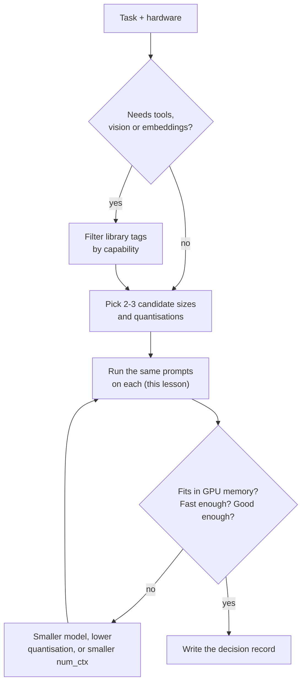

# 02. Choosing and comparing models: size, quantisation, context length

> **Draft: written but not yet run.** The code and the expected output in this lesson were prepared by reading the code and the official documentation. They have not been executed yet. If something does not behave as described, trust your tool's real output and report it.

## What you will be able to do
- Explain how parameter count, quantisation and context length change disk use, memory use, speed and quality.
- Run a harness that times several models on the same prompts with `time.perf_counter` and read its table.
- Explain why the harness separates cold start from warm runs and reports medians.
- Write a short decision record that picks a model from your own measurements, not from a leaderboard.

## Recap
1. What is the difference between downloading a model and loading it?
   <details><summary>Answer</summary>Downloading stores weights on disk; loading puts them in RAM or VRAM so they can run. Loading takes time (the cold start).</details>
2. Which setting wins: a Modelfile `PARAMETER` or a request `options` value?
   <details><summary>Answer</summary>The request value, for that request only (lesson 01).</details>
3. What does `done_reason: length` mean?
   <details><summary>Answer</summary>The reply was cut off by a token cap, not finished by the model.</details>

## Why it matters
"Which model should we use?" is the most common question and the most often answered by guessing. A smaller or more compressed model can be several times faster and fit on a modest laptop, while a larger one may answer better. The only honest answer is a measurement on your hardware with your prompts. This lesson gives you a small, repeatable way to take that measurement and a vocabulary for reading it.

## What you will build
A harness (`compare.py`) that, for each model in a list, unloads it, measures one cold request, then runs a few timed warm requests per prompt, checks each reply against simple expected fragments, and prints a table plus a CSV file. You will also write unit tests for its pure functions and finish with a decision record.

## Before you start
- **Prerequisites:** [Ollama 201 lesson 01, the Modelfile in depth](01-modelfile-in-depth.md).
- Time: 80-100 minutes for a first timer (downloads add time). Two sittings are fine; pause after Step 3.
- Tools: Python 3.12+, native Ollama on `127.0.0.1:11434`. No `pip install`: standard library only.
- Disk: about 4.1 GB for the three tags below. Check free space first. Download sizes are not memory needs.
- Source pack (optional): every file is shown in full in this lesson, except `ollama_http.py`, which is identical to lesson 01 (copy it). The finished code, the exercise starter and the solution are in the course repository https://github.com/Uee03/Code101 under `source/ollama/201-hero-to-super-hero/phase-1-customising/02-choosing-and-comparing-models/` (on that page choose **Code, Download ZIP**, or run `git clone https://github.com/Uee03/Code101.git`).
- This lesson shows **no measured numbers**. Your numbers depend on your CPU, GPU, memory, drivers, power settings and what else is running. Placeholders such as `<seconds>` show where your values appear.

## Four things that decide whether a model fits
Tags checked on https://ollama.com/library/llama3.2/tags on **2026-11-23**:

| Tag | Listed download | Listed context | What it is |
|---|---|---|---|
| `llama3.2:1b` | 1.3 GB | 128K | 1 billion parameters; listed with the same digest as `1b-instruct-q8_0`, so the 8-bit build |
| `llama3.2:1b-instruct-q4_K_M` | 808 MB | 128K | the same 1B model compressed to a 4-bit-class format |
| `llama3.2:3b` | 2.0 GB | 128K | 3 billion parameters (the `latest` tag points at it) |

1. **Parameter count** (1B, 3B): the number of learned values. More parameters usually mean better answers on hard tasks and proportionally more memory and time per token.
2. **Quantisation**: storing each weight with fewer bits. `q8_0` is about 8 bits per weight, `q4_K_M` about 4-5, `fp16` 16 (the 1B model's fp16 build is listed at 2.5 GB). Fewer bits give a smaller, faster model and a small to moderate quality loss that depends on the task. It is a trade, not a free win.
3. **Context length**: the maximum tokens of prompt plus reply. The library lists 128K for these models, but Ollama's default context is **4096** tokens (https://docs.ollama.com/faq, checked 2026-11-23); you raise it with `num_ctx`. The **KV cache**, the memory that remembers earlier tokens, grows with the context length and with parallel requests, so a large `num_ctx` can push a model out of VRAM and onto the CPU.
4. **Capabilities**: library pages show tags such as `tools`, `vision` or `embedding`. A model without the capability you need is the wrong model whatever its speed.

Rule of thumb for fit: the download size is roughly the weights; add the KV cache and some overhead; then confirm with `ollama ps` (the `PROCESSOR` column shows `100% GPU`, `100% CPU` or a split) instead of trusting arithmetic.



> **Why this, not that.** A public leaderboard score measures somebody else's tasks on somebody else's hardware. A harness of 20 lines measures yours. Use leaderboards to choose candidates, and your own measurement (and, in 301 lesson 03, a golden question set) to choose the winner.

## Steps
### Step 1. Create the folder and copy the helper
**File: `Windows PowerShell; starting anywhere`**
```powershell
New-Item -ItemType Directory -Path "$HOME/code101/ollama201-02" -Force | Out-Null
Set-Location "$HOME/code101/ollama201-02"
```

**File: `macOS/Linux terminal; starting anywhere`**
```bash
mkdir -p ~/code101/ollama201-02
cd ~/code101/ollama201-02
```
Copy `ollama_http.py` from your lesson 01 folder into this one (identical, unchanged). Windows: `Copy-Item "$HOME/code101/ollama201-01/ollama_http.py" .`. macOS/Linux: `cp ~/code101/ollama201-01/ollama_http.py .`. Expected result: no output; the file is now in the folder.

### Step 2. Check health and disk, then pull the three models
**File: `Windows PowerShell; folder ~/code101/ollama201-02`**
```powershell
Invoke-RestMethod -Uri http://127.0.0.1:11434/api/version -TimeoutSec 5
Get-PSDrive -PSProvider FileSystem
```

**File: `macOS/Linux terminal; folder ~/code101/ollama201-02`**
```bash
curl --fail --show-error --silent --max-time 5 http://127.0.0.1:11434/api/version
df -h ~
```
If the server does not answer, start it as in 101.02 and repeat. If you have about 4.1 GB free, download the three tags (any OS, any folder):

**File: `Terminal, any OS`**
```text
ollama pull llama3.2:1b
ollama pull llama3.2:1b-instruct-q4_K_M
ollama pull llama3.2:3b
```
Expected result: progress bars ending in `success` for each. If a pull fails, re-check the tag spelling against the library page; tags can change.

### Step 3. Describe what you compare: `models.json` and `prompts.json`
The harness reads its settings from files so you can change them without editing code. `models.json` lists the tags, the request options used for **every** request and the number of timed runs. `temperature 0` and a fixed `seed` reduce run-to-run variation; `num_ctx 4096` keeps the context identical; `num_predict 120` caps the reply so a runaway answer cannot ruin the timing.

**File: `~/code101/ollama201-02/models.json`**
```json
{
  "models": [
    "llama3.2:1b",
    "llama3.2:1b-instruct-q4_K_M",
    "llama3.2:3b"
  ],
  "options": {
    "temperature": 0,
    "seed": 1,
    "num_ctx": 4096,
    "num_predict": 120
  },
  "runs": 3
}
```
`prompts.json` holds three tiny prompts, each with fragments a correct reply must contain. This is a **smoke screen**: it catches a model that fails trivial tasks, nothing more.

**File: `~/code101/ollama201-02/prompts.json`**
```json
[
  {
    "id": "capital",
    "prompt": "What is the capital of France? Answer with one word.",
    "must_contain": ["paris"]
  },
  {
    "id": "translate",
    "prompt": "Translate 'good morning' into Spanish. Answer with the translation only.",
    "must_contain": ["buenos d"]
  },
  {
    "id": "count",
    "prompt": "Write the numbers from 1 to 5, separated by commas.",
    "must_contain": ["1", "2", "3", "4", "5"]
  }
]
```

### Step 4. Write the harness
Read the code once before typing it; the "How it works" section explains each function. Save it as `compare.py`.

**File: `~/code101/ollama201-02/compare.py`**
```python
import argparse
import csv
import json
import statistics
import time
from pathlib import Path

from ollama_http import get_json, post_json, post_stream, run_cli

HERE = Path(__file__).resolve().parent
FIELDS = ["model", "prompt_id", "run", "total_s", "first_token_s", "tokens", "tokens_per_s", "passed", "gpu_share"]
COLUMNS = ["model", "cold_start_s", "total_s", "first_token_s", "tokens_per_s", "pass_rate", "gpu_share"]


def passes(reply, must_contain):
    text = reply.lower()
    return all(fragment.lower() in text for fragment in must_contain)


def median(values):
    values = [v for v in values if v is not None]
    return statistics.median(values) if values else None


def cell(value, digits=2, percent=False):
    if value is None:
        return "n/a"
    if percent:
        return f"{value * 100:.0f}%"
    return f"{value:.{digits}f}"


def timed_chat(model, prompt, options):
    body = {
        "model": model,
        "messages": [{"role": "user", "content": prompt}],
        "stream": True,
        "options": options,
    }
    start = time.perf_counter()
    first = None
    parts = []
    final = {}
    for chunk in post_stream("/api/chat", body):
        piece = chunk.get("message", {}).get("content", "")
        if piece and first is None:
            first = time.perf_counter() - start
        parts.append(piece)
        if chunk.get("done"):
            final = chunk
    total = time.perf_counter() - start
    eval_seconds = final.get("eval_duration", 0) / 1e9
    tokens = final.get("eval_count", 0)
    return {
        "reply": "".join(parts),
        "total_s": total,
        "first_token_s": first,
        "tokens": tokens,
        "tokens_per_s": tokens / eval_seconds if eval_seconds > 0 else None,
    }


def unload(model):
    post_json("/api/chat", {"model": model, "keep_alive": 0}, timeout=60)


def gpu_share(model):
    for item in get_json("/api/ps").get("models", []):
        if item.get("model") == model or item.get("name") == model:
            size = item.get("size") or 0
            return (item.get("size_vram") or 0) / size if size else None
    return None


def describe(model):
    details = post_json("/api/show", {"model": model}, timeout=30).get("details", {})
    print(f"{model}: parameter_size={details.get('parameter_size')} quantization={details.get('quantization_level')}")


def measure_model(model, prompts, options, runs):
    unload(model)
    cold = timed_chat(model, prompts[0]["prompt"], options)
    share = gpu_share(model)
    rows = []
    for prompt in prompts:
        for run in range(1, runs + 1):
            result = timed_chat(model, prompt["prompt"], options)
            rows.append({
                "model": model,
                "prompt_id": prompt["id"],
                "run": run,
                "total_s": result["total_s"],
                "first_token_s": result["first_token_s"],
                "tokens": result["tokens"],
                "tokens_per_s": result["tokens_per_s"],
                "passed": passes(result["reply"], prompt["must_contain"]),
                "gpu_share": share,
            })
    unload(model)
    return cold["total_s"], rows


def summarise(models, rows, cold):
    table = []
    for model in models:
        mine = [row for row in rows if row["model"] == model]
        if not mine:
            continue
        table.append({
            "model": model,
            "cold_start_s": cold[model],
            "total_s": median(row["total_s"] for row in mine),
            "first_token_s": median(row["first_token_s"] for row in mine),
            "tokens_per_s": median(row["tokens_per_s"] for row in mine),
            "pass_rate": sum(1 for row in mine if row["passed"]) / len(mine),
            "gpu_share": mine[0]["gpu_share"],
        })
    return table


def print_table(table):
    print(" | ".join(COLUMNS))
    for row in table:
        print(" | ".join([
            row["model"],
            cell(row["cold_start_s"]),
            cell(row["total_s"]),
            cell(row["first_token_s"]),
            cell(row["tokens_per_s"], 1),
            cell(row["pass_rate"], percent=True),
            cell(row["gpu_share"], percent=True),
        ]))


def main():
    parser = argparse.ArgumentParser(description="Time and screen several models on the same prompts.")
    parser.add_argument("--models", nargs="*", help="override the models in models.json")
    parser.add_argument("--runs", type=int, help="override the number of timed runs per prompt")
    parser.add_argument("--out", default="results.csv")
    args = parser.parse_args()
    config = json.loads((HERE / "models.json").read_text(encoding="utf-8"))
    prompts = json.loads((HERE / "prompts.json").read_text(encoding="utf-8"))
    models = args.models or config["models"]
    runs = args.runs or config["runs"]
    installed = {item["name"] for item in get_json("/api/tags").get("models", [])}
    print("ollama version:", get_json("/api/version").get("version"))
    print("options:", json.dumps(config["options"]))
    all_rows = []
    cold = {}
    measured = []
    for model in models:
        if model not in installed:
            print(f"not downloaded, skipped: {model} (run: ollama pull {model})")
            continue
        describe(model)
        cold[model], rows = measure_model(model, prompts, config["options"], runs)
        all_rows.extend(rows)
        measured.append(model)
    with open(args.out, "w", newline="", encoding="utf-8") as handle:
        writer = csv.DictWriter(handle, fieldnames=FIELDS)
        writer.writeheader()
        writer.writerows(all_rows)
    print_table(summarise(measured, all_rows, cold))
    print(f"rows written to {args.out}")


if __name__ == "__main__":
    run_cli(main)
```

### Step 5. Test the pure functions
The parts that decide what the table says (pass check, median, summary) need no server. Save the tests.

**File: `~/code101/ollama201-02/test_compare.py`**
```python
import unittest

from compare import cell, median, passes, summarise


class CompareTests(unittest.TestCase):
    def test_passes_requires_every_fragment(self):
        self.assertTrue(passes("1, 2, 3, 4, 5", ["1", "5"]))
        self.assertFalse(passes("1, 2, 3", ["1", "5"]))

    def test_passes_ignores_case(self):
        self.assertTrue(passes("The capital is PARIS.", ["paris"]))

    def test_median_skips_missing_values(self):
        self.assertEqual(median([1.0, None, 3.0]), 2.0)

    def test_median_of_nothing_is_none(self):
        self.assertIsNone(median([None, None]))

    def test_cell_formats(self):
        self.assertEqual(cell(None), "n/a")
        self.assertEqual(cell(1.234), "1.23")
        self.assertEqual(cell(0.5, percent=True), "50%")

    def test_summarise_one_model(self):
        rows = [
            {"model": "m", "total_s": 1.0, "first_token_s": 0.5, "tokens_per_s": 10.0, "passed": True, "gpu_share": 1.0},
            {"model": "m", "total_s": 3.0, "first_token_s": None, "tokens_per_s": 30.0, "passed": False, "gpu_share": 1.0},
        ]
        table = summarise(["m"], rows, {"m": 4.0})
        self.assertEqual(len(table), 1)
        self.assertEqual(table[0]["total_s"], 2.0)
        self.assertEqual(table[0]["first_token_s"], 0.5)
        self.assertEqual(table[0]["tokens_per_s"], 20.0)
        self.assertEqual(table[0]["pass_rate"], 0.5)
        self.assertEqual(table[0]["cold_start_s"], 4.0)


if __name__ == "__main__":
    unittest.main()
```
**File: `Terminal; folder ~/code101/ollama201-02`** (Windows `python`, macOS/Linux `python3`)
```text
python -m unittest
```
Expected result (not yet run): `Ran 6 tests in` and a small time, then `OK`.

### Step 6. Predict, then run
Write down three guesses before you run: (a) which model has the highest `tokens_per_s`; (b) which has the longest `cold_start_s`; (c) whether the 4-bit build passes as many prompts as the 8-bit one. Close heavy programs (browsers with many tabs, games) and, on a laptop, plug in the charger, so the machine does not change speed mid-test.

**File: `Terminal; folder ~/code101/ollama201-02`**
```text
python compare.py
```
The run sends about ten small requests per model. First-time loads can take a while on CPU. Expected shape (not captured; every `<...>` is a value from your machine):

```text
ollama version: <version>
options: {"temperature": 0, "seed": 1, "num_ctx": 4096, "num_predict": 120}
llama3.2:1b: parameter_size=<size> quantization=<level>
llama3.2:1b-instruct-q4_K_M: parameter_size=<size> quantization=<level>
llama3.2:3b: parameter_size=<size> quantization=<level>
model | cold_start_s | total_s | first_token_s | tokens_per_s | pass_rate | gpu_share
llama3.2:1b | <seconds> | <seconds> | <seconds> | <tokens/s> | <percent> | <percent>
llama3.2:1b-instruct-q4_K_M | <seconds> | <seconds> | <seconds> | <tokens/s> | <percent> | <percent>
llama3.2:3b | <seconds> | <seconds> | <seconds> | <tokens/s> | <percent> | <percent>
rows written to results.csv
```
The three `describe` lines print before the table; `n/a` appears when a value is missing.

### Step 7. Read the result with care
Open `results.csv` in a spreadsheet or text editor. Questions to answer in writing: Is the spread between runs of one model small compared with the gap between models? (If not, the difference is noise.) Does `gpu_share` show a model only partly on the GPU? (Then its speed reflects a split, and a smaller `num_ctx` may help.) Did any model fail a prompt, and does the failing reply look like a wrong answer or a formatting miss (for example `Paris.` is fine, a sentence without the word is not)?

### Step 8. Write the decision record
Keep it short and dated. Copy this skeleton into a file `decision.md` and fill it from your own table.

```text
Decision record: model for <task>
Date: <date>   Machine: <CPU, GPU, RAM, OS>   Ollama: <version>
Candidates: <tags>
Requirement: <e.g. first token under 2 s, fits fully on GPU, passes the smoke prompts>
Measured: <your table values, copied from results.csv>
Chosen: <tag>   Why: <one or two sentences tied to the numbers>
Re-check when: <new model release, new hardware, quality complaints>
```

## Run it
**File: `Terminal; folder ~/code101/ollama201-02`**
```text
python -m unittest
python compare.py
python compare.py --models llama3.2:1b --runs 1 --out quick.csv
```
The third command is a quick check with one model and one run per prompt. Expected: the same shape as above with a single table row.

## How it works
1. **`time.perf_counter()`** returns a high-resolution clock that only moves forward and is meant for measuring durations (Python docs). Only the difference between two calls means anything. The wall clock (`time.time()`) can jump when the system clock changes.
2. **Two kinds of time.** The client clock (`total_s`, `first_token_s`) includes network, prompt processing and queueing. The server fields (`eval_count`, `eval_duration`, in nanoseconds) cover generation only, so `tokens_per_s = eval_count / (eval_duration / 1e9)` isolates how fast the model writes once it has started.
3. **Cold versus warm.** `unload` sends `keep_alive: 0`, the model leaves memory, and the first request pays the load cost. We keep that as `cold_start_s` and exclude it from the warm statistics, because most real traffic hits a loaded model (lesson 301.06 covers `keep_alive`).
4. **Median, not mean.** One slow run (an antivirus scan, a thermal throttle) would drag a mean. The median ignores a single outlier. With three runs it is still rough; more runs give a steadier number.
5. **`gpu_share`** comes from `/api/ps`: `size_vram / size`. It is a snapshot of where the weights sit, not a measure of GPU busy time.
6. **Common misconception:** "the fastest model is the best". Speed only matters once the answer is good enough; the `pass_rate` column here is a floor, and real quality needs the golden set of 301 lesson 03.

## Try it
Starter: `exercise/starter` (copy the whole `starter` folder to `~/code101/ollama201-02/try01`, keep your `results.csv` one folder up, or pass its path).
1. **Guided.** Complete the two TODOs in `report.py` so that `python -m unittest` passes in the `try01` folder, then run `python report.py ../results.csv`.
2. **Change.** Extend `report.py` to print, per model, the share of rows with `passed` equal to `True` as a percentage.
3. **Stretch (no single answer).** Add a fourth candidate from the library whose capability and licence suit your task, run the harness, and decide whether it earns a place in your decision record.

<details><summary>Solution</summary>

**File: `exercise/solution/report.py`**
```python
import csv
import sys


def spread(values):
    return (min(values), max(values))


def slowest_prompt(rows):
    best = max(rows, key=lambda row: float(row["total_s"]))
    return best["prompt_id"]


def main():
    path = sys.argv[1] if len(sys.argv) > 1 else "results.csv"
    with open(path, newline="", encoding="utf-8") as handle:
        rows = list(csv.DictReader(handle))
    for model in sorted({row["model"] for row in rows}):
        mine = [row for row in rows if row["model"] == model]
        low, high = spread([float(row["total_s"]) for row in mine])
        print(f"{model}: total_s min {low:.2f} max {high:.2f}, slowest prompt {slowest_prompt(mine)}")


if __name__ == "__main__":
    main()
```
The CSV stores everything as text, so each value is converted with `float` before comparing; comparing the strings `"10.0"` and `"9.0"` would put `"9.0"` last. The unit tests in the starter folder check both functions with tiny inline rows (fixtures, not measurements).
</details>

## Check yourself
1. Why can a 4-bit model be both smaller and faster than an 8-bit one, and what do you give up? <details><summary>Answer</summary>Fewer bits per weight means less memory traffic and less to load. You usually give up some accuracy; how much depends on the model and task, so measure.</details>
2. A model advertises a 128K context. Why is that not the context you get by default? <details><summary>Answer</summary>The default `num_ctx` is 4096; larger values must be requested and cost KV-cache memory.</details>
3. Predict: `median([2.0, None, 4.0, 10.0])`. <details><summary>Answer</summary>`4.0` (the missing value is skipped; the middle of 2, 4, 10 is 4).</details>
4. Why is the first request after an unload excluded from the warm statistics? <details><summary>Answer</summary>It includes model load time, which is a different cost from steady-state generation.</details>

## Common mistakes
| Symptom | Cause | Fix |
|---|---|---|
| `not downloaded, skipped: <tag>` | The tag is not in `/api/tags` | `ollama pull <tag>` exactly as printed |
| All timings far larger than expected, one run | First load, antivirus, or another heavy program | Close programs; compare medians, not one run |
| `gpu_share` is `n/a` | `/api/ps` did not list the model after the cold request | Check `ollama ps` yourself; the model may have unloaded early |
| `Cannot reach Ollama on 127.0.0.1:11434` | Server not running | Start it as in 101.02 |
| Table shows a 100% pass rate for a weak model | Prompts are too easy | Add harder prompts; see 301 lesson 03 |
| `ModuleNotFoundError: No module named 'ollama_http'` (typical message) | Helper file not copied or terminal in another folder | Copy `ollama_http.py` here; check the folder |

## Best practice
Measure on the machine and settings you will deploy, record the Ollama version and options with every result, and treat differences smaller than the run-to-run spread as noise. Source: Python `time.perf_counter` documentation https://docs.python.org/3/library/time.html#time.perf_counter

## Going further
- `ollama show <tag>` lists details such as quantisation; the library tag pages list sizes and context.
- `OLLAMA_FLASH_ATTENTION` and `OLLAMA_KV_CACHE_TYPE` reduce KV-cache memory (https://docs.ollama.com/faq); lesson 301.06 covers when to touch them.

## Summary
- You compared parameter count, quantisation, context length and capability using checked library tags.
- You ran a harness that times models with `time.perf_counter` and separates cold from warm runs.
- You explained why medians, fixed options and a recorded Ollama version make comparisons fair.
- You wrote a decision record tied to your own measurements, with no borrowed numbers.

## Next lesson
03. Structured output with JSON schema: make replies machine-readable with the `format` parameter, then validate them anyway.
