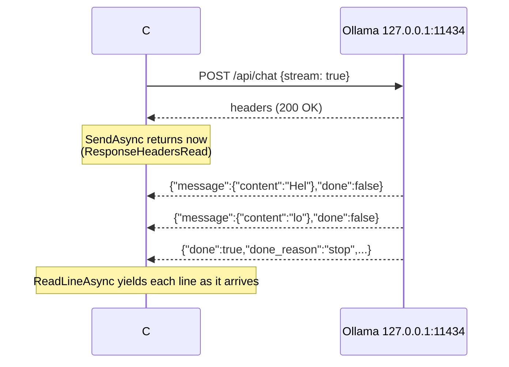

# 04. Calling Ollama from C#: HttpClient and streaming

> **Draft: written but not yet run.** The code and the expected output in this lesson were prepared by reading the code and the official documentation. They have not been executed yet. If something does not behave as described, trust your tool's real output and report it.

## What you will be able to do
- Call `/api/chat` from C# with a typed request and read a typed reply using `HttpClient` and `System.Text.Json`.
- Stream the reply line by line without buffering the whole response, and explain why `ResponseHeadersRead` matters.
- Bound a call with a `CancellationToken` that covers a timeout and Ctrl+C.
- Test the parsing code without a server using a self-test.

## Recap
1. What is NDJSON and why does a streamed chat reply use it?
   <details><summary>Answer</summary>Newline-delimited JSON: one complete JSON object per line, so a client can parse each piece as soon as its line arrives.</details>
2. In lesson 03, why is a retry loop bounded?
   <details><summary>Answer</summary>Unbounded retries could spend unlimited compute on a stuck model.</details>
3. What does `done_reason: length` mean?
   <details><summary>Answer</summary>The reply stopped at a token cap, not because the model finished.</details>

## Why it matters
Most real applications that call a local model are not Python scripts: an ASP.NET service, a desktop app or a worker calls Ollama over HTTP. The request is simple; the mistakes are not: creating an `HttpClient` per call, a default 100-second timeout that kills long answers, and buffering a "streamed" response until it ends so the user sees nothing for ten seconds. This lesson builds the small client you can lift into a service.

## What you will build
A console app, `OllamaDemo`, with: typed records for the chat request and reply; an `OllamaApi` class with one non-streaming method and one streaming method; a 120-second cancellation budget with Ctrl+C support; and `--selftest` that parses a built-in NDJSON sample.



## Before you start
- **Prerequisites:** [Ollama 201 lesson 03, structured output and validation](../phase-1-customising/03-structured-output-and-validation.md) and [C# 101 lesson 12, expense tracker](../../../csharp/101-zero-to-hero/phase-3-real-programs/12-expense-tracker.md).
- Time: 80-100 minutes for a first timer. Two sittings are fine; pause after Step 5.
- Tools: the .NET SDK from C# 101 (these files target `net11.0`, the version used in the course), native Ollama on `127.0.0.1:11434`, and `llama3.2:1b` (about 1.3 GB, checked 2026-11-23).
- The first `dotnet` command on a machine may print a welcome banner and a telemetry notice; they are normal and do not mean an error.
- Source pack (optional): every file is shown in full in this lesson, so you can follow without it. The finished code, the exercise starter and the solution are in https://github.com/Uee03/Code101 under `source/ollama/201-hero-to-super-hero/phase-2-integrating/04-calling-ollama-from-csharp/` (on that page choose **Code, Download ZIP**, or run `git clone https://github.com/Uee03/Code101.git`).
- No NuGet packages: `HttpClient` and `System.Text.Json` ship with .NET.

## Steps
### Step 1. Create the folder and the project file
**File: `Windows PowerShell; starting anywhere`**
```powershell
New-Item -ItemType Directory -Path "$HOME/code101/ollama201-04" -Force | Out-Null
Set-Location "$HOME/code101/ollama201-04"
```

**File: `macOS/Linux terminal; starting anywhere`**
```bash
mkdir -p ~/code101/ollama201-04
cd ~/code101/ollama201-04
```
Create the project file by hand (we do not run `dotnet new` so every line is visible). Line by line: `Sdk="Microsoft.NET.Sdk"` selects the standard build tools; `OutputType Exe` makes a runnable program; `TargetFramework net11.0` names the runtime; `ImplicitUsings` adds common `using` lines automatically (so `HttpClient`, `Task` and LINQ need no import); `Nullable enable` turns on null-safety warnings.

**File: `~/code101/ollama201-04/OllamaDemo.csproj`**
```xml
<Project Sdk="Microsoft.NET.Sdk">

  <PropertyGroup>
    <OutputType>Exe</OutputType>
    <TargetFramework>net11.0</TargetFramework>
    <ImplicitUsings>enable</ImplicitUsings>
    <Nullable>enable</Nullable>
  </PropertyGroup>

</Project>
```

### Step 2. The data types: `Models.cs`
A C# `record` is a class made for data. Each property carries `[JsonPropertyName]` because Ollama's field names are snake_case (`done_reason`) while C# uses PascalCase. `Json.Options` ignores null properties when writing, so an absent `Options` is omitted from the request instead of sent as `"options": null`.

**File: `~/code101/ollama201-04/Models.cs`**
```csharp
using System.Text.Json;
using System.Text.Json.Serialization;

namespace OllamaDemo;

public static class Json
{
    public static readonly JsonSerializerOptions Options = new()
    {
        DefaultIgnoreCondition = JsonIgnoreCondition.WhenWritingNull,
    };
}

public sealed record ChatMessage(
    [property: JsonPropertyName("role")] string Role,
    [property: JsonPropertyName("content")] string Content);

public sealed record ChatOptions(
    [property: JsonPropertyName("temperature")] double Temperature,
    [property: JsonPropertyName("num_predict")] int NumPredict);

public sealed record ChatRequest(
    [property: JsonPropertyName("model")] string Model,
    [property: JsonPropertyName("messages")] IReadOnlyList<ChatMessage> Messages,
    [property: JsonPropertyName("stream")] bool Stream,
    [property: JsonPropertyName("options")] ChatOptions? Options = null);

public sealed record ChatChunk(
    [property: JsonPropertyName("message")] ChatMessage? Message,
    [property: JsonPropertyName("done")] bool Done,
    [property: JsonPropertyName("done_reason")] string? DoneReason,
    [property: JsonPropertyName("eval_count")] int? EvalCount);
```
`ChatChunk` serves both the whole reply (non-streaming) and each streamed line, because Ollama uses the same object shape for both; fields the server does not send stay `null` or `false`. Properties we do not declare (durations, model name) are ignored when reading.

### Step 3. The parser: `ChunkParser.cs`
One line of NDJSON in, one `ChatChunk` out. Keeping it separate makes it testable without HTTP.

**File: `~/code101/ollama201-04/ChunkParser.cs`**
```csharp
using System.Text.Json;

namespace OllamaDemo;

public static class ChunkParser
{
    public static ChatChunk Parse(string line) =>
        JsonSerializer.Deserialize<ChatChunk>(line, Json.Options)
        ?? throw new InvalidDataException("A streamed line was JSON null.");
}
```

### Step 4. The client: `OllamaApi.cs`
Read the two methods side by side. `ChatAsync` posts and waits for the whole body. `ChatStreamAsync` is an async iterator (`IAsyncEnumerable`): it posts, receives the headers, and then yields one chunk per line as lines arrive.

**File: `~/code101/ollama201-04/OllamaApi.cs`**
```csharp
using System.Net.Http.Json;
using System.Runtime.CompilerServices;

namespace OllamaDemo;

public sealed class OllamaApi(HttpClient http)
{
    public async Task<ChatChunk> ChatAsync(ChatRequest request, CancellationToken cancellationToken)
    {
        using var response = await http.PostAsJsonAsync(
            "/api/chat", request with { Stream = false }, Json.Options, cancellationToken);
        response.EnsureSuccessStatusCode();
        var chunk = await response.Content.ReadFromJsonAsync<ChatChunk>(Json.Options, cancellationToken);
        return chunk ?? throw new InvalidDataException("The reply body was empty.");
    }

    public async IAsyncEnumerable<ChatChunk> ChatStreamAsync(
        ChatRequest request, [EnumeratorCancellation] CancellationToken cancellationToken)
    {
        using var message = new HttpRequestMessage(HttpMethod.Post, "/api/chat")
        {
            Content = JsonContent.Create(request with { Stream = true }, options: Json.Options),
        };
        using var response = await http.SendAsync(
            message, HttpCompletionOption.ResponseHeadersRead, cancellationToken);
        response.EnsureSuccessStatusCode();
        await using var stream = await response.Content.ReadAsStreamAsync(cancellationToken);
        using var reader = new StreamReader(stream);
        while (await reader.ReadLineAsync(cancellationToken) is { } line)
        {
            if (line.Length == 0)
            {
                continue;
            }
            yield return ChunkParser.Parse(line);
        }
    }
}
```
Key lines:
- `request with { Stream = false }` copies the record and flips one property, so callers cannot accidentally ask the non-streaming method for a stream (that would break `ReadFromJsonAsync`).
- `HttpCompletionOption.ResponseHeadersRead` tells `SendAsync` to return as soon as the headers arrive. The default (`ResponseContentRead`) waits for the **entire** body, which makes a "streamed" reply arrive all at once.
- `EnsureSuccessStatusCode()` throws `HttpRequestException` for non-2xx replies (for example a missing model).
- `[EnumeratorCancellation]` lets the token passed to `await foreach (...).WithCancellation(...)` reach this method too.
- `sealed class OllamaApi(HttpClient http)` is a primary constructor: the `HttpClient` is injected, not created here.

### Step 5. The self-test: `SelfTest.cs`
This parses a three-line NDJSON sample (a raw string literal; the middle blank line checks that blank lines are skipped by the test loop) and checks the result.

**File: `~/code101/ollama201-04/SelfTest.cs`**
```csharp
namespace OllamaDemo;

public static class SelfTest
{
    private const string Sample = """
        {"model":"x","message":{"role":"assistant","content":"Hel"},"done":false}
        {"model":"x","message":{"role":"assistant","content":"lo"},"done":false}

        {"model":"x","message":{"role":"assistant","content":""},"done":true,"done_reason":"stop","eval_count":2}
        """;

    public static int Run()
    {
        var chunks = new List<ChatChunk>();
        foreach (var line in Sample.Split('\n'))
        {
            var trimmed = line.Trim();
            if (trimmed.Length > 0)
            {
                chunks.Add(ChunkParser.Parse(trimmed));
            }
        }

        var text = string.Concat(chunks.Select(chunk => chunk.Message?.Content));
        var failures = new List<string>();
        Expect(chunks.Count == 3, $"expected 3 chunks, got {chunks.Count}", failures);
        Expect(text == "Hello", $"expected text Hello, got {text}", failures);
        Expect(chunks[^1].Done && chunks[^1].DoneReason == "stop", "the last chunk should be done with reason stop", failures);
        Expect(chunks[^1].EvalCount == 2, "the last chunk should report eval_count 2", failures);

        foreach (var failure in failures)
        {
            Console.Error.WriteLine($"FAIL: {failure}");
        }
        if (failures.Count == 0)
        {
            Console.WriteLine($"selftest ok: {chunks.Count} chunks, text \"{text}\"");
        }
        return failures.Count == 0 ? 0 : 1;
    }

    private static void Expect(bool condition, string message, List<string> failures)
    {
        if (!condition)
        {
            failures.Add(message);
        }
    }
}
```
This is a hand-made check, not a test framework. In a real project you would use xunit or NUnit; we avoid NuGet downloads here so the lesson needs nothing beyond the SDK.

### Step 6. The program: `Program.cs`
Top-level statements: the code runs from the first line. Read the HttpClient setup carefully, it is the part most worth copying.

**File: `~/code101/ollama201-04/Program.cs`**
```csharp
using System.Text;
using OllamaDemo;

Console.OutputEncoding = Encoding.UTF8;

if (args.Contains("--selftest"))
{
    return SelfTest.Run();
}

var stream = args.Contains("--stream");
var prompt = args.FirstOrDefault(arg => !arg.StartsWith("--"))
    ?? "Explain in two sentences what an HTTP timeout is.";

var handler = new SocketsHttpHandler { UseProxy = false };
using var http = new HttpClient(handler)
{
    BaseAddress = new Uri("http://127.0.0.1:11434"),
    Timeout = Timeout.InfiniteTimeSpan,
};
var api = new OllamaApi(http);
var request = new ChatRequest(
    "llama3.2:1b",
    new[] { new ChatMessage("user", prompt) },
    stream,
    new ChatOptions(Temperature: 0.2, NumPredict: 200));

using var cts = new CancellationTokenSource(TimeSpan.FromSeconds(120));
Console.CancelKeyPress += (_, e) =>
{
    e.Cancel = true;
    cts.Cancel();
};

try
{
    if (stream)
    {
        await foreach (var chunk in api.ChatStreamAsync(request, cts.Token))
        {
            Console.Write(chunk.Message?.Content);
            if (chunk.Done)
            {
                Console.WriteLine();
                Console.WriteLine($"[done_reason={chunk.DoneReason} tokens={chunk.EvalCount}]");
            }
        }
    }
    else
    {
        var reply = await api.ChatAsync(request, cts.Token);
        Console.WriteLine(reply.Message?.Content);
        Console.WriteLine($"[done_reason={reply.DoneReason} tokens={reply.EvalCount}]");
    }
    return 0;
}
catch (HttpRequestException error)
{
    Console.Error.WriteLine($"Request failed: {error.Message}");
    return 1;
}
catch (OperationCanceledException)
{
    Console.Error.WriteLine("Cancelled, or no complete answer within 120 seconds.");
    return 1;
}
```
Why each choice:
- `UseProxy = false` keeps this loopback traffic away from any system proxy (the same reason as the Python clients).
- `Timeout = InfiniteTimeSpan` switches off `HttpClient`'s own 100-second limit; the `CancellationTokenSource` (120 s) is now the single budget. With streaming, that budget covers the whole stream, which is simple and safe; a production service would also add an "idle" limit between chunks.
- `Console.CancelKeyPress` turns Ctrl+C into cancellation, so the request is abandoned cleanly.
- The exit code is `0` on success and `1` on a handled failure, so scripts can react.

## Run it
**File: `Terminal; folder ~/code101/ollama201-04`** (same on Windows, macOS and Linux)
```text
dotnet run -- --selftest
```
Expected output (derived by reading the code; the first run also compiles, so build messages may appear before it):
```text
selftest ok: 3 chunks, text "Hello"
```
Predict before you run the next two: will `--stream` print the whole answer at once, or piece by piece? Then run them (check that the server answers first, as in lesson 01):

**File: `Terminal; folder ~/code101/ollama201-04`**
```text
dotnet run -- "Name two uses of an HTTP timeout."
dotnet run -- --stream "Name two uses of an HTTP timeout."
```
Expected shape (not captured; the words vary): the first command prints the whole reply after a pause, then `[done_reason=stop tokens=<number>]`. The second prints the reply in pieces as it is produced, a newline, then the same bracket line.

## How it works
1. `PostAsJsonAsync` serialises the record with `System.Text.Json` and posts it with `Content-Type: application/json`.
2. For the streaming call, `SendAsync(..., ResponseHeadersRead, ...)` returns when the status line and headers arrive. `ReadAsStreamAsync` then gives the unbuffered body, and `StreamReader.ReadLineAsync` returns each complete line (NDJSON uses `\n`, so a line is a complete object).
3. `yield return` makes `ChatStreamAsync` a lazy sequence: the caller's `await foreach` pulls one chunk at a time.
4. **`HttpClient` lifetime.** Create one and reuse it. Creating a new client per request can exhaust sockets. In ASP.NET, register a typed client with `IHttpClientFactory` (`builder.Services.AddHttpClient<OllamaApi>(...)`) and let the framework manage handlers; this console app builds its own because it is a single process.
5. **Common misconception:** "streaming is faster". Total time is about the same; what improves is **time to the first visible text**.

## Try it
Starter: `exercise/starter/StreamStats.cs`. Copy the whole `starter` file into your project folder next to `Program.cs`.
1. **Guided.** Complete the three TODOs in `Add` so the class counts chunks, remembers when the first non-empty content arrived, and collects the text.
2. **Change.** In `Program.cs` create a `StreamStats` before the `await foreach`, call `stats.Add(chunk)` for each chunk, and after the loop print `stats.Chunks` and `stats.FirstChunkAfter`. Run with `--stream` and describe what you see.
3. **Stretch (no single answer).** Add an idle timeout: cancel if no chunk arrives for 30 seconds, even when the 120-second budget has not expired. Decide where the timer belongs and how you would test it without a server.

<details><summary>Solution</summary>

**File: `exercise/solution/StreamStats.cs`**
```csharp
using System.Diagnostics;
using System.Text;

namespace OllamaDemo;

public sealed class StreamStats
{
    private readonly Stopwatch _clock = Stopwatch.StartNew();
    private readonly StringBuilder _text = new();

    public int Chunks { get; private set; }

    public TimeSpan? FirstChunkAfter { get; private set; }

    public string Text => _text.ToString();

    public void Add(ChatChunk chunk)
    {
        Chunks++;
        var content = chunk.Message?.Content;
        if (FirstChunkAfter is null && !string.IsNullOrEmpty(content))
        {
            FirstChunkAfter = _clock.Elapsed;
        }
        _text.Append(content);
    }
}
```
`FirstChunkAfter` stays `null` if the model sends no text at all. The stopwatch starts when the object is created, so create it just before the request. The final chunk has empty content, so it is counted but does not set the first-chunk time.
</details>

## Check yourself
1. What changes if you remove `HttpCompletionOption.ResponseHeadersRead`? <details><summary>Answer</summary>`SendAsync` waits for the whole body, so the "stream" arrives all at once at the end.</details>
2. Why is `HttpClient.Timeout` set to infinite here? <details><summary>Answer</summary>The default 100 seconds would kill long generations; a `CancellationToken` budget replaces it and also supports Ctrl+C.</details>
3. Predict the output of `dotnet run -- --selftest`. <details><summary>Answer</summary>`selftest ok: 3 chunks, text "Hello"`.</details>
4. Why does `ChatChunk` work for both reply styles? <details><summary>Answer</summary>Ollama returns the same object shape for a full reply and for each streamed line; missing fields stay null.</details>

## Common mistakes
| Symptom | Cause | Fix |
|---|---|---|
| `Request failed:` followed by a connection message (typical message) | Ollama is not running | Start it as in 101.02 and repeat |
| `Response status code does not indicate success: 404` (typical message) | Model not downloaded or misspelt | `ollama pull llama3.2:1b` |
| Whole answer appears at once with `--stream` | `ResponseHeadersRead` missing, or a proxy buffers | Check the option in `OllamaApi.cs`; `UseProxy = false` is set |
| `error CS0246` about `ChatChunk` or `Json` (typical message) | A file is missing or in another folder | All six `.cs` files and the `.csproj` must be in one folder |
| `A project file cannot be found` / nothing to run (typical message) | Terminal is in the wrong folder | `cd ~/code101/ollama201-04` |
| No output after typing a prompt with spaces | The prompt was not quoted | Wrap it in double quotes |

## Best practice
Reuse one `HttpClient` (or a typed client from `IHttpClientFactory`), always pass a `CancellationToken`, stream with `ResponseHeadersRead`, and never log request or response bodies. Source: Microsoft Learn, HttpClient guidelines https://learn.microsoft.com/dotnet/fundamentals/networking/http/httpclient-guidelines

## Going further
- The same ideas in a full service: the ASP.NET backend capstones, and 301 lesson 08 where a service sits in front of Ollama.
- Register `OllamaApi` as a typed client and read the base address from configuration instead of a constant.

## Summary
- You called `/api/chat` from C# with typed records and `HttpClient`.
- You streamed NDJSON with `ResponseHeadersRead` and `ReadLineAsync` and explained why both matter.
- You bounded the call with a cancellation token and handled Ctrl+C.
- You tested the parser offline with `--selftest`.

## Next lesson
05. Calling Ollama from TypeScript: `fetch`, `ReadableStream` and the awkward case of NDJSON lines split across network chunks.
