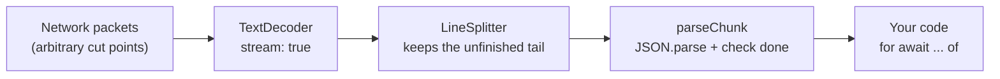

# 05. Calling Ollama from TypeScript: fetch and streaming NDJSON

> **Draft: written but not yet run.** The code and the expected output in this lesson were prepared by reading the code and the official documentation. They have not been executed yet. If something does not behave as described, trust your tool's real output and report it.

## What you will be able to do
- Call `/api/chat` with `fetch` from Node.js and type the request and reply in TypeScript.
- Read a streamed reply from a `ReadableStream`, and explain why a network chunk is not a line.
- Write a line splitter that survives a JSON object cut in half, and test it without a server.
- Explain why a browser page should not call Ollama directly.

## Recap
1. What does `ResponseHeadersRead` do in the C# client (lesson 04)?
   <details><summary>Answer</summary>It returns from `SendAsync` when headers arrive instead of waiting for the whole body, so streaming is visible.</details>
2. Why do we pass a cancellation budget instead of relying on a default timeout?
   <details><summary>Answer</summary>A default can kill long generations; an explicit budget is predictable and can be cancelled.</details>
3. In TypeScript 101, what does `strict` do?
   <details><summary>Answer</summary>It turns on the strongest type checks, such as no implicit `any` and null checking.</details>

## Why it matters
JavaScript runs your web tools, your Node servers and your build scripts. Node 18 and later ship `fetch`, so calling Ollama needs no library. The one subtle part is streaming: network packets do not respect line boundaries. A packet can end in the middle of a JSON object, and code that parses every packet as a line works in a demo and fails under load. You will write the small buffer that fixes it and test it with a deliberately split line.

## What you will build
A TypeScript project with `src/ollama.ts` (types, `LineSplitter`, `parseChunk`, `chat`, `chatStream`), `src/main.ts` (one complete reply then a streamed one), and `src/selftest.ts` (six checks, no server needed).



## Before you start
- **Prerequisites:** [Ollama 201 lesson 04, calling Ollama from C#](04-calling-ollama-from-csharp.md) and [Web 101 lesson 10, TypeScript first steps](../../../web/101-zero-to-hero/phase-3-typescript-and-project/10-typescript-first-steps.md).
- Time: 80-100 minutes for a first timer. Two sittings are fine; pause after Step 4.
- Tools: Node.js and npm as installed in Web 101 (lesson 10 pins the same versions: Node 26.13.1, npm 11.20.0), native Ollama on `127.0.0.1:11434`, `llama3.2:1b` (about 1.3 GB, checked 2026-11-23).
- Windows PowerShell trap: if `npm` fails with a message that `npm.ps1` cannot be loaded because running scripts is disabled (typical message), run `npm.cmd` instead of `npm`.
- Source pack (optional): every file is shown in full in this lesson, so you can follow without it. The finished code, the exercise starter and the solution are in https://github.com/Uee03/Code101 under `source/ollama/201-hero-to-super-hero/phase-2-integrating/05-calling-ollama-from-typescript/` (on that page choose **Code, Download ZIP**, or run `git clone https://github.com/Uee03/Code101.git`).
- Packages: `typescript` and `@types/node` (development only). No lockfile is shipped, because one can only be created by running `npm install`; that command creates `package-lock.json` for you, and you should keep it.

## Steps
### Step 1. Create the project folder
**File: `Windows PowerShell; starting anywhere`**
```powershell
New-Item -ItemType Directory -Path "$HOME/code101/ollama201-05/src" -Force | Out-Null
Set-Location "$HOME/code101/ollama201-05"
```

**File: `macOS/Linux terminal; starting anywhere`**
```bash
mkdir -p ~/code101/ollama201-05/src
cd ~/code101/ollama201-05
```
Expected result: no output; the terminal is inside `ollama201-05`, which has an empty `src` folder.

### Step 2. `package.json`
Line by line: `"private": true` stops an accidental publish; `"type": "module"` makes `.js` files ES modules (so `import` works); the three scripts are `build` (compile), `start` and `selftest` (run the compiled files); `engines` documents the versions the lesson was written for; the two `devDependencies` are pinned to exact versions (no `^`) so everyone compiles the same way.

**File: `~/code101/ollama201-05/package.json`**
```json
{
  "name": "ollama-lesson-05",
  "version": "1.0.0",
  "private": true,
  "type": "module",
  "scripts": {
    "build": "tsc",
    "start": "node dist/main.js",
    "selftest": "node dist/selftest.js"
  },
  "engines": {
    "node": "26.13.1",
    "npm": "11.20.0"
  },
  "devDependencies": {
    "@types/node": "26.6.6",
    "typescript": "7.0.2"
  }
}
```
Both versions were the newest published on the npm registry when this lesson was written (2026-11-23). If your Node is newer, `engines` only warns.

### Step 3. `tsconfig.json`
`rootDir` and `outDir` map `src/*.ts` to `dist/*.js`; `lib` includes `DOM` for the `fetch`, `AbortSignal` and `TextDecoder` types (Node implements them too); `types: ["node"]` adds `process`; `strict` and `noEmitOnError` stop a build that has type errors from producing output.

**File: `~/code101/ollama201-05/tsconfig.json`**
```json
{
  "compilerOptions": {
    "target": "ES2022",
    "module": "ES2022",
    "moduleResolution": "Bundler",
    "lib": [
      "ES2022",
      "DOM"
    ],
    "types": [
      "node"
    ],
    "rootDir": "src",
    "outDir": "dist",
    "strict": true,
    "noEmitOnError": true,
    "skipLibCheck": true
  },
  "include": [
    "src/**/*.ts"
  ]
}
```

### Step 4. The client: `src/ollama.ts`
Read it top to bottom. The interfaces describe only the fields we use; extra fields in the reply are ignored. `LineSplitter` is the heart of the lesson. `chatStream` is an async generator (`async function*`): the caller gets chunks with `for await`.

**File: `~/code101/ollama201-05/src/ollama.ts`**
```typescript
export interface ChatMessage {
  role: "system" | "user" | "assistant";
  content: string;
}

export interface ChatChunk {
  message?: ChatMessage;
  done: boolean;
  done_reason?: string;
  eval_count?: number;
}

export interface ChatRequest {
  model: string;
  messages: ChatMessage[];
  stream: boolean;
  options?: { temperature?: number; num_predict?: number };
}

const BASE_URL = "http://127.0.0.1:11434";

export class LineSplitter {
  private pending = "";

  push(text: string): string[] {
    this.pending += text;
    const lines = this.pending.split("\n");
    this.pending = lines.pop() ?? "";
    return lines.filter((line) => line.trim().length > 0);
  }

  flush(): string[] {
    const rest = this.pending.trim();
    this.pending = "";
    return rest.length > 0 ? [rest] : [];
  }
}

export function parseChunk(line: string): ChatChunk {
  const value: unknown = JSON.parse(line);
  if (
    typeof value !== "object" ||
    value === null ||
    typeof (value as { done?: unknown }).done !== "boolean"
  ) {
    throw new Error("Unexpected line from Ollama: missing boolean 'done'.");
  }
  return value as ChatChunk;
}

async function post(request: ChatRequest, signal: AbortSignal): Promise<Response> {
  const response = await fetch(`${BASE_URL}/api/chat`, {
    method: "POST",
    headers: { "Content-Type": "application/json" },
    body: JSON.stringify(request),
    signal,
  });
  if (!response.ok) {
    throw new Error(`Ollama answered HTTP ${response.status}`);
  }
  return response;
}

export async function chat(request: ChatRequest, signal: AbortSignal): Promise<ChatChunk> {
  const response = await post({ ...request, stream: false }, signal);
  return parseChunk(await response.text());
}

export async function* chatStream(
  request: ChatRequest,
  signal: AbortSignal,
): AsyncGenerator<ChatChunk> {
  const response = await post({ ...request, stream: true }, signal);
  if (response.body === null) {
    throw new Error("The response has no body to stream.");
  }
  const reader = response.body.getReader();
  const decoder = new TextDecoder();
  const splitter = new LineSplitter();
  try {
    while (true) {
      const { done, value } = await reader.read();
      if (done) {
        break;
      }
      for (const line of splitter.push(decoder.decode(value, { stream: true }))) {
        yield parseChunk(line);
      }
    }
    const tail = [...splitter.push(decoder.decode()), ...splitter.flush()];
    for (const line of tail) {
      yield parseChunk(line);
    }
  } finally {
    reader.releaseLock();
  }
}
```
Key points:
- `LineSplitter.push` appends text, splits on `\n`, and **keeps the last piece** as `pending`, because it may be an unfinished line. Only the pieces before it are complete lines.
- `TextDecoder.decode(value, { stream: true })` keeps a half-received multi-byte character (for example an accented letter) for the next call instead of turning it into a replacement character.
- After the stream ends, `decoder.decode()` and `splitter.flush()` hand back anything left, so a final line without a trailing newline is not lost.
- `parseChunk` checks that `done` is a boolean before trusting the shape. TypeScript types vanish at run time: `value as ChatChunk` alone would accept anything.
- `finally { reader.releaseLock() }` frees the stream even if the consumer stops early.
- `signal` is an `AbortSignal`; aborting it cancels the fetch.

### Step 5. The self-test: `src/selftest.ts`
It feeds the splitter a line cut in half, as a network would. Predict first: after the first `push`, how many complete lines come back? (One: the second object is unfinished, so it stays in `pending`.)

**File: `~/code101/ollama201-05/src/selftest.ts`**
```typescript
import { LineSplitter, parseChunk } from "./ollama.js";

function assertEqual<T>(actual: T, expected: T, label: string): void {
  if (JSON.stringify(actual) !== JSON.stringify(expected)) {
    throw new Error(`${label}: expected ${JSON.stringify(expected)}, got ${JSON.stringify(actual)}`);
  }
}

const first = '{"done":false,"message":{"role":"assistant","content":"Hel"}}';
const second = '{"done":false,"message":{"role":"assistant","content":"lo"}}';
const last = '{"done":true,"done_reason":"stop"}';

const splitter = new LineSplitter();
assertEqual(splitter.push(`${first}\n{"done":fal`), [first], "first piece, second line still incomplete");
assertEqual(splitter.push('se,"message":{"role":"assistant","content":"lo"}}\n'), [second], "second piece completes the line");
assertEqual(splitter.push(last), [], "no newline yet");
assertEqual(splitter.flush(), [last], "flush returns the unfinished last line");
assertEqual(parseChunk('{"done":true,"done_reason":"stop","eval_count":2}').eval_count, 2, "eval_count is read");

let rejected = false;
try {
  parseChunk('{"message":{}}');
} catch {
  rejected = true;
}
assertEqual(rejected, true, "a line without done is rejected");

console.log("selftest ok: 6 checks");
```
Notice that the imports end in `.js` although the files are `.ts`: Node runs the compiled `.js`, and TypeScript resolves `./ollama.js` back to `ollama.ts`.

### Step 6. The program: `src/main.ts`
**File: `~/code101/ollama201-05/src/main.ts`**
```typescript
import { chat, chatStream, type ChatRequest } from "./ollama.js";

const PROMPT = "Explain in two sentences what an HTTP timeout is.";

function buildRequest(stream: boolean): ChatRequest {
  return {
    model: "llama3.2:1b",
    messages: [{ role: "user", content: PROMPT }],
    stream,
    options: { temperature: 0.2, num_predict: 200 },
  };
}

async function main(): Promise<void> {
  const signal = AbortSignal.timeout(120_000);

  console.log("--- one complete reply");
  const reply = await chat(buildRequest(false), signal);
  console.log(reply.message?.content ?? "");
  console.log(`[done_reason=${reply.done_reason} tokens=${reply.eval_count}]`);

  console.log("--- streamed reply");
  for await (const chunk of chatStream(buildRequest(true), signal)) {
    process.stdout.write(chunk.message?.content ?? "");
    if (chunk.done) {
      process.stdout.write(`\n[done_reason=${chunk.done_reason} tokens=${chunk.eval_count}]\n`);
    }
  }
}

main().catch((error: unknown) => {
  const reason = error instanceof Error ? error.message : String(error);
  console.error(`Request failed: ${reason}`);
  process.exitCode = 1;
});
```
`AbortSignal.timeout(120_000)` makes one signal that aborts after 120 seconds and is shared by both calls (a single budget for the whole run). `process.stdout.write` prints without adding a newline, so the streamed text grows on one line. `process.exitCode = 1` marks failure without cutting off pending output.

## Run it
Install, compile, run the offline check:

**File: `Terminal; folder ~/code101/ollama201-05`**
```text
npm install
npm run build
npm run selftest
```
Expected output of the last command (derived by reading the code):
```text
selftest ok: 6 checks
```
`npm install` downloads the two dev packages and creates `package-lock.json` and `node_modules`; `npm run build` creates `dist`. Now check that the server answers (lesson 01) and run the program:

**File: `Terminal; folder ~/code101/ollama201-05`**
```text
npm start
```
Expected shape (not captured; the words vary): the line `--- one complete reply`, the reply after a pause and `[done_reason=stop tokens=<number>]`, then `--- streamed reply` followed by the reply appearing gradually and the same bracket line.

## How it works
1. `fetch` returns when headers arrive (the body is a stream by default), so `response.body.getReader()` gives chunks as they come. This is why no special option is needed, unlike C#.
2. A `Uint8Array` chunk is bytes, not text and not lines. Decode, then split, keeping the tail. The test proves the tail logic.
3. `AbortSignal.timeout` rejects the pending `fetch` or `read()` with an abort error when time is up; the `catch` in `main` turns it into one message.
4. Node's `fetch` does not use proxy environment variables unless you opt in, so loopback calls stay local.
5. **Common misconception:** "each `read()` is one JSON line". It is whatever the network delivered: half a line, three lines, or one byte.

> **Why this, not that.** The official `ollama` npm package (`npm i ollama`) wraps all of this and is a good choice once you understand the protocol. Raw `fetch` has no dependency, and you can see and log exactly what is sent. **Never call Ollama from page JavaScript in a browser:** Ollama has no authentication, a page would need `OLLAMA_ORIGINS` widened (https://docs.ollama.com/faq), and anyone who can load the page could use your model. Put a small server between the page and Ollama (lesson 301.07).

## Try it
Starter: `exercise/starter/stats.ts` and `stats-check.ts`. Copy both into `~/code101/ollama201-05/src`.
1. **Guided.** Complete the two TODOs in `tokensPerSecond`, build, and run `node dist/stats-check.js`. Predict the three printed values first.
2. **Change.** Make `main.ts` print the speed of the streamed reply by capturing the final chunk. The final chunk includes `eval_duration` (nanoseconds), which our `ChatChunk` interface does not declare; decide whether to extend the interface or keep the intersection type used in `stats.ts`.
3. **Stretch (no single answer).** Add a `--timeout-seconds` option, noting that Node needs `process.argv` to read arguments. Decide how to validate the value and what the program does when it is not a number.

<details><summary>Solution</summary>

**File: `exercise/solution/stats.ts`**
```typescript
import type { ChatChunk } from "./ollama.js";

export function tokensPerSecond(final: ChatChunk & { eval_duration?: number }): number | undefined {
  if (!final.done || !final.eval_count || !final.eval_duration) {
    return undefined;
  }
  return final.eval_count / (final.eval_duration / 1e9);
}
```
Expected output of `node dist/stats-check.js` with the solution (derived by reading the code: 20 tokens over 2 seconds):
```text
10 undefined undefined
```
The first call has `done` true and both numbers; the second is not done; the third has no counts. With the starter's stub all three print `undefined`.
</details>

## Check yourself
1. Why does `LineSplitter.push` keep the last element of `split("\n")`? <details><summary>Answer</summary>It may be an incomplete line; only the elements before it ended with a newline.</details>
2. What does `{ stream: true }` do in `decode`? <details><summary>Answer</summary>It remembers an incomplete multi-byte character at the end of one chunk and completes it with the next chunk.</details>
3. Predict the output of the self-test. <details><summary>Answer</summary>`selftest ok: 6 checks`.</details>
4. Why should a browser page not call `127.0.0.1:11434` directly? <details><summary>Answer</summary>No authentication, needs relaxed origin rules, and every visitor could use the model; a server in between can authenticate and rate-limit.</details>

## Common mistakes
| Symptom | Cause | Fix |
|---|---|---|
| `npm : File ...npm.ps1 cannot be loaded` (typical message) | PowerShell script policy | Use `npm.cmd`, or change the policy for your user as Microsoft documents |
| `Request failed: fetch failed` (typical message) | Ollama not running | Start it as in 101.02 and repeat |
| `Request failed: Ollama answered HTTP 404` | Model not downloaded or misspelt | `ollama pull llama3.2:1b` |
| `error TS2307: Cannot find module './ollama.js'` (typical message) | File saved in the wrong folder | All three source files go in `src` |
| `Cannot find module .../dist/selftest.js` (typical message) | Forgot `npm run build` | Run `npm run build` first |
| Streamed text prints one word per line | `console.log` instead of `process.stdout.write` | Use `process.stdout.write` as in `main.ts` |
| `SyntaxError: Unexpected end of JSON input` (typical message) | Parsed a packet instead of a line | Keep the `LineSplitter` between decoder and parser |

## Best practice
Treat every network chunk as arbitrary bytes: decode with `stream: true`, split on the delimiter, keep the tail, and validate each parsed object's shape at run time because TypeScript types do not exist then. Source: MDN, ReadableStream and the Streams API https://developer.mozilla.org/docs/Web/API/Streams_API

## Going further
- Add `AbortController` and a Cancel button in a small Node server, then connect a page to that server instead of Ollama.
- Compare the output of this client with the C# one for the same prompt: the shapes match, the words differ.

## Summary
- You called `/api/chat` from Node with `fetch` and typed the exchange.
- You streamed NDJSON through a decoder, a line splitter and a validated parser.
- You tested the awkward case, a line cut in half, without a server.
- You explained why browsers must go through a server.

## Next lesson
06. The OpenAI-compatible endpoint: when `/v1/chat/completions` is the right door, and what it cannot do.
