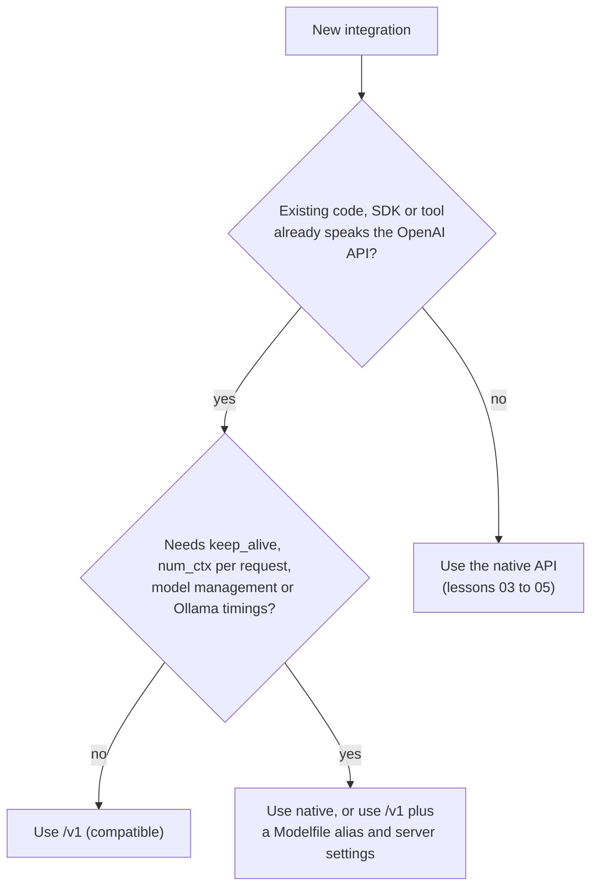

# 06. The OpenAI-compatible endpoint, and when to use it

> **Draft: written but not yet run.** The code and the expected output in this lesson were prepared by reading the code and the official documentation. They have not been executed yet. If something does not behave as described, trust your tool's real output and report it.

## What you will be able to do
- Call `/v1/chat/completions`, `/v1/embeddings` and `/v1/models` on a local Ollama server, including streaming and JSON mode.
- Read a Server-Sent Events (SSE) stream and tell it apart from Ollama's native NDJSON.
- List what the compatible endpoint cannot do and decide, for a given project, which door to use.
- Translate a native request into a compatible one and report what was dropped.

## Recap
1. What is the difference between NDJSON and a stream cut into packets? (lesson 05)
   <details><summary>Answer</summary>NDJSON is one JSON object per line. Packets are arbitrary pieces of bytes, so lines can be split across packets and must be reassembled.</details>
2. Which setting wins, the Modelfile or the request? (lesson 01)
   <details><summary>Answer</summary>The request, for that call.</details>
3. What does `format` do in `/api/chat`? (lesson 03)
   <details><summary>Answer</summary>It constrains the reply to JSON, or to a given JSON schema.</details>

## Why it matters
Many tools, libraries and teams already speak the OpenAI HTTP API: SDKs in every language, coding assistants, chat front ends. Ollama implements a **subset** of that API, so you can point such a tool at your local server by changing a base URL. That is a real convenience and a real trap: the subset has gaps, and code that quietly depends on a missing feature fails in ways that look like model problems. This lesson shows the door, then lists what is missing so you can choose deliberately.

## What you will build
A standard-library client `openai_compat.py` with five actions (`models`, `chat`, `stream`, `json`, `embed`), tests for its SSE parser, and a decision table. The optional official OpenAI SDK appears only as a text snippet.



## Before you start
- **Prerequisites:** Ollama 201 lessons [03, structured output and validation](../phase-1-customising/03-structured-output-and-validation.md) and [05, calling Ollama from TypeScript](05-calling-ollama-from-typescript.md).
- Time: 70-90 minutes for a first timer. Two sittings are fine; pause after Step 4.
- Tools: Python 3.12+, native Ollama on `127.0.0.1:11434`, `llama3.2:1b` (about 1.3 GB, checked 2026-11-23). The `embed` action also needs `nomic-embed-text:v1.5` (about 274 MB; the tag was checked at https://ollama.com/library/nomic-embed-text on 2026-11-23): run `ollama pull nomic-embed-text:v1.5` after checking free disk space.
- No `pip install` for the lesson code. The optional SDK snippet needs `python -m pip install openai` inside a virtual environment (pip creates the environment's packages; there is no lockfile in this course, so pin the version you tested).
- Source pack (optional): every file is shown in full in this lesson, except `ollama_http.py`, identical to lesson 01. The finished code, the exercise starter and the solution are in https://github.com/Uee03/Code101 under `source/ollama/201-hero-to-super-hero/phase-2-integrating/06-openai-compatible-endpoint/` (on that page choose **Code, Download ZIP**, or run `git clone https://github.com/Uee03/Code101.git`).
- Model replies are never shown as expected output; only shapes.

## What the compatible endpoint supports
From https://docs.ollama.com/api/openai-compatibility (read on 2026-11-23). The documentation lists these endpoints: `/v1/chat/completions`, `/v1/completions`, `/v1/models`, `/v1/embeddings`, `/v1/responses` (stateless only) and audio endpoints for suitable models. For `/v1/chat/completions` it ticks: chat, streaming, JSON mode, reproducible outputs (`seed`), vision (base64 images only), tools and `response_format`. It does **not** support `tool_choice`, `logprobs`, `logit_bias`, `n` or `user`, image URLs, or stateful `/v1/responses`.

| Need | Native `/api/...` | Compatible `/v1/...` |
|---|---|---|
| Existing OpenAI SDK or tool works unchanged | no | yes (change the base URL; the API key must be non-empty but is ignored) |
| `keep_alive`, per-request `options` such as `num_ctx` | yes | no (set `num_ctx` in a Modelfile alias, `keep_alive` via the server setting) |
| Ollama timings (`eval_duration`, `load_duration`) | yes | no (only token counts in `usage`) |
| Pull, delete, show, list loaded models | yes (`/api/pull`, `/api/show`, `/api/ps` ...) | only list models (`/v1/models`) |
| Stream format | NDJSON | SSE (`data: {...}` lines, then `data: [DONE]`) |
| Structured output | `format` (schema) | `response_format` |

Two tricks from the documentation: for a tool that hardcodes a model name such as `gpt-3.5-turbo`, copy a local model to that name with `ollama cp llama3.2:1b gpt-3.5-turbo`; and since the OpenAI API cannot set the context size, create a Modelfile with `FROM <model>` and `PARAMETER num_ctx <size>`, build it with `ollama create`, and use the new name.

> **Why this, not that.** Choose `/v1` when compatibility is the point: you are plugging in code you do not control, or you want the freedom to swap to another server later. Choose the native API when you control the code and want everything Ollama offers. Whichever you pick, put the base URL, model name and timeouts in configuration, not in scattered literals. And a limit applies to both: the compatible endpoint is not a security boundary, it has no authentication (lesson 301.07).

## Steps
### Step 1. Create the folder and copy the helper
**File: `Windows PowerShell; starting anywhere`**
```powershell
New-Item -ItemType Directory -Path "$HOME/code101/ollama201-06" -Force | Out-Null
Set-Location "$HOME/code101/ollama201-06"
Copy-Item "$HOME/code101/ollama201-01/ollama_http.py" .
```

**File: `macOS/Linux terminal; starting anywhere`**
```bash
mkdir -p ~/code101/ollama201-06
cd ~/code101/ollama201-06
cp ~/code101/ollama201-01/ollama_http.py .
```
Expected result: no output; the folder holds `ollama_http.py`.

### Step 2. Write the client
We reuse the lesson 01 helper for the plain JSON calls (`post_json`, `get_json`). Streaming needs its own reader because SSE lines start with `data:` and are not bare JSON. `parse_sse_line` is a pure function so it can be tested.

**File: `~/code101/ollama201-06/openai_compat.py`**
```python
import argparse
import json
import urllib.request

from ollama_http import BASE_URL, get_json, post_json, run_cli

_OPENER = urllib.request.build_opener(urllib.request.ProxyHandler({}))


def parse_sse_line(line):
    """Return the decoded event, the string DONE for the end marker, or None for lines to skip."""
    line = line.strip()
    if not line.startswith("data:"):
        return None
    payload = line[len("data:"):].strip()
    if payload == "[DONE]":
        return "DONE"
    return json.loads(payload)


def stream_events(path, body, timeout=180):
    request = urllib.request.Request(
        BASE_URL + path,
        data=json.dumps(body).encode("utf-8"),
        headers={"Content-Type": "application/json"},
        method="POST",
    )
    with _OPENER.open(request, timeout=timeout) as response:
        for raw in response:
            event = parse_sse_line(raw.decode("utf-8"))
            if event == "DONE":
                return
            if event is not None:
                yield event


def chat_body(model, prompt):
    return {
        "model": model,
        "messages": [{"role": "user", "content": prompt}],
        "temperature": 0.2,
        "max_tokens": 200,
    }


def chat_once(model, prompt):
    data = post_json("/v1/chat/completions", chat_body(model, prompt))
    choice = data["choices"][0]
    return choice["message"]["content"], choice.get("finish_reason"), data.get("usage", {})


def chat_stream(model, prompt):
    body = {**chat_body(model, prompt), "stream": True}
    for event in stream_events("/v1/chat/completions", body):
        choices = event.get("choices") or []
        if choices:
            yield choices[0].get("delta", {}).get("content") or "", choices[0].get("finish_reason")


def json_mode(model, prompt):
    body = {**chat_body(model, prompt), "response_format": {"type": "json_object"}}
    data = post_json("/v1/chat/completions", body)
    return json.loads(data["choices"][0]["message"]["content"])


def embed(model, texts):
    data = post_json("/v1/embeddings", {"model": model, "input": texts})
    ordered = sorted(data["data"], key=lambda item: item["index"])
    return [item["embedding"] for item in ordered]


def list_models():
    return [item["id"] for item in get_json("/v1/models")["data"]]


def main():
    parser = argparse.ArgumentParser(description="Try the OpenAI-compatible endpoint with the standard library.")
    parser.add_argument("action", choices=["models", "chat", "stream", "json", "embed"])
    parser.add_argument("--model", default=None)
    parser.add_argument("--prompt", default="Name two uses of an HTTP timeout.")
    args = parser.parse_args()
    if args.action == "models":
        for name in list_models():
            print(name)
    elif args.action == "chat":
        text, reason, usage = chat_once(args.model or "llama3.2:1b", args.prompt)
        print(text)
        print(f"finish_reason={reason} usage={usage}")
    elif args.action == "stream":
        for piece, reason in chat_stream(args.model or "llama3.2:1b", args.prompt):
            print(piece, end="", flush=True)
            if reason:
                print(f"\nfinish_reason={reason}")
    elif args.action == "json":
        prompt = "Reply as JSON with the keys city and country for the capital of France."
        print(json.dumps(json_mode(args.model or "llama3.2:1b", prompt)))
    else:
        vectors = embed(args.model or "nomic-embed-text:v1.5", [args.prompt])
        print(f"vectors: {len(vectors)}, dimensions: {len(vectors[0])}")


if __name__ == "__main__":
    run_cli(main)
```
Differences from the native client you already know: the request uses OpenAI field names (`max_tokens`, top-level `temperature`, `response_format`); the reply puts text at `choices[0].message.content` (streamed: `choices[0].delta.content`); the usage block carries token counts; embeddings come back in `data[i].embedding` with an `index`, which we sort by so the order always matches the input.

### Step 3. Test the SSE parser
**File: `~/code101/ollama201-06/test_openai_compat.py`**
```python
import unittest

from openai_compat import parse_sse_line


class SseTests(unittest.TestCase):
    def test_data_line_is_decoded(self):
        line = 'data: {"choices":[{"delta":{"content":"Hi"}}]}\n'
        self.assertEqual(parse_sse_line(line), {"choices": [{"delta": {"content": "Hi"}}]})

    def test_done_marker(self):
        self.assertEqual(parse_sse_line("data: [DONE]\n"), "DONE")

    def test_other_lines_are_skipped(self):
        for line in ["\n", ": keep-alive\n", "event: ping\n"]:
            self.assertIsNone(parse_sse_line(line))

    def test_broken_json_is_an_error(self):
        with self.assertRaises(ValueError):
            parse_sse_line("data: {not json}\n")


if __name__ == "__main__":
    unittest.main()
```
**File: `Terminal; folder ~/code101/ollama201-06`** (Windows `python`, macOS/Linux `python3`)
```text
python -m unittest
```
Expected result (not yet run): `Ran 4 tests in` and a small time, then `OK`. Blank lines and comment lines in an SSE stream are part of the format: the blank line separates events, and lines starting with `:` are comments, so the parser must skip them and not fail.

### Step 4. Run the five actions
Check that the server answers (lesson 01). Predict first: will `models` list the model you used in lesson 01 under the same tag, or a different name? (The compatible endpoint lists local models by their tag.)

**File: `Terminal; folder ~/code101/ollama201-06`**
```text
python openai_compat.py models
python openai_compat.py chat
python openai_compat.py stream
python openai_compat.py json
python openai_compat.py embed
```
Expected shape (not captured; replies vary):
- `models`: one model tag per line (for example `llama3.2:1b` if you pulled it).
- `chat`: the reply text, then `finish_reason=<stop or length> usage={<token counts>}`.
- `stream`: the reply appearing piece by piece, then a newline and `finish_reason=stop`.
- `json`: one line of JSON with the keys `city` and `country` (values vary; the content is model output, so validate it as in lesson 03).
- `embed`: `vectors: 1, dimensions: <number>`. If the embedding model is not pulled you get an HTTP error line, not a traceback.

### Step 5. See the official SDK shape (optional, not run here)
If you use a Python OpenAI SDK, the only Ollama-specific parts are the base URL and a placeholder key (the documentation says the key is required by the SDK but ignored by Ollama). Treat this as a text snippet to adapt, not part of the lesson code:

```text
from openai import OpenAI

client = OpenAI(base_url="http://localhost:11434/v1/", api_key="ollama")
reply = client.chat.completions.create(
    model="llama3.2:1b",
    messages=[{"role": "user", "content": "Say hello in one sentence."}],
)
print(reply.choices[0].message.content)
```
Install the SDK only inside a virtual environment: `python -m venv .venv`, then activate it (Windows PowerShell: `.venv\Scripts\Activate.ps1`; if a script policy blocks it, see the PowerShell note in Python 101; macOS/Linux: `source .venv/bin/activate`), then `python -m pip install openai`. pip creates the environment and installs into it; this course does not ship a lockfile, so record the version `pip` installs.

## Run it
**File: `Terminal; folder ~/code101/ollama201-06`**
```text
python -m unittest
python openai_compat.py stream --prompt "Give one reason to stream a reply."
```
Expected: `OK` from the tests, and a streamed reply followed by `finish_reason=stop` (or `length` if the 200-token cap was hit).

## How it works
1. The compatible layer translates OpenAI-shaped requests into Ollama's internal ones and back. It adds nothing: the same model, the same server, the same lack of authentication.
2. SSE is a text protocol: events are lines `data: <json>` separated by blank lines, ending with `data: [DONE]`. Native NDJSON has no `data:` prefix and ends with an object whose `done` is true. A client written for one cannot read the other.
3. Streamed OpenAI chunks carry `delta.content` and the finish reason arrives in the last content-bearing chunk; `usage` in a stream needs `stream_options.include_usage` (listed as supported). We do not request it here.
4. **Common misconception:** "OpenAI-compatible means OpenAI-equivalent". It means the common paths work. Behaviour on the edges (`tool_choice`, `n`, logprobs) differs or is absent, and the model behind the endpoint is a small local model, not the hosted one the tool was tested with.

## Try it
Starter: `exercise/starter` (copy the `starter` folder to `~/code101/ollama201-06/try01`).
1. **Guided.** Complete the four TODOs in `translate.py` so that `python -m unittest` passes. Run the tests first and read which fail.
2. **Change.** Add `top_k` handling: it has no OpenAI equivalent, so it must appear in the dropped list as `options.top_k`. Confirm that no code change is needed, then write the test that proves it.
3. **Stretch (no single answer).** For a tool you use, decide using the table which door you would pick and which one setting you would move into a Modelfile alias. Write your reasoning in two sentences.

<details><summary>Solution</summary>

**File: `exercise/solution/translate.py`**
```python
OPTION_MAP = {
    "temperature": "temperature",
    "num_predict": "max_tokens",
    "top_p": "top_p",
    "seed": "seed",
    "stop": "stop",
}
HANDLED = {"model", "messages", "stream", "options", "format"}


def to_openai(native):
    body = {"model": native["model"], "messages": native["messages"]}
    dropped = []
    if "stream" in native:
        body["stream"] = native["stream"]
    for name, value in native.get("options", {}).items():
        if name in OPTION_MAP:
            body[OPTION_MAP[name]] = value
        else:
            dropped.append("options." + name)
    fmt = native.get("format")
    if fmt == "json":
        body["response_format"] = {"type": "json_object"}
    elif fmt is not None:
        dropped.append("format (schema)")
    for name in native:
        if name not in HANDLED:
            dropped.append(name)
    return body, dropped
```
`top_k` needs no code change: any option not in `OPTION_MAP` is reported as dropped. A schema `format` is reported rather than translated because the compatible endpoint's schema form (`response_format`) is a different shape that you should check against the documentation before relying on it.
</details>

## Check yourself
1. Name two native-only capabilities. <details><summary>Answer</summary>`keep_alive` per request and per-request `options` such as `num_ctx`; also model management endpoints and Ollama's timing fields.</details>
2. How do you set the context size when you must use `/v1`? <details><summary>Answer</summary>Create a Modelfile alias with `PARAMETER num_ctx <size>` and use that model name.</details>
3. What does `parse_sse_line("event: ping\n")` return, and why? <details><summary>Answer</summary>`None`: only lines starting with `data:` carry events; others are skipped.</details>
4. The API key in an OpenAI SDK is `"ollama"`. Does that protect your server? <details><summary>Answer</summary>No. Ollama ignores it; the endpoint has no authentication.</details>

## Common mistakes
| Symptom | Cause | Fix |
|---|---|---|
| `HTTP 404 from Ollama: check the model name...` | Model not pulled, or misspelt | `ollama pull <tag>`; compare with `models` output |
| `Cannot reach Ollama on 127.0.0.1:11434` | Server not running | Start it as in 101.02 |
| Tool says the API key is required (typical message) | SDK demands a non-empty key | Give any placeholder string; it is ignored |
| Answers use only a small context although the model lists a large one | Default context is 4096 tokens | Modelfile alias with `num_ctx` (lesson 01) |
| Code expecting `tool_choice` or `n > 1` misbehaves | Not supported by the compatible endpoint | Use the native API or change the design |
| Streaming code from another tutorial finds no `data:` lines | You called the native `/api/chat`, which streams NDJSON | Match the reader to the endpoint |

## Best practice
Treat the compatible endpoint as an adapter: keep base URL, model and timeouts in configuration, test the features you rely on against the documented support list, and keep the server on loopback. Source: Ollama OpenAI compatibility documentation https://docs.ollama.com/api/openai-compatibility

## Going further
- Structured output through `response_format` is described in https://docs.ollama.com/capabilities/structured-outputs.
- Lesson 301.04 uses tool calling through the native API, where `tool_calls` and `tool` messages are shown in full.

## Summary
- You called chat, streaming, JSON mode and embeddings through `/v1` with the standard library.
- You read an SSE stream and tested its parser.
- You listed what the compatible endpoint lacks and chose between the two doors by need.
- You translated a native request into a compatible one and reported what was dropped.

## Next lesson
07. Embeddings in depth: similarity, normalisation and how chunk size changes what search finds.
