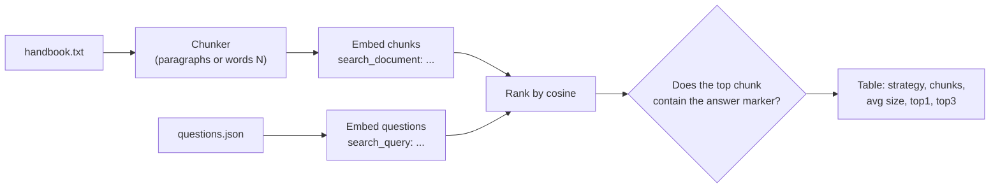

# 07. Embeddings in depth: similarity, normalisation and chunk size

> **Draft: written but not yet run.** The code and the expected output in this lesson were prepared by reading the code and the official documentation. They have not been executed yet. If something does not behave as described, trust your tool's real output and report it.

## What you will be able to do
- Explain what an embedding is, why vectors from different models cannot be compared, and why a model's task prefixes matter.
- Normalise vectors and show that cosine similarity equals the dot product of unit vectors.
- Chunk a document with overlap, test the chunker, and measure how chunk size changes retrieval on questions you wrote.
- Choose a chunking strategy using evidence, and name the trade-offs.

## Recap
1. In 101 lesson 07, what did cosine similarity measure, and is it a probability?
   <details><summary>Answer</summary>The angle between two vectors (how similar their directions are). It is not a probability or a truth score.</details>
2. Why did the 101 program use `search_document:` and `search_query:` prefixes?
   <details><summary>Answer</summary>The embedding model was trained to expect them; they mark text as a stored document or a search query.</details>
3. What is the risk of `truncate: true` (the default)?
   <details><summary>Answer</summary>Input longer than the model's context is silently cut, so the tail of a chunk is never embedded.</details>

## Why it matters
Semantic search quality is decided less by the search code than by two upstream choices: which model embeds the text and how you cut the text into chunks. A chunk that is too large blends several topics into one vector, so no question matches it well. A chunk that is too small loses the context that makes it meaningful. You will measure that on your own data instead of copying a number from a blog post.

## What you will build
`textutil.py` (vector maths and chunkers with 13 unit tests), a 12-paragraph invented handbook (`handbook.txt`), eight questions with answer markers (`questions.json`), and `embed_lab.py` with two experiments: `norms` (lengths and similarity) and `chunks` (four chunking strategies compared on your questions).



## Before you start
- **Prerequisites:** [Ollama 201 lesson 06, the OpenAI-compatible endpoint](../phase-2-integrating/06-openai-compatible-endpoint.md) and [Ollama 101 lesson 07, embeddings search](../../101-zero-to-hero/phase-2-building-with-ollama/07-embeddings-search.md).
- Time: 85-105 minutes for a first timer. Two sittings are fine; pause after Step 4.
- Tools: Python 3.12+, native Ollama on `127.0.0.1:11434`, and `nomic-embed-text:v1.5`. The tag was checked at https://ollama.com/library/nomic-embed-text on **2026-11-23**: about 274 MB, an embedding-only model with a 2K-token context listed. Check free disk space, then run `ollama pull nomic-embed-text:v1.5` (101 lesson 07 may already have downloaded it).
- No `pip install`: standard library only.
- Source pack (optional): every file is shown in full in this lesson, except `ollama_http.py`, identical to lesson 01. The finished code, the exercise starter and the solution are in https://github.com/Uee03/Code101 under `source/ollama/201-hero-to-super-hero/phase-3-embeddings/07-embeddings-in-depth/` (on that page choose **Code, Download ZIP**, or run `git clone https://github.com/Uee03/Code101.git`).
- Scores and hit counts are never shown as expected output: they depend on the model build and your machine. Placeholders show where your values appear.

## Four facts to hold on to
1. **An embedding is a point in space.** The model maps text to a list of numbers (a vector). Texts with similar meaning land near each other. The number of numbers (the dimension) is fixed per model.
2. **Vectors are only comparable within one model.** Different models use different spaces. If you change the model, re-embed everything. Store the model name beside every vector (lesson 08 does).
3. **Prefixes are part of the model's contract.** The nomic model's Hugging Face page (https://huggingface.co/nomic-ai/nomic-embed-text-v1.5) asks for `search_document:` before stored text and `search_query:` before queries. Other models document other prefixes or none. Skipping the documented prefix can lower quality without any error.
4. **Context limits are real.** The library lists a 2K-token window for this model. We send `truncate: false`, so an over-long chunk raises an error instead of being silently cut (the API default is `true`, https://docs.ollama.com/api/embed).

## Steps
### Step 1. Create the folder, copy the helper, check the server
**File: `Windows PowerShell; starting anywhere`**
```powershell
New-Item -ItemType Directory -Path "$HOME/code101/ollama201-07" -Force | Out-Null
Set-Location "$HOME/code101/ollama201-07"
Copy-Item "$HOME/code101/ollama201-01/ollama_http.py" .
Invoke-RestMethod -Uri http://127.0.0.1:11434/api/version -TimeoutSec 5
```

**File: `macOS/Linux terminal; starting anywhere`**
```bash
mkdir -p ~/code101/ollama201-07
cd ~/code101/ollama201-07
cp ~/code101/ollama201-01/ollama_http.py .
curl --fail --show-error --silent --max-time 5 http://127.0.0.1:11434/api/version
```
Expected result: a small JSON object with `version`. If no server answers, start it as in 101.02 and repeat. Then, if the embedding model is not downloaded:

**File: `Terminal, any OS`**
```text
ollama pull nomic-embed-text:v1.5
```

### Step 2. Vector maths and chunkers: `textutil.py`
**File: `~/code101/ollama201-07/textutil.py`**
```python
import math
import re


def dot(left, right):
    return sum(a * b for a, b in zip(left, right))


def norm(vector):
    return math.sqrt(sum(x * x for x in vector))


def normalise(vector):
    length = norm(vector)
    if length == 0:
        raise ValueError("cannot normalise a zero vector")
    return [x / length for x in vector]


def cosine(left, right):
    if not left or len(left) != len(right):
        raise ValueError("vectors must have the same non-zero length")
    left_length = norm(left)
    right_length = norm(right)
    if left_length == 0 or right_length == 0:
        raise ValueError("cannot compare a zero vector")
    return dot(left, right) / (left_length * right_length)


def cosine_rank(query, vectors):
    scores = [cosine(query, vector) for vector in vectors]
    return sorted(range(len(vectors)), key=lambda index: scores[index], reverse=True)


def chunk_words(text, max_chars, overlap_words=0):
    if max_chars <= 0 or overlap_words < 0:
        raise ValueError("max_chars must be positive and overlap_words must not be negative")
    words = text.split()
    chunks = []
    start = 0
    while start < len(words):
        end = start
        length = 0
        while end < len(words) and (end == start or length + 1 + len(words[end]) <= max_chars):
            length += len(words[end]) + (1 if end > start else 0)
            end += 1
        chunks.append(" ".join(words[start:end]))
        if end >= len(words):
            break
        start = max(end - overlap_words, start + 1)
    return chunks


def split_paragraphs(text):
    return [part.strip() for part in re.split(r"\n\s*\n", text) if part.strip()]
```
Read `chunk_words` slowly, it is the heart of the lesson. It works on whole words so a word is never cut. The inner loop adds words while the chunk stays within `max_chars` (the first word is always accepted, so one very long word becomes its own chunk). The next chunk starts `overlap_words` words before the previous one ended, so a sentence cut at a boundary appears whole in at least one chunk; `max(..., start + 1)` guarantees progress so the loop cannot run forever.

**Normalising** divides a vector by its length so that the new length is 1. For two unit vectors, `dot(a, b)` equals `cosine(a, b)`. That matters later: if you store unit vectors you may use the cheaper inner product and get the same ranking as cosine. Never assume that stored or third-party vectors are unit length; compute the norm and see (Step 5). The Ollama embeddings documentation (https://docs.ollama.com/capabilities/embeddings, read 2026-11-23) states that `/api/embed` returns L2-normalised (unit-length) vectors, and `embed_lab.py norms` lets you confirm that on your own setup.

### Step 3. Test them
**File: `~/code101/ollama201-07/test_textutil.py`**
```python
import unittest

from textutil import chunk_words, cosine, cosine_rank, dot, normalise, norm, split_paragraphs


class VectorTests(unittest.TestCase):
    def test_dot_and_norm(self):
        self.assertEqual(dot([1, 2, 3], [4, 5, 6]), 32)
        self.assertEqual(norm([3, 4]), 5.0)

    def test_normalise_gives_unit_length(self):
        result = normalise([3, 4])
        self.assertAlmostEqual(result[0], 0.6)
        self.assertAlmostEqual(result[1], 0.8)
        self.assertAlmostEqual(norm(result), 1.0)

    def test_normalise_rejects_zero_vector(self):
        with self.assertRaises(ValueError):
            normalise([0, 0])

    def test_cosine_of_same_and_perpendicular_directions(self):
        self.assertAlmostEqual(cosine([1, 0], [2, 0]), 1.0)
        self.assertAlmostEqual(cosine([1, 0], [0, 1]), 0.0)

    def test_cosine_rejects_unequal_lengths(self):
        with self.assertRaises(ValueError):
            cosine([1, 2], [1, 2, 3])

    def test_dot_of_unit_vectors_equals_cosine(self):
        left, right = [1, 2, 3], [4, 5, 6]
        self.assertAlmostEqual(dot(normalise(left), normalise(right)), cosine(left, right))

    def test_rank_orders_by_similarity(self):
        self.assertEqual(cosine_rank([1, 0], [[0, 1], [1, 0], [1, 1]]), [1, 2, 0])


class ChunkTests(unittest.TestCase):
    def test_overlap_repeats_words(self):
        self.assertEqual(chunk_words("aa bb cc dd ee ff", 8, 1), ["aa bb cc", "cc dd ee", "ee ff"])

    def test_no_overlap_partitions_the_text(self):
        self.assertEqual(chunk_words("aa bb cc dd ee ff", 8, 0), ["aa bb cc", "dd ee ff"])

    def test_a_long_word_gets_its_own_chunk(self):
        self.assertEqual(chunk_words("abcdefghij kl", 5, 0), ["abcdefghij", "kl"])

    def test_every_word_is_covered(self):
        text = " ".join(f"w{number}" for number in range(20))
        chunks = chunk_words(text, 12, 2)
        covered = {word for chunk in chunks for word in chunk.split()}
        self.assertEqual(covered, set(text.split()))

    def test_bad_settings_are_rejected(self):
        with self.assertRaises(ValueError):
            chunk_words("a b", 0, 0)
        with self.assertRaises(ValueError):
            chunk_words("a b", 5, -1)

    def test_paragraphs(self):
        self.assertEqual(split_paragraphs("One.\n\nTwo\nlines.\n\n\nThree."), ["One.", "Two\nlines.", "Three."])


if __name__ == "__main__":
    unittest.main()
```
**File: `Terminal; folder ~/code101/ollama201-07`** (Windows `python`, macOS/Linux `python3`)
```text
python -m unittest
```
Expected result (not yet run): `Ran 13 tests in` and a small time, then `OK`. Predict first: in `test_overlap_repeats_words`, why does the middle chunk start with `cc`? (The first chunk ended after `cc`; with an overlap of one word the next chunk starts one word back.)

### Step 4. The data: a handbook and eight questions
The handbook is an invented bike-shop document, so the facts are safe to use and none is in the model's memory. Each question paraphrases a fact; the `marker` is a phrase that appears only in the chunk that answers it. We count a hit when the top-ranked chunk contains the marker.

**File: `~/code101/ollama201-07/handbook.txt`**
```text
The shop opens at 9:00 on weekdays and 10:00 on Saturdays. It is closed on Sundays and on public holidays.

Customers may return unused parts within 30 days with a receipt. Opened tyres and inner tubes cannot be returned.

A puncture repair takes about 20 minutes and costs 8 euros. The mechanic checks the tyre for glass before fitting the new tube.

A standard service includes brake adjustment, gear tuning and a chain check. Book it at least two days ahead; the bike stays in the workshop for one day.

Frames carry a five-year warranty against manufacturing faults. Wear parts such as brake pads and chains are not covered.

Every child bike sold includes a free helmet fitting. Staff adjust the straps until two fingers fit under the chin.

Orders over 100 euros ship free within the country. Delivery takes three to five working days.

New staff shadow a mechanic for two weeks before working alone. Every mechanic completes a first-aid course each year.

The workshop floor is swept at closing time. Used oil goes into the sealed blue drum and is collected monthly.

Test rides last up to 15 minutes and need a photo ID left at the counter. E-bikes require a signed waiver.

Members collect one point per euro and receive a 5 euro voucher for every 500 points.

Customers can store a bike over winter for 25 euros per month. Stored bikes get a free brake check in spring.
```

**File: `~/code101/ollama201-07/questions.json`**
```json
[
  {"question": "When can I visit on a Saturday?", "marker": "10:00 on Saturdays"},
  {"question": "Can I send back a part I did not use?", "marker": "within 30 days"},
  {"question": "What does fixing a flat tyre cost?", "marker": "costs 8 euros"},
  {"question": "How far in advance must I book a bike service?", "marker": "at least two days ahead"},
  {"question": "How long is the frame guarantee?", "marker": "five-year warranty"},
  {"question": "What do I need to leave before a test ride?", "marker": "photo ID"},
  {"question": "How can I keep my bicycle over the winter?", "marker": "25 euros per month"},
  {"question": "Do points turn into discounts?", "marker": "500 points"}
]
```
Notice the questions share few words with the answers ("flat tyre" versus "puncture repair"). Plain keyword search would struggle; that is the case embeddings are for.

### Step 5. The experiments: `embed_lab.py`
`embed` sends texts in batches of 16, adds the prefix, and checks that you got one vector per input. `STRATEGIES` holds four ways to chunk the same text. `show_norms` prints vector lengths and, for three sentence pairs, the cosine and the dot product of the normalised vectors. `run_experiment` is the measurement.

**File: `~/code101/ollama201-07/embed_lab.py`**
```python
import argparse
import json
from pathlib import Path

from ollama_http import post_json, run_cli
from textutil import chunk_words, cosine, cosine_rank, dot, norm, normalise, split_paragraphs

HERE = Path(__file__).resolve().parent
MODEL = "nomic-embed-text:v1.5"
DOC_PREFIX = "search_document: "
QUERY_PREFIX = "search_query: "
BATCH = 16
STRATEGIES = {
    "paragraphs": split_paragraphs,
    "words 150": lambda text: chunk_words(text, 150, 5),
    "words 400": lambda text: chunk_words(text, 400, 5),
    "words 1500": lambda text: chunk_words(text, 1500, 5),
}


def embed(texts, prefix):
    vectors = []
    for start in range(0, len(texts), BATCH):
        batch = [prefix + text for text in texts[start:start + BATCH]]
        data = post_json("/api/embed", {"model": MODEL, "input": batch, "truncate": False})
        vectors.extend(data["embeddings"])
    if len(vectors) != len(texts):
        raise ValueError("the server returned a different number of vectors than inputs")
    return vectors


def show_norms():
    sentences = [
        "The cat sat on the mat.",
        "A kitten rests on a rug.",
        "Invoices are due in 30 days.",
    ]
    vectors = embed(sentences, DOC_PREFIX)
    print(f"dimensions: {len(vectors[0])}")
    for sentence, vector in zip(sentences, vectors):
        print(f"norm={norm(vector):.4f}  {sentence}")
    for left, right in [(0, 1), (0, 2), (1, 2)]:
        by_cosine = cosine(vectors[left], vectors[right])
        by_dot = dot(normalise(vectors[left]), normalise(vectors[right]))
        print(f"pair {left}-{right}: cosine={by_cosine:.4f} dot_of_unit_vectors={by_dot:.4f}")


def run_experiment():
    text = (HERE / "handbook.txt").read_text(encoding="utf-8")
    questions = json.loads((HERE / "questions.json").read_text(encoding="utf-8"))
    query_vectors = embed([item["question"] for item in questions], QUERY_PREFIX)
    print("strategy | chunks | avg_chars | top1 | top3")
    for name, make_chunks in STRATEGIES.items():
        chunks = make_chunks(text)
        vectors = embed(chunks, DOC_PREFIX)
        top1 = 0
        top3 = 0
        for item, query_vector in zip(questions, query_vectors):
            order = cosine_rank(query_vector, vectors)
            marker = item["marker"].lower()
            if marker in chunks[order[0]].lower():
                top1 += 1
            if any(marker in chunks[index].lower() for index in order[:3]):
                top3 += 1
        average = sum(len(chunk) for chunk in chunks) / len(chunks)
        print(f"{name} | {len(chunks)} | {average:.0f} | {top1}/{len(questions)} | {top3}/{len(questions)}")


def main():
    parser = argparse.ArgumentParser(description="Embedding experiments.")
    parser.add_argument("action", choices=["norms", "chunks"])
    args = parser.parse_args()
    if args.action == "norms":
        show_norms()
    else:
        run_experiment()


if __name__ == "__main__":
    run_cli(main)
```

## Run it
First predict, then run `norms`: which pair of sentences will have the highest cosine, and will the vector lengths (`norm=`) all equal 1.0000?

**File: `Terminal; folder ~/code101/ollama201-07`**
```text
python embed_lab.py norms
```
Expected shape (not captured; your numbers will differ):
```text
dimensions: <number>
norm=<number>  The cat sat on the mat.
norm=<number>  A kitten rests on a rug.
norm=<number>  Invoices are due in 30 days.
pair 0-1: cosine=<number> dot_of_unit_vectors=<number>
pair 0-2: cosine=<number> dot_of_unit_vectors=<number>
pair 1-2: cosine=<number> dot_of_unit_vectors=<number>
```
On each `pair` line the two numbers should match (that is the mathematics from Step 2, not a model property). Whether the `norm=` values print as 1.0000 confirms the documented unit-length behaviour on your setup; if they do not, trust your output and normalise before comparing with dot products. The cat and kitten sentences are the likely closest pair, but check.

Then the main experiment. Before running, write down which strategy you expect to win on `top1` and which to lose, and why.

**File: `Terminal; folder ~/code101/ollama201-07`**
```text
python embed_lab.py chunks
```
Expected shape:
```text
strategy | chunks | avg_chars | top1 | top3
paragraphs | 12 | <number> | <n>/8 | <n>/8
words 150 | <number> | <number> | <n>/8 | <n>/8
words 400 | <number> | <number> | <n>/8 | <n>/8
words 1500 | <number> | <number> | <n>/8 | <n>/8
```
The `12` is fixed: the file has twelve paragraphs. Every other number is yours. Run it twice: identical retrieval numbers on the second run show the experiment is repeatable on your setup; any difference is worth a note.

## How it works
1. **Embedding calls.** `POST /api/embed` takes `input` as one string or a list and returns `embeddings`, one vector per input in the same order. Batching amortises the request overhead.
2. **Why `top3` is reported too.** A pipeline that passes three chunks to a model can still answer when the right chunk is second. `top1` shows ranking sharpness; `top3` shows whether the fact is retrievable at all.
3. **Trade-offs you should be able to read from your table:**

| Chunk size | Strength | Weakness |
|---|---|---|
| Small (about 150 characters) | Precise match, little noise | Facts split from their context; many vectors to store and search |
| Medium (about 400, or a paragraph) | Usually keeps one idea together | Needs structure-aware splitting to avoid cutting ideas |
| Large (about 1500) | Context kept | Several topics blended into one vector; a long chunk costs more prompt space later |

4. **Overlap** duplicates words so an idea cut at a boundary survives intact in one chunk. It also stores and ranks near-duplicates, so more overlap is not always better.
5. **Common misconception:** "a higher cosine means a correct answer". A score is relative within one query and one model. A best match can still be wrong, and a threshold needs calibrating on your data (lesson 301.03).
6. A measured result here is evidence about **this** text and these eight questions. Eight questions cannot prove one strategy is better, they can only disprove a lazy assumption; lesson 301.03 builds a proper question set.

## Try it
Starter: `exercise/starter` (copy the `starter` folder to `~/code101/ollama201-07/try01`).
1. **Guided.** Complete the four TODOs in `sentences.py` so that `python -m unittest` in `try01` passes. Run the tests first and read the failure.
2. **Change.** Add `"sentences 300": lambda text: chunk_sentences(text, 300)` as a fifth strategy in `embed_lab.py` (import the function from your `sentences.py`) and compare it to the others.
3. **Stretch (no single answer).** Our markers decide hits mechanically, but a marker can be present in a chunk that does not really answer the question. Design a stricter hit rule and say what it would cost to apply it to 200 questions.

<details><summary>Solution</summary>

**File: `exercise/solution/sentences.py`**
```python
import re


def chunk_sentences(text, max_chars):
    sentences = [part for part in re.split(r"(?<=[.!?])\s+", text.strip()) if part]
    chunks = []
    current = ""
    for sentence in sentences:
        if current and len(current) + 1 + len(sentence) > max_chars:
            chunks.append(current)
            current = sentence
        else:
            current = f"{current} {sentence}".strip()
    if current:
        chunks.append(current)
    return chunks
```
The regular expression `(?<=[.!?])\s+` splits on whitespace that follows `.`, `!` or `?` without removing the punctuation. It is simple on purpose: abbreviations such as "e.g." will be split wrongly, which is why real pipelines use a proper sentence tokenizer or structure (headings, paragraphs).
</details>

## Check yourself
1. Why must you store the embedding model's name with each vector? <details><summary>Answer</summary>Vectors from different models are not comparable; after a model change you must know which vectors to rebuild.</details>
2. What does `truncate: false` change? <details><summary>Answer</summary>An input longer than the context raises an error instead of being silently cut.</details>
3. Predict: `normalise([3, 4])`. <details><summary>Answer</summary>`[0.6, 0.8]`.</details>
4. A 1500-character strategy scores lower than paragraphs on `top1`. Give one likely reason. <details><summary>Answer</summary>Each big chunk blends several facts, so its single vector is a compromise that matches no one question closely.</details>

## Common mistakes
| Symptom | Cause | Fix |
|---|---|---|
| `HTTP 404 from Ollama...` | Embedding model not pulled | `ollama pull nomic-embed-text:v1.5` |
| `HTTP 400 from Ollama...` on a large strategy (typical message) | A chunk exceeds the model's context and `truncate` is false | Use smaller chunks; this is the behaviour we asked for |
| `ValueError: vectors must have the same non-zero length` | Vectors from different models or an empty result | Embed everything with one model |
| All strategies score the same | Eight easy questions | Add harder, paraphrased questions |
| Table order of `top1` changes between runs | Model or server updated, or different batch behaviour | Record versions; compare on your own repeat runs |
| `FileNotFoundError` for `handbook.txt` (typical message) | File saved in another folder | Keep all files in `~/code101/ollama201-07` |

## Best practice
Choose the embedding model, its prefixes and your chunk size together, record them with the vectors, and re-measure on your own questions whenever any of them changes. Source: Ollama embeddings documentation https://docs.ollama.com/capabilities/embeddings

## Going further
- The embed API also accepts `dimensions`; only use it with a model that documents shortened vectors, and re-measure.
- Lesson 08 stores these vectors in Postgres; lesson 301.01 chunks by document structure and keeps headings as metadata.

## Summary
- You explained embeddings, model-specific prefixes and why vectors from different models do not mix.
- You normalised vectors and showed that the dot product of unit vectors equals cosine similarity.
- You wrote and tested overlap chunkers and compared four strategies on your own questions.
- You read the trade-offs from a table you produced, with no borrowed numbers.

## Next lesson
08. Vector search with Postgres and pgvector: a schema, an HNSW index, distance operators and honest query plans.
