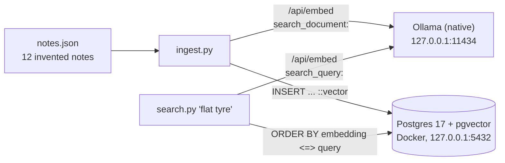

# 08. Vector search with Postgres and pgvector

> **Draft: written but not yet run.** The code and the expected output in this lesson were prepared by reading the code and the official documentation. They have not been executed yet. If something does not behave as described, trust your tool's real output and report it.

## What you will be able to do
- Run Postgres with the pgvector extension in a temporary Docker container, with a complete Compose file you can read line by line.
- Design a schema that stores chunks, vectors and the model that made them, with an HNSW index.
- Insert and query vectors from Python with `psycopg`, using the cosine-distance operator `<=>`.
- Read an `EXPLAIN` plan honestly: know when the index is not used and why that can be correct.

## Recap
1. Why must a vector be stored with the name of the embedding model?
   <details><summary>Answer</summary>Vectors from different models are not comparable, so after a model change you must know which rows to rebuild.</details>
2. What is the relation between cosine similarity and the dot product?
   <details><summary>Answer</summary>For unit-length vectors they are equal. Otherwise cosine divides the dot product by both lengths.</details>
3. What does an index cost you in return for speed?
   <details><summary>Answer</summary>Space, slower writes, and (for approximate indexes) a chance of missing the true nearest neighbours. See [Databases 201 lesson 07](../../../databases/201-hero-to-super-hero/phase-2-querying/07-indexes-and-explain.md).</details>

## Why it matters
In lesson 07 the vectors lived in a Python list and vanished when the program ended. A real search feature needs them stored, updated and queried next to the rest of your data, with transactions and backups. Postgres with the pgvector extension does that: one database for rows and vectors, ordinary SQL, familiar operations. It is not the only choice (dedicated vector databases exist), but if you already run Postgres it is often the simplest one to operate.

## What you will build
A small local stack: Ollama (native) makes the vectors, Postgres (in Docker, temporary) stores them. You will write the Compose file, the schema, an ingest script that skips unchanged notes, a search script, and a SQL file for exploring distances, plans and index size.



## Before you start
- **Prerequisites:** [Ollama 201 lesson 07, embeddings in depth](07-embeddings-in-depth.md); Databases 101 lessons [01, what a database is](../../../databases/101-zero-to-hero/phase-1-first-queries/01-what-a-database-is.md) to [12, library project](../../../databases/101-zero-to-hero/phase-3-designing/12-library-project.md); Docker 101 lessons [01, what is a container](../../../docker/101-zero-to-hero/phase-1-containers/01-what-is-a-container.md) to [08, two-service project](../../../docker/101-zero-to-hero/phase-2-compose/08-two-service-project.md).
- Time: 90-120 minutes for a first timer, in two sittings. Pause after Step 6 (the stack is up and the schema exists). Docker image download time is extra.
- Tools: Python 3.12+, native Ollama with `nomic-embed-text:v1.5` (lesson 07), Docker with the Compose plugin (Docker 101 lessons 06 and 07), and about 500 MB of disk for the image.
- Image tag, checked on Docker Hub on **2026-11-23**: `pgvector/pgvector:0.8.7-pg17` exists (pgvector 0.8.7 on Postgres 17, Debian bookworm; it has the same digest as the floating `pg17` and `pg17-bookworm` tags at that date). We pin the exact version tag, not `latest`, so the lesson does not change under you. Re-check the tag list before a later revision.
- **Port 5432 is shared** with the Databases track labs and the capstone platform database. Stop those (`docker compose down` in their folders) or change `POSTGRES_PORT` in your `.env` (for example to `55432`); the Python code reads the port from `.env`.
- Python packages: the one direct dependency, `psycopg`, is pinned in `requirements.txt` (`psycopg[binary]==3.3.9`, the newest version on PyPI on 2026-11-23, needs Python 3.10 or newer). **pip creates the virtual environment's contents; no lockfile ships with this course** because one can only be produced by running `pip`. If you need exact reproducibility, record `python -m pip freeze` after your own install.
- Source pack (optional): every file is shown in full in this lesson, except `ollama_http.py`, identical to lesson 01. The finished code, the exercise starter and the solution are in https://github.com/Uee03/Code101 under `source/ollama/201-hero-to-super-hero/phase-3-embeddings/08-vector-search-with-pgvector/` (on that page choose **Code, Download ZIP**, or run `git clone https://github.com/Uee03/Code101.git`).
- Never put real or private documents in this lab. The notes are invented. The database password you choose must not be one you use anywhere else.

## Steps
### Step 1. Create the folder and the helper
**File: `Windows PowerShell; starting anywhere`**
```powershell
New-Item -ItemType Directory -Path "$HOME/code101/ollama201-08/initdb" -Force | Out-Null
Set-Location "$HOME/code101/ollama201-08"
Copy-Item "$HOME/code101/ollama201-01/ollama_http.py" .
```

**File: `macOS/Linux terminal; starting anywhere`**
```bash
mkdir -p ~/code101/ollama201-08/initdb
cd ~/code101/ollama201-08
cp ~/code101/ollama201-01/ollama_http.py .
```
Expected result: no output; the folder holds `initdb` and `ollama_http.py`.

### Step 2. The Compose file
Docker Compose describes containers in YAML. Save it exactly. Every line is explained below the file.

**File: `~/code101/ollama201-08/docker-compose.yml`**
```yaml
name: code101-ollama-pgvector

services:
  db:
    image: pgvector/pgvector:0.8.7-pg17
    container_name: code101-ollama-pgvector
    restart: "no"
    environment:
      POSTGRES_USER: ${POSTGRES_USER:?set POSTGRES_USER in .env}
      POSTGRES_PASSWORD: ${POSTGRES_PASSWORD:?set POSTGRES_PASSWORD in .env}
      POSTGRES_DB: ${POSTGRES_DB:?set POSTGRES_DB in .env}
    ports:
      - "127.0.0.1:${POSTGRES_PORT:-5432}:5432"
    volumes:
      - pgdata:/var/lib/postgresql/data
      - ./initdb:/docker-entrypoint-initdb.d:ro
    healthcheck:
      test: ["CMD-SHELL", "pg_isready -h 127.0.0.1 -U $${POSTGRES_USER} -d $${POSTGRES_DB}"]
      interval: 5s
      timeout: 3s
      retries: 12
      start_period: 10s

volumes:
  pgdata:
```

| Line | Meaning | If you change it |
|---|---|---|
| `name: code101-ollama-pgvector` | Compose project name; groups the container, network and volume | A different name makes a separate stack with its own volume |
| `services: db:` | One service called `db` | Other tools reach it by this name inside the Compose network |
| `image: pgvector/pgvector:0.8.7-pg17` | Postgres 17 with the extension installed, version pinned | `latest` could change under you; a lower pgvector may lack features used here |
| `container_name` | Fixed name for `docker ps` and logs | Remove it to let Compose pick one |
| `restart: "no"` | Never restart automatically: the stack is temporary | `unless-stopped` keeps it running after reboots |
| `${POSTGRES_USER:?message}` | Take the value from `.env`; **stop with the message if it is missing** | Removing `:?...` lets an empty value through |
| `ports: "127.0.0.1:${POSTGRES_PORT:-5432}:5432"` | Publish container port 5432 on the host's **loopback only**; default host port 5432 | Without `127.0.0.1:` the database would listen on every network interface, reachable from your LAN |
| `pgdata:/var/lib/postgresql/data` | A named volume keeps data when the container is removed | Remove it and data is lost with the container |
| `./initdb:/docker-entrypoint-initdb.d:ro` | Scripts here run **once**, when the data directory is first created; read-only (`:ro`) | Edits do not re-run on an existing volume (remove the volume to start over) |
| `healthcheck` | Asks Postgres if it is ready; `-h 127.0.0.1` forces a TCP check, which succeeds only after the init scripts finished and the real server started | Without `-h`, the check may pass too early on the temporary init server |
| `$${...}` | Compose writes `$$` to mean a literal `$`, so the container's shell fills in the variable | A single `$` would be replaced by Compose on your machine |
| `volumes: pgdata:` | Declares the named volume | |

### Step 3. The settings file and ignore rules
`.env.example` is the template you commit; `.env` holds your real values and must never be committed (the `.gitignore` below keeps it out). Create `.env.example`, then copy it.

**File: `~/code101/ollama201-08/.env.example`**
```text
POSTGRES_USER=search
POSTGRES_PASSWORD=change-me-before-first-start
POSTGRES_DB=searchdb
POSTGRES_PORT=5432
```

**File: `~/code101/ollama201-08/.gitignore`**
```text
.env
.venv/
__pycache__/
```

**File: `Windows PowerShell; folder ~/code101/ollama201-08`**
```powershell
Copy-Item .env.example .env
notepad .env
```

**File: `macOS/Linux terminal; folder ~/code101/ollama201-08`**
```bash
cp .env.example .env
nano .env
```
Change `POSTGRES_PASSWORD` to a new value used only for this lab (the password is set when the data volume is first created; changing `.env` later does not change an existing database). Save the file with Ctrl+S (Windows) or Ctrl+O then Ctrl+X (nano).

### Step 4. The schema (`initdb/01-schema.sql`)
Postgres runs this on first start. Two tables: `documents` (one row per source note, with a content hash so ingest can skip unchanged ones) and `chunks` (the searchable pieces and their vectors).

**File: `~/code101/ollama201-08/initdb/01-schema.sql`**
```sql
CREATE EXTENSION IF NOT EXISTS vector;

CREATE SCHEMA IF NOT EXISTS search;

CREATE TABLE search.documents (
    id           bigint GENERATED ALWAYS AS IDENTITY PRIMARY KEY,
    source       text        NOT NULL UNIQUE,
    title        text        NOT NULL,
    content_hash text        NOT NULL,
    ingested_at  timestamptz NOT NULL DEFAULT now()
);

CREATE TABLE search.chunks (
    id              bigint GENERATED ALWAYS AS IDENTITY PRIMARY KEY,
    document_id     bigint      NOT NULL REFERENCES search.documents (id) ON DELETE CASCADE,
    chunk_index     integer     NOT NULL CHECK (chunk_index >= 0),
    section         text        NOT NULL DEFAULT '',
    content         text        NOT NULL,
    embedding_model text        NOT NULL,
    embedding       vector(768) NOT NULL,
    UNIQUE (document_id, chunk_index)
);

CREATE INDEX chunks_embedding_hnsw
    ON search.chunks
    USING hnsw (embedding vector_cosine_ops)
    WITH (m = 16, ef_construction = 64);
```
Decisions worth understanding:
- `vector(768)`: the column type fixes the dimension. 768 is the output size of `nomic-embed-text:v1.5`; `ingest.py` also checks it before insert. A different model with a different dimension needs a new column or table, which is another reason to store `embedding_model`.
- `ON DELETE CASCADE`: deleting a document deletes its chunks, so no orphans.
- `UNIQUE (document_id, chunk_index)`: one chunk per position; it also gives Postgres an index on `document_id` as its first column.
- **HNSW** (hierarchical navigable small world) is an *approximate* nearest-neighbour index: a layered graph that is walked greedily from the top. `vector_cosine_ops` says it serves the cosine-distance operator `<=>`; a query with another operator (`<->` L2, `<#>` negative inner product) cannot use it. `m = 16` is the number of links per node and `ef_construction = 64` the build-time search width; both are the pgvector defaults, written out so you can see them. Higher values raise recall and index size and slow builds.
- The `vector` type can be indexed up to 2,000 dimensions (pgvector README, checked 2026-11-23); 768 fits.
- Without any index pgvector does an **exact** scan with perfect recall: fine for thousands of rows, and the baseline against which an index's recall can be measured.

### Step 5. Start the database and check it
**File: `Terminal, any OS; folder ~/code101/ollama201-08`**
```text
docker compose up -d --wait
docker compose ps
docker compose logs db
```
Expected result (messages vary by Docker version): Docker pulls the image the first time (progress bars), creates the network and volume, starts the container, and `--wait` returns when the health check passes. `docker compose ps` lists `db` as `healthy` (or `running (healthy)`). The logs end with a line saying the database system is ready to accept connections, and earlier lines show the init script running.

If Docker says the port is already allocated (typical message), another database holds 5432: stop it or change `POSTGRES_PORT` in `.env`, then `docker compose up -d --wait` again.

Open a SQL prompt to look around (the user and database come from your `.env`; the defaults are shown):

**File: `Terminal, any OS; folder ~/code101/ollama201-08`**
```text
docker compose exec db psql -U search -d searchdb -c "\dx"
docker compose exec db psql -U search -d searchdb -c "\d search.chunks"
```
Expected: the first lists the `vector` extension (and `plpgsql`); the second shows the six columns, the unique constraint and the `chunks_embedding_hnsw` index of type `hnsw`.

### Step 6. Python setup and helpers
Create a virtual environment so `psycopg` does not touch your system Python.

**File: `Windows PowerShell; folder ~/code101/ollama201-08`**
```powershell
python -m venv .venv
.venv\Scripts\Activate.ps1
```

**File: `macOS/Linux terminal; folder ~/code101/ollama201-08`**
```bash
python3 -m venv .venv
source .venv/bin/activate
```
If PowerShell refuses to run `Activate.ps1` (a message about running scripts being disabled, typical), allow scripts for your user once with `Set-ExecutionPolicy -Scope CurrentUser RemoteSigned`, as in Python 101, or call `.venv\Scripts\python.exe` directly. The prompt shows `(.venv)` when activated. Now the requirements file and the install:

**File: `~/code101/ollama201-08/requirements.txt`**
```text
psycopg[binary]==3.3.9
```
`[binary]` installs a prebuilt copy of the PostgreSQL client library so no compiler or system library is needed.

**File: `Terminal, any OS; folder ~/code101/ollama201-08 (virtual environment active)`**
```text
python -m pip install -r requirements.txt
```
Expected result: pip downloads and installs `psycopg` and `psycopg-binary` and ends with a line starting `Successfully installed`.

Next `db.py`: it reads `.env` (environment variables override it), builds the connection, and converts a Python list into pgvector's text form `[x,y,...]` after checking the length and that no value is NaN or infinite. `psycopg` is imported inside `connect` on purpose, so the unit tests run without it.

**File: `~/code101/ollama201-08/db.py`**
```python
import math
import os
from pathlib import Path

HERE = Path(__file__).resolve().parent
DIMENSIONS = 768


def parse_env(text):
    values = {}
    for raw in text.splitlines():
        line = raw.strip()
        if not line or line.startswith("#") or "=" not in line:
            continue
        name, _, value = line.partition("=")
        values[name.strip()] = value.strip()
    return values


def settings():
    path = HERE / ".env"
    from_file = parse_env(path.read_text(encoding="utf-8")) if path.exists() else {}
    from_environment = {name: value for name, value in os.environ.items() if name.startswith("POSTGRES_")}
    return {**from_file, **from_environment}


def to_vector_literal(vector, dimensions=DIMENSIONS):
    if len(vector) != dimensions:
        raise ValueError(f"expected {dimensions} dimensions, got {len(vector)}")
    if not all(math.isfinite(x) for x in vector):
        raise ValueError("the vector contains NaN or infinity")
    return "[" + ",".join(repr(float(x)) for x in vector) + "]"


def connect():
    import psycopg

    config = settings()
    missing = [name for name in ("POSTGRES_USER", "POSTGRES_PASSWORD", "POSTGRES_DB") if name not in config]
    if missing:
        raise RuntimeError("copy .env.example to .env and set: " + ", ".join(missing))
    return psycopg.connect(
        host="127.0.0.1",
        port=int(config.get("POSTGRES_PORT", "5432")),
        user=config["POSTGRES_USER"],
        password=config["POSTGRES_PASSWORD"],
        dbname=config["POSTGRES_DB"],
        connect_timeout=5,
        autocommit=True,
    )
```
`host="127.0.0.1"` is fixed so the code can only talk to a local database. `autocommit=True` makes each statement its own transaction unless we open one explicitly with `conn.transaction()` (used in `ingest.py`); that avoids a transaction left open while we wait for the embedding server.

**File: `~/code101/ollama201-08/test_db.py`**
```python
import unittest

from db import parse_env, to_vector_literal


class DbHelperTests(unittest.TestCase):
    def test_parse_env_skips_comments_and_bad_lines(self):
        text = "# comment\nA=1\n\nB = two words \nnot a setting\n"
        self.assertEqual(parse_env(text), {"A": "1", "B": "two words"})

    def test_vector_literal(self):
        self.assertEqual(to_vector_literal([1, 2.5, -3], dimensions=3), "[1.0,2.5,-3.0]")

    def test_wrong_dimension_is_rejected(self):
        with self.assertRaises(ValueError):
            to_vector_literal([1.0, 2.0], dimensions=3)

    def test_not_a_number_is_rejected(self):
        with self.assertRaises(ValueError):
            to_vector_literal([1.0, float("nan")], dimensions=2)


if __name__ == "__main__":
    unittest.main()
```
**File: `Terminal; folder ~/code101/ollama201-08`**
```text
python -m unittest
```
Expected result (not yet run): `Ran 4 tests in` and a small time, then `OK`. **This is a good place for the break.**

### Step 7. The notes and the ingest script
The notes are the bike-shop facts from lesson 07, each as one short note (so one chunk per document).

**File: `~/code101/ollama201-08/notes.json`**
```json
[
  {"id": "n01", "title": "Opening hours", "text": "The shop opens at 9:00 on weekdays and 10:00 on Saturdays. It is closed on Sundays and on public holidays."},
  {"id": "n02", "title": "Returns", "text": "Customers may return unused parts within 30 days with a receipt. Opened tyres and inner tubes cannot be returned."},
  {"id": "n03", "title": "Puncture repair", "text": "A puncture repair takes about 20 minutes and costs 8 euros. The mechanic checks the tyre for glass before fitting the new tube."},
  {"id": "n04", "title": "Standard service", "text": "A standard service includes brake adjustment, gear tuning and a chain check. Book it at least two days ahead."},
  {"id": "n05", "title": "Frame warranty", "text": "Frames carry a five-year warranty against manufacturing faults. Wear parts such as brake pads and chains are not covered."},
  {"id": "n06", "title": "Helmet fitting", "text": "Every child bike sold includes a free helmet fitting. Staff adjust the straps until two fingers fit under the chin."},
  {"id": "n07", "title": "Deliveries", "text": "Orders over 100 euros ship free within the country. Delivery takes three to five working days."},
  {"id": "n08", "title": "Staff training", "text": "New staff shadow a mechanic for two weeks before working alone. Every mechanic completes a first-aid course each year."},
  {"id": "n09", "title": "Workshop cleaning", "text": "The workshop floor is swept at closing time. Used oil goes into the sealed blue drum and is collected monthly."},
  {"id": "n10", "title": "Test rides", "text": "Test rides last up to 15 minutes and need a photo ID left at the counter. E-bikes require a signed waiver."},
  {"id": "n11", "title": "Loyalty points", "text": "Members collect one point per euro and receive a 5 euro voucher for every 500 points."},
  {"id": "n12", "title": "Winter storage", "text": "Customers can store a bike over winter for 25 euros per month. Stored bikes get a free brake check in spring."}
]
```
`ingest.py` hashes each note, compares with the stored hash, embeds only new or changed notes in **one** batched request, and writes each in its own transaction (document row, old chunks deleted, new chunk inserted), so a failure never leaves a document without its chunk.

**File: `~/code101/ollama201-08/ingest.py`**
```python
import hashlib
import json
from pathlib import Path

from db import connect, to_vector_literal
from ollama_http import post_json, run_cli

HERE = Path(__file__).resolve().parent
MODEL = "nomic-embed-text:v1.5"
DOC_PREFIX = "search_document: "


def embed(texts):
    body = {"model": MODEL, "input": [DOC_PREFIX + text for text in texts], "truncate": False}
    vectors = post_json("/api/embed", body)["embeddings"]
    if len(vectors) != len(texts):
        raise ValueError("the server returned a different number of vectors than inputs")
    return vectors


def content_hash(note):
    payload = json.dumps(note, sort_keys=True, ensure_ascii=False).encode("utf-8")
    return hashlib.sha256(payload).hexdigest()


def ingest(notes):
    with connect() as conn:
        rows = conn.execute("SELECT id, source, content_hash FROM search.documents").fetchall()
        known = {source: (document_id, digest) for document_id, source, digest in rows}
        pending = []
        for note in notes:
            digest = content_hash(note)
            existing = known.get(note["id"])
            if existing and existing[1] == digest:
                continue
            pending.append((note, digest, existing[0] if existing else None))
        vectors = embed([note["text"] for note, _, _ in pending]) if pending else []
        for (note, digest, document_id), vector in zip(pending, vectors):
            with conn.transaction():
                if document_id is None:
                    document_id = conn.execute(
                        "INSERT INTO search.documents (source, title, content_hash) VALUES (%s, %s, %s) RETURNING id",
                        (note["id"], note["title"], digest),
                    ).fetchone()[0]
                else:
                    conn.execute(
                        "UPDATE search.documents SET title = %s, content_hash = %s, ingested_at = now() WHERE id = %s",
                        (note["title"], digest, document_id),
                    )
                    conn.execute("DELETE FROM search.chunks WHERE document_id = %s", (document_id,))
                conn.execute(
                    "INSERT INTO search.chunks (document_id, chunk_index, section, content, embedding_model, embedding) "
                    "VALUES (%s, 0, %s, %s, %s, %s::vector)",
                    (document_id, note["title"], note["text"], MODEL, to_vector_literal(vector)),
                )
    print(f"ingested {len(pending)} notes, skipped {len(notes) - len(pending)} unchanged")


def main():
    notes = json.loads((HERE / "notes.json").read_text(encoding="utf-8"))
    ingest(notes)


if __name__ == "__main__":
    run_cli(main)
```
Note how SQL values are passed as **parameters** (`%s` with a tuple), never pasted into the SQL text. That prevents SQL injection and handles quotes in the notes. The `::vector` cast turns the text literal into a `vector`.

### Step 8. The search script
The query is embedded with the `search_query:` prefix (the notes used `search_document:`). The SQL orders by `embedding <=> query`, the cosine **distance** (0 means the same direction, larger means less similar), so `1 - distance` is the cosine similarity we print. The filter `embedding_model = ...` makes sure we only compare vectors made by the same model.

**File: `~/code101/ollama201-08/search.py`**
```python
import argparse

from db import connect, to_vector_literal
from ollama_http import post_json, run_cli

MODEL = "nomic-embed-text:v1.5"
QUERY_PREFIX = "search_query: "

SEARCH_SQL = """
SELECT d.title, c.content, c.embedding <=> %s::vector AS distance
FROM search.chunks AS c
JOIN search.documents AS d ON d.id = c.document_id
WHERE c.embedding_model = %s
ORDER BY c.embedding <=> %s::vector
LIMIT %s
"""


def embed_query(text):
    body = {"model": MODEL, "input": QUERY_PREFIX + text, "truncate": False}
    return post_json("/api/embed", body)["embeddings"][0]


def search(text, limit):
    literal = to_vector_literal(embed_query(text))
    with connect() as conn:
        return conn.execute(SEARCH_SQL, (literal, MODEL, literal, limit)).fetchall()


def main():
    parser = argparse.ArgumentParser(description="Semantic search over the stored notes.")
    parser.add_argument("query")
    parser.add_argument("-k", type=int, default=3, help="how many results to show")
    args = parser.parse_args()
    if not 1 <= args.k <= 20:
        raise SystemExit("-k must be between 1 and 20")
    for title, content, distance in search(args.query, args.k):
        print(f"{1 - distance:.3f} | {title} | {content[:70]}")


if __name__ == "__main__":
    run_cli(main)
```
`ORDER BY` repeats the operator expression because that exact shape (`embedding <=> constant ORDER BY ... LIMIT n`) is what lets the planner use the HNSW index. Note the `-k` bound: never let a caller ask for an unbounded number of rows.

### Step 9. Explore with SQL
This file runs six queries. Read each comment before you run it.

**File: `~/code101/ollama201-08/queries.sql`**
```sql
-- 1. The notes closest to the stored note "Opening hours" (exact scan, no query vector needed)
SELECT b.section, round((a.embedding <=> b.embedding)::numeric, 4) AS distance
FROM search.chunks AS a
JOIN search.chunks AS b ON a.id <> b.id
WHERE a.section = 'Opening hours'
ORDER BY a.embedding <=> b.embedding
LIMIT 3;

-- 2. Which model built the vectors, and how many dimensions do they have?
SELECT embedding_model, count(*) AS chunks, vector_dims(embedding) AS dimensions
FROM search.chunks
GROUP BY embedding_model, vector_dims(embedding);

-- 3. The plan with the default settings (with 12 rows the planner usually prefers a sequential scan)
EXPLAIN
SELECT id FROM search.chunks
ORDER BY embedding <=> (SELECT embedding FROM search.chunks WHERE section = 'Opening hours')
LIMIT 3;

-- 4. The same query with sequential scans discouraged, to see whether the HNSW index can be used
SET enable_seqscan = off;
EXPLAIN
SELECT id FROM search.chunks
ORDER BY embedding <=> (SELECT embedding FROM search.chunks WHERE section = 'Opening hours')
LIMIT 3;
RESET enable_seqscan;

-- 5. The recall knob of the HNSW index: how many candidates a query inspects
SHOW hnsw.ef_search;

-- 6. How big are the table and the index?
SELECT pg_size_pretty(pg_table_size('search.chunks')) AS table_size,
       pg_size_pretty(pg_relation_size('search.chunks_embedding_hnsw')) AS index_size;
```

## Run it
First ingest, twice. Predict the output of the **second** run before you do it.

**File: `Terminal, any OS; folder ~/code101/ollama201-08 (virtual environment active)`**
```text
python ingest.py
python ingest.py
```
Expected output (derived by reading the code):
```text
ingested 12 notes, skipped 0 unchanged
ingested 0 notes, skipped 12 unchanged
```
The second run embeds nothing because every content hash already matches. Edit the `text` of one note, run again, and expect `ingested 1 notes, skipped 11 unchanged`.

Now search. Predict which title wins for each query before you look:

**File: `Terminal, any OS; folder ~/code101/ollama201-08 (virtual environment active)`**
```text
python search.py "how much does it cost to fix a flat tyre"
python search.py "can I give back something I bought" -k 5
```
Expected shape (not captured; scores and order depend on the model): up to `k` lines of `<similarity> | <title> | <first 70 characters of the note>`, highest similarity first. The first query should rank the puncture note highly and the second the returns note, but treat that as a hypothesis, check your output, and note any surprise.

Run the exploration file through `psql` inside the container (values `search` and `searchdb` come from `.env`):

**File: `Windows PowerShell; folder ~/code101/ollama201-08`**
```powershell
Get-Content queries.sql | docker compose exec -T db psql -U search -d searchdb
```

**File: `macOS/Linux terminal; folder ~/code101/ollama201-08`**
```bash
docker compose exec -T db psql -U search -d searchdb < queries.sql
```
Expected shape: query 1 prints three rows (section names and distances); query 2 prints one row with `nomic-embed-text:v1.5`, `12` and `768` (this one is fixed by the code and your ingest); queries 3 and 4 print plan text; `SHOW` prints the current `hnsw.ef_search` value (the pgvector default is 40); query 6 prints two sizes. **Read the plans honestly:** with 12 rows Postgres may choose a sequential scan even though an index exists, because scanning twelve rows is cheaper than walking a graph. If query 4 shows an index scan on `chunks_embedding_hnsw`, the index *can* serve this query shape; if it still shows a sequential scan, say so rather than forcing a story. Neither result proves anything about speed at 1,000,000 rows. For that you need a representative table size and a recall measurement against the exact scan.

Stop and clean up when you finish the session (do not run this in the middle of a lesson series if you want to keep the data):

**File: `Terminal, any OS; folder ~/code101/ollama201-08`**
```text
docker compose down
```
That removes the container and network but **keeps the volume**; the next `up` starts with your data. To delete everything including the data: `docker compose down -v`.

## How it works
1. **Distance operators.** `<->` is L2 (straight-line) distance, `<=>` cosine distance, `<#>` the *negative* inner product (Postgres can only order ascending, so pgvector negates it). For unit vectors all three rank identically.
2. **HNSW is approximate.** It trades a small chance of missing a true neighbour for much faster queries on large tables. `hnsw.ef_search` (default 40) widens the search per query: higher means better recall and slower queries.
3. **Filters and approximate indexes.** With an approximate index, a `WHERE` condition is applied *after* the index returns its candidates, so a selective filter can leave you with fewer than `k` rows. pgvector 0.8.0 added iterative index scans (`SET hnsw.iterative_scan = relaxed_order;`) that keep scanning until enough rows pass the filter. Our `embedding_model` filter matches every row, so it is harmless here; in a multi-tenant table it would matter a great deal (see lesson 301.05 on access control before ranking).
4. **Parameterised SQL.** Passing the vector as a text parameter plus `::vector` avoids a client-side vector adapter and keeps the dependency list to one package.
5. **Common misconception:** "an index always speeds a query up". On a tiny table the planner is right to ignore it, and an HNSW index can be slower to build and bigger than the data.

> **Why this, not that.** pgvector wins when your data is already in Postgres, you need transactions, joins and backups, and you have up to millions of vectors. A dedicated vector database or an in-memory structure may win for very large or very specialised workloads, or for a tiny corpus where a Python list (lesson 07) is plenty. Choose by measuring your own recall and latency, not by reputation.

## Try it
Starter: `exercise/starter/my-queries.sql` (copy the `starter` folder to `~/code101/ollama201-08/try01` and run it as the comment at the top says, from the lesson folder that contains `docker-compose.yml`).
1. **Guided.** Write the three queries at the TODOs. Predict query 1's result first (it is a single number).
2. **Change.** Add a fourth query that lists each document's `title` and the length of its chunk `content` in characters, ordered from longest to shortest.
3. **Stretch (no single answer).** Describe how you would measure the recall of the HNSW index against the exact scan for 1,000 random queries, and what recall you would accept before you ship it.

<details><summary>Solution</summary>

**File: `exercise/solution/my-queries.sql`**
```sql
-- Solution for the three exercise queries. Run it with:
--   Windows PowerShell: Get-Content my-queries.sql | docker compose exec -T db psql -U search -d searchdb
--   macOS/Linux: docker compose exec -T db psql -U search -d searchdb < my-queries.sql

SELECT count(*) AS chunks FROM search.chunks;

SELECT embedding_model, count(*) AS chunks, vector_dims(embedding) AS dimensions
FROM search.chunks
GROUP BY embedding_model, vector_dims(embedding);

SELECT b.section AS title, (a.embedding <#> b.embedding) AS negative_inner_product
FROM search.chunks AS a
JOIN search.chunks AS b ON a.id <> b.id
WHERE a.section = 'Returns'
ORDER BY a.embedding <#> b.embedding
LIMIT 3;
```
Query 1 prints `12` after a first ingest. Query 2 prints one row: the model name, `12` and `768`. Query 3 prints three titles with **negative** numbers: the more similar the chunk, the more negative the value, so ascending order puts the best match first.
</details>

## Check yourself
1. Why does the Compose file publish `127.0.0.1:5432` and not `5432`? <details><summary>Answer</summary>Without the loopback address the database is reachable from other machines on your network.</details>
2. What does `1 - (a <=> b)` give you? <details><summary>Answer</summary>The cosine similarity.</details>
3. Predict the second run of `ingest.py`. <details><summary>Answer</summary>`ingested 0 notes, skipped 12 unchanged`.</details>
4. The plan shows a sequential scan on a 12-row table. Is something wrong? <details><summary>Answer</summary>Not necessarily: for tiny tables a sequential scan is cheaper, and the planner is allowed to choose it.</details>
5. Why a `vector(768)` column and an `embedding_model` column together? <details><summary>Answer</summary>The type fixes the dimension for the current model; the model name tells you what the vectors mean and what to rebuild if you change models.</details>

## Common mistakes
| Symptom | Cause | Fix |
|---|---|---|
| `error while interpolating ... set POSTGRES_PASSWORD in .env` (typical message) | `.env` missing or incomplete | `cp .env.example .env` and fill it in |
| `port is already allocated` (typical message) | Another database holds 5432 | Stop it or set `POSTGRES_PORT` in `.env` |
| `password authentication failed` (typical message) | `.env` password differs from the one the volume was created with | `docker compose down -v` to recreate the data, or restore the old password |
| `RuntimeError: copy .env.example to .env and set: ...` | `.env` not in the lesson folder | Create it in the same folder as `db.py` |
| `ValueError: expected 768 dimensions, got N` | A different embedding model | Use `nomic-embed-text:v1.5`, or change the column type and `DIMENSIONS` together |
| `connection refused` (typical message) | Container not healthy yet or stopped | `docker compose ps`; wait for `healthy` |
| Schema changes in `initdb` have no effect | Init scripts run only on first volume creation | `docker compose down -v`, then `up -d --wait` |
| `ModuleNotFoundError: No module named 'psycopg'` (typical message) | Virtual environment not active | Activate `.venv`, then `python -m pip install -r requirements.txt` |

## Best practice
Store the embedding model and dimension with every vector, match the query operator to the index's operator class, pass all values as SQL parameters, publish the database on loopback only, and measure recall before trusting an approximate index. Source: pgvector README https://github.com/pgvector/pgvector

## Going further
- [Databases 201 lesson 07](../../../databases/201-hero-to-super-hero/phase-2-querying/07-indexes-and-explain.md) (indexes and `EXPLAIN`) and [lesson 11](../../../databases/201-hero-to-super-hero/phase-4-operations-and-security/11-roles-rls-backup-and-pooling.md) (roles and row-level security) apply directly to this table.
- Lesson 09 turns this into a command-line tool for your own text files; 301 lesson 02 adds citations.

## Summary
- You ran Postgres with pgvector from a fully explained Compose file, bound to loopback.
- You designed a chunks table with a typed vector column, a model name and an HNSW index.
- You inserted and queried vectors from Python with parameterised SQL.
- You read query plans without forcing a conclusion the data cannot support.

## Next lesson
09. Project: a local semantic search CLI that ingests your own text files, skips unchanged ones and searches them.
