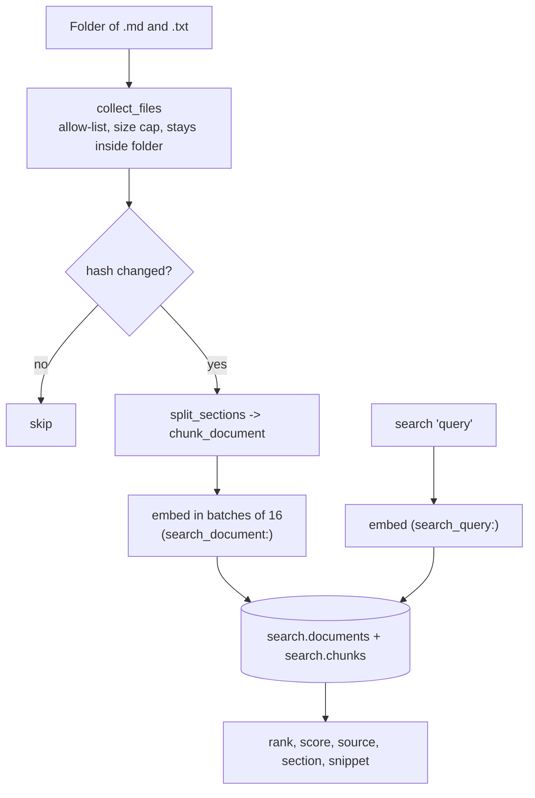

# 09. Project: a local semantic search CLI

> **Draft: written but not yet run.** The code and the expected output in this lesson were prepared by reading the code and the official documentation. They have not been executed yet. If something does not behave as described, trust your tool's real output and report it.

## What you will be able to do
- Combine chunking, embedding and pgvector into one command-line tool with subcommands.
- Ingest a folder of Markdown and text files safely: allow-list file types, cap sizes, stay inside the folder, skip unchanged files.
- Split documents by heading so results can name their section, and test the splitting without any server.
- Explain what the tool does not do and when you would reach for something else.

## Recap
1. Why does `ingest.py` in lesson 08 hash each note?
   <details><summary>Answer</summary>To skip notes that did not change, so only new or edited ones are embedded again.</details>
2. What does the operator `<=>` return and how do you turn it into a similarity?
   <details><summary>Answer</summary>Cosine distance; similarity is `1 - distance`.</details>
3. What happens to a `WHERE` filter when you use an approximate index?
   <details><summary>Answer</summary>It is applied after the index returns candidates, so a selective filter can leave fewer than `k` rows.</details>

## Why it matters
Lessons 07 and 08 gave you the parts. A project joins them and meets the real problems: files that are too large or not UTF-8, symlinks that leave the folder, documents you edited since last time, a table that should not be wiped by accident. These details separate a demo from a tool you can trust with your own notes.

## What you will build
`semsearch.py`, a CLI with four subcommands: `ingest <folder>` (with `--prune`), `search "<query>"` (with `-k` and `--min-score`), `stats` and `reset --yes`. It splits Markdown by heading, merges small paragraphs, splits long ones by words, embeds in batches, and stores everything in the Postgres from lesson 08. Seven unit tests cover the pure functions.



## Before you start
- **Prerequisites:** Ollama 201 lessons [07, embeddings in depth](07-embeddings-in-depth.md) and [08, vector search with pgvector](08-vector-search-with-pgvector.md).
- Time: 120-150 minutes for a first timer, in two sittings. Break after Step 5, when the stack is running and the unit tests pass.
- Tools: everything from lesson 08: Python 3.12+, a virtual environment with `psycopg[binary]==3.3.9`, Docker with Compose, native Ollama with `nomic-embed-text:v1.5` (about 274 MB, tag checked 2026-11-23). The database image is `pgvector/pgvector:0.8.7-pg17` (checked on Docker Hub 2026-11-23).
- **Start from an empty database.** Lesson 08 used the same Compose project and volume. In the lesson 08 folder run `docker compose down -v` to delete its data (this is a lab database; the command removes the volume), or keep it and run `reset --yes` in Step 8. Also stop any other database using port 5432.
- Source pack (optional): every file is shown in full in this lesson, except eight files that are identical to earlier lessons (listed in Step 1). The finished code, the exercise starter and the solution are in https://github.com/Uee03/Code101 under `source/ollama/201-hero-to-super-hero/phase-3-embeddings/09-project-semantic-search-cli/` (on that page choose **Code, Download ZIP**, or run `git clone https://github.com/Uee03/Code101.git`).
- Never ingest private or confidential text while following the lesson: the three sample documents are invented, and the database keeps a full copy of everything you ingest.

## Steps
### Step 1. Create the folder and copy the unchanged files
These eight files are identical to the earlier lessons, so they are not shown again (the "genuinely identical steps" rule). Copy them and change nothing.

| File | Copy from | What it is |
|---|---|---|
| `ollama_http.py` | lesson 01 | HTTP helper for Ollama |
| `textutil.py` | lesson 07 | `chunk_words`, `split_paragraphs` and vector maths |
| `db.py` | lesson 08 | `.env` reader, `connect`, `to_vector_literal` |
| `docker-compose.yml` | lesson 08 | pgvector 0.8.7 on Postgres 17, loopback only |
| `.env.example` | lesson 08 | settings template |
| `.gitignore` | lesson 08 | keeps `.env` and `.venv` out of Git |
| `requirements.txt` | lesson 08 | `psycopg[binary]==3.3.9` |
| `initdb/01-schema.sql` | lesson 08 | the `search.documents` and `search.chunks` tables and HNSW index |

**File: `Windows PowerShell; starting anywhere`**
```powershell
New-Item -ItemType Directory -Path "$HOME/code101/ollama201-09/initdb" -Force | Out-Null
New-Item -ItemType Directory -Path "$HOME/code101/ollama201-09/docs" -Force | Out-Null
Set-Location "$HOME/code101/ollama201-09"
Copy-Item "$HOME/code101/ollama201-01/ollama_http.py" .
Copy-Item "$HOME/code101/ollama201-07/textutil.py" .
foreach ($name in "db.py", "docker-compose.yml", ".env.example", ".gitignore", "requirements.txt") { Copy-Item "$HOME/code101/ollama201-08/$name" . }
Copy-Item "$HOME/code101/ollama201-08/initdb/01-schema.sql" initdb/
```

**File: `macOS/Linux terminal; starting anywhere`**
```bash
mkdir -p ~/code101/ollama201-09/initdb ~/code101/ollama201-09/docs
cd ~/code101/ollama201-09
cp ~/code101/ollama201-01/ollama_http.py .
cp ~/code101/ollama201-07/textutil.py .
cp ~/code101/ollama201-08/{db.py,docker-compose.yml,.env.example,.gitignore,requirements.txt} .
cp ~/code101/ollama201-08/initdb/01-schema.sql initdb/
```
Expected result: no output. If you skipped a lesson, open its file listing in that lesson (or the source pack) and create the file there.

### Step 2. Environment file, virtual environment, database
**File: `Windows PowerShell; folder ~/code101/ollama201-09`**
```powershell
Copy-Item .env.example .env
notepad .env
python -m venv .venv
.venv\Scripts\Activate.ps1
python -m pip install -r requirements.txt
docker compose up -d --wait
```

**File: `macOS/Linux terminal; folder ~/code101/ollama201-09`**
```bash
cp .env.example .env
nano .env
python3 -m venv .venv
source .venv/bin/activate
python -m pip install -r requirements.txt
docker compose up -d --wait
```
In `.env` set a new `POSTGRES_PASSWORD` used only for this lab. Expected result: pip ends with `Successfully installed` and the Compose command returns once the `db` service is healthy (lesson 08 explains every Compose line and the PowerShell script-policy note). pip creates the environment's packages; there is no lockfile in this course, so record `python -m pip freeze` if you need exact reproducibility.

### Step 3. Three invented sample documents
They live in `docs`. Headings split each into sections: `# Title` lines carry no body, `##` lines start the searchable sections.

**File: `~/code101/ollama201-09/docs/backup.md`**
```text
# Backups

## Schedule
The laptop is backed up every night at 02:00 to the external disk. The backup keeps the last seven daily copies.

## Restoring a file
To restore a file, open the backup disk, choose the date, and copy the file back. Restoring never overwrites the newer file without asking.
```

**File: `~/code101/ollama201-09/docs/network.md`**
```text
# Home network

## Wi-Fi
The router has two networks. The guest network is isolated from the main one and has its own password.

## Printer
The printer has a fixed address and only accepts jobs from the main network.
```

**File: `~/code101/ollama201-09/docs/passwords.md`**
```text
# Passwords

## Manager
All passwords live in the password manager. The master passphrase is long and is never written in a file.

## Two-factor sign-in
Two-factor sign-in is switched on for email and banking, using an authenticator app rather than text messages.
```

### Step 4. The CLI: `semsearch.py`
Read the file in this order: constants, the pure functions (`is_searchable`, `split_sections`, `chunk_document`, `prepare`), then `embed`, `collect_files`, the four `cmd_` functions and `main`. The "How it works" section walks through the safety choices.

**File: `~/code101/ollama201-09/semsearch.py`**
```python
import argparse
import hashlib
import re
from pathlib import Path

from db import connect, to_vector_literal
from ollama_http import post_json, run_cli
from textutil import chunk_words, split_paragraphs

MODEL = "nomic-embed-text:v1.5"
DOC_PREFIX = "search_document: "
QUERY_PREFIX = "search_query: "
ALLOWED_SUFFIXES = {".md", ".txt"}
MAX_FILE_BYTES = 1_000_000
MAX_QUERY_CHARS = 500
BATCH = 16
HEADING = re.compile(r"^#{1,6}\s+(.*\S)\s*$")

SEARCH_SQL = """
SELECT d.source, c.section, c.content, c.embedding <=> %s::vector AS distance
FROM search.chunks AS c
JOIN search.documents AS d ON d.id = c.document_id
WHERE c.embedding_model = %s
ORDER BY c.embedding <=> %s::vector
LIMIT %s
"""


def is_searchable(name):
    return not name.startswith(".") and Path(name).suffix.lower() in ALLOWED_SUFFIXES


def split_sections(text):
    sections = []
    heading = ""
    lines = []

    def flush():
        body = "\n".join(lines).strip()
        if body:
            sections.append((heading, body))

    for line in text.splitlines():
        match = HEADING.match(line)
        if match:
            flush()
            heading = match.group(1).strip()
            lines = []
        else:
            lines.append(line)
    flush()
    return sections


def chunk_document(text, max_chars=800, overlap_words=15):
    chunks = []
    current = ""
    for paragraph in split_paragraphs(text):
        if len(paragraph) > max_chars:
            if current:
                chunks.append(current)
                current = ""
            chunks.extend(chunk_words(paragraph, max_chars, overlap_words))
        elif current and len(current) + 2 + len(paragraph) > max_chars:
            chunks.append(current)
            current = paragraph
        else:
            current = f"{current}\n\n{paragraph}" if current else paragraph
    if current:
        chunks.append(current)
    return chunks


def prepare(text):
    return [(heading, chunk) for heading, body in split_sections(text) for chunk in chunk_document(body)]


def embed_text(heading, chunk):
    return f"{heading}\n{chunk}" if heading else chunk


def embed(texts, prefix):
    vectors = []
    for start in range(0, len(texts), BATCH):
        batch = [prefix + text for text in texts[start:start + BATCH]]
        data = post_json("/api/embed", {"model": MODEL, "input": batch, "truncate": False})
        vectors.extend(data["embeddings"])
    if len(vectors) != len(texts):
        raise ValueError("the server returned a different number of vectors than inputs")
    return vectors


def collect_files(root):
    files = []
    skipped = []
    for path in sorted(root.rglob("*")):
        relative_parts = path.relative_to(root).parts
        if any(part.startswith(".") for part in relative_parts):
            continue
        if not path.is_file() or not is_searchable(path.name):
            continue
        resolved = path.resolve()
        try:
            source = resolved.relative_to(root).as_posix()
        except ValueError:
            skipped.append(f"{path.name}: points outside the folder")
            continue
        if resolved.stat().st_size > MAX_FILE_BYTES:
            skipped.append(f"{source}: larger than {MAX_FILE_BYTES} bytes")
            continue
        files.append((source, resolved))
    return files, skipped


def format_result(rank, score, source, section, content):
    snippet = " ".join(content.split())[:80]
    return f"{rank}. {score:.3f} | {source} | {section or '-'} | {snippet}"


def cmd_ingest(folder, prune):
    root = Path(folder).resolve()
    if not root.is_dir():
        raise SystemExit(f"not a folder: {folder}")
    files, skipped = collect_files(root)
    with connect() as conn:
        known = dict(conn.execute("SELECT source, content_hash FROM search.documents").fetchall())
        work = []
        unchanged = 0
        for source, path in files:
            data = path.read_bytes()
            digest = hashlib.sha256(data).hexdigest()
            if known.get(source) == digest:
                unchanged += 1
                continue
            try:
                text = data.decode("utf-8")
            except UnicodeDecodeError:
                skipped.append(f"{source}: not valid UTF-8")
                continue
            work.append((source, digest, prepare(text)))
        texts = [embed_text(heading, chunk) for _, _, pieces in work for heading, chunk in pieces]
        vectors = embed(texts, DOC_PREFIX) if texts else []
        offset = 0
        for source, digest, pieces in work:
            with conn.transaction():
                row = conn.execute("SELECT id FROM search.documents WHERE source = %s", (source,)).fetchone()
                if row:
                    document_id = row[0]
                    conn.execute(
                        "UPDATE search.documents SET title = %s, content_hash = %s, ingested_at = now() WHERE id = %s",
                        (Path(source).stem, digest, document_id),
                    )
                    conn.execute("DELETE FROM search.chunks WHERE document_id = %s", (document_id,))
                else:
                    document_id = conn.execute(
                        "INSERT INTO search.documents (source, title, content_hash) VALUES (%s, %s, %s) RETURNING id",
                        (source, Path(source).stem, digest),
                    ).fetchone()[0]
                for index, (heading, chunk) in enumerate(pieces):
                    conn.execute(
                        "INSERT INTO search.chunks (document_id, chunk_index, section, content, embedding_model, embedding) "
                        "VALUES (%s, %s, %s, %s, %s, %s::vector)",
                        (document_id, index, heading, chunk, MODEL, to_vector_literal(vectors[offset + index])),
                    )
            offset += len(pieces)
        removed = 0
        if prune:
            if not files:
                raise SystemExit("refusing to prune: no searchable files were found")
            removed = conn.execute(
                "DELETE FROM search.documents WHERE source <> ALL(%s)", ([source for source, _ in files],)
            ).rowcount
    written = sum(len(pieces) for _, _, pieces in work)
    print(f"files: {len(files)} found, {len(work)} ingested, {unchanged} unchanged, {len(skipped)} skipped; chunks written: {written}")
    for message in skipped:
        print(f"skipped {message}")
    if prune:
        print(f"pruned {removed} documents no longer on disk")


def cmd_search(query, limit, min_score):
    query = query.strip()
    if not query or len(query) > MAX_QUERY_CHARS:
        raise SystemExit(f"the query must have 1 to {MAX_QUERY_CHARS} characters")
    literal = to_vector_literal(embed([query], QUERY_PREFIX)[0])
    with connect() as conn:
        rows = conn.execute(SEARCH_SQL, (literal, MODEL, literal, limit)).fetchall()
    shown = 0
    for rank, (source, section, content, distance) in enumerate(rows, start=1):
        score = 1 - distance
        if score >= min_score:
            print(format_result(rank, score, source, section, content))
            shown += 1
    if shown == 0:
        print("no results at or above the minimum score")


def cmd_stats():
    with connect() as conn:
        documents = conn.execute("SELECT count(*) FROM search.documents").fetchone()[0]
        chunks = conn.execute("SELECT count(*) FROM search.chunks").fetchone()[0]
        models = conn.execute(
            "SELECT embedding_model, count(*) FROM search.chunks GROUP BY embedding_model ORDER BY embedding_model"
        ).fetchall()
    print(f"documents: {documents}")
    print(f"chunks: {chunks}")
    for model, count in models:
        print(f"model {model}: {count} chunks")


def cmd_reset(confirmed):
    if not confirmed:
        raise SystemExit("this deletes every document and chunk; repeat with --yes to confirm")
    with connect() as conn:
        conn.execute("TRUNCATE search.documents CASCADE")
    print("all documents and chunks deleted")


def main():
    parser = argparse.ArgumentParser(prog="semsearch", description="Local semantic search over text files.")
    commands = parser.add_subparsers(dest="command", required=True)
    ingest = commands.add_parser("ingest", help="read .md and .txt files from a folder")
    ingest.add_argument("folder")
    ingest.add_argument("--prune", action="store_true", help="delete documents whose file is gone")
    search = commands.add_parser("search", help="find the passages closest in meaning to a query")
    search.add_argument("query")
    search.add_argument("-k", type=int, default=5, help="how many results (1 to 20)")
    search.add_argument("--min-score", type=float, default=0.0, help="hide results below this similarity")
    commands.add_parser("stats", help="count documents and chunks")
    reset = commands.add_parser("reset", help="delete everything that was ingested")
    reset.add_argument("--yes", action="store_true")
    args = parser.parse_args()
    if args.command == "ingest":
        cmd_ingest(args.folder, args.prune)
    elif args.command == "search":
        if not 1 <= args.k <= 20:
            raise SystemExit("-k must be between 1 and 20")
        cmd_search(args.query, args.k, args.min_score)
    elif args.command == "stats":
        cmd_stats()
    else:
        cmd_reset(args.yes)


if __name__ == "__main__":
    run_cli(main)
```

### Step 5. Unit tests for the pure functions
**File: `~/code101/ollama201-09/test_semsearch.py`**
```python
import unittest

from semsearch import chunk_document, format_result, is_searchable, split_sections


class SectionTests(unittest.TestCase):
    def test_split_sections(self):
        text = "Intro line\n# A\ntext a\n\n## B\ntext b\n"
        self.assertEqual(split_sections(text), [("", "Intro line"), ("A", "text a"), ("B", "text b")])

    def test_heading_without_body_is_dropped(self):
        self.assertEqual(split_sections("# Title\n## Part\nbody"), [("Part", "body")])


class ChunkTests(unittest.TestCase):
    def test_small_paragraphs_are_merged(self):
        self.assertEqual(chunk_document("aaa\n\nbbb", 20), ["aaa\n\nbbb"])

    def test_a_new_chunk_starts_when_the_limit_is_reached(self):
        self.assertEqual(chunk_document("aaaa\n\nbbbb\n\ncccc", 12), ["aaaa\n\nbbbb", "cccc"])

    def test_a_long_paragraph_is_split_by_words(self):
        self.assertEqual(chunk_document("one two three four five six", 12, 0), ["one two", "three four", "five six"])


class HelperTests(unittest.TestCase):
    def test_is_searchable(self):
        self.assertTrue(is_searchable("notes.md"))
        self.assertTrue(is_searchable("A.TXT"))
        self.assertFalse(is_searchable("image.png"))
        self.assertFalse(is_searchable(".hidden.md"))
        self.assertFalse(is_searchable("README"))

    def test_format_result(self):
        line = format_result(1, 0.87654, "docs/a.md", "", "line one\nline two")
        self.assertEqual(line, "1. 0.877 | docs/a.md | - | line one line two")


if __name__ == "__main__":
    unittest.main()
```
**File: `Terminal; folder ~/code101/ollama201-09 (virtual environment active)`**
```text
python -m unittest
```
Expected result (not yet run): `Ran 7 tests in` and a small time, then `OK`. **Good place for the break.** Predict first: why is `"# Title\n## Part\nbody"` split into one section, not two? (A heading with no text under it carries nothing to search, so it is dropped.)

## Run it
Start from the folder with the virtual environment active. Predict each output before running it.

**File: `Terminal, any OS; folder ~/code101/ollama201-09 (virtual environment active)`**
```text
python semsearch.py stats
python semsearch.py ingest docs
python semsearch.py ingest docs
python semsearch.py stats
```
Expected output (derived by reading the code and the sample files: three files with two sections each; a fresh database):
```text
documents: 0
chunks: 0
files: 3 found, 3 ingested, 0 unchanged, 0 skipped; chunks written: 6
files: 3 found, 0 ingested, 3 unchanged, 0 skipped; chunks written: 0
documents: 3
chunks: 6
model nomic-embed-text:v1.5: 6 chunks
```
If your first `stats` shows other numbers, lesson 08's data is still there: run `python semsearch.py reset --yes` and start again.

Now search. Write down which source file you expect first for each query:

**File: `Terminal, any OS; folder ~/code101/ollama201-09 (virtual environment active)`**
```text
python semsearch.py search "how do I get an old version of a file back"
python semsearch.py search "is my phone number used for signing in" -k 3
python semsearch.py search "tell me about the weather" --min-score 0.6
```
Expected shape (not captured; scores and order depend on the model): lines like `1. <score> | backup.md | Restoring a file | To restore a file, open the backup disk, ...`, up to `k` of them, best first. The third query asks about something that is not in the documents; with a suitable `--min-score` the output may be the single line `no results at or above the minimum score`. **What threshold works is a measurement you must make on your own data**: print the scores for questions that do have answers and for ones that do not, and look for a gap (lesson 301.03).

Edit `docs/network.md` (add a sentence), run `ingest docs` again and expect `files: 3 found, 1 ingested, 2 unchanged, 0 skipped; chunks written: 2`. Delete `docs/passwords.md`, run `python semsearch.py ingest docs --prune`, and expect a `pruned 1 documents no longer on disk` line.

Finally, try the guard on `reset`:

**File: `Terminal, any OS; folder ~/code101/ollama201-09 (virtual environment active)`**
```text
python semsearch.py reset
```
Expected: no deletion, a message `this deletes every document and chunk; repeat with --yes to confirm`, and a non-zero exit status. Clean up when you finish (container and network only; `-v` would also delete the data):

**File: `Terminal, any OS; folder ~/code101/ollama201-09`**
```text
docker compose down
```

## How it works
1. **Safety at the edge.** Only `.md` and `.txt` files are read; hidden files and folders (starting with `.`, such as `.git` and `.venv`) are skipped; each file is resolved and must stay inside the folder (a symlink to elsewhere is skipped); files over 1 MB and files that are not UTF-8 are skipped with a message. The query is limited to 500 characters and `-k` to 1 to 20.
2. **Idempotent ingest.** The SHA-256 hash of the file bytes decides whether a file changed. An edit replaces the document's chunks inside one transaction, so a failure in the middle leaves the old chunks intact.
3. **Structure-aware chunking.** `split_sections` keeps headings as metadata, `chunk_document` merges short paragraphs up to 800 characters and splits a long paragraph by words with a 15-word overlap. The heading is added to the text that gets embedded (`embed_text`), which often helps a short chunk match a question. Lesson 07's numbers show how much chunk size matters; this CLI makes the settings constants you can measure and change.
4. **Batching.** All new chunks from all changed files are embedded together in batches of 16, so a hundred-file folder does not cost a hundred requests.
5. **`--prune`** deletes rows whose file no longer exists. It refuses to run when no files were found, so a mistyped folder cannot empty the database.
6. **What it deliberately lacks:** keyword (full-text) matching, access control, a web UI, PDF parsing, and an answer-writing model. Lesson 301.01 adds the last one and its failure modes.

> **Why this, not that.** A plain-text `grep` is better when you know the exact words; semantic search is better when you remember the idea. Real systems combine both (hybrid search), which the practice capstone P06 explores. For fewer than a few hundred short notes, an in-memory list as in lesson 07 is simpler than a database; the database earns its place when data must persist, be shared or be updated incrementally.

## Try it
Starter: `exercise/starter` (copy the `starter` folder to `~/code101/ollama201-09/try01`).
1. **Guided.** Complete the two TODOs in `grouping.py` so that `python -m unittest` passes in `try01`. Read the failing test first.
2. **Change.** Add a `--one-per-file` flag to the `search` subcommand that keeps only the best chunk per source file by calling `group_by_source`. Fetch more rows than `k` first (for example `k * 3`), group, then cut to `k`. Explain why.
3. **Stretch (no single answer).** Design how `ingest` could handle a 5,000-file folder: progress output, resuming after a crash, and a bound on memory use. Choose, then write down what you gave up.

<details><summary>Solution</summary>

**File: `exercise/solution/grouping.py`**
```python
def group_by_source(rows):
    """rows are (source, section, content, score) tuples, best first.

    Return one row per source: the first (best) one, keeping the original order.
    """
    seen = set()
    best = []
    for row in rows:
        if row[0] in seen:
            continue
        seen.add(row[0])
        best.append(row)
    return best
```
Because rows arrive best first, the first row seen for a source is its best. For the Change step you fetch more than `k` rows because grouping removes duplicates: if you fetched exactly `k` and three of them came from one file, you would end up with fewer than `k` files.
</details>

## Check yourself
1. Why does `ingest` embed all new chunks in one pass before opening the per-file transactions? <details><summary>Answer</summary>Embedding is slow; doing it first avoids holding database transactions open while waiting for the model, and batches the requests.</details>
2. Predict the first line printed by `ingest docs` on a fresh database. <details><summary>Answer</summary>`files: 3 found, 3 ingested, 0 unchanged, 0 skipped; chunks written: 6`.</details>
3. What stops a symlink in the folder from leaking a file outside it? <details><summary>Answer</summary>`collect_files` resolves each path and requires it to be inside the root; otherwise it is skipped.</details>
4. Why does `--prune` refuse to run when no files were found? <details><summary>Answer</summary>A mistyped or empty folder would otherwise delete every document.</details>

## Common mistakes
| Symptom | Cause | Fix |
|---|---|---|
| `RuntimeError: copy .env.example to .env and set: ...` | No `.env` in the folder | Create it from `.env.example` |
| `not a folder: docs` | Terminal in another folder, or `docs` not created | `cd ~/code101/ollama201-09`; create `docs` |
| `connection refused` (typical message) | Database not running | `docker compose up -d --wait` |
| `HTTP 404 from Ollama...` | Embedding model missing | `ollama pull nomic-embed-text:v1.5` |
| `documents: 12` on the first `stats` | Lesson 08's data is still in the volume | `python semsearch.py reset --yes` |
| `skipped <file>: not valid UTF-8` | File saved in another encoding | Re-save as UTF-8 |
| Results look random | Different model used to ingest and search, or an empty database | Run `stats`; re-ingest after `reset --yes` |
| `ModuleNotFoundError: No module named 'psycopg'` (typical message) | Virtual environment not active | Activate `.venv` |

## Best practice
Treat every file name, file size, encoding and user query as untrusted input at the boundary: allow-list, cap, check, and fail with a clear message; make ingestion idempotent and wrap each document's writes in one transaction. Source: OWASP Input Validation Cheat Sheet https://cheatsheetseries.owasp.org/cheatsheets/Input_Validation_Cheat_Sheet.html

## Going further
- Practice capstone P06 (document search and question answering) is this tool grown to a service with access control and evaluation; start with its TDD.
- Level 301 turns retrieval into question answering with citations (lesson 02) and measures it (lesson 03).

## Summary
- You built a CLI that ingests, searches, counts and resets a local vector store.
- You validated the edges: file types, sizes, encodings, symlinks, query length and limits.
- You split Markdown by heading, tested the splitting offline and stored sections as metadata.
- You named what the tool does not do and when another approach fits better.

## Next lesson
Level 301, lesson 01: RAG architecture. You stop returning passages and start answering questions from them, and study how that fails.
