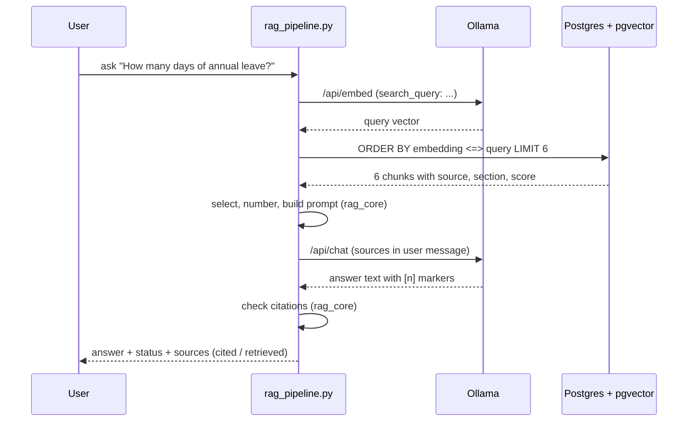

# 02. Building the RAG pipeline with citations

> **Draft: written but not yet run.** The code and the expected output in this lesson were prepared by reading the code and the official documentation. They have not been executed yet. If something does not behave as described, trust your tool's real output and report it.

## What you will be able to do
- Connect the tested core of lesson 01 to real retrieval (Postgres + pgvector) and real generation (Ollama).
- Produce answers that carry numbered citations back to a file and a section, and display which sources were cited versus merely retrieved.
- Break the pipeline on purpose (out-of-corpus question, edited document, tiny context) and read the status it reports.
- State why a citation is evidence of provenance, not of truth.

## Recap
1. Which statuses can `answer_question` return?
   <details><summary>Answer</summary>`answered`, `no_evidence`, `refused_by_model`, `failed_checks` and `context_too_small`.</details>
2. Why does the core not call the model when no hit passes the threshold?
   <details><summary>Answer</summary>Without evidence the model can only refuse or invent; code can guarantee the refusal.</details>
3. What does `semsearch.py ingest` skip, and how does it know?
   <details><summary>Answer</summary>Files whose SHA-256 hash is unchanged since the last ingest.</details>

## Why it matters
A RAG answer without a way to check it is a rumour with good grammar. Citations turn an answer into a claim you can verify in seconds: open file X, section Y. They also make failures visible: a citation that does not exist is a defect your code can catch, and a question that returns zero citations tells you retrieval found nothing. This lesson wires the pieces into a working command-line pipeline over a small invented policy corpus, and lets you watch it succeed and fail.

## What you will build
`rag_pipeline.py` with two commands, `ingest <folder>` and `ask "<question>"`. It reuses `semsearch.py` (lesson 201.09) for ingestion and embeddings, `rag_core.py` (lesson 301.01) for the decision logic, adds a retrieval query that returns chunk ids, scores and sections, and calls `llama3.2:3b` for generation. Three unit tests cover the formatting helpers. The corpus is nine sections across three invented policy files.



## Before you start
- **Prerequisites:** [Ollama 301 lesson 01, RAG architecture](01-rag-architecture.md) and [Ollama 201 lesson 09, project: semantic search CLI](../../201-hero-to-super-hero/phase-3-embeddings/09-project-semantic-search-cli.md).
- Time: 100-130 minutes for a first timer, in two sittings. Break after Step 5 (database up, unit tests pass, no model calls yet).
- Tools: everything from level 201 phase 3: Python 3.12+ with a virtual environment, Docker with Compose, native Ollama. Models: `nomic-embed-text:v1.5` (about 274 MB) and `llama3.2:3b`. Tags checked on https://ollama.com/library/llama3.2 and https://ollama.com/library/nomic-embed-text on **2026-11-23**: `llama3.2:3b` is listed at 2.0 GB with a 128K context window and the `tools` capability. Check free disk space before pulling.
- **Port 5432 is shared** with the Databases track, the capstone platform and the 201 lessons. Stop those stacks or set `POSTGRES_PORT` in `.env`. This lesson's Compose project has its own name and volume, so it does not touch the 201 data.
- Source pack (optional): every file is shown in full in this lesson, except eight files identical to earlier lessons (listed in Step 1). The finished code, the exercise starter and the solution are in https://github.com/Uee03/Code101 under `source/ollama/301-super-hero-to-legendary/phase-1-rag/02-pipeline-with-citations/` (on that page choose **Code, Download ZIP**, or run `git clone https://github.com/Uee03/Code101.git`).
- Packages: `psycopg[binary]==3.3.9` from `requirements.txt` (pip creates the environment's contents; no lockfile ships in this course).
- Answers and scores are never shown as expected output; only shapes and statuses derived from the code.

## Steps
### Step 1. Create the folder and copy the unchanged files
These eight files are identical to earlier lessons, so they are not shown again (the "genuinely identical steps" rule). Copy them without changes.

| File | Copy from | What it is |
|---|---|---|
| `ollama_http.py` | 201 lesson 01 | HTTP helper for Ollama |
| `textutil.py` | 201 lesson 07 | chunking helpers and vector maths |
| `db.py` | 201 lesson 08 | `.env` reader, `connect`, `to_vector_literal` |
| `semsearch.py` | 201 lesson 09 | file collection, heading-aware chunking, embedding, `cmd_ingest` |
| `rag_core.py` | 301 lesson 01 | selection, prompt layout, citation checks, `answer_question` |
| `requirements.txt` | 201 lesson 08 | `psycopg[binary]==3.3.9` |
| `.gitignore` | 201 lesson 08 | keeps `.env` and `.venv` out of Git |
| `initdb/01-schema.sql` | 201 lesson 08 | `search.documents`, `search.chunks`, HNSW index |

**File: `Windows PowerShell; starting anywhere`**
```powershell
New-Item -ItemType Directory -Path "$HOME/code101/ollama301-02/initdb" -Force | Out-Null
New-Item -ItemType Directory -Path "$HOME/code101/ollama301-02/corpus" -Force | Out-Null
Set-Location "$HOME/code101/ollama301-02"
Copy-Item "$HOME/code101/ollama201-01/ollama_http.py" .
Copy-Item "$HOME/code101/ollama201-07/textutil.py" .
Copy-Item "$HOME/code101/ollama201-09/semsearch.py" .
Copy-Item "$HOME/code101/ollama301-01/rag_core.py" .
foreach ($name in "db.py", "requirements.txt", ".gitignore") { Copy-Item "$HOME/code101/ollama201-08/$name" . }
Copy-Item "$HOME/code101/ollama201-08/initdb/01-schema.sql" initdb/
```

**File: `macOS/Linux terminal; starting anywhere`**
```bash
mkdir -p ~/code101/ollama301-02/initdb ~/code101/ollama301-02/corpus
cd ~/code101/ollama301-02
cp ~/code101/ollama201-01/ollama_http.py .
cp ~/code101/ollama201-07/textutil.py .
cp ~/code101/ollama201-09/semsearch.py .
cp ~/code101/ollama301-01/rag_core.py .
cp ~/code101/ollama201-08/{db.py,requirements.txt,.gitignore} .
cp ~/code101/ollama201-08/initdb/01-schema.sql initdb/
```
Expected result: no output. The schema is unchanged on purpose: `chunks.section` and `chunks.embedding_model` already hold what citations need.

### Step 2. The Compose file and the settings (new, in full)
This project uses its own Compose project name, container name, volume, database and user, so it can coexist with the 201 data on disk (but not on port 5432 at the same time). Every line works as explained in lesson 201.08; the differences are only the names.

**File: `~/code101/ollama301-02/docker-compose.yml`**
```yaml
name: code101-ollama-rag

services:
  db:
    image: pgvector/pgvector:0.8.7-pg17
    container_name: code101-ollama-rag-db
    restart: "no"
    environment:
      POSTGRES_USER: ${POSTGRES_USER:?set POSTGRES_USER in .env}
      POSTGRES_PASSWORD: ${POSTGRES_PASSWORD:?set POSTGRES_PASSWORD in .env}
      POSTGRES_DB: ${POSTGRES_DB:?set POSTGRES_DB in .env}
    ports:
      - "127.0.0.1:${POSTGRES_PORT:-5432}:5432"
    volumes:
      - ragdata:/var/lib/postgresql/data
      - ./initdb:/docker-entrypoint-initdb.d:ro
    healthcheck:
      test: ["CMD-SHELL", "pg_isready -h 127.0.0.1 -U $${POSTGRES_USER} -d $${POSTGRES_DB}"]
      interval: 5s
      timeout: 3s
      retries: 12
      start_period: 10s

volumes:
  ragdata:
```
Recap of the lines that matter for safety: `127.0.0.1:` publishes the port on loopback only; `${VAR:?message}` refuses to start with a missing setting; the image tag is pinned (checked on Docker Hub 2026-11-23); `restart: "no"` keeps the lab temporary; the `-h 127.0.0.1` in the healthcheck makes it pass only when the real server is up.

**File: `~/code101/ollama301-02/.env.example`**
```text
POSTGRES_USER=rag
POSTGRES_PASSWORD=change-me-before-first-start
POSTGRES_DB=ragdb
POSTGRES_PORT=5432
```

**File: `Windows PowerShell; folder ~/code101/ollama301-02`**
```powershell
Copy-Item .env.example .env
notepad .env
python -m venv .venv
.venv\Scripts\Activate.ps1
python -m pip install -r requirements.txt
docker compose up -d --wait
```

**File: `macOS/Linux terminal; folder ~/code101/ollama301-02`**
```bash
cp .env.example .env
nano .env
python3 -m venv .venv
source .venv/bin/activate
python -m pip install -r requirements.txt
docker compose up -d --wait
```
Set a new `POSTGRES_PASSWORD` used nowhere else. Expected result: pip ends with `Successfully installed`; Compose returns when the service is healthy (PowerShell script-policy note: lesson 201.08). Models, once, after checking free disk space:

**File: `Terminal, any OS`**
```text
ollama pull nomic-embed-text:v1.5
ollama pull llama3.2:3b
```

### Step 3. The corpus: nine facts in three invented files
Invented on purpose, so none of it is in any model's memory: if an answer contains these numbers, they came from retrieval.

**File: `~/code101/ollama301-02/corpus/leave-policy.md`**
```text
# Leave policy

## Annual leave
Full-time staff receive 25 days of paid annual leave per calendar year. Leave must be approved by a manager at least two weeks in advance.

## Carry-over
Up to 5 unused days may be carried into the next year. Carried days expire on 31 March.

## Sick leave
Staff who are ill must tell their manager before 10:00 on the first day. A medical note is required after three consecutive days.
```

**File: `~/code101/ollama301-02/corpus/expenses.md`**
```text
# Expenses

## Claims
Expense claims must be submitted within 30 days of purchase, with the original receipt attached.

## Travel
Train travel is booked in standard class. Flights need approval from a partner before booking.

## Meals
The daily meal allowance on client trips is 30 euros. Alcohol is never reimbursed.
```

**File: `~/code101/ollama301-02/corpus/security.md`**
```text
# Information security

## Passwords
Passwords must be at least 14 characters long and are kept in the firm's password manager.

## Client files
Client files may only be stored on the firm's file server. Copying them to personal devices or personal cloud storage is forbidden.

## Incidents
Report a lost laptop or a suspected phishing email to the IT desk within one hour.
```

### Step 4. The pipeline: `rag_pipeline.py`
Read the pieces in order. `RETRIEVE_SQL` returns the chunk id, source, section, content and `1 - distance` as the score. `retrieve` embeds the question with the query prefix and returns `Hit` objects. `generate` calls `/api/chat` with fixed options and returns an empty string when the reply was cut off (an empty answer fails `check_answer`, so a truncated answer is never shown). `render` prints the answer, the status, and each source marked `cited` or `retrieved`.

**File: `~/code101/ollama301-02/rag_pipeline.py`**
```python
import argparse

import semsearch
from db import connect, to_vector_literal
from ollama_http import post_json, run_cli
from rag_core import Hit, Settings, answer_question, extract_citations

GENERATION_MODEL = "llama3.2:3b"
RETRIEVE_K = 6
SETTINGS = Settings(min_score=0.0, max_hits=4, max_context_chars=3000)
MAX_QUESTION_CHARS = 500

RETRIEVE_SQL = """
SELECT c.id, d.source, c.section, c.content, 1 - (c.embedding <=> %s::vector) AS score
FROM search.chunks AS c
JOIN search.documents AS d ON d.id = c.document_id
WHERE c.embedding_model = %s
ORDER BY c.embedding <=> %s::vector
LIMIT %s
"""


def row_to_hit(row):
    chunk_id, source, section, content, score = row
    return Hit(chunk_id, source, section, content, float(score))


def retrieve(question):
    literal = to_vector_literal(semsearch.embed([question], semsearch.QUERY_PREFIX)[0])
    with connect() as conn:
        rows = conn.execute(RETRIEVE_SQL, (literal, semsearch.MODEL, literal, RETRIEVE_K)).fetchall()
    return [row_to_hit(row) for row in rows]


def generate(messages):
    body = {
        "model": GENERATION_MODEL,
        "messages": messages,
        "stream": False,
        "options": {"temperature": 0, "seed": 7, "num_ctx": 4096, "num_predict": 300},
    }
    data = post_json("/api/chat", body, timeout=300)
    if data.get("done_reason") == "length":
        return ""
    return data["message"]["content"]


def render(result):
    lines = [f"Answer: {result['answer']}", f"Status: {result['status']}"]
    cited = set(extract_citations(result["answer"]))
    for number, hit in enumerate(result["sources"], start=1):
        mark = "cited" if number in cited else "retrieved"
        lines.append(f"[{number}] {hit.source} / {hit.section or '-'} ({mark}, score {hit.score:.3f})")
    if result["problems"]:
        lines.append("Checks failed: " + "; ".join(result["problems"]))
    return "\n".join(lines)


def main():
    parser = argparse.ArgumentParser(prog="rag_pipeline", description="Ask questions of ingested documents.")
    commands = parser.add_subparsers(dest="command", required=True)
    ingest = commands.add_parser("ingest", help="read .md and .txt files from a folder")
    ingest.add_argument("folder")
    ingest.add_argument("--prune", action="store_true")
    ask = commands.add_parser("ask", help="answer one question from the documents")
    ask.add_argument("question")
    args = parser.parse_args()
    if args.command == "ingest":
        semsearch.cmd_ingest(args.folder, args.prune)
        return
    question = args.question.strip()
    if not question or len(question) > MAX_QUESTION_CHARS:
        raise SystemExit(f"the question must have 1 to {MAX_QUESTION_CHARS} characters")
    print(render(answer_question(question, retrieve, generate, SETTINGS)))


if __name__ == "__main__":
    run_cli(main)
```
Choices to notice:
- `temperature 0` and a fixed `seed` make a re-run on the same setup likely (not guaranteed) to repeat; that matters for evaluation (lesson 03).
- `num_ctx 4096` must hold the system prompt, up to 3000 characters of sources and the answer. About 3000 characters is on the order of a thousand tokens for English prose, so there is headroom; measure your real prompt size (`prompt_eval_count` in the reply) before raising `max_context_chars`. A prompt longer than `num_ctx` is truncated by the server, usually silently, which is a classic RAG bug.
- `min_score=0.0` disables the threshold on purpose: we have no measurements yet. Lesson 03 calibrates it.
- The question is bounded to 500 characters at the edge, as in the CLI of lesson 201.09.

### Step 5. Test the helpers, then take the break
**File: `~/code101/ollama301-02/test_rag_pipeline.py`**
```python
import unittest

from rag_core import REFUSAL, Hit
from rag_pipeline import render, row_to_hit

HIT = Hit(7, "leave-policy.md", "Annual leave", "Full-time staff receive 25 days.", 0.8123)


class PipelineHelperTests(unittest.TestCase):
    def test_row_to_hit(self):
        self.assertEqual(row_to_hit((7, "a.md", "", "text", 0.5)), Hit(7, "a.md", "", "text", 0.5))

    def test_render_an_answered_result(self):
        result = {"answer": "25 days [1].", "status": "answered", "sources": [HIT], "problems": []}
        expected = "\n".join([
            "Answer: 25 days [1].",
            "Status: answered",
            "[1] leave-policy.md / Annual leave (cited, score 0.812)",
        ])
        self.assertEqual(render(result), expected)

    def test_render_a_failed_result_lists_the_problems(self):
        result = {"answer": REFUSAL, "status": "failed_checks", "sources": [HIT], "problems": ["the answer cites no source"]}
        expected = "\n".join([
            "Answer: I cannot find that in the documents.",
            "Status: failed_checks",
            "[1] leave-policy.md / Annual leave (retrieved, score 0.812)",
            "Checks failed: the answer cites no source",
        ])
        self.assertEqual(render(result), expected)


if __name__ == "__main__":
    unittest.main()
```
**File: `Terminal; folder ~/code101/ollama301-02 (virtual environment active)`**
```text
python -m unittest
```
Expected result (not yet run): `Ran 3 tests in` and a small time, then `OK`. The test for `rag_core` itself lives in lesson 01; if you want it here too, copy `test_rag_core.py` and the count becomes 13. **Good place for the break.**

## Run it
Ingest, twice. Predict the second line first.

**File: `Terminal, any OS; folder ~/code101/ollama301-02 (virtual environment active)`**
```text
python rag_pipeline.py ingest corpus
python rag_pipeline.py ingest corpus
```
Expected output (derived by reading the code and the corpus: three files, three sections each):
```text
files: 3 found, 3 ingested, 0 unchanged, 0 skipped; chunks written: 9
files: 3 found, 0 ingested, 3 unchanged, 0 skipped; chunks written: 0
```
Now ask. Before each run, write down the status you expect (`answered`? `no_evidence`? `refused_by_model`?) and which file you expect cited:

**File: `Terminal, any OS; folder ~/code101/ollama301-02 (virtual environment active)`**
```text
python rag_pipeline.py ask "How many days of paid annual leave do full-time staff get?"
python rag_pipeline.py ask "Where may client files be stored?"
python rag_pipeline.py ask "What is the policy on working from home?"
```
Expected shape (not captured; the wording varies):
```text
Answer: <text with at least one [n] marker, or the refusal sentence>
Status: <answered | refused_by_model | failed_checks | no_evidence>
[1] <file>.md / <section> (<cited|retrieved>, score <0.xxx>)
[2] ...
```
For the first question you expect `answered` with the `leave-policy.md` annual-leave source marked `cited`; check the cited section yourself against the answer. For the third question the corpus has no answer: with `min_score=0.0` there is always *some* nearest chunk, so the status depends on the model refusing (`refused_by_model`) rather than on retrieval (`no_evidence`). That difference is exactly why lesson 03 measures a threshold.

Three experiments, each with a question to answer in writing:
1. **Weak evidence.** Ask `"Which VPN software does the firm use?"` several times. Is the answer ever `answered`? If it is, open the cited section and judge whether it supports the claim (a fluent invention with a real citation is the dangerous case).
2. **Edited document.** Change `25 days` to `27 days` in `corpus/leave-policy.md`, run `ingest corpus` (expect `1 ingested, 2 unchanged`, and `chunks written: 3`), then ask the first question again. The answer should follow the file, not the old text; if it does not, find out why before you trust the pipeline.
3. **Tiny context.** In `rag_pipeline.py` set `max_context_chars=50`, ask the first question and read the status (`context_too_small`, because no whole source fits), then set it back. Which part of your design would warn an operator that this happened?

Clean up at the end of the session (container and network only; `-v` would also delete the data):

**File: `Terminal, any OS; folder ~/code101/ollama301-02`**
```text
docker compose down
```

## How it works
1. **Separation of concerns.** `rag_core` knows nothing about Ollama or Postgres; `rag_pipeline` knows nothing about prompts or checks. Swapping Postgres for another store or Ollama for another server touches only `retrieve` and `generate`.
2. **What a citation proves.** A citation marker `[2]` proves only that the model produced the token `[2]` and that source 2 exists. Whether source 2 supports the sentence is a separate question that your code cannot answer. The status column and `cited` versus `retrieved` marks exist so a human can check quickly.
3. **Score semantics.** `score = 1 - cosine distance`. It ranks chunks for one query; do not compare scores across different embedding models or treat 0.8 as "80% sure".
4. **Why sections matter.** The heading text is stored in `chunks.section` and also embedded with the chunk text (lesson 201.09), so questions that echo a heading ("sick leave") match short chunks. Citations then read as `file / section`, which a human can find in seconds.
5. **Trade-offs to record in your design notes.** (a) `RETRIEVE_K=6` retrieves more than `max_hits=4` uses, leaving room for threshold and de-duplication; (b) a larger `max_hits` raises recall and prompt cost and dilutes small models; (c) `llama3.2:3b` is a small model: it will sometimes cite wrongly or ignore the sources, which is why the checks exist; (d) a larger model improves faithfulness at the cost of memory and latency, so measure.
6. **Common misconception:** "if the answer has a citation it is correct". Only the check results and your own review say anything about correctness.

## Try it
Starter: `exercise/starter` (copy the `starter` folder to `~/code101/ollama301-02/try01` and copy `rag_core.py` into it).
1. **Guided.** Complete the two TODOs in `cited.py` so that `python -m unittest` passes in `try01`. Read the failing tests first.
2. **Change.** Use `cited_sources` in `render` to print an extra line `Cited files: a.md, b.md` listing each cited file once, in citation order. Add a test with an answer that cites two sources from the same file.
3. **Stretch (no single answer).** Design an "open the passage" feature: what must the pipeline return so a user interface can show the cited text with the matching words highlighted, and what are the privacy implications of returning passage text from an API?

<details><summary>Solution</summary>

**File: `exercise/solution/cited.py`**
```python
from rag_core import extract_citations


def cited_sources(result):
    """Return (number, hit) pairs for the sources the answer actually cites, in citation order.

    result is the dictionary returned by answer_question. Source numbers start at 1 and refer to
    positions in result["sources"]. Ignore numbers that do not exist.
    """
    pairs = []
    for number in extract_citations(result["answer"]):
        if 1 <= number <= len(result["sources"]):
            pairs.append((number, result["sources"][number - 1]))
    return pairs
```
`extract_citations` returns a sorted list of unique numbers, so each source appears once. Source `[n]` is the n-th element of `sources`, hence `number - 1`. Numbers outside the range are skipped here because `check_answer` already turns them into a refusal; ignoring them keeps this helper total.
</details>

## Check yourself
1. Why does the pipeline return `failed_checks` and the refusal text instead of the model's uncited answer? <details><summary>Answer</summary>An answer without a verifiable citation cannot be trusted or audited, so the code refuses and records the problem.</details>
2. What does `context_too_small` mean and how can it happen? <details><summary>Answer</summary>Not even the first source fits in `max_context_chars`; it happens with a tiny budget or very large chunks.</details>
3. Predict the second `ingest` line. <details><summary>Answer</summary>`files: 3 found, 0 ingested, 3 unchanged, 0 skipped; chunks written: 0`.</details>
4. With `min_score=0.0`, can the status be `no_evidence` for a non-empty database? <details><summary>Answer</summary>No: retrieval always returns the nearest chunks, so something passes the threshold; only a positive threshold can produce `no_evidence`.</details>
5. What silent failure can an oversized prompt cause? <details><summary>Answer</summary>The server truncates input beyond `num_ctx`, so sources or the question can be cut without an error.</details>

## Common mistakes
| Symptom | Cause | Fix |
|---|---|---|
| `RuntimeError: copy .env.example to .env and set: ...` | No `.env` | Create it from `.env.example` |
| `port is already allocated` (typical message) | Another database on 5432 | Stop it or set `POSTGRES_PORT` |
| `HTTP 404 from Ollama...` | A model is not pulled | `ollama pull nomic-embed-text:v1.5` and `ollama pull llama3.2:3b` |
| First `ask` is very slow | Model load (cold start) | Wait; later calls reuse the loaded model for the keep-alive period |
| Every answer is `failed_checks` | The model does not use `[n]` markers | Print the raw reply in a scratch test; try a larger model or a clearer prompt |
| Answers ignore a document you just edited | Not re-ingested | Run `ingest corpus` again; check the `1 ingested` line |
| Scores look odd after changing the embedding model | Mixed models in the table | `semsearch.py reset --yes`, re-ingest everything |
| `ModuleNotFoundError: No module named 'psycopg'` (typical message) | Virtual environment not active | Activate `.venv` |

## Best practice
Cite by file and section, verify citation numbers in code, show the user which sources were used and which were only retrieved, and never describe a citation as proof of truth. Source: Ollama embeddings documentation https://docs.ollama.com/capabilities/embeddings (embedding side) and the OWASP Top 10 for LLM Applications https://owasp.org/www-project-top-10-for-large-language-model-applications/ (overreliance and prompt injection).

## Going further
- Hybrid retrieval (keyword plus vector) and re-ranking appear in practice capstone P06's requirements R-07 and R-08.
- Lesson 03 measures this pipeline; lesson 05 attacks it.

## Summary
- You connected the tested RAG core to Postgres retrieval and Ollama generation.
- You produced answers with numbered citations and showed cited versus retrieved sources.
- You provoked weak evidence, a stale document and a tiny context and read the resulting statuses.
- You stated what a citation does and does not prove.

## Next lesson
03. Evaluation: golden question sets, hit rate, mean reciprocal rank, refusal accuracy, and how to choose a threshold with data.
