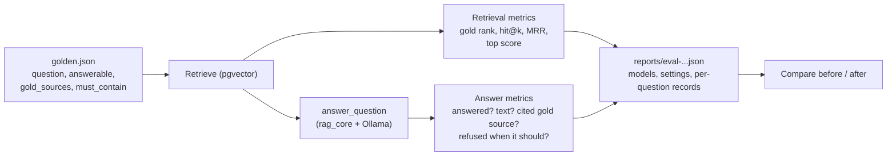

# 03. Evaluating RAG: golden questions, hit rate, MRR and answer checks

> **Draft: written but not yet run.** The code and the expected output in this lesson were prepared by reading the code and the official documentation. They have not been executed yet. If something does not behave as described, trust your tool's real output and report it.

## What you will be able to do
- Build a golden question set with answerable and unanswerable questions, and explain why gold labels point to source files, not to chunks.
- Compute hit rate at k and mean reciprocal rank (MRR) by hand and in code, and read both correctly.
- Separate retrieval quality from answer quality, and automatic checks from manual review.
- Choose a retrieval-score threshold from your own score distributions, and prove the change helped (or did not) with a before/after report.

## Recap
1. What are the five statuses `answer_question` can return?
   <details><summary>Answer</summary>`answered`, `no_evidence`, `refused_by_model`, `failed_checks`, `context_too_small`.</details>
2. Why is `min_score` 0.0 in the pipeline of lesson 02?
   <details><summary>Answer</summary>Nothing had been measured, so no threshold could be justified; this lesson measures it.</details>
3. Does a citation prove an answer is true?
   <details><summary>Answer</summary>No. It proves provenance only; support for the claim needs a check or a human.</details>

## Why it matters
Without measurements, every change to a RAG system (new chunk size, new model, new prompt) is an act of faith: a demo question improves, three others quietly get worse. Evaluation replaces impressions with a small, repeatable experiment: the same questions, the same scoring, a number before and a number after. It is also the only honest way to choose a refusal threshold, because the right value depends on how your own scores are distributed. This lesson shows how to measure. It gives you **no numbers to expect**, because any number I printed here would be a number from somebody else's machine.

## What you will build
`golden.json` (twelve questions over the corpus of lesson 02: nine answerable, three unanswerable), `metrics.py` (ranking metrics, answer judging and aggregation as pure functions, with nine unit tests), and `evaluate.py` with two commands: `scores` (retrieval only: cheap and fast) and `full` (retrieval, generation and checks, with a JSON report that stores model names and settings).



## Before you start
- **Prerequisites:** [Ollama 301 lesson 02, pipeline with citations](02-pipeline-with-citations.md).
- Time: 100-130 minutes for a first timer, in two sittings. Break after Step 5 (tests pass, nothing needs the model yet).
- Tools: everything from lesson 301.02: Docker with Compose, Python 3.12+ with a virtual environment, native Ollama with `nomic-embed-text:v1.5` and `llama3.2:3b` (checked 2026-11-23). The database image is `pgvector/pgvector:0.8.7-pg17` (checked on Docker Hub 2026-11-23). Port 5432 must be free (stop other labs).
- Source pack (optional): every file is shown in full in this lesson, except thirteen files identical to earlier lessons (Step 1). The finished code, the exercise starter and the solution are in https://github.com/Uee03/Code101 under `source/ollama/301-super-hero-to-legendary/phase-1-rag/03-evaluation/` (on that page choose **Code, Download ZIP**, or run `git clone https://github.com/Uee03/Code101.git`).
- **No expected numbers appear in this lesson.** Report shapes use placeholders. Your results depend on the model builds, your machine and your questions.

## Concepts you must be able to explain
**Golden set.** A fixed list of questions with known right answers, written *before* you tune the system. Rules that save you later:
1. **Cover the corpus and the question types:** facts, numbers, dates, negations ("can I claim X?"), and questions whose answer sits in a document you suspect the chunker cuts badly.
2. **Paraphrase.** Questions that copy the document's wording test keyword matching, not semantic retrieval. Ours reword on purpose ("how soon after buying something" for "within 30 days of purchase").
3. **Include unanswerable questions.** A system that answers everything scores perfectly on answerable questions and is dangerous. Ours has three, a quarter of the set.
4. **Label gold by source file (or document id), not by chunk id.** Chunk ids change whenever you re-chunk; file names survive. This is what lets you compare chunk sizes fairly.
5. **Verify the labels.** Before trusting a metric, check each gold label by hand with a text search (Step 3). A wrong label silently caps your score.
6. **Do not tune on the questions you report on.** With twelve questions you will be tempted to adjust the prompt until all twelve pass; that measures memorisation. Keep some questions unseen (see the stretch exercise).
7. **Size.** Twelve questions can show a gross failure; they cannot show a 3-point improvement. With few questions every question moves a rate by several points. Treat small differences as noise until you have hundreds of questions or repeated runs.

**Retrieval metrics** (over answerable questions; `rank` = position of the first retrieved chunk whose source is a gold source):
- **Hit rate at k**: the share of questions with `rank <= k`. It answers "is the evidence in the top k at all?". Hit rate at 1 is strict; at the number of chunks you give the model (here `max_hits`, 4) it tells you whether generation can possibly succeed.
- **MRR** (mean reciprocal rank): average of `1 / rank`, counting 0 when nothing relevant was retrieved. It rewards putting the right chunk first. Worked example: ranks `[1, 3, none]` give `(1/1 + 1/3 + 0) / 3 = 4/9`. Hit rate at 3 for the same ranks is 2/3.
- Both ignore *how many* relevant chunks exist and how long the list is; they are cheap and deterministic, which is why we run `scores` on every change.

**Answer metrics** (these need the model, so they vary between runs):
- **Correct** (automatic): status is `answered` **and** the answer contains every `must_contain` fragment (case-insensitive) **and** at least one cited source is a gold source. This is deliberately strict and crude: a correct answer worded differently from your fragment counts as a miss, and a wrong answer that happens to contain the fragment counts as a hit. Treat it as a screening tool, not as truth.
- **False refusal rate**: answerable questions that were not answered.
- **Refusal rate on unanswerable questions**, and **wrongly answered** (the dangerous count).
- **Faithfulness** (manual): is every claim in the answer supported by the cited text? An automatic fragment check cannot tell. Sample answers and score them with a rubric:

| Score | Meaning |
|---|---|
| 2 | Every claim is supported by a cited source; nothing important is missing |
| 1 | Supported, but incomplete, or cites more or fewer sources than needed |
| 0 | A claim is unsupported, contradicts the source, or the citation does not contain the fact |

Review at least every `answered` result that looks suspicious, and a random sample of the rest; record who reviewed and when.

**Threshold calibration.** Compare the best retrieval score of answerable questions with that of unanswerable ones. If the lowest answerable top score is above the highest unanswerable top score, any value between them separates the groups on this set, and the midpoint is a sensible first choice. If the groups overlap, **no threshold works**, and you must improve retrieval (chunking, query handling, a better embedding model) or accept a trade: raising the threshold removes unanswerable answers at the cost of more false refusals. Choose by the cost of each error.

> **Why this, not that.** Why not use a second model to grade answers ("LLM as judge")? It scales, but it brings its own errors and biases, needs its own validation against human labels, and makes results depend on another model version. Use it later as a *screen* on top of a human-checked sample, never as the only judge.

## Steps
### Step 1. Create the folder and copy the unchanged files
These thirteen files are identical to earlier lessons and are not shown again. Copy them from your lesson 301.02 folder without changes (they in turn came from 201 lessons 01, 07, 08, 09 and 301 lesson 01).

| Files | What they are |
|---|---|
| `ollama_http.py`, `textutil.py`, `db.py`, `semsearch.py` | HTTP helper, chunk helpers, database helpers, heading-aware ingest |
| `rag_core.py`, `rag_pipeline.py` | RAG decision logic; retrieval, generation and rendering |
| `requirements.txt`, `docker-compose.yml`, `.env.example`, `initdb/01-schema.sql` | `psycopg[binary]==3.3.9`; the pgvector database; the settings template; the schema |
| `corpus/leave-policy.md`, `corpus/expenses.md`, `corpus/security.md` | the three invented policy files |

**File: `Windows PowerShell; starting anywhere`**
```powershell
New-Item -ItemType Directory -Path "$HOME/code101/ollama301-03/initdb" -Force | Out-Null
New-Item -ItemType Directory -Path "$HOME/code101/ollama301-03/corpus" -Force | Out-Null
Set-Location "$HOME/code101/ollama301-03"
$from = "$HOME/code101/ollama301-02"
foreach ($name in "ollama_http.py", "textutil.py", "db.py", "semsearch.py", "rag_core.py", "rag_pipeline.py", "requirements.txt", "docker-compose.yml", ".env.example") { Copy-Item "$from/$name" . }
Copy-Item "$from/initdb/01-schema.sql" initdb/
Copy-Item "$from/corpus/*.md" corpus/
```

**File: `macOS/Linux terminal; starting anywhere`**
```bash
mkdir -p ~/code101/ollama301-03/initdb ~/code101/ollama301-03/corpus
cd ~/code101/ollama301-03
from=~/code101/ollama301-02
cp "$from"/{ollama_http.py,textutil.py,db.py,semsearch.py,rag_core.py,rag_pipeline.py,requirements.txt,docker-compose.yml,.env.example} .
cp "$from/initdb/01-schema.sql" initdb/
cp "$from"/corpus/*.md corpus/
```
Expected result: no output. This lesson also needs one new ignore file, because reports contain answers:

**File: `~/code101/ollama301-03/.gitignore`**
```text
.env
.venv/
__pycache__/
reports/
```

### Step 2. The golden set
Twelve questions. Read each one against the corpus files and check that you agree with its label before you go on.

**File: `~/code101/ollama301-03/golden.json`**
```json
[
  {"id": "q01", "question": "How many days of paid annual leave do full-time staff get?", "answerable": true, "gold_sources": ["leave-policy.md"], "must_contain": ["25"]},
  {"id": "q02", "question": "How long before a holiday must a manager approve it?", "answerable": true, "gold_sources": ["leave-policy.md"], "must_contain": ["two weeks"]},
  {"id": "q03", "question": "When do carried-over leave days run out?", "answerable": true, "gold_sources": ["leave-policy.md"], "must_contain": ["31 March"]},
  {"id": "q04", "question": "By what time on the first day must I tell my manager that I am ill?", "answerable": true, "gold_sources": ["leave-policy.md"], "must_contain": ["10:00"]},
  {"id": "q05", "question": "How soon after buying something must I file an expense claim?", "answerable": true, "gold_sources": ["expenses.md"], "must_contain": ["30 days"]},
  {"id": "q06", "question": "Can I claim back the cost of alcohol on a client trip?", "answerable": true, "gold_sources": ["expenses.md"], "must_contain": ["alcohol"]},
  {"id": "q07", "question": "What is the minimum length of a password?", "answerable": true, "gold_sources": ["security.md"], "must_contain": ["14"]},
  {"id": "q08", "question": "Where may client files be stored?", "answerable": true, "gold_sources": ["security.md"], "must_contain": ["file server"]},
  {"id": "q09", "question": "Who must I tell about a lost laptop, and how soon?", "answerable": true, "gold_sources": ["security.md"], "must_contain": ["hour"]},
  {"id": "q10", "question": "What is the firm's policy on working from home?", "answerable": false, "gold_sources": [], "must_contain": []},
  {"id": "q11", "question": "How large is the annual bonus?", "answerable": false, "gold_sources": [], "must_contain": []},
  {"id": "q12", "question": "Which VPN software does the firm use?", "answerable": false, "gold_sources": [], "must_contain": []}
]
```
Notes: the `must_contain` fragments are lower-risk anchors (numbers and distinctive words), because a small model may reword a sentence but should keep the number. `q06` only checks for the word "alcohol", which is weak; a better check for a yes/no question needs review by a person, which is exactly why a manual sample is part of the method.

### Step 3. Verify the gold labels with a text search
Before measuring, prove each answerable question's evidence is in its gold file. For `q07` (password length) search for `14`:

**File: `Windows PowerShell; folder ~/code101/ollama301-03`**
```powershell
Select-String -Path corpus/*.md -Pattern "14 characters" | Select-Object Filename, LineNumber
```

**File: `macOS/Linux terminal; folder ~/code101/ollama301-03`**
```bash
grep -n "14 characters" corpus/*.md
```
Expected result: exactly one match, in `security.md`. If a fact appears in two files, both belong in `gold_sources`. Do the same for two other questions of your choice.

### Step 4. The metrics module
Everything that decides a number is a pure function, so it can be tested with hand-made inputs. Read `judge` carefully: it takes the retrieved hits (for ranking metrics) and the pipeline result (for answer metrics) and returns one flat record per question.

**File: `~/code101/ollama301-03/metrics.py`**
```python
import statistics

from rag_core import extract_citations

REFUSAL_STATUSES = {"no_evidence", "refused_by_model", "failed_checks", "context_too_small"}


def first_relevant_rank(sources, gold_sources):
    for rank, source in enumerate(sources, start=1):
        if source in gold_sources:
            return rank
    return None


def hit_rate(ranks, k):
    if not ranks:
        return None
    return sum(1 for rank in ranks if rank is not None and rank <= k) / len(ranks)


def mean_reciprocal_rank(ranks):
    if not ranks:
        return None
    return sum(1 / rank for rank in ranks if rank is not None) / len(ranks)


def contains_all(text, fragments):
    lowered = text.lower()
    return all(fragment.lower() in lowered for fragment in fragments)


def rate(count, total):
    return None if total == 0 else count / total


def score_gap(answerable_scores, unanswerable_scores):
    lowest_answerable = min(answerable_scores)
    highest_unanswerable = max(unanswerable_scores)
    return lowest_answerable, highest_unanswerable, lowest_answerable > highest_unanswerable


def judge(entry, hits, result):
    record = {
        "id": entry["id"],
        "answerable": entry["answerable"],
        "status": result["status"],
        "top_score": hits[0].score if hits else None,
    }
    if entry["answerable"]:
        record["rank"] = first_relevant_rank([hit.source for hit in hits], entry["gold_sources"])
        cited = [result["sources"][number - 1].source
                 for number in extract_citations(result["answer"])
                 if 1 <= number <= len(result["sources"])]
        record["answered"] = result["status"] == "answered"
        record["text_ok"] = contains_all(result["answer"], entry["must_contain"])
        record["citation_ok"] = any(source in entry["gold_sources"] for source in cited)
        record["correct"] = record["answered"] and record["text_ok"] and record["citation_ok"]
    else:
        record["refused"] = result["status"] in REFUSAL_STATUSES
    return record


def aggregate(records, ks=(1, 3)):
    answerable = [record for record in records if record["answerable"]]
    unanswerable = [record for record in records if not record["answerable"]]
    ranks = [record["rank"] for record in answerable]
    summary = {
        "answerable": len(answerable),
        "unanswerable": len(unanswerable),
        "hit_rate": {k: hit_rate(ranks, k) for k in ks},
        "mrr": mean_reciprocal_rank(ranks),
        "correct_rate": rate(sum(1 for record in answerable if record["correct"]), len(answerable)),
        "false_refusal_rate": rate(sum(1 for record in answerable if not record["answered"]), len(answerable)),
        "refusal_rate": rate(sum(1 for record in unanswerable if record["refused"]), len(unanswerable)),
        "wrongly_answered": sum(1 for record in unanswerable if not record["refused"]),
        "score_gap": None,
    }
    answerable_scores = [record["top_score"] for record in answerable if record["top_score"] is not None]
    unanswerable_scores = [record["top_score"] for record in unanswerable if record["top_score"] is not None]
    if answerable_scores and unanswerable_scores:
        summary["score_gap"] = score_gap(answerable_scores, unanswerable_scores)
    return summary


def spread(values):
    values = [value for value in values if value is not None]
    if not values:
        return None
    return min(values), statistics.median(values), max(values)
```
Design points: a `None` rank (nothing relevant retrieved) counts as a miss in hit rate and contributes 0 to MRR; the `failed_checks` and `context_too_small` statuses count as refusals for unanswerable questions (the user saw the refusal text); the cited-source check maps citation numbers back to sources through `result["sources"]`, ignoring numbers that do not exist.

### Step 5. Test the metrics, then take the break
**File: `~/code101/ollama301-03/test_metrics.py`**
```python
import unittest

from metrics import (
    aggregate,
    contains_all,
    first_relevant_rank,
    hit_rate,
    judge,
    mean_reciprocal_rank,
    score_gap,
)
from rag_core import Hit

HITS = [Hit(1, "a.md", "S", "text", 0.9), Hit(2, "b.md", "", "other", 0.5)]
ENTRY = {"id": "q1", "answerable": True, "gold_sources": ["a.md"], "must_contain": ["25"]}


class RankingMetricTests(unittest.TestCase):
    def test_first_relevant_rank(self):
        self.assertEqual(first_relevant_rank(["a", "b", "c"], {"b"}), 2)
        self.assertIsNone(first_relevant_rank(["a", "b"], {"z"}))

    def test_hit_rate(self):
        ranks = [1, 3, None]
        self.assertAlmostEqual(hit_rate(ranks, 1), 1 / 3)
        self.assertAlmostEqual(hit_rate(ranks, 3), 2 / 3)
        self.assertIsNone(hit_rate([], 3))

    def test_mean_reciprocal_rank(self):
        self.assertAlmostEqual(mean_reciprocal_rank([1, 3, None]), 4 / 9)

    def test_contains_all_ignores_case(self):
        self.assertTrue(contains_all("You get 25 DAYS", ["25", "days"]))
        self.assertFalse(contains_all("You get 25", ["25", "days"]))

    def test_score_gap(self):
        self.assertEqual(score_gap([0.7, 0.8], [0.5, 0.6]), (0.7, 0.6, True))
        self.assertEqual(score_gap([0.55, 0.8], [0.6]), (0.55, 0.6, False))


class JudgeTests(unittest.TestCase):
    def test_a_correct_answer(self):
        result = {"answer": "25 days [1].", "status": "answered", "sources": HITS, "problems": []}
        record = judge(ENTRY, HITS, result)
        self.assertEqual(record["rank"], 1)
        self.assertTrue(record["correct"])

    def test_a_citation_to_the_wrong_source_is_not_correct(self):
        result = {"answer": "25 days [2].", "status": "answered", "sources": HITS, "problems": []}
        record = judge(ENTRY, HITS, result)
        self.assertFalse(record["citation_ok"])
        self.assertFalse(record["correct"])

    def test_unanswerable_questions(self):
        entry = {"id": "q9", "answerable": False}
        refused = {"answer": "x", "status": "refused_by_model", "sources": HITS, "problems": []}
        answered = {"answer": "x [1]", "status": "answered", "sources": HITS, "problems": []}
        self.assertTrue(judge(entry, HITS, refused)["refused"])
        self.assertFalse(judge(entry, HITS, answered)["refused"])


class AggregateTests(unittest.TestCase):
    def test_aggregate(self):
        records = [
            {"answerable": True, "rank": 1, "answered": True, "correct": True, "top_score": 0.9},
            {"answerable": True, "rank": 3, "answered": True, "correct": False, "top_score": 0.7},
            {"answerable": True, "rank": None, "answered": False, "correct": False, "top_score": 0.6},
            {"answerable": False, "refused": True, "top_score": 0.5},
            {"answerable": False, "refused": False, "top_score": 0.65},
        ]
        summary = aggregate(records, ks=(1, 3))
        self.assertEqual(summary["answerable"], 3)
        self.assertEqual(summary["unanswerable"], 2)
        self.assertAlmostEqual(summary["hit_rate"][1], 1 / 3)
        self.assertAlmostEqual(summary["hit_rate"][3], 2 / 3)
        self.assertAlmostEqual(summary["mrr"], 4 / 9)
        self.assertAlmostEqual(summary["correct_rate"], 1 / 3)
        self.assertAlmostEqual(summary["false_refusal_rate"], 1 / 3)
        self.assertAlmostEqual(summary["refusal_rate"], 0.5)
        self.assertEqual(summary["wrongly_answered"], 1)
        self.assertEqual(summary["score_gap"], (0.6, 0.65, False))


if __name__ == "__main__":
    unittest.main()
```
**File: `Terminal; folder ~/code101/ollama301-03`** (Windows `python`, macOS/Linux `python3`)
```text
python -m unittest
```
Expected result (not yet run): `Ran 9 tests in` and a small time, then `OK`. The last test is a worked example of an *overlap*: the lowest answerable top score (0.6) sits below the highest unanswerable one (0.65), so `score_gap` reports `False`, meaning no threshold separates these made-up groups. **Good place for the break.**

### Step 6. The evaluation program
`scores` runs retrieval only (seconds, no generation) and prints, per question, the top score and the rank of the first gold source. `full` runs everything, prints the summary and the failing questions, and writes a JSON report with the versions and settings next to the per-question records (including answer text: the reports folder is git-ignored; if you ever evaluate on private documents, treat the reports as private too).

**File: `~/code101/ollama301-03/evaluate.py`**
```python
import argparse
import json
import time
from datetime import datetime
from pathlib import Path

import rag_pipeline
import semsearch
from metrics import aggregate, judge, spread
from ollama_http import get_json, run_cli
from rag_core import Settings, answer_question

HERE = Path(__file__).resolve().parent
KS = (1, 3, 6)


def load_golden():
    return json.loads((HERE / "golden.json").read_text(encoding="utf-8"))


def cmd_scores(golden):
    answerable_scores = []
    unanswerable_scores = []
    for entry in golden:
        hits = rag_pipeline.retrieve(entry["question"])
        top = hits[0].score if hits else None
        ranks = [hit.source in entry["gold_sources"] for hit in hits]
        gold_rank = ranks.index(True) + 1 if True in ranks else None
        (answerable_scores if entry["answerable"] else unanswerable_scores).append(top)
        shown = "-" if top is None else f"{top:.3f}"
        print(f"{entry['id']} | {'answerable' if entry['answerable'] else 'unanswerable'} | top={shown} | gold_rank={gold_rank or '-'}")
    print("answerable top scores (min, median, max):", spread(answerable_scores))
    print("unanswerable top scores (min, median, max):", spread(unanswerable_scores))


def run_full(golden, settings):
    records = []
    for entry in golden:
        started = time.perf_counter()
        hits = rag_pipeline.retrieve(entry["question"])
        result = answer_question(entry["question"], lambda question: hits, rag_pipeline.generate, settings)
        record = judge(entry, hits, result)
        record["seconds"] = round(time.perf_counter() - started, 2)
        record["answer"] = result["answer"]
        records.append(record)
    return records


def print_summary(summary):
    print(f"answerable questions: {summary['answerable']}, unanswerable: {summary['unanswerable']}")
    for k, value in summary["hit_rate"].items():
        print(f"hit rate at {k}: {value}")
    print(f"MRR: {summary['mrr']}")
    print(f"correct answers (answered, right text, right source cited): {summary['correct_rate']}")
    print(f"false refusals of answerable questions: {summary['false_refusal_rate']}")
    print(f"correct refusals of unanswerable questions: {summary['refusal_rate']}")
    print(f"unanswerable questions answered anyway: {summary['wrongly_answered']}")
    print(f"score gap (lowest answerable top score, highest unanswerable top score, separable): {summary['score_gap']}")


def print_failures(records):
    for record in records:
        if record["answerable"] and not record["correct"]:
            print(f"FAIL {record['id']}: status={record['status']} rank={record['rank']} text_ok={record['text_ok']} citation_ok={record['citation_ok']}")
        if not record["answerable"] and not record["refused"]:
            print(f"FAIL {record['id']}: an unanswerable question was answered")


def cmd_full(golden, min_score, label):
    settings = Settings(min_score=min_score, max_hits=rag_pipeline.SETTINGS.max_hits,
                        max_context_chars=rag_pipeline.SETTINGS.max_context_chars)
    records = run_full(golden, settings)
    summary = aggregate(records, KS)
    print_summary(summary)
    print_failures(records)
    report = {
        "created": datetime.now().isoformat(timespec="seconds"),
        "label": label,
        "ollama_version": get_json("/api/version").get("version"),
        "embedding_model": semsearch.MODEL,
        "generation_model": rag_pipeline.GENERATION_MODEL,
        "retrieve_k": rag_pipeline.RETRIEVE_K,
        "settings": {"min_score": settings.min_score, "max_hits": settings.max_hits,
                     "max_context_chars": settings.max_context_chars},
        "summary": summary,
        "records": records,
    }
    folder = HERE / "reports"
    folder.mkdir(exist_ok=True)
    path = folder / f"eval-{datetime.now().strftime('%Y%m%d-%H%M%S')}-{label}.json"
    path.write_text(json.dumps(report, indent=2), encoding="utf-8")
    print(f"report written to {path.name}")


def main():
    parser = argparse.ArgumentParser(description="Evaluate the RAG pipeline on the golden question set.")
    commands = parser.add_subparsers(dest="command", required=True)
    commands.add_parser("scores", help="retrieval only: top scores and the rank of the gold source")
    full = commands.add_parser("full", help="retrieval and generation, with a JSON report")
    full.add_argument("--min-score", type=float, default=0.0)
    full.add_argument("--label", default="run")
    args = parser.parse_args()
    golden = load_golden()
    if args.command == "scores":
        cmd_scores(golden)
    else:
        cmd_full(golden, args.min_score, args.label)


if __name__ == "__main__":
    run_cli(main)
```
In `run_full` the retrieval happens once per question and the same hits feed both the metrics and `answer_question` (through the `lambda`), so the ranking you measure is exactly the ranking the model saw.

## Run it
Environment first (same as lesson 301.02; the Windows PowerShell block comes first, then the macOS/Linux block):

**File: `Windows PowerShell; folder ~/code101/ollama301-03`**
```powershell
Copy-Item .env.example .env
notepad .env
python -m venv .venv
.venv\Scripts\Activate.ps1
python -m pip install -r requirements.txt
docker compose up -d --wait
python rag_pipeline.py ingest corpus
```

**File: `macOS/Linux terminal; folder ~/code101/ollama301-03`**
```bash
cp .env.example .env
nano .env
python3 -m venv .venv
source .venv/bin/activate
python -m pip install -r requirements.txt
docker compose up -d --wait
python rag_pipeline.py ingest corpus
```
Expected output of the last command on a fresh database (derived from the corpus): `files: 3 found, 3 ingested, 0 unchanged, 0 skipped; chunks written: 9`. If another Compose project already holds port 5432, stop it first.

**1. Retrieval only.** Predict first: for answerable questions, which `gold_rank` do you expect for most, and could any of the three unanswerable questions have a top score as high as an answerable one?

**File: `Terminal, any OS; folder ~/code101/ollama301-03 (virtual environment active)`**
```text
python evaluate.py scores
```
Expected shape (not captured; twelve lines, then two summary lines):
```text
q01 | answerable | top=<0.xxx> | gold_rank=<1..6 or ->
...
q10 | unanswerable | top=<0.xxx> | gold_rank=-
...
answerable top scores (min, median, max): (<number>, <number>, <number>)
unanswerable top scores (min, median, max): (<number>, <number>, <number>)
```
Read it like an analyst: Is any answerable `gold_rank` above 1 or `-`? Do the two ranges overlap? The answer to the second question decides whether a threshold can work.

**2. Baseline.** Run the full evaluation with no threshold, and give it a label:

**File: `Terminal, any OS; folder ~/code101/ollama301-03 (virtual environment active)`**
```text
python evaluate.py full --label baseline
```
It makes about twelve generation calls, so expect a few minutes on CPU. Expected shape (not captured):
```text
answerable questions: 9, unanswerable: 3
hit rate at 1: <fraction>
hit rate at 3: <fraction>
hit rate at 6: <fraction>
MRR: <fraction>
correct answers (answered, right text, right source cited): <fraction>
false refusals of answerable questions: <fraction>
correct refusals of unanswerable questions: <fraction>
unanswerable questions answered anyway: <count>
score gap (lowest answerable top score, highest unanswerable top score, separable): (<number>, <number>, <True or False>)
FAIL <id>: ...            (one line per failing question, if any)
report written to eval-<timestamp>-baseline.json
```
The counts `9` and `3` are fixed by the golden file; every other value is yours. **Write the summary down with the date.** Then read each `FAIL` line: is it a retrieval failure (`rank` is `None` or large), a wording miss (`text_ok` is False although the answer looks right), a citation miss, or a model refusal? Each needs a different fix.

**3. Choose a threshold from data.** If the `score gap` ends with `True`, take a value between the two numbers (the exercise computes the midpoint) and run again:

**File: `Terminal, any OS; folder ~/code101/ollama301-03 (virtual environment active)`**
```text
python evaluate.py full --min-score <your value> --label threshold
```
Compare the two reports field by field: `correct_rate`, `false_refusal_rate`, `refusal_rate`, `wrongly_answered`. State in one sentence what improved and what got worse. If the gap was `False`, do not pick a number anyway: write down which change to retrieval you would try first, and re-run `scores` after it.

**4. Repeatability.** Run `full --label baseline-again` with the same settings. Retrieval numbers should match the first run exactly; generation-dependent numbers should be close (temperature 0 and a fixed seed make repeats likely, not certain). Differences larger than you expected mean your comparisons between two *different* configurations need more questions or repeated runs.

Stop the database when you are done (`docker compose down`; add `-v` only to delete the data).

## How it works
1. **Why `scores` exists.** Retrieval is deterministic and fast; you can run it after every chunking or embedding change, in seconds. Generation is slow and varies. Check retrieval first: if the gold source is not retrieved, no prompt can save the answer.
2. **Separating failure causes.** The record keeps `rank`, `answered`, `text_ok`, `citation_ok` and `status` separately, so a failing question can be traced to the stage that failed.
3. **What the report must contain** to be useful six months later: the Ollama version, both model names, the retrieval and selection settings, the date and label, the per-question records, and the summary. Without those a number cannot be reproduced or compared.
4. **Regression discipline.** Treat the golden set like a test suite: run `scores` on every change to chunking, embedding or retrieval; run `full` before merging a change to the prompt or model; keep the reports; investigate every question that flips from pass to fail, even when the total improves.
5. **Common misconception:** "the summary number is the quality of the system". It is the quality *on these questions with this scoring*. A system tuned to a small golden set is overfitted to it.

## Try it
Starter: `exercise/starter` (copy the `starter` folder to `~/code101/ollama301-03/try01` and copy `metrics.py` and `rag_core.py` into it).
1. **Guided.** Complete the three TODOs in `threshold.py` so that `python -m unittest` passes in `try01`.
2. **Change.** Add two answerable questions of your own to `golden.json` (invent a fact and add it to a corpus file, verify the gold label as in Step 3), re-ingest, and re-run `scores`. Which metric moved, and was the move meaningful at this size?
3. **Stretch (no single answer).** Split the questions into a tuning half and a held-out half. Tune `min_score` on the first half only, then report both halves. Describe what a large difference between the two halves would tell you.

<details><summary>Solution</summary>

**File: `exercise/solution/threshold.py`**
```python
from metrics import score_gap


def suggest_threshold(answerable_scores, unanswerable_scores):
    """Return a score threshold halfway between the two groups, or None when they overlap.

    answerable_scores are the best retrieval scores of questions the documents can answer;
    unanswerable_scores are the best scores of questions they cannot answer.
    """
    lowest_answerable, highest_unanswerable, separable = score_gap(answerable_scores, unanswerable_scores)
    if not separable:
        return None
    return (lowest_answerable + highest_unanswerable) / 2
```
The midpoint is a defensible *starting* value, not an optimum: it assumes the two kinds of error cost the same, and it uses only the extreme questions, so it is sensitive to one odd score. Re-check it whenever the corpus or embedding model changes.
</details>

## Check yourself
1. Why label gold by file name and not by chunk id? <details><summary>Answer</summary>Chunk ids change whenever you re-chunk or re-ingest; file names are stable, so results stay comparable across chunking experiments.</details>
2. Compute hit rate at 3 and MRR for ranks `[2, None, 1, 4]`. <details><summary>Answer</summary>Hit rate at 3 is 2/4 = 0.5 (ranks 2 and 1). MRR is (1/2 + 0 + 1/1 + 1/4) / 4 = 1.75 / 4 = 0.4375.</details>
3. The answerable and unanswerable top-score ranges overlap. What can you not do, and what can you do? <details><summary>Answer</summary>No threshold separates the groups. You can improve retrieval, or choose a threshold that trades false refusals against wrongly answered questions according to their costs.</details>
4. Why is "correct" computed automatically only a screening result? <details><summary>Answer</summary>It checks fragments and a cited source, not whether every claim is supported; a correct answer worded differently fails and an unsupported answer containing the fragment passes. Manual review covers that.</details>
5. Name one reason two runs with identical settings might differ. <details><summary>Answer</summary>Generation is not guaranteed to repeat even with temperature 0 and a seed (hardware, server version, batching); retrieval should repeat exactly.</details>

## Common mistakes
| Symptom | Cause | Fix |
|---|---|---|
| `hit rate` all `None` or zero | Database is empty | Run `python rag_pipeline.py ingest corpus` |
| `KeyError: 'rank'` printing failures (typical message) | An edited record lacks the key for its kind | Keep `answerable` entries and `rank` consistent in `judge` |
| Every question `FAIL` with `citation_ok=False` | `gold_sources` do not match the stored `source` names | Source names are paths relative to the ingested folder (for example `security.md`) |
| Scores differ after editing a corpus file | The file was re-ingested | Expected; keep the golden set fixed and re-run |
| Reports contain answers you consider private | Evaluating on private documents | Keep `reports/` git-ignored, store it on encrypted disk, delete when done |
| Threshold "worked" on 12 questions and fails in use | Overfitted to a tiny set | Add questions, keep a held-out set |
| `ModuleNotFoundError: No module named 'psycopg'` (typical message) | Virtual environment not active | Activate `.venv` |

## Best practice
Write the golden set before tuning, label gold by stable document ids, include unanswerable questions, store every report with the model names, settings and versions, and never claim an improvement smaller than the noise of your question set. Source: Manning, Raghavan and Schütze, Introduction to Information Retrieval, chapter 8 "Evaluation in information retrieval" https://nlp.stanford.edu/IR-book/html/htmledition/evaluation-in-information-retrieval-1.html (the vocabulary of relevance judgements and ranked-retrieval metrics; this lesson implements the simple ones by hand to show what they mean).

## Going further
- Practice capstone P06 requirements R-10 and R-13 (refusal accuracy and an evaluation harness with stored runs).
- Add keyword search and compare hybrid retrieval on `scores` before touching generation.

## Summary
- You built a golden set with unanswerable questions and stable gold labels, and verified them.
- You computed hit rate and MRR by hand and in code, and tested the maths.
- You separated retrieval failures from answer failures, and automatic checks from manual review.
- You calibrated a threshold from score distributions, or learned that none exists, with no borrowed numbers.

## Next lesson
04. Tool calling with Ollama: a function schema, the call-and-result loop, and how to design tools so a mistaken or manipulated model cannot do harm.
