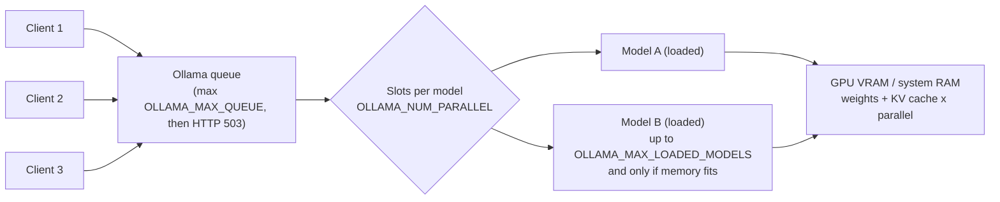

# 06. Serving and scaling a local model service

> **Draft: written but not yet run.** The code and the expected output in this lesson were prepared by reading the code and the official documentation. They have not been executed yet. If something does not behave as described, trust your tool's real output and report it.

## What you will be able to do
- Explain how Ollama schedules concurrent requests, loaded models and queued work, and which environment variables control each.
- Run a bounded concurrency test, read latency percentiles and throughput, and tell a queueing problem from a capacity problem.
- Choose `keep_alive`, `OLLAMA_NUM_PARALLEL`, `OLLAMA_MAX_LOADED_MODELS` and `OLLAMA_MAX_QUEUE` from your measurements and memory budget.
- Set server environment variables correctly on Windows, macOS and Linux, and reverse the change.
- State what is different for AMD on Windows, NVIDIA and Apple, with the documentation as the source of every claim.

## Recap
1. What is the difference between a cold and a warm request (lesson 201.02)?
   <details><summary>Answer</summary>A cold request includes loading the model into memory; a warm one finds it loaded.</details>
2. Why report p95 and not only the average?
   <details><summary>Answer</summary>The average hides the slow tail that users actually feel; a percentile shows it.</details>
3. What bounds the number of concurrent generations in the service of lesson 08?
   <details><summary>Answer</summary>A small semaphore (two slots): beyond it callers get a "busy" response instead of an unbounded queue.</details>

## Why it matters
One user and one model is a hobby. Two users arriving together is a queueing problem: a model that answers in a few seconds for one person answers in many seconds for the last of several, unless the server runs requests in parallel, which costs memory. Operating a local model service is therefore mostly arithmetic about three budgets (memory, time and queue length) plus the discipline to measure instead of guess. This lesson gives you the vocabulary, one bounded test tool, and the settings that matter.

## What you will build
`stats.py` (nearest-rank percentiles and a run summary, five tests), `load_test.py` (a bounded concurrency test with a warm-up, a placement snapshot and a CSV), `ollama-override.conf` (a Linux systemd drop-in), and `set-ollama-env.ps1` (set and remove the server variables for your Windows user). You will run a small experiment matrix and record the results in a table you fill with your own numbers.



## Before you start
- **Prerequisites:** [Ollama 201 lesson 02, choosing and comparing models](../../201-hero-to-super-hero/phase-1-customising/02-choosing-and-comparing-models.md) and [Ollama 301 lesson 02, pipeline with citations](../phase-1-rag/02-pipeline-with-citations.md).
- Time: 100-130 minutes for a first timer, in two sittings. Break after Step 4 (tests pass, nothing measured yet).
- Tools: Python 3.12+, native Ollama on `127.0.0.1:11434`, `llama3.2:1b` (about 1.3 GB, checked 2026-11-23 at https://ollama.com/library/llama3.2). No `pip install`: standard library only.
- **Care with load tests.** The tool is capped at 40 requests per level and 8 concurrent workers, uses a tiny prompt and a 40-token answer limit, and only talks to your own loopback server. Never point load tools at a server you do not own. Close other heavy programs, and on a laptop plug in the charger, or the machine's own throttling will dominate the result.
- Source pack (optional): every file is shown in full in this lesson, except `ollama_http.py` (identical to lesson 201.01: copy it). The finished code, the exercise starter and the solution are in https://github.com/Uee03/Code101 under `source/ollama/301-super-hero-to-legendary/phase-3-operating/06-serving-and-scaling/` (on that page choose **Code, Download ZIP**, or run `git clone https://github.com/Uee03/Code101.git`).
- **No numbers are shown as results.** Every measurement is yours, and every claim about server behaviour cites the documentation read on 2026-11-23.

## How the server schedules work (from the FAQ)
Source: https://docs.ollama.com/faq (sections on concurrency, `keep_alive`, queues, Flash Attention and the KV cache).
- **Loaded models.** If memory allows, several models can be loaded at once (system memory for CPU inference, VRAM for GPU inference). If a new request needs a model that does not fit next to the loaded ones, requests are **queued** until idle models are unloaded. With GPU inference a new model must fit entirely in VRAM to be loaded alongside others.
- **`OLLAMA_MAX_LOADED_MODELS`**: the maximum models loaded at once. Default: 3 times the number of GPUs, or 3 for CPU inference. The FAQ adds a note that Windows with Radeon GPUs defaulted to 1 model because of a VRAM-reporting limitation in an older ROCm; it says concurrent loads can be enabled but you must not load more than fits. Check the note against your version.
- **`OLLAMA_NUM_PARALLEL`**: the maximum parallel requests per loaded model. The documentation says that when unset or zero, MLX on Metal chooses a conservative default from memory, and other backends default to 1. **More parallelism needs more memory**: "a 2K context with 4 parallel requests will result in an 8K context and additional memory allocation".
- **`OLLAMA_MAX_QUEUE`**: how many requests may wait when the server is busy. Default 512. Beyond that the server answers **HTTP 503** (overloaded).
- **`keep_alive`**: how long a model stays loaded after its last request. Default 5 minutes. As a request field (on `/api/generate` and `/api/chat`) it can be a duration string such as `"10m"` or `"24h"`, a number of seconds, a negative number for "keep loaded", or `0` to unload at once; it overrides the server-wide `OLLAMA_KEEP_ALIVE`. An empty request (just `model`) preloads a model; `ollama stop <model>` unloads it.
- **Flash Attention and KV cache quantisation**: `OLLAMA_FLASH_ATTENTION` can be forced on or off; `OLLAMA_KV_CACHE_TYPE` (`f16` default, `q8_0`, `q4_0`) quantises the key/value cache when Flash Attention is on. The FAQ describes `q8_0` as using about half the memory of `f16` "with a very small loss in precision", and `q4_0` as about a quarter with a "small-medium loss" that may be more noticeable at larger contexts. It is global (all models) and its effect depends on the model, so measure quality after changing it.

### A mental model you can test
If each request takes `S` seconds of model time and the server handles **one at a time** (`NUM_PARALLEL` at 1), then with `N` requests arriving together the last waits about `N x S` seconds. Throughput stays flat at about `1 / S` requests per second while latency grows with `N`: **latency grows, throughput does not**. With parallelism on a GPU that has spare capacity, throughput may rise before latency does; once the GPU is saturated, parallel requests share it and each slows down. This is a prediction to *check*, not a result: your test will show whether your hardware behaves like it.

## Hardware notes (documentation, not benchmarks)
Source: https://docs.ollama.com/gpu (read 2026-11-23). Always confirm what actually happened with `ollama ps`, whose `PROCESSOR` column shows `100% GPU`, `100% CPU` or a split.

| Platform | What the documentation says | Practical consequence |
|---|---|---|
| **AMD on Windows** | Needs a ROCm v7 / HIP7-capable driver stack; the Windows list names Radeon RX 7900 XTX, 7900 XT, 7900 GRE, 7800 XT, 7700 XT, 7600 XT, 7600 and some Radeon PRO W-series cards. Additional GPUs are supported through **Vulkan**, enabled by default on Windows (most vendor drivers bundle it). `OLLAMA_VULKAN=0` or `GGML_VK_VISIBLE_DEVICES=-1` disables Vulkan GPUs; on mixed iGPU and discrete systems set `GGML_VK_VISIBLE_DEVICES` to the discrete GPU's index | A supported Radeon uses ROCm; an unsupported one may still work through Vulkan. Check `ollama ps` and the server log. Do not set Linux-only overrides such as `HSA_OVERRIDE_GFX_VERSION` on Windows without a reason |
| **NVIDIA** | Compute capability 5.0 or newer; driver 550 or newer (570 or newer for capability 5.0 to 6.2). `CUDA_VISIBLE_DEVICES` selects GPUs; an invalid id (for example `-1`) forces CPU | `nvidia-smi` should work first. Docker GPU passthrough exists for NVIDIA on Linux and WSL2 (FAQ); this course runs Ollama natively anyway |
| **Apple silicon** | GPU acceleration through Metal | Memory is shared with the system, so the model competes with every other app; Docker Desktop on macOS has no GPU passthrough (FAQ), another reason Ollama stays native |
| **CPU only** | Works; slower | Smaller or more quantised models, smaller `num_ctx`, fewer parallel slots; measure |
| **Vulkan on Linux** | Needs extra components; Vulkan may need root or `cap_perfmon` to expose free VRAM, otherwise Ollama estimates model sizes | Expect conservative scheduling without it |

> **Why this, not that.** More parallel slots, a bigger machine, or a second server? **Slots** are the cheapest fix for bursty traffic if memory is spare. A **bigger GPU** helps when the model itself is too slow or does not fit. A **second server** (with a router in front) helps availability and scale, at the price of operating two machines. Whichever you choose, put a limit in front (lesson 07) so the queue is bounded by *your* policy, not just by `OLLAMA_MAX_QUEUE`.

## Steps
### Step 1. Create the folder and copy the helper
**File: `Windows PowerShell; starting anywhere`**
```powershell
New-Item -ItemType Directory -Path "$HOME/code101/ollama301-06" -Force | Out-Null
Set-Location "$HOME/code101/ollama301-06"
Copy-Item "$HOME/code101/ollama201-01/ollama_http.py" .
```

**File: `macOS/Linux terminal; starting anywhere`**
```bash
mkdir -p ~/code101/ollama301-06
cd ~/code101/ollama301-06
cp ~/code101/ollama201-01/ollama_http.py .
```
Expected result: no output; the folder holds the helper.

### Step 2. The statistics: `stats.py`
`percentile` uses the **nearest-rank** method: sort the values, take the one at position `ceil(p/100 x n)`. It never invents a value between two measurements, which keeps small samples honest. `summarise` turns the list of per-request results plus the wall-clock time of the whole level into the numbers you will read.

**File: `~/code101/ollama301-06/stats.py`**
```python
import math
from collections import Counter


def percentile(values, p):
    if not values:
        return None
    ordered = sorted(values)
    rank = math.ceil(p / 100 * len(ordered))
    return ordered[max(rank, 1) - 1]


def summarise(results, wall_seconds):
    ok = [result for result in results if result["status"] == 200]
    latencies = [result["seconds"] for result in ok]
    codes = Counter(str(result["status"]) for result in results)
    tokens = sum(result.get("tokens", 0) for result in ok)
    return {
        "requests": len(results),
        "ok": len(ok),
        "statuses": dict(sorted(codes.items())),
        "p50_s": percentile(latencies, 50),
        "p95_s": percentile(latencies, 95),
        "max_s": max(latencies) if latencies else None,
        "requests_per_s": len(ok) / wall_seconds if wall_seconds > 0 else None,
        "tokens_per_s": tokens / wall_seconds if wall_seconds > 0 else None,
    }
```
Two design points: only status-200 requests count towards latency and throughput (a fast 503 is not a good latency), and failures are counted by status code so a run full of `503` or `error` is visible rather than averaged away. With few requests per level, p95 is almost the maximum: do not read it as a stable statistic until you have dozens of requests.

### Step 3. Test the statistics
**File: `~/code101/ollama301-06/test_stats.py`**
```python
import unittest

from stats import percentile, summarise


class PercentileTests(unittest.TestCase):
    def test_nearest_rank_percentiles(self):
        values = [1, 2, 3, 4, 5]
        self.assertEqual(percentile(values, 50), 3)
        self.assertEqual(percentile(values, 95), 5)
        self.assertEqual(percentile(values, 100), 5)
        self.assertEqual(percentile(values, 0), 1)

    def test_input_order_does_not_matter(self):
        self.assertEqual(percentile([5, 1, 3], 50), 3)

    def test_single_value_and_empty_input(self):
        self.assertEqual(percentile([7], 95), 7)
        self.assertIsNone(percentile([], 50))


class SummariseTests(unittest.TestCase):
    def test_summary_of_a_small_run(self):
        results = [
            {"status": 200, "seconds": 1.0, "tokens": 10},
            {"status": 200, "seconds": 3.0, "tokens": 30},
            {"status": 503, "seconds": 0.1, "tokens": 0},
        ]
        summary = summarise(results, 4.0)
        self.assertEqual(summary["requests"], 3)
        self.assertEqual(summary["ok"], 2)
        self.assertEqual(summary["statuses"], {"200": 2, "503": 1})
        self.assertEqual(summary["p50_s"], 1.0)
        self.assertEqual(summary["p95_s"], 3.0)
        self.assertEqual(summary["max_s"], 3.0)
        self.assertEqual(summary["requests_per_s"], 0.5)
        self.assertEqual(summary["tokens_per_s"], 10.0)

    def test_a_run_with_no_successes(self):
        summary = summarise([{"status": "error", "seconds": 0.5, "tokens": 0}], 1.0)
        self.assertEqual(summary["ok"], 0)
        self.assertIsNone(summary["p50_s"])
        self.assertIsNone(summary["max_s"])
        self.assertEqual(summary["statuses"], {"error": 1})


if __name__ == "__main__":
    unittest.main()
```
**File: `Terminal; folder ~/code101/ollama301-06`** (Windows `python`, macOS/Linux `python3`)
```text
python -m unittest
```
Predict first: in `test_summary_of_a_small_run`, why is the p50 `1.0` and not `2.0`? (Nearest rank takes position `ceil(0.5 x 2) = 1`, the smaller of the two measurements; it never averages.) Expected result (not yet run): `Ran 5 tests in` and a small time, then `OK`.

### Step 4. The load test: `load_test.py`, then the break
The program does one warm-up request (not counted, so the model is loaded), prints where the model sits (`size` and `size_vram` from `/api/ps`), then for each concurrency level sends `--requests` requests using that many worker threads and prints one summary line. The prompt and answer length are fixed and tiny (40 tokens at most) so that you measure scheduling, not text length.

**File: `~/code101/ollama301-06/load_test.py`**
```python
import argparse
import csv
import json
import time
import urllib.error
from concurrent.futures import ThreadPoolExecutor

from ollama_http import get_json, post_json, run_cli
from stats import summarise

MAX_REQUESTS = 40
MAX_CONCURRENCY = 8
PROMPT = "Write one short sentence about the sea."
FIELDS = ["label", "concurrency", "requests", "ok", "statuses", "p50_s", "p95_s", "max_s", "requests_per_s", "tokens_per_s"]


def request_body(model):
    return {
        "model": model,
        "messages": [{"role": "user", "content": PROMPT}],
        "stream": False,
        "options": {"temperature": 0, "num_predict": 40},
    }


def one_request(model, timeout):
    started = time.perf_counter()
    try:
        data = post_json("/api/chat", request_body(model), timeout=timeout)
        return {"status": 200, "seconds": time.perf_counter() - started, "tokens": data.get("eval_count", 0)}
    except urllib.error.HTTPError as error:
        return {"status": error.code, "seconds": time.perf_counter() - started, "tokens": 0}
    except OSError:
        return {"status": "error", "seconds": time.perf_counter() - started, "tokens": 0}


def run_level(model, concurrency, total, timeout):
    started = time.perf_counter()
    with ThreadPoolExecutor(max_workers=concurrency) as pool:
        results = list(pool.map(lambda _: one_request(model, timeout), range(total)))
    return results, time.perf_counter() - started


def placement(model):
    for item in get_json("/api/ps").get("models", []):
        if item.get("name") == model or item.get("model") == model:
            return {"size": item.get("size"), "size_vram": item.get("size_vram")}
    return None


def format_number(value):
    return "n/a" if value is None else f"{value:.2f}"


def main():
    parser = argparse.ArgumentParser(description="A small, bounded concurrency test for one model.")
    parser.add_argument("--model", default="llama3.2:1b")
    parser.add_argument("--levels", type=int, nargs="+", default=[1, 2, 4], help="concurrency levels to try")
    parser.add_argument("--requests", type=int, default=8, help="requests per level")
    parser.add_argument("--timeout", type=int, default=120)
    parser.add_argument("--label", default="run", help="a name for the server settings you are testing")
    args = parser.parse_args()
    if not 1 <= args.requests <= MAX_REQUESTS:
        raise SystemExit(f"--requests must be between 1 and {MAX_REQUESTS}")
    if any(not 1 <= level <= MAX_CONCURRENCY for level in args.levels):
        raise SystemExit(f"each level must be between 1 and {MAX_CONCURRENCY}")
    print("ollama version:", get_json("/api/version").get("version"))
    print("warm-up request (not counted)...")
    one_request(args.model, args.timeout)
    print("loaded model placement:", placement(args.model))
    rows = []
    for level in args.levels:
        results, wall = run_level(args.model, level, args.requests, args.timeout)
        summary = summarise(results, wall)
        print(
            f"concurrency={level} | requests={summary['requests']} | ok={summary['ok']} | statuses={summary['statuses']} | "
            f"p50={format_number(summary['p50_s'])}s p95={format_number(summary['p95_s'])}s max={format_number(summary['max_s'])}s | "
            f"req/s={format_number(summary['requests_per_s'])} | tokens/s={format_number(summary['tokens_per_s'])}"
        )
        rows.append({"label": args.label, "concurrency": level, **summary, "statuses": json.dumps(summary["statuses"])})
    out = f"load-{args.label}.csv"
    with open(out, "w", newline="", encoding="utf-8") as handle:
        writer = csv.DictWriter(handle, fieldnames=FIELDS)
        writer.writeheader()
        writer.writerows(rows)
    print(f"rows written to {out}")


if __name__ == "__main__":
    run_cli(main)
```
Read the choices: the worker count is the **offered concurrency** (how many requests are in flight), not the server's parallelism; `pool.map` with `total` tasks keeps exactly `concurrency` requests outstanding; the `--label` becomes the CSV name, so write what you are testing (`defaults`, `parallel2`...), because the script cannot read the server's environment for you. `OSError` catches connection failures and timeouts (they are all subclasses), `HTTPError` keeps the status code so a `503` is visible. **Good place for the break.**

## Run it
### The experiment matrix
Fill in your own results. Run each row, then write the numbers into the table (a spreadsheet works). No row has a "right" answer.

| Label | Server settings | Concurrency levels | What you expect to learn |
|---|---|---|---|
| `defaults` | no `OLLAMA_*` variables set | 1, 2, 4 | Baseline: does latency rise with concurrency while req/s stays flat? |
| `parallel2` | `OLLAMA_NUM_PARALLEL=2` | 1, 2, 4 | Does the second slot raise throughput at concurrency 2, and what does `size` / `size_vram` say about memory? |
| `keepalive` | `OLLAMA_KEEP_ALIVE=10m` | 1 | Does the warm-up cost disappear after the idle period you set? (Check with a request after 6 minutes of silence.) |

### 1. Baseline
Check that the server answers and the model is pulled (`ollama pull llama3.2:1b` after checking disk space), close other heavy programs, then:

**File: `Terminal; folder ~/code101/ollama301-06`**
```text
python load_test.py --label defaults
```
Predict first, in writing: at concurrency 4 compared with concurrency 1, by roughly what factor will `p95` change, and will `req/s` change? Expected shape (not captured; each line holds your numbers):
```text
ollama version: <version>
warm-up request (not counted)...
loaded model placement: {'size': <bytes>, 'size_vram': <bytes>}
concurrency=1 | requests=8 | ok=8 | statuses={'200': 8} | p50=<s> p95=<s> max=<s> | req/s=<n> | tokens/s=<n>
concurrency=2 | ...
concurrency=4 | ...
rows written to load-defaults.csv
```
`requests=8` and `ok` equal to 8 are what a healthy run looks like; any `503` or `error` in `statuses` means the server was overloaded or unreachable at that level, which is itself a finding. `size_vram` close to `size` means the weights sit in GPU memory; a much smaller `size_vram` means a CPU/GPU split; both near zero for `size_vram` means CPU only.

### 2. Change one server setting, then repeat
Change **one** variable at a time, restart Ollama, run, record. Per OS:

**Windows (your user account; reversible).** The FAQ says Ollama on Windows inherits your user and system environment variables, so quit Ollama from the tray icon, set the variable, and start it again from the Start menu. The script below sets or removes the four server variables for your *user* only (it asks nothing and prints the stored values). It does not touch system-wide settings.

**File: `~/code101/ollama301-06/set-ollama-env.ps1`**
```powershell
param(
    [ValidateRange(0, 16)][int]$NumParallel = 0,
    [ValidateRange(0, 8)][int]$MaxLoadedModels = 0,
    [ValidateRange(0, 4096)][int]$MaxQueue = 0,
    [string]$KeepAlive = "",
    [switch]$Remove
)

$names = @("OLLAMA_NUM_PARALLEL", "OLLAMA_MAX_LOADED_MODELS", "OLLAMA_MAX_QUEUE", "OLLAMA_KEEP_ALIVE")

if ($Remove) {
    foreach ($name in $names) {
        [Environment]::SetEnvironmentVariable($name, $null, "User")
    }
    Write-Host "Removed the four OLLAMA_* variables from your user environment."
}
else {
    if ($NumParallel -gt 0) { [Environment]::SetEnvironmentVariable("OLLAMA_NUM_PARALLEL", "$NumParallel", "User") }
    if ($MaxLoadedModels -gt 0) { [Environment]::SetEnvironmentVariable("OLLAMA_MAX_LOADED_MODELS", "$MaxLoadedModels", "User") }
    if ($MaxQueue -gt 0) { [Environment]::SetEnvironmentVariable("OLLAMA_MAX_QUEUE", "$MaxQueue", "User") }
    if ($KeepAlive -match '^-?\d+[smh]?$') { [Environment]::SetEnvironmentVariable("OLLAMA_KEEP_ALIVE", $KeepAlive, "User") }
    elseif ($KeepAlive -ne "") { throw "KeepAlive must look like 10m, 3600 or -1" }
}

foreach ($name in $names) {
    $value = [Environment]::GetEnvironmentVariable($name, "User")
    if ($value) { Write-Host "$name = $value" } else { Write-Host "$name = (not set)" }
}
Write-Host "Quit Ollama from the tray icon and start it again for changes to take effect."
```
Line by line: `param(...)` declares optional inputs with range checks (a typo such as `-NumParallel 500` is rejected); `$names` lists the only variables the script may touch; the `-Remove` branch clears them for the **User** scope; otherwise each positive value is stored for the **User** scope; `KeepAlive` is checked against a small pattern (`10m`, `3600`, `-1`) before it is stored; the last loop prints what is stored. If PowerShell refuses to run the script (execution policy, typical message), run `Set-ExecutionPolicy -Scope CurrentUser RemoteSigned` as taught in Python 101, or copy the four `SetEnvironmentVariable` lines into your own console.

**File: `Windows PowerShell; folder ~/code101/ollama301-06`**
```powershell
.\set-ollama-env.ps1 -NumParallel 2
python load_test.py --label parallel2
.\set-ollama-env.ps1 -Remove
```
Remember to **quit and restart Ollama** after each change and after the final removal; a running server keeps the environment it started with.

**Linux (systemd).** The FAQ's method: `sudo systemctl edit ollama.service` opens an editor on a drop-in file; add the lines below, save, then reload and restart. This file is the drop-in content.

**File: `~/code101/ollama301-06/ollama-override.conf`**
```text
[Service]
Environment="OLLAMA_NUM_PARALLEL=2"
Environment="OLLAMA_MAX_LOADED_MODELS=1"
Environment="OLLAMA_MAX_QUEUE=64"
Environment="OLLAMA_KEEP_ALIVE=10m"
```
`[Service]` is the systemd section; each `Environment=` sets one variable for the service; the values here are an example (two parallel slots, one loaded model, a queue of 64, ten minutes), not a recommendation. Apply and undo:

**File: `Linux terminal; folder ~/code101/ollama301-06`**
```bash
sudo systemctl edit ollama.service
sudo systemctl daemon-reload
sudo systemctl restart ollama
sudo systemctl revert ollama.service
sudo systemctl restart ollama
```
The first three apply the settings (paste the contents of `ollama-override.conf` in the editor); the last two remove the drop-in and restart. **macOS (menu-bar app)**: the FAQ says to set each variable with `launchctl setenv NAME value` and restart the app; to undo, `launchctl unsetenv NAME` and restart:

**File: `macOS terminal; any folder`**
```bash
launchctl setenv OLLAMA_NUM_PARALLEL 2
launchctl unsetenv OLLAMA_NUM_PARALLEL
```
(Run the first line, restart the Ollama app, measure; run the second and restart again to revert.)

### 3. Keep-alive
After a run, wait longer than your `keep_alive` and send one request; compare its time with a warm one. To unload immediately: `ollama stop llama3.2:1b`. To preload without generating: send a chat request with only `"model"`, or `ollama run llama3.2:1b ""`. Record how long the first request after each takes.

### 4. Read your table
Write three sentences: (1) what happened to `p95` and `req/s` as concurrency rose with the default settings; (2) what the second parallel slot bought and cost (use `size` and `size_vram`); (3) which setting you would choose for **your** expected number of simultaneous users, and why. If a level shows `503`, you hit the queue limit: consider whether a smaller queue plus a fast "busy" response is better for users than a long wait.

## How it works
1. **Queue, then slot, then model.** A request waits in the queue (bounded by `OLLAMA_MAX_QUEUE`), is given a slot on a loaded model (bounded by `OLLAMA_NUM_PARALLEL`), and the model must be loaded (bounded by memory and `OLLAMA_MAX_LOADED_MODELS`). Each stage has its own limit, failure and measurement.
2. **Memory is the real currency.** Weights (fixed), plus a KV cache that grows with context length and with the number of parallel slots. If the sum does not fit in VRAM, layers spill to the CPU (the `PROCESSOR` split), and every request slows. That is why a setting that looks harmless in a config file can make the service slower.
3. **Offered load versus capacity.** The test increases offered concurrency and watches latency, throughput and failures. The *knee* (where latency starts to rise faster than throughput) is your capacity.
4. **Capacity planning arithmetic.** If one answer needs `A` tokens and the server generates `R` tokens per second for one request, one answer takes `A / R` seconds; serially, a 30-second budget serves `floor(30 / (A / R))` answers. Measure `R` yourself (lesson 201.02 or the `tokens/s` column), pick `A` from your real answers, and remember that parallelism changes `R` per request. The exercise implements the serial formula.
5. **Failure behaviour to design for:** a 503 means overload, not a bug; clients should back off with jitter; your service should cap its own concurrency (lesson 08) so a burst becomes quick "busy" replies rather than a long queue behind a slow model.
6. **Common misconception:** "more parallel slots always means more throughput". Only up to what the hardware can run concurrently; past that, slots add memory use and per-request latency.

## Operations checklist
[ ] Version of Ollama and models recorded; [ ] `ollama ps` shows the expected placement after every restart; [ ] settings in version control (the drop-in, the script, or notes), with the reason for each; [ ] warm-up request on service start; [ ] alerts on HTTP 503 count and on p95 above your budget; [ ] logs rotated and free of prompts (lesson 05); [ ] disk space watched (models are large); [ ] a documented way to roll back each setting; [ ] the API stays on loopback (lesson 07).

## Try it
Starter: `exercise/starter` (copy the `starter` folder to `~/code101/ollama301-06/try01`).
1. **Guided.** Complete the three TODOs in `capacity.py` so that `python -m unittest` passes in `try01`.
2. **Change.** Use your own measured `tokens/s` (from the table) and a realistic answer length to compute how many serial answers fit in 30 seconds, then compare with your measured `req/s` at concurrency 1. Explain any gap.
3. **Stretch (no single answer).** Design an overload policy for a service with three kinds of requests (a quick lookup, a long summary, a batch re-index). Which get priority, which get rejected first, and what does the client see?

<details><summary>Solution</summary>

**File: `exercise/solution/capacity.py`**
```python
import math


def serial_capacity(tokens_per_second, answer_tokens, target_seconds):
    """How many answers fit inside target_seconds when the server handles one request at a time?

    Each answer takes answer_tokens / tokens_per_second seconds. Return the whole number of answers
    that finish within target_seconds (the last one in the queue must also finish in time).
    Raise ValueError when tokens_per_second, answer_tokens or target_seconds is not positive.
    """
    if tokens_per_second <= 0 or answer_tokens <= 0 or target_seconds <= 0:
        raise ValueError("all three numbers must be positive")
    seconds_per_answer = answer_tokens / tokens_per_second
    return math.floor(target_seconds / seconds_per_answer)
```
This is the *optimistic* bound: it ignores prompt processing (the time before the first token), load time and any parallel gain. Your measured `req/s` at concurrency 1 will usually be lower than `tokens/s` suggests for exactly those reasons.
</details>

## Check yourself
1. What happens when more requests arrive than `OLLAMA_MAX_QUEUE` allows? <details><summary>Answer</summary>The server rejects the extra requests with HTTP 503.</details>
2. Why can raising `OLLAMA_NUM_PARALLEL` make a model slower or push it off the GPU? <details><summary>Answer</summary>Parallel requests enlarge the effective context (KV cache), which uses more memory; if it no longer fits in VRAM, part of the model runs on the CPU.</details>
3. Compute `percentile([4, 8, 15, 16, 23, 42], 95)` by nearest rank. <details><summary>Answer</summary>`ceil(0.95 x 6) = 6`, so the sixth value: `42`.</details>
4. Why does the load test discard the first request? <details><summary>Answer</summary>It pays the model load time (cold start), which would distort the steady-state latency.</details>
5. Which command shows whether a model runs on the GPU, and which column? <details><summary>Answer</summary>`ollama ps`, the `PROCESSOR` column.</details>

## Common mistakes
| Symptom | Cause | Fix |
|---|---|---|
| All requests `error` | Server not running or wrong model name | Start it (101.02); `ollama pull llama3.2:1b` |
| Some `503` at concurrency 8 | Queue limit hit, or a tiny `OLLAMA_MAX_QUEUE` | Expected under overload; compare with your queue setting |
| Settings seem ignored | Ollama was not restarted after changing the environment | Quit and restart the app or service |
| `set-ollama-env.ps1` not recognised or blocked (typical message) | Wrong folder or execution policy | `Set-Location` to the folder, prefix `.\`, adjust the policy for your user |
| Latency numbers vary wildly between runs | Other programs, thermal throttling, small sample | Close programs, repeat, use more requests (up to 40), compare medians |
| `size_vram` is `0` although you expected GPU use | Unsupported GPU or driver, or Vulkan disabled | Read the server log; check the GPU documentation section above |
| After the lesson Ollama still has odd limits | Variables left set | `.\set-ollama-env.ps1 -Remove` (or `launchctl unsetenv`, `systemctl revert`) and restart |

## Best practice
Change one setting at a time, restart, measure with the same bounded test, and record the version, settings and results together. Set limits in your own service so overload becomes a fast, honest "busy" reply. Source: Ollama FAQ, "How does Ollama handle concurrent requests?" https://docs.ollama.com/faq

## Going further
- Practice capstone P06 requirement N-01 to N-05 (latency, throughput, memory) asks for exactly these measurements.
- Lesson 08 limits concurrent generations in the service itself; lesson 07 limits request rate and size at the proxy.

## Summary
- You described how Ollama queues, slots and loads work, and which variable controls each, from the documentation.
- You tested percentiles and a run summary, and ran a bounded concurrency experiment of your own.
- You set and removed server environment variables on your OS, reversibly.
- You wrote capacity arithmetic and hardware notes without borrowing anyone's numbers.

## Next lesson
07. Security and deployment: keeping Ollama on loopback, and a reverse proxy with authentication, an endpoint allow-list, rate limits and size limits, shown in full.
