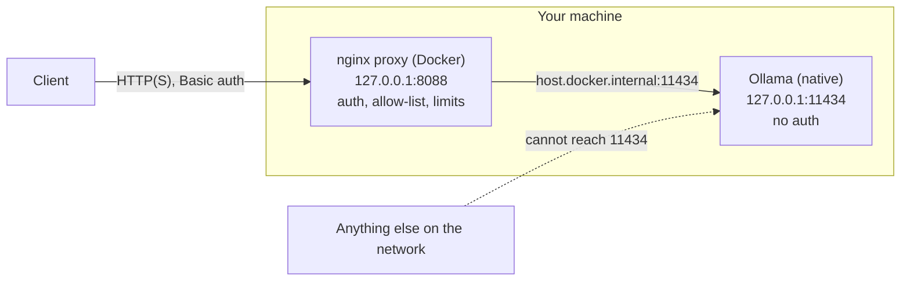

# 07. Security and deployment: loopback, a reverse proxy with auth and rate limits

> **Draft: written but not yet run.** The code and the expected output in this lesson were prepared by reading the code and the official documentation. They have not been executed yet. If something does not behave as described, trust your tool's real output and report it.

## What you will be able to do
- Explain why Ollama's API must stay on loopback, and verify on your OS that it does.
- Put an nginx reverse proxy in front of it with authentication, an endpoint allow-list, rate and size limits, timeouts and streaming support, and explain every line of the configuration.
- Test the proxy with a small probe script that checks the security behaviour (401, 403, 429) rather than only the happy path.
- Choose between a proxy, a VPN or an SSH tunnel, and write the decision down.
- Review a flawed configuration and list what is wrong with it.

## Recap
1. What does Ollama authenticate by default?
   <details><summary>Answer</summary>Nothing. The API has no authentication; the OpenAI-compatible endpoint's key is ignored.</details>
2. What happens when the server's queue is full?
   <details><summary>Answer</summary>It answers HTTP 503 (lesson 06).</details>
3. Why does the log policy of lesson 05 avoid storing question text?
   <details><summary>Answer</summary>Questions are often the most sensitive data in the system; keyed fingerprints answer operational questions without them.</details>

## Why it matters
By default Ollama binds to `127.0.0.1:11434` and has no authentication, which is exactly right for one person on one machine. The moment someone changes `OLLAMA_HOST` to make it reachable (a common first reaction to "my other computer cannot connect"), every person who can reach that port can run your models, download new ones until the disk is full, and delete the ones you have. The official FAQ documents how to expose Ollama, and even shows a bare nginx example, but a bare proxy adds no security: it just moves the open door. This lesson builds the version with a lock, a doorman and a ticket counter.

## What you will build
- `nginx.conf` and `docker-compose.yml`: a proxy on `127.0.0.1:8088` that requires Basic authentication, forwards only `/api/chat`, `/api/embed` and `/api/version`, limits request rate and body size, sets timeouts, and keeps streaming working. The proxy runs in Docker (a temporary container); **Ollama stays native** and untouched.
- `nginx.tls.conf`: the same policy with TLS, for the day the proxy is reachable from another machine (shown in full, not run in the lab).
- `probe.py` with three unit tests: it checks the proxy returns 401 without credentials, 403 for blocked endpoints and 429 under a burst.
- A review exercise: ten flaws in a deliberately bad configuration.



## Before you start
- **Prerequisites:** [Ollama 301 lesson 06, serving and scaling](06-serving-and-scaling.md); [Docker 101 lesson 06, networks and Compose](../../../docker/101-zero-to-hero/phase-2-compose/06-networks-and-compose.md).
- Time: 100-130 minutes for a first timer, in two sittings. Break after Step 5 (files written, tests pass, nothing started).
- Tools: Docker with the Compose plugin; Python 3.12+; native Ollama running on its default loopback address. Images, checked on Docker Hub on **2026-11-23**: `nginx:1.30.7-alpine` and `httpd:2.4-alpine` (used once, to produce a password hash).
- **Do not change `OLLAMA_HOST`.** Nothing in this lesson requires Ollama to listen on anything but loopback. Port 8088 on your machine is used by the proxy (it is not one of the ports used by other labs; if something else uses it, set `PROXY_PORT` in `.env`).
- Source pack (optional): every file is shown in full in this lesson. The finished code, the exercise starter and the solution are in https://github.com/Uee03/Code101 under `source/ollama/301-super-hero-to-legendary/phase-3-operating/07-security-and-deployment/` (on that page choose **Code, Download ZIP**, or run `git clone https://github.com/Uee03/Code101.git`).
- Passwords: choose a lab-only password you use nowhere else; it is typed into your terminal and stored only as a hash.
- Docker on Linux: a container reaching a host service listening only on `127.0.0.1` is **not** possible with the standard bridge network (Docker Desktop on Windows and macOS forwards `host.docker.internal` to the host, which is why this lab works there). On Linux, run nginx natively instead (package manager) with `server 127.0.0.1:11434;`, rather than changing Ollama's bind address.

## Step 0: verify that Ollama is not exposed (do this before anything else)
The FAQ states Ollama binds `127.0.0.1` port 11434 by default. Prove it on your machine.

**File: `Windows PowerShell; any folder`**
```powershell
Get-NetTCPConnection -LocalPort 11434 -State Listen | Select-Object LocalAddress, LocalPort
```

**File: `macOS terminal; any folder`**
```bash
lsof -iTCP:11434 -sTCP:LISTEN -P -n
```

**File: `Linux terminal; any folder`**
```bash
ss -ltn 'sport = :11434'
```
Expected: the local address is `127.0.0.1` (or `::1`), never `0.0.0.0`, `*` or `[::]`, and not your LAN address. If it is not, someone set `OLLAMA_HOST`: remove it (lesson 06 shows how to remove variables per OS), restart Ollama, and check again. Also check that no firewall rule opens 11434 to the network.

## The design, as decisions
| # | Decision | Alternatives | Consequence |
|---|---|---|---|
| ADR-1 | Ollama stays on loopback; a **proxy** is the only network-facing process | Bind Ollama to the LAN; tunnel the raw port | One small, auditable surface instead of a feature-rich unauthenticated one |
| ADR-2 | The proxy uses an **allow-list** of three endpoints | Block known-dangerous ones (a deny-list) | New Ollama endpoints are closed by default; clients needing `/api/embed` and `/api/chat` keep working |
| ADR-3 | **Basic auth** with bcrypt hashes for the lab | Mutual TLS, OIDC (Keycloak, Authentik) | Simple and testable; a shared secret per client, no revocation per user, so graduate to OIDC for real users (see the platform capstone's identity chapter) |
| ADR-4 | **Rate limit per client IP**, bounded body and short client timeouts | No limits; limit at Ollama's queue only | The queue (`OLLAMA_MAX_QUEUE`) stays a backstop; abusive or buggy clients are cut off at the door. Per IP is wrong behind shared NAT: key by credential or token when you have them |
| ADR-5 | **TLS terminates at the proxy** whenever traffic leaves the machine | Plain HTTP on a trusted network | Credentials and prompts are never sent in clear text across a network; the lab uses loopback only |
| ADR-6 | **No bodies in logs** (default access log lines hold method, path and status only) | Log requests for debugging | Prompts and answers are not stored (lesson 05 policy) |
| ADR-7 | **Alternatives considered:** VPN or SSH tunnel for a few trusted users | Proxy for many users | A VPN or `ssh -L` keeps the API off the network entirely and needs no code, but gives all-or-nothing access and no per-endpoint rules; use it for yourself and a few colleagues |

> **Why this, not that.** The FAQ also lists tunnels (ngrok, Cloudflare Tunnel). They publish whatever you point them at to the internet. Pointed at raw Ollama, that is an open, unauthenticated model server on a public address. If you use a tunnel at all, point it at the authenticated proxy, never at port 11434.

## Steps
### Step 1. Create the folder
**File: `Windows PowerShell; starting anywhere`**
```powershell
New-Item -ItemType Directory -Path "$HOME/code101/ollama301-07" -Force | Out-Null
Set-Location "$HOME/code101/ollama301-07"
```

**File: `macOS/Linux terminal; starting anywhere`**
```bash
mkdir -p ~/code101/ollama301-07
cd ~/code101/ollama301-07
```

### Step 2. The proxy configuration: `nginx.conf`
nginx's configuration is a tree of blocks. Read the file once through, then use the table below it.

**File: `~/code101/ollama301-07/nginx.conf`**
```nginx
user nginx;
worker_processes auto;
pid /tmp/nginx.pid;
error_log /dev/stderr warn;

events {
    worker_connections 256;
}

http {
    access_log /dev/stdout;
    server_tokens off;

    client_body_temp_path /tmp/client_body;
    proxy_temp_path /tmp/proxy;
    fastcgi_temp_path /tmp/fastcgi;
    uwsgi_temp_path /tmp/uwsgi;
    scgi_temp_path /tmp/scgi;

    limit_req_zone $binary_remote_addr zone=perip:10m rate=5r/s;
    limit_req_status 429;

    client_max_body_size 1m;
    client_body_timeout 10s;
    client_header_timeout 10s;
    keepalive_timeout 30s;

    upstream ollama {
        server host.docker.internal:11434;
        keepalive 4;
    }

    server {
        listen 8088;
        server_name _;

        limit_req zone=perip burst=10 nodelay;
        auth_basic "Ollama";
        auth_basic_user_file /etc/nginx/.htpasswd;

        add_header X-Content-Type-Options "nosniff" always;
        add_header Cache-Control "no-store" always;

        location ~ ^/api/(chat|embed|version)$ {
            limit_except GET POST {
                deny all;
            }
            proxy_pass http://ollama;
            proxy_http_version 1.1;
            proxy_set_header Connection "";
            proxy_set_header Host localhost:11434;
            proxy_buffering off;
            proxy_connect_timeout 5s;
            proxy_send_timeout 30s;
            proxy_read_timeout 300s;
        }

        location / {
            return 403;
        }
    }
}
```

| Line(s) | What it does | What happens if you change or remove it |
|---|---|---|
| `user nginx;` | Worker processes run as the unprivileged `nginx` user | Running workers as root would turn a bug into a root compromise |
| `worker_processes auto;` | One worker per CPU core | Fewer workers lower concurrency |
| `pid /tmp/nginx.pid;` | Where the process id is written; `/tmp` is a writable in-memory mount in the container (the root file system is read-only) | A path on the read-only file system makes nginx fail to start |
| `error_log /dev/stderr warn;` | Errors go to the container log at warning level | Too verbose a level fills logs |
| `events { worker_connections 256; }` | Connections per worker | Raise only with a measured need |
| `access_log /dev/stdout;` | One line per request in the default format: address, time, request line, status, bytes, referrer, agent. **No request body** | Adding `$request_body` to a log format writes prompts to logs (the exercise's flaw 5) |
| `server_tokens off;` | Hides the nginx version in headers and error pages | Version disclosure helps attackers pick exploits |
| `*_temp_path /tmp/...` (five lines) | Where nginx buffers large bodies and responses; moved to the writable `/tmp` so the read-only root works | Default paths under `/var/cache/nginx` would be unwritable |
| `limit_req_zone $binary_remote_addr zone=perip:10m rate=5r/s;` | A shared-memory table (10 MB) keyed by client address that allows 5 requests per second per key | A key shared by many users (NAT, a proxy in front) throttles them together; a smaller rate throttles harder |
| `limit_req_status 429;` | Excess requests get HTTP 429 (Too Many Requests) instead of the default 503 | Without it clients cannot tell "slow down" from "server broken" |
| `client_max_body_size 1m;` | Requests with a body over 1 MB are rejected (413) | Larger prompts need a larger value; `0` disables the check (never do that) |
| `client_body_timeout 10s;` `client_header_timeout 10s;` | A client must send the header and each body piece within 10 s | Without these, slow clients ("slowloris") tie up connections |
| `keepalive_timeout 30s;` | Idle client connections close after 30 s | Longer keeps more idle sockets |
| `upstream ollama { server host.docker.internal:11434; keepalive 4; }` | Names the back end (Ollama on the host, reached through Docker's special name) and keeps up to 4 idle connections open to it | A wrong host or port gives 502 errors |
| `listen 8088;` | The port inside the container (Compose publishes it on the host's loopback only) | |
| `server_name _;` | Catch-all name | |
| `limit_req zone=perip burst=10 nodelay;` | Apply the zone: 5 requests per second, and a burst of 10 extra requests is let through immediately; beyond that, 429. This runs **before** authentication, so a flood of unauthenticated requests is also throttled | Without `nodelay` excess requests are delayed instead of rejected |
| `auth_basic "Ollama";` and `auth_basic_user_file ...` | Require an HTTP Basic username and password; check against a file of hashes | Removing them leaves the proxy open |
| `add_header X-Content-Type-Options "nosniff" always;` | Tells browsers not to guess content types | Defence in depth for responses viewed in a browser |
| `add_header Cache-Control "no-store" always;` | Responses must not be cached by intermediaries | Cached answers can leak between users |
| `location ~ ^/api/(chat|embed|version)$ { ... }` | Only these three exact paths are proxied (**allow-list**) | Adding a path (for example `/v1/chat/completions` for OpenAI-style clients) is a conscious decision |
| `limit_except GET POST { deny all; }` | Only GET and POST are accepted here | Other methods get 403 |
| `proxy_pass http://ollama;` | Forward to the upstream | |
| `proxy_http_version 1.1;` and `proxy_set_header Connection "";` | Required for the upstream keep-alive connections | Omitting them closes connections each time |
| `proxy_set_header Host localhost:11434;` | The FAQ's nginx example sets this: Ollama expects a local host name | Without it Ollama may reject the request |
| `proxy_buffering off;` | Pass streamed (NDJSON) replies through immediately | With buffering on, a streamed answer arrives in bursts |
| `proxy_connect_timeout 5s;` `proxy_send_timeout 30s;` | Fail fast when Ollama is down; limit time to send the request | |
| `proxy_read_timeout 300s;` | The longest silent gap allowed while Ollama generates (5 minutes) | Too small kills long generations; very large (an hour) ties up workers |
| `location / { return 403; }` | Everything else, including `/api/pull`, `/api/delete`, `/api/tags` and `/api/create`, is refused | The most important line after the allow-list: nothing is reachable by accident |

A subtlety the probe will demonstrate: `return 403` is evaluated before `auth_basic`, so an unauthenticated request to a blocked path gets 403 and not 401, while an unauthenticated request to an allowed path gets 401. Neither reveals anything useful.

### Step 3. The Compose file and settings
**File: `~/code101/ollama301-07/docker-compose.yml`**
```yaml
name: code101-ollama-proxy

services:
  proxy:
    image: nginx:1.30.7-alpine
    container_name: code101-ollama-proxy
    restart: "no"
    ports:
      - "127.0.0.1:${PROXY_PORT:-8088}:8088"
    extra_hosts:
      - "host.docker.internal:host-gateway"
    volumes:
      - ./nginx.conf:/etc/nginx/nginx.conf:ro
      - ./.htpasswd:/etc/nginx/.htpasswd:ro
    read_only: true
    tmpfs:
      - /tmp
    security_opt:
      - no-new-privileges:true
```

| Line | Meaning | If you change it |
|---|---|---|
| `name:` | Compose project name | |
| `image: nginx:1.30.7-alpine` | Pinned to an exact version, small Alpine base | `latest` could change behaviour under you |
| `restart: "no"` | The lab is temporary | |
| `ports: "127.0.0.1:${PROXY_PORT:-8088}:8088"` | Publish on the host's **loopback only**; default 8088 | Dropping `127.0.0.1:` exposes the proxy on every interface, which you should do only with TLS and after reading the checklist below |
| `extra_hosts: host.docker.internal:host-gateway` | Makes the name resolve to the host on Linux too (Docker Desktop provides it already) | Without a resolvable name nginx refuses to start |
| `volumes: ./nginx.conf` and `./.htpasswd` (read-only `:ro`) | Mount the config and the password hashes; neither can be modified from inside the container | `.htpasswd` must exist before `up`: Docker would otherwise create a *directory* with that name |
| `read_only: true` and `tmpfs: /tmp` | The container's file system cannot be written except for in-memory `/tmp` | Remove only if nginx needs more writable paths, and say why |
| `security_opt: no-new-privileges:true` | Processes cannot gain extra privileges | |

**File: `~/code101/ollama301-07/.env.example`**
```text
PROXY_PORT=8088
```

**File: `~/code101/ollama301-07/.gitignore`**
```text
.env
.htpasswd
certs/
__pycache__/
```
`.htpasswd` and any TLS keys under `certs/` must never be committed.

### Step 4. Create the password file
`htpasswd` makes the hash. We use a throw-away container only for that, so nothing is installed on your machine. The `-nB` flags mean: print to the terminal (`n`), use bcrypt (`B`); you are asked for the password twice and it is not echoed.

**File: `Terminal, any OS; folder ~/code101/ollama301-07`**
```text
docker run --rm -it httpd:2.4-alpine htpasswd -nB alice
```
Expected shape: after you type the password twice, one line such as `alice:$2y$05$<a long hash>`. Copy that single line into a new file named `.htpasswd` **with a text editor** (Notepad on Windows, with **Save As** and the file name `.htpasswd` in quotes so it keeps no `.txt`; `nano .htpasswd` on macOS or Linux). Do **not** use PowerShell's `>` redirection: Windows PowerShell 5.1 writes UTF-16 with a byte order mark, which nginx cannot read. The file must contain exactly one line and no extra spaces.

Copy the settings: Windows `Copy-Item .env.example .env`, macOS/Linux `cp .env.example .env`.

### Step 5. The probe and its tests, then the break
The probe checks behaviour from outside. Read the six checks as a specification of the security policy: no credentials, a wrong password, a valid login, two blocked endpoints (a dangerous one and an information one), and a burst. It never sends a real `pull`: the `/api/pull` request is rejected by the proxy before it reaches Ollama, which is the very thing being tested.

**File: `~/code101/ollama301-07/probe.py`**
```python
import base64
import os
import sys
import urllib.error
import urllib.request

BASE = os.environ.get("PROBE_URL", "http://127.0.0.1:8088")
OPENER = urllib.request.build_opener(urllib.request.ProxyHandler({}))
BURST = 30


def basic_auth_header(user, password):
    token = base64.b64encode(f"{user}:{password}".encode("utf-8")).decode("ascii")
    return {"Authorization": f"Basic {token}"}


def status_of(method, path, headers=None, body=None):
    request = urllib.request.Request(BASE + path, data=body, method=method, headers=headers or {})
    try:
        with OPENER.open(request, timeout=10) as response:
            return response.status
    except urllib.error.HTTPError as error:
        return error.code


def count_status(status, attempts, path, headers):
    return sum(1 for _ in range(attempts) if status_of("GET", path, headers) == status)


def format_check(label, expected, actual):
    return f"{'PASS' if expected == actual else 'FAIL'} {label}: expected {expected}, got {actual}"


def run_checks(user, password):
    good = basic_auth_header(user, password)
    wrong = basic_auth_header(user, password + "x")
    json_headers = {**good, "Content-Type": "application/json"}
    lines = [
        format_check("no credentials", 401, status_of("GET", "/api/version")),
        format_check("wrong password", 401, status_of("GET", "/api/version", wrong)),
        format_check("valid credentials", 200, status_of("GET", "/api/version", good)),
        format_check("blocked endpoint /api/pull", 403, status_of("POST", "/api/pull", json_headers, b'{"model": "x"}')),
        format_check("blocked endpoint /api/tags", 403, status_of("GET", "/api/tags", good)),
    ]
    limited = count_status(429, BURST, "/api/version", good)
    lines.append(f"{'PASS' if limited > 0 else 'FAIL'} rate limit: {limited} of {BURST} rapid requests were answered 429")
    return lines


def main():
    user = os.environ.get("PROBE_USER")
    password = os.environ.get("PROBE_PASSWORD")
    if not user or not password:
        raise SystemExit("set PROBE_USER and PROBE_PASSWORD in the environment first")
    try:
        lines = run_checks(user, password)
    except urllib.error.URLError:
        raise SystemExit(f"cannot reach the proxy at {BASE}: is it running?")
    print("\n".join(lines))
    if any(line.startswith("FAIL") for line in lines):
        sys.exit(1)


if __name__ == "__main__":
    main()
```
The password is read from the environment, never from a file or a command-line argument (arguments are visible to other users in process lists).

**File: `~/code101/ollama301-07/test_probe.py`**
```python
import unittest
from unittest import mock

import probe


class ProbeTests(unittest.TestCase):
    def test_basic_auth_header(self):
        self.assertEqual(probe.basic_auth_header("alice", "secret"), {"Authorization": "Basic YWxpY2U6c2VjcmV0"})

    def test_format_check(self):
        self.assertEqual(probe.format_check("x", 401, 401), "PASS x: expected 401, got 401")
        self.assertEqual(probe.format_check("x", 401, 200), "FAIL x: expected 401, got 200")

    def test_count_status(self):
        with mock.patch.object(probe, "status_of", side_effect=[429, 200, 429]):
            self.assertEqual(probe.count_status(429, 3, "/api/version", {}), 2)


if __name__ == "__main__":
    unittest.main()
```
**File: `Terminal; folder ~/code101/ollama301-07`** (Windows `python`, macOS/Linux `python3`)
```text
python -m unittest
```
Expected result (not yet run): `Ran 3 tests in` and a small time, then `OK`. Predict first: `base64("alice:secret")` is `YWxpY2U6c2VjcmV0`; Basic auth is **encoding, not encryption**, which is why it needs TLS whenever traffic leaves the machine. **Good place for the break.**

## Run it
Start the proxy (Ollama must be running natively), then probe:

**File: `Terminal, any OS; folder ~/code101/ollama301-07`**
```text
docker compose up -d
docker compose ps
docker compose logs proxy
```
Expected: the `proxy` service is `running` (there is no health check here; the probe is the check). If it exited, the log shows why: a missing `.htpasswd` (Docker made a directory), a syntax error (nginx prints the file and line), or an unresolvable `host.docker.internal`.

**File: `Windows PowerShell; folder ~/code101/ollama301-07`**
```powershell
$env:PROBE_USER = "alice"
$env:PROBE_PASSWORD = Read-Host "Lab password"
python probe.py
Remove-Item Env:PROBE_PASSWORD
```

**File: `macOS/Linux terminal; folder ~/code101/ollama301-07`**
```bash
export PROBE_USER=alice
read -r -s -p "Lab password: " PROBE_PASSWORD; export PROBE_PASSWORD; echo
python3 probe.py
unset PROBE_PASSWORD
```
Expected output when everything works (the count in the last line varies; the `PASS` words are what matters; the 200 check needs Ollama running):
```text
PASS no credentials: expected 401, got 401
PASS wrong password: expected 401, got 401
PASS valid credentials: expected 200, got 200
PASS blocked endpoint /api/pull: expected 403, got 403
PASS blocked endpoint /api/tags: expected 403, got 403
PASS rate limit: <n> of 30 rapid requests were answered 429
```
A `FAIL` line names the check and both values. Typical causes: `valid credentials` got 401 (the hash line is wrong or has extra characters), got 502 (Ollama is not running, or the container cannot reach the host); `rate limit` got 0 (the machine was slow enough that requests never exceeded 5 per second plus the burst: lower the rate in the config for the test).

Now use the proxy like a client would. A chat call through the proxy, with credentials:

**File: `macOS/Linux terminal; any folder`**
```bash
curl -u alice --max-time 120 http://127.0.0.1:8088/api/chat -d '{"model":"llama3.2:1b","messages":[{"role":"user","content":"Say hi in three words."}],"stream":false}'
```

**File: `Windows PowerShell; any folder`**
```powershell
$cred = Get-Credential -UserName alice -Message "Lab proxy password"
Invoke-RestMethod -Uri http://127.0.0.1:8088/api/chat -Method Post -Credential $cred -AllowUnencryptedAuthentication -ContentType "application/json" -Body '{"model":"llama3.2:1b","messages":[{"role":"user","content":"Say hi in three words."}],"stream":false}'
```
Expected shape (not captured): the usual `/api/chat` reply JSON. Without credentials you get HTTP 401 (`curl` prints a short error page; PowerShell reports an unauthorized error). The `-AllowUnencryptedAuthentication` switch in PowerShell exists because Basic credentials over plain HTTP are normally refused: it is acceptable **only** on loopback, which is all this lab uses.

Finally prove nothing changed under Ollama: repeat Step 0. The listener must still be loopback. Stop the lab when you finish:

**File: `Terminal, any OS; folder ~/code101/ollama301-07`**
```text
docker compose down
```

## TLS, for when traffic leaves the machine (shown in full, not run)
`nginx.tls.conf` is the same policy with three differences: it listens with TLS, adds an HSTS header, and talks to a native nginx's local Ollama (`127.0.0.1:11434`) instead of the Docker host name. It assumes certificates you obtained properly (for example from your organisation's CA or Let's Encrypt) in `certs/fullchain.pem` and `certs/privkey.pem`. Never reuse a self-signed lab certificate as production, and never commit the private key.

**File: `~/code101/ollama301-07/nginx.tls.conf`**
```nginx
user nginx;
worker_processes auto;
pid /tmp/nginx.pid;
error_log /dev/stderr warn;

events {
    worker_connections 256;
}

http {
    access_log /dev/stdout;
    server_tokens off;

    client_body_temp_path /tmp/client_body;
    proxy_temp_path /tmp/proxy;
    fastcgi_temp_path /tmp/fastcgi;
    uwsgi_temp_path /tmp/uwsgi;
    scgi_temp_path /tmp/scgi;

    limit_req_zone $binary_remote_addr zone=perip:10m rate=5r/s;
    limit_req_status 429;

    client_max_body_size 1m;
    client_body_timeout 10s;
    client_header_timeout 10s;
    keepalive_timeout 30s;

    upstream ollama {
        server 127.0.0.1:11434;
        keepalive 4;
    }

    server {
        listen 8443 ssl;
        server_name ollama.example.internal;

        ssl_certificate /etc/nginx/certs/fullchain.pem;
        ssl_certificate_key /etc/nginx/certs/privkey.pem;
        ssl_protocols TLSv1.2 TLSv1.3;
        ssl_session_timeout 1h;

        limit_req zone=perip burst=10 nodelay;
        auth_basic "Ollama";
        auth_basic_user_file /etc/nginx/.htpasswd;

        add_header Strict-Transport-Security "max-age=31536000" always;
        add_header X-Content-Type-Options "nosniff" always;
        add_header Cache-Control "no-store" always;

        location ~ ^/api/(chat|embed|version)$ {
            limit_except GET POST {
                deny all;
            }
            proxy_pass http://ollama;
            proxy_http_version 1.1;
            proxy_set_header Connection "";
            proxy_set_header Host localhost:11434;
            proxy_buffering off;
            proxy_connect_timeout 5s;
            proxy_send_timeout 30s;
            proxy_read_timeout 300s;
        }

        location / {
            return 403;
        }
    }
}
```
Differences: `listen 8443 ssl;` plus the four `ssl_*` lines (certificate chain, private key, only TLS 1.2 and 1.3, session lifetime); `server_name` is a real name that matches the certificate; `Strict-Transport-Security` tells browsers to use HTTPS only (adding it commits you to HTTPS for that name for a year, so add it only when you are sure); and the upstream is `127.0.0.1:11434` because this variant is for nginx installed on the same host (a package on Linux, or a Windows build). TLS settings age: take current cipher and protocol guidance from Mozilla's server-side TLS recommendations rather than from this file when you deploy.

## Deployment checklist
[ ] `OLLAMA_HOST` unset (loopback) and verified with the Step 0 command; [ ] no firewall rule or tunnel pointing at 11434; [ ] the proxy is the only listener on a non-loopback address, and only with TLS; [ ] allow-list of endpoints reviewed after each Ollama upgrade; [ ] authentication in place (hashes, no shared plain passwords in scripts) and a plan to rotate; [ ] rate limit, body limit and timeouts set from lesson 06's measurements; [ ] logs contain no bodies, are rotated and access-controlled; [ ] container root file system read-only, no extra privileges; [ ] image pinned and re-checked monthly for security updates; [ ] `OLLAMA_ORIGINS` untouched unless a browser extension needs it; [ ] backups of `.htpasswd` and config (not of secrets in chat); [ ] a documented way to disable access in one command (`docker compose down`).

## How it works
1. **Defence in depth.** Loopback binding is the first lock; the proxy is the second (identity); the allow-list is the third (capability); the limits are the fourth (abuse); TLS protects the wire. Remove one and the others still hold, but only for the threats they were built for.
2. **Order of nginx phases** explains two surprises: rate limiting happens before authentication (so unauthenticated floods are throttled), and `return` happens before authentication (so blocked paths answer 403 regardless of credentials).
3. **What Basic auth is.** The client sends `Authorization: Basic base64(user:password)` on **every** request. It is only as safe as the channel (TLS) and the password (long, unique). The server stores only a bcrypt hash, so a stolen file does not reveal passwords directly, but offline guessing against weak passwords is possible.
4. **What the proxy cannot do.** It cannot tell a harmless prompt from a harmful one; it does not limit tokens generated per user; it does not prevent a user with valid credentials from sending sensitive text to the model. Quotas per user, token budgets and per-user audit need an application layer (lesson 08) or a real identity provider.
5. **Common misconception:** "it is only on my network". Networks include guests, infected laptops and forgotten IoT devices. Treat any unauthenticated service as public on a network you do not fully control.

## Try it
Starter: `exercise/starter/nginx.flawed.conf`. This is a **review** exercise.
1. **Guided.** Read the file and list every flaw you can find (the checklist above helps). Aim for eight or more. Do not run it.
2. **Change.** Write the corrected configuration for the file, using the lab `nginx.conf` as your reference only after your own attempt. Run `docker run --rm -v "$PWD/nginx.fixed.conf:/etc/nginx/nginx.conf:ro" nginx:1.30.7-alpine nginx -t` (PowerShell: use `${PWD}`) to let nginx check the syntax; it prints whether the test is successful.
3. **Stretch (no single answer).** Design per-user quotas: where would the user identity come from (Basic auth user, a token), where is the counter stored, and what do clients see when a quota is exhausted?

<details><summary>Solution</summary>

**File: `exercise/solution/findings.md`**
```text
# Findings for nginx.flawed.conf (a review answer; check yours against it)

| # | Flaw | Why it is a problem | Fix (as in the lab nginx.conf) |
|---|------|---------------------|--------------------------------|
| 1 | No authentication | Anyone who can reach the port can use the model; Ollama has none of its own | `auth_basic` with a hashed password file (later: OIDC) |
| 2 | `location /` proxies everything | `/api/pull`, `/api/delete`, `/api/create`, `/api/show` and `/api/tags` are reachable: disk filling, deleting models, probing | Allow-list only the endpoints the clients need; `return 403` for the rest |
| 3 | No rate limit | One client can occupy the model and starve others | `limit_req_zone` and `limit_req`, with status 429 |
| 4 | `client_max_body_size 0` | Unlimited request bodies; memory and disk exhaustion | A small explicit limit such as `1m` |
| 5 | The access log includes `$request_body` | Prompts, which may hold private data, are written to logs | Default access log (no body); never log bodies |
| 6 | `proxy_read_timeout 3600s` and no client timeouts | Slow or stuck connections tie up workers for an hour | Short client and send timeouts; a read timeout sized to the longest legitimate answer |
| 7 | `proxy_buffering` left on | Streamed answers arrive in bursts instead of piece by piece | `proxy_buffering off` on the proxied location |
| 8 | `server_tokens` left on | The version is disclosed in headers | `server_tokens off` |
| 9 | Plain HTTP on every interface the container publishes (not visible in this file) | Credentials and prompts cross the network unencrypted if the port leaves the machine | Publish on `127.0.0.1` only (Compose), or terminate TLS (`nginx.tls.conf`) |
| 10 | No method restriction | Methods other than the ones needed are accepted | `limit_except GET POST { deny all; }` |
```
The starter file for reference (flaws 1 to 8 and 10 are visible in it; flaw 9 lives in the Compose file):

**File: `exercise/starter/nginx.flawed.conf`**
```nginx
worker_processes auto;
events { worker_connections 256; }

http {
    log_format full '$remote_addr "$request" $status "$request_body"';
    access_log /dev/stdout full;

    upstream ollama {
        server host.docker.internal:11434;
    }

    server {
        listen 8088;
        client_max_body_size 0;

        location / {
            proxy_pass http://ollama;
            proxy_set_header Host localhost:11434;
            proxy_read_timeout 3600s;
        }
    }
}
```
</details>

## Check yourself
1. Why must Ollama stay on loopback even when you have a proxy? <details><summary>Answer</summary>The proxy protects only traffic that goes through it; if Ollama also listens on a network address, anyone can bypass the proxy and its authentication.</details>
2. Why an allow-list and not a deny-list of dangerous endpoints? <details><summary>Answer</summary>New or forgotten endpoints are closed by default; a deny-list is open to everything you did not think of.</details>
3. An unauthenticated request to `/api/pull` gets 403 and one to `/api/chat` gets 401. Why the difference? <details><summary>Answer</summary>`return 403` runs in an earlier nginx phase than `auth_basic`, so blocked paths are refused before authentication; allowed paths reach the authentication check.</details>
4. Is Basic authentication encrypted? <details><summary>Answer</summary>No; it is base64-encoded. It needs TLS whenever the traffic crosses a network.</details>
5. Why does the access log hold no request body? <details><summary>Answer</summary>Bodies are prompts, which can contain private data; logs are copied, shipped and kept far longer than intended.</details>

## Common mistakes
| Symptom | Cause | Fix |
|---|---|---|
| The `proxy` container exits at once | `.htpasswd` missing (Docker created a directory), or a config error | Create the file first; read `docker compose logs proxy`; run `nginx -t` as in the exercise |
| Every login gives 401 | The hash line is wrong, has extra characters, or the file was saved as UTF-16 | Re-create it with a text editor, one line, no BOM |
| 502 Bad Gateway for allowed endpoints (typical message) | Ollama not running, or the container cannot reach the host | Start Ollama; on Linux use a native nginx with `server 127.0.0.1:11434;` |
| Streaming replies arrive all at once | `proxy_buffering` on, or a buffering client | Keep `proxy_buffering off`; test with `curl -N` |
| Big prompts fail with 413 | Over `client_max_body_size` | Raise it deliberately, with a reason |
| `docker compose up` says the port is in use (typical message) | Something else uses 8088 | Set `PROXY_PORT` in `.env` and give `probe.py` the new `PROBE_URL` |
| Windows PowerShell refuses Basic auth over HTTP | Safety default | `-AllowUnencryptedAuthentication` on loopback only; use TLS otherwise |

## Best practice
Keep the model server on loopback, expose only an authenticated, rate-limited, allow-listed proxy over TLS, keep bodies out of logs, and test the denials (401, 403, 413, 429) as carefully as the success path. Source: Ollama FAQ, "How can I expose Ollama on my network?" and "How can I use Ollama with a proxy server?" https://docs.ollama.com/faq, together with the nginx documentation for `limit_req` https://nginx.org/en/docs/http/ngx_http_limit_req_module.html and `auth_basic` https://nginx.org/en/docs/http/ngx_http_auth_basic_module.html

## Going further
- Real identity: the platform capstone's Keycloak chapter (`capstones/platform/tutorials/phase-3-identity/03-keycloak-identity.md`) shows bearer tokens, roles and scopes; a proxy can validate tokens instead of Basic credentials.
- Lesson 08 puts an authenticated application service in front of retrieval and generation, where per-user rules belong.

## Summary
- You verified that Ollama listens on loopback only, and wrote down why it must stay there.
- You built and explained a proxy with authentication, an allow-list, rate and size limits, timeouts and streaming support.
- You tested the denials with a probe, and learned the nginx phase order behind 401 versus 403.
- You reviewed a flawed configuration and compared the choices: proxy, VPN, tunnel.

## Next lesson
08. Capstone: a RAG service over the Tasks and Teams platform documents, with authentication, limits, guardrails, privacy-safe logging, evaluation and a review exercise.
