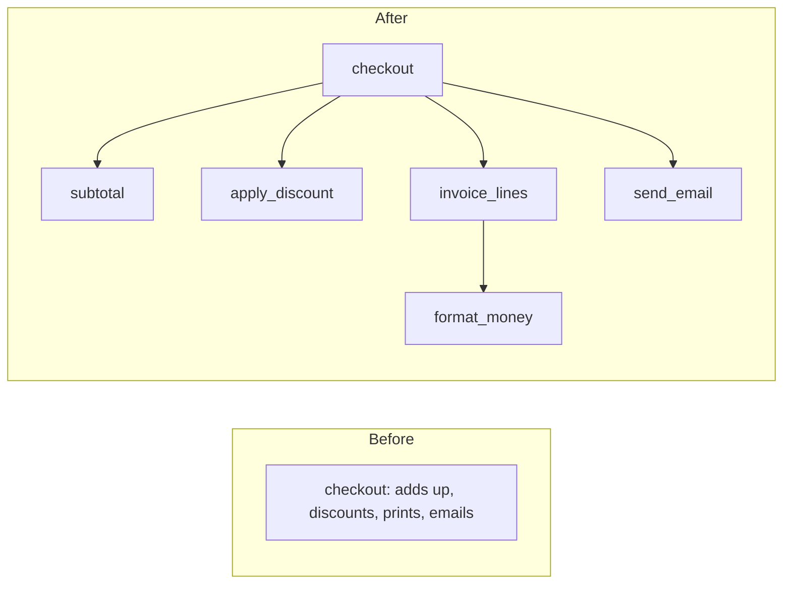

# 01. Why design matters

> **Draft: written but not yet run.** The code and the expected output in this lesson were prepared by reading the code and the official documentation. They have not been executed yet. If something does not behave as described, trust your tool's real output and report it.

## What you will be able to do
By the end of this lesson you will be able to:
- explain **coupling** and **cohesion** with an everyday example
- name three **code smells** when you see them in a function
- predict the output of a program, then show that a refactoring did not change it
- split one long function into small named functions that each do one job

## Recap
None, this is the start of the track. The lessons assume you can write a function, a loop, a list and (from lesson 02 on) a class in Python or C#.

## Why it matters
Think of a restaurant kitchen. In a good kitchen each station does one job: one cook for salads, one for the grill, one for desserts. If the grill cook gets sick, a replacement can step in without learning the whole kitchen. In a bad kitchen one person cooks, serves, washes dishes and counts the money, and everything is tangled together. Programs behave the same way. Code that works today is not automatically code you can change next month. **Design** is the habit of arranging code so that changing one thing does not break five others.

## What you will build
A tiny invoice program in two versions. The first version works but is hard to change. The second version prints exactly the same invoice, but every job (adding up, discounting, formatting, "emailing") lives in its own small function. You will see both versions run one after the other and compare their output.

## Before you start
- Time: 35 minutes for one language, 55 minutes if you follow both. You only need **one** of the two: Python or C#. The other version is there so you can compare.
- Python: Python 3.10 or newer (Python 101 lesson 01). C#: the .NET 11 SDK (C# 101 lesson 01).
- You need a terminal and an editor (VS Code from the earlier tracks is fine).
- Source pack (optional): every file is shown in full in this lesson, so you can follow without it. The finished code, the exercise starter and the solution are in the
  course repository https://github.com/Uee03/Code101 under `source/patterns/101-zero-to-hero/phase-1-solid/01-why-design-matters/` (on that page choose **Code, Download ZIP**, or run
  `git clone https://github.com/Uee03/Code101.git`).

## Steps

### Step 1. Make the lesson folders
Open a terminal. The folder shown before the `>` or `$` is your current folder. Run the commands for your system.

**PowerShell, starting folder: anywhere**
```powershell
New-Item -ItemType Directory -Path "$HOME/code101/patterns/lesson01/python" -Force | Out-Null
New-Item -ItemType Directory -Path "$HOME/code101/patterns/lesson01/csharp" -Force | Out-Null
Set-Location "$HOME/code101/patterns/lesson01"
code .
```

**macOS/Linux terminal, starting folder: anywhere**
```bash
mkdir -p ~/code101/patterns/lesson01/python ~/code101/patterns/lesson01/csharp
cd ~/code101/patterns/lesson01
code .
```
Expected result: VS Code opens the `lesson01` folder with two empty subfolders, `python` and `csharp`. The commands print nothing. If `code` is not found, use **File > Open Folder** instead. If you follow only one language, you only need that language's subfolder. A dot on an editor tab means the file is not saved yet: press **Ctrl+S** (macOS: **Cmd+S**).

### Step 2. Read the first version: it works, but it is tangled
A **tuple** is a small fixed group of values. Here each item is the tuple `(name, price in cents, quantity)`. Prices are whole **cents** (1200 means 12.00) so that we never meet rounding surprises with decimals.

Create the file for your language. Type or paste the whole file.

**File: `~/code101/patterns/lesson01/python/before.py`**
```python
def checkout(items, email):
    total = 0
    for name, price, qty in items:
        total = total + price * qty
    if total > 2500:
        total = total - total * 10 // 100
    print("INVOICE")
    for name, price, qty in items:
        line = price * qty
        print(name + " x" + str(qty) + " = " + str(line // 100) + "." + str(line % 100).zfill(2))
    print("Total: " + str(total // 100) + "." + str(total % 100).zfill(2))
    print("Email sent to " + email)
```

**File: `~/code101/patterns/lesson01/csharp/Before.cs`**
```csharp
using Item = (string Name, int PriceCents, int Quantity);

namespace Before;

public static class Invoicing
{
    public static void Checkout(List<Item> items, string email)
    {
        int total = 0;
        foreach (var item in items)
        {
            total = total + item.PriceCents * item.Quantity;
        }
        if (total > 2500)
        {
            total = total - total * 10 / 100;
        }
        Console.WriteLine("INVOICE");
        foreach (var item in items)
        {
            int line = item.PriceCents * item.Quantity;
            Console.WriteLine(item.Name + " x" + item.Quantity + " = " + (line / 100) + "." + (line % 100).ToString("D2"));
        }
        Console.WriteLine("Total: " + (total / 100) + "." + (total % 100).ToString("D2"));
        Console.WriteLine("Email sent to " + email);
    }
}
```
What the new C# pieces mean: `using Item = (...)` gives a short nickname (an **alias**) to the tuple type so we do not repeat it. `namespace Before;` puts everything in this file into a group called `Before`; later we make a second group called `After` so both versions can have a class with the same name. `static class` is a class we never make objects from; it only holds functions.

In both languages `//` (Python) and `/` on whole numbers (C#) throw away the fraction, and `%` gives the remainder. So `1550 // 100` is 15 and `1550 % 100` is 50.

### Step 3. Predict before you run
Without running anything, answer on paper: for the items Notebook (1200 cents, quantity 2) and Pen (150 cents, quantity 4):
1. What is the total before the discount?
2. The code discounts 10 percent when the total is above 2500. What is the total after?
3. How many lines will be printed in all?

<details><summary>Answer</summary>

1. 1200 x 2 = 2400 and 150 x 4 = 600, so 3000 cents.
2. 3000 is above 2500, so we take off 3000 x 10 / 100 = 300 and get 2700 cents, printed as 27.00.
3. Five lines: `INVOICE`, one line per item (two), the `Total:` line and the `Email sent to` line.

</details>

### Step 4. Count the smells
A **code smell** is a pattern in code that is not a bug but hints at a design problem, like a faint smell from the fridge: nothing is broken yet, but look closer. Read `before` again and find these:

| Smell | Where you can see it | Why it hurts |
|---|---|---|
| **Long function** doing several jobs | `checkout` adds up, discounts, prints lines and "emails" | To change the discount you must read the printing code too |
| **Magic numbers** | `2500` and `10` | Nobody knows what they mean or whether `10` in one place is the same `10` elsewhere |
| **Duplicated code** | the money formatting `str(x // 100) + "." + ...` appears twice | Fix a bug in one copy and the other keeps it |

Source: refactoring.guru, Code smells https://refactoring.guru/refactoring/smells and SourceMaking, Code smells https://sourcemaking.com/refactoring/smells

### Step 5. Read the second version: same behaviour, better shape
**Refactoring** means changing the structure of code without changing what it does. The proof is that the output stays identical. Here is the same program split into small functions. Each function has one clear job and a name that says it.

**File: `~/code101/patterns/lesson01/python/after.py`**
```python
DISCOUNT_THRESHOLD_CENTS = 2500
DISCOUNT_PERCENT = 10


def format_money(cents):
    return f"{cents // 100}.{cents % 100:02d}"


def subtotal(items):
    total = 0
    for _, price, qty in items:
        total += price * qty
    return total


def apply_discount(total):
    if total > DISCOUNT_THRESHOLD_CENTS:
        return total - total * DISCOUNT_PERCENT // 100
    return total


def invoice_lines(items, total):
    lines = ["INVOICE"]
    for name, price, qty in items:
        lines.append(f"{name} x{qty} = {format_money(price * qty)}")
    lines.append(f"Total: {format_money(total)}")
    return lines


def send_email(address):
    print(f"Email sent to {address}")


def checkout(items, email):
    total = apply_discount(subtotal(items))
    for line in invoice_lines(items, total):
        print(line)
    send_email(email)
```

**File: `~/code101/patterns/lesson01/csharp/After.cs`**
```csharp
using Item = (string Name, int PriceCents, int Quantity);

namespace After;

public static class Invoicing
{
    private const int DiscountThresholdCents = 2500;
    private const int DiscountPercent = 10;

    public static string FormatMoney(int cents)
    {
        return $"{cents / 100}.{cents % 100:D2}";
    }

    public static int Subtotal(List<Item> items)
    {
        int total = 0;
        foreach (var item in items)
        {
            total += item.PriceCents * item.Quantity;
        }
        return total;
    }

    public static int ApplyDiscount(int total)
    {
        if (total > DiscountThresholdCents)
        {
            return total - total * DiscountPercent / 100;
        }
        return total;
    }

    public static List<string> InvoiceLines(List<Item> items, int total)
    {
        var lines = new List<string> { "INVOICE" };
        foreach (var item in items)
        {
            lines.Add($"{item.Name} x{item.Quantity} = {FormatMoney(item.PriceCents * item.Quantity)}");
        }
        lines.Add($"Total: {FormatMoney(total)}");
        return lines;
    }

    public static void SendEmail(string address)
    {
        Console.WriteLine($"Email sent to {address}");
    }

    public static void Checkout(List<Item> items, string email)
    {
        int total = ApplyDiscount(Subtotal(items));
        foreach (string line in InvoiceLines(items, total))
        {
            Console.WriteLine(line);
        }
        SendEmail(email);
    }
}
```
New pieces: `f"..."` in Python and `$"..."` in C# are strings with values placed inside `{ }`. `:02d` (Python) and `:D2` (C#) both mean "show at least two digits, pad with a zero", so 0 prints as `00`. `private const int` is a named constant that only this class can see. The Python names in capitals (`DISCOUNT_PERCENT`) are the usual way to say "do not change this".

### Step 6. Write the file that runs both
**File: `~/code101/patterns/lesson01/python/main.py`**
```python
import after
import before

ITEMS = [("Notebook", 1200, 2), ("Pen", 150, 4)]
EMAIL = "ana@example.com"

print("--- before ---")
before.checkout(ITEMS, EMAIL)
print("--- after ---")
after.checkout(ITEMS, EMAIL)
```

**File: `~/code101/patterns/lesson01/csharp/Program.cs`**
```csharp
using Item = (string Name, int PriceCents, int Quantity);

var items = new List<Item> { ("Notebook", 1200, 2), ("Pen", 150, 4) };
const string email = "ana@example.com";

Console.WriteLine("--- before ---");
Before.Invoicing.Checkout(items, email);
Console.WriteLine("--- after ---");
After.Invoicing.Checkout(items, email);
```
C# also needs a project file. It tells `dotnet` what to build. Every line of it:

**File: `~/code101/patterns/lesson01/csharp/Lesson.csproj`**
```xml
<Project Sdk="Microsoft.NET.Sdk">

  <PropertyGroup>
    <OutputType>Exe</OutputType>
    <TargetFramework>net11.0</TargetFramework>
    <ImplicitUsings>enable</ImplicitUsings>
    <Nullable>enable</Nullable>
  </PropertyGroup>

</Project>
```
- `Sdk="Microsoft.NET.Sdk"` means "build this with the standard .NET tools".
- `OutputType` `Exe` means the result is a program you can run (not a library).
- `TargetFramework` `net11.0` means .NET 11. If you change it, `dotnet` needs a matching SDK.
- `ImplicitUsings` `enable` adds the common `using` lines (such as `System` and `System.Collections.Generic`) for you.
- `Nullable` `enable` makes the compiler warn when a value that could be missing is used carelessly.

The same file is used in every lesson of this track; later lessons only say "same `Lesson.csproj` as lesson 01".

## Run it
**PowerShell, folder: `~/code101/patterns/lesson01/python`**
```powershell
Set-Location "$HOME/code101/patterns/lesson01/python"
python main.py
```
**macOS/Linux terminal, folder: `~/code101/patterns/lesson01/python`**
```bash
cd ~/code101/patterns/lesson01/python
python3 main.py
```
**Any terminal, folder: `~/code101/patterns/lesson01/csharp`** (after `cd` into it)
```text
dotnet run --project . --nologo
```
On the very first `dotnet` use it may print a welcome banner; it is the same banner as in C# 101 lesson 01 and is harmless.

Expected output (derived by reading the code, not yet run; identical for Python and C#):
```text
--- before ---
INVOICE
Notebook x2 = 24.00
Pen x4 = 6.00
Total: 27.00
Email sent to ana@example.com
--- after ---
INVOICE
Notebook x2 = 24.00
Pen x4 = 6.00
Total: 27.00
Email sent to ana@example.com
```
If your two halves differ, that is the point of a refactoring check: a difference means you changed behaviour by accident. Look for a typo or an unsaved file.

## How it works
Both versions do the same five things in the same order. What changed is **where** the code lives.


In the "before" box one function holds everything. In the "after" box `checkout` only **coordinates**: it calls the helpers in order. Two ideas explain why that is better:

- **Cohesion** is how closely the parts inside one unit belong together. A function that only formats money has high cohesion. `before.checkout` has low cohesion: adding, discounting, printing and emailing have nothing in common except "they happen at checkout".
- **Coupling** is how much one unit depends on the details of another. Low coupling is like a plug and a socket: you can swap the lamp without rewiring the house. `invoice_lines` does not know that email exists, so you can change the email part without touching it. In `before`, everything is glued together, like wires twisted straight into the wall.

Good design aims for **high cohesion and low coupling**. Notice two small wins already: `DISCOUNT_PERCENT` has a name instead of a bare `10`, and `format_money` exists once instead of twice.

A common misconception is that design means drawing big diagrams before you write anything. At this level it simply means: when you read code and it is hard to change, notice why, and reshape it in small steps while the output stays the same. Another misconception is that a smell is a bug. The `before` program is correct; it is just expensive to change.

The new words are in the track glossary (`GLOSSARY.md`). The principles in the next five lessons (SOLID) are a short list of rules for getting higher cohesion and lower coupling in object-oriented code.

## Try it
Starter and answer are in `exercise/starter` and `exercise/solution` of the source pack, and the starter is shown below.

**Rung 1, guided.** In your own folder `~/code101/patterns/lesson01/try01/` (create it, then copy the file for your language into it) fix the three TODOs. The program must print the same two lines before and after your change.

**File: `try01/main.py`**
```python
ITEMS = [("Mug", 800, 3), ("Plate", 1250, 2)]


def order_summary(items, country):
    total = 0
    for name, price, qty in items:
        total = total + price * qty
    if country == "DE":
        total = total + 500
    elif country == "FR":
        total = total + 500
    else:
        total = total + 1500
    print("Order total: " + str(total // 100) + "." + str(total % 100).zfill(2))


# TODO 1: write subtotal(items) that returns the sum of price * qty.
# TODO 2: write shipping_cents(country) that returns 500 for "DE" or "FR", otherwise 1500.
#         Give 500 and 1500 names (constants) so nobody has to guess what they mean.
# TODO 3: rewrite order_summary to use both helpers. The printed lines must not change.

order_summary(ITEMS, "FR")
order_summary(ITEMS, "US")
```

**File: `try01/Program.cs`** (put the same `Lesson.csproj` from Step 6 next to it)
```csharp
using Item = (string Name, int PriceCents, int Quantity);

var cart = new List<Item> { ("Mug", 800, 3), ("Plate", 1250, 2) };

// TODO 1: write a static method Subtotal(List<Item> items) that returns the sum of price * quantity.
// TODO 2: write a static method ShippingCents(string country): 500 for "DE" or "FR", otherwise 1500.
//         Give 500 and 1500 names (const values) so nobody has to guess what they mean.
// TODO 3: rewrite OrderSummary to use both helpers. The printed lines must not change.

OrderSummary(cart, "FR");
OrderSummary(cart, "US");

static void OrderSummary(List<Item> items, string country)
{
    int total = 0;
    foreach (var item in items)
    {
        total = total + item.PriceCents * item.Quantity;
    }
    if (country == "DE")
    {
        total = total + 500;
    }
    else if (country == "FR")
    {
        total = total + 500;
    }
    else
    {
        total = total + 1500;
    }
    Console.WriteLine("Order total: " + (total / 100) + "." + (total % 100).ToString("D2"));
}
```
The starter already prints the final answer. Your job is to change its **shape**, not its output. Expected output, before and after your change:
```text
Order total: 54.00
Order total: 64.00
```

**Rung 2, change.** Add a third nearby country, `"NL"`, to the finished (rung 1) program. Count how many places you had to edit. If you edited more than one place, ask which smell is still there.

**Rung 3, stretch (no single answer).** Open a small program you wrote in Python 101 or C# 101. Find one function that does more than one job. Write one sentence naming each job, and decide which job you would move out first and why.

<details><summary>Solution</summary>

**File: `exercise/solution/python/main.py`**
```python
ITEMS = [("Mug", 800, 3), ("Plate", 1250, 2)]

NEARBY_SHIPPING_CENTS = 500
FAR_SHIPPING_CENTS = 1500
NEARBY_COUNTRIES = ("DE", "FR")


def subtotal(items):
    total = 0
    for _, price, qty in items:
        total += price * qty
    return total


def shipping_cents(country):
    if country in NEARBY_COUNTRIES:
        return NEARBY_SHIPPING_CENTS
    return FAR_SHIPPING_CENTS


def order_summary(items, country):
    total = subtotal(items) + shipping_cents(country)
    print("Order total: " + str(total // 100) + "." + str(total % 100).zfill(2))


order_summary(ITEMS, "FR")
order_summary(ITEMS, "US")
```

**File: `exercise/solution/csharp/Program.cs`**
```csharp
using Item = (string Name, int PriceCents, int Quantity);

var cart = new List<Item> { ("Mug", 800, 3), ("Plate", 1250, 2) };

OrderSummary(cart, "FR");
OrderSummary(cart, "US");

static int Subtotal(List<Item> items)
{
    int total = 0;
    foreach (var item in items)
    {
        total += item.PriceCents * item.Quantity;
    }
    return total;
}

static int ShippingCents(string country)
{
    const int NearbyShippingCents = 500;
    const int FarShippingCents = 1500;
    if (country == "DE" || country == "FR")
    {
        return NearbyShippingCents;
    }
    return FarShippingCents;
}

static void OrderSummary(List<Item> items, string country)
{
    int total = Subtotal(items) + ShippingCents(country);
    Console.WriteLine("Order total: " + (total / 100) + "." + (total % 100).ToString("D2"));
}
```
The mug and plate subtotal is 800 x 3 + 1250 x 2 = 4900 cents. France is nearby, so shipping is 500 and the total is 5400, printed `54.00`. The United States is not, so shipping is 1500 and the total is 6400, printed `64.00`.

Rung 2: in the Python solution you add `"NL"` to the `NEARBY_COUNTRIES` tuple: one edit. In the C# solution you add `|| country == "NL"` to one condition: also one edit. In the starter you would have needed a third copy of the branch. That is what removing duplication buys you.

</details>

## Check yourself
1. In your own words, what is the difference between coupling and cohesion? <details><summary>Answer</summary>Cohesion is how well the things inside one unit belong together (you want it high). Coupling is how much one unit depends on the inner details of another (you want it low).</details>
2. Name the three smells found in `before` and one problem each causes. <details><summary>Answer</summary>Long function (hard to change one job without reading the others), magic numbers 2500 and 10 (nobody knows what they mean), duplicated money formatting (a fix must be made twice).</details>
3. Predict: if you change `DISCOUNT_PERCENT` to 20 in `after`, what will the `after` half print for the total? Will the `before` half change? <details><summary>Answer</summary>The total becomes 3000 - 600 = 2400, printed `Total: 24.00`. The `before` half does not change because it has its own hard-coded `10`. That is exactly why duplicated numbers are dangerous.</details>
4. Why is the output of a refactoring the proof that it worked? <details><summary>Answer</summary>Refactoring changes structure, not behaviour. If the output changes, behaviour changed, so it was not a pure refactoring.</details>

## Common mistakes
These are typical messages, not yet reproduced by running this lesson. Your tool's exact wording may differ.

| Symptom or error text | Cause | Fix |
|---|---|---|
| `python: can't open file '...main.py': [Errno 2] No such file or directory` | Your terminal is in the wrong folder | `cd` into `~/code101/patterns/lesson01/python` and try again |
| `ModuleNotFoundError: No module named 'before'` | `before.py` is missing, misspelled or in another folder | Put `before.py` and `after.py` in the same folder as `main.py` |
| `MSB1003: Specify a project or solution file. The current working directory does not contain a project or solution file.` | Your terminal is not in the folder with `Lesson.csproj` | `cd` into `~/code101/patterns/lesson01/csharp` |
| `error CS0246: The type or namespace name 'Before' could not be found` | `Before.cs` is missing, unsaved, or has no `namespace Before;` line | Create or save the file and check its first lines |
| The `before` half and the `after` half print different totals | A typo in a constant, or an unsaved file (dot on the tab) | Save all files and compare each constant |

## Best practice
Change structure and behaviour in separate steps: first refactor with unchanged output, then add the feature. Source: refactoring.guru, Refactoring basics https://refactoring.guru/refactoring and SourceMaking, Refactoring https://sourcemaking.com/refactoring

## Going further
- The catalogue of smells with examples: https://refactoring.guru/refactoring/smells
- A short article on the five SOLID principles that the next lessons teach: https://www.digitalocean.com/community/conceptual-articles/s-o-l-i-d-the-first-five-principles-of-object-oriented-design

## Summary
- You explained coupling and cohesion with a kitchen and a plug-and-socket example.
- You found three smells (long function, magic numbers, duplicated code) in a working program.
- You predicted the output of an invoice program and used identical output to show a refactoring kept behaviour.
- You split one long function into small named functions that each do one job.

## Next lesson
02. Single Responsibility: one class, one reason to change. You will split a class that calculates, formats, saves and emails.
