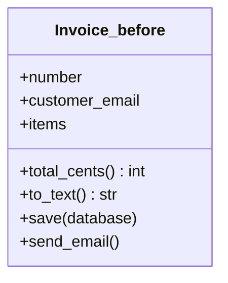
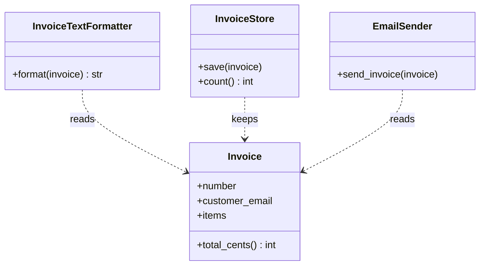

# 02. Single Responsibility

> **Draft: written but not yet run.** The code and the expected output in this lesson were prepared by reading the code and the official documentation. They have not been executed yet. If something does not behave as described, trust your tool's real output and report it.

## What you will be able to do
By the end of this lesson you will be able to:
- state the Single Responsibility Principle (SRP) in one sentence
- list the "reasons to change" of a class
- split a class that does four jobs into four small classes
- predict which class you would edit for a given change request

## Recap
1. What is the difference between cohesion and coupling? <details><summary>Answer</summary>Cohesion: how well the parts inside one unit belong together (want high). Coupling: how much one unit depends on the details of another (want low).</details>
2. Why must a refactoring leave the output unchanged? <details><summary>Answer</summary>Refactoring changes structure only. If the output changes, behaviour changed too.</details>
3. Name one code smell from lesson 01. <details><summary>Answer</summary>Long function, magic numbers or duplicated code.</details>

## Why it matters
Picture a small shop where one person is the cook, the cashier, the delivery driver and the accountant. If the delivery bike breaks, the cooking stops. If the tax rules change, the cashier work is disturbed too. Now picture four people with four jobs: a problem in one job does not stop the other three. The **Single Responsibility Principle** says the same about classes: **a class should have only one reason to change**. It is the first of the five SOLID principles (SOLID is an acronym: **S**ingle responsibility, **O**pen/closed, **L**iskov substitution, **I**nterface segregation, **D**ependency inversion). Each of the next five lessons teaches one letter.

## What you will build
An `Invoice` class that calculates a total, formats text, saves itself and sends an email is split into four small classes. Both versions run one after the other and print the same lines.

## Before you start
- Time: 35 minutes for one language, 55 minutes if you follow both. Follow **one** language (Python or C#); the other is there to compare.
- You need lesson 01 and a working Python 3.10+ and/or .NET 11 SDK. You also need to know what a class and a method are (Python 101 lesson 11, C# 101 lesson 10).
- Source pack (optional): every file is shown in full in this lesson, so you can follow without it. The finished code, the exercise starter and the solution are in the
  course repository https://github.com/Uee03/Code101 under `source/patterns/101-zero-to-hero/phase-1-solid/02-single-responsibility/` (on that page choose **Code, Download ZIP**, or run
  `git clone https://github.com/Uee03/Code101.git`).

## Steps

### Step 1. Make the lesson folders
**PowerShell, starting folder: anywhere**
```powershell
New-Item -ItemType Directory -Path "$HOME/code101/patterns/lesson02/python" -Force | Out-Null
New-Item -ItemType Directory -Path "$HOME/code101/patterns/lesson02/csharp" -Force | Out-Null
Set-Location "$HOME/code101/patterns/lesson02"
code .
```

**macOS/Linux terminal, starting folder: anywhere**
```bash
mkdir -p ~/code101/patterns/lesson02/python ~/code101/patterns/lesson02/csharp
cd ~/code101/patterns/lesson02
code .
```
Expected result: VS Code opens `lesson02` with empty `python` and `csharp` folders. Save every file with **Ctrl+S** (macOS: **Cmd+S**); a dot on the tab means unsaved.

### Step 2. Read the first design: one class, four jobs
An **attribute** is a value stored on an object. A **method** is a function that belongs to a class. In C#, a **property** such as `public int Number { get; }` is an attribute that can be read from outside but only set in the constructor.

**File: `~/code101/patterns/lesson02/python/before.py`**
```python
class Invoice:
    def __init__(self, number, customer_email, items):
        self.number = number
        self.customer_email = customer_email
        self.items = items

    def total_cents(self):
        total = 0
        for _, price, qty in self.items:
            total += price * qty
        return total

    def to_text(self):
        lines = [f"Invoice {self.number}"]
        for name, _, qty in self.items:
            lines.append(f"{name} x{qty}")
        lines.append(f"Total cents: {self.total_cents()}")
        return "\n".join(lines)

    def save(self, database):
        database.append(self.to_text())

    def send_email(self):
        print(f"Email to {self.customer_email}: invoice {self.number}")
```

**File: `~/code101/patterns/lesson02/csharp/Before.cs`**
```csharp
using Item = (string Name, int PriceCents, int Quantity);

namespace Before;

public class Invoice
{
    public int Number { get; }
    public string CustomerEmail { get; }
    public List<Item> Items { get; }

    public Invoice(int number, string customerEmail, List<Item> items)
    {
        Number = number;
        CustomerEmail = customerEmail;
        Items = items;
    }

    public int TotalCents()
    {
        int total = 0;
        foreach (var item in Items)
        {
            total += item.PriceCents * item.Quantity;
        }
        return total;
    }

    public string ToText()
    {
        var lines = new List<string> { $"Invoice {Number}" };
        foreach (var item in Items)
        {
            lines.Add($"{item.Name} x{item.Quantity}");
        }
        lines.Add($"Total cents: {TotalCents()}");
        return string.Join("\n", lines);
    }

    public void Save(List<string> database)
    {
        database.Add(ToText());
    }

    public void SendEmail()
    {
        Console.WriteLine($"Email to {CustomerEmail}: invoice {Number}");
    }
}
```
Here `"\n".join(lines)` (Python) and `string.Join("\n", lines)` (C#) glue a list of lines into one text with a line break between them. The "database" is just a list in memory so that nothing needs installing.

### Step 3. Find the reasons to change
Do this on paper before reading on. For each method of the class above, write **who would ask you to change it**:

<details><summary>Answer</summary>

| Method | Who asks for a change | Example request |
|---|---|---|
| `total_cents` | Finance | "Add 20 percent tax" |
| `to_text` | Marketing or design | "Make the invoice look nicer" |
| `save` | The technical team | "Move from a list to a real database" |
| `send_email` | Customer support | "Change the email wording" |

Four different people, four different reasons. When finance asks for tax, you open the same file that marketing and IT also edit. That raises the chance of one change breaking another.

</details>

### Step 4. Read the refactored design
Each job gets its own class. `Invoice` keeps only what an invoice **is** and how its total is calculated.

**File: `~/code101/patterns/lesson02/python/after.py`**
```python
class Invoice:
    def __init__(self, number, customer_email, items):
        self.number = number
        self.customer_email = customer_email
        self.items = items

    def total_cents(self):
        total = 0
        for _, price, qty in self.items:
            total += price * qty
        return total


class InvoiceTextFormatter:
    def format(self, invoice):
        lines = [f"Invoice {invoice.number}"]
        for name, _, qty in invoice.items:
            lines.append(f"{name} x{qty}")
        lines.append(f"Total cents: {invoice.total_cents()}")
        return "\n".join(lines)


class InvoiceStore:
    def __init__(self):
        self.saved = []

    def save(self, invoice):
        self.saved.append(invoice)

    def count(self):
        return len(self.saved)


class EmailSender:
    def send_invoice(self, invoice):
        print(f"Email to {invoice.customer_email}: invoice {invoice.number}")
```

**File: `~/code101/patterns/lesson02/csharp/After.cs`**
```csharp
using Item = (string Name, int PriceCents, int Quantity);

namespace After;

public class Invoice
{
    public int Number { get; }
    public string CustomerEmail { get; }
    public List<Item> Items { get; }

    public Invoice(int number, string customerEmail, List<Item> items)
    {
        Number = number;
        CustomerEmail = customerEmail;
        Items = items;
    }

    public int TotalCents()
    {
        int total = 0;
        foreach (var item in Items)
        {
            total += item.PriceCents * item.Quantity;
        }
        return total;
    }
}

public class InvoiceTextFormatter
{
    public string Format(Invoice invoice)
    {
        var lines = new List<string> { $"Invoice {invoice.Number}" };
        foreach (var item in invoice.Items)
        {
            lines.Add($"{item.Name} x{item.Quantity}");
        }
        lines.Add($"Total cents: {invoice.TotalCents()}");
        return string.Join("\n", lines);
    }
}

public class InvoiceStore
{
    private readonly List<Invoice> _saved = new();

    public int Count => _saved.Count;

    public void Save(Invoice invoice)
    {
        _saved.Add(invoice);
    }
}

public class EmailSender
{
    public void SendInvoice(Invoice invoice)
    {
        Console.WriteLine($"Email to {invoice.CustomerEmail}: invoice {invoice.Number}");
    }
}
```
In C#, `private readonly` means "only this class can see it, and it is assigned once". `public int Count => _saved.Count;` is a read-only property that answers with the list's size. `new()` after the type name is shorthand for `new List<Invoice>()`.

### Step 5. Write the file that runs both
**File: `~/code101/patterns/lesson02/python/main.py`**
```python
import after
import before

ITEMS = [("Notebook", 1200, 2), ("Pen", 150, 4)]

print("--- before ---")
database = []
old_invoice = before.Invoice(1, "ana@example.com", ITEMS)
print(old_invoice.to_text())
old_invoice.save(database)
old_invoice.send_email()
print(f"Stored invoices: {len(database)}")

print("--- after ---")
formatter = after.InvoiceTextFormatter()
store = after.InvoiceStore()
sender = after.EmailSender()
invoice = after.Invoice(1, "ana@example.com", ITEMS)
print(formatter.format(invoice))
store.save(invoice)
sender.send_invoice(invoice)
print(f"Stored invoices: {store.count()}")
```

**File: `~/code101/patterns/lesson02/csharp/Program.cs`**
```csharp
using Item = (string Name, int PriceCents, int Quantity);

var items = new List<Item> { ("Notebook", 1200, 2), ("Pen", 150, 4) };

Console.WriteLine("--- before ---");
var database = new List<string>();
var oldInvoice = new Before.Invoice(1, "ana@example.com", items);
Console.WriteLine(oldInvoice.ToText());
oldInvoice.Save(database);
oldInvoice.SendEmail();
Console.WriteLine($"Stored invoices: {database.Count}");

Console.WriteLine("--- after ---");
var formatter = new After.InvoiceTextFormatter();
var store = new After.InvoiceStore();
var sender = new After.EmailSender();
var invoice = new After.Invoice(1, "ana@example.com", items);
Console.WriteLine(formatter.Format(invoice));
store.Save(invoice);
sender.SendInvoice(invoice);
Console.WriteLine($"Stored invoices: {store.Count}");
```
For C# the project file is the same `Lesson.csproj` as in lesson 01. It still has to be next to `Program.cs`, so create it again:

**File: `~/code101/patterns/lesson02/csharp/Lesson.csproj`**
```xml
<Project Sdk="Microsoft.NET.Sdk">

  <PropertyGroup>
    <OutputType>Exe</OutputType>
    <TargetFramework>net11.0</TargetFramework>
    <ImplicitUsings>enable</ImplicitUsings>
    <Nullable>enable</Nullable>
  </PropertyGroup>

</Project>
```

## Run it
Before you run, predict: will the two halves print the same text? How many lines will each half print?

**PowerShell, folder: `~/code101/patterns/lesson02/python`**
```powershell
Set-Location "$HOME/code101/patterns/lesson02/python"
python main.py
```
**macOS/Linux terminal, folder: `~/code101/patterns/lesson02/python`**
```bash
cd ~/code101/patterns/lesson02/python
python3 main.py
```
**Any terminal, folder: `~/code101/patterns/lesson02/csharp`**
```text
dotnet run --project . --nologo
```
Expected output (derived by reading the code, not yet run; identical for Python and C#):
```text
--- before ---
Invoice 1
Notebook x2
Pen x4
Total cents: 3000
Email to ana@example.com: invoice 1
Stored invoices: 1
--- after ---
Invoice 1
Notebook x2
Pen x4
Total cents: 3000
Email to ana@example.com: invoice 1
Stored invoices: 1
```
Each half prints six lines, and both halves are identical: the design changed, the behaviour did not.

## How it works

One box with four jobs. After the split:


Dotted arrows with an open head mean "depends on": the three helpers know about `Invoice`, but `Invoice` knows nothing about them. (Lesson 09 explains every arrow.)

Follow the program in `main`: it creates the four objects, asks the formatter for text, asks the store to keep the invoice, and asks the sender to send. The `main` file is the **coordinator**: somebody has to connect the small pieces.

The test for SRP is a sentence: "This class changes when ___." If you need the word **and** (finance changes the total **and** marketing changes the layout), split it. After the split: `Invoice` changes when the pricing rules change. `InvoiceTextFormatter` changes when the layout changes. `InvoiceStore` changes when storage changes. `EmailSender` changes when the email wording or provider changes.

Two misconceptions to avoid:
- **"One class, one method."** No. A class can have many methods as long as they serve the same reason to change.
- **"The more classes the better."** No. Splitting has a cost: more files and more wiring. Split when you can name two different reasons to change. Do not split `total_cents` into three classes because it has a loop and a sum.

## Try it
**Rung 1, guided.** Copy the `starter` folder of your language to a new folder `try02` (copy the folder itself and rename the copy; do not put it inside another folder) and fix the TODOs. The output must stay the same.

**File: `try02/main.py`**
```python
class Order:
    def __init__(self, customer, prices):
        self.customer = customer
        self.prices = prices

    def total(self):
        return sum(self.prices)

    def receipt_text(self):
        return f"Receipt for {self.customer}: {self.total()} cents"

    def send_confirmation(self):
        print(f"SMS to {self.customer}: {self.receipt_text()}")


# TODO 1: make a class ReceiptFormatter with format(order) that returns the receipt text.
# TODO 2: make a class SmsSender with send(order, text) that prints the SMS line.
# TODO 3: remove receipt_text and send_confirmation from Order, then change the lines
#         below so the formatter and the sender do those jobs. The output must not change.

order = Order("Ben", [500, 250, 125])
order.send_confirmation()
```

**File: `try02/Program.cs`** (with the same `Lesson.csproj` next to it)
```csharp
var order = new Order("Ben", new List<int> { 500, 250, 125 });
order.SendConfirmation();

// TODO 1: make a class ReceiptFormatter with Format(Order order) that returns the receipt text.
// TODO 2: make a class SmsSender with Send(Order order, string text) that prints the SMS line.
// TODO 3: remove ReceiptText and SendConfirmation from Order, then change the two lines at the
//         top so the formatter and the sender do those jobs. The output must not change.

class Order
{
    public string Customer { get; }
    public List<int> Prices { get; }

    public Order(string customer, List<int> prices)
    {
        Customer = customer;
        Prices = prices;
    }

    public int Total()
    {
        return Prices.Sum();
    }

    public string ReceiptText()
    {
        return $"Receipt for {Customer}: {Total()} cents";
    }

    public void SendConfirmation()
    {
        Console.WriteLine($"SMS to {Customer}: {ReceiptText()}");
    }
}
```
Expected output before and after your change:
```text
SMS to Ben: Receipt for Ben: 875 cents
```

**Rung 2, change.** Finance asks you to add a service fee of 200 cents to every order total. Which class do you edit? Make the change in your finished program. The output should become `SMS to Ben: Receipt for Ben: 1075 cents`, and you should only have touched one class.

**Rung 3, stretch (no single answer).** Marketing wants the SMS to end with `Thanks!` and also wants the same receipt text sent by email. Sketch (on paper or as a Mermaid diagram) which classes you would add or change, and say which of them would have "Marketing" as a reason to change.

<details><summary>Solution</summary>

**File: `exercise/solution/python/main.py`**
```python
class Order:
    def __init__(self, customer, prices):
        self.customer = customer
        self.prices = prices

    def total(self):
        return sum(self.prices)


class ReceiptFormatter:
    def format(self, order):
        return f"Receipt for {order.customer}: {order.total()} cents"


class SmsSender:
    def send(self, order, text):
        print(f"SMS to {order.customer}: {text}")


order = Order("Ben", [500, 250, 125])
text = ReceiptFormatter().format(order)
SmsSender().send(order, text)
```

**File: `exercise/solution/csharp/Program.cs`**
```csharp
var order = new Order("Ben", new List<int> { 500, 250, 125 });
string text = new ReceiptFormatter().Format(order);
new SmsSender().Send(order, text);

class Order
{
    public string Customer { get; }
    public List<int> Prices { get; }

    public Order(string customer, List<int> prices)
    {
        Customer = customer;
        Prices = prices;
    }

    public int Total()
    {
        return Prices.Sum();
    }
}

class ReceiptFormatter
{
    public string Format(Order order)
    {
        return $"Receipt for {order.Customer}: {order.Total()} cents";
    }
}

class SmsSender
{
    public void Send(Order order, string text)
    {
        Console.WriteLine($"SMS to {order.Customer}: {text}");
    }
}
```
The prices add up to 500 + 250 + 125 = 875, so the output is `SMS to Ben: Receipt for Ben: 875 cents`.

Rung 2: only `Order.total` changes (Python: `return sum(self.prices) + 200`; C#: `return Prices.Sum() + 200;`). In practice you would give 200 a name such as `SERVICE_FEE_CENTS`. Finance is the reason to change, and `Order` is the class finance owns. The formatter and sender are untouched, and the output becomes `SMS to Ben: Receipt for Ben: 1075 cents`.

Rung 3, one possible answer: change `ReceiptFormatter` for the `Thanks!` wording (Marketing is its reason to change) and add an `EmailSender` class next to `SmsSender`. `Order` is untouched.

</details>

## Check yourself
1. State the Single Responsibility Principle in your own words. <details><summary>Answer</summary>A class should have only one reason to change: it serves one job (or one stakeholder), so a change request touches one class.</details>
2. In `before.Invoice`, which methods would you ask "who requests changes?" about, and how many different answers do you get? <details><summary>Answer</summary>All four methods. You get four answers: finance (total), marketing/design (text), the technical team (storage), support (email).</details>
3. Predict: after the split, finance asks for tax on the total. Which class do you edit, and does the formatter change? <details><summary>Answer</summary>Edit `Invoice.total_cents`. The formatter only calls `total_cents()`, so its code does not change, but the text it prints will show the new total.</details>
4. Is a class with ten methods automatically breaking SRP? <details><summary>Answer</summary>No. SRP counts reasons to change, not methods. Ten methods that all serve one job are fine.</details>

## Common mistakes
These are typical messages, not yet reproduced by running this lesson. Your tool's exact wording may differ.

| Symptom or error text | Cause | Fix |
|---|---|---|
| `AttributeError: 'Invoice' object has no attribute 'to_text'` | You called `to_text()` on the **after** `Invoice`; that job moved to the formatter | Call `InvoiceTextFormatter().format(invoice)` instead |
| `error CS1061: 'Invoice' does not contain a definition for 'ToText'` | The same mistake in C#: `ToText` is not on `After.Invoice` any more | Use `new After.InvoiceTextFormatter().Format(invoice)` |
| `python: can't open file '...main.py': [Errno 2] No such file or directory` | The terminal is in the wrong folder | `cd` into `~/code101/patterns/lesson02/python` |
| `MSB1003: Specify a project or solution file. The current working directory does not contain a project or solution file.` | The terminal is not in the folder with `Lesson.csproj` | `cd` into `~/code101/patterns/lesson02/csharp` |

## Best practice
For every class, finish the sentence "This class changes when ___" and split it if the sentence needs "and". Source: DigitalOcean, SOLID: The First 5 Principles of Object-Oriented Design https://www.digitalocean.com/community/conceptual-articles/s-o-l-i-d-the-first-five-principles-of-object-oriented-design

## Going further
- The pattern catalogue that the next level of this track builds on: https://sourcemaking.com/design_patterns
- The smell that SRP cures, "Large Class": https://refactoring.guru/smells/large-class

## Summary
- You stated SRP as "one reason to change".
- You listed four reasons to change in one `Invoice` class by asking who would request each change.
- You split that class into `Invoice`, `InvoiceTextFormatter`, `InvoiceStore` and `EmailSender` without changing the output.
- You predicted which class a finance change touches.

## Next lesson
03. Open/Closed: add new behaviour by adding code, not by editing old code.
