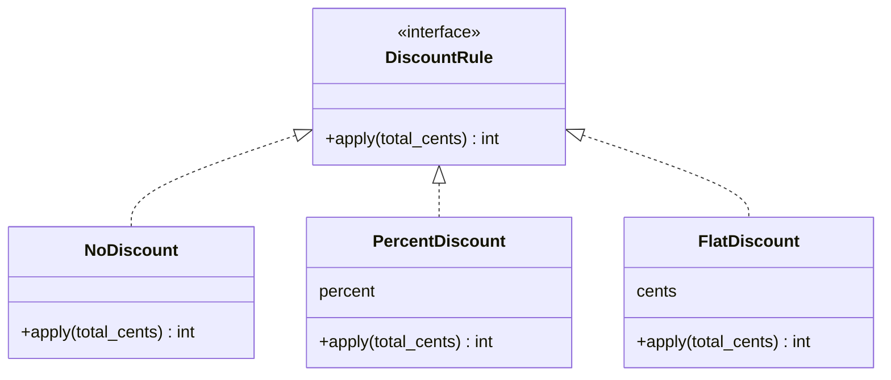

# 03. Open/Closed

> **Draft: written but not yet run.** The code and the expected output in this lesson were prepared by reading the code and the official documentation. They have not been executed yet. If something does not behave as described, trust your tool's real output and report it.

## What you will be able to do
By the end of this lesson you will be able to:
- explain "open for extension, closed for modification" with an example
- recognise a growing `if / elif` chain that switches on a type name
- replace that chain with small classes that share one interface
- add a new behaviour by adding a new file instead of editing an old one

## Recap
1. What does the Single Responsibility Principle say? <details><summary>Answer</summary>A class should have only one reason to change.</details>
2. Finish the sentence: "This class changes when ___." Why is the word "and" a warning? <details><summary>Answer</summary>If you need "and" the class has two reasons to change and probably two jobs; split it.</details>
3. In lesson 02 which class held the total calculation after the split? <details><summary>Answer</summary>`Invoice`; the formatter, store and sender only used it.</details>

## Why it matters
A power strip has free sockets. When you buy a new lamp you plug it in; you do not open the wall and rewire the house. The wall (the thing that already works and was already tested) is **closed for modification**. The strip is **open for extension**. The **Open/Closed Principle** (OCP) asks the same of code: **you should be able to add new behaviour without editing code that already works**. Every edit to old code risks breaking something that was fine yesterday.

## What you will build
A discount calculator for a shop with regular, VIP and student customers. First as a chain of `if` tests where each new customer type forces an edit. Then as small discount classes, where a new "employee" discount is added in a **new file** and no old file is touched.

## Before you start
- Time: 40 minutes for one language, 60 minutes if you follow both. Follow **one** language; the other is there to compare.
- You need lessons 01 and 02 and Python 3.10+ and/or the .NET 11 SDK.
- Source pack (optional): every file is shown in full in this lesson, so you can follow without it. The finished code, the exercise starter and the solution are in the
  course repository https://github.com/Uee03/Code101 under `source/patterns/101-zero-to-hero/phase-1-solid/03-open-closed/` (on that page choose **Code, Download ZIP**, or run
  `git clone https://github.com/Uee03/Code101.git`).

## Steps

### Step 1. Make the lesson folders
**PowerShell, starting folder: anywhere**
```powershell
New-Item -ItemType Directory -Path "$HOME/code101/patterns/lesson03/python" -Force | Out-Null
New-Item -ItemType Directory -Path "$HOME/code101/patterns/lesson03/csharp" -Force | Out-Null
Set-Location "$HOME/code101/patterns/lesson03"
code .
```

**macOS/Linux terminal, starting folder: anywhere**
```bash
mkdir -p ~/code101/patterns/lesson03/python ~/code101/patterns/lesson03/csharp
cd ~/code101/patterns/lesson03
code .
```
Expected result: VS Code opens `lesson03` with empty `python` and `csharp` folders. Remember to save each file.

### Step 2. Read the first design: an if-chain
**File: `~/code101/patterns/lesson03/python/before.py`**
```python
def discounted_total(customer_type, total_cents):
    if customer_type == "regular":
        return total_cents
    elif customer_type == "vip":
        return total_cents - total_cents * 20 // 100
    elif customer_type == "student":
        return total_cents - total_cents * 10 // 100
    return total_cents
```

**File: `~/code101/patterns/lesson03/csharp/Before.cs`**
```csharp
namespace Before;

public static class Discounts
{
    public static int DiscountedTotal(string customerType, int totalCents)
    {
        if (customerType == "regular")
        {
            return totalCents;
        }
        else if (customerType == "vip")
        {
            return totalCents - totalCents * 20 / 100;
        }
        else if (customerType == "student")
        {
            return totalCents - totalCents * 10 / 100;
        }
        return totalCents;
    }
}
```
Predict before you go on: what will this function return for the customer type `"employee"` and a total of 5000? <details><summary>Answer</summary>5000. No branch matches `"employee"`, so the function falls through to the last line and quietly gives **no discount**. Nobody is told that a type is missing.</details>

To give employees a discount you must **open this function and edit it**. Every new customer type means another branch, in the same function that is already used by every checkout. This is the exact situation OCP wants to avoid.

### Step 3. Read the second design: small classes with one shared promise
Three new words, each in plain language:
- An **interface** is a list of methods that a class promises to have. It says what can be done, not how. Think of the shape of a plug: any lamp with that plug fits the socket.
- To **implement** an interface means a class keeps that promise by providing every listed method.
- **Polymorphism** (from Greek, "many shapes") means you call the same method on different objects and each does its own thing. `rule.apply(total)` works for any rule.

Python has no `interface` keyword. We use an **abstract base class**: a class that cannot be used directly and marks methods that every subclass must provide. You make one by inheriting from `ABC` and marking methods with `@abstractmethod`. C# has real interfaces; by convention their names start with `I`.

**File: `~/code101/patterns/lesson03/python/after.py`**
```python
from abc import ABC, abstractmethod


class DiscountRule(ABC):
    @abstractmethod
    def apply(self, total_cents):
        ...


class NoDiscount(DiscountRule):
    def apply(self, total_cents):
        return total_cents


class PercentDiscount(DiscountRule):
    def __init__(self, percent):
        self.percent = percent

    def apply(self, total_cents):
        return total_cents - total_cents * self.percent // 100


def final_total(rule, total_cents):
    return rule.apply(total_cents)
```

**File: `~/code101/patterns/lesson03/csharp/After.cs`**
```csharp
namespace After;

public interface IDiscountRule
{
    int Apply(int totalCents);
}

public class NoDiscount : IDiscountRule
{
    public int Apply(int totalCents)
    {
        return totalCents;
    }
}

public class PercentDiscount : IDiscountRule
{
    private readonly int _percent;

    public PercentDiscount(int percent)
    {
        _percent = percent;
    }

    public int Apply(int totalCents)
    {
        return totalCents - totalCents * _percent / 100;
    }
}

public static class Pricing
{
    public static int FinalTotal(IDiscountRule rule, int totalCents)
    {
        return rule.Apply(totalCents);
    }
}
```
In Python `class PercentDiscount(DiscountRule)` means "PercentDiscount is a kind of DiscountRule"; in C# `class PercentDiscount : IDiscountRule` means "implements the interface". The `...` in Python is a placeholder body that does nothing. `final_total` / `FinalTotal` does not know which rule it receives. It never changes when a new rule appears. That is the **closed** part.

### Step 4. Add a new rule in a new file
The business wants employees to get 500 cents off (never below zero). This is a different calculation from a percentage, and it goes into a **new file**. The two files from Step 3 are not touched.

**File: `~/code101/patterns/lesson03/python/new_rules.py`**
```python
from after import DiscountRule


class FlatDiscount(DiscountRule):
    def __init__(self, cents):
        self.cents = cents

    def apply(self, total_cents):
        return max(total_cents - self.cents, 0)
```

**File: `~/code101/patterns/lesson03/csharp/NewRules.cs`**
```csharp
using After;

namespace NewRules;

public class FlatDiscount : IDiscountRule
{
    private readonly int _cents;

    public FlatDiscount(int cents)
    {
        _cents = cents;
    }

    public int Apply(int totalCents)
    {
        return Math.Max(totalCents - _cents, 0);
    }
}
```
`max(a, b)` and `Math.Max(a, b)` return the larger value, so the price never goes below 0.

### Step 5. Write the file that runs both
**File: `~/code101/patterns/lesson03/python/main.py`**
```python
import after
import before
import new_rules

TOTAL = 5000
CUSTOMERS = ["regular", "vip", "student", "employee"]

print("--- before ---")
for customer in CUSTOMERS:
    print(f"{customer}: {before.discounted_total(customer, TOTAL)}")

print("--- after ---")
rules = {
    "regular": after.NoDiscount(),
    "vip": after.PercentDiscount(20),
    "student": after.PercentDiscount(10),
    "employee": new_rules.FlatDiscount(500),
}
for customer in CUSTOMERS:
    print(f"{customer}: {after.final_total(rules[customer], TOTAL)}")
```

**File: `~/code101/patterns/lesson03/csharp/Program.cs`**
```csharp
const int total = 5000;
string[] customers = { "regular", "vip", "student", "employee" };

Console.WriteLine("--- before ---");
foreach (string customer in customers)
{
    Console.WriteLine($"{customer}: {Before.Discounts.DiscountedTotal(customer, total)}");
}

Console.WriteLine("--- after ---");
var rules = new Dictionary<string, After.IDiscountRule>
{
    ["regular"] = new After.NoDiscount(),
    ["vip"] = new After.PercentDiscount(20),
    ["student"] = new After.PercentDiscount(10),
    ["employee"] = new NewRules.FlatDiscount(500),
};
foreach (string customer in customers)
{
    Console.WriteLine($"{customer}: {After.Pricing.FinalTotal(rules[customer], total)}");
}
```
A **dictionary** (Python `dict`, C# `Dictionary`) maps a key (here the customer type) to a value (here a rule object). Looking up `rules["vip"]` replaces the whole `if / elif` chain.

**File: `~/code101/patterns/lesson03/csharp/Lesson.csproj`** (the same file as in lessons 01 and 02)
```xml
<Project Sdk="Microsoft.NET.Sdk">

  <PropertyGroup>
    <OutputType>Exe</OutputType>
    <TargetFramework>net11.0</TargetFramework>
    <ImplicitUsings>enable</ImplicitUsings>
    <Nullable>enable</Nullable>
  </PropertyGroup>

</Project>
```

## Run it
Predict first: the `after` half has an `employee` rule; the `before` half does not. Which line will differ?

**PowerShell, folder: `~/code101/patterns/lesson03/python`**
```powershell
Set-Location "$HOME/code101/patterns/lesson03/python"
python main.py
```
**macOS/Linux terminal, folder: `~/code101/patterns/lesson03/python`**
```bash
cd ~/code101/patterns/lesson03/python
python3 main.py
```
**Any terminal, folder: `~/code101/patterns/lesson03/csharp`**
```text
dotnet run --project . --nologo
```
Expected output (derived by reading the code, not yet run; identical for Python and C#):
```text
--- before ---
regular: 5000
vip: 4000
student: 4500
employee: 5000
--- after ---
regular: 5000
vip: 4000
student: 4500
employee: 4500
```
The first three lines agree between the halves: the refactoring kept the old behaviour. The last line differs on purpose: we **added** a feature without touching the old files.

## How it works

The hollow-triangle arrow with a dotted line means "implements". Read it as "NoDiscount, PercentDiscount and FlatDiscount all keep the DiscountRule promise". (Lesson 09 explains every arrow.)

How the program runs: `main` builds a dictionary of rule objects, looks one up by customer type, and hands it to `final_total`. `final_total` calls `rule.apply(...)`; the object decides how to calculate. Adding a rule means: write a class, add one dictionary entry.

Where did the "modification" go? It did not disappear: one line in the dictionary in `main` still changes. OCP moves edits from **tested logic** (the calculation code everyone uses) to **one small list of wiring** that is easy to read and review. Lesson 06 shows where that wiring should live.

Misconceptions:
- **"Closed means you may never edit a file again."** No. Fix bugs freely. OCP is about adding **new behaviour**.
- **"Always build interfaces first, just in case."** No. The `if` chain in `before` is perfectly fine with two branches. Introduce the interface when the third case arrives, or when you see the chain being edited again and again (lesson 07 explains why: YAGNI).

## Try it
**Rung 1, guided.** Copy the `starter` folder of your language to `try03` (copy the folder itself and rename it) and complete the TODOs. The output must stay the same.

**File: `try03/main.py`**
```python
def shipping_cents(method):
    if method == "standard":
        return 400
    if method == "express":
        return 1200
    return 0


# TODO 1: make a base class ShippingRule (use ABC and @abstractmethod) with a method cost_cents().
# TODO 2: make StandardShipping (400 cents) and ExpressShipping (1200 cents) that inherit from it.
# TODO 3: put one object of each in a dictionary named RULES, keyed "standard" and "express".
#         Then print the costs with RULES[method].cost_cents() and delete shipping_cents.

for method in ["standard", "express"]:
    print(f"{method}: {shipping_cents(method)}")
```

**File: `try03/Program.cs`** (with the same `Lesson.csproj` next to it)
```csharp
foreach (string method in new[] { "standard", "express" })
{
    Console.WriteLine($"{method}: {ShippingCents(method)}");
}

// TODO 1: make an interface IShippingRule with a method int CostCents().
// TODO 2: make classes StandardShipping (400 cents) and ExpressShipping (1200 cents) that implement it.
// TODO 3: put one object of each in a Dictionary<string, IShippingRule> named rules, keyed "standard" and "express".
//         Then print the costs with rules[method].CostCents() and delete ShippingCents.

static int ShippingCents(string method)
{
    if (method == "standard")
    {
        return 400;
    }
    if (method == "express")
    {
        return 1200;
    }
    return 0;
}
```
Expected output before and after your change:
```text
standard: 400
express: 1200
```

**Rung 2, change.** The shop adds a pickup option, `"pickup"`, that costs 0. Add it by writing one new class and adding one dictionary entry, and print it as a third line. Do not edit the other classes. Expected extra line: `pickup: 0`.

**Rung 3, stretch (no single answer).** Look at a program of your own (or the examples in Python 101 or C# 101) for an `if / elif` chain that compares a string or a type. Decide whether it is worth replacing with classes today. Write down the rule of thumb you used (for example "when the third case arrives").

<details><summary>Solution</summary>

**File: `exercise/solution/python/main.py`**
```python
from abc import ABC, abstractmethod


class ShippingRule(ABC):
    @abstractmethod
    def cost_cents(self):
        ...


class StandardShipping(ShippingRule):
    def cost_cents(self):
        return 400


class ExpressShipping(ShippingRule):
    def cost_cents(self):
        return 1200


RULES = {"standard": StandardShipping(), "express": ExpressShipping()}

for method in ["standard", "express"]:
    print(f"{method}: {RULES[method].cost_cents()}")
```

**File: `exercise/solution/csharp/Program.cs`**
```csharp
var rules = new Dictionary<string, IShippingRule>
{
    ["standard"] = new StandardShipping(),
    ["express"] = new ExpressShipping(),
};

foreach (string method in new[] { "standard", "express" })
{
    Console.WriteLine($"{method}: {rules[method].CostCents()}");
}

interface IShippingRule
{
    int CostCents();
}

class StandardShipping : IShippingRule
{
    public int CostCents()
    {
        return 400;
    }
}

class ExpressShipping : IShippingRule
{
    public int CostCents()
    {
        return 1200;
    }
}
```
Output: `standard: 400` and `express: 1200`.

Rung 2 (Python): add `class PickupShipping(ShippingRule)` whose `cost_cents` returns `0`, add `"pickup": PickupShipping()` to `RULES`, and add `"pickup"` to the list in the `for` line. In C# the same: a class `PickupShipping : IShippingRule`, a dictionary entry, and `"pickup"` in the array. The existing classes are unchanged. Output gains the line `pickup: 0`.

Rung 3, one possible answer: replace a chain when a third case arrives or when the chain is edited often. For two stable cases an `if` is clearer.

</details>

## Check yourself
1. What do "open" and "closed" refer to in OCP? <details><summary>Answer</summary>Open for extension (you can add new behaviour); closed for modification (you do not have to edit working, tested code to do it).</details>
2. In `before.discounted_total`, what is the quiet danger when someone forgets to add a branch for a new customer type? <details><summary>Answer</summary>The function falls through to the last `return`, so the customer silently gets no discount and no error appears.</details>
3. Predict: if you add `"staff": after.PercentDiscount(30)` to the dictionary in `main` and ask for `"staff"`, which files had to change? <details><summary>Answer</summary>Only `main.py` (or `Program.cs`). `PercentDiscount` already exists and `final_total` does not change.</details>
4. When is an `if` chain still the better choice? <details><summary>Answer</summary>When there are only two or three stable cases that rarely change; an interface and several classes would be more code than the problem needs.</details>

## Common mistakes
These are typical messages, not yet reproduced by running this lesson. Your tool's exact wording may differ.

| Symptom or error text | Cause | Fix |
|---|---|---|
| `TypeError: Can't instantiate abstract class DiscountRule ...` (the wording differs between Python versions) | You created `DiscountRule()` itself, or a subclass that does not define `apply` | Create a concrete class such as `NoDiscount()`; check the method name |
| `error CS0535: 'FlatDiscount' does not implement interface member 'IDiscountRule.Apply(int)'` | The class says `: IDiscountRule` but its method is missing, misspelled or not `public` | Add `public int Apply(int totalCents)` |
| `KeyError: 'employee'` (Python) or `KeyNotFoundException: The given key 'employee' was not present in the dictionary.` (C#) | You asked for a customer type that has no entry in the dictionary | Add the entry to `rules` |
| `ModuleNotFoundError: No module named 'new_rules'` | `new_rules.py` is not in the same folder as `main.py` | Move or recreate it next to `main.py` |
| `error CS0246: The type or namespace name 'NewRules' could not be found (are you missing a using directive or an assembly reference?)` | `NewRules.cs` is missing, unsaved, or has a different namespace | Check `namespace NewRules;` and save the file |

## Best practice
Prefer adding a new class that implements an existing interface over adding another branch to a chain that already works. Source: DigitalOcean, SOLID: The First 5 Principles of Object-Oriented Design https://www.digitalocean.com/community/conceptual-articles/s-o-l-i-d-the-first-five-principles-of-object-oriented-design

## Going further
- Python's abstract base classes: https://docs.python.org/3/library/abc.html
- C# interfaces: https://learn.microsoft.com/dotnet/csharp/fundamentals/types/interfaces
- This "pick an interchangeable rule at run time" idea is a named design pattern, Strategy: https://refactoring.guru/design-patterns/strategy

## Summary
- You explained OCP as "open for extension, closed for modification".
- You spotted an `if / elif` chain that silently ignored an unknown customer type.
- You replaced it with an interface (or abstract base class) and three small rule classes.
- You added an employee discount in a new file without editing the old files.

## Next lesson
04. Liskov Substitution: when a class is allowed to stand in for another, and how to spot a subclass that breaks the promise.
