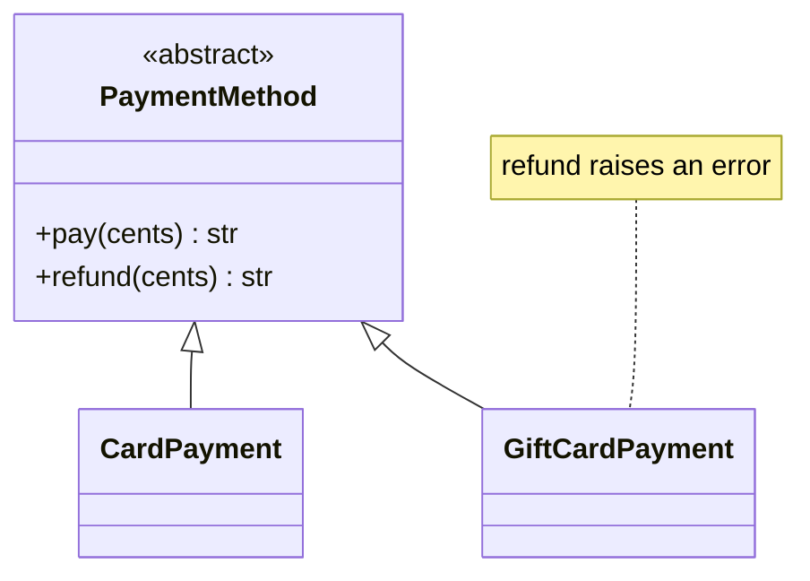
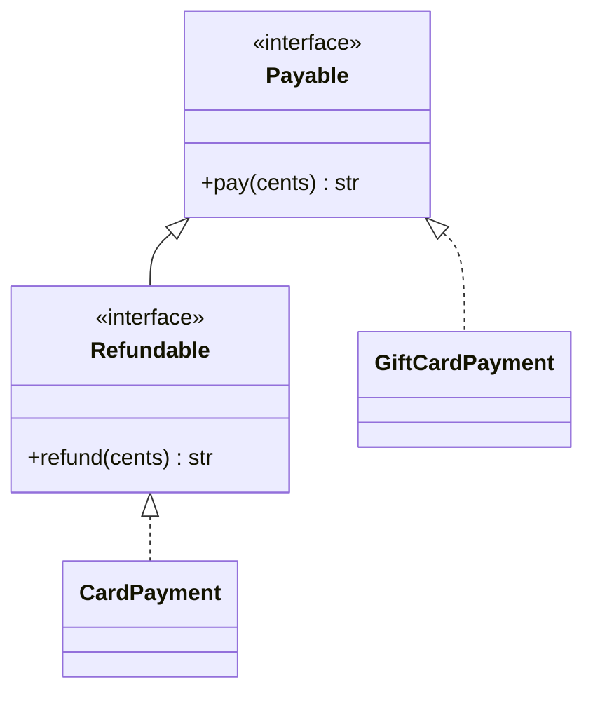

# 04. Liskov Substitution

> **Draft: written but not yet run.** The code and the expected output in this lesson were prepared by reading the code and the official documentation. They have not been executed yet. If something does not behave as described, trust your tool's real output and report it.

## What you will be able to do
By the end of this lesson you will be able to:
- explain the Liskov Substitution Principle (LSP) with an everyday example
- spot a subclass that keeps the name of its parent but breaks its promise
- fix such a design by splitting the interface instead of throwing an error
- predict which line of a program will crash because of a broken substitution

## Recap
1. In the Open/Closed lesson, what replaced the `if / elif` chain? <details><summary>Answer</summary>An interface (or abstract base class) with one small class per behaviour, plus a dictionary to pick the class.</details>
2. What is an interface in plain words? <details><summary>Answer</summary>A list of methods that a class promises to have. It says what can be done, not how.</details>
3. What does it mean to say a class "implements" an interface? <details><summary>Answer</summary>It provides every method the interface lists.</details>

## Why it matters
If you can drive a car, you can drive a taxi, a rental car or your neighbour's van. That is what "car" promises: steering wheel, pedals, brakes. Imagine a vehicle that is labelled "car" but has no brakes. It looks right and the label is right, but the moment you treat it like any other car, you crash. The **Liskov Substitution Principle** (named after the computer scientist Barbara Liskov) says: **wherever your code accepts a parent type, it must keep working when given any child type.** A child that cannot keep the parent's promises is a car without brakes.

## What you will build
A payment system with a card and a gift card. In the first design the gift card pretends to be able to refund money and crashes when asked. In the second design the types say honestly who can do what, so the mistake is caught before the program runs (in C#) or by your editor (in Python).

## Before you start
- Time: 40 minutes for one language, 60 minutes if you follow both. Follow **one** language; the other is there to compare.
- You need lesson 03 (interfaces and abstract classes) and Python 3.10+ and/or the .NET 11 SDK.
- Source pack (optional): every file is shown in full in this lesson, so you can follow without it. The finished code, the exercise starter and the solution are in the
  course repository https://github.com/Uee03/Code101 under `source/patterns/101-zero-to-hero/phase-1-solid/04-liskov-substitution/` (on that page choose **Code, Download ZIP**, or run
  `git clone https://github.com/Uee03/Code101.git`).

## Steps

### Step 1. Make the lesson folders
**PowerShell, starting folder: anywhere**
```powershell
New-Item -ItemType Directory -Path "$HOME/code101/patterns/lesson04/python" -Force | Out-Null
New-Item -ItemType Directory -Path "$HOME/code101/patterns/lesson04/csharp" -Force | Out-Null
Set-Location "$HOME/code101/patterns/lesson04"
code .
```

**macOS/Linux terminal, starting folder: anywhere**
```bash
mkdir -p ~/code101/patterns/lesson04/python ~/code101/patterns/lesson04/csharp
cd ~/code101/patterns/lesson04
code .
```
Expected result: VS Code opens `lesson04` with empty `python` and `csharp` folders.

### Step 2. Read the first design: every payment method "can" refund
A **parent type** (also called a base type) is the type another type is built from. A **child type** (subclass, derived class) is a type that inherits from it. In Python the parent goes in brackets: `class CardPayment(PaymentMethod)`. In C# it follows a colon: `class CardPayment : PaymentMethod`. An **exception** is Python's and C#'s way of stopping the normal flow when something goes wrong; `raise` (Python) and `throw` (C#) start one, and `try / except` (Python) or `try / catch` (C#) handle it.

**File: `~/code101/patterns/lesson04/python/before.py`**
```python
from abc import ABC, abstractmethod


class PaymentMethod(ABC):
    @abstractmethod
    def pay(self, cents):
        ...

    @abstractmethod
    def refund(self, cents):
        ...


class CardPayment(PaymentMethod):
    def pay(self, cents):
        return f"Card charged {cents}"

    def refund(self, cents):
        return f"Card refunded {cents}"


class GiftCardPayment(PaymentMethod):
    def pay(self, cents):
        return f"Gift card used for {cents}"

    def refund(self, cents):
        raise RuntimeError("gift cards cannot be refunded")


def cancel_order(payment, cents):
    return payment.refund(cents)
```

**File: `~/code101/patterns/lesson04/csharp/Before.cs`**
```csharp
namespace Before;

public abstract class PaymentMethod
{
    public abstract string Pay(int cents);

    public abstract string Refund(int cents);
}

public class CardPayment : PaymentMethod
{
    public override string Pay(int cents)
    {
        return $"Card charged {cents}";
    }

    public override string Refund(int cents)
    {
        return $"Card refunded {cents}";
    }
}

public class GiftCardPayment : PaymentMethod
{
    public override string Pay(int cents)
    {
        return $"Gift card used for {cents}";
    }

    public override string Refund(int cents)
    {
        throw new NotSupportedException("gift cards cannot be refunded");
    }
}

public static class Orders
{
    public static string CancelOrder(PaymentMethod payment, int cents)
    {
        return payment.Refund(cents);
    }
}
```
In C#, an `abstract class` can mark methods `abstract` (no body; children must supply one) and children write `override`. `cancel_order` accepts **any** `PaymentMethod` and asks it to refund. The parent promised that every payment method can refund. The gift card breaks that promise.

### Step 3. Predict before you run
`cancel_order` is called once with a card and once with a gift card, each for 1500 cents. Write down what each call returns or does. <details><summary>Answer</summary>The card returns `Card refunded 1500`. The gift card raises (or throws) an error with the message `gift cards cannot be refunded`. The caller never expected a "payment method" to refuse, so the program would crash if nothing caught it.</details>

### Step 4. Read the second design: say honestly who can do what
The cure is not "throw a clearer error". It is to stop claiming that every payment can refund. We make a small interface for paying and a second one for refunding. A class implements only the promises it can keep.

**File: `~/code101/patterns/lesson04/python/after.py`**
```python
from abc import ABC, abstractmethod


class Payable(ABC):
    @abstractmethod
    def pay(self, cents):
        ...


class Refundable(Payable):
    @abstractmethod
    def refund(self, cents):
        ...


class CardPayment(Refundable):
    def pay(self, cents):
        return f"Card charged {cents}"

    def refund(self, cents):
        return f"Card refunded {cents}"


class GiftCardPayment(Payable):
    def pay(self, cents):
        return f"Gift card used for {cents}"


def cancel_order(payment: Refundable, cents: int) -> str:
    return payment.refund(cents)
```

**File: `~/code101/patterns/lesson04/csharp/After.cs`**
```csharp
namespace After;

public interface IPayable
{
    string Pay(int cents);
}

public interface IRefundable : IPayable
{
    string Refund(int cents);
}

public class CardPayment : IRefundable
{
    public string Pay(int cents)
    {
        return $"Card charged {cents}";
    }

    public string Refund(int cents)
    {
        return $"Card refunded {cents}";
    }
}

public class GiftCardPayment : IPayable
{
    public string Pay(int cents)
    {
        return $"Gift card used for {cents}";
    }
}

public static class Orders
{
    public static string CancelOrder(IRefundable payment, int cents)
    {
        return payment.Refund(cents);
    }
}
```
In Python, `payment: Refundable` and `-> str` are **type hints**: notes about which type goes in and comes out. Python ignores them when running, but editors (for example VS Code with Pylance) and checkers such as mypy read them and underline mistakes. In C# the compiler enforces the types, so a mistake stops the build.

### Step 5. Write the file that runs both
**File: `~/code101/patterns/lesson04/python/main.py`**
```python
import after
import before

print("--- before ---")
for payment in [before.CardPayment(), before.GiftCardPayment()]:
    try:
        print(before.cancel_order(payment, 1500))
    except RuntimeError as error:
        print(f"Crash: {error}")

print("--- after ---")
card = after.CardPayment()
gift = after.GiftCardPayment()
for payable in [card, gift]:
    print(payable.pay(1500))
print(after.cancel_order(card, 1500))
# after.cancel_order(gift, 1500)  # a type checker flags this line before you run it
```

**File: `~/code101/patterns/lesson04/csharp/Program.cs`**
```csharp
Console.WriteLine("--- before ---");
var oldPayments = new List<Before.PaymentMethod> { new Before.CardPayment(), new Before.GiftCardPayment() };
foreach (var payment in oldPayments)
{
    try
    {
        Console.WriteLine(Before.Orders.CancelOrder(payment, 1500));
    }
    catch (NotSupportedException error)
    {
        Console.WriteLine($"Crash: {error.Message}");
    }
}

Console.WriteLine("--- after ---");
var card = new After.CardPayment();
var gift = new After.GiftCardPayment();
var payables = new List<After.IPayable> { card, gift };
foreach (var payable in payables)
{
    Console.WriteLine(payable.Pay(1500));
}
Console.WriteLine(After.Orders.CancelOrder(card, 1500));
// After.Orders.CancelOrder(gift, 1500);  // the compiler refuses this line
```
The `try / except` (C#: `try / catch`) is only there so the **before** half can print `Crash:` and carry on, instead of ending the program. Real code should not hide this kind of bug; we do it to see it.

**File: `~/code101/patterns/lesson04/csharp/Lesson.csproj`** (the same file as in lessons 01 to 03)
```xml
<Project Sdk="Microsoft.NET.Sdk">

  <PropertyGroup>
    <OutputType>Exe</OutputType>
    <TargetFramework>net11.0</TargetFramework>
    <ImplicitUsings>enable</ImplicitUsings>
    <Nullable>enable</Nullable>
  </PropertyGroup>

</Project>
```

## Run it
**PowerShell, folder: `~/code101/patterns/lesson04/python`**
```powershell
Set-Location "$HOME/code101/patterns/lesson04/python"
python main.py
```
**macOS/Linux terminal, folder: `~/code101/patterns/lesson04/python`**
```bash
cd ~/code101/patterns/lesson04/python
python3 main.py
```
**Any terminal, folder: `~/code101/patterns/lesson04/csharp`**
```text
dotnet run --project . --nologo
```
Expected output (derived by reading the code, not yet run; identical for Python and C#):
```text
--- before ---
Card refunded 1500
Crash: gift cards cannot be refunded
--- after ---
Card charged 1500
Gift card used for 1500
Card refunded 1500
```
Now remove the leading `#` (Python) or `//` (C#) from the last line of `main` and run again. The mistake "refund a gift card" can no longer hide: C# refuses to build, and in Python your editor underlines the line before you run it. The typical messages are in "Common mistakes" below.

## How it works

The solid line with a hollow triangle is **inheritance** ("is a kind of"). `GiftCardPayment` claims to be a `PaymentMethod` but its `refund` only raises an error.


After the change, the diagram says exactly what is true. `cancel_order` asks for a `Refundable`, so a gift card can never reach it. (Lesson 09 explains every arrow.)

A subclass must keep **three promises** of its parent:
1. **Do not demand more.** If the parent accepts any amount, the child must not suddenly reject amounts above 10000.
2. **Do not deliver less.** If the parent returns a receipt text, the child must not return nothing.
3. **Do not surprise the caller.** A child that raises an error the parent never raised, or silently removes an ability, is a car without brakes.

Common misconception: "A gift card **is a** payment, so inheritance is natural." In everyday language yes, but in code "is a" means "**behaves as** the parent in every place the parent is used". Ask "can I use it everywhere the parent is used?", not "is it the same kind of thing?"

A warning sign in code: a method that only does `raise NotImplementedError` / `throw new NotSupportedException()`, or a check like `if isinstance(payment, GiftCardPayment)` (C#: `if (payment is GiftCardPayment)`) in code that should treat all payments the same way.

## Try it
**Rung 1, guided.** Copy the `starter` folder of your language to `try04` (copy the folder itself and rename it) and fix the TODOs. The starter **crashes on purpose** at its last line: SMS cannot carry attachments.

**File: `try04/main.py`**
```python
from abc import ABC, abstractmethod


class Channel(ABC):
    @abstractmethod
    def send(self, message):
        ...

    @abstractmethod
    def send_attachment(self, message, filename):
        ...


class EmailChannel(Channel):
    def send(self, message):
        return f"Email: {message}"

    def send_attachment(self, message, filename):
        return f"Email: {message} [{filename}]"


class SmsChannel(Channel):
    def send(self, message):
        return f"SMS: {message}"

    def send_attachment(self, message, filename):
        raise RuntimeError("SMS cannot carry attachments")


def send_report(channel, message):
    print(channel.send(message))
    print(channel.send_attachment(message, "report.pdf"))


# TODO 1: split Channel in two: Channel (only send) and AttachmentChannel(Channel) (adds send_attachment).
# TODO 2: EmailChannel becomes an AttachmentChannel. SmsChannel becomes a plain Channel and loses send_attachment.
# TODO 3: add send_text(channel, message) that only prints channel.send(message).
# TODO 4: change the last line so SMS uses send_text. The program must no longer crash.

send_report(EmailChannel(), "Report ready")
send_report(SmsChannel(), "Report ready")
```

**File: `try04/Program.cs`** (with the same `Lesson.csproj` next to it)
```csharp
SendReport(new EmailChannel(), "Report ready");
SendReport(new SmsChannel(), "Report ready");

// TODO 1: split IChannel in two: IChannel (only Send) and IAttachmentChannel : IChannel (adds SendAttachment).
// TODO 2: EmailChannel implements IAttachmentChannel. SmsChannel implements only IChannel and loses SendAttachment.
// TODO 3: add SendText(IChannel channel, string message) that only prints channel.Send(message).
// TODO 4: change SendReport to take an IAttachmentChannel and make the last line of the program use SendText for SMS.
//         The program must no longer crash.

static void SendReport(IChannel channel, string message)
{
    Console.WriteLine(channel.Send(message));
    Console.WriteLine(channel.SendAttachment(message, "report.pdf"));
}

interface IChannel
{
    string Send(string message);

    string SendAttachment(string message, string filename);
}

class EmailChannel : IChannel
{
    public string Send(string message)
    {
        return $"Email: {message}";
    }

    public string SendAttachment(string message, string filename)
    {
        return $"Email: {message} [{filename}]";
    }
}

class SmsChannel : IChannel
{
    public string Send(string message)
    {
        return $"SMS: {message}";
    }

    public string SendAttachment(string message, string filename)
    {
        throw new NotSupportedException("SMS cannot carry attachments");
    }
}
```
Running the starter prints the first two lines of the expected output, then stops with an error whose last line contains `SMS cannot carry attachments`. After your fix the program prints:
```text
Email: Report ready
Email: Report ready [report.pdf]
SMS: Report ready
```

**Rung 2, change.** Add a `PushChannel` (output `Push: <message>`) that can send text but no attachment. Which interface do you give it, and do you need to change `send_text`? Show it working with a fourth output line.

**Rung 3, stretch (no single answer).** The parent `Payable.pay` accepts any amount. A teammate writes `SubscriptionPayment.pay` that raises an error for amounts above 10000. Which of the three promises does it break, and what would you change in the design (not just the error message)?

<details><summary>Solution</summary>

**File: `exercise/solution/python/main.py`**
```python
from abc import ABC, abstractmethod


class Channel(ABC):
    @abstractmethod
    def send(self, message):
        ...


class AttachmentChannel(Channel):
    @abstractmethod
    def send_attachment(self, message, filename):
        ...


class EmailChannel(AttachmentChannel):
    def send(self, message):
        return f"Email: {message}"

    def send_attachment(self, message, filename):
        return f"Email: {message} [{filename}]"


class SmsChannel(Channel):
    def send(self, message):
        return f"SMS: {message}"


def send_report(channel: AttachmentChannel, message):
    print(channel.send(message))
    print(channel.send_attachment(message, "report.pdf"))


def send_text(channel: Channel, message):
    print(channel.send(message))


send_report(EmailChannel(), "Report ready")
send_text(SmsChannel(), "Report ready")
```

**File: `exercise/solution/csharp/Program.cs`**
```csharp
SendReport(new EmailChannel(), "Report ready");
SendText(new SmsChannel(), "Report ready");

static void SendReport(IAttachmentChannel channel, string message)
{
    Console.WriteLine(channel.Send(message));
    Console.WriteLine(channel.SendAttachment(message, "report.pdf"));
}

static void SendText(IChannel channel, string message)
{
    Console.WriteLine(channel.Send(message));
}

interface IChannel
{
    string Send(string message);
}

interface IAttachmentChannel : IChannel
{
    string SendAttachment(string message, string filename);
}

class EmailChannel : IAttachmentChannel
{
    public string Send(string message)
    {
        return $"Email: {message}";
    }

    public string SendAttachment(string message, string filename)
    {
        return $"Email: {message} [{filename}]";
    }
}

class SmsChannel : IChannel
{
    public string Send(string message)
    {
        return $"SMS: {message}";
    }
}
```
Rung 2: `PushChannel` extends `Channel` (Python) or implements `IChannel` (C#) with only `send` / `Send`. `send_text` accepts any `Channel`, so it does not change. Add one line: `send_text(PushChannel(), "Report ready")` and you get `Push: Report ready`.

Rung 3: `SubscriptionPayment` **demands more** than the parent (a stricter input rule), which breaks promise 1. Callers that pass 12000 to any `Payable` would crash. Fix the design, for example: give subscriptions their own interface for plans with limits, or check the limit before choosing the payment type, so that code which accepts a `Payable` never meets a surprise.

</details>

## Check yourself
1. State the Liskov Substitution Principle in your own words. <details><summary>Answer</summary>Anywhere code works with a parent type, it must keep working, with the same promises, when given a child type.</details>
2. Why is "just raise a clearer error" not a fix for `GiftCardPayment.refund`? <details><summary>Answer</summary>The caller still believes every payment can refund, so the crash still happens at run time. The design must stop claiming that gift cards can refund.</details>
3. Predict: in the after design, what happens at build time (C#) or in the editor (Python) if you call `cancel_order(gift, 1500)`? <details><summary>Answer</summary>C# refuses to build because `GiftCardPayment` is not an `IRefundable`. A Python type checker flags the line; Python itself would still run it and then fail with an `AttributeError` because gift cards have no `refund`.</details>
4. A `ReadOnlyFile` class inherits from `File` and its `write()` silently does nothing. Which promise does it break? <details><summary>Answer</summary>"Do not deliver less": callers believe the data was written, but nothing was saved. It is also the "surprise" kind of break, because there is no error to warn them.</details>

## Common mistakes
These are typical messages, not yet reproduced by running this lesson. Your tool's exact wording may differ.

| Symptom or error text | Cause | Fix |
|---|---|---|
| `AttributeError: 'GiftCardPayment' object has no attribute 'refund'` | You removed the `#` and Python ran the forbidden line | Put the `#` back: gift cards cannot be refunded in this design |
| `error CS1503: Argument 1: cannot convert from 'After.GiftCardPayment' to 'After.IRefundable'` | You removed the `//` and the compiler enforced the design | Put the `//` back |
| `TypeError: Can't instantiate abstract class GiftCardPayment ...` (wording differs between Python versions) | A subclass of an abstract base class is missing one of its abstract methods, such as `pay` | Add the missing method |
| `error CS0535: 'GiftCardPayment' does not implement interface member 'IPayable.Pay(int)'` | The class says `: IPayable` but has no matching public `Pay` | Add `public string Pay(int cents)` |
| `python: can't open file '...main.py': [Errno 2] No such file or directory` or `MSB1003: Specify a project or solution file...` | The terminal is in the wrong folder | `cd` into the `python` or `csharp` folder of this lesson |

## Best practice
Design child types so they work everywhere their parent works; if a child cannot keep a promise, split the interface instead of throwing an error. Source: DigitalOcean, SOLID: The First 5 Principles of Object-Oriented Design https://www.digitalocean.com/community/conceptual-articles/s-o-l-i-d-the-first-five-principles-of-object-oriented-design

## Going further
- The code smell this principle prevents ("Refused Bequest", a child that rejects what it inherited): https://refactoring.guru/smells/refused-bequest
- Type hints in Python: https://docs.python.org/3/library/typing.html

## Summary
- You explained LSP as "a child must work wherever its parent works".
- You found a gift card that broke the refund promise and predicted the crash.
- You fixed the design by splitting one interface into `Payable` and `Refundable`.
- You described three ways a child can break its parent's promise.

## Next lesson
05. Interface Segregation: keep interfaces small so that nobody is forced to implement methods they cannot use.
