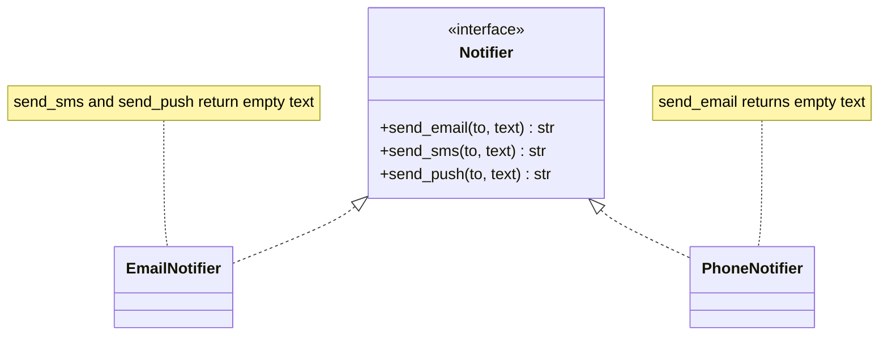
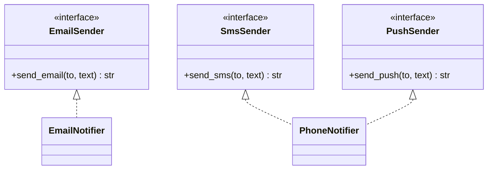

# 05. Interface Segregation

> **Draft: written but not yet run.** The code and the expected output in this lesson were prepared by reading the code and the official documentation. They have not been executed yet. If something does not behave as described, trust your tool's real output and report it.

## What you will be able to do
By the end of this lesson you will be able to:
- explain the Interface Segregation Principle (ISP) with an everyday example
- spot a "fat" interface that forces classes to write empty methods
- split it into small interfaces and let one class implement several of them
- predict which call a type checker or compiler will refuse after the split

## Recap
1. In lesson 04, what did we do instead of throwing a clearer error in `GiftCardPayment.refund`? <details><summary>Answer</summary>We split the interface into `Payable` and `Refundable` so gift cards stop claiming they can refund.</details>
2. What are the "three promises" a child type must keep? <details><summary>Answer</summary>Do not demand more than the parent, do not deliver less, do not surprise the caller with new errors.</details>
3. What is a type hint in Python? <details><summary>Answer</summary>A note such as `payment: Refundable` about which type a value should have. Python ignores it at run time; editors and checkers use it.</details>

## Why it matters
Imagine a job contract that says: "Employee must cook, drive the van, do the accounts, and play the piano at parties." You hired a cook. Every time the accounts rules change, the cook has to read the contract again, and when the cook cannot play the piano, the contract is broken. A **fat interface** is that contract. The **Interface Segregation Principle** says: **do not force a class to depend on methods it does not use; prefer several small interfaces that each describe one role.** "Segregation" means "keeping things apart".

## What you will build
A notifier with three abilities: email, SMS and push messages. In the first design one big interface lists all three, so a class that only does email must write two empty methods, and one of them silently swallows a message. In the second design three small interfaces let each class promise only what it can do.

## Before you start
- Time: 40 minutes for one language, 60 minutes if you follow both. Follow **one** language; the other is there to compare.
- You need lessons 03 and 04 and Python 3.10+ and/or the .NET 11 SDK.
- Source pack (optional): every file is shown in full in this lesson, so you can follow without it. The finished code, the exercise starter and the solution are in the
  course repository https://github.com/Uee03/Code101 under `source/patterns/101-zero-to-hero/phase-1-solid/05-interface-segregation/` (on that page choose **Code, Download ZIP**, or run
  `git clone https://github.com/Uee03/Code101.git`).

## Steps

### Step 1. Make the lesson folders
**PowerShell, starting folder: anywhere**
```powershell
New-Item -ItemType Directory -Path "$HOME/code101/patterns/lesson05/python" -Force | Out-Null
New-Item -ItemType Directory -Path "$HOME/code101/patterns/lesson05/csharp" -Force | Out-Null
Set-Location "$HOME/code101/patterns/lesson05"
code .
```

**macOS/Linux terminal, starting folder: anywhere**
```bash
mkdir -p ~/code101/patterns/lesson05/python ~/code101/patterns/lesson05/csharp
cd ~/code101/patterns/lesson05
code .
```
Expected result: VS Code opens `lesson05` with empty `python` and `csharp` folders.

### Step 2. Read the first design: one fat interface
A **client** of an interface is the code that uses it. Here the client is `notify_shipped`, which only needs to send an email. Look at what it is forced to depend on.

**File: `~/code101/patterns/lesson05/python/before.py`**
```python
from abc import ABC, abstractmethod


class Notifier(ABC):
    @abstractmethod
    def send_email(self, to, text):
        ...

    @abstractmethod
    def send_sms(self, to, text):
        ...

    @abstractmethod
    def send_push(self, to, text):
        ...


class EmailNotifier(Notifier):
    def send_email(self, to, text):
        return f"Email to {to}: {text}"

    def send_sms(self, to, text):
        return ""

    def send_push(self, to, text):
        return ""


class PhoneNotifier(Notifier):
    def send_email(self, to, text):
        return ""

    def send_sms(self, to, text):
        return f"SMS to {to}: {text}"

    def send_push(self, to, text):
        return f"Push to {to}: {text}"


def notify_shipped(notifier, address):
    return notifier.send_email(address, "Order shipped")
```

**File: `~/code101/patterns/lesson05/csharp/Before.cs`**
```csharp
namespace Before;

public interface INotifier
{
    string SendEmail(string to, string text);

    string SendSms(string to, string text);

    string SendPush(string to, string text);
}

public class EmailNotifier : INotifier
{
    public string SendEmail(string to, string text)
    {
        return $"Email to {to}: {text}";
    }

    public string SendSms(string to, string text)
    {
        return "";
    }

    public string SendPush(string to, string text)
    {
        return "";
    }
}

public class PhoneNotifier : INotifier
{
    public string SendEmail(string to, string text)
    {
        return "";
    }

    public string SendSms(string to, string text)
    {
        return $"SMS to {to}: {text}";
    }

    public string SendPush(string to, string text)
    {
        return $"Push to {to}: {text}";
    }
}

public static class Shipping
{
    public static string NotifyShipped(INotifier notifier, string address)
    {
        return notifier.SendEmail(address, "Order shipped");
    }
}
```
Both classes have **empty stub methods** (a stub is a method that exists only to satisfy the interface and does nothing real). They return an empty text instead of failing, so nobody notices.

### Step 3. Predict before you run
`notify_shipped` is called once with an `EmailNotifier` and once with a `PhoneNotifier`. Write down what each call returns. <details><summary>Answer</summary>The email notifier returns `Email to ana@example.com: Order shipped`. The phone notifier returns an **empty text**: its `send_email` stub does nothing, so the customer would never be told, and there is no error at all.</details>

### Step 4. Read the second design: one small interface per role
A **role** is one thing a class can do for a client. Each role gets its own interface. A class lists every role it can play: in Python by naming several parents, in C# by listing several interfaces after the colon.

**File: `~/code101/patterns/lesson05/python/after.py`**
```python
from abc import ABC, abstractmethod


class EmailSender(ABC):
    @abstractmethod
    def send_email(self, to, text):
        ...


class SmsSender(ABC):
    @abstractmethod
    def send_sms(self, to, text):
        ...


class PushSender(ABC):
    @abstractmethod
    def send_push(self, to, text):
        ...


class EmailNotifier(EmailSender):
    def send_email(self, to, text):
        return f"Email to {to}: {text}"


class PhoneNotifier(SmsSender, PushSender):
    def send_sms(self, to, text):
        return f"SMS to {to}: {text}"

    def send_push(self, to, text):
        return f"Push to {to}: {text}"


def notify_shipped(sender: EmailSender, address):
    return sender.send_email(address, "Order shipped")
```

**File: `~/code101/patterns/lesson05/csharp/After.cs`**
```csharp
namespace After;

public interface IEmailSender
{
    string SendEmail(string to, string text);
}

public interface ISmsSender
{
    string SendSms(string to, string text);
}

public interface IPushSender
{
    string SendPush(string to, string text);
}

public class EmailNotifier : IEmailSender
{
    public string SendEmail(string to, string text)
    {
        return $"Email to {to}: {text}";
    }
}

public class PhoneNotifier : ISmsSender, IPushSender
{
    public string SendSms(string to, string text)
    {
        return $"SMS to {to}: {text}";
    }

    public string SendPush(string to, string text)
    {
        return $"Push to {to}: {text}";
    }
}

public static class Shipping
{
    public static string NotifyShipped(IEmailSender sender, string address)
    {
        return sender.SendEmail(address, "Order shipped");
    }
}
```
There are no empty methods any more. `notify_shipped` now asks only for an `EmailSender`, which is exactly what it needs.

### Step 5. Write the file that runs both
**File: `~/code101/patterns/lesson05/python/main.py`**
```python
import after
import before

print("--- before ---")
for notifier in [before.EmailNotifier(), before.PhoneNotifier()]:
    result = before.notify_shipped(notifier, "ana@example.com")
    print(f"Result: '{result}'")

print("--- after ---")
email = after.EmailNotifier()
phone = after.PhoneNotifier()
print(after.notify_shipped(email, "ana@example.com"))
print(phone.send_sms("+100", "Order shipped"))
print(phone.send_push("ana-phone", "Order shipped"))
# after.notify_shipped(phone, "ana@example.com")  # a type checker flags this line
```

**File: `~/code101/patterns/lesson05/csharp/Program.cs`**
```csharp
Console.WriteLine("--- before ---");
var oldNotifiers = new List<Before.INotifier> { new Before.EmailNotifier(), new Before.PhoneNotifier() };
foreach (var notifier in oldNotifiers)
{
    string result = Before.Shipping.NotifyShipped(notifier, "ana@example.com");
    Console.WriteLine($"Result: '{result}'");
}

Console.WriteLine("--- after ---");
var email = new After.EmailNotifier();
var phone = new After.PhoneNotifier();
Console.WriteLine(After.Shipping.NotifyShipped(email, "ana@example.com"));
Console.WriteLine(phone.SendSms("+100", "Order shipped"));
Console.WriteLine(phone.SendPush("ana-phone", "Order shipped"));
// After.Shipping.NotifyShipped(phone, "ana@example.com");  // the compiler refuses this line
```
The quotes around `{result}` in the output are there so that an empty result is visible as `''`.

**File: `~/code101/patterns/lesson05/csharp/Lesson.csproj`** (the same file as in lessons 01 to 04)
```xml
<Project Sdk="Microsoft.NET.Sdk">

  <PropertyGroup>
    <OutputType>Exe</OutputType>
    <TargetFramework>net11.0</TargetFramework>
    <ImplicitUsings>enable</ImplicitUsings>
    <Nullable>enable</Nullable>
  </PropertyGroup>

</Project>
```

## Run it
**PowerShell, folder: `~/code101/patterns/lesson05/python`**
```powershell
Set-Location "$HOME/code101/patterns/lesson05/python"
python main.py
```
**macOS/Linux terminal, folder: `~/code101/patterns/lesson05/python`**
```bash
cd ~/code101/patterns/lesson05/python
python3 main.py
```
**Any terminal, folder: `~/code101/patterns/lesson05/csharp`**
```text
dotnet run --project . --nologo
```
Expected output (derived by reading the code, not yet run; identical for Python and C#):
```text
--- before ---
Result: 'Email to ana@example.com: Order shipped'
Result: ''
--- after ---
Email to ana@example.com: Order shipped
SMS to +100: Order shipped
Push to ana-phone: Order shipped
```
The second line is the silent bug: the customer with only a phone never gets told, and nothing complains.

## How it works

Two classes, each with empty methods. After the split:


`PhoneNotifier` plays two roles; `EmailNotifier` plays one. (Lesson 09 explains every arrow.)

Three reasons small interfaces win:
1. **No dummy methods.** A method that must exist but does nothing is a lie in the code.
2. **Honest types.** `notify_shipped(phone, ...)` is now refused by the compiler (C#) or flagged by the type checker (Python). In `before` it ran and lost the message.
3. **Less ripple.** Add `send_slack` to the fat `Notifier` and every class that implements it must change, even those that have nothing to do with Slack. Add `SlackSender` as a new small interface and nobody else is touched.

How this relates to the earlier lessons: ISP is the **client's** side of the story. Ask "what does this caller actually use?" and shape the interface to that. It often fixes the Liskov problem from lesson 04 too, because a class that is not forced to implement a method cannot implement it badly.

Common misconception: "ISP means one method per interface." No. `Payable` with `pay` and `get_receipt` can be one role if callers always use both together. Split along **roles that different callers need**, not by counting methods.

## Try it
**Rung 1, guided.** Copy the `starter` folder of your language to `try05` (copy the folder itself and rename it) and fix the TODOs.

**File: `try05/main.py`**
```python
from abc import ABC, abstractmethod


class Catalog(ABC):
    @abstractmethod
    def get_price(self, product):
        ...

    @abstractmethod
    def set_price(self, product, cents):
        ...


class ShopCatalog(Catalog):
    def __init__(self, prices):
        self.prices = prices

    def get_price(self, product):
        return self.prices[product]

    def set_price(self, product, cents):
        self.prices[product] = cents


class PartnerCatalog(Catalog):
    def __init__(self, prices):
        self.prices = prices

    def get_price(self, product):
        return self.prices[product]

    def set_price(self, product, cents):
        pass


def show_price(catalog, product):
    print(f"{product}: {catalog.get_price(product)}")


# TODO 1: split Catalog into two small interfaces: PriceReader (get_price) and PriceWriter (set_price).
# TODO 2: ShopCatalog implements both. PartnerCatalog implements only PriceReader and loses its empty set_price.
# TODO 3: show_price asks for a PriceReader (use a type hint).
# TODO 4: delete the last two lines of the program (the partner.set_price call and the show_price after it).
#         The compiler or type checker would refuse them now, which is the point.

shop = ShopCatalog({"mug": 800})
partner = PartnerCatalog({"mug": 750})
show_price(shop, "mug")
show_price(partner, "mug")
shop.set_price("mug", 900)
show_price(shop, "mug")
partner.set_price("mug", 1)
show_price(partner, "mug")
```

**File: `try05/Program.cs`** (with the same `Lesson.csproj` next to it)
```csharp
var shop = new ShopCatalog(new Dictionary<string, int> { ["mug"] = 800 });
var partner = new PartnerCatalog(new Dictionary<string, int> { ["mug"] = 750 });
ShowPrice(shop, "mug");
ShowPrice(partner, "mug");
shop.SetPrice("mug", 900);
ShowPrice(shop, "mug");
partner.SetPrice("mug", 1);
ShowPrice(partner, "mug");

// TODO 1: split ICatalog into two small interfaces: IPriceReader (GetPrice) and IPriceWriter (SetPrice).
// TODO 2: ShopCatalog implements both. PartnerCatalog implements only IPriceReader and loses its empty SetPrice.
// TODO 3: ShowPrice asks for an IPriceReader.
// TODO 4: delete the two lines that call partner.SetPrice and the ShowPrice after it.
//         The compiler would refuse them now, which is the point.

static void ShowPrice(ICatalog catalog, string product)
{
    Console.WriteLine($"{product}: {catalog.GetPrice(product)}");
}

interface ICatalog
{
    int GetPrice(string product);

    void SetPrice(string product, int cents);
}

class ShopCatalog : ICatalog
{
    private readonly Dictionary<string, int> _prices;

    public ShopCatalog(Dictionary<string, int> prices)
    {
        _prices = prices;
    }

    public int GetPrice(string product)
    {
        return _prices[product];
    }

    public void SetPrice(string product, int cents)
    {
        _prices[product] = cents;
    }
}

class PartnerCatalog : ICatalog
{
    private readonly Dictionary<string, int> _prices;

    public PartnerCatalog(Dictionary<string, int> prices)
    {
        _prices = prices;
    }

    public int GetPrice(string product)
    {
        return _prices[product];
    }

    public void SetPrice(string product, int cents)
    {
    }
}
```
Predict: what does the **starter** print? <details><summary>Answer</summary>Four lines: `mug: 800`, `mug: 750`, `mug: 900`, `mug: 750`. The last call tried to change the partner price to 1 and was silently ignored.</details>

After your fix the program prints:
```text
mug: 800
mug: 750
mug: 900
```

**Rung 2, change.** Add a third role, `PriceDeleter` (Python) or `IPriceDeleter` (C#), with a `delete_price` / `DeletePrice` method. Make only `ShopCatalog` implement it and delete `"mug"` at the end. Which existing classes and functions did you have to edit? (Aim for: only `ShopCatalog`'s header.)

**Rung 3, stretch (no single answer).** A function `export_prices(catalog)` needs to read all prices and nothing else. Would you add `get_all_prices` to `PriceReader` or create a new `PriceLister` role? Write down the question you asked yourself to decide.

<details><summary>Solution</summary>

**File: `exercise/solution/python/main.py`**
```python
from abc import ABC, abstractmethod


class PriceReader(ABC):
    @abstractmethod
    def get_price(self, product):
        ...


class PriceWriter(ABC):
    @abstractmethod
    def set_price(self, product, cents):
        ...


class ShopCatalog(PriceReader, PriceWriter):
    def __init__(self, prices):
        self.prices = prices

    def get_price(self, product):
        return self.prices[product]

    def set_price(self, product, cents):
        self.prices[product] = cents


class PartnerCatalog(PriceReader):
    def __init__(self, prices):
        self.prices = prices

    def get_price(self, product):
        return self.prices[product]


def show_price(catalog: PriceReader, product):
    print(f"{product}: {catalog.get_price(product)}")


shop = ShopCatalog({"mug": 800})
partner = PartnerCatalog({"mug": 750})
show_price(shop, "mug")
show_price(partner, "mug")
shop.set_price("mug", 900)
show_price(shop, "mug")
```

**File: `exercise/solution/csharp/Program.cs`**
```csharp
var shop = new ShopCatalog(new Dictionary<string, int> { ["mug"] = 800 });
var partner = new PartnerCatalog(new Dictionary<string, int> { ["mug"] = 750 });
ShowPrice(shop, "mug");
ShowPrice(partner, "mug");
shop.SetPrice("mug", 900);
ShowPrice(shop, "mug");

static void ShowPrice(IPriceReader catalog, string product)
{
    Console.WriteLine($"{product}: {catalog.GetPrice(product)}");
}

interface IPriceReader
{
    int GetPrice(string product);
}

interface IPriceWriter
{
    void SetPrice(string product, int cents);
}

class ShopCatalog : IPriceReader, IPriceWriter
{
    private readonly Dictionary<string, int> _prices;

    public ShopCatalog(Dictionary<string, int> prices)
    {
        _prices = prices;
    }

    public int GetPrice(string product)
    {
        return _prices[product];
    }

    public void SetPrice(string product, int cents)
    {
        _prices[product] = cents;
    }
}

class PartnerCatalog : IPriceReader
{
    private readonly Dictionary<string, int> _prices;

    public PartnerCatalog(Dictionary<string, int> prices)
    {
        _prices = prices;
    }

    public int GetPrice(string product)
    {
        return _prices[product];
    }
}
```
Rung 2: write the new interface, add it to the `ShopCatalog` header (`class ShopCatalog(PriceReader, PriceWriter, PriceDeleter)` or `: IPriceReader, IPriceWriter, IPriceDeleter`) and add the method. `PartnerCatalog`, `show_price` and the other interfaces are untouched; that is the benefit of small roles.

Rung 3, one possible answer: the question is "does every reader need this?" If only the export code needs it, make a new role so that `PartnerCatalog` and `show_price` do not change.

</details>

## Check yourself
1. State the Interface Segregation Principle in your own words. <details><summary>Answer</summary>No class should be forced to implement methods it does not use, so prefer several small interfaces over one large one.</details>
2. In `before`, why is the empty `send_email` in `PhoneNotifier` more dangerous than a method that raises an error? <details><summary>Answer</summary>It fails silently: the program carries on and the customer never receives the message, so the bug can live for months.</details>
3. Predict: what happens when you add a new method `send_slack` to the fat `Notifier` in `before`? <details><summary>Answer</summary>Every class that implements `Notifier` must be changed (in Python they cannot even be created until they define it), even those unrelated to Slack.</details>
4. Is an interface with one method always better than one with three? <details><summary>Answer</summary>No. Split by roles that different callers need. Three methods that every caller uses together are one role.</details>

## Common mistakes
These are typical messages, not yet reproduced by running this lesson. Your tool's exact wording may differ.

| Symptom or error text | Cause | Fix |
|---|---|---|
| `AttributeError: 'PhoneNotifier' object has no attribute 'send_email'` | You removed the `#` and Python ran the forbidden line | Put the `#` back: a phone notifier cannot send email in this design |
| `error CS1503: Argument 1: cannot convert from 'After.PhoneNotifier' to 'After.IEmailSender'` | You removed the `//` and the compiler enforced the roles | Put the `//` back |
| `TypeError: Can't instantiate abstract class PhoneNotifier ...` (wording differs between Python versions) | One of its abstract methods, such as `send_push`, is missing or misspelled | Add or rename the method |
| `error CS0535: 'PhoneNotifier' does not implement interface member 'IPushSender.SendPush(string, string)'` | The class lists `IPushSender` but has no matching public method | Add `public string SendPush(string to, string text)` |
| `python: can't open file '...main.py': [Errno 2] No such file or directory` or `MSB1003: Specify a project or solution file...` | The terminal is in the wrong folder | `cd` into the `python` or `csharp` folder of this lesson |

## Best practice
Design interfaces from the caller's point of view: list what the caller needs, and give each distinct need its own small interface. Source: DigitalOcean, SOLID: The First 5 Principles of Object-Oriented Design https://www.digitalocean.com/community/conceptual-articles/s-o-l-i-d-the-first-five-principles-of-object-oriented-design

## Going further
- Multiple interfaces in C#: https://learn.microsoft.com/dotnet/csharp/fundamentals/types/interfaces
- Abstract base classes in Python: https://docs.python.org/3/library/abc.html

## Summary
- You explained ISP as "no class should depend on methods it does not use".
- You found a fat interface whose empty methods hid a lost message.
- You split it into `EmailSender`, `SmsSender` and `PushSender` and let one class play two roles.
- You predicted which call the compiler or type checker would now refuse.

## Next lesson
06. Dependency Inversion: depend on interfaces, not on concrete classes, and pass the dependencies in by hand.
