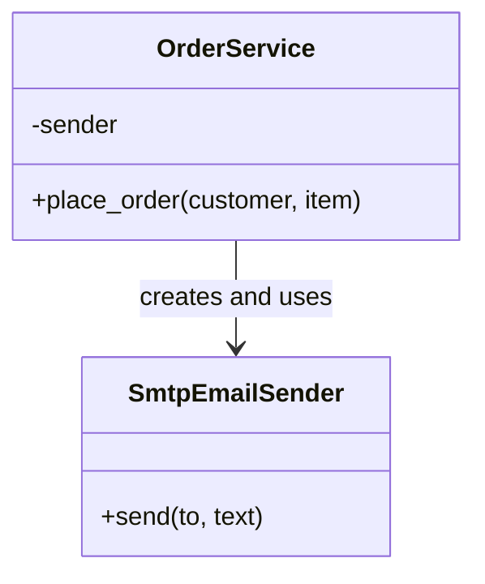
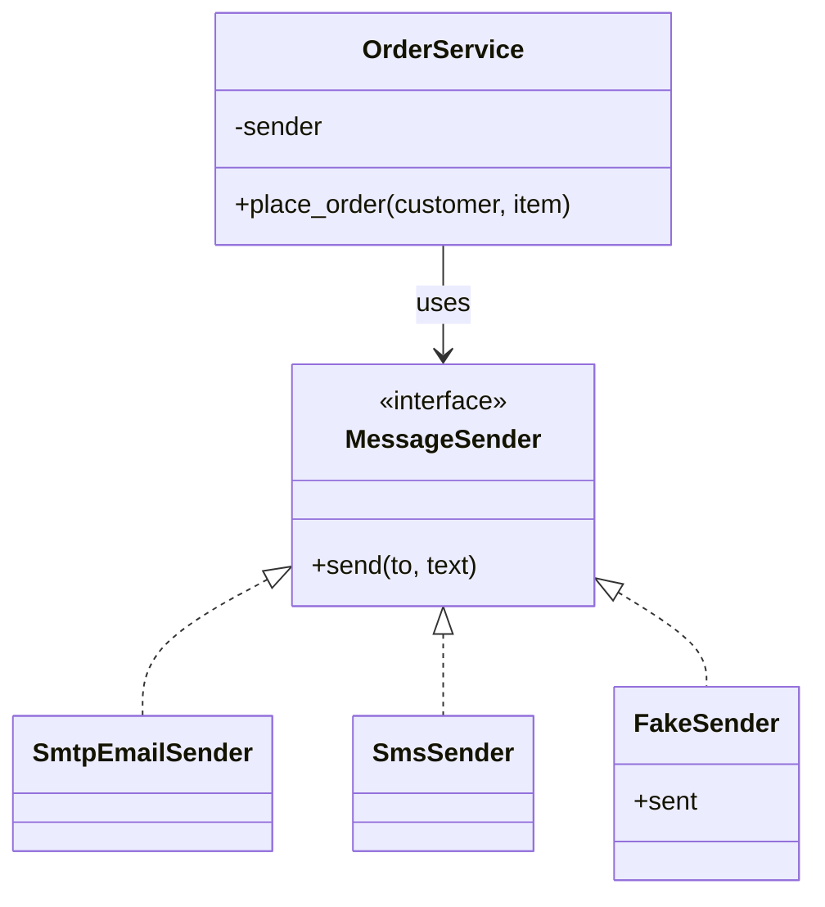

# 06. Dependency Inversion and injection by hand

> **Draft: written but not yet run.** The code and the expected output in this lesson were prepared by reading the code and the official documentation. They have not been executed yet. If something does not behave as described, trust your tool's real output and report it.

## What you will be able to do
By the end of this lesson you will be able to:
- explain the Dependency Inversion Principle (DIP) and say how it differs from dependency injection
- find a class that creates its own helper with `new` or `Helper()` and explain why that hurts
- pass a dependency in through the constructor and wire the program together by hand
- write a fake object and check a service's behaviour without any test framework

## Recap
1. What is a "fat interface" and what does ISP say about it? <details><summary>Answer</summary>A fat interface lists many methods; ISP says no class should be forced to depend on methods it does not use, so split it into small role interfaces.</details>
2. In lesson 03, where did the remaining "edit" go after we replaced the `if` chain with rule classes? <details><summary>Answer</summary>Into one small place that connects things: the dictionary in `main`. Today's lesson says where that place should live.</details>
3. What does it mean for a class to "implement" an interface? <details><summary>Answer</summary>It provides every method the interface lists.</details>

## Why it matters
Think of a lamp with a cable that is **soldered** into the wall. To move the lamp you must break the wall open. Now think of a lamp with a **plug**: the lamp does not care which wall socket it meets, only that the socket has the standard shape. The **Dependency Inversion Principle** says: **high-level code (the business rules) should not depend on low-level details (email, databases, clocks). Both should depend on an abstraction, the shape of the plug.** The word "inversion" means the arrow flips: instead of the order service reaching down to a concrete email class, the email class bends to fit the order service's plug.

## What you will build
An `OrderService` that thanks a customer after an order. In the first design it creates its own email sender inside itself, so it cannot be changed or checked without real emails. In the second design the sender is **passed in**, so the same service can use email, SMS, or a fake that records messages for a check. At the end is a review of all five SOLID principles.

## Before you start
- Time: 45 minutes for one language, 70 minutes if you follow both. Follow **one** language; the other is there to compare.
- You need lessons 03 to 05 and Python 3.10+ and/or the .NET 11 SDK.
- Source pack (optional): every file is shown in full in this lesson, so you can follow without it. The finished code, the exercise starter and the solution are in the
  course repository https://github.com/Uee03/Code101 under `source/patterns/101-zero-to-hero/phase-1-solid/06-dependency-inversion/` (on that page choose **Code, Download ZIP**, or run
  `git clone https://github.com/Uee03/Code101.git`).

## Steps

### Step 1. Make the lesson folders
**PowerShell, starting folder: anywhere**
```powershell
New-Item -ItemType Directory -Path "$HOME/code101/patterns/lesson06/python" -Force | Out-Null
New-Item -ItemType Directory -Path "$HOME/code101/patterns/lesson06/csharp" -Force | Out-Null
Set-Location "$HOME/code101/patterns/lesson06"
code .
```

**macOS/Linux terminal, starting folder: anywhere**
```bash
mkdir -p ~/code101/patterns/lesson06/python ~/code101/patterns/lesson06/csharp
cd ~/code101/patterns/lesson06
code .
```
Expected result: VS Code opens `lesson06` with empty `python` and `csharp` folders.

### Step 2. Read the first design: the service builds its own helper
A **dependency** is anything a class needs in order to do its job: another class, a clock, a file, a network connection. Find the dependency in this code.

**File: `~/code101/patterns/lesson06/python/before.py`**
```python
class SmtpEmailSender:
    def send(self, to, text):
        print(f"SMTP email to {to}: {text}")


class OrderService:
    def __init__(self):
        self.sender = SmtpEmailSender()

    def place_order(self, customer, item):
        self.sender.send(customer, f"Thanks for ordering {item}")
```

**File: `~/code101/patterns/lesson06/csharp/Before.cs`**
```csharp
namespace Before;

public class SmtpEmailSender
{
    public void Send(string to, string text)
    {
        Console.WriteLine($"SMTP email to {to}: {text}");
    }
}

public class OrderService
{
    private readonly SmtpEmailSender _sender = new SmtpEmailSender();

    public void PlaceOrder(string customer, string item)
    {
        _sender.Send(customer, $"Thanks for ordering {item}");
    }
}
```
(`SMTP` is the standard protocol for sending email. Here the "email" is only printed, so nothing real is sent.) `OrderService` **creates** its sender itself on the line `SmtpEmailSender()` (Python) / `new SmtpEmailSender()` (C#). That is the soldered cable.

### Step 3. Feel the pain
Answer on paper: (1) How would you make the service send an SMS instead? (2) How would you check, in a program, that the service sends exactly one thank-you message, without printing anything to the screen? <details><summary>Answer</summary>(1) You must open `OrderService` and edit it, which breaks the Open/Closed rule. (2) You cannot: the sender is hidden inside, so you cannot swap it or look at what it received. The only way to "test" is to run the real sender.</details>

### Step 4. Read the second design: depend on the plug, pass in the cable
Three ideas:
- **The abstraction** (the plug): a small interface `MessageSender` with one method, `send`. `OrderService` depends only on this.
- **Dependency injection** (DI): instead of creating a dependency, a class **receives** it from outside, here as a parameter of its constructor. A **constructor** is the method that runs when an object is created (`__init__` in Python, a method named like the class in C#). Handing the dependency to the constructor is called **constructor injection**.
- A **fake** is a simple stand-in object used in a check instead of the real thing. `FakeSender` does not send anything; it writes every message into a list so the check can look at it.

**File: `~/code101/patterns/lesson06/python/after.py`**
```python
from abc import ABC, abstractmethod


class MessageSender(ABC):
    @abstractmethod
    def send(self, to, text):
        ...


class SmtpEmailSender(MessageSender):
    def send(self, to, text):
        print(f"SMTP email to {to}: {text}")


class SmsSender(MessageSender):
    def send(self, to, text):
        print(f"SMS to {to}: {text}")


class FakeSender(MessageSender):
    def __init__(self):
        self.sent = []

    def send(self, to, text):
        self.sent.append((to, text))


class OrderService:
    def __init__(self, sender: MessageSender):
        self.sender = sender

    def place_order(self, customer, item):
        self.sender.send(customer, f"Thanks for ordering {item}")
```

**File: `~/code101/patterns/lesson06/csharp/After.cs`**
```csharp
namespace After;

public interface IMessageSender
{
    void Send(string to, string text);
}

public class SmtpEmailSender : IMessageSender
{
    public void Send(string to, string text)
    {
        Console.WriteLine($"SMTP email to {to}: {text}");
    }
}

public class SmsSender : IMessageSender
{
    public void Send(string to, string text)
    {
        Console.WriteLine($"SMS to {to}: {text}");
    }
}

public class FakeSender : IMessageSender
{
    public List<(string To, string Text)> Sent { get; } = new();

    public void Send(string to, string text)
    {
        Sent.Add((to, text));
    }
}

public class OrderService
{
    private readonly IMessageSender _sender;

    public OrderService(IMessageSender sender)
    {
        _sender = sender;
    }

    public void PlaceOrder(string customer, string item)
    {
        _sender.Send(customer, $"Thanks for ordering {item}");
    }
}
```
`OrderService` now contains no `SmtpEmailSender`, `SmsSender` or `FakeSender` anywhere. It only knows the plug.

### Step 5. Wire it up by hand
Somebody has to choose which sender goes into which service. That place is called the **composition root**: the one spot, near the start of the program, where objects are created and connected. Here `main` is the composition root. Doing it by hand means writing these `new` lines yourself. (Big programs use a **DI container**, a tool that does the wiring automatically; you do not need one to understand the idea, and this lesson does not use one.)

**File: `~/code101/patterns/lesson06/python/main.py`**
```python
import after
import before

print("--- before ---")
before.OrderService().place_order("ana@example.com", "Notebook")

print("--- after ---")
after.OrderService(after.SmtpEmailSender()).place_order("ana@example.com", "Notebook")
after.OrderService(after.SmsSender()).place_order("+100", "Notebook")

fake = after.FakeSender()
after.OrderService(fake).place_order("test@example.com", "Notebook")
if fake.sent == [("test@example.com", "Thanks for ordering Notebook")]:
    print("Check passed: the fake saw exactly one message")
else:
    print("Check FAILED")
```

**File: `~/code101/patterns/lesson06/csharp/Program.cs`**
```csharp
Console.WriteLine("--- before ---");
new Before.OrderService().PlaceOrder("ana@example.com", "Notebook");

Console.WriteLine("--- after ---");
new After.OrderService(new After.SmtpEmailSender()).PlaceOrder("ana@example.com", "Notebook");
new After.OrderService(new After.SmsSender()).PlaceOrder("+100", "Notebook");

var fake = new After.FakeSender();
new After.OrderService(fake).PlaceOrder("test@example.com", "Notebook");
if (fake.Sent.Count == 1 && fake.Sent[0] == ("test@example.com", "Thanks for ordering Notebook"))
{
    Console.WriteLine("Check passed: the fake saw exactly one message");
}
else
{
    Console.WriteLine("Check FAILED");
}
```
The `if` at the end is a **check written by hand**: it compares what the fake recorded with what we expect and prints the result. No test framework is needed to start. (Later tracks introduce real test frameworks.)

**File: `~/code101/patterns/lesson06/csharp/Lesson.csproj`** (the same file as in lessons 01 to 05)
```xml
<Project Sdk="Microsoft.NET.Sdk">

  <PropertyGroup>
    <OutputType>Exe</OutputType>
    <TargetFramework>net11.0</TargetFramework>
    <ImplicitUsings>enable</ImplicitUsings>
    <Nullable>enable</Nullable>
  </PropertyGroup>

</Project>
```

## Run it
Predict first: how many lines will the `after` half print on the screen, and which of the three services prints nothing? <details><summary>Answer</summary>Three lines: the SMTP line, the SMS line and the check result. The service that uses the fake prints nothing itself; it only records the message.</details>

**PowerShell, folder: `~/code101/patterns/lesson06/python`**
```powershell
Set-Location "$HOME/code101/patterns/lesson06/python"
python main.py
```
**macOS/Linux terminal, folder: `~/code101/patterns/lesson06/python`**
```bash
cd ~/code101/patterns/lesson06/python
python3 main.py
```
**Any terminal, folder: `~/code101/patterns/lesson06/csharp`**
```text
dotnet run --project . --nologo
```
Expected output (derived by reading the code, not yet run; identical for Python and C#):
```text
--- before ---
SMTP email to ana@example.com: Thanks for ordering Notebook
--- after ---
SMTP email to ana@example.com: Thanks for ordering Notebook
SMS to +100: Thanks for ordering Notebook
Check passed: the fake saw exactly one message
```

## How it works

The arrow points from the business rule down to a detail. After the change:


Now `OrderService` points only at the interface, and the details point at the interface too. The arrow from the details has flipped to point **up**: that is the "inversion". (Lesson 09 explains every arrow.)

Keep three names apart, because they are often mixed up:
| Name | What it is | In this lesson |
|---|---|---|
| **Dependency Inversion Principle** | A design rule: depend on abstractions, not on details | `OrderService` depends on `MessageSender` |
| **Dependency injection** | A technique: pass dependencies in from outside | the constructor parameter |
| **DI container** | A tool that does the wiring for you | not used; we wire by hand in `main` |

The earlier lessons come together here. The dictionary in lesson 03 and the `new` lines in `main` today are the same idea: **the composition root is the one place that knows about concrete classes**. Everything else knows only plugs. You keep that "dirty" knowledge in one small, easy-to-read place.

Misconceptions:
- **"DIP means every class needs an interface."** No. Plain data holders, and helpers that will never be swapped (like a small math function), do not need one. Invert the dependencies that are likely to change or that make testing hard: email, databases, files, network, the clock, random numbers.
- **"Injection needs a framework."** No. A constructor parameter is all it is.

## Try it
**Rung 1, guided.** The clock is a hidden dependency: `date.today()` gives a different answer every day, so a program that prints it can never be checked against a fixed expected line. Copy the `starter` folder of your language to `try06` (copy the folder itself and rename it) and fix the TODOs.

**File: `try06/main.py`**
```python
from datetime import date


class InvoiceStamper:
    def stamp(self, number):
        return f"Invoice {number} issued {date.today()}"


# TODO 1: make an abstract class Clock (ABC) with an abstract method today().
# TODO 2: make SystemClock (today() returns date.today()) and FixedClock
#         (it receives a date in __init__ and today() returns that date).
# TODO 3: give InvoiceStamper an __init__ that receives a clock and use self.clock.today() in stamp.
# TODO 4: change the two lines below so the stamper is created with FixedClock(date(2026, 1, 15)).

stamper = InvoiceStamper()
print(stamper.stamp(7))
```

**File: `try06/Program.cs`** (with the same `Lesson.csproj` next to it)
```csharp
var stamper = new InvoiceStamper();
Console.WriteLine(stamper.Stamp(7));

// TODO 1: make an interface IClock with a method DateOnly Today().
// TODO 2: make SystemClock (Today() returns DateOnly.FromDateTime(DateTime.Now)) and FixedClock
//         (its constructor receives a DateOnly and Today() returns it).
// TODO 3: give InvoiceStamper a constructor that receives an IClock and use _clock.Today() in Stamp.
// TODO 4: change the first line so the stamper is created with new FixedClock(new DateOnly(2026, 1, 15)).

class InvoiceStamper
{
    public string Stamp(int number)
    {
        DateOnly today = DateOnly.FromDateTime(DateTime.Now);
        return $"Invoice {number} issued {today:yyyy-MM-dd}";
    }
}
```
The starter prints today's date, so its output changes every day. After your fix the output never changes:
```text
Invoice 7 issued 2026-01-15
```

**Rung 2, change.** Add a second line to the program that uses `SystemClock` and prints the stamp for invoice 8. Its output should have the same layout with today's date. Which classes did you change to do this? (Aim for none: only `main`.)

**Rung 3, stretch (no single answer).** Name three other hidden dependencies that make a class hard to check (hint: randomness, files, the network). For each, write the one-method interface you would invent.

<details><summary>Solution</summary>

**File: `exercise/solution/python/main.py`**
```python
from abc import ABC, abstractmethod
from datetime import date


class Clock(ABC):
    @abstractmethod
    def today(self):
        ...


class SystemClock(Clock):
    def today(self):
        return date.today()


class FixedClock(Clock):
    def __init__(self, day):
        self.day = day

    def today(self):
        return self.day


class InvoiceStamper:
    def __init__(self, clock: Clock):
        self.clock = clock

    def stamp(self, number):
        return f"Invoice {number} issued {self.clock.today()}"


stamper = InvoiceStamper(FixedClock(date(2026, 1, 15)))
print(stamper.stamp(7))
```

**File: `exercise/solution/csharp/Program.cs`**
```csharp
var stamper = new InvoiceStamper(new FixedClock(new DateOnly(2026, 1, 15)));
Console.WriteLine(stamper.Stamp(7));

interface IClock
{
    DateOnly Today();
}

class SystemClock : IClock
{
    public DateOnly Today()
    {
        return DateOnly.FromDateTime(DateTime.Now);
    }
}

class FixedClock : IClock
{
    private readonly DateOnly _day;

    public FixedClock(DateOnly day)
    {
        _day = day;
    }

    public DateOnly Today()
    {
        return _day;
    }
}

class InvoiceStamper
{
    private readonly IClock _clock;

    public InvoiceStamper(IClock clock)
    {
        _clock = clock;
    }

    public string Stamp(int number)
    {
        DateOnly today = _clock.Today();
        return $"Invoice {number} issued {today:yyyy-MM-dd}";
    }
}
```
Rung 2: add `print(InvoiceStamper(SystemClock()).stamp(8))` (C#: `Console.WriteLine(new InvoiceStamper(new SystemClock()).Stamp(8));`). No class changes, only `main`: the composition root.

Rung 3, possible answers: random numbers (`RandomSource` with `next_int(max)`), files (`FileStore` with `read(name)` and `write(name, text)`), the network (`HttpClientLike` with `get(url)`). Each makes a class checkable with a fake.

</details>

## Phase 1 mixed review
You have now met all five SOLID letters. For each problem, say which principle it breaks and how you would start fixing it.

1. A class `Report` has methods `calculate()`, `to_pdf()` and `send_to_boss()`.
2. A function `area(shape)` has an `if / elif` chain on `"circle"`, `"square"` and `"triangle"`. It is edited every time a new shape is added.
3. `ReadOnlyList` inherits from `MyList`, but its `add()` raises "not allowed".
4. `class Robot(Worker)` must implement `eat()` and `sleep()` from `Worker` and leaves them empty.
5. `class Checkout` runs `self.db = PostgresDatabase()` in its constructor.

<details><summary>Answers</summary>

1. **S**ingle Responsibility: three reasons to change (finance logic, document layout, email). Split into `Report`, `PdfFormatter`, `ReportMailer`.
2. **O**pen/Closed: introduce a `Shape` interface with an `area()` method and one class per shape.
3. **L**iskov Substitution: the child refuses what the parent promised. Do not inherit; split a read-only role from a writable one.
4. **I**nterface Segregation: split `Worker` into `Workable` and `Eatable` (or similar) so the robot only promises to work.
5. **D**ependency Inversion: depend on a `Database` interface and receive it through the constructor; create `PostgresDatabase` in the composition root.

</details>

## Check yourself
1. In one sentence each: what is DIP, what is dependency injection, and what is a composition root? <details><summary>Answer</summary>DIP: depend on abstractions, not on concrete details. Dependency injection: receive dependencies from outside instead of creating them. Composition root: the one place near the start of the program that creates and connects the objects.</details>
2. Why can `before.OrderService` not be checked without sending a "real" message? <details><summary>Answer</summary>It creates its own `SmtpEmailSender` inside the constructor, so a caller cannot replace it with a fake.</details>
3. Predict: what does the check print if `OrderService.place_order` is changed to send the message twice? <details><summary>Answer</summary>`Check FAILED`, because the fake would have recorded two messages and the comparison expects exactly one.</details>
4. Which of these should you put behind an interface: a function `add(a, b)`, a clock, an email sender? <details><summary>Answer</summary>The clock and the email sender (they touch the outside world and are hard to check). `add` is pure and never needs replacing.</details>
5. Which SOLID letter is each: "one reason to change", "add without editing", "child keeps parent's promises", "small role interfaces", "depend on plugs"? <details><summary>Answer</summary>S, O, L, I, D, in that order.</details>

## Common mistakes
These are typical messages, not yet reproduced by running this lesson. Your tool's exact wording may differ.

| Symptom or error text | Cause | Fix |
|---|---|---|
| `TypeError: OrderService.__init__() missing 1 required positional argument: 'sender'` | You wrote `after.OrderService()` without a sender | Pass a sender: `after.OrderService(after.SmsSender())` |
| `error CS7036: There is no argument given that corresponds to the required parameter 'sender' of 'OrderService.OrderService(IMessageSender)'` | The same mistake in C# | Pass a sender to `new After.OrderService(...)` |
| `AttributeError: 'SmsSender' object has no attribute 'sent'` | You looked at `.sent` on a real sender instead of the fake | Keep the variable that holds the `FakeSender` and read `.sent` from it |
| `Check FAILED` | The fake received a different text or number of messages than expected | Print `fake.sent` (C#: loop over `fake.Sent`) and compare it with the expected tuple |
| `python: can't open file '...main.py': [Errno 2] No such file or directory` or `MSB1003: Specify a project or solution file...` | The terminal is in the wrong folder | `cd` into the `python` or `csharp` folder of this lesson |

## Best practice
Create objects in one place (the composition root) and pass them in; classes with business rules should receive their dependencies, not build them. Source: DigitalOcean, SOLID: The First 5 Principles of Object-Oriented Design https://www.digitalocean.com/community/conceptual-articles/s-o-l-i-d-the-first-five-principles-of-object-oriented-design

## Going further
- Dependency injection in .NET (container-based, for later): https://learn.microsoft.com/dotnet/core/extensions/dependency-injection
- The catalogue of design patterns that build on these five principles: https://refactoring.guru/design-patterns/catalog

## Summary
- You explained DIP as "depend on the plug, not on the cable" and told it apart from injection and containers.
- You found a service that built its own sender and explained why that blocked change and checking.
- You injected a `MessageSender` through the constructor and wired three services by hand in `main`.
- You wrote a fake and a hand-made check that proved the service sent exactly one message.
- You matched five problems to the five SOLID principles.

## Next lesson
07. DRY, KISS and YAGNI: three short rules about repetition, simplicity and not building things you do not need yet (and when "don't repeat yourself" is wrong).
