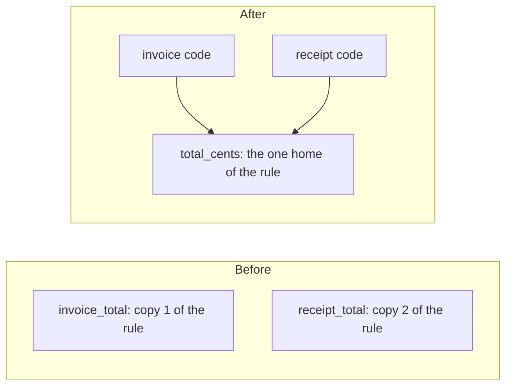
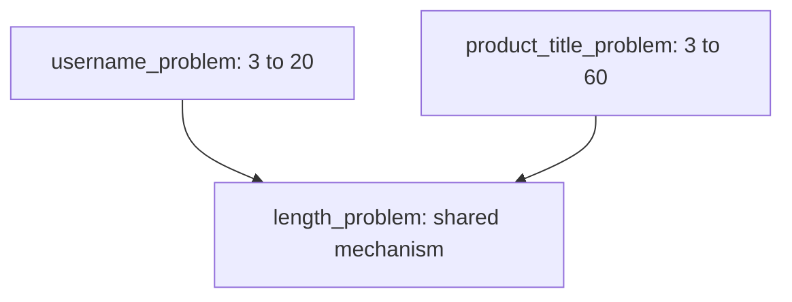

# 07. DRY, KISS and YAGNI

> **Draft: written but not yet run.** The code and the expected output in this lesson were prepared by reading the code and the official documentation. They have not been executed yet. If something does not behave as described, trust your tool's real output and report it.

## What you will be able to do
By the end of this lesson you will be able to:
- explain DRY, KISS and YAGNI each in one sentence
- find duplicated knowledge, needless cleverness and unused extras in a small program
- remove them without changing the output
- decide when two similar pieces of code should **not** be merged

## Recap
1. Which SOLID letter says "depend on abstractions, not on concrete classes"? <details><summary>Answer</summary>D, Dependency Inversion.</details>
2. What is a composition root? <details><summary>Answer</summary>The one place near the start of the program that creates objects and connects them.</details>
3. A class has methods for calculating, printing and emailing. Which principle does it break? <details><summary>Answer</summary>S, Single Responsibility: it has several reasons to change.</details>

## Why it matters
Think of a cookbook. If the same sauce recipe is copied into five dishes and you want less salt, you have to find and fix five places, and you will probably miss one. That is **repetition of knowledge**. Now think of a cook who owns a robotic arm, a vacuum sealer and a smoke machine to make toast. That is **needless cleverness** and **building for a future that may never come**. These three everyday principles keep small programs healthy:

- **DRY**: **D**on't **R**epeat **Y**ourself. Every piece of knowledge (a rule, a number, a formula) should have one home.
- **KISS**: **K**eep **I**t **S**imple. Choose the plainest code that does the job, so the next reader (often you) understands it in one pass.
- **YAGNI**: **Y**ou **A**ren't **G**onna **N**eed **I**t. Do not build a feature "just in case". Build it when you need it.

## What you will build
A tiny totals module. The `before` version breaks all three rules at once: the discount rule is written twice in two different styles, one version is a clever one-liner, and there are unused extras. The `after` version has one function. A third file shows a case where two similar functions must stay separate even though they look alike.

## Before you start
- Time: 40 minutes for one language, 60 minutes if you follow both. Follow **one** language; the other is there to compare.
- You need lessons 01 to 06 and Python 3.10+ and/or the .NET 11 SDK.
- Source pack (optional): every file is shown in full in this lesson, so you can follow without it. The finished code, the exercise starter and the solution are in the
  course repository https://github.com/Uee03/Code101 under `source/patterns/101-zero-to-hero/phase-2-everyday-principles/07-dry-kiss-yagni/` (on that page choose **Code, Download ZIP**, or run
  `git clone https://github.com/Uee03/Code101.git`).

## Steps

### Step 1. Make the lesson folders
**PowerShell, starting folder: anywhere**
```powershell
New-Item -ItemType Directory -Path "$HOME/code101/patterns/lesson07/python" -Force | Out-Null
New-Item -ItemType Directory -Path "$HOME/code101/patterns/lesson07/csharp" -Force | Out-Null
Set-Location "$HOME/code101/patterns/lesson07"
code .
```

**macOS/Linux terminal, starting folder: anywhere**
```bash
mkdir -p ~/code101/patterns/lesson07/python ~/code101/patterns/lesson07/csharp
cd ~/code101/patterns/lesson07
code .
```
Expected result: VS Code opens `lesson07` with empty `python` and `csharp` folders.

### Step 2. Read the first version and count the problems
Items are `(name, price in cents, quantity)` tuples again. Read the file once, slowly.

**File: `~/code101/patterns/lesson07/python/before.py`**
```python
from functools import reduce


def invoice_total(items, currency="EUR", rounding="HALF_UP"):
    total = reduce(lambda acc, item: acc + item[1] * item[2], items, 0)
    return total - total * 10 // 100 if total > 2500 else total


def receipt_total(items):
    total = 0
    for _, price, qty in items:
        total += price * qty
    if total > 2500:
        total = total - total * 10 // 100
    return total


def export_invoice_to_xml(items):
    return "<invoice/>"
```

**File: `~/code101/patterns/lesson07/csharp/Before.cs`**
```csharp
using Item = (string Name, int PriceCents, int Quantity);

namespace Before;

public static class Totals
{
    public static int InvoiceTotal(List<Item> items, string currency = "EUR", string rounding = "HALF_UP")
    {
        int total = items.Aggregate(0, (acc, item) => acc + item.PriceCents * item.Quantity);
        return total > 2500 ? total - total * 10 / 100 : total;
    }

    public static int ReceiptTotal(List<Item> items)
    {
        int total = 0;
        foreach (var item in items)
        {
            total += item.PriceCents * item.Quantity;
        }
        if (total > 2500)
        {
            total = total - total * 10 / 100;
        }
        return total;
    }

    public static string ExportInvoiceToXml(List<Item> items)
    {
        return "<invoice/>";
    }
}
```
A few new words, in plain language: `lambda` (Python) and `(acc, item) => ...` (C#) are tiny nameless functions written in one line. `reduce` (Python) and `Aggregate` (C#) fold a whole list into one value by calling such a function on each item. `a if cond else b` (Python) and `cond ? a : b` (C#) choose between two values in one line.

Do this on paper before reading on: **find three problems**, one for each of DRY, KISS and YAGNI. <details><summary>Answer</summary>

| Principle | Where | Why it hurts |
|---|---|---|
| **DRY** | The rule "10 percent off above 2500" is written in `invoice_total` **and** `receipt_total` | Change the rule to 15 percent and fix only one place: invoice and receipt now disagree |
| **KISS** | `invoice_total` uses `reduce`, a lambda and a one-line conditional where a plain loop does the same | A beginner has to decode it, and decoded it is the same as the other function |
| **YAGNI** | The parameters `currency` and `rounding` are never used, and `export_invoice_to_xml` is never called | Extras to read, test and keep correct for a future that has not arrived |

</details>

### Step 3. Read the second version: one home for the rule
**File: `~/code101/patterns/lesson07/python/after.py`**
```python
DISCOUNT_THRESHOLD_CENTS = 2500
DISCOUNT_PERCENT = 10


def total_cents(items):
    total = 0
    for _, price, qty in items:
        total += price * qty
    if total > DISCOUNT_THRESHOLD_CENTS:
        total -= total * DISCOUNT_PERCENT // 100
    return total
```

**File: `~/code101/patterns/lesson07/csharp/After.cs`**
```csharp
using Item = (string Name, int PriceCents, int Quantity);

namespace After;

public static class Totals
{
    private const int DiscountThresholdCents = 2500;
    private const int DiscountPercent = 10;

    public static int TotalCents(List<Item> items)
    {
        int total = 0;
        foreach (var item in items)
        {
            total += item.PriceCents * item.Quantity;
        }
        if (total > DiscountThresholdCents)
        {
            total -= total * DiscountPercent / 100;
        }
        return total;
    }
}
```
Invoice and receipt code will both call `total_cents`. The rule lives in exactly one place, written as a plain loop, with no unused extras.

### Step 4. Meet the case where DRY is wrong
Two functions can look the same today and still be different pieces of knowledge. A username must be 3 to 20 characters. A product title is also 3 to 20 characters **today**. A careless programmer merges them into one shared rule:

```text
Illustration only, do not type: the mistake
LENGTH_RULE = (3, 20)       # used by both the username check and the product title check
```
Next month the shop wants titles up to 60 characters. Changing the shared rule would also change what usernames accept. The two rules changed for **different reasons**, so they were never the same knowledge. They only happened to match, which is **accidental duplication**.

The safe way is to share the **mechanism** (how to check a length) and keep the **policy** (which numbers) in separate functions:

**File: `~/code101/patterns/lesson07/python/lookalikes.py`**
```python
def length_problem(text, minimum, maximum):
    if len(text) < minimum or len(text) > maximum:
        return f"must be {minimum} to {maximum} characters"
    return ""


def username_problem(name):
    return length_problem(name, 3, 20)


def product_title_problem(title):
    return length_problem(title, 3, 60)
```

**File: `~/code101/patterns/lesson07/csharp/Lookalikes.cs`**
```csharp
namespace Lookalikes;

public static class Validation
{
    public static string LengthProblem(string text, int minimum, int maximum)
    {
        if (text.Length < minimum || text.Length > maximum)
        {
            return $"must be {minimum} to {maximum} characters";
        }
        return "";
    }

    public static string UsernameProblem(string name)
    {
        return LengthProblem(name, 3, 20);
    }

    public static string ProductTitleProblem(string title)
    {
        return LengthProblem(title, 3, 60);
    }
}
```
Here the titles are already allowed up to 60, and usernames are untouched. Each policy can change on its own.

### Step 5. Write the file that runs everything
**File: `~/code101/patterns/lesson07/python/main.py`**
```python
import after
import before
import lookalikes

ITEMS = [("Notebook", 1200, 2), ("Pen", 150, 4)]


def describe(problem):
    if problem == "":
        return "ok"
    return problem


print("--- before ---")
print(f"Invoice: {before.invoice_total(ITEMS)}")
print(f"Receipt: {before.receipt_total(ITEMS)}")

print("--- after ---")
print(f"Invoice: {after.total_cents(ITEMS)}")
print(f"Receipt: {after.total_cents(ITEMS)}")

print("--- lookalikes ---")
print("Username 'al': " + describe(lookalikes.username_problem("al")))
print("Title with 30 letters: " + describe(lookalikes.product_title_problem("x" * 30)))
```

**File: `~/code101/patterns/lesson07/csharp/Program.cs`**
```csharp
using Item = (string Name, int PriceCents, int Quantity);

var items = new List<Item> { ("Notebook", 1200, 2), ("Pen", 150, 4) };

Console.WriteLine("--- before ---");
Console.WriteLine($"Invoice: {Before.Totals.InvoiceTotal(items)}");
Console.WriteLine($"Receipt: {Before.Totals.ReceiptTotal(items)}");

Console.WriteLine("--- after ---");
Console.WriteLine($"Invoice: {After.Totals.TotalCents(items)}");
Console.WriteLine($"Receipt: {After.Totals.TotalCents(items)}");

Console.WriteLine("--- lookalikes ---");
Console.WriteLine("Username 'al': " + Describe(Lookalikes.Validation.UsernameProblem("al")));
Console.WriteLine("Title with 30 letters: " + Describe(Lookalikes.Validation.ProductTitleProblem(new string('x', 30))));

static string Describe(string problem)
{
    if (problem == "")
    {
        return "ok";
    }
    return problem;
}
```
`"x" * 30` (Python) and `new string('x', 30)` (C#) both make a text of 30 letters `x`. In Python, `describe` must be defined **above** the lines that call it, because Python reads the file from top to bottom.

**File: `~/code101/patterns/lesson07/csharp/Lesson.csproj`** (the same file as in lessons 01 to 06)
```xml
<Project Sdk="Microsoft.NET.Sdk">

  <PropertyGroup>
    <OutputType>Exe</OutputType>
    <TargetFramework>net11.0</TargetFramework>
    <ImplicitUsings>enable</ImplicitUsings>
    <Nullable>enable</Nullable>
  </PropertyGroup>

</Project>
```

## Run it
Predict first: 1200 x 2 + 150 x 4 = 3000, which is above 2500, so 10 percent comes off. What are the invoice and receipt totals? What does the 30-letter title give? <details><summary>Answer</summary>3000 - 300 = 2700 for both. The title has 30 letters, which is between 3 and 60, so it is `ok`. The username `al` has 2 letters, below the minimum of 3.</details>

**PowerShell, folder: `~/code101/patterns/lesson07/python`**
```powershell
Set-Location "$HOME/code101/patterns/lesson07/python"
python main.py
```
**macOS/Linux terminal, folder: `~/code101/patterns/lesson07/python`**
```bash
cd ~/code101/patterns/lesson07/python
python3 main.py
```
**Any terminal, folder: `~/code101/patterns/lesson07/csharp`**
```text
dotnet run --project . --nologo
```
Expected output (derived by reading the code, not yet run; identical for Python and C#):
```text
--- before ---
Invoice: 2700
Receipt: 2700
--- after ---
Invoice: 2700
Receipt: 2700
--- lookalikes ---
Username 'al': must be 3 to 20 characters
Title with 30 letters: ok
```
Both versions give the same numbers: the refactoring did not change behaviour.

## How it works


Read the three principles as questions you ask while reading code:

| Principle | Question | Typical fix | When it goes wrong |
|---|---|---|---|
| DRY | "If this rule changes, how many places must I edit?" | One function or constant | Merging lookalikes that change for different reasons (Step 4) |
| KISS | "Could a classmate understand this in one pass?" | A plain loop and clear names | Splitting a simple thing into five tiny abstractions "to be clean" |
| YAGNI | "Who needs this today?" | Delete it; version control remembers | Using it as an excuse to skip tests, security checks or things that are very hard to add later, such as keeping a data format you may need to read again |

Some helpful rules of thumb:
- DRY is about **knowledge**, not about identical text. Two lines that look the same but mean different things are not duplication.
- **Rule of three:** the first time, write it; the second time, wince and copy it; the third time, extract it. By the third time you can see what really varies.
- A wrong shared function is more expensive than a little repetition, because every caller depends on it and has to be untangled later.
- Notice how these principles connect to earlier lessons. DRY pushes toward one home for each rule (like the single responsibility of lesson 02). YAGNI is the answer to lesson 03's warning: do not build an interface for a second case that has not arrived.

## Try it
**Rung 1, guided.** Copy the `starter` folder of your language to `try07` (copy the folder itself and rename it) and fix the TODOs. The output must stay the same.

**File: `try07/main.py`**
```python
def email_greeting(name):
    return "Hello " + name.strip() + ", welcome!"


def sms_greeting(name):
    return "Hello " + name.strip() + "!"


def greeting_as_xml(name):
    return "<greeting>" + name.strip() + "</greeting>"


def initials(name):
    return "".join(map(lambda part: part[0].upper(), filter(None, name.strip().split(" "))))


# TODO 1 (DRY): the cleaning step name.strip() is repeated. Move it into a function clean_name(name)
#               and call it from the greetings.
# TODO 2 (YAGNI): delete the function nobody calls.
# TODO 3 (KISS): rewrite initials with a plain for loop over name.split(). The output must not change.

print(email_greeting("  Ana Silva "))
print(sms_greeting("  Ana Silva "))
print(initials("  Ana Silva "))
```

**File: `try07/Program.cs`** (with the same `Lesson.csproj` next to it)
```csharp
Console.WriteLine(EmailGreeting("  Ana Silva "));
Console.WriteLine(SmsGreeting("  Ana Silva "));
Console.WriteLine(Initials("  Ana Silva "));

// TODO 1 (DRY): the cleaning step name.Trim() is repeated. Move it into a method CleanName(name)
//               and call it from the greetings.
// TODO 2 (YAGNI): delete the method nobody calls.
// TODO 3 (KISS): rewrite Initials with a plain foreach loop over name.Split(' ', StringSplitOptions.RemoveEmptyEntries).
//                The output must not change.

static string EmailGreeting(string name)
{
    return "Hello " + name.Trim() + ", welcome!";
}

static string SmsGreeting(string name)
{
    return "Hello " + name.Trim() + "!";
}

static string GreetingAsXml(string name)
{
    return "<greeting>" + name.Trim() + "</greeting>";
}

static string Initials(string name)
{
    return string.Join("", name.Split(' ', StringSplitOptions.RemoveEmptyEntries).Select(part => char.ToUpper(part[0])));
}
```
Expected output before and after your change:
```text
Hello Ana Silva, welcome!
Hello Ana Silva!
AS
```
(The C# starter may print a compiler warning about the unused `GreetingAsXml`; that is YAGNI talking.)

**Rung 2, change.** Marketing asks for `Hi` instead of `Hello` in both greetings. How many places do you edit in your finished program? Would a constant `GREETING = "Hello"` be worth it?

**Rung 3, stretch (no single answer).** Are the email greeting and the SMS greeting the same knowledge, or lookalikes? Write down one realistic future change that would hit only one of them, and decide whether you would merge them.

<details><summary>Solution</summary>

**File: `exercise/solution/python/main.py`**
```python
def clean_name(name):
    return name.strip()


def email_greeting(name):
    return "Hello " + clean_name(name) + ", welcome!"


def sms_greeting(name):
    return "Hello " + clean_name(name) + "!"


def initials(name):
    letters = ""
    for part in name.split():
        letters += part[0].upper()
    return letters


print(email_greeting("  Ana Silva "))
print(sms_greeting("  Ana Silva "))
print(initials("  Ana Silva "))
```

**File: `exercise/solution/csharp/Program.cs`**
```csharp
Console.WriteLine(EmailGreeting("  Ana Silva "));
Console.WriteLine(SmsGreeting("  Ana Silva "));
Console.WriteLine(Initials("  Ana Silva "));

static string CleanName(string name)
{
    return name.Trim();
}

static string EmailGreeting(string name)
{
    return "Hello " + CleanName(name) + ", welcome!";
}

static string SmsGreeting(string name)
{
    return "Hello " + CleanName(name) + "!";
}

static string Initials(string name)
{
    string letters = "";
    foreach (string part in name.Split(' ', StringSplitOptions.RemoveEmptyEntries))
    {
        letters += char.ToUpper(part[0]);
    }
    return letters;
}
```
Rung 2: two places, one per greeting. A shared constant would make it one, but the two greetings are different messages for different channels. Marketing may well want "Hi" in the SMS only, so keeping them separate is a reasonable choice.

Rung 3, one possible answer: the SMS has a length limit and might drop "welcome" or become shorter; the email might gain a signature. Those are different reasons to change, so they are lookalikes. Share only the mechanism (`clean_name`), not the wording.

</details>

## Check yourself
1. What do DRY, KISS and YAGNI stand for, and what does each ask you to do? <details><summary>Answer</summary>Don't Repeat Yourself: one home per piece of knowledge. Keep It Simple: choose the plainest code that works. You Aren't Gonna Need It: do not build things before you need them.</details>
2. In `before`, which line would you have to edit in two places if the discount became 15 percent? <details><summary>Answer</summary>The `10` in `invoice_total` and the `10` in `receipt_total`. If you miss one, the invoice and the receipt disagree.</details>
3. Predict: in the `lookalikes` example, what would `product_title_problem("x" * 30)` return if the title limit were still 20? <details><summary>Answer</summary>`must be 3 to 20 characters`, because 30 letters is above 20. That is why a long title forced the change.</details>
4. When is merging two similar functions a mistake? <details><summary>Answer</summary>When they change for different reasons (accidental duplication). Share the mechanism, keep the policy separate.</details>
5. Does YAGNI mean "skip input checks because nobody attacks us yet"? <details><summary>Answer</summary>No. Security, correctness and things that are very hard to add later are needs today. YAGNI is about speculative features.</details>

## Common mistakes
These are typical messages, not yet reproduced by running this lesson. Your tool's exact wording may differ.

| Symptom or error text | Cause | Fix |
|---|---|---|
| `NameError: name 'describe' is not defined` | `describe` is defined **below** the lines that call it | Move the `def describe` block above the first `print` that uses it |
| `ModuleNotFoundError: No module named 'lookalikes'` | `lookalikes.py` is missing, misspelled or in another folder | Put it next to `main.py` |
| `error CS0246: The type or namespace name 'Lookalikes' could not be found (are you missing a using directive or an assembly reference?)` | `Lookalikes.cs` is missing, unsaved, or has a different namespace | Check `namespace Lookalikes;` and save |
| Invoice and receipt totals differ | A typo in one of the numbers, or an unsaved file | Compare the numbers with the lesson and save all files |
| `python: can't open file '...main.py': [Errno 2] No such file or directory` or `MSB1003: Specify a project or solution file...` | The terminal is in the wrong folder | `cd` into the `python` or `csharp` folder of this lesson |

## Best practice
Remove duplication of **knowledge** early, but wait for the third occurrence before you abstract similar-looking code. Source: SourceMaking, Duplicate Code https://sourcemaking.com/refactoring/smells/duplicate-code and Martin Fowler, Yagni https://martinfowler.com/bliki/Yagni.html

## Going further
- The code smells behind these rules: Duplicate Code https://refactoring.guru/smells/duplicate-code and Speculative Generality https://refactoring.guru/smells/speculative-generality
- Python 101 and C# 101 projects (the expense trackers) are good places to practise: find one repeated rule and give it one home.

## Summary
- You explained DRY, KISS and YAGNI in one sentence each.
- You found duplicated knowledge, a needlessly clever one-liner and unused extras in one small module.
- You removed them and proved the totals did not change.
- You explained why merging lookalike code can be wrong and shared only the mechanism.

## Next lesson
08. Composition over inheritance: build behaviour by combining small parts instead of stacking classes in a family tree.
