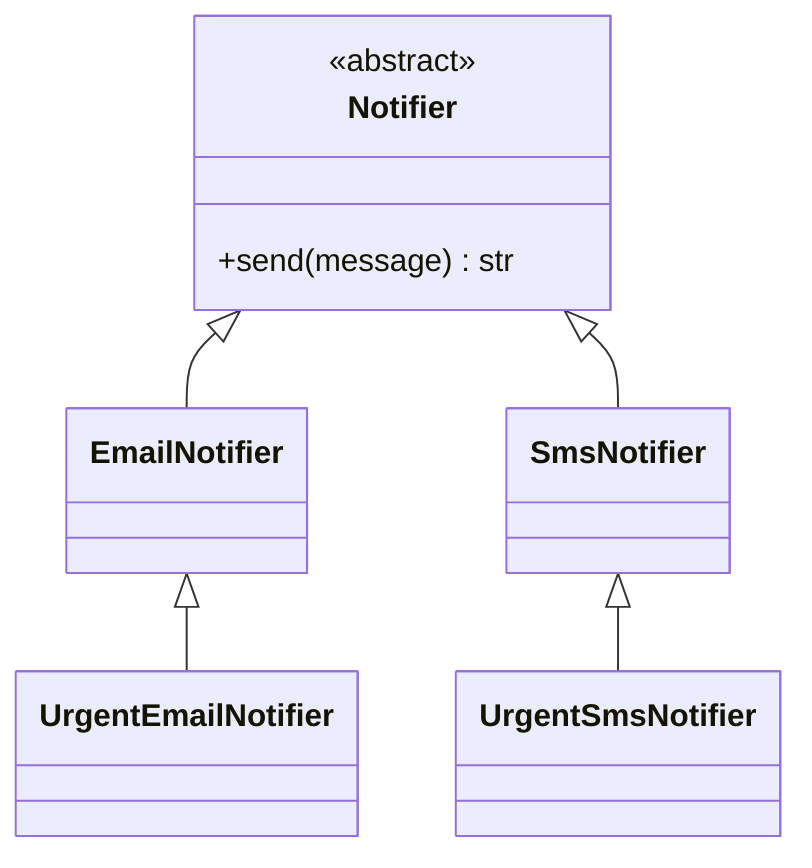
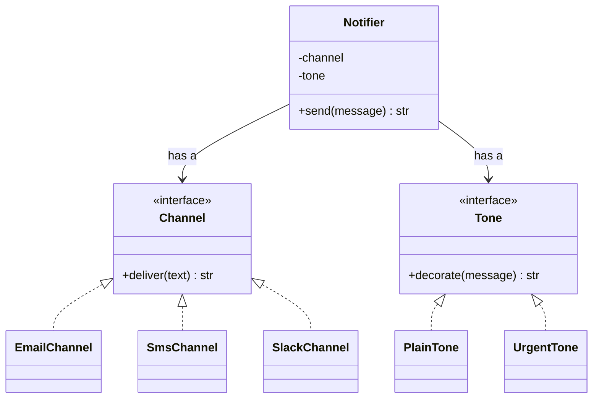

# 08. Composition over inheritance

> **Draft: written but not yet run.** The code and the expected output in this lesson were prepared by reading the code and the official documentation. They have not been executed yet. If something does not behave as described, trust your tool's real output and report it.

## What you will be able to do
By the end of this lesson you will be able to:
- tell "is a" (inheritance) from "has a" (composition) in a design
- predict how many classes an inheritance tree needs when a new option is added
- rebuild a class tree as small parts that are combined when the object is created
- name two situations where inheritance is still a good choice

## Recap
1. What does DRY say, and when is it wrong? <details><summary>Answer</summary>Every piece of knowledge should have one home. It is wrong when two lookalike pieces of code change for different reasons; then share only the mechanism.</details>
2. What is dependency injection? <details><summary>Answer</summary>A class receives the things it needs from outside (for example through its constructor) instead of creating them itself.</details>
3. What does the Liskov Substitution Principle ask of a child class? <details><summary>Answer</summary>That it works everywhere its parent works and keeps the parent's promises.</details>

## Why it matters
Imagine a toy shop that sells robots. Robots come with a choice of **arms** (claws or hands) and a choice of **voices** (polite or loud). One approach is to build a separate factory mold for every combination: ClawPoliteRobot, ClawLoudRobot, HandPoliteRobot, HandLoudRobot. Add a third arm and you need three new molds. Another approach is to make robots from **snap-on parts**: one body, interchangeable arms, interchangeable voices. Adding a new arm is one new part, and every voice works with it immediately.

In code, the molds are **inheritance** (a class gets its behaviour by being a kind of another class) and the snap-on parts are **composition** (a class gets its behaviour by **holding** other objects and asking them to do the work). The old advice is **favour composition over inheritance**: reach for snap-on parts first.

## What you will build
A notifier that can send messages over email, SMS or Slack, in a plain or an urgent tone. First as a family tree of classes (which grows with every new option), then as two small interchangeable part types plus one class that combines them.

## Before you start
- Time: 40 minutes for one language, 60 minutes if you follow both. Follow **one** language; the other is there to compare.
- You need lessons 03 to 06 and Python 3.10+ and/or the .NET 11 SDK.
- Source pack (optional): every file is shown in full in this lesson, so you can follow without it. The finished code, the exercise starter and the solution are in the
  course repository https://github.com/Uee03/Code101 under `source/patterns/101-zero-to-hero/phase-2-everyday-principles/08-composition-over-inheritance/` (on that page choose **Code, Download ZIP**, or run
  `git clone https://github.com/Uee03/Code101.git`).

## Steps

### Step 1. Make the lesson folders
**PowerShell, starting folder: anywhere**
```powershell
New-Item -ItemType Directory -Path "$HOME/code101/patterns/lesson08/python" -Force | Out-Null
New-Item -ItemType Directory -Path "$HOME/code101/patterns/lesson08/csharp" -Force | Out-Null
Set-Location "$HOME/code101/patterns/lesson08"
code .
```

**macOS/Linux terminal, starting folder: anywhere**
```bash
mkdir -p ~/code101/patterns/lesson08/python ~/code101/patterns/lesson08/csharp
cd ~/code101/patterns/lesson08
code .
```
Expected result: VS Code opens `lesson08` with empty `python` and `csharp` folders.

### Step 2. Read the first design: a family tree
`super().send(...)` in Python and `base.Send(...)` in C# mean "run the parent class's version of this method". Each urgent notifier reuses its parent and adds the word `URGENT`.

**File: `~/code101/patterns/lesson08/python/before.py`**
```python
from abc import ABC, abstractmethod


class Notifier(ABC):
    @abstractmethod
    def send(self, message):
        ...


class EmailNotifier(Notifier):
    def send(self, message):
        return f"Email: {message}"


class UrgentEmailNotifier(EmailNotifier):
    def send(self, message):
        return super().send(f"URGENT {message}")


class SmsNotifier(Notifier):
    def send(self, message):
        return f"SMS: {message}"


class UrgentSmsNotifier(SmsNotifier):
    def send(self, message):
        return super().send(f"URGENT {message}")
```

**File: `~/code101/patterns/lesson08/csharp/Before.cs`**
```csharp
namespace Before;

public abstract class Notifier
{
    public abstract string Send(string message);
}

public class EmailNotifier : Notifier
{
    public override string Send(string message)
    {
        return $"Email: {message}";
    }
}

public class UrgentEmailNotifier : EmailNotifier
{
    public override string Send(string message)
    {
        return base.Send($"URGENT {message}");
    }
}

public class SmsNotifier : Notifier
{
    public override string Send(string message)
    {
        return $"SMS: {message}";
    }
}

public class UrgentSmsNotifier : SmsNotifier
{
    public override string Send(string message)
    {
        return base.Send($"URGENT {message}");
    }
}
```

### Step 3. Count before you build
Write down your answers: (1) The team adds **Slack**. How many new classes does the tree need? (2) Later the team adds a **polite** tone ("Please note: ..."). With three channels, how many new classes now? (3) The word `URGENT` appears in the code how many times? <details><summary>Answer</summary>(1) Two: `SlackNotifier` and `UrgentSlackNotifier`. (2) Three more (one polite class per channel), and if polite and urgent can be combined, even more. With C channels and T tones you need about C x T classes. (3) The word `URGENT` is repeated in every urgent class, so it is duplicated knowledge (DRY from lesson 07).</details>

The reason: the tree welds two independent choices, the **channel** and the **tone**, into one chain of parents and children.

### Step 4. Read the second design: two kinds of snap-on part
Each independent choice becomes its own small interface (lesson 03) with several implementations. A single class, `Notifier`, **holds** one channel and one tone and uses both. That "holds" is the "has a" relationship.

**File: `~/code101/patterns/lesson08/python/after.py`**
```python
from abc import ABC, abstractmethod


class Channel(ABC):
    @abstractmethod
    def deliver(self, text):
        ...


class EmailChannel(Channel):
    def deliver(self, text):
        return f"Email: {text}"


class SmsChannel(Channel):
    def deliver(self, text):
        return f"SMS: {text}"


class SlackChannel(Channel):
    def deliver(self, text):
        return f"Slack: {text}"


class Tone(ABC):
    @abstractmethod
    def decorate(self, message):
        ...


class PlainTone(Tone):
    def decorate(self, message):
        return message


class UrgentTone(Tone):
    def decorate(self, message):
        return f"URGENT {message}"


class Notifier:
    def __init__(self, channel: Channel, tone: Tone):
        self.channel = channel
        self.tone = tone

    def send(self, message):
        return self.channel.deliver(self.tone.decorate(message))
```

**File: `~/code101/patterns/lesson08/csharp/After.cs`**
```csharp
namespace After;

public interface IChannel
{
    string Deliver(string text);
}

public class EmailChannel : IChannel
{
    public string Deliver(string text)
    {
        return $"Email: {text}";
    }
}

public class SmsChannel : IChannel
{
    public string Deliver(string text)
    {
        return $"SMS: {text}";
    }
}

public class SlackChannel : IChannel
{
    public string Deliver(string text)
    {
        return $"Slack: {text}";
    }
}

public interface ITone
{
    string Decorate(string message);
}

public class PlainTone : ITone
{
    public string Decorate(string message)
    {
        return message;
    }
}

public class UrgentTone : ITone
{
    public string Decorate(string message)
    {
        return $"URGENT {message}";
    }
}

public class Notifier
{
    private readonly IChannel _channel;
    private readonly ITone _tone;

    public Notifier(IChannel channel, ITone tone)
    {
        _channel = channel;
        _tone = tone;
    }

    public string Send(string message)
    {
        return _channel.Deliver(_tone.Decorate(message));
    }
}
```
Read `send` from the inside out: the tone decorates the message, then the channel delivers the decorated text. `Notifier` does not know which channel or tone it holds; it passes both through the standard plugs (lesson 06).

### Step 5. Write the file that runs both
**File: `~/code101/patterns/lesson08/python/main.py`**
```python
import after
import before

print("--- before: 2 channels ---")
old_notifiers = [
    before.EmailNotifier(),
    before.UrgentEmailNotifier(),
    before.SmsNotifier(),
    before.UrgentSmsNotifier(),
]
for notifier in old_notifiers:
    print(notifier.send("Server down"))

print("--- after: 3 channels ---")
channels = [after.EmailChannel(), after.SmsChannel(), after.SlackChannel()]
tones = [after.PlainTone(), after.UrgentTone()]
for channel in channels:
    for tone in tones:
        print(after.Notifier(channel, tone).send("Server down"))
```

**File: `~/code101/patterns/lesson08/csharp/Program.cs`**
```csharp
Console.WriteLine("--- before: 2 channels ---");
var oldNotifiers = new List<Before.Notifier>
{
    new Before.EmailNotifier(),
    new Before.UrgentEmailNotifier(),
    new Before.SmsNotifier(),
    new Before.UrgentSmsNotifier(),
};
foreach (var notifier in oldNotifiers)
{
    Console.WriteLine(notifier.Send("Server down"));
}

Console.WriteLine("--- after: 3 channels ---");
var channels = new List<After.IChannel> { new After.EmailChannel(), new After.SmsChannel(), new After.SlackChannel() };
var tones = new List<After.ITone> { new After.PlainTone(), new After.UrgentTone() };
foreach (var channel in channels)
{
    foreach (var tone in tones)
    {
        Console.WriteLine(new After.Notifier(channel, tone).Send("Server down"));
    }
}
```
The two nested loops build every combination of channel and tone: 3 x 2 = 6 notifiers from 5 small parts and one combiner.

**File: `~/code101/patterns/lesson08/csharp/Lesson.csproj`** (the same file as in lessons 01 to 07)
```xml
<Project Sdk="Microsoft.NET.Sdk">

  <PropertyGroup>
    <OutputType>Exe</OutputType>
    <TargetFramework>net11.0</TargetFramework>
    <ImplicitUsings>enable</ImplicitUsings>
    <Nullable>enable</Nullable>
  </PropertyGroup>

</Project>
```

## Run it
Predict first: how many lines will each half print? <details><summary>Answer</summary>The before half prints 4 lines (2 channels x 2 tones). The after half prints 6 lines (3 channels x 2 tones), after adding Slack with only **one** new class.</details>

**PowerShell, folder: `~/code101/patterns/lesson08/python`**
```powershell
Set-Location "$HOME/code101/patterns/lesson08/python"
python main.py
```
**macOS/Linux terminal, folder: `~/code101/patterns/lesson08/python`**
```bash
cd ~/code101/patterns/lesson08/python
python3 main.py
```
**Any terminal, folder: `~/code101/patterns/lesson08/csharp`**
```text
dotnet run --project . --nologo
```
Expected output (derived by reading the code, not yet run; identical for Python and C#):
```text
--- before: 2 channels ---
Email: Server down
Email: URGENT Server down
SMS: Server down
SMS: URGENT Server down
--- after: 3 channels ---
Email: Server down
Email: URGENT Server down
SMS: Server down
SMS: URGENT Server down
Slack: Server down
Slack: URGENT Server down
```
The first four lines of the after half are exactly the four lines of the before half: the same behaviour, now from reusable parts.

## How it works

Inheritance: the tree gets wider with every channel and deeper with every tone. After the change:


The solid arrows labelled "has a" are **composition** (in the loose sense of "holds another object"). Lesson 09 explains the stricter UML names for these arrows.

Why composition usually wins:
1. **Combinations multiply in a tree, but add in parts.** C channels and T tones need C x T classes with inheritance but only C + T parts with composition.
2. **A child is welded to its parent.** If `EmailNotifier.send` changes, every urgent email notifier changes too, even by accident. Parts talk through a small interface, so they stay independent (low coupling, lesson 01).
3. **Choices can change while the program runs.** An object cannot change its parent class, but it can be handed a different channel.
4. **Parts are easy to check** with a fake, like in lesson 06.

The idea of swapping an interchangeable part at run time has a name, the **Strategy pattern** (level 201 of this track covers it with all the other patterns). You have just used it twice, in lessons 03 and 08.

When inheritance is still the right tool:
- A real, stable **is-a** relationship where the child keeps all promises of the parent (lesson 04), and the tree stays shallow (one or two levels). Examples: a family of exception types, or a framework's base class that you are asked to extend.
- Sharing a small amount of code in a closed set of related classes, when you control all of them.

Misconception: "Inheritance is bad." It is not bad; it is **overused**. Ask two questions before inheriting: "Is it truly an is-a that holds everywhere?" and "Will a second independent choice appear later?" If the answer to the second is yes, prefer parts.

## Try it
**Rung 1, guided.** Copy the `starter` folder of your language to `try08` (copy the folder itself and rename it) and fix the TODOs. The output must stay the same.

**File: `try08/main.py`**
```python
class PostShipping:
    def cost_cents(self):
        return 300


class ExpressPostShipping(PostShipping):
    def cost_cents(self):
        return super().cost_cents() + 500


class CourierShipping:
    def cost_cents(self):
        return 800


class ExpressCourierShipping(CourierShipping):
    def cost_cents(self):
        return super().cost_cents() + 500


# TODO 1: make an abstract class Carrier (ABC) with base_cents(), and PostCarrier (300) and CourierCarrier (800).
# TODO 2: make an abstract class Speed (ABC) with surcharge_cents(), and StandardSpeed (0) and ExpressSpeed (500).
# TODO 3: make one class Shipping(carrier, speed) whose cost_cents() adds the carrier base and the speed surcharge.
# TODO 4: delete the four classes above. Replace the loop below with two nested loops over the carriers
#         [PostCarrier(), CourierCarrier()] and the speeds [StandardSpeed(), ExpressSpeed()], printing
#         Shipping(carrier, speed).cost_cents(). The output must not change.

for shipping in [PostShipping(), ExpressPostShipping(), CourierShipping(), ExpressCourierShipping()]:
    print(shipping.cost_cents())
```

**File: `try08/Program.cs`** (with the same `Lesson.csproj` next to it)
```csharp
var shippings = new List<PostShipping>
{
    new PostShipping(),
    new ExpressPostShipping(),
};
foreach (var shipping in shippings)
{
    Console.WriteLine(shipping.CostCents());
}
Console.WriteLine(new CourierShipping().CostCents());
Console.WriteLine(new ExpressCourierShipping().CostCents());

// TODO 1: make an interface ICarrier with BaseCents(), and PostCarrier (300) and CourierCarrier (800).
// TODO 2: make an interface ISpeed with SurchargeCents(), and StandardSpeed (0) and ExpressSpeed (500).
// TODO 3: make one class Shipping(ICarrier carrier, ISpeed speed) whose CostCents() adds the carrier base and the speed surcharge.
// TODO 4: delete the four classes below and the code above. Write two nested foreach loops over the carriers
//         {PostCarrier, CourierCarrier} and the speeds {StandardSpeed, ExpressSpeed}, printing
//         new Shipping(carrier, speed).CostCents(). The output must not change.

class PostShipping
{
    public virtual int CostCents()
    {
        return 300;
    }
}

class ExpressPostShipping : PostShipping
{
    public override int CostCents()
    {
        return base.CostCents() + 500;
    }
}

class CourierShipping
{
    public virtual int CostCents()
    {
        return 800;
    }
}

class ExpressCourierShipping : CourierShipping
{
    public override int CostCents()
    {
        return base.CostCents() + 500;
    }
}
```
Expected output before and after your change:
```text
300
800
800
1300
```

**Rung 2, change.** Add a `DroneCarrier` that costs 500 as base. How many classes did you add in the **finished** (composition) version, and how many would the **starter** (inheritance) version need so that standard and express drone shipping both exist?

**Rung 3, stretch (no single answer).** The business now wants a third independent choice: a surcharge of 200 for Saturday delivery that can be combined with either speed. Sketch how you would add it with parts (one new part type? a list of extras?) and say what you would have to change in `Shipping`.

<details><summary>Solution</summary>

**File: `exercise/solution/python/main.py`**
```python
from abc import ABC, abstractmethod


class Carrier(ABC):
    @abstractmethod
    def base_cents(self):
        ...


class PostCarrier(Carrier):
    def base_cents(self):
        return 300


class CourierCarrier(Carrier):
    def base_cents(self):
        return 800


class Speed(ABC):
    @abstractmethod
    def surcharge_cents(self):
        ...


class StandardSpeed(Speed):
    def surcharge_cents(self):
        return 0


class ExpressSpeed(Speed):
    def surcharge_cents(self):
        return 500


class Shipping:
    def __init__(self, carrier: Carrier, speed: Speed):
        self.carrier = carrier
        self.speed = speed

    def cost_cents(self):
        return self.carrier.base_cents() + self.speed.surcharge_cents()


for carrier in [PostCarrier(), CourierCarrier()]:
    for speed in [StandardSpeed(), ExpressSpeed()]:
        print(Shipping(carrier, speed).cost_cents())
```

**File: `exercise/solution/csharp/Program.cs`**
```csharp
var carriers = new List<ICarrier> { new PostCarrier(), new CourierCarrier() };
var speeds = new List<ISpeed> { new StandardSpeed(), new ExpressSpeed() };
foreach (var carrier in carriers)
{
    foreach (var speed in speeds)
    {
        Console.WriteLine(new Shipping(carrier, speed).CostCents());
    }
}

interface ICarrier
{
    int BaseCents();
}

class PostCarrier : ICarrier
{
    public int BaseCents()
    {
        return 300;
    }
}

class CourierCarrier : ICarrier
{
    public int BaseCents()
    {
        return 800;
    }
}

interface ISpeed
{
    int SurchargeCents();
}

class StandardSpeed : ISpeed
{
    public int SurchargeCents()
    {
        return 0;
    }
}

class ExpressSpeed : ISpeed
{
    public int SurchargeCents()
    {
        return 500;
    }
}

class Shipping
{
    private readonly ICarrier _carrier;
    private readonly ISpeed _speed;

    public Shipping(ICarrier carrier, ISpeed speed)
    {
        _carrier = carrier;
        _speed = speed;
    }

    public int CostCents()
    {
        return _carrier.BaseCents() + _speed.SurchargeCents();
    }
}
```
The four results are 300 (post, standard), 800 (post, express), 800 (courier, standard) and 1300 (courier, express).

Rung 2: one new class, `DroneCarrier`, plus adding it to the list in the loop. In the starter you would need two (`DroneShipping` and `ExpressDroneShipping`).

Rung 3, one possible answer: give `Shipping` a list of extras, each with a `surcharge_cents()`, and add `SaturdayExtra` (200). `Shipping.cost_cents` adds the carrier base and then the sum of the extras. The speed can also become just another extra, which makes the design even simpler.

</details>

## Check yourself
1. What is the difference between "is a" and "has a" in code? <details><summary>Answer</summary>"Is a" is inheritance: a class gets behaviour by being a kind of another class. "Has a" is composition: a class holds other objects and asks them to do the work.</details>
2. With 4 channels and 3 tones, how many classes would the inheritance tree need, and how many parts would the composition design need? <details><summary>Answer</summary>About 12 notifier classes with inheritance (4 x 3). With composition: 4 channels + 3 tones = 7 small parts plus the one `Notifier` class.</details>
3. Predict: what does `after.Notifier(after.SlackChannel(), after.UrgentTone()).send("Disk full")` return? <details><summary>Answer</summary>`Slack: URGENT Disk full`. The tone decorates first, then the channel delivers.</details>
4. Name one case where inheritance is still a good choice. <details><summary>Answer</summary>A real, stable is-a relationship that keeps the parent's promises in a shallow tree, such as a family of exception types or a framework base class you are meant to extend.</details>

## Common mistakes
These are typical messages, not yet reproduced by running this lesson. Your tool's exact wording may differ.

| Symptom or error text | Cause | Fix |
|---|---|---|
| `TypeError: Notifier.__init__() missing 1 required positional argument: 'tone'` | You created `after.Notifier(channel)` with only one part | Pass both: `after.Notifier(channel, tone)` |
| `error CS7036: There is no argument given that corresponds to the required parameter 'tone' of 'Notifier.Notifier(IChannel, ITone)'` | The same mistake in C# | Pass both parts to `new After.Notifier(...)` |
| `TypeError: Can't instantiate abstract class Channel ...` (wording differs between Python versions) | You wrote `after.Channel()` instead of a concrete channel such as `after.EmailChannel()` | Use a concrete class |
| `error CS0535: 'SlackChannel' does not implement interface member 'IChannel.Deliver(string)'` | The method is missing, misspelled or not `public` | Add `public string Deliver(string text)` |
| `python: can't open file '...main.py': [Errno 2] No such file or directory` or `MSB1003: Specify a project or solution file...` | The terminal is in the wrong folder | `cd` into the `python` or `csharp` folder of this lesson |

## Best practice
Prefer holding a small, replaceable part over inheriting from a class; inherit only for a genuine, stable is-a relationship. Source: refactoring.guru, Bridge (the class explosion from two independent dimensions, solved by switching from inheritance to object composition) https://refactoring.guru/design-patterns/bridge

## Going further
- The same idea in a wider form, with its two independent hierarchies named Abstraction and Implementation (the Bridge pattern): https://refactoring.guru/design-patterns/bridge
- The Decorator pattern (parts that wrap other parts, like the tone here): https://refactoring.guru/design-patterns/decorator

## Summary
- You told "is a" (inheritance) from "has a" (composition).
- You counted how an inheritance tree multiplies with every new option.
- You rebuilt the notifier from interchangeable channel and tone parts and added Slack with one class.
- You named two cases where inheritance is still the right tool.

## Next lesson
09. Reading and drawing class diagrams in Mermaid, plus a mixed review where you refactor a messy program using everything from this track.
