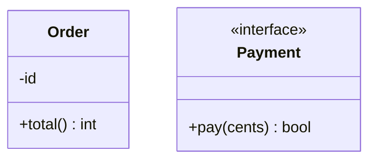
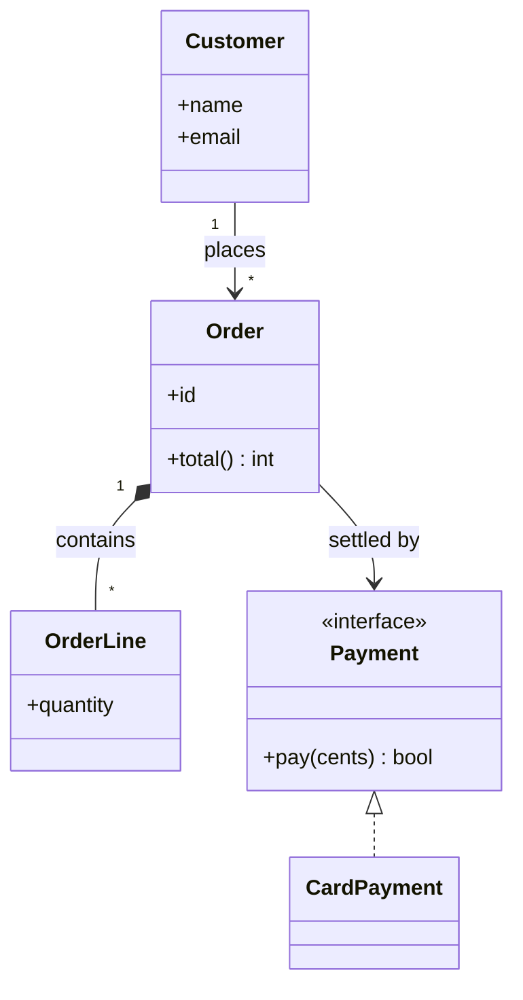
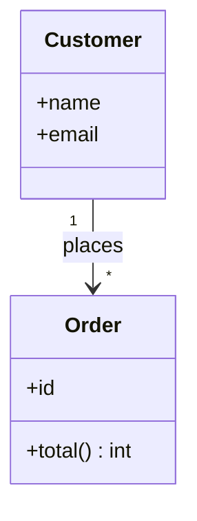
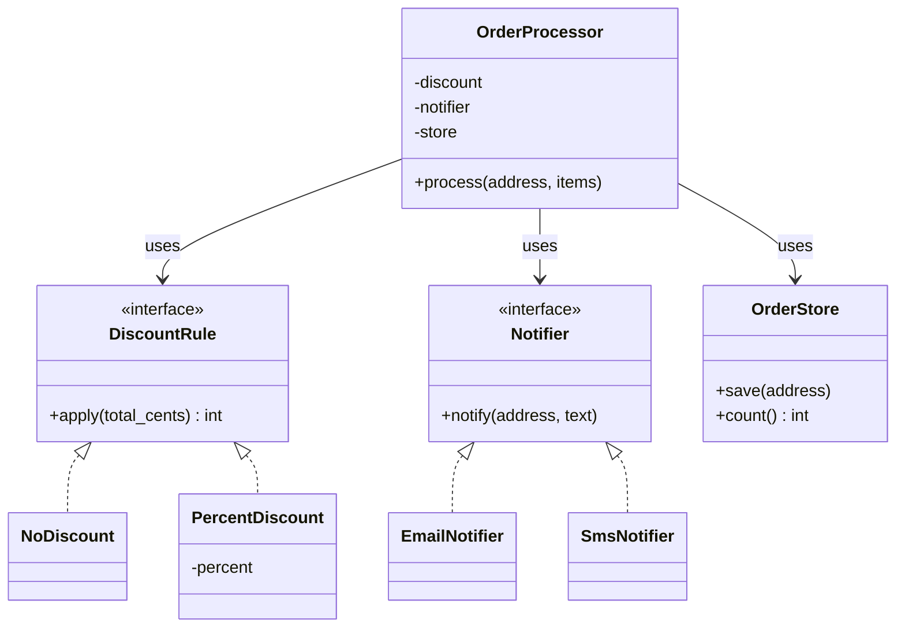
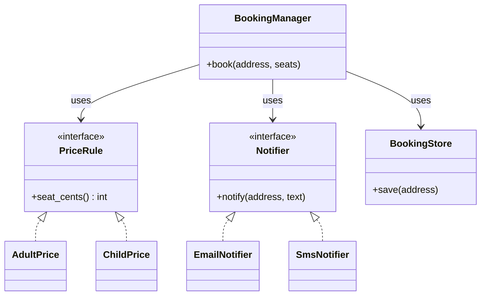

# 09. Reading and drawing class diagrams, and a mixed review

> **Draft: written but not yet run.** The code and the expected output in this lesson were prepared by reading the code and the official documentation. They have not been executed yet. If something does not behave as described, trust your tool's real output and report it.

## What you will be able to do
By the end of this lesson you will be able to:
- read a Mermaid class diagram and say what each box, line and arrowhead means
- draw a class diagram for a small program from its code
- refactor a messy class using SRP, OCP, DIP and composition, and show the output did not change
- choose which principle to apply first when you meet messy code

## Recap
1. What does "favour composition over inheritance" mean? <details><summary>Answer</summary>Build behaviour by holding small replaceable parts ("has a") instead of stacking classes in a family tree ("is a").</details>
2. Name the five SOLID letters and one phrase for each. <details><summary>Answer</summary>S: one reason to change. O: add without editing. L: children keep the parent's promises. I: small role interfaces. D: depend on abstractions and inject them.</details>
3. Which two of DRY, KISS and YAGNI would you apply to an unused parameter and a copied formula? <details><summary>Answer</summary>YAGNI for the unused parameter (delete it); DRY for the copied formula (give it one home).</details>

## Why it matters
Architects do not describe a house only in words. They draw a plan, so that a plumber, an electrician and the owner can all see the same thing. A **class diagram** is the plan of a program: it shows which classes exist and how they are connected, without showing a single line of the code that does the work. Developers use them in design talks, in pull requests and in documentation. Being able to read one, and to sketch one in two minutes, is a skill used for the rest of your career. In this lesson you also use everything from the track on one messy class.

## What you will build
Two things. First a small diagram you read, then draw yourself. Second a mixed review: a messy `OrderProcessor` is refactored into small classes (the lesson's own code), and then you do the same to a different messy class in the exercise.

## Before you start
- Time: 60 minutes for one language, 80 minutes if you follow both. This is a longer lesson: **two sittings**, with a break after "Run it".
- You need lessons 01 to 08 and Python 3.10+ and/or the .NET 11 SDK.
- A Markdown editor with preview: VS Code (from the earlier tracks). Diagrams are text inside a Markdown file. To see them as pictures in the VS Code preview, install the extension **Markdown Preview Mermaid Support** (identifier `bierner.markdown-mermaid`): open the Extensions view with **Ctrl+Shift+X** (macOS: **Cmd+Shift+X**), search for the name, press **Install**. GitHub also draws Mermaid blocks in `.md` files by itself.
- Source pack (optional): every file is shown in full in this lesson, so you can follow without it. The finished code, the exercise starter and the solution are in the
  course repository https://github.com/Uee03/Code101 under `source/patterns/101-zero-to-hero/phase-2-everyday-principles/09-class-diagrams-and-review/` (on that page choose **Code, Download ZIP**, or run
  `git clone https://github.com/Uee03/Code101.git`).

## Steps

### Step 1. Make the lesson folders
**PowerShell, starting folder: anywhere**
```powershell
New-Item -ItemType Directory -Path "$HOME/code101/patterns/lesson09/python" -Force | Out-Null
New-Item -ItemType Directory -Path "$HOME/code101/patterns/lesson09/csharp" -Force | Out-Null
Set-Location "$HOME/code101/patterns/lesson09"
code .
```

**macOS/Linux terminal, starting folder: anywhere**
```bash
mkdir -p ~/code101/patterns/lesson09/python ~/code101/patterns/lesson09/csharp
cd ~/code101/patterns/lesson09
code .
```
Expected result: VS Code opens `lesson09` with empty `python` and `csharp` folders.

### Step 2. Learn the notation
A Mermaid diagram sits in a fenced block (three backticks, then the word `mermaid`) inside a `.md` file. The first line is `classDiagram`. Everything else describes classes and the lines between them.

**One class** is a box with up to three parts: the name, the data it stores (attributes), and the actions it can do (methods). A method has `()`. A `+` in front means public (visible to everyone) and `-` means private (only the class itself). Words inside `<<double angle brackets>>` label a kind, such as `<<interface>>`.


Read the top box: "`Order` has a private attribute `id` and a public method `total` that gives back an `int`".

**Relationships** are the lines between boxes. The arrowhead tells you the kind. These are the ones you need:

| You write | Name | Plain meaning | Example from this track |
|---|---|---|---|
| `Animal <\|-- Dog` | Inheritance | Dog **is a kind of** Animal | `Notifier <\|-- EmailNotifier` (lesson 08, before) |
| `Payable <\|.. CardPayment` | Realization | CardPayment **implements** the interface Payable | lesson 04, after |
| `Notifier --> Channel` | Association | Notifier **knows and uses** a Channel (holds a reference) | lesson 08, after |
| `OrderService ..> Invoice` | Dependency | OrderService **uses Invoice briefly** (as a parameter, say) | lesson 02, after |
| `Order o-- Item` | Aggregation | Order **has** Items, but the items can live without the order | a shelf and its books |
| `Order *-- OrderLine` | Composition | Order **owns** OrderLines; delete the order and they go too | an order and its lines |

You can put a **label** after a colon (`Customer --> Order : places`) and **numbers** in quotes to say how many (`"1"`, `"*"` for many): `Customer "1" --> "*" Order : places`.

Remember the shape: a **triangle** head is "is a" or "implements" (solid line: inherits; dotted line: implements); an **open arrow** is "uses"; a **diamond** at the end means "has". The diamond is hollow for aggregation (`o--`) and filled for composition (`*--`).

Source: Mermaid, Class diagrams https://mermaid.js.org/syntax/classDiagram.html

### Step 3. Read a diagram
Here is a diagram of a small shop. Without running anything, answer the questions below it.


1. How many orders can one customer place? 2. Which classes disappear when an order is deleted? 3. Which box is an interface? 4. Does `CardPayment` know that `Order` exists? 5. Which class could you swap to change how an order is paid, without touching `Order`?

<details><summary>Answers</summary>

1. Many (`"*"` on the `Order` side). 2. `OrderLine`, because `Order` **composes** it (filled diamond). 3. `Payment` (the `<<interface>>` label). 4. No: the only arrow touching `CardPayment` points **from** it to `Payment` (it implements it). Nothing points from `CardPayment` to `Order`. 5. `CardPayment`: any other class that implements `Payment` can replace it, because `Order` only knows the interface.

</details>

### Step 4. Draw one yourself
Create a file in your lesson folder named `reading.md`. It only holds the diagram text, so you can see how it is drawn.

**File: `~/code101/patterns/lesson09/reading.md`**
````text
# My first class diagram


````
Open the file in VS Code and press **Ctrl+Shift+V** (macOS: **Cmd+Shift+V**) to open the Markdown preview. You should see two boxes joined by an arrow labelled "places", with `1` near `Customer` and `*` near `Order`. If you only see the text, install the extension from "Before you start". Now add your own: a `Payment` interface and a `CardPayment` that realizes it, then look at the preview again.

Common mistakes with Mermaid: class names with spaces (use `OrderLine`, not `Order Line`), forgetting the first line `classDiagram`, and forgetting that a line inside a class body with `()` is a method and one without is an attribute. To show a list in a method, use `~`, as in `List~Item~`, because `<` and `>` have other meanings.

### Step 5. Read the messy program (the review's "before")
Now the review. This class has the three jobs, the two `if` chains and the hidden dependencies from the whole track. Before you read the answer, pencil in as many smells as you can see.

**File: `~/code101/patterns/lesson09/python/before.py`**
```python
class OrderProcessor:
    def process(self, customer_type, channel, address, items):
        total = 0
        for _, price, qty in items:
            total += price * qty
        if customer_type == "vip":
            total = total - total * 20 // 100
        elif customer_type == "student":
            total = total - total * 10 // 100
        if channel == "email":
            print(f"Email to {address}: order total {total}")
        elif channel == "sms":
            print(f"SMS to {address}: order total {total}")
        print(f"Saved order for {address}")
```

**File: `~/code101/patterns/lesson09/csharp/Before.cs`**
```csharp
using Item = (string Name, int PriceCents, int Quantity);

namespace Before;

public class OrderProcessor
{
    public void Process(string customerType, string channel, string address, List<Item> items)
    {
        int total = 0;
        foreach (var item in items)
        {
            total += item.PriceCents * item.Quantity;
        }
        if (customerType == "vip")
        {
            total = total - total * 20 / 100;
        }
        else if (customerType == "student")
        {
            total = total - total * 10 / 100;
        }
        if (channel == "email")
        {
            Console.WriteLine($"Email to {address}: order total {total}");
        }
        else if (channel == "sms")
        {
            Console.WriteLine($"SMS to {address}: order total {total}");
        }
        Console.WriteLine($"Saved order for {address}");
    }
}
```
<details><summary>Smell list</summary>

| Smell | Principle | Where |
|---|---|---|
| One method calculates, discounts, notifies and saves | **S**ingle Responsibility | the whole `process` |
| An `if / elif` chain on `customer_type`: new type means edit | **O**pen/Closed | the discount block |
| An `if / elif` chain on `channel`: new channel means edit; an unknown channel is silently ignored | **O**pen/Closed | the notification block |
| The class does the printing and saving itself, so nothing can be swapped or checked | **D**ependency Inversion | the `print` lines |
| Magic numbers `20` and `10` | smell from lesson 01 | the discount block |

</details>

### Step 6. Read the refactored program (the review's "after")
Every part of the track is used here. Find them as you read: the discount and the notifier are interchangeable rules (OCP, lessons 03 and 08), the processor receives them through its constructor (DIP, lesson 06), and each class has one job (SRP, lesson 02).

**File: `~/code101/patterns/lesson09/python/after.py`**
```python
from abc import ABC, abstractmethod


class DiscountRule(ABC):
    @abstractmethod
    def apply(self, total_cents):
        ...


class NoDiscount(DiscountRule):
    def apply(self, total_cents):
        return total_cents


class PercentDiscount(DiscountRule):
    def __init__(self, percent):
        self.percent = percent

    def apply(self, total_cents):
        return total_cents - total_cents * self.percent // 100


class Notifier(ABC):
    @abstractmethod
    def notify(self, address, text):
        ...


class EmailNotifier(Notifier):
    def notify(self, address, text):
        print(f"Email to {address}: {text}")


class SmsNotifier(Notifier):
    def notify(self, address, text):
        print(f"SMS to {address}: {text}")


class OrderStore:
    def __init__(self):
        self.addresses = []

    def save(self, address):
        self.addresses.append(address)
        print(f"Saved order for {address}")

    def count(self):
        return len(self.addresses)


class OrderProcessor:
    def __init__(self, discount: DiscountRule, notifier: Notifier, store: OrderStore):
        self.discount = discount
        self.notifier = notifier
        self.store = store

    def process(self, address, items):
        subtotal = 0
        for _, price, qty in items:
            subtotal += price * qty
        total = self.discount.apply(subtotal)
        self.notifier.notify(address, f"order total {total}")
        self.store.save(address)
```

**File: `~/code101/patterns/lesson09/csharp/After.cs`**
```csharp
using Item = (string Name, int PriceCents, int Quantity);

namespace After;

public interface IDiscountRule
{
    int Apply(int totalCents);
}

public class NoDiscount : IDiscountRule
{
    public int Apply(int totalCents)
    {
        return totalCents;
    }
}

public class PercentDiscount : IDiscountRule
{
    private readonly int _percent;

    public PercentDiscount(int percent)
    {
        _percent = percent;
    }

    public int Apply(int totalCents)
    {
        return totalCents - totalCents * _percent / 100;
    }
}

public interface INotifier
{
    void Notify(string address, string text);
}

public class EmailNotifier : INotifier
{
    public void Notify(string address, string text)
    {
        Console.WriteLine($"Email to {address}: {text}");
    }
}

public class SmsNotifier : INotifier
{
    public void Notify(string address, string text)
    {
        Console.WriteLine($"SMS to {address}: {text}");
    }
}

public class OrderStore
{
    private readonly List<string> _addresses = new();

    public int Count => _addresses.Count;

    public void Save(string address)
    {
        _addresses.Add(address);
        Console.WriteLine($"Saved order for {address}");
    }
}

public class OrderProcessor
{
    private readonly IDiscountRule _discount;
    private readonly INotifier _notifier;
    private readonly OrderStore _store;

    public OrderProcessor(IDiscountRule discount, INotifier notifier, OrderStore store)
    {
        _discount = discount;
        _notifier = notifier;
        _store = store;
    }

    public void Process(string address, List<Item> items)
    {
        int subtotal = 0;
        foreach (var item in items)
        {
            subtotal += item.PriceCents * item.Quantity;
        }
        int total = _discount.Apply(subtotal);
        _notifier.Notify(address, $"order total {total}");
        _store.Save(address);
    }
}
```
Deliberate choice: `OrderStore` stays a concrete class with no interface. Nobody needs a second store today, so adding an interface would be YAGNI. If a database arrives, extract the interface then.

### Step 7. Write the file that runs both
**File: `~/code101/patterns/lesson09/python/main.py`**
```python
import after
import before

ITEMS = [("Notebook", 1200, 2), ("Pen", 150, 4)]

print("--- before ---")
old_processor = before.OrderProcessor()
old_processor.process("vip", "email", "ana@example.com", ITEMS)
old_processor.process("student", "sms", "+100", ITEMS)
old_processor.process("regular", "email", "bo@example.com", ITEMS)

print("--- after ---")
store = after.OrderStore()
vip_by_email = after.OrderProcessor(after.PercentDiscount(20), after.EmailNotifier(), store)
student_by_sms = after.OrderProcessor(after.PercentDiscount(10), after.SmsNotifier(), store)
regular_by_email = after.OrderProcessor(after.NoDiscount(), after.EmailNotifier(), store)
vip_by_email.process("ana@example.com", ITEMS)
student_by_sms.process("+100", ITEMS)
regular_by_email.process("bo@example.com", ITEMS)
print(f"Stored orders: {store.count()}")
```

**File: `~/code101/patterns/lesson09/csharp/Program.cs`**
```csharp
using Item = (string Name, int PriceCents, int Quantity);

var items = new List<Item> { ("Notebook", 1200, 2), ("Pen", 150, 4) };

Console.WriteLine("--- before ---");
var oldProcessor = new Before.OrderProcessor();
oldProcessor.Process("vip", "email", "ana@example.com", items);
oldProcessor.Process("student", "sms", "+100", items);
oldProcessor.Process("regular", "email", "bo@example.com", items);

Console.WriteLine("--- after ---");
var store = new After.OrderStore();
var vipByEmail = new After.OrderProcessor(new After.PercentDiscount(20), new After.EmailNotifier(), store);
var studentBySms = new After.OrderProcessor(new After.PercentDiscount(10), new After.SmsNotifier(), store);
var regularByEmail = new After.OrderProcessor(new After.NoDiscount(), new After.EmailNotifier(), store);
vipByEmail.Process("ana@example.com", items);
studentBySms.Process("+100", items);
regularByEmail.Process("bo@example.com", items);
Console.WriteLine($"Stored orders: {store.Count}");
```
Here `main` is the composition root (lesson 06): the only place that names concrete classes.

**File: `~/code101/patterns/lesson09/csharp/Lesson.csproj`** (the same file as in lessons 01 to 08)
```xml
<Project Sdk="Microsoft.NET.Sdk">

  <PropertyGroup>
    <OutputType>Exe</OutputType>
    <TargetFramework>net11.0</TargetFramework>
    <ImplicitUsings>enable</ImplicitUsings>
    <Nullable>enable</Nullable>
  </PropertyGroup>

</Project>
```

## Run it
Predict first: Notebook x2 and Pen x4 is 3000 cents. What are the three totals? <details><summary>Answer</summary>VIP: 3000 minus 20 percent is 2400. Student: 3000 minus 10 percent is 2700. Regular: 3000.</details>

**PowerShell, folder: `~/code101/patterns/lesson09/python`**
```powershell
Set-Location "$HOME/code101/patterns/lesson09/python"
python main.py
```
**macOS/Linux terminal, folder: `~/code101/patterns/lesson09/python`**
```bash
cd ~/code101/patterns/lesson09/python
python3 main.py
```
**Any terminal, folder: `~/code101/patterns/lesson09/csharp`**
```text
dotnet run --project . --nologo
```
Expected output (derived by reading the code, not yet run; identical for Python and C#):
```text
--- before ---
Email to ana@example.com: order total 2400
Saved order for ana@example.com
SMS to +100: order total 2700
Saved order for +100
Email to bo@example.com: order total 3000
Saved order for bo@example.com
--- after ---
Email to ana@example.com: order total 2400
Saved order for ana@example.com
SMS to +100: order total 2700
Saved order for +100
Email to bo@example.com: order total 3000
Saved order for bo@example.com
Stored orders: 3
```
The two halves are identical, apart from the one extra line that the new design can report. **Good place for a break.**

## How it works
This is the diagram of the `after` design. Read it with the table from Step 2.


What the picture tells you at a glance:
- The only class with arrows **out** is `OrderProcessor`, and they all point to interfaces or to the store: it depends on abstractions (**D**).
- Every interface has several implementers: you can add one without touching `OrderProcessor` (**O**).
- Each box has a short list of methods about one job (**S**).
- There is no inheritance between concrete classes: the behaviour is combined by holding parts (composition).

Which principle first? When you meet messy code, this order usually works: (1) **S**plit the jobs, because everything else is easier with small classes; (2) put the **hidden dependencies** (printing, saving, the clock) behind interfaces and inject them (**D**); (3) replace `if` chains that keep growing with interchangeable parts (**O**); (4) remove duplication and delete unused extras (DRY, YAGNI). Do each step on its own and re-run to make sure the output did not change.

Honest trade-off: the `after` code is longer and has more files. For a script of 20 lines that never changes, the `before` code is the right answer (KISS, YAGNI). These principles pay off when code lives for months and several people change it.

Misconceptions: a diagram is not documentation of every detail (leave out getters and obvious things), and it is not code (it is a sketch you can redraw in two minutes). A diagram that is out of date is worse than none, so draw them when you need to talk, not for ceremony.

## Try it
**Rung 1, guided (the mixed review).** Copy the `starter` folder of your language to `try09` (copy the folder itself and rename it). It holds a different messy class. Follow the TODOs, then draw the diagram.

**File: `try09/main.py`**
```python
class BookingManager:
    def book(self, ticket_kind, channel, address, seats):
        if ticket_kind == "adult":
            price = 1000
        elif ticket_kind == "child":
            price = 500
        else:
            price = 1000
        total = price * seats
        if channel == "email":
            print(f"Email to {address}: booking for {seats} seat(s), total {total}")
        elif channel == "sms":
            print(f"SMS to {address}: booking for {seats} seat(s), total {total}")
        print(f"Booking saved for {address}")


# Mixed review. The class above breaks several principles from this track.
# TODO 1: write down which smells you see (which of S, O, D, and which of DRY, KISS, YAGNI).
# TODO 2: make an abstract class PriceRule with seat_cents(), and AdultPrice (1000) and ChildPrice (500).
# TODO 3: make an abstract class Notifier with notify(address, text), and EmailNotifier and SmsNotifier.
# TODO 4: make a class BookingStore whose save(address) prints "Booking saved for <address>".
# TODO 5: change BookingManager so its constructor receives a PriceRule, a Notifier and a BookingStore,
#         and book(address, seats) uses them. Wire the objects together below. The output must not change.
# TODO 6: draw the result as a Mermaid class diagram in a file diagram.md.

manager = BookingManager()
manager.book("adult", "email", "ana@example.com", 2)
manager.book("child", "sms", "+100", 3)
```

**File: `try09/Program.cs`** (with the same `Lesson.csproj` next to it)
```csharp
var manager = new BookingManager();
manager.Book("adult", "email", "ana@example.com", 2);
manager.Book("child", "sms", "+100", 3);

// Mixed review. The class below breaks several principles from this track.
// TODO 1: write down which smells you see (which of S, O, D, and which of DRY, KISS, YAGNI).
// TODO 2: make an interface IPriceRule with SeatCents(), and AdultPrice (1000) and ChildPrice (500).
// TODO 3: make an interface INotifier with Notify(string address, string text), and EmailNotifier and SmsNotifier.
// TODO 4: make a class BookingStore whose Save(string address) prints "Booking saved for <address>".
// TODO 5: change BookingManager so its constructor receives an IPriceRule, an INotifier and a BookingStore,
//         and Book(string address, int seats) uses them. Wire the objects together at the top. The output must not change.
// TODO 6: draw the result as a Mermaid class diagram in a file diagram.md.

class BookingManager
{
    public void Book(string ticketKind, string channel, string address, int seats)
    {
        int price;
        if (ticketKind == "adult")
        {
            price = 1000;
        }
        else if (ticketKind == "child")
        {
            price = 500;
        }
        else
        {
            price = 1000;
        }
        int total = price * seats;
        if (channel == "email")
        {
            Console.WriteLine($"Email to {address}: booking for {seats} seat(s), total {total}");
        }
        else if (channel == "sms")
        {
            Console.WriteLine($"SMS to {address}: booking for {seats} seat(s), total {total}");
        }
        Console.WriteLine($"Booking saved for {address}");
    }
}
```
Expected output before and after your change:
```text
Email to ana@example.com: booking for 2 seat(s), total 2000
Booking saved for ana@example.com
SMS to +100: booking for 3 seat(s), total 1500
Booking saved for +100
```

**Rung 2, change.** The cinema adds a senior ticket at 700 per seat. Add it with one new class and one wiring line, and book one senior seat by email to `cy@example.com`. Expected extra output: `Email to cy@example.com: booking for 1 seat(s), total 700` and `Booking saved for cy@example.com`. Update your diagram. Which existing class did you have to edit? (Aim for none.)

**Rung 3, stretch (no single answer).** Open the diagram of the finished program and decide where `BookingStore` should become an interface. Write down the trigger event ("when ..."), and the question from YAGNI that tells you not to do it yet.

<details><summary>Solution</summary>

**File: `exercise/solution/python/main.py`**
```python
from abc import ABC, abstractmethod


class PriceRule(ABC):
    @abstractmethod
    def seat_cents(self):
        ...


class AdultPrice(PriceRule):
    def seat_cents(self):
        return 1000


class ChildPrice(PriceRule):
    def seat_cents(self):
        return 500


class Notifier(ABC):
    @abstractmethod
    def notify(self, address, text):
        ...


class EmailNotifier(Notifier):
    def notify(self, address, text):
        print(f"Email to {address}: {text}")


class SmsNotifier(Notifier):
    def notify(self, address, text):
        print(f"SMS to {address}: {text}")


class BookingStore:
    def save(self, address):
        print(f"Booking saved for {address}")


class BookingManager:
    def __init__(self, price_rule: PriceRule, notifier: Notifier, store: BookingStore):
        self.price_rule = price_rule
        self.notifier = notifier
        self.store = store

    def book(self, address, seats):
        total = self.price_rule.seat_cents() * seats
        self.notifier.notify(address, f"booking for {seats} seat(s), total {total}")
        self.store.save(address)


store = BookingStore()
BookingManager(AdultPrice(), EmailNotifier(), store).book("ana@example.com", 2)
BookingManager(ChildPrice(), SmsNotifier(), store).book("+100", 3)
```

**File: `exercise/solution/csharp/Program.cs`**
```csharp
var store = new BookingStore();
new BookingManager(new AdultPrice(), new EmailNotifier(), store).Book("ana@example.com", 2);
new BookingManager(new ChildPrice(), new SmsNotifier(), store).Book("+100", 3);

interface IPriceRule
{
    int SeatCents();
}

class AdultPrice : IPriceRule
{
    public int SeatCents()
    {
        return 1000;
    }
}

class ChildPrice : IPriceRule
{
    public int SeatCents()
    {
        return 500;
    }
}

interface INotifier
{
    void Notify(string address, string text);
}

class EmailNotifier : INotifier
{
    public void Notify(string address, string text)
    {
        Console.WriteLine($"Email to {address}: {text}");
    }
}

class SmsNotifier : INotifier
{
    public void Notify(string address, string text)
    {
        Console.WriteLine($"SMS to {address}: {text}");
    }
}

class BookingStore
{
    public void Save(string address)
    {
        Console.WriteLine($"Booking saved for {address}");
    }
}

class BookingManager
{
    private readonly IPriceRule _priceRule;
    private readonly INotifier _notifier;
    private readonly BookingStore _store;

    public BookingManager(IPriceRule priceRule, INotifier notifier, BookingStore store)
    {
        _priceRule = priceRule;
        _notifier = notifier;
        _store = store;
    }

    public void Book(string address, int seats)
    {
        int total = _priceRule.SeatCents() * seats;
        _notifier.Notify(address, $"booking for {seats} seat(s), total {total}");
        _store.Save(address);
    }
}
```
TODO 1 answer: **S** (one method prices, notifies and saves), **O** (two `if` chains, new ticket kinds or channels mean edits), **D** (printing and saving are hard-wired), a duplicated branch (`else: price = 1000` repeats the adult price, a DRY and KISS problem), and an unknown channel that is silently ignored.

TODO 6, one possible diagram for `diagram.md`:

Rung 2: add `class SeniorPrice(PriceRule)` returning 700 (C#: `class SeniorPrice : IPriceRule`) and one more line `BookingManager(SeniorPrice(), EmailNotifier(), store).book("cy@example.com", 1)` (C#: `new BookingManager(new SeniorPrice(), new EmailNotifier(), store).Book("cy@example.com", 1);`). No existing class changes. In the diagram add `PriceRule <|.. SeniorPrice`.

Rung 3, one possible answer: make `BookingStore` an interface when a second store is really needed (for example a real database in production and a fake in checks). The YAGNI question: "Who needs a second store today?"

</details>

## Check yourself
1. Which arrow means "implements an interface", and which means "uses"? <details><summary>Answer</summary>Implements: a dotted line with a hollow triangle (`<|..`). Uses: a solid line with an open arrow (`-->`); a dotted open arrow (`..>`) is a briefer dependency.</details>
2. Predict: in the diagram `Order "1" *-- "*" OrderLine`, what happens to the lines when the order is removed? <details><summary>Answer</summary>They go with it: the filled diamond means composition, the order owns its lines.</details>
3. In the `after` diagram, how many classes would have to change to add a Slack notifier? <details><summary>Answer</summary>None. You add a new class that implements `Notifier` and use it where the objects are wired together.</details>
4. Which smell in the messy `BookingManager` is a DRY problem? <details><summary>Answer</summary>The `else` branch repeats the adult price `1000`, so the knowledge "an adult seat costs 1000" is written twice.</details>
5. When would you leave the `before` code alone? <details><summary>Answer</summary>When it is a short script that will not change or grow; the extra structure would not pay for itself (KISS, YAGNI).</details>

## Common mistakes
These are typical messages, not yet reproduced by running this lesson. Your tool's exact wording may differ.

| Symptom or error text | Cause | Fix |
|---|---|---|
| The preview shows the diagram text instead of a picture | The Mermaid extension is not installed, or the opening fence is not exactly three backticks followed by `mermaid` | Install **Markdown Preview Mermaid Support** and check the fence |
| The preview shows a red syntax error box | A typo in the diagram, such as a class name with a space or a missing `classDiagram` first line | Fix the first error the preview reports before changing anything else |
| `TypeError: BookingManager() takes no arguments` | You pass objects to `BookingManager(...)` but the class still has no `__init__` | Add the `__init__` that receives the three parts |
| `error CS1729: 'BookingManager' does not contain a constructor that takes 3 arguments` | The same mistake in C# | Add the constructor with three parameters |
| The output differs from the expected lines | A price, text or order of lines changed during the refactoring | Compare line by line; a refactoring must not change the output |
| `python: can't open file '...main.py': [Errno 2] No such file or directory` or `MSB1003: Specify a project or solution file...` | The terminal is in the wrong folder | `cd` into the `python` or `csharp` folder of this lesson |

## Best practice
Draw a diagram when it helps people agree on a structure; keep it small and redraw it when the code changes. Source: Mermaid, Class diagrams https://mermaid.js.org/syntax/classDiagram.html and SourceMaking, Design Patterns https://sourcemaking.com/design_patterns

## Going further
- The catalogue of 22 classic design patterns, each with a class diagram (the next level of this track builds on it): https://refactoring.guru/design-patterns/catalog
- Mermaid's full class diagram reference, including notes, namespaces and styling: https://mermaid.js.org/syntax/classDiagram.html

## Summary
- You read a class diagram and explained its boxes, arrowheads, numbers and labels.
- You drew a class diagram in a Markdown file and previewed it.
- You refactored a messy order processor using SRP, OCP, DIP and composition, and showed the output did not change.
- You listed which principle to apply first and when to leave messy code alone.

## Next lesson
This was the last lesson of Design Patterns + SOLID, level 101. Level 201 of this track turns these principles into the catalogue of named design patterns (creational, structural and behavioural), each with a class diagram and examples in C# and Python.
