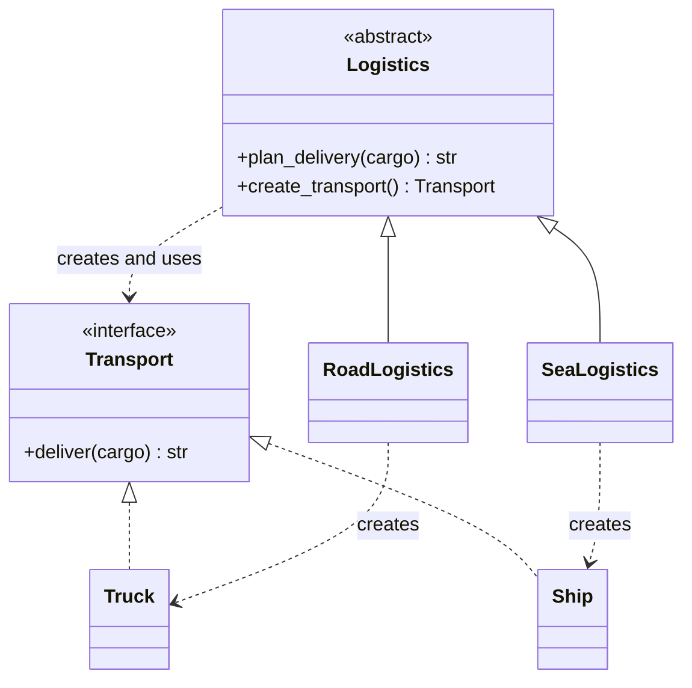
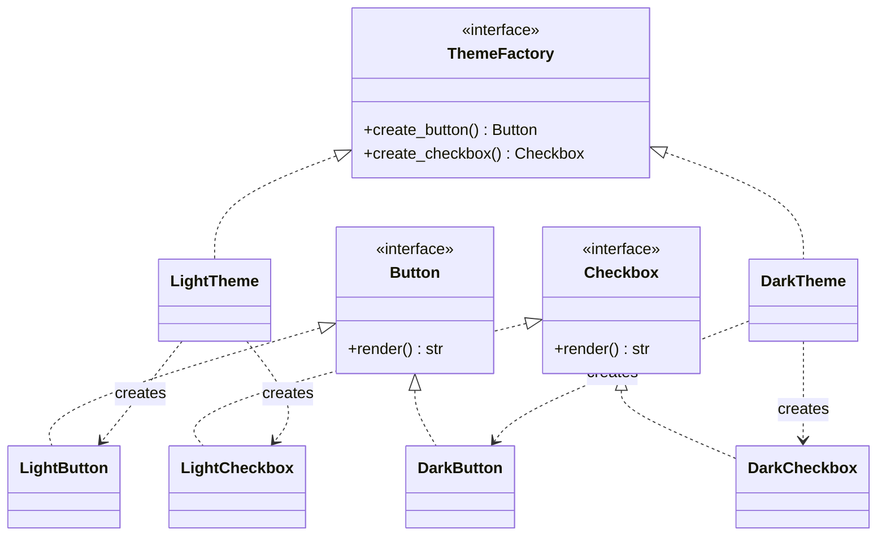

# 01. Factory Method and Abstract Factory

> **Draft: written but not yet run.** The code and the expected output in this lesson were prepared by reading the code and the official documentation. They have not been executed yet. If something does not behave as described, trust your tool's real output and report it.

## What you will be able to do
By the end of this lesson you will be able to:
- explain what a **design pattern** is and name the three families of the catalogue (creational, structural, behavioral)
- write a **Factory Method** so that a subclass, not the caller, decides which product is created
- write an **Abstract Factory** that always creates a matching family of products
- decide when a plain constructor call or a small function is enough and a factory would only add noise

## Recap
1. Patterns 101, lesson 06: what does the Dependency Inversion Principle say about a class that writes `new SmtpEmailSender()` inside itself? <details><summary>Answer</summary>High-level code should depend on an abstraction, not on a concrete detail it builds itself. The creation should move out, usually into the composition root.</details>
2. Patterns 101, lesson 03: what did we replace an `if / elif` chain with, and why? <details><summary>Answer</summary>Small classes behind one interface, so that a new case is a new class and the old code stays closed for modification.</details>
3. Patterns 101, lesson 08: what is the difference between "is a" and "has a"? <details><summary>Answer</summary>Inheritance means a class is a kind of another class; composition means a class holds other objects and asks them to do the work. Prefer composition unless "is a" is really true.</details>

## Why it matters
Think of a restaurant kitchen. A customer says "one soup", not "take a pot, boil water, cut onions". The kitchen decides how the soup is made, and a seafood restaurant and a vegetarian restaurant make different soups from the same order. A **design pattern** is a named, proven shape for a problem that keeps coming back, like "the kitchen decides what is created". Patterns give a team a shared vocabulary ("use a factory here") and a tested starting design. They are **not** laws: a pattern costs extra classes, so you pay that cost only when the problem it solves is real.

The 22 classic patterns are grouped into three families:
| Family | Question it answers | Patterns (lessons) |
|---|---|---|
| **Creational** | How do I create objects without tying code to concrete classes? | Factory Method, Abstract Factory (01), Builder, Prototype (02), Singleton (03) |
| **Structural** | How do I assemble objects into larger structures? | Adapter, Facade (04), Decorator, Proxy (05), Composite, Flyweight (06), Bridge (07) |
| **Behavioral** | How do objects share work and talk to each other? | Strategy, State (08), Observer, Mediator (09), Command, Memento (10), Iterator, Template Method, Visitor, Chain of Responsibility (11) |

Lesson 12 shows how to choose between them. Today: the first two creational patterns.

## What you will build
Two small programs. The first plans deliveries: a base class `Logistics` has the shared planning code and **leaves one step open** (`create_transport`); `RoadLogistics` fills it with a `Truck` and `SeaLogistics` with a `Ship`. The second renders a form in a **theme**: a `ThemeFactory` creates a button and a checkbox that always belong to the same theme (light or dark).

## Before you start
- **Prerequisites:** Patterns 101 lessons [03, open-closed](../../101-zero-to-hero/phase-1-solid/03-open-closed.md), [06, dependency inversion](../../101-zero-to-hero/phase-1-solid/06-dependency-inversion.md) and [08, composition over inheritance](../../101-zero-to-hero/phase-2-everyday-principles/08-composition-over-inheritance.md); [Python 101 lesson 11, classes basics](../../../python/101-zero-to-hero/phase-3-real-programs/11-classes-basics.md) and/or [C# 101 lesson 10, classes and objects](../../../csharp/101-zero-to-hero/phase-3-real-programs/10-classes-and-objects.md).
- Time: 60 minutes for one language, 90 minutes if you follow both. Follow **one** language; the other is there to compare.
- You need Patterns 101 (lessons 03, 06 and 08 are used), Python 3.10 or newer and/or the .NET 11 SDK. The TypeScript snippet is for reading only.
- Source pack (optional): every file is shown in full in this lesson, so you can follow without it. The finished code, the exercise starter and the solution are in the
  course repository https://github.com/Uee03/Code101 under `source/patterns/201-hero-to-super-hero/phase-1-creational/01-factory-method-and-abstract-factory/` (on that page choose **Code, Download ZIP**, or run
  `git clone https://github.com/Uee03/Code101.git`).

## Steps

### Step 1. Make the lesson folders
**PowerShell, starting folder: anywhere**
```powershell
New-Item -ItemType Directory -Path "$HOME/code101/patterns201/lesson01/python" -Force | Out-Null
New-Item -ItemType Directory -Path "$HOME/code101/patterns201/lesson01/csharp" -Force | Out-Null
Set-Location "$HOME/code101/patterns201/lesson01"
code .
```

**macOS/Linux terminal, starting folder: anywhere**
```bash
mkdir -p ~/code101/patterns201/lesson01/python ~/code101/patterns201/lesson01/csharp
cd ~/code101/patterns201/lesson01
code .
```
Expected result: VS Code opens `lesson01` with empty `python` and `csharp` folders. If a dot appears on a file's editor tab, the file is not saved yet.

### Step 2. See the problem first (read only, do not type)
A delivery planner that decides the transport with an `if` chain:
```python
def plan_delivery(mode, cargo):
    if mode == "road":
        transport = Truck()
    elif mode == "sea":
        transport = Ship()
    else:
        raise ValueError(mode)
    return f"Plan: {transport.deliver(cargo)}"
```
Every new transport (a plane, a drone) means editing this function, and any other function that repeats the same chain. The planning code is welded to the concrete classes `Truck` and `Ship`. That is the Open/Closed and Dependency Inversion pain from Patterns 101.

**Pattern 1: Factory Method.** *Intent (paraphrased from the catalogue at refactoring.guru):* define a method that creates an object, and let subclasses decide which class it creates. The code that **uses** the product is written once against an interface; the **creation** step is a method that subclasses override.


Four roles: the **product** interface (`Transport`), **concrete products** (`Truck`, `Ship`), the **creator** (`Logistics`, which has the shared logic and the open step) and **concrete creators** (`RoadLogistics`, `SeaLogistics`, which fill the open step). The creator's own code never names `Truck` or `Ship`.

### Step 3. Write the Factory Method
**File: `~/code101/patterns201/lesson01/python/factory_method.py`**
```python
from abc import ABC, abstractmethod


class Transport(ABC):
    @abstractmethod
    def deliver(self, cargo: str) -> str:
        ...


class Truck(Transport):
    def deliver(self, cargo: str) -> str:
        return f"Truck carries {cargo} by road"


class Ship(Transport):
    def deliver(self, cargo: str) -> str:
        return f"Ship carries {cargo} by sea"


class Logistics(ABC):
    def plan_delivery(self, cargo: str) -> str:
        transport = self.create_transport()
        return f"Plan: {transport.deliver(cargo)}"

    @abstractmethod
    def create_transport(self) -> Transport:
        ...


class RoadLogistics(Logistics):
    def create_transport(self) -> Transport:
        return Truck()


class SeaLogistics(Logistics):
    def create_transport(self) -> Transport:
        return Ship()


def demo() -> None:
    planners = {"road": RoadLogistics(), "sea": SeaLogistics()}
    for mode in ("road", "sea"):
        print(planners[mode].plan_delivery("5 crates"))
```

**File: `~/code101/patterns201/lesson01/csharp/FactoryMethod.cs`**
```csharp
namespace FactoryMethodDemo;

public interface ITransport
{
    string Deliver(string cargo);
}

public class Truck : ITransport
{
    public string Deliver(string cargo) => $"Truck carries {cargo} by road";
}

public class Ship : ITransport
{
    public string Deliver(string cargo) => $"Ship carries {cargo} by sea";
}

public abstract class Logistics
{
    public string PlanDelivery(string cargo)
    {
        ITransport transport = CreateTransport();
        return $"Plan: {transport.Deliver(cargo)}";
    }

    protected abstract ITransport CreateTransport();
}

public class RoadLogistics : Logistics
{
    protected override ITransport CreateTransport() => new Truck();
}

public class SeaLogistics : Logistics
{
    protected override ITransport CreateTransport() => new Ship();
}

public static class Demo
{
    public static void Run()
    {
        var planners = new Dictionary<string, Logistics>
        {
            ["road"] = new RoadLogistics(),
            ["sea"] = new SeaLogistics(),
        };
        foreach (var mode in new[] { "road", "sea" })
        {
            Console.WriteLine(planners[mode].PlanDelivery("5 crates"));
        }
    }
}
```
`plan_delivery` is the **shared** code. It calls `create_transport()` without knowing which subclass it is running in. (The `=>` in C# is a short form for a method whose body is one expression. The dictionary of planners is the one place that picks a concrete creator, like the composition root in Patterns 101.)

**Pattern 2: Abstract Factory.** *Intent (paraphrased):* give clients an interface that creates a whole **family** of related objects, so that the products always match and the client never names a concrete class.

### Step 4. See the second problem (read only)
A form that checks the theme in every place it builds a widget:
```python
def make_button(theme):
    if theme == "dark":
        return DarkButton()
    return LightButton()


def make_checkbox(theme):
    if theme == "dark":
        return DarkCheckbox()
    return LightCheckbox()
```
Two functions repeat the same test. Nothing stops code from calling `make_button("dark")` and `make_checkbox("light")` and showing a mismatched form, and a new theme means finding every such function. The fix: put **the whole family** behind one object.


The client (`render_form`) depends only on `ThemeFactory`, `Button` and `Checkbox`. Because one factory object creates both widgets, the pair always matches.

### Step 5. Write the Abstract Factory
**File: `~/code101/patterns201/lesson01/python/abstract_factory.py`**
```python
from abc import ABC, abstractmethod


class Button(ABC):
    @abstractmethod
    def render(self) -> str:
        ...


class Checkbox(ABC):
    @abstractmethod
    def render(self) -> str:
        ...


class LightButton(Button):
    def render(self) -> str:
        return "light button"


class LightCheckbox(Checkbox):
    def render(self) -> str:
        return "light checkbox"


class DarkButton(Button):
    def render(self) -> str:
        return "dark button"


class DarkCheckbox(Checkbox):
    def render(self) -> str:
        return "dark checkbox"


class ThemeFactory(ABC):
    @abstractmethod
    def create_button(self) -> Button:
        ...

    @abstractmethod
    def create_checkbox(self) -> Checkbox:
        ...


class LightTheme(ThemeFactory):
    def create_button(self) -> Button:
        return LightButton()

    def create_checkbox(self) -> Checkbox:
        return LightCheckbox()


class DarkTheme(ThemeFactory):
    def create_button(self) -> Button:
        return DarkButton()

    def create_checkbox(self) -> Checkbox:
        return DarkCheckbox()


def render_form(theme: ThemeFactory) -> str:
    button = theme.create_button()
    checkbox = theme.create_checkbox()
    return f"{button.render()} + {checkbox.render()}"


def demo() -> None:
    for name, theme in (("light", LightTheme()), ("dark", DarkTheme())):
        print(f"{name}: {render_form(theme)}")
```

**File: `~/code101/patterns201/lesson01/csharp/AbstractFactory.cs`**
```csharp
namespace AbstractFactoryDemo;

public interface IButton
{
    string Render();
}

public interface ICheckbox
{
    string Render();
}

public class LightButton : IButton
{
    public string Render() => "light button";
}

public class LightCheckbox : ICheckbox
{
    public string Render() => "light checkbox";
}

public class DarkButton : IButton
{
    public string Render() => "dark button";
}

public class DarkCheckbox : ICheckbox
{
    public string Render() => "dark checkbox";
}

public interface IThemeFactory
{
    IButton CreateButton();
    ICheckbox CreateCheckbox();
}

public class LightTheme : IThemeFactory
{
    public IButton CreateButton() => new LightButton();
    public ICheckbox CreateCheckbox() => new LightCheckbox();
}

public class DarkTheme : IThemeFactory
{
    public IButton CreateButton() => new DarkButton();
    public ICheckbox CreateCheckbox() => new DarkCheckbox();
}

public static class Demo
{
    public static string RenderForm(IThemeFactory theme)
    {
        IButton button = theme.CreateButton();
        ICheckbox checkbox = theme.CreateCheckbox();
        return $"{button.Render()} + {checkbox.Render()}";
    }

    public static void Run()
    {
        var themes = new (string Name, IThemeFactory Theme)[]
        {
            ("light", new LightTheme()),
            ("dark", new DarkTheme()),
        };
        foreach (var (name, theme) in themes)
        {
            Console.WriteLine($"{name}: {RenderForm(theme)}");
        }
    }
}
```
(In C# each pattern file has its own **namespace**, `FactoryMethodDemo` and `AbstractFactoryDemo`, so both can have a class called `Demo` and classes like `Truck` never clash.)

### Step 6. Run both from one entry file
**File: `~/code101/patterns201/lesson01/python/main.py`**
```python
import abstract_factory
import factory_method

print("--- factory method ---")
factory_method.demo()
print("--- abstract factory ---")
abstract_factory.demo()
```

**File: `~/code101/patterns201/lesson01/csharp/Program.cs`**
```csharp
Console.WriteLine("--- factory method ---");
FactoryMethodDemo.Demo.Run();
Console.WriteLine("--- abstract factory ---");
AbstractFactoryDemo.Demo.Run();
```

**File: `~/code101/patterns201/lesson01/csharp/Lesson.csproj`** (every lesson in this level uses this same file)
```xml
<Project Sdk="Microsoft.NET.Sdk">

  <PropertyGroup>
    <OutputType>Exe</OutputType>
    <TargetFramework>net11.0</TargetFramework>
    <ImplicitUsings>enable</ImplicitUsings>
    <Nullable>enable</Nullable>
  </PropertyGroup>

</Project>
```
Line by line: `OutputType` Exe makes a program you can run; `TargetFramework` `net11.0` selects the .NET 11 SDK's runtime; `ImplicitUsings` adds the common `using` lines (`System`, `System.Collections.Generic`, `System.Linq` and others) so `Console` and `Dictionary` work without them; `Nullable` turns on the compiler's null checks. Remove `ImplicitUsings` and `Console` becomes unknown.

## Run it
Predict first: in the second half, would it be possible for the program to print `light button + dark checkbox`? <details><summary>Answer</summary>No. One factory object creates both widgets, so they always come from the same theme. That guarantee is the reason for the pattern.</details>

**PowerShell, folder: `~/code101/patterns201/lesson01/python`**
```powershell
Set-Location "$HOME/code101/patterns201/lesson01/python"
python main.py
```
**macOS/Linux terminal, folder: `~/code101/patterns201/lesson01/python`**
```bash
cd ~/code101/patterns201/lesson01/python
python3 main.py
```
**Any terminal, folder: `~/code101/patterns201/lesson01/csharp`**
```text
dotnet run --project . --nologo
```
Expected output (derived by reading the code, not yet run; identical for Python and C#):
```text
--- factory method ---
Plan: Truck carries 5 crates by road
Plan: Ship carries 5 crates by sea
--- abstract factory ---
light: light button + light checkbox
dark: dark button + dark checkbox
```
The first time `dotnet` runs it may print a welcome or telemetry notice first; that is not part of the program's output.

## How it works
**Factory Method.** `plan_delivery` is a **template** with one hole. The hole is `create_transport`. Python and C# both call the **overridden** version in the object's real class, so `RoadLogistics` fills the hole with a `Truck`. Adding a plane means one new product class and one new creator class; `Logistics` is not edited (Open/Closed).

**Abstract Factory.** A factory is an object with several `create_*` methods. Swap the factory and the **whole family** swaps. Notice that an Abstract Factory is often built from several Factory Methods: each `create_*` method *is* a factory method.

| | Factory Method | Abstract Factory |
|---|---|---|
| Creates | **one** product | a **family** of related products |
| Built from | inheritance: a subclass overrides one method | composition: you pass a factory object in |
| Typical sign you need it | shared code that must create "some kind of X" | several products that must match |
| Cost | one creator subclass per product | one factory class per family, one interface method per product kind |

**Pattern card: Factory Method**
| | |
|---|---|
| Use when | shared code needs "some product" but the exact class varies; you want to let a subclass or a framework user extend the product list |
| Do not use when | there is one creation site or one product: call the constructor. A small `dict` or `if` in **one** place (a "simple factory") is often better than a class hierarchy |
| Real-world uses | .NET `IHttpClientFactory.CreateClient`, `Encoding.GetEncoding(name)`; Python alternative constructors such as `datetime.fromtimestamp` follow the same idea of a named creation function |
| Related patterns | Abstract Factory (built from factory methods), Template Method (lesson 11: the factory method is a step of a template), Prototype (lesson 02: creates by copying instead of by subclassing) |
| Pitfalls | a parallel hierarchy (one creator class per product, doubling the class count); creators that only return `new X()` and add nothing; forgetting that Python will not stop you from skipping the override until the object is created |

**Pattern card: Abstract Factory**
| | |
|---|---|
| Use when | products come in families that must be used together (themes, operating systems, database dialects) and you want to switch the whole family at one point |
| Do not use when | there is only one family, or the "family" is a single product (use Factory Method), or new product kinds are added often: each new `create_*` method means editing the interface and **every** factory |
| Real-world uses | .NET `DbProviderFactory` creates the connection, command and parameter objects of one database provider; cross-platform UI kits create matching widgets per platform |
| Related patterns | Factory Method (the building block), Singleton (a factory is often a single shared object, see lesson 03), Bridge (lesson 07: a different answer when you vary an abstraction and its implementation) |
| Pitfalls | interface explosion (N families times M products = many classes); a concrete class leaking into client code (`new LightButton()` in the form) which breaks the family guarantee |

A TypeScript sketch of the first pattern, for reading (same shape, no new idea):
```typescript
interface Transport { deliver(cargo: string): string }

abstract class Logistics {
  planDelivery(cargo: string): string {
    return `Plan: ${this.createTransport().deliver(cargo)}`;
  }
  protected abstract createTransport(): Transport;
}
```
In TypeScript and Python a plain **function** that returns a product is often a lighter factory, because functions are values. Use classes when the creation needs several related methods or shared state.

Misconception: **"a factory is any function that calls `new`."** The pattern is about moving the *decision* of which class to create away from the code that uses the product. If the caller still names the class, nothing was decoupled.

## Try it
**Rung 1, guided.** Copy the `starter` folder of your language to `try01` (copy the folder itself and rename it, do not paste it inside another folder) and finish the TODOs. The program should print a plain line and a shouting line.

**File: `try01/main.py`**
```python
from abc import ABC, abstractmethod


class Formatter(ABC):
    @abstractmethod
    def format(self, text: str) -> str:
        ...


class PlainFormatter(Formatter):
    def format(self, text: str) -> str:
        return text


class Printer(ABC):
    def print_line(self, text: str) -> None:
        print(self.create_formatter().format(text))

    @abstractmethod
    def create_formatter(self) -> Formatter:
        ...


class PlainPrinter(Printer):
    def create_formatter(self) -> Formatter:
        return PlainFormatter()


# TODO 1: write ShoutFormatter whose format returns the text in upper case followed by "!".
# TODO 2: write ShoutPrinter whose create_formatter returns a ShoutFormatter.
# TODO 3: add "shout": ShoutPrinter() to the dictionary below.

printers = {"plain": PlainPrinter()}
for name in ("plain", "shout"):
    printers[name].print_line("hello")
```

**File: `try01/Program.cs`** (the same `Lesson.csproj` as above goes next to it)
```csharp
var printers = new Dictionary<string, Printer>
{
    ["plain"] = new PlainPrinter(),
    // TODO 3: add ["shout"] = new ShoutPrinter(),
};
foreach (var name in new[] { "plain", "shout" })
{
    printers[name].PrintLine("hello");
}

// TODO 1: write ShoutFormatter (implements IFormatter): Format returns the text in upper case followed by "!".
// TODO 2: write ShoutPrinter (extends Printer): CreateFormatter returns a new ShoutFormatter.

interface IFormatter
{
    string Format(string text);
}

class PlainFormatter : IFormatter
{
    public string Format(string text) => text;
}

abstract class Printer
{
    public void PrintLine(string text) => Console.WriteLine(CreateFormatter().Format(text));

    protected abstract IFormatter CreateFormatter();
}

class PlainPrinter : Printer
{
    protected override IFormatter CreateFormatter() => new PlainFormatter();
}
```
Before you finish the TODOs, run the starter once: it stops with an error about the missing `"shout"` key. Expected output when done (not yet run):
```text
hello
HELLO!
```

**Rung 2, change.** Add a third product, `BracketFormatter`, and a creator for it, so the program also prints `[hello]` as a third line. Count how many existing classes you had to edit.

**Rung 3, stretch (no single answer).** Replace the dictionary of creator **objects** with a dictionary of creator **functions** (Python) or `Func<IFormatter>` values (C#). Write two sentences: which is simpler, and what did you lose?

<details><summary>Solution (Rungs 1 and 2 answer)</summary>

**File: `try01/main.py`**
```python
from abc import ABC, abstractmethod


class Formatter(ABC):
    @abstractmethod
    def format(self, text: str) -> str:
        ...


class PlainFormatter(Formatter):
    def format(self, text: str) -> str:
        return text


class ShoutFormatter(Formatter):
    def format(self, text: str) -> str:
        return text.upper() + "!"


class Printer(ABC):
    def print_line(self, text: str) -> None:
        print(self.create_formatter().format(text))

    @abstractmethod
    def create_formatter(self) -> Formatter:
        ...


class PlainPrinter(Printer):
    def create_formatter(self) -> Formatter:
        return PlainFormatter()


class ShoutPrinter(Printer):
    def create_formatter(self) -> Formatter:
        return ShoutFormatter()


printers = {"plain": PlainPrinter(), "shout": ShoutPrinter()}
for name in ("plain", "shout"):
    printers[name].print_line("hello")
```

**File: `try01/Program.cs`**
```csharp
var printers = new Dictionary<string, Printer>
{
    ["plain"] = new PlainPrinter(),
    ["shout"] = new ShoutPrinter(),
};
foreach (var name in new[] { "plain", "shout" })
{
    printers[name].PrintLine("hello");
}

interface IFormatter
{
    string Format(string text);
}

class PlainFormatter : IFormatter
{
    public string Format(string text) => text;
}

class ShoutFormatter : IFormatter
{
    public string Format(string text) => text.ToUpperInvariant() + "!";
}

abstract class Printer
{
    public void PrintLine(string text) => Console.WriteLine(CreateFormatter().Format(text));

    protected abstract IFormatter CreateFormatter();
}

class PlainPrinter : Printer
{
    protected override IFormatter CreateFormatter() => new PlainFormatter();
}

class ShoutPrinter : Printer
{
    protected override IFormatter CreateFormatter() => new ShoutFormatter();
}
```
Output: `hello`, then `HELLO!`. For Rung 2 you add `BracketFormatter` (returns `"[" + text + "]"`) and `BracketPrinter`, plus one dictionary entry and one more name in the loop. You edited **no existing class**: only the composition point changed. That is the Open/Closed payoff. For Rung 3: a function (`lambda: ShoutFormatter()`) is shorter, but a creator class can hold extra shared methods and be extended by subclasses.
</details>

## Check yourself
1. Which family do Factory Method and Abstract Factory belong to, and what question does that family answer? <details><summary>Answer</summary>Creational: how to create objects without tying code to concrete classes.</details>
2. In `Logistics`, which method is the factory method, and which class names does `plan_delivery` mention? <details><summary>Answer</summary>`create_transport` is the factory method. `plan_delivery` names only the `Transport` interface (and `Logistics` itself), never `Truck` or `Ship`.</details>
3. Predict: you add `AirLogistics` with a `Plane` product. Which existing classes change? <details><summary>Answer</summary>None, except the place that builds the `planners` dictionary.</details>
4. Find the bug: a form uses `DarkTheme().create_button()` and `LightTheme().create_checkbox()`. What guarantee did the code break? <details><summary>Answer</summary>The family guarantee: products from one factory match. Create both widgets from the same factory object.</details>
5. When should you not use a factory? <details><summary>Answer</summary>When there is one creation site and one product kind: a constructor call, or a tiny function, is simpler (KISS and YAGNI).</details>

## Mixed review
1. (Patterns 101, OCP) How does the Factory Method make `Logistics` closed for modification? <details><summary>Answer</summary>New transports arrive as new subclasses; the shared planning code is never edited.</details>
2. (Patterns 101, DIP) Which arrow flips compared with the `if` chain version? <details><summary>Answer</summary>Before, `plan_delivery` depended on `Truck` and `Ship`. Now it depends on the `Transport` interface and the concrete classes depend on it too.</details>
3. (Patterns 101, YAGNI) You have exactly one report format today. Do you add an Abstract Factory for future formats? <details><summary>Answer</summary>No. Wait until the second format exists, then refactor toward the pattern.</details>

## Common mistakes
These messages are typical and have **not** been reproduced yet; the exact wording depends on your Python and .NET versions.
| Symptom or error text (typical) | Cause | Fix |
|---|---|---|
| `TypeError: Can't instantiate abstract class Logistics ...` (Python) | you created the abstract creator directly, or a subclass forgot to override `create_transport` | create `RoadLogistics()` or add the override |
| `error CS0534: 'SeaLogistics' does not implement inherited abstract member 'Logistics.CreateTransport()'` (C#) | the subclass has no `override` of the abstract method | add `protected override ITransport CreateTransport() => ...` |
| `KeyError: 'shout'` (Python) or `KeyNotFoundException` (C#) when you run the starter | the name is looked up in the dictionary but the creator was not added | add the entry (TODO 3) |
| `python: can't open file ... main.py` or `MSB1003: Specify a project or solution file` | the terminal is in the wrong folder | `cd` into the `python` or `csharp` folder first (look at the text before `>` or `$`) |
| nothing changes after an edit | the file is not saved (dot on the tab) | save, then run again |

## Best practice
Start with a plain constructor call; introduce a factory when a **second** product or a real need for substitution appears, and keep the decision of "which concrete class" in one place. Source: Factory Method, Refactoring.Guru https://refactoring.guru/design-patterns/factory-method

## Going further
- Abstract Factory: https://refactoring.guru/design-patterns/abstract-factory and the cross-check at https://sourcemaking.com/design_patterns/abstract_factory
- Python abstract base classes: https://docs.python.org/3/library/abc.html
- Lesson 03 shows how a DI container replaces many hand-written factories, and lesson 12 helps you choose between a factory, a builder and a constructor.

## Summary
- You named the three pattern families and said what each one is for.
- You wrote a Factory Method where subclasses decide the product and the shared code stays closed.
- You wrote an Abstract Factory that keeps a product family consistent.
- You compared both with a constructor or a small function and named when the factory is overkill.

## Next lesson
02. Builder and Prototype: build complex objects step by step, and create new objects by copying existing ones.
