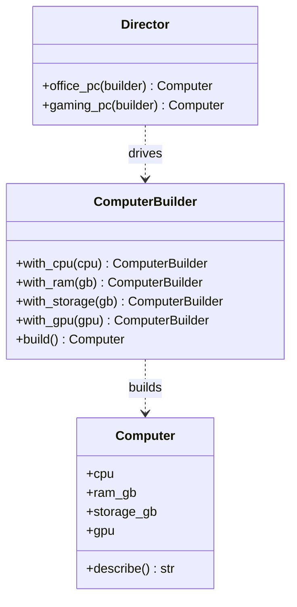
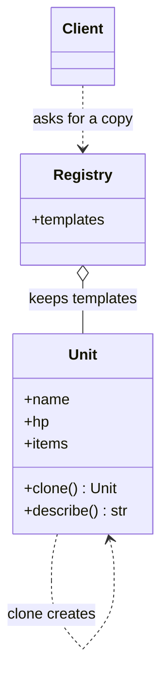

# 02. Builder and Prototype

> **Draft: written but not yet run.** The code and the expected output in this lesson were prepared by reading the code and the official documentation. They have not been executed yet. If something does not behave as described, trust your tool's real output and report it.

## What you will be able to do
By the end of this lesson you will be able to:
- write a **Builder** that assembles an object step by step and refuses to build an invalid one
- explain what a **Director** adds to a builder and when you can skip it
- write a **Prototype** (`clone`) and predict the difference between a shallow and a deep copy
- decide when keyword arguments, object initializers or `copy` already solve the problem

## Recap
1. (Lesson 01) What does Abstract Factory guarantee that Factory Method does not? <details><summary>Answer</summary>That several products created by one factory belong to the same family and match each other.</details>
2. (Lesson 01) Name a sign that a factory is overkill. <details><summary>Answer</summary>One creation site and one product kind: a plain constructor call or tiny function is enough.</details>
3. (Patterns 101, lesson 07) What does YAGNI warn about? <details><summary>Answer</summary>Building features or abstractions before you need them.</details>

## Why it matters
Ordering a custom sandwich, you do not hand over one sentence with twelve unlabeled words; you go step by step: bread, filling, sauce, toasted or not. A **Builder** is that counter: you describe the object one named step at a time and ask for the result at the end. A **Prototype** is the photocopier: when a ready-made, configured object already exists, you copy it instead of rebuilding it from scratch. Both are *creational* patterns (lesson 01): they decide **how** an object comes into being.

## What you will build
Two small programs. The first builds `Computer` objects with a `ComputerBuilder` (optional parts have defaults, `build()` checks the rules) and two ready recipes kept in a `Director`. The second clones a `Unit` template from a registry and then shows what goes wrong with a **shallow** copy.

## Before you start
- **Prerequisites:** [Patterns 201 lesson 01, factory method and abstract factory](01-factory-method-and-abstract-factory.md) and [Patterns 101 lesson 07, DRY, KISS and YAGNI](../../101-zero-to-hero/phase-2-everyday-principles/07-dry-kiss-yagni.md).
- Time: 55 minutes for one language, 85 minutes if you follow both.
- You need lesson 01 and Python 3.10 or newer and/or the .NET 11 SDK. The TypeScript snippet is for reading only.
- Source pack (optional): every file is shown in full in this lesson, so you can follow without it. The finished code, the exercise starter and the solution are in the
  course repository https://github.com/Uee03/Code101 under `source/patterns/201-hero-to-super-hero/phase-1-creational/02-builder-and-prototype/` (on that page choose **Code, Download ZIP**, or run
  `git clone https://github.com/Uee03/Code101.git`).

## Steps

### Step 1. Make the lesson folders
**PowerShell, starting folder: anywhere**
```powershell
New-Item -ItemType Directory -Path "$HOME/code101/patterns201/lesson02/python" -Force | Out-Null
New-Item -ItemType Directory -Path "$HOME/code101/patterns201/lesson02/csharp" -Force | Out-Null
Set-Location "$HOME/code101/patterns201/lesson02"
code .
```

**macOS/Linux terminal, starting folder: anywhere**
```bash
mkdir -p ~/code101/patterns201/lesson02/python ~/code101/patterns201/lesson02/csharp
cd ~/code101/patterns201/lesson02
code .
```
Expected result: VS Code opens `lesson02` with empty `python` and `csharp` folders.

### Step 2. See the Builder problem first (read only)
```python
pc = Computer("fast CPU", 32, 2000, "big GPU")
office = Computer("basic CPU", 8, 256, None)
```
Which number is RAM, which is storage? This is the **telescoping constructor** problem: a constructor with many positional values, most of them optional, that is easy to call wrongly and hard to read. The usual alternative, creating an empty object and setting fields one by one (`pc.ram_gb = 2`), has a different flaw: the object exists in a half-built or **invalid** state, and nothing checks the rules before somebody uses it.

**Pattern 1: Builder.** *Intent (paraphrased from the catalogue at refactoring.guru):* construct a complex object step by step, so that the same construction steps can create different results, and keep the construction code out of the product class.


Three roles: the **builder** (steps plus `build()`), the **product** (`Computer`, immutable once built) and an optional **director** (a class that knows *recipes*, i.e. which steps in which order).

### Step 3. Write the Builder
**File: `~/code101/patterns201/lesson02/python/builder.py`**
```python
from dataclasses import dataclass
from typing import Optional


@dataclass(frozen=True)
class Computer:
    cpu: str
    ram_gb: int
    storage_gb: int
    gpu: Optional[str]

    def describe(self) -> str:
        gpu = self.gpu if self.gpu is not None else "no GPU"
        return f"{self.cpu}, {self.ram_gb} GB RAM, {self.storage_gb} GB storage, {gpu}"


class ComputerBuilder:
    def __init__(self) -> None:
        self._cpu = "basic CPU"
        self._ram_gb = 8
        self._storage_gb = 256
        self._gpu: Optional[str] = None

    def with_cpu(self, cpu: str) -> "ComputerBuilder":
        self._cpu = cpu
        return self

    def with_ram(self, ram_gb: int) -> "ComputerBuilder":
        self._ram_gb = ram_gb
        return self

    def with_storage(self, storage_gb: int) -> "ComputerBuilder":
        self._storage_gb = storage_gb
        return self

    def with_gpu(self, gpu: str) -> "ComputerBuilder":
        self._gpu = gpu
        return self

    def build(self) -> Computer:
        if self._ram_gb < 4:
            raise ValueError("at least 4 GB RAM is required")
        return Computer(self._cpu, self._ram_gb, self._storage_gb, self._gpu)


class Director:
    @staticmethod
    def office_pc(builder: ComputerBuilder) -> Computer:
        return builder.with_ram(16).build()

    @staticmethod
    def gaming_pc(builder: ComputerBuilder) -> Computer:
        return builder.with_cpu("fast CPU").with_ram(32).with_storage(2000).with_gpu("big GPU").build()


def demo() -> None:
    print(f"office: {Director.office_pc(ComputerBuilder()).describe()}")
    print(f"gaming: {Director.gaming_pc(ComputerBuilder()).describe()}")
    try:
        ComputerBuilder().with_ram(2).build()
    except ValueError as error:
        print(f"Rejected: {error}")
```

**File: `~/code101/patterns201/lesson02/csharp/Builder.cs`**
```csharp
namespace BuilderDemo;

public record Computer(string Cpu, int RamGb, int StorageGb, string? Gpu)
{
    public string Describe()
    {
        string gpu = Gpu ?? "no GPU";
        return $"{Cpu}, {RamGb} GB RAM, {StorageGb} GB storage, {gpu}";
    }
}

public class ComputerBuilder
{
    private string _cpu = "basic CPU";
    private int _ramGb = 8;
    private int _storageGb = 256;
    private string? _gpu;

    public ComputerBuilder WithCpu(string cpu)
    {
        _cpu = cpu;
        return this;
    }

    public ComputerBuilder WithRam(int ramGb)
    {
        _ramGb = ramGb;
        return this;
    }

    public ComputerBuilder WithStorage(int storageGb)
    {
        _storageGb = storageGb;
        return this;
    }

    public ComputerBuilder WithGpu(string gpu)
    {
        _gpu = gpu;
        return this;
    }

    public Computer Build()
    {
        if (_ramGb < 4)
        {
            throw new InvalidOperationException("at least 4 GB RAM is required");
        }
        return new Computer(_cpu, _ramGb, _storageGb, _gpu);
    }
}

public static class Director
{
    public static Computer OfficePc(ComputerBuilder builder) => builder.WithRam(16).Build();

    public static Computer GamingPc(ComputerBuilder builder) =>
        builder.WithCpu("fast CPU").WithRam(32).WithStorage(2000).WithGpu("big GPU").Build();
}

public static class Demo
{
    public static void Run()
    {
        Console.WriteLine($"office: {Director.OfficePc(new ComputerBuilder()).Describe()}");
        Console.WriteLine($"gaming: {Director.GamingPc(new ComputerBuilder()).Describe()}");
        try
        {
            new ComputerBuilder().WithRam(2).Build();
        }
        catch (InvalidOperationException error)
        {
            Console.WriteLine($"Rejected: {error.Message}");
        }
    }
}
```
Key points: each `with_*` step returns `self` / `this`, which makes the **fluent** style possible (`a.b().c().build()`). Only `build()` creates the `Computer`, and it checks the rule first, so an invalid computer **can never exist**. `Computer` is a frozen dataclass (Python) and a `record` (C#): after building, nothing can change it. In C#, `string?` means "may be null" (the `Nullable` setting in the csproj).

**Pattern 2: Prototype.** *Intent (paraphrased):* create new objects by **copying** an existing object (the prototype), without making the code depend on the object's concrete class.

### Step 4. See the Prototype problem (read only)
```python
scout = Unit("archer", 30, ["bow"])    # the same setup, typed again
scout.name = "scout"
```
Creating a copy by re-running the setup duplicates knowledge (DRY) and needs the caller to know the class and its constructor. And the shortcut "copy the fields by hand from outside" fails when fields are private. The object itself knows best how to copy itself, so give it a `clone()` method.



### Step 5. Write the Prototype
**File: `~/code101/patterns201/lesson02/python/prototype.py`**
```python
import copy


class Unit:
    def __init__(self, name: str, hp: int, items: list[str]) -> None:
        self.name = name
        self.hp = hp
        self.items = items

    def clone(self) -> "Unit":
        return Unit(self.name, self.hp, list(self.items))

    def describe(self) -> str:
        return f"{self.name} hp={self.hp} items={', '.join(self.items)}"


def demo() -> None:
    archer = Unit("archer", 30, ["bow"])
    registry = {"archer": archer}

    scout = registry["archer"].clone()
    scout.name = "scout"
    scout.items.append("map")
    print(archer.describe())
    print(scout.describe())

    shallow = copy.copy(archer)
    shallow.items.append("torch")
    print(archer.describe())
```

**File: `~/code101/patterns201/lesson02/csharp/Prototype.cs`**
```csharp
namespace PrototypeDemo;

public class Unit
{
    public string Name { get; set; }
    public int Hp { get; }
    public List<string> Items { get; }

    public Unit(string name, int hp, List<string> items)
    {
        Name = name;
        Hp = hp;
        Items = items;
    }

    public Unit Clone() => new Unit(Name, Hp, new List<string>(Items));

    public Unit ShallowCopy() => (Unit)MemberwiseClone();

    public string Describe() => $"{Name} hp={Hp} items={string.Join(", ", Items)}";
}

public static class Demo
{
    public static void Run()
    {
        var archer = new Unit("archer", 30, new List<string> { "bow" });
        var registry = new Dictionary<string, Unit> { ["archer"] = archer };

        Unit scout = registry["archer"].Clone();
        scout.Name = "scout";
        scout.Items.Add("map");
        Console.WriteLine(archer.Describe());
        Console.WriteLine(scout.Describe());

        Unit shallow = archer.ShallowCopy();
        shallow.Items.Add("torch");
        Console.WriteLine(archer.Describe());
    }
}
```
`clone()` builds a new `Unit` **and a new list** (`list(self.items)`). A **shallow copy** (`copy.copy` in Python, `MemberwiseClone` in C#) copies the fields but not the objects they point to: both units then share **one** list. A **deep copy** also copies those inner objects. In Python `copy.deepcopy(archer)` does that for you; in C# you write it yourself, as `Clone` does.

### Step 6. Entry files
**File: `~/code101/patterns201/lesson02/python/main.py`**
```python
import builder
import prototype

print("--- builder ---")
builder.demo()
print("--- prototype ---")
prototype.demo()
```

**File: `~/code101/patterns201/lesson02/csharp/Program.cs`**
```csharp
Console.WriteLine("--- builder ---");
BuilderDemo.Demo.Run();
Console.WriteLine("--- prototype ---");
PrototypeDemo.Demo.Run();
```

**File: `~/code101/patterns201/lesson02/csharp/Lesson.csproj`** (identical to lesson 01; every lesson in this level uses this same file)
```xml
<Project Sdk="Microsoft.NET.Sdk">

  <PropertyGroup>
    <OutputType>Exe</OutputType>
    <TargetFramework>net11.0</TargetFramework>
    <ImplicitUsings>enable</ImplicitUsings>
    <Nullable>enable</Nullable>
  </PropertyGroup>

</Project>
```

## Run it
Predict first: the last line prints `archer`. Will its item list contain `torch`? And did the scout's `map` leak into the archer on line 2? <details><summary>Answer</summary>`torch` appears in the archer's list (the shallow copy shares the list), but `map` did not leak, because `clone()` made a new list. Same output in both languages.</details>

**PowerShell, folder: `~/code101/patterns201/lesson02/python`**
```powershell
Set-Location "$HOME/code101/patterns201/lesson02/python"
python main.py
```
**macOS/Linux terminal, folder: `~/code101/patterns201/lesson02/python`**
```bash
cd ~/code101/patterns201/lesson02/python
python3 main.py
```
**Any terminal, folder: `~/code101/patterns201/lesson02/csharp`**
```text
dotnet run --project . --nologo
```
Expected output (derived by reading the code, not yet run; identical for Python and C#):
```text
--- builder ---
office: basic CPU, 16 GB RAM, 256 GB storage, no GPU
gaming: fast CPU, 32 GB RAM, 2000 GB storage, big GPU
Rejected: at least 4 GB RAM is required
--- prototype ---
archer hp=30 items=bow
scout hp=30 items=bow, map
archer hp=30 items=bow, torch
```

## How it works
**Builder.** The builder holds *draft* values with defaults. Each step changes the draft and returns the builder. `build()` is the single exit: it validates and creates the immutable product. The `Director` is only a place for named recipes; you can skip it when callers build their own objects, which is the common case.

**Prototype.** The object copies itself, so callers do not need its class or its private data. A **registry** (here a dictionary) stores configured templates that are cloned on demand. The real danger is *what* is copied: any mutable inner object (a list, a dictionary) must be copied too, or two "independent" objects secretly share state.

**Pattern card: Builder**
| | |
|---|---|
| Use when | an object has many optional parts, rules that span several fields, or must be immutable; or the same steps should produce different results |
| Do not use when | the object has two or three simple fields. Python keyword arguments with defaults (`Computer(ram_gb=16)`), a dataclass, or C# object initializers and `required` members are simpler. Do not write a builder only because you can |
| Real-world uses | .NET `StringBuilder`, `UriBuilder`, `SqlConnectionStringBuilder`, `WebApplication.CreateBuilder`; the chained query style of libraries such as SQLAlchemy `select(...).where(...)` |
| Related patterns | Factory Method and Abstract Factory (they create in **one** call, a builder in several steps), Composite (builders often assemble trees), Fluent interfaces (the chaining style) |
| Pitfalls | a builder that allows `build()` twice and shares its lists between products (copy them in `build`); validation forgotten in `build()`; a fluent chain that hides an order requirement; a director with one method that nobody reuses |

**Pattern card: Prototype**
| | |
|---|---|
| Use when | creating an object is costly or needs many steps and you have a configured example, or you want a catalogue of presets, or code must copy objects of unknown concrete type |
| Do not use when | objects are cheap to create (call the constructor), or objects hold resources that cannot be copied (open files, sockets, locks), or the object graph has cycles you have not handled |
| Real-world uses | Python `copy.copy` and `copy.deepcopy`; C# `record` types with the `with` expression (a shallow copy with changes); `MemberwiseClone` |
| Related patterns | Factory Method (creates by subclass, prototype creates by copying), Memento (lesson 10: also copies state, for undo), Singleton (a registry of prototypes is often one shared object) |
| Pitfalls | **shallow vs deep** confusion (the `torch` line above); `ICloneable` in .NET does not say whether it is shallow or deep, so most guides recommend not using it in public APIs and writing an explicit `Clone` instead; clones that share an `id` which should be unique |

A TypeScript sketch of each, for reading:
```typescript
class ComputerBuilder {
  private ramGb = 8;
  withRam(gb: number): this { this.ramGb = gb; return this; }
  build(): { ramGb: number } {
    if (this.ramGb < 4) throw new Error("at least 4 GB RAM is required");
    return { ramGb: this.ramGb };
  }
}

const copy = structuredClone({ name: "archer", items: ["bow"] }); // a deep copy
```
Misconception: **"fluent chaining is the Builder pattern."** Chaining is only a style. The pattern is the separate builder object plus a validating `build()`.

## Try it
**Rung 1, guided.** Copy the `starter` folder of your language to `try02` (copy the folder itself and rename it) and finish the TODOs: an `EmailBuilder` where an email needs at least one recipient.

**File: `try02/main.py`**
```python
from dataclasses import dataclass


@dataclass(frozen=True)
class Email:
    recipients: tuple
    subject: str
    body: str

    def describe(self) -> str:
        return f"To: {', '.join(self.recipients)} | Subject: {self.subject} | Body: {self.body}"


class EmailBuilder:
    def __init__(self) -> None:
        self._recipients: list = []
        self._subject = "(no subject)"
        self._body = ""

    def add_recipient(self, address: str) -> "EmailBuilder":
        # TODO 1: append the address to self._recipients and return self
        raise NotImplementedError("TODO 1")

    def with_subject(self, subject: str) -> "EmailBuilder":
        # TODO 2: set self._subject and return self
        raise NotImplementedError("TODO 2")

    def with_body(self, body: str) -> "EmailBuilder":
        # TODO 2: set self._body and return self
        raise NotImplementedError("TODO 2")

    def build(self) -> Email:
        # TODO 3: raise ValueError("an email needs at least one recipient") when there are no recipients,
        #         otherwise return Email(tuple(self._recipients), self._subject, self._body)
        raise NotImplementedError("TODO 3")


email = EmailBuilder().add_recipient("ana@example.com").add_recipient("bo@example.com").with_subject("Hello").with_body("Hi!").build()
print(email.describe())
try:
    EmailBuilder().with_subject("Lonely").build()
except ValueError as error:
    print(f"Rejected: {error}")
```

**File: `try02/Program.cs`** (with the same `Lesson.csproj`)
```csharp
var email = new EmailBuilder()
    .AddRecipient("ana@example.com")
    .AddRecipient("bo@example.com")
    .WithSubject("Hello")
    .WithBody("Hi!")
    .Build();
Console.WriteLine(email.Describe());
try
{
    new EmailBuilder().WithSubject("Lonely").Build();
}
catch (InvalidOperationException error)
{
    Console.WriteLine($"Rejected: {error.Message}");
}

record Email(IReadOnlyList<string> Recipients, string Subject, string Body)
{
    public string Describe() => $"To: {string.Join(", ", Recipients)} | Subject: {Subject} | Body: {Body}";
}

class EmailBuilder
{
    private readonly List<string> _recipients = new();
    private string _subject = "(no subject)";
    private string _body = "";

    public EmailBuilder AddRecipient(string address)
    {
        // TODO 1: add the address to _recipients and return this
        throw new NotImplementedException("TODO 1");
    }

    public EmailBuilder WithSubject(string subject)
    {
        // TODO 2: set _subject and return this
        throw new NotImplementedException("TODO 2");
    }

    public EmailBuilder WithBody(string body)
    {
        // TODO 2: set _body and return this
        throw new NotImplementedException("TODO 2");
    }

    public Email Build()
    {
        // TODO 3: throw new InvalidOperationException("an email needs at least one recipient") when _recipients is empty,
        //         otherwise return new Email(_recipients.ToArray(), _subject, _body)
        throw new NotImplementedException("TODO 3");
    }
}
```
Expected output when done (not yet run):
```text
To: ana@example.com, bo@example.com | Subject: Hello | Body: Hi!
Rejected: an email needs at least one recipient
```
**Rung 2, change.** Call `build()` twice on the same builder, then add a recipient to the builder and build a third time. Make sure the first email does not change. (Hint: look at what `build()` passes to `Email`.) Then add `with_cc(address)` so the email also lists a Cc line.

**Rung 3, stretch (no single answer).** Write the same `Email` with only keyword arguments and defaults (Python) or an object initializer with `required` members (C#). Which would you ship for a three-field email, and at what number of fields would you switch to a builder?

<details><summary>Solution</summary>

**File: `try02/main.py`**
```python
from dataclasses import dataclass


@dataclass(frozen=True)
class Email:
    recipients: tuple
    subject: str
    body: str

    def describe(self) -> str:
        return f"To: {', '.join(self.recipients)} | Subject: {self.subject} | Body: {self.body}"


class EmailBuilder:
    def __init__(self) -> None:
        self._recipients: list = []
        self._subject = "(no subject)"
        self._body = ""

    def add_recipient(self, address: str) -> "EmailBuilder":
        self._recipients.append(address)
        return self

    def with_subject(self, subject: str) -> "EmailBuilder":
        self._subject = subject
        return self

    def with_body(self, body: str) -> "EmailBuilder":
        self._body = body
        return self

    def build(self) -> Email:
        if not self._recipients:
            raise ValueError("an email needs at least one recipient")
        return Email(tuple(self._recipients), self._subject, self._body)


email = EmailBuilder().add_recipient("ana@example.com").add_recipient("bo@example.com").with_subject("Hello").with_body("Hi!").build()
print(email.describe())
try:
    EmailBuilder().with_subject("Lonely").build()
except ValueError as error:
    print(f"Rejected: {error}")
```

**File: `try02/Program.cs`**
```csharp
var email = new EmailBuilder()
    .AddRecipient("ana@example.com")
    .AddRecipient("bo@example.com")
    .WithSubject("Hello")
    .WithBody("Hi!")
    .Build();
Console.WriteLine(email.Describe());
try
{
    new EmailBuilder().WithSubject("Lonely").Build();
}
catch (InvalidOperationException error)
{
    Console.WriteLine($"Rejected: {error.Message}");
}

record Email(IReadOnlyList<string> Recipients, string Subject, string Body)
{
    public string Describe() => $"To: {string.Join(", ", Recipients)} | Subject: {Subject} | Body: {Body}";
}

class EmailBuilder
{
    private readonly List<string> _recipients = new();
    private string _subject = "(no subject)";
    private string _body = "";

    public EmailBuilder AddRecipient(string address)
    {
        _recipients.Add(address);
        return this;
    }

    public EmailBuilder WithSubject(string subject)
    {
        _subject = subject;
        return this;
    }

    public EmailBuilder WithBody(string body)
    {
        _body = body;
        return this;
    }

    public Email Build()
    {
        if (_recipients.Count == 0)
        {
            throw new InvalidOperationException("an email needs at least one recipient");
        }
        return new Email(_recipients.ToArray(), _subject, _body);
    }
}
```
For Rung 2, the first email does not change because `build()` copies the list (`tuple(self._recipients)` / `ToArray()`); without that copy the product would share the builder's list. Rung 3 has no single answer; many teams switch to a builder when there are cross-field rules or more than about five optional parts.
</details>

## Check yourself
1. What problem does a Builder solve that a constructor with default values does not? <details><summary>Answer</summary>Rules across several fields checked at one point (`build`), step-by-step construction, and immutable results; defaults alone cannot validate a combination.</details>
2. In the output, why does the `scout` have `map` but the archer on line 1 does not? <details><summary>Answer</summary>`clone()` makes a new list, so the two units do not share it.</details>
3. Predict: if `clone()` returned `Unit(self.name, self.hp, self.items)` what would line 1 print? <details><summary>Answer</summary>`archer hp=30 items=bow, map` (the scout's `map` leaks into the archer because the list is shared).</details>
4. When would you not write a builder? <details><summary>Answer</summary>When the object has few simple fields, or the language already offers keyword arguments or object initializers that solve it.</details>

## Mixed review
1. (Lesson 01) Which pattern would you add if the `Director` needed to pick between a `LightComputerBuilder` and a `DarkComputerBuilder` family? <details><summary>Answer</summary>An Abstract Factory (or a Factory Method) that returns the right builder.</details>
2. (Patterns 101, SRP) Which class is responsible for validation, and why is that good? <details><summary>Answer</summary>The builder (`build`). The product stays a simple data holder and the rules have one home.</details>
3. (Patterns 101, composition) Why is a `Director` that receives a builder better than a `Director` that creates one? <details><summary>Answer</summary>The director depends on the builder passed in, so any builder (or a fake in a check) can be used (dependency injection).</details>

## Common mistakes
These messages are typical and have **not** been reproduced yet; the wording depends on your versions.
| Symptom or error text (typical) | Cause | Fix |
|---|---|---|
| `dataclasses.FrozenInstanceError: cannot assign to field 'ram_gb'` | you tried to change a frozen `Computer` after `build()` | build a new one with the builder |
| `NotImplementedError: TODO 1` (Python) or `System.NotImplementedException: TODO 1` (C#) when you run the starter | the TODO stub is still there | replace the stub body with your code |
| the second built object shows changes made after the first `build()` | the builder passed its own list to the product | copy the list in `build()` (`tuple(...)`, `ToArray()`) |
| the clone changes when you change the original | shallow copy of a list or dictionary | copy the inner objects too (`list(...)`, `copy.deepcopy`) |
| `MSB1003: Specify a project or solution file` | the terminal is not in the `csharp` folder | `cd` into the folder that contains `Lesson.csproj` |

## Best practice
Make the product immutable and put every validation rule in `build()`, so an invalid object cannot exist; for copies, state in the class whether `clone()` is shallow or deep. Source: Builder, Refactoring.Guru https://refactoring.guru/design-patterns/builder

## Going further
- Prototype: https://refactoring.guru/design-patterns/prototype and Python `copy`: https://docs.python.org/3/library/copy.html
- C# records and the `with` expression: https://learn.microsoft.com/dotnet/csharp/language-reference/builtin-types/record
- Lesson 10 (Memento) copies state again, for undo.

## Summary
- You wrote a Builder with defaults, fluent steps, a validating `build()` and a Director of recipes.
- You explained why the product is immutable and why a keyword-argument constructor is often enough.
- You wrote a Prototype with a registry and predicted the effect of a shallow copy.
- You named when each pattern is overkill.

## Next lesson
03. Singleton and why dependency injection is usually better: one shared instance, how to write it, why it is usually a smell and what to do instead.
