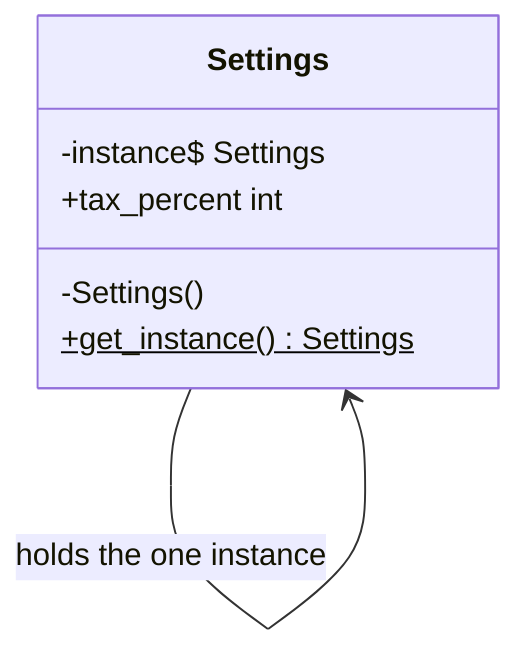
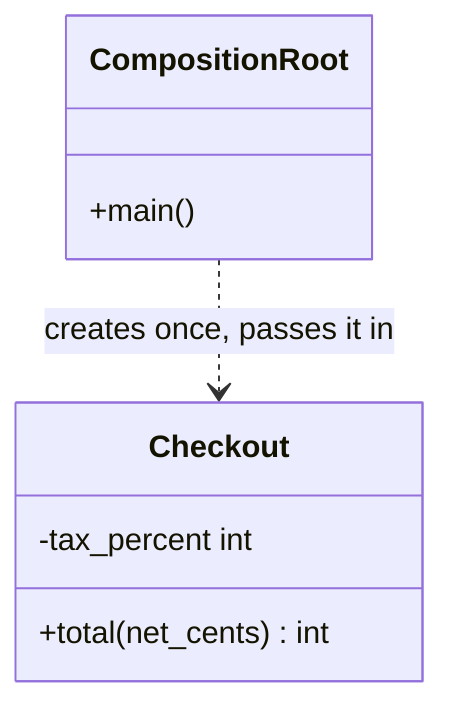

# 03. Singleton and why dependency injection is usually better

> **Draft: written but not yet run.** The code and the expected output in this lesson were prepared by reading the code and the official documentation. They have not been executed yet. If something does not behave as described, trust your tool's real output and report it.

## What you will be able to do
By the end of this lesson you will be able to:
- write a Singleton in Python and in C# and say what it guarantees
- explain at least three reasons why a Singleton is usually a design smell
- replace a Singleton with constructor injection and still have "exactly one instance" where you need it
- decide when a single shared instance is right, and who should be responsible for creating it

## Recap
1. (Lesson 02) Why must a `clone()` copy the inner list? <details><summary>Answer</summary>Otherwise the original and the copy share one list and a change to one shows up in the other (shallow copy).</details>
2. (Patterns 101, lesson 06) What is a composition root? <details><summary>Answer</summary>The one place near program start that creates the objects and connects them.</details>
3. (Lesson 01) What does a factory move out of the calling code? <details><summary>Answer</summary>The decision of which concrete class is created.</details>

## Why it matters
A town has one town hall. That is a fact about the town. But if the town hall's phone number were written on every citizen's forehead, nobody could ever get a second town hall for a rehearsal, and anybody could scribble on the number. The **Singleton** pattern says "this class has exactly one instance, and everybody can reach it through a global access point". The first half is sometimes true and useful. The second half, the **global**, is what causes trouble. This lesson teaches the pattern **and** its honest verdict: most of the time you want "one instance" *without* "global".

## What you will build
Two small programs with the same job: add a tax to a price. The first reads the tax rate from a Singleton `Settings`. The second receives the rate through a constructor (`Checkout`), the way Patterns 101 lesson 06 taught. You will see in the output how a change made "somewhere else" silently alters the first program, and cannot touch the second.

## Before you start
- **Prerequisites:** Patterns 201 lessons [01, factory method and abstract factory](01-factory-method-and-abstract-factory.md) and [02, builder and prototype](02-builder-and-prototype.md); [Patterns 101 lesson 06, dependency inversion](../../101-zero-to-hero/phase-1-solid/06-dependency-inversion.md).
- Time: 50 minutes for one language, 75 minutes if you follow both.
- You need lessons 01 and 02 and Python 3.10 or newer and/or the .NET 11 SDK. The DI-container and TypeScript snippets are for reading only (they need a package or a TypeScript setup that this course does not install here).
- Source pack (optional): every file is shown in full in this lesson, so you can follow without it. The finished code, the exercise starter and the solution are in the
  course repository https://github.com/Uee03/Code101 under `source/patterns/201-hero-to-super-hero/phase-1-creational/03-singleton-and-dependency-injection/` (on that page choose **Code, Download ZIP**, or run
  `git clone https://github.com/Uee03/Code101.git`).

## Steps

### Step 1. Make the lesson folders
**PowerShell, starting folder: anywhere**
```powershell
New-Item -ItemType Directory -Path "$HOME/code101/patterns201/lesson03/python" -Force | Out-Null
New-Item -ItemType Directory -Path "$HOME/code101/patterns201/lesson03/csharp" -Force | Out-Null
Set-Location "$HOME/code101/patterns201/lesson03"
code .
```

**macOS/Linux terminal, starting folder: anywhere**
```bash
mkdir -p ~/code101/patterns201/lesson03/python ~/code101/patterns201/lesson03/csharp
cd ~/code101/patterns201/lesson03
code .
```
Expected result: VS Code opens `lesson03` with empty `python` and `csharp` folders.

### Step 2. See the need (read only)
A program wants one shared settings object. Without a pattern, three files each write `settings = Settings()` and now there are three objects that disagree. The wish is reasonable: **one instance**.

**Pattern: Singleton.** *Intent (paraphrased from the catalogue at refactoring.guru):* make sure a class has only one instance, and give a global access point to it. Two promises: (1) nobody can create a second instance; (2) anybody can reach the one instance.


The constructor is **private** (C#) or avoided by convention (Python has no private constructors), a **static** field holds the instance, and a **static** method or property returns it, creating it the first time.

### Step 3. Write the Singleton
**File: `~/code101/patterns201/lesson03/python/singleton.py`**
```python
class Settings:
    _instance = None

    def __init__(self) -> None:
        self.tax_percent = 20

    @classmethod
    def instance(cls) -> "Settings":
        if cls._instance is None:
            cls._instance = cls()
        return cls._instance


def total_with_tax(net_cents: int) -> int:
    return net_cents + net_cents * Settings.instance().tax_percent // 100


def demo() -> None:
    first = Settings.instance()
    second = Settings.instance()
    print(f"same instance: {first is second}")
    print(f"total: {total_with_tax(1000)}")
    first.tax_percent = 0
    print(f"total after a change elsewhere: {total_with_tax(1000)}")
```

**File: `~/code101/patterns201/lesson03/csharp/Singleton.cs`**
```csharp
namespace SingletonDemo;

public sealed class Settings
{
    private static readonly Lazy<Settings> LazyInstance = new(() => new Settings());

    private Settings()
    {
    }

    public static Settings Instance => LazyInstance.Value;

    public int TaxPercent { get; set; } = 20;
}

public static class Demo
{
    public static int TotalWithTax(int netCents) => netCents + netCents * Settings.Instance.TaxPercent / 100;

    public static void Run()
    {
        Settings first = Settings.Instance;
        Settings second = Settings.Instance;
        Console.WriteLine($"same instance: {object.ReferenceEquals(first, second)}");
        Console.WriteLine($"total: {TotalWithTax(1000)}");
        first.TaxPercent = 0;
        Console.WriteLine($"total after a change elsewhere: {TotalWithTax(1000)}");
    }
}
```
Notes on the code:
- Python: `instance()` creates the object on first use and stores it on the class (`_instance`). Nothing stops someone calling `Settings()` directly, so Python's version is a *convention*. The more idiomatic Python "singleton" is simply a **module-level object**: a module is loaded once, so `settings = Settings()` at the bottom of `settings.py` and `from settings import settings` everywhere gives one shared instance with no pattern code.
- C#: the `private` constructor blocks `new Settings()` from outside. `Lazy<T>` creates the value on first use and is **thread-safe** by default (it makes sure only one thread creates it). `sealed` prevents subclasses, which could otherwise break the guarantee. `is` / `ReferenceEquals` checks "the very same object", not "equal values".
- The `//` and `/` operators do whole-number division here. Money is whole cents, as in Patterns 101.
- Thread safety: the Python version above is **not** guaranteed safe if two threads call `instance()` for the first time at the same moment; a lock or a module-level object avoids that.

### Step 4. Feel the smell
In `demo`, the line `first.tax_percent = 0` stands for *any code anywhere* that touches the shared object (a check that "just wants zero tax", a feature flag, a leftover from a previous test). The function `total_with_tax` has no parameter that tells you it depends on settings, so you cannot see the dependency in its signature, and its result changed although its input did not. Why this is a smell:

| Problem | What it means |
|---|---|
| **Hidden dependency** | the signature `total_with_tax(net_cents)` lies: it also needs the settings |
| **Global mutable state** | any code can change it; bugs appear far from their cause |
| **Hard to test** | every check shares the same object and must reset it; checks cannot run in parallel safely |
| **Two jobs in one class (SRP)** | the class does its real work **and** controls its own lifetime |
| **Tight coupling (DIP)** | callers depend on the concrete class, not on an abstraction they could swap |

### Step 5. Replace it with injection
The need was "one instance", not "a global". Create the object **once** in the composition root and pass it to whoever needs it.



**File: `~/code101/patterns201/lesson03/python/injection.py`**
```python
class Checkout:
    def __init__(self, tax_percent: int) -> None:
        self._tax_percent = tax_percent

    def total(self, net_cents: int) -> int:
        return net_cents + net_cents * self._tax_percent // 100


def demo() -> None:
    shop = Checkout(20)
    check = Checkout(0)
    print(f"shop total: {shop.total(1000)}")
    print(f"check total: {check.total(1000)}")
    print(f"shop total again: {shop.total(1000)}")
```

**File: `~/code101/patterns201/lesson03/csharp/Injection.cs`**
```csharp
namespace InjectionDemo;

public class Checkout
{
    private readonly int _taxPercent;

    public Checkout(int taxPercent)
    {
        _taxPercent = taxPercent;
    }

    public int Total(int netCents) => netCents + netCents * _taxPercent / 100;
}

public static class Demo
{
    public static void Run()
    {
        var shop = new Checkout(20);
        var check = new Checkout(0);
        Console.WriteLine($"shop total: {shop.Total(1000)}");
        Console.WriteLine($"check total: {check.Total(1000)}");
        Console.WriteLine($"shop total again: {shop.Total(1000)}");
    }
}
```
`shop` is the one "production" object. `check` is a separate object with other settings, and it cannot disturb `shop`. In a real program the `Checkout(20)` line lives in `main` (the composition root) and **that** is where "exactly one" is decided: you call `Checkout(20)` once. The class itself is an ordinary class that can be tested with any rate.

Big programs let a **DI container** do the wiring and choose a **lifetime** for each service: *singleton* (one per application), *scoped* (one per request) or *transient* (a new one each time). So "singleton" survives as a **lifetime setting**, not as code inside the class. Reading-only C# sketch (needs the NuGet package `Microsoft.Extensions.DependencyInjection`, not used in this lab):
```csharp
var services = new ServiceCollection();
services.AddSingleton<ITaxPolicy, FixedTaxPolicy>();
services.AddTransient<OrderService>();
var provider = services.BuildServiceProvider();
var service = provider.GetRequiredService<OrderService>();
```
The TypeScript equivalent of the module-level trick, for reading:
```typescript
export const settings = { taxPercent: 20 }; // an ES module is evaluated once, so this is shared
```
It is simple, but it is still global state; prefer passing `settings` into functions that need it.

### Step 6. Entry files
**File: `~/code101/patterns201/lesson03/python/main.py`**
```python
import injection
import singleton

print("--- singleton ---")
singleton.demo()
print("--- injection ---")
injection.demo()
```

**File: `~/code101/patterns201/lesson03/csharp/Program.cs`**
```csharp
Console.WriteLine("--- singleton ---");
SingletonDemo.Demo.Run();
Console.WriteLine("--- injection ---");
InjectionDemo.Demo.Run();
```

**File: `~/code101/patterns201/lesson03/csharp/Lesson.csproj`** (identical to lesson 01)
```xml
<Project Sdk="Microsoft.NET.Sdk">

  <PropertyGroup>
    <OutputType>Exe</OutputType>
    <TargetFramework>net11.0</TargetFramework>
    <ImplicitUsings>enable</ImplicitUsings>
    <Nullable>enable</Nullable>
  </PropertyGroup>

</Project>
```

## Run it
Predict first: what are the totals of the first program before and after `first.tax_percent = 0`? <details><summary>Answer</summary>1000 net plus 20 percent is 1200; after the change elsewhere it is 1000, although the call looks identical.</details>

**PowerShell, folder: `~/code101/patterns201/lesson03/python`**
```powershell
Set-Location "$HOME/code101/patterns201/lesson03/python"
python main.py
```
**macOS/Linux terminal, folder: `~/code101/patterns201/lesson03/python`**
```bash
cd ~/code101/patterns201/lesson03/python
python3 main.py
```
**Any terminal, folder: `~/code101/patterns201/lesson03/csharp`**
```text
dotnet run --project . --nologo
```
Expected output (derived by reading the code, not yet run; identical for Python and C#):
```text
--- singleton ---
same instance: True
total: 1200
total after a change elsewhere: 1000
--- injection ---
shop total: 1200
check total: 1000
shop total again: 1200
```

## How it works
The Singleton works as promised: both `first` and `second` are the same object. The price is in the second and third lines: the *same call* with the *same argument* returns different answers, because there is hidden shared state. With injection, the rate is a visible constructor argument, each `Checkout` owns its value, and `shop` is unaffected by `check`.

**When is a single shared instance legitimate?** When the thing really exists once per process: a connection pool, a clock, a logger, a cache, a hardware device. Even then:
1. let the **composition root** (or the DI container's *singleton lifetime*) create it once, and pass it in; or
2. if you must offer a global access point, expose it behind an **interface** so tests can swap it.

**Pattern card: Singleton**
| | |
|---|---|
| Use when | exactly one instance must exist per process and a second one would be a bug (for example access to a single hardware device) **and** you cannot pass it around easily |
| Do not use when | you only want to share data or avoid passing a parameter. That is a global variable in disguise. Do not use it for settings, services, caches or loggers that other code needs to test or replace |
| Real-world uses | .NET DI singleton lifetime (`AddSingleton`), `Console.Out`, `Environment`; Python modules are singletons by nature (imported once) and `logging.getLogger(name)` returns the same logger object for the same name |
| Related patterns | Abstract Factory and Builder (a factory or registry is often one shared object), Facade (often shared), Flyweight (a shared pool of immutable objects, lesson 06), Dependency injection (the preferred alternative) |
| Pitfalls | hidden dependencies and global state; tests that depend on order; unsafe first creation in threads; a private constructor that blocks the test fake; subclasses that break the guarantee; a Singleton with state that is never reset (leaks between checks) |

Misconceptions:
- **"Singleton is bad, never use it."** The *global access point* is the problem, not "one instance". One instance created by the composition root is fine.
- **"A static class is the same thing."** A static class cannot be passed in, cannot implement an interface and cannot be replaced by a fake. A Singleton object at least can implement an interface, if you let it.
- **"Dependency injection means a framework."** No: Patterns 101 lesson 06 did it with a constructor parameter; the container is a convenience.

## Try it
**Rung 1, guided.** The starter has a `Logger` singleton used inside `Greeter`. Copy the `starter` folder of your language to `try03` (copy the folder itself and rename it) and finish the TODOs so the logger is passed in. The starter does not run to the end until TODO 1 and TODO 2 are done: Python stops with a `TypeError` about the constructor, C# stops compiling. That is expected.

**File: `try03/main.py`**
```python
class Logger:
    _instance = None

    def __init__(self) -> None:
        self.lines: list[str] = []

    @classmethod
    def instance(cls) -> "Logger":
        if cls._instance is None:
            cls._instance = cls()
        return cls._instance

    def log(self, text: str) -> None:
        self.lines.append(text)


class Greeter:
    def greet(self, name: str) -> str:
        Logger.instance().log(f"greeting {name}")
        return f"Hello, {name}"


# TODO 1: give Greeter an __init__ that receives a logger and stores it in self._logger.
# TODO 2: make greet call self._logger.log(...) instead of Logger.instance().log(...).
# TODO 3: delete _instance and instance() from Logger: nobody needs them any more.

shared = Logger()
Greeter(shared).greet("Ana")
Greeter(shared).greet("Bo")
print(", ".join(shared.lines))
other = Logger()
print(f"other has {len(other.lines)} lines")
```

**File: `try03/Program.cs`** (with the same `Lesson.csproj`)
```csharp
var shared = new Logger();
new Greeter(shared).Greet("Ana");
new Greeter(shared).Greet("Bo");
Console.WriteLine(string.Join(", ", shared.Lines));
var other = new Logger();
Console.WriteLine($"other has {other.Lines.Count} lines");

// TODO 1: give Greeter a constructor that receives a Logger and stores it in _logger.
// TODO 2: make Greet call _logger.Log(...) instead of Logger.Instance.Log(...).
// TODO 3: delete the static Instance property from Logger: nobody needs it any more.

class Logger
{
    public static Logger Instance { get; } = new Logger();

    public List<string> Lines { get; } = new();

    public void Log(string text) => Lines.Add(text);
}

class Greeter
{
    public string Greet(string name)
    {
        Logger.Instance.Log($"greeting {name}");
        return $"Hello, {name}";
    }
}
```
Expected output when done (not yet run):
```text
greeting Ana, greeting Bo
other has 0 lines
```
**Rung 2, change.** Introduce a small interface (`ILogger` in C#, an abstract class in Python) with two implementations: one that stores lines in a list and one that prints each line. Pass the list-based one in a hand-made check and print `Check passed` when the greeter logged exactly one line.

**Rung 3, stretch (no single answer).** Your app needs exactly one database connection pool per process. Write four sentences: who creates it, who receives it, how a check gets a fake, and why you still do not need a Singleton class.

<details><summary>Solution</summary>

**File: `try03/main.py`**
```python
class Logger:
    def __init__(self) -> None:
        self.lines: list[str] = []

    def log(self, text: str) -> None:
        self.lines.append(text)


class Greeter:
    def __init__(self, logger: Logger) -> None:
        self._logger = logger

    def greet(self, name: str) -> str:
        self._logger.log(f"greeting {name}")
        return f"Hello, {name}"


shared = Logger()
Greeter(shared).greet("Ana")
Greeter(shared).greet("Bo")
print(", ".join(shared.lines))
other = Logger()
print(f"other has {len(other.lines)} lines")
```

**File: `try03/Program.cs`**
```csharp
var shared = new Logger();
new Greeter(shared).Greet("Ana");
new Greeter(shared).Greet("Bo");
Console.WriteLine(string.Join(", ", shared.Lines));
var other = new Logger();
Console.WriteLine($"other has {other.Lines.Count} lines");

class Logger
{
    public List<string> Lines { get; } = new();

    public void Log(string text) => Lines.Add(text);
}

class Greeter
{
    private readonly Logger _logger;

    public Greeter(Logger logger)
    {
        _logger = logger;
    }

    public string Greet(string name)
    {
        _logger.Log($"greeting {name}");
        return $"Hello, {name}";
    }
}
```
The two greeters share `shared` because **you** passed the same object to both (one instance, no global). `other` is a different logger and stays empty. For Rung 3 a good answer: the composition root creates the pool once; it is passed to the repositories that need it; a check passes a fake pool; and "one" is guaranteed by creating it once, not by the class.
</details>

## Check yourself
1. What are the two promises of the Singleton pattern, and which one causes most of the harm? <details><summary>Answer</summary>One instance, and a global access point. The global access point (hidden shared state) does most of the harm.</details>
2. Predict: in `demo`, what would `total_with_tax(1000)` print if nothing had changed `tax_percent`? <details><summary>Answer</summary>1200.</details>
3. Name three reasons why a Singleton hurts tests. <details><summary>Answer</summary>Shared state leaks between checks, the dependency is hidden, and the instance cannot be swapped for a fake.</details>
4. How can a program have "exactly one" of something without a Singleton class? <details><summary>Answer</summary>Create it once in the composition root (or register it with singleton lifetime in a container) and pass it to the code that needs it.</details>
5. Why is `Lazy<T>` used in the C# version? <details><summary>Answer</summary>It creates the instance on first use and is thread-safe by default.</details>

## Mixed review (lessons 01 to 03)
1. (Lesson 01) Which pattern would you use if the code that picks between a `Truck` and a `Ship` must be shared and extended by subclasses? <details><summary>Answer</summary>Factory Method.</details>
2. (Lesson 02) A configuration object has eight optional parts and a rule that spans two of them. Which pattern, and where does the rule live? <details><summary>Answer</summary>Builder; the rule lives in `build()`.</details>
3. (Lesson 02) You clone a prototype that holds a list. What must `clone()` do with the list? <details><summary>Answer</summary>Copy it (deep copy), or the clone shares it with the original.</details>
4. (Patterns 101, DIP) Which of the five SOLID principles is violated by `Settings.instance()` called inside business logic? <details><summary>Answer</summary>Dependency Inversion: the business code depends on a concrete global, not on an abstraction passed in.</details>
5. (Lesson 01) You need a family of matching widgets per theme. Factory Method or Abstract Factory? <details><summary>Answer</summary>Abstract Factory.</details>

## Common mistakes
These messages are typical and have **not** been reproduced yet; the wording depends on your versions.
| Symptom or error text (typical) | Cause | Fix |
|---|---|---|
| `error CS0122: 'Settings.Settings()' is inaccessible due to its protection level` | you wrote `new Settings()` outside the class; the constructor is private on purpose | use `Settings.Instance` (or, better, inject it) |
| `TypeError: Greeter() takes no arguments` (Python starter) or `error CS1729: 'Greeter' does not contain a constructor that takes 1 arguments` (C# starter) | TODO 1 is not done yet | add the constructor that receives the logger |
| two different "singletons" in Python | you called `Settings()` directly instead of `Settings.instance()` | go through `instance()`, or use a module-level object |
| a check passes alone and fails in a group | shared singleton state changed by another check | pass a fresh object into each check (injection) |
| `MSB1003: Specify a project or solution file` | the terminal is not in the `csharp` folder | `cd` into the folder that contains `Lesson.csproj` |

## Best practice
Ask "who decides there is only one?" The answer should be the composition root or the container, not the class itself; pass the single instance to the code that needs it and let it implement an interface. Source: Dependency injection in .NET, Microsoft Learn https://learn.microsoft.com/dotnet/core/extensions/dependency-injection

## Going further
- Singleton in the catalogue: https://refactoring.guru/design-patterns/singleton and the cross-check at https://sourcemaking.com/design_patterns/singleton
- .NET service lifetimes (singleton, scoped, transient): https://learn.microsoft.com/dotnet/core/extensions/dependency-injection#service-lifetimes
- Lesson 06 (Flyweight) shares many *immutable* objects, a safer kind of sharing; lesson 12 lists "Singleton for settings" among the anti-patterns.

## Summary
- You wrote a Singleton in both languages and explained its two promises.
- You listed why it is usually a smell: hidden dependency, global state, hard tests, two responsibilities.
- You replaced it with constructor injection and kept "one instance" by creating it once in the composition root.
- You learned that DI containers keep "singleton" as a lifetime setting.
- You finished phase 1: five creational patterns and the question to ask before using any of them.

## Next lesson
04. Adapter and Facade: make an incompatible interface fit, and hide a messy subsystem behind one simple entry point (phase 2, structural patterns).
