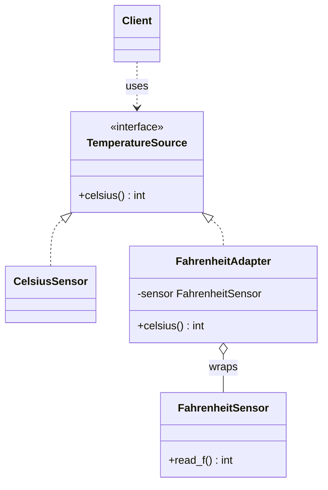
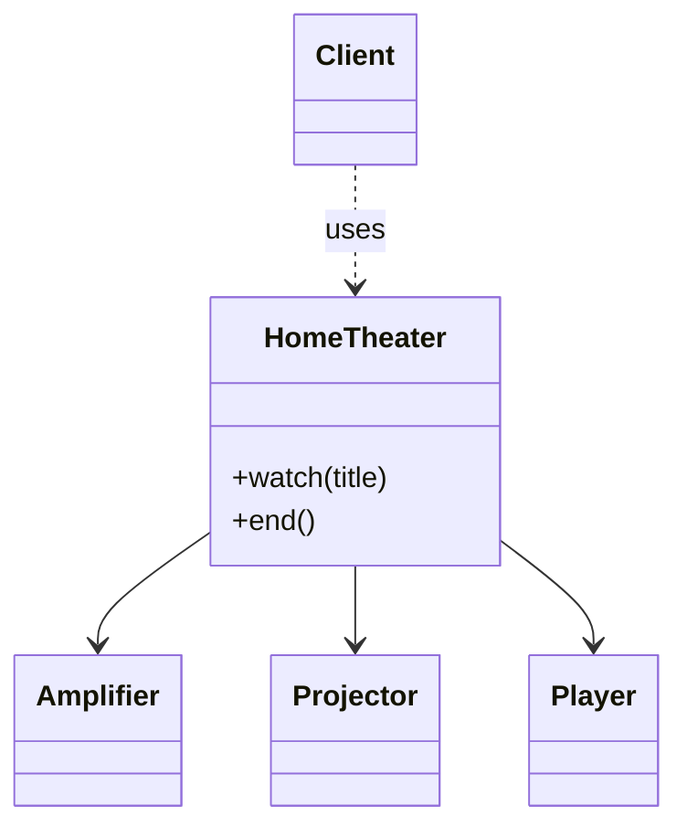

# 04. Adapter and Facade

> **Draft: written but not yet run.** The code and the expected output in this lesson were prepared by reading the code and the official documentation. They have not been executed yet. If something does not behave as described, trust your tool's real output and report it.

## What you will be able to do
By the end of this lesson you will be able to:
- explain what the **structural** family is for and name its seven patterns
- write an **Adapter** that lets code use a class with an incompatible interface that you cannot change
- write a **Facade** that gives a simple entry point to a group of classes
- tell Adapter, Facade and the other "wrapper" patterns apart by their intent

## Recap
1. (Lesson 03) What is the preferred alternative to a Singleton? <details><summary>Answer</summary>Create the one instance in the composition root and pass it in (dependency injection).</details>
2. (Patterns 101, lesson 05) What did Interface Segregation say about big interfaces? <details><summary>Answer</summary>Clients should not depend on methods they do not use; prefer several small interfaces.</details>
3. (Lesson 01) Which role in Factory Method knows the concrete product class? <details><summary>Answer</summary>The concrete creator (for example `RoadLogistics`).</details>

## Why it matters
Travelling abroad, your laptop plug does not fit the wall. You do not rebuild the laptop or the wall; you buy a **travel adapter**. And at a hotel, you do not operate the boiler, pump and thermostat: you press the **one button** at the reception desk, the *facade* of the building's machinery. **Structural patterns** are about assembling classes and objects into larger structures while keeping those structures flexible. The seven structural patterns are Adapter and Facade (today), Decorator and Proxy (lesson 05), Composite and Flyweight (lesson 06) and Bridge (lesson 07). Four of them *wrap* another object, so the first skill is telling them apart by **intent**, not by shape.

## What you will build
Two small programs. The first reads temperature from a `FahrenheitSensor` (a class you cannot change) through an adapter, so code that expects Celsius works with both sensors. The second hides a three-part home theater (amplifier, projector, player) behind two methods, `watch` and `end`.

## Before you start
- **Prerequisites:** Patterns 201 lessons [01, factory method and abstract factory](../phase-1-creational/01-factory-method-and-abstract-factory.md) to [03, singleton and dependency injection](../phase-1-creational/03-singleton-and-dependency-injection.md); Patterns 101 lessons [05, interface segregation](../../101-zero-to-hero/phase-1-solid/05-interface-segregation.md) and [06, dependency inversion](../../101-zero-to-hero/phase-1-solid/06-dependency-inversion.md).
- Time: 55 minutes for one language, 80 minutes if you follow both.
- You need lesson 03 and Python 3.10 or newer and/or the .NET 11 SDK. The TypeScript snippet is for reading only.
- Source pack (optional): every file is shown in full in this lesson, so you can follow without it. The finished code, the exercise starter and the solution are in the
  course repository https://github.com/Uee03/Code101 under `source/patterns/201-hero-to-super-hero/phase-2-structural/04-adapter-and-facade/` (on that page choose **Code, Download ZIP**, or run
  `git clone https://github.com/Uee03/Code101.git`).

## Steps

### Step 1. Make the lesson folders
**PowerShell, starting folder: anywhere**
```powershell
New-Item -ItemType Directory -Path "$HOME/code101/patterns201/lesson04/python" -Force | Out-Null
New-Item -ItemType Directory -Path "$HOME/code101/patterns201/lesson04/csharp" -Force | Out-Null
Set-Location "$HOME/code101/patterns201/lesson04"
code .
```

**macOS/Linux terminal, starting folder: anywhere**
```bash
mkdir -p ~/code101/patterns201/lesson04/python ~/code101/patterns201/lesson04/csharp
cd ~/code101/patterns201/lesson04
code .
```
Expected result: VS Code opens `lesson04` with empty `python` and `csharp` folders.

### Step 2. See the Adapter problem (read only)
Your program has a function `report(source)` that expects an object with a `celsius()` method. A supplier gives you a `FahrenheitSensor` with a `read_f()` method. You cannot edit the supplier's class (it is a library), and you do not want to change `report` or every other caller. Copy-pasting a conversion at each call site (`(sensor.read_f() - 32) * 5 // 9`) duplicates knowledge and mixes unit conversion into business code.

**Pattern 1: Adapter.** *Intent (paraphrased from the catalogue at refactoring.guru):* let objects with incompatible interfaces work together by wrapping one in an object that exposes the interface the client expects.


Roles: the **target** interface the client wants (`TemperatureSource`), the **adaptee** that does the real work but has the wrong shape (`FahrenheitSensor`), and the **adapter** that implements the target and translates calls to the adaptee. This is the **object adapter**: it *holds* the adaptee (composition). A **class adapter** inherits from the adaptee instead; it needs multiple inheritance, so it is possible in Python but not in C#, and it is less flexible.

### Step 3. Write the Adapter
**File: `~/code101/patterns201/lesson04/python/adapter.py`**
```python
from abc import ABC, abstractmethod


class TemperatureSource(ABC):
    @abstractmethod
    def celsius(self) -> int:
        ...


class CelsiusSensor(TemperatureSource):
    def __init__(self, degrees: int) -> None:
        self._degrees = degrees

    def celsius(self) -> int:
        return self._degrees


class FahrenheitSensor:
    def __init__(self, degrees: int) -> None:
        self._degrees = degrees

    def read_f(self) -> int:
        return self._degrees


class FahrenheitAdapter(TemperatureSource):
    def __init__(self, sensor: FahrenheitSensor) -> None:
        self._sensor = sensor

    def celsius(self) -> int:
        return (self._sensor.read_f() - 32) * 5 // 9


def report(source: TemperatureSource) -> str:
    return f"{source.celsius()} C"


def demo() -> None:
    print(report(CelsiusSensor(20)))
    print(report(FahrenheitAdapter(FahrenheitSensor(212))))
    print(report(FahrenheitAdapter(FahrenheitSensor(50))))
```

**File: `~/code101/patterns201/lesson04/csharp/Adapter.cs`**
```csharp
namespace AdapterDemo;

public interface ITemperatureSource
{
    int Celsius();
}

public class CelsiusSensor : ITemperatureSource
{
    private readonly int _degrees;

    public CelsiusSensor(int degrees)
    {
        _degrees = degrees;
    }

    public int Celsius() => _degrees;
}

public class FahrenheitSensor
{
    private readonly int _degrees;

    public FahrenheitSensor(int degrees)
    {
        _degrees = degrees;
    }

    public int ReadF() => _degrees;
}

public class FahrenheitAdapter : ITemperatureSource
{
    private readonly FahrenheitSensor _sensor;

    public FahrenheitAdapter(FahrenheitSensor sensor)
    {
        _sensor = sensor;
    }

    public int Celsius() => (_sensor.ReadF() - 32) * 5 / 9;
}

public static class Demo
{
    public static string Report(ITemperatureSource source) => $"{source.Celsius()} C";

    public static void Run()
    {
        Console.WriteLine(Report(new CelsiusSensor(20)));
        Console.WriteLine(Report(new FahrenheitAdapter(new FahrenheitSensor(212))));
        Console.WriteLine(Report(new FahrenheitAdapter(new FahrenheitSensor(50))));
    }
}
```
`report` knows only `TemperatureSource`. The conversion `(f - 32) * 5 / 9` lives in **one** class. 212 degrees Fahrenheit is 100 Celsius and 50 is 10. (Whole-number division, as in the earlier lessons, keeps the output identical in both languages.) Python's duck typing means `report` would also accept any object with a `celsius()` method without the abstract class; we keep the class to make the role visible.

**Pattern 2: Facade.** *Intent (paraphrased):* provide one simple interface to a library, framework or set of classes that is complex to use directly.

### Step 4. See the Facade problem (read only)
```python
amplifier.on(5)
projector.on("player")
player.play("Matrix")
```
Every caller must know the three parts **and** the right order, and when the film ends, the reverse order with different calls. Forget one line and the picture shows without sound. The knowledge of "how to start a movie" is spread over every caller (duplication, and high coupling to three classes).


The facade **does not replace** the subsystem: a client that needs special control can still use `Amplifier` directly. It is a convenient front door, not a wall.

### Step 5. Write the Facade
**File: `~/code101/patterns201/lesson04/python/facade.py`**
```python
class Amplifier:
    def on(self, volume: int) -> None:
        print(f"Amplifier: on, volume {volume}")

    def off(self) -> None:
        print("Amplifier: off")


class Projector:
    def on(self, source: str) -> None:
        print(f"Projector: on, input {source}")

    def off(self) -> None:
        print("Projector: off")


class Player:
    def play(self, title: str) -> None:
        print(f"Player: playing {title}")

    def stop(self) -> None:
        print("Player: stopped")


class HomeTheater:
    def __init__(self, amplifier: Amplifier, projector: Projector, player: Player) -> None:
        self._amplifier = amplifier
        self._projector = projector
        self._player = player

    def watch(self, title: str) -> None:
        self._amplifier.on(5)
        self._projector.on("player")
        self._player.play(title)

    def end(self) -> None:
        self._player.stop()
        self._projector.off()
        self._amplifier.off()


def demo() -> None:
    theater = HomeTheater(Amplifier(), Projector(), Player())
    theater.watch("Matrix")
    theater.end()
```

**File: `~/code101/patterns201/lesson04/csharp/Facade.cs`**
```csharp
namespace FacadeDemo;

public class Amplifier
{
    public void On(int volume) => Console.WriteLine($"Amplifier: on, volume {volume}");

    public void Off() => Console.WriteLine("Amplifier: off");
}

public class Projector
{
    public void On(string source) => Console.WriteLine($"Projector: on, input {source}");

    public void Off() => Console.WriteLine("Projector: off");
}

public class Player
{
    public void Play(string title) => Console.WriteLine($"Player: playing {title}");

    public void Stop() => Console.WriteLine("Player: stopped");
}

public class HomeTheater
{
    private readonly Amplifier _amplifier;
    private readonly Projector _projector;
    private readonly Player _player;

    public HomeTheater(Amplifier amplifier, Projector projector, Player player)
    {
        _amplifier = amplifier;
        _projector = projector;
        _player = player;
    }

    public void Watch(string title)
    {
        _amplifier.On(5);
        _projector.On("player");
        _player.Play(title);
    }

    public void End()
    {
        _player.Stop();
        _projector.Off();
        _amplifier.Off();
    }
}

public static class Demo
{
    public static void Run()
    {
        var theater = new HomeTheater(new Amplifier(), new Projector(), new Player());
        theater.Watch("Matrix");
        theater.End();
    }
}
```
The facade receives its parts through the constructor (dependency injection, lesson 03), so a check could pass fakes.

### Step 6. Entry files
**File: `~/code101/patterns201/lesson04/python/main.py`**
```python
import adapter
import facade

print("--- adapter ---")
adapter.demo()
print("--- facade ---")
facade.demo()
```

**File: `~/code101/patterns201/lesson04/csharp/Program.cs`**
```csharp
Console.WriteLine("--- adapter ---");
AdapterDemo.Demo.Run();
Console.WriteLine("--- facade ---");
FacadeDemo.Demo.Run();
```

**File: `~/code101/patterns201/lesson04/csharp/Lesson.csproj`** (identical to lesson 01)
```xml
<Project Sdk="Microsoft.NET.Sdk">

  <PropertyGroup>
    <OutputType>Exe</OutputType>
    <TargetFramework>net11.0</TargetFramework>
    <ImplicitUsings>enable</ImplicitUsings>
    <Nullable>enable</Nullable>
  </PropertyGroup>

</Project>
```

## Run it
Predict first: what does `FahrenheitSensor(50)` report through the adapter, and in which order does the facade switch things off? <details><summary>Answer</summary>`10 C`, and the reverse of the start order: player, projector, amplifier.</details>

**PowerShell, folder: `~/code101/patterns201/lesson04/python`**
```powershell
Set-Location "$HOME/code101/patterns201/lesson04/python"
python main.py
```
**macOS/Linux terminal, folder: `~/code101/patterns201/lesson04/python`**
```bash
cd ~/code101/patterns201/lesson04/python
python3 main.py
```
**Any terminal, folder: `~/code101/patterns201/lesson04/csharp`**
```text
dotnet run --project . --nologo
```
Expected output (derived by reading the code, not yet run; identical for Python and C#):
```text
--- adapter ---
20 C
100 C
10 C
--- facade ---
Amplifier: on, volume 5
Projector: on, input player
Player: playing Matrix
Player: stopped
Projector: off
Amplifier: off
```

## How it works
**Adapter** changes the *shape* of an interface and nothing else: it translates the method name and the unit, and delegates. **Facade** changes the *size* of an interface: many calls become few. Both leave the wrapped classes untouched.

| Wrapper pattern | Intent | Interface of the wrapper |
|---|---|---|
| **Adapter** | make an existing interface fit the one the client expects | **different** from the wrapped object |
| **Facade** | simplify a whole subsystem | a **new, simpler** interface |
| **Decorator** (lesson 05) | add behavior to one object | **same** as the wrapped object |
| **Proxy** (lesson 05) | control access to one object | **same** as the wrapped object |

**Pattern card: Adapter**
| | |
|---|---|
| Use when | you want to use an existing class whose interface does not match, and you cannot or should not change it (third-party code, legacy code, a generated client) |
| Do not use when | you own both sides: change the interface instead. Do not stack adapters on adapters; if you keep translating the same way, write the new interface properly and migrate |
| Real-world uses | .NET `StreamReader` adapts a `Stream` of bytes to a text reader; Python `io.TextIOWrapper` adapts a binary stream to a text stream; wrappers around SDKs so the rest of the app depends on your own interface |
| Related patterns | Facade (simplifies instead of translating), Decorator and Proxy (same interface), Bridge (lesson 07: designed up front, not retrofitted), Strategy (an adapter for an algorithm interface) |
| Pitfalls | leaking the adaptee's types through the adapter's interface; silent lossy conversion (here integer division drops fractions); an adapter that grows business logic; one adapter per method instead of per concept |

**Pattern card: Facade**
| | |
|---|---|
| Use when | a subsystem is complex and most clients need only a few common tasks; you want to layer a system (each layer has an entry point); you want to cut dependencies on a library |
| Do not use when | the subsystem is already simple, or the facade would have to expose everything to be useful (it becomes a copy of the subsystem) |
| Real-world uses | .NET `File.ReadAllText` (hides streams, readers and disposal); Python `shutil.copytree` (hides directory walking and copying); a service class that coordinates several repositories |
| Related patterns | Adapter (translates one interface), Mediator (lesson 09: colleagues talk **through** it, a facade is one-way), Abstract Factory (can hide how subsystems are created), Singleton (a facade is often shared, see lesson 03) |
| Pitfalls | the **god object**: a facade that accumulates all the logic of the application; hiding the subsystem so completely that power users cannot reach it; a facade created inside callers so it cannot be replaced by a fake |

A TypeScript sketch of the adapter idea, for reading:
```typescript
interface TemperatureSource { celsius(): number }
class FahrenheitAdapter implements TemperatureSource {
  constructor(private sensor: { readF(): number }) {}
  celsius(): number { return Math.floor(((this.sensor.readF() - 32) * 5) / 9); }
}
```
Misconception: **"Adapter and Facade are the same: both wrap."** An adapter keeps the same *functionality* and changes the *interface* to match what the client expects; a facade creates a *new* simpler interface over many classes.

## Try it
**Rung 1, guided.** The starter has a `Notifier` interface and a ready `SmsClient` with a different method. Copy the `starter` folder of your language to `try04` (copy the folder itself and rename it) and write the adapter.

**File: `try04/main.py`**
```python
from abc import ABC, abstractmethod


class Notifier(ABC):
    @abstractmethod
    def send(self, message: str) -> None:
        ...


class ConsoleNotifier(Notifier):
    def send(self, message: str) -> None:
        print(f"Console: {message}")


class SmsClient:
    def send_sms(self, number: str, text: str) -> None:
        print(f"SMS to {number}: {text}")


# TODO 1: write SmsNotifier(Notifier). Its __init__ receives an SmsClient and a phone number.
#         Its send(message) calls send_sms(number, message) on the client.


def finish_build(notifier: Notifier) -> None:
    notifier.send("Build finished")


finish_build(ConsoleNotifier())
# TODO 2: call finish_build with SmsNotifier(SmsClient(), "+100")
```

**File: `try04/Program.cs`** (with the same `Lesson.csproj`)
```csharp
FinishBuild(new ConsoleNotifier());
// TODO 2: call FinishBuild with new SmsNotifier(new SmsClient(), "+100")

static void FinishBuild(INotifier notifier) => notifier.Send("Build finished");

// TODO 1: write SmsNotifier : INotifier. Its constructor receives an SmsClient and a phone number.
//         Its Send(message) calls SendSms(number, message) on the client.

interface INotifier
{
    void Send(string message);
}

class ConsoleNotifier : INotifier
{
    public void Send(string message) => Console.WriteLine($"Console: {message}");
}

class SmsClient
{
    public void SendSms(string number, string text) => Console.WriteLine($"SMS to {number}: {text}");
}
```
Expected output when done (not yet run):
```text
Console: Build finished
SMS to +100: Build finished
```
**Rung 2, change.** Make the adapter take a **list** of phone numbers and send to each, so the output has one `SMS to ...` line per number. Which class changed, and did `finish_build` change?

**Rung 3, stretch (no single answer).** Design a facade `Release` over three classes `Tagger`, `Packager` and `Publisher`. Decide: which steps does the facade hide, and which options must a power user still be able to reach? Write the method list and one sentence of justification.

<details><summary>Solution</summary>

**File: `try04/main.py`**
```python
from abc import ABC, abstractmethod


class Notifier(ABC):
    @abstractmethod
    def send(self, message: str) -> None:
        ...


class ConsoleNotifier(Notifier):
    def send(self, message: str) -> None:
        print(f"Console: {message}")


class SmsClient:
    def send_sms(self, number: str, text: str) -> None:
        print(f"SMS to {number}: {text}")


class SmsNotifier(Notifier):
    def __init__(self, client: SmsClient, number: str) -> None:
        self._client = client
        self._number = number

    def send(self, message: str) -> None:
        self._client.send_sms(self._number, message)


def finish_build(notifier: Notifier) -> None:
    notifier.send("Build finished")


finish_build(ConsoleNotifier())
finish_build(SmsNotifier(SmsClient(), "+100"))
```

**File: `try04/Program.cs`**
```csharp
FinishBuild(new ConsoleNotifier());
FinishBuild(new SmsNotifier(new SmsClient(), "+100"));

static void FinishBuild(INotifier notifier) => notifier.Send("Build finished");

interface INotifier
{
    void Send(string message);
}

class ConsoleNotifier : INotifier
{
    public void Send(string message) => Console.WriteLine($"Console: {message}");
}

class SmsClient
{
    public void SendSms(string number, string text) => Console.WriteLine($"SMS to {number}: {text}");
}

class SmsNotifier : INotifier
{
    private readonly SmsClient _client;
    private readonly string _number;

    public SmsNotifier(SmsClient client, string number)
    {
        _client = client;
        _number = number;
    }

    public void Send(string message) => _client.SendSms(_number, message);
}
```
For Rung 2 only `SmsNotifier` changes (it loops over its numbers); `finish_build` and `Notifier` stay closed. That is the benefit of the adapter: callers depend on the target interface only.
</details>

## Check yourself
1. What is the difference between the target, the adaptee and the adapter? <details><summary>Answer</summary>Target: the interface the client expects. Adaptee: the existing class with the wrong interface. Adapter: implements the target and delegates to the adaptee.</details>
2. Predict: what would `report(FahrenheitAdapter(FahrenheitSensor(32)))` print? <details><summary>Answer</summary>`0 C`, because (32 - 32) * 5 // 9 is 0.</details>
3. Does a facade hide the subsystem completely? <details><summary>Answer</summary>No. It offers a simple front door; clients can still use the subsystem classes when they need more control.</details>
4. Which of the two (adapter, facade) changes the **number** of calls a client makes, and which changes the **names**? <details><summary>Answer</summary>The facade reduces the number of calls (many into few); the adapter translates names and shapes of one interface.</details>

## Mixed review
1. (Lesson 03) Why does `HomeTheater` receive its parts in the constructor? <details><summary>Answer</summary>Dependency injection: the parts can be replaced by fakes and the facade does not decide which concrete classes it uses.</details>
2. (Lesson 02) You want to configure a `HomeTheater` with ten optional settings. Which creational pattern helps? <details><summary>Answer</summary>Builder.</details>
3. (Patterns 101, SRP) Why is the unit conversion better inside the adapter than in `report`? <details><summary>Answer</summary>`report` has one reason to change (the report format); the conversion has another (the sensor), so each gets its own class.</details>
4. (Lesson 01) A facade that creates its subsystem with `new` inside its methods breaks which principle? <details><summary>Answer</summary>Dependency Inversion: it depends on concrete classes it builds itself.</details>

## Common mistakes
These messages are typical and have **not** been reproduced yet; the wording depends on your versions.
| Symptom or error text (typical) | Cause | Fix |
|---|---|---|
| `AttributeError: 'FahrenheitSensor' object has no attribute 'celsius'` | you passed the sensor to `report` without wrapping it | wrap it: `FahrenheitAdapter(FahrenheitSensor(50))` |
| `error CS1503: Argument 1: cannot convert from 'AdapterDemo.FahrenheitSensor' to 'AdapterDemo.ITemperatureSource'` | the C# compiler stops the same mistake earlier | wrap it with the adapter |
| `TypeError: Can't instantiate abstract class FahrenheitAdapter ...` | the adapter forgot to implement `celsius` (or misspelled it) | implement every abstract method with the exact name |
| the facade works but a step is missing in the output | the facade method forgot to call one subsystem | compare the steps with the problem list in Step 4 |
| `MSB1003: Specify a project or solution file` | the terminal is not in the `csharp` folder | `cd` into the folder that contains `Lesson.csproj` |

## Best practice
Keep adapters thin (translate and delegate only) and put them at the **boundary** of your system, so the rest of the code depends on your own interface and not on a vendor's. Source: Adapter, Refactoring.Guru https://refactoring.guru/design-patterns/adapter

## Going further
- Facade: https://refactoring.guru/design-patterns/facade and the cross-check at https://sourcemaking.com/design_patterns/facade
- Adapter cross-check: https://sourcemaking.com/design_patterns/adapter
- The "ports and adapters" (hexagonal) architecture is this idea at system scale; lesson 12 shows where it sits among the patterns.

## Summary
- You named the seven structural patterns and what the family is for.
- You wrote an object Adapter that translates a Fahrenheit sensor to a Celsius interface.
- You wrote a Facade that hides a three-part subsystem and keeps the order of calls in one place.
- You told Adapter, Facade, Decorator and Proxy apart by intent and by their interface.

## Next lesson
05. Decorator and Proxy: wrap an object with the **same** interface, to add behavior or to control access.
