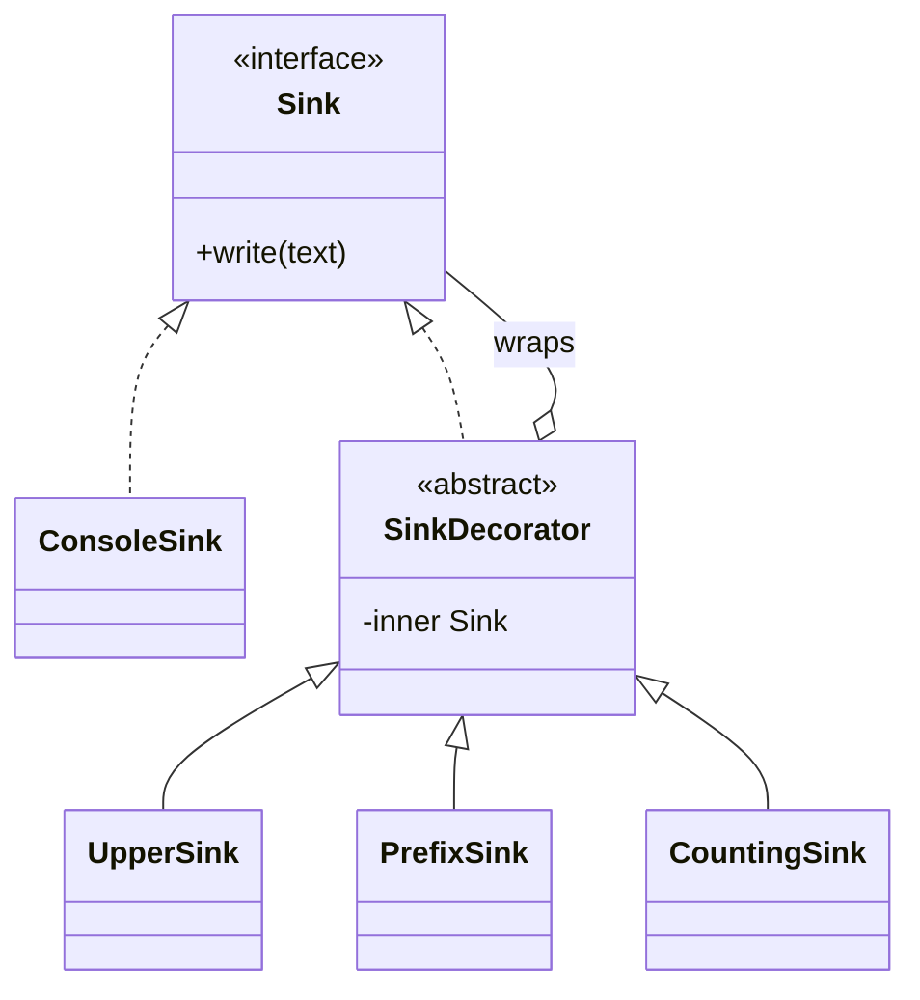
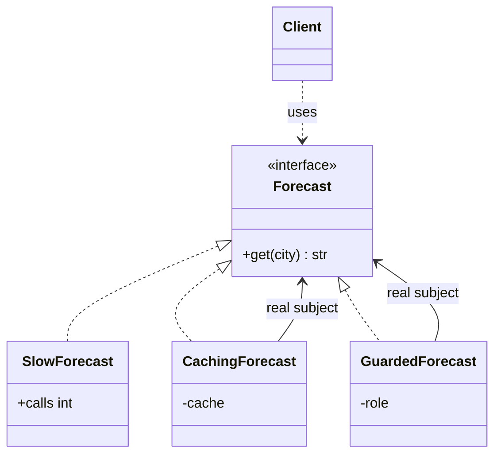

# 05. Decorator and Proxy

> **Draft: written but not yet run.** The code and the expected output in this lesson were prepared by reading the code and the official documentation. They have not been executed yet. If something does not behave as described, trust your tool's real output and report it.

## What you will be able to do
By the end of this lesson you will be able to:
- write **Decorators** that add behavior to an object at run time and predict how their order changes the result
- write a **Proxy** (caching and protection) that stands in for a real object with the same interface
- explain the difference in intent between Decorator, Proxy, Adapter and Facade
- say why stacking wrappers beats a subclass for every combination

## Recap
1. (Lesson 04) What is the difference between an Adapter and a Facade? <details><summary>Answer</summary>An adapter changes one interface into another that the client expects; a facade offers a new, simpler interface over many classes.</details>
2. (Patterns 101, lesson 08) Why prefer composition over inheritance? <details><summary>Answer</summary>Parts can be combined and swapped at run time without a class for every combination.</details>
3. (Patterns 101, lesson 03) What does "closed for modification" allow you to do? <details><summary>Answer</summary>Add behavior by writing new code (new classes) instead of editing code that already works.</details>

## Why it matters
You can put on a coat over a sweater over a shirt: each layer adds something (warmth, rain protection), you can combine them in any order, and you are still the same person underneath. That is a **Decorator**: a wrapper with the **same interface** as the thing it wraps, which adds behavior before or after delegating. A **Proxy** also has the same interface, but its job is different: it is a *stand-in* that **controls access** to the real object, like a receptionist who decides whether to fetch the manager at all, answers common questions from memory, or checks your badge first.

## What you will build
Two small programs. The first writes text to a console `Sink` through stacked decorators (upper-casing, prefixing, counting) and shows that the **order** of the layers changes the output. The second wraps a slow `Forecast` service in a **caching proxy** (it calls the real service once per city) and a **protection proxy** (guests are refused).

## Before you start
- **Prerequisites:** [Patterns 201 lesson 04, adapter and facade](04-adapter-and-facade.md); Patterns 101 lessons [03, open-closed](../../101-zero-to-hero/phase-1-solid/03-open-closed.md) and [08, composition over inheritance](../../101-zero-to-hero/phase-2-everyday-principles/08-composition-over-inheritance.md).
- Time: 55 minutes for one language, 80 minutes if you follow both.
- You need lesson 04 and Python 3.10 or newer and/or the .NET 11 SDK. The TypeScript snippet is for reading only.
- Source pack (optional): every file is shown in full in this lesson, so you can follow without it. The finished code, the exercise starter and the solution are in the
  course repository https://github.com/Uee03/Code101 under `source/patterns/201-hero-to-super-hero/phase-2-structural/05-decorator-and-proxy/` (on that page choose **Code, Download ZIP**, or run
  `git clone https://github.com/Uee03/Code101.git`).

## Steps

### Step 1. Make the lesson folders
**PowerShell, starting folder: anywhere**
```powershell
New-Item -ItemType Directory -Path "$HOME/code101/patterns201/lesson05/python" -Force | Out-Null
New-Item -ItemType Directory -Path "$HOME/code101/patterns201/lesson05/csharp" -Force | Out-Null
Set-Location "$HOME/code101/patterns201/lesson05"
code .
```

**macOS/Linux terminal, starting folder: anywhere**
```bash
mkdir -p ~/code101/patterns201/lesson05/python ~/code101/patterns201/lesson05/csharp
cd ~/code101/patterns201/lesson05
code .
```
Expected result: VS Code opens `lesson05` with empty `python` and `csharp` folders.

### Step 2. See the Decorator problem (read only)
You have a `ConsoleSink`. Some callers want upper case, some want a prefix, some want both, some want to count writes. With inheritance you write `UpperConsoleSink`, `PrefixConsoleSink`, `UpperPrefixConsoleSink`, `CountingUpperPrefixConsoleSink`... The number of classes doubles with every new feature (a **class explosion**), and the features cannot be combined at run time.

**Pattern 1: Decorator.** *Intent (paraphrased from the catalogue at refactoring.guru):* attach new behavior to an object by placing it inside a wrapper object that has the same interface and contains the new behavior.


The key line is the last: a decorator **is a** `Sink` *and* **has a** `Sink`. Because it is a `Sink`, it can be wrapped again by another decorator, as deep as you like.

### Step 3. Write the Decorators
**File: `~/code101/patterns201/lesson05/python/decorator.py`**
```python
from abc import ABC, abstractmethod


class Sink(ABC):
    @abstractmethod
    def write(self, text: str) -> None:
        ...


class ConsoleSink(Sink):
    def write(self, text: str) -> None:
        print(text)


class SinkDecorator(Sink):
    def __init__(self, inner: Sink) -> None:
        self._inner = inner


class UpperSink(SinkDecorator):
    def write(self, text: str) -> None:
        self._inner.write(text.upper())


class PrefixSink(SinkDecorator):
    def __init__(self, inner: Sink, prefix: str) -> None:
        super().__init__(inner)
        self._prefix = prefix

    def write(self, text: str) -> None:
        self._inner.write(self._prefix + text)


class CountingSink(SinkDecorator):
    def __init__(self, inner: Sink) -> None:
        super().__init__(inner)
        self.count = 0

    def write(self, text: str) -> None:
        self.count += 1
        self._inner.write(text)


def demo() -> None:
    console = ConsoleSink()
    a = UpperSink(PrefixSink(console, "[app] "))
    b = PrefixSink(UpperSink(console), "[app] ")
    a.write("hello")
    b.write("hello")
    counted = CountingSink(console)
    counted.write("one")
    counted.write("two")
    print(f"writes counted: {counted.count}")
```

**File: `~/code101/patterns201/lesson05/csharp/Decorator.cs`**
```csharp
namespace DecoratorDemo;

public interface ISink
{
    void Write(string text);
}

public class ConsoleSink : ISink
{
    public void Write(string text) => Console.WriteLine(text);
}

public abstract class SinkDecorator : ISink
{
    protected readonly ISink Inner;

    protected SinkDecorator(ISink inner)
    {
        Inner = inner;
    }

    public abstract void Write(string text);
}

public class UpperSink : SinkDecorator
{
    public UpperSink(ISink inner) : base(inner)
    {
    }

    public override void Write(string text) => Inner.Write(text.ToUpperInvariant());
}

public class PrefixSink : SinkDecorator
{
    private readonly string _prefix;

    public PrefixSink(ISink inner, string prefix) : base(inner)
    {
        _prefix = prefix;
    }

    public override void Write(string text) => Inner.Write(_prefix + text);
}

public class CountingSink : SinkDecorator
{
    public int Count { get; private set; }

    public CountingSink(ISink inner) : base(inner)
    {
    }

    public override void Write(string text)
    {
        Count++;
        Inner.Write(text);
    }
}

public static class Demo
{
    public static void Run()
    {
        var console = new ConsoleSink();
        ISink a = new UpperSink(new PrefixSink(console, "[app] "));
        ISink b = new PrefixSink(new UpperSink(console), "[app] ");
        a.Write("hello");
        b.Write("hello");
        var counted = new CountingSink(console);
        counted.Write("one");
        counted.Write("two");
        Console.WriteLine($"writes counted: {counted.Count}");
    }
}
```
Read the two stacks from the **outside in**. In `a`, `UpperSink` is outermost: it upper-cases `hello` to `HELLO` and passes it to `PrefixSink`, which adds `[app] ` in front, so the console gets `[app] HELLO`. In `b` the layers are swapped: the prefix is added first (`[app] hello`) and then everything is upper-cased: `[APP] HELLO`. **Order matters.** `CountingSink` adds behavior *before* delegating (it counts, then forwards); a decorator may act before, after or around the call.

**Pattern 2: Proxy.** *Intent (paraphrased):* provide a substitute for another object that controls access to it, letting you do something before or after the request reaches the real object.

### Step 4. See the Proxy problem (read only)
`SlowForecast.get(city)` takes a long time (a network call). Callers ask for the same city many times, and some callers must not use the service at all. If you add caching and permission checks **inside** `SlowForecast`, the class mixes three jobs (SRP) and every client pays for them. If you add them to **each caller**, you copy them everywhere (DRY).


Structurally this looks like a Decorator: same interface, holds the real object. The **intent** differs, and so does *who creates the real object* and *what the wrapper decides*: a decorator **adds** something to every call; a proxy **decides whether and when** the real call happens (not at all, once, later, remotely).

### Step 5. Write the Proxies
**File: `~/code101/patterns201/lesson05/python/proxy.py`**
```python
from abc import ABC, abstractmethod


class Forecast(ABC):
    @abstractmethod
    def get(self, city: str) -> str:
        ...


class SlowForecast(Forecast):
    def __init__(self) -> None:
        self.calls = 0

    def get(self, city: str) -> str:
        self.calls += 1
        print(f"(slow call for {city})")
        return f"forecast for {city}"


class CachingForecast(Forecast):
    def __init__(self, real: Forecast) -> None:
        self._real = real
        self._cache: dict[str, str] = {}

    def get(self, city: str) -> str:
        if city not in self._cache:
            self._cache[city] = self._real.get(city)
        return self._cache[city]


class GuardedForecast(Forecast):
    def __init__(self, real: Forecast, role: str) -> None:
        self._real = real
        self._role = role

    def get(self, city: str) -> str:
        if self._role != "member":
            raise PermissionError("members only")
        return self._real.get(city)


def demo() -> None:
    real = SlowForecast()
    cached = CachingForecast(real)
    print(cached.get("Oslo"))
    print(cached.get("Oslo"))
    print(cached.get("Rome"))
    print(f"real calls: {real.calls}")
    guarded = GuardedForecast(real, "guest")
    try:
        guarded.get("Oslo")
    except PermissionError as error:
        print(f"Denied: {error}")
```

**File: `~/code101/patterns201/lesson05/csharp/Proxy.cs`**
```csharp
namespace ProxyDemo;

public interface IForecast
{
    string Get(string city);
}

public class SlowForecast : IForecast
{
    public int Calls { get; private set; }

    public string Get(string city)
    {
        Calls++;
        Console.WriteLine($"(slow call for {city})");
        return $"forecast for {city}";
    }
}

public class CachingForecast : IForecast
{
    private readonly IForecast _real;
    private readonly Dictionary<string, string> _cache = new();

    public CachingForecast(IForecast real)
    {
        _real = real;
    }

    public string Get(string city)
    {
        if (!_cache.ContainsKey(city))
        {
            _cache[city] = _real.Get(city);
        }
        return _cache[city];
    }
}

public class GuardedForecast : IForecast
{
    private readonly IForecast _real;
    private readonly string _role;

    public GuardedForecast(IForecast real, string role)
    {
        _real = real;
        _role = role;
    }

    public string Get(string city)
    {
        if (_role != "member")
        {
            throw new UnauthorizedAccessException("members only");
        }
        return _real.Get(city);
    }
}

public static class Demo
{
    public static void Run()
    {
        var real = new SlowForecast();
        var cached = new CachingForecast(real);
        Console.WriteLine(cached.Get("Oslo"));
        Console.WriteLine(cached.Get("Oslo"));
        Console.WriteLine(cached.Get("Rome"));
        Console.WriteLine($"real calls: {real.Calls}");
        var guarded = new GuardedForecast(real, "guest");
        try
        {
            guarded.Get("Oslo");
        }
        catch (UnauthorizedAccessException error)
        {
            Console.WriteLine($"Denied: {error.Message}");
        }
    }
}
```
The caching proxy checks its dictionary first, so the "(slow call ...)" line appears once per city. The guarded proxy throws **before** reaching the real object, so no slow call is made for the guest. The client code uses only the `Forecast` interface and cannot tell whether it talks to the real service or a proxy.

### Step 6. Entry files
**File: `~/code101/patterns201/lesson05/python/main.py`**
```python
import decorator
import proxy

print("--- decorator ---")
decorator.demo()
print("--- proxy ---")
proxy.demo()
```

**File: `~/code101/patterns201/lesson05/csharp/Program.cs`**
```csharp
Console.WriteLine("--- decorator ---");
DecoratorDemo.Demo.Run();
Console.WriteLine("--- proxy ---");
ProxyDemo.Demo.Run();
```

**File: `~/code101/patterns201/lesson05/csharp/Lesson.csproj`** (identical to lesson 01)
```xml
<Project Sdk="Microsoft.NET.Sdk">

  <PropertyGroup>
    <OutputType>Exe</OutputType>
    <TargetFramework>net11.0</TargetFramework>
    <ImplicitUsings>enable</ImplicitUsings>
    <Nullable>enable</Nullable>
  </PropertyGroup>

</Project>
```

## Run it
Predict first: (1) what does stack `b` print? (2) how many `(slow call ...)` lines appear in the proxy half, and does the guest cause one? <details><summary>Answer</summary>(1) `[APP] HELLO`. (2) Two lines (Oslo, Rome); the guest causes none because the guarded proxy refuses first.</details>

**PowerShell, folder: `~/code101/patterns201/lesson05/python`**
```powershell
Set-Location "$HOME/code101/patterns201/lesson05/python"
python main.py
```
**macOS/Linux terminal, folder: `~/code101/patterns201/lesson05/python`**
```bash
cd ~/code101/patterns201/lesson05/python
python3 main.py
```
**Any terminal, folder: `~/code101/patterns201/lesson05/csharp`**
```text
dotnet run --project . --nologo
```
Expected output (derived by reading the code, not yet run; identical for Python and C#):
```text
--- decorator ---
[app] HELLO
[APP] HELLO
one
two
writes counted: 2
--- proxy ---
(slow call for Oslo)
forecast for Oslo
forecast for Oslo
(slow call for Rome)
forecast for Rome
real calls: 2
Denied: members only
```

## How it works
Both patterns rely on **the same interface** plus **holding the wrapped object**. The difference is intent:

| | Decorator | Proxy | Adapter | Facade |
|---|---|---|---|---|
| Interface vs wrapped object | same | same | different | simpler, new |
| Purpose | add behavior | control access | make it fit | simplify a subsystem |
| Who builds the wrapped object | the client, layer by layer | often the proxy itself or its creator (lazy creation) | the client | the facade or its creator |
| Typical stack depth | many layers | usually one | one | one |

**Pattern card: Decorator**
| | |
|---|---|
| Use when | you need to add or remove responsibilities at run time, in combination, without a subclass for each; or extension by subclassing is impossible (a sealed class) |
| Do not use when | a single fixed behavior is enough (just write it in the class); when order-dependence would confuse readers and tests; when the base interface is huge (every decorator must forward every method) |
| Real-world uses | .NET `BufferedStream` and `GZipStream` wrap another `Stream`; Python `io.BufferedReader` wraps a raw stream; web middleware layers; Python's `functools.lru_cache` and `@decorator` syntax are the same idea for functions |
| Related patterns | Adapter (different interface), Proxy (same structure, different intent), Composite (a decorator is a composite with one child), Chain of Responsibility (lesson 11: handlers may stop the call, decorators normally pass it on), Strategy (changes the guts instead of the skin) |
| Pitfalls | order-dependent bugs (see `a` and `b`); identity: a decorated object is not the original (`is` and type checks fail); many tiny classes; a decorator that forgets to forward a method; stateful decorators shared between users |

**Pattern card: Proxy**
| | |
|---|---|
| Use when | lazy creation (virtual proxy), access control (protection proxy), caching results (caching proxy), logging or measuring calls, or a local stand-in for a remote object (remote proxy) |
| Do not use when | there is no real reason to intercept: an extra layer is only latency and code. Do not use it to hide an unreliable object that should be fixed |
| Real-world uses | Entity Framework Core lazy-loading proxies, .NET `DispatchProxy`, Python `weakref.proxy`; generated client stubs of remote services (gRPC, SOAP, REST clients); caching layers in front of a service |
| Related patterns | Decorator (adds behavior), Adapter, Facade, Singleton (a proxy often is the shared access point to one real resource), Flyweight (lesson 06: shared objects often sit behind a factory or proxy) |
| Pitfalls | stale cache entries (this cache never expires); a caching proxy that grows without limit; a protection proxy that is bypassed because a caller kept a reference to the real object; hidden latency; thread safety of the cache |

A TypeScript sketch of the decorator idea, for reading:
```typescript
interface Sink { write(text: string): void }
class UpperSink implements Sink {
  constructor(private inner: Sink) {}
  write(text: string): void { this.inner.write(text.toUpperCase()); }
}
```
Misconception: **"Decorator is Python's `@decorator` syntax."** The syntax is a way to wrap a *function*; the pattern is about wrapping an *object* with the same interface. They are related in spirit, but a Python function decorator is one possible implementation of the idea, not a requirement of the pattern.

## Try it
**Rung 1, guided.** The starter has a `Price` interface with a `BasePrice` and a ready `Tax` decorator. Copy the `starter` folder of your language to `try05` (copy the folder itself and rename it) and write `Discount` and `Fee`, then compare two orders. All amounts are whole cents.

**File: `try05/main.py`**
```python
from abc import ABC, abstractmethod


class Price(ABC):
    @abstractmethod
    def cents(self) -> int:
        ...


class BasePrice(Price):
    def __init__(self, amount: int) -> None:
        self._amount = amount

    def cents(self) -> int:
        return self._amount


class Tax(Price):
    def __init__(self, inner: Price, percent: int) -> None:
        self._inner = inner
        self._percent = percent

    def cents(self) -> int:
        net = self._inner.cents()
        return net + net * self._percent // 100


# TODO 1: write Discount(Price): __init__(inner, percent); cents() returns the inner price minus percent of it (use // 100).
# TODO 2: write Fee(Price): __init__(inner, extra_cents); cents() returns the inner price plus extra_cents.

base = BasePrice(1000)
print(f"base: {base.cents()}")
print(f"taxed: {Tax(base, 20).cents()}")
# TODO 3: build fee_last = Fee(Tax(Discount(base, 10), 20), 500) and fee_first = Tax(Fee(Discount(base, 10), 500), 20)
#         and print them as "fee last: ..." and "fee first: ..."
```

**File: `try05/Program.cs`** (with the same `Lesson.csproj`)
```csharp
IPrice basePrice = new BasePrice(1000);
Console.WriteLine($"base: {basePrice.Cents()}");
Console.WriteLine($"taxed: {new Tax(basePrice, 20).Cents()}");
// TODO 3: build feeLast = new Fee(new Tax(new Discount(basePrice, 10), 20), 500)
//         and feeFirst = new Tax(new Fee(new Discount(basePrice, 10), 500), 20)
//         and print them as "fee last: ..." and "fee first: ..."

// TODO 1: write Discount : IPrice with a constructor (IPrice inner, int percent); Cents() returns the inner price minus percent of it.
// TODO 2: write Fee : IPrice with a constructor (IPrice inner, int extraCents); Cents() returns the inner price plus extraCents.

interface IPrice
{
    int Cents();
}

class BasePrice : IPrice
{
    private readonly int _amount;

    public BasePrice(int amount)
    {
        _amount = amount;
    }

    public int Cents() => _amount;
}

class Tax : IPrice
{
    private readonly IPrice _inner;
    private readonly int _percent;

    public Tax(IPrice inner, int percent)
    {
        _inner = inner;
        _percent = percent;
    }

    public int Cents()
    {
        int net = _inner.Cents();
        return net + net * _percent / 100;
    }
}
```
Expected output when done (not yet run):
```text
base: 1000
taxed: 1200
fee last: 1580
fee first: 1680
```
**Rung 2, change.** Add a `Coupon(inner, cents)` decorator that subtracts a fixed amount but never goes below zero. Predict the result of `Coupon(BasePrice(300), 500)` before you run it.

**Rung 3, stretch (no single answer).** The `Forecast` cache never expires. Sketch (words and a method list, no code needed) how a proxy could expire entries after a number of calls, and whether that belongs in the proxy or in a separate decorator on top of it.

<details><summary>Solution</summary>

**File: `try05/main.py`**
```python
from abc import ABC, abstractmethod


class Price(ABC):
    @abstractmethod
    def cents(self) -> int:
        ...


class BasePrice(Price):
    def __init__(self, amount: int) -> None:
        self._amount = amount

    def cents(self) -> int:
        return self._amount


class Tax(Price):
    def __init__(self, inner: Price, percent: int) -> None:
        self._inner = inner
        self._percent = percent

    def cents(self) -> int:
        net = self._inner.cents()
        return net + net * self._percent // 100


class Discount(Price):
    def __init__(self, inner: Price, percent: int) -> None:
        self._inner = inner
        self._percent = percent

    def cents(self) -> int:
        gross = self._inner.cents()
        return gross - gross * self._percent // 100


class Fee(Price):
    def __init__(self, inner: Price, extra_cents: int) -> None:
        self._inner = inner
        self._extra_cents = extra_cents

    def cents(self) -> int:
        return self._inner.cents() + self._extra_cents


base = BasePrice(1000)
print(f"base: {base.cents()}")
print(f"taxed: {Tax(base, 20).cents()}")
fee_last = Fee(Tax(Discount(base, 10), 20), 500)
fee_first = Tax(Fee(Discount(base, 10), 500), 20)
print(f"fee last: {fee_last.cents()}")
print(f"fee first: {fee_first.cents()}")
```

**File: `try05/Program.cs`**
```csharp
IPrice basePrice = new BasePrice(1000);
Console.WriteLine($"base: {basePrice.Cents()}");
Console.WriteLine($"taxed: {new Tax(basePrice, 20).Cents()}");
var feeLast = new Fee(new Tax(new Discount(basePrice, 10), 20), 500);
var feeFirst = new Tax(new Fee(new Discount(basePrice, 10), 500), 20);
Console.WriteLine($"fee last: {feeLast.Cents()}");
Console.WriteLine($"fee first: {feeFirst.Cents()}");

interface IPrice
{
    int Cents();
}

class BasePrice : IPrice
{
    private readonly int _amount;

    public BasePrice(int amount)
    {
        _amount = amount;
    }

    public int Cents() => _amount;
}

class Tax : IPrice
{
    private readonly IPrice _inner;
    private readonly int _percent;

    public Tax(IPrice inner, int percent)
    {
        _inner = inner;
        _percent = percent;
    }

    public int Cents()
    {
        int net = _inner.Cents();
        return net + net * _percent / 100;
    }
}

class Discount : IPrice
{
    private readonly IPrice _inner;
    private readonly int _percent;

    public Discount(IPrice inner, int percent)
    {
        _inner = inner;
        _percent = percent;
    }

    public int Cents()
    {
        int gross = _inner.Cents();
        return gross - gross * _percent / 100;
    }
}

class Fee : IPrice
{
    private readonly IPrice _inner;
    private readonly int _extraCents;

    public Fee(IPrice inner, int extraCents)
    {
        _inner = inner;
        _extraCents = extraCents;
    }

    public int Cents() => _inner.Cents() + _extraCents;
}
```
Hand check: the discount takes 10 percent off 1000 and gives 900. Tax then adds 180 to give 1080 and the fee adds 500 for **1580**. In the other order the fee is added first (1400) and the tax is applied to the larger amount (1400 plus 280 is **1680**). The layers commute only when both are percentages; a flat fee does not commute with a percentage. For Rung 2, `Coupon(BasePrice(300), 500)` should give 0, not -200 (use `max(0, ...)` in Python and `Math.Max(0, ...)` in C#).
</details>

## Check yourself
1. What do Decorator and Proxy have in common, and what is the difference in intent? <details><summary>Answer</summary>Both wrap an object with the same interface. A decorator adds behavior; a proxy controls access (whether, when and how the real call happens).</details>
2. Predict: you swap the two layers of `a` so that `PrefixSink` is outermost. What does the console receive? <details><summary>Answer</summary>`[APP] HELLO` (the prefix is added first and then upper-cased, the same as stack `b`).</details>
3. Why does the guest cause no `(slow call ...)` line? <details><summary>Answer</summary>The guarded proxy raises the error before it forwards the call to the real object.</details>
4. Why is a stack of decorators better than one subclass per combination? <details><summary>Answer</summary>Combinations are chosen at run time from small pieces, and the class count grows by one per feature instead of doubling.</details>

## Mixed review
1. (Lesson 04) A wrapper that changes the **method names** of a class so a client can use it: which pattern? <details><summary>Answer</summary>Adapter.</details>
2. (Lesson 03) You want exactly one `CachingForecast` for the whole program. Singleton class or composition root? <details><summary>Answer</summary>Create it once in the composition root and pass it in; no global needed.</details>
3. (Lesson 02) `build()` of a builder returns an immutable object. Which wrapper pattern would you avoid on it, and why? <details><summary>Answer</summary>No pattern is forbidden, but a mutable stateful decorator around an immutable value breaks the guarantee; keep decorators stateless or make state explicit.</details>
4. (Patterns 101, LSP) What must a decorator keep true so that it can replace the object it wraps? <details><summary>Answer</summary>It must honor the same contract (same inputs, outputs and error behavior) as the wrapped object.</details>

## Common mistakes
These messages are typical and have **not** been reproduced yet; the wording depends on your versions.
| Symptom or error text (typical) | Cause | Fix |
|---|---|---|
| `TypeError: Can't instantiate abstract class UpperSink ...` (Python) | the decorator subclass did not implement `write` | implement the abstract method |
| `error CS0534: 'UpperSink' does not implement inherited abstract member 'SinkDecorator.Write(string)'` (C#) | missing `override` implementation | add `public override void Write(string text)` |
| output has the right text but the wrong case or prefix | the layers were stacked in the wrong order | read the stack from the outside in |
| `PermissionError: members only` (Python) or `UnauthorizedAccessException` (C#) escapes as a crash | the call was not inside `try` / `catch` | catch the error where the caller can handle it |
| `MSB1003: Specify a project or solution file` | the terminal is not in the `csharp` folder | `cd` into the folder that contains `Lesson.csproj` |

## Best practice
Keep every wrapper small, with one purpose, and document the order that must be used when it matters; make caches bounded and say when entries expire. Source: Decorator, Refactoring.Guru https://refactoring.guru/design-patterns/decorator and Proxy, Refactoring.Guru https://refactoring.guru/design-patterns/proxy

## Going further
- Cross-checks: https://sourcemaking.com/design_patterns/decorator and https://sourcemaking.com/design_patterns/proxy
- .NET `Stream` decorators: https://learn.microsoft.com/dotnet/api/system.io.bufferedstream
- Lesson 11 (Chain of Responsibility) shows the cousin that may **stop** the call instead of always forwarding it.

## Summary
- You wrote three decorators and predicted how their order changes the output.
- You wrote a caching proxy and a protection proxy behind one `Forecast` interface.
- You separated the intents of Decorator, Proxy, Adapter and Facade.
- You named the cost: many small classes, order dependence and hidden latency.

## Next lesson
06. Composite and Flyweight: treat a tree of objects like a single object, and share identical data between thousands of objects to save memory.
