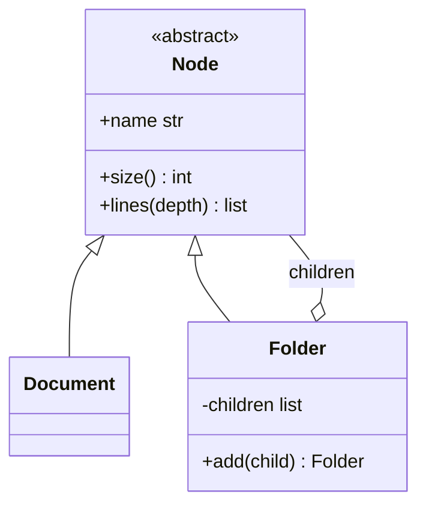
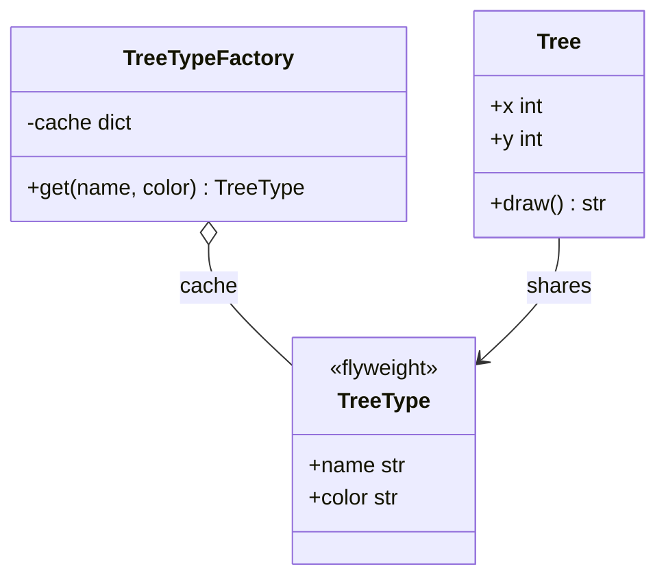

# 06. Composite and Flyweight

> **Draft: written but not yet run.** The code and the expected output in this lesson were prepared by reading the code and the official documentation. They have not been executed yet. If something does not behave as described, trust your tool's real output and report it.

## What you will be able to do
By the end of this lesson you will be able to:
- write a **Composite** so that a single object and a group of objects share one interface and recursion does the work
- write a **Flyweight** factory that shares immutable data between many objects and separate shared from per-object data
- decide when a tree structure or a shared pool is justified, and when it is premature
- explain why "measure before you share" applies to Flyweight

## Recap
1. (Lesson 05) How does a Decorator differ from a Proxy? <details><summary>Answer</summary>Both wrap an object with the same interface; a decorator adds behavior, a proxy controls access.</details>
2. (Lesson 03) Why is an object shared through a composition root better than a Singleton class? <details><summary>Answer</summary>No hidden global state, and tests can pass something else.</details>
3. (Patterns 101, lesson 04) What does the Liskov Substitution Principle ask of a child type? <details><summary>Answer</summary>It must work wherever the parent is expected, keeping the parent's promises.</details>

## Why it matters
A **box** can contain items, and it can also contain other boxes that contain items. When the shipping company asks "what does it weigh?", you do not care whether you hold an item or a box of boxes: you ask, and the box asks its contents. That is a **Composite**: a tree where leaves and groups answer the same questions. A **Flyweight** is the opposite worry: you need a million little things (the letters in a book, the trees in a forest), most of them identical in a few properties. Instead of storing "oak, green, rough bark" a million times, you store it **once** and let each tree point to it.

## What you will build
Two small programs. The first builds a folder tree of documents and prints each node with its size; a folder's size is the sum of its children, and the same method works for a single file. The second plants five trees that share only two `TreeType` objects, and proves that two trees point to the **very same** object.

## Before you start
- **Prerequisites:** Patterns 201 lessons [04, adapter and facade](04-adapter-and-facade.md) and [05, decorator and proxy](05-decorator-and-proxy.md); [Patterns 101 lesson 08, composition over inheritance](../../101-zero-to-hero/phase-2-everyday-principles/08-composition-over-inheritance.md).
- Time: 55 minutes for one language, 80 minutes if you follow both.
- You need lessons 04 and 05 and Python 3.10 or newer and/or the .NET 11 SDK. The TypeScript snippet is for reading only.
- Source pack (optional): every file is shown in full in this lesson, so you can follow without it. The finished code, the exercise starter and the solution are in the
  course repository https://github.com/Uee03/Code101 under `source/patterns/201-hero-to-super-hero/phase-2-structural/06-composite-and-flyweight/` (on that page choose **Code, Download ZIP**, or run
  `git clone https://github.com/Uee03/Code101.git`).

## Steps

### Step 1. Make the lesson folders
**PowerShell, starting folder: anywhere**
```powershell
New-Item -ItemType Directory -Path "$HOME/code101/patterns201/lesson06/python" -Force | Out-Null
New-Item -ItemType Directory -Path "$HOME/code101/patterns201/lesson06/csharp" -Force | Out-Null
Set-Location "$HOME/code101/patterns201/lesson06"
code .
```

**macOS/Linux terminal, starting folder: anywhere**
```bash
mkdir -p ~/code101/patterns201/lesson06/python ~/code101/patterns201/lesson06/csharp
cd ~/code101/patterns201/lesson06
code .
```
Expected result: VS Code opens `lesson06` with empty `python` and `csharp` folders.

### Step 2. See the Composite problem (read only)
Without a pattern, the code that computes a size must ask the type of everything it meets:
```python
def total_size(item):
    if isinstance(item, Document):
        return item.size_kb
    return sum(total_size(child) for child in item.children)
```
Every new kind of node (a shortcut, a zip archive) means another `isinstance` branch in **every** function that walks the tree (size, print, search, delete). The walker knows too much about the node classes.

**Pattern 1: Composite.** *Intent (paraphrased from the catalogue at refactoring.guru):* compose objects into tree structures and let clients treat individual objects and compositions in the same way.


Roles: the **component** (`Node`), the **leaf** (`Document`: does the real work) and the **composite** (`Folder`: holds children and **delegates** to them). The last line is the trick: a `Folder` is a `Node` and *has many* `Node`s, so folders hold folders.

### Step 3. Write the Composite
**File: `~/code101/patterns201/lesson06/python/composite.py`**
```python
from abc import ABC, abstractmethod


class Node(ABC):
    def __init__(self, name: str) -> None:
        self.name = name

    @abstractmethod
    def size(self) -> int:
        ...

    @abstractmethod
    def lines(self, depth: int) -> list[str]:
        ...


class Document(Node):
    def __init__(self, name: str, size_kb: int) -> None:
        super().__init__(name)
        self._size_kb = size_kb

    def size(self) -> int:
        return self._size_kb

    def lines(self, depth: int) -> list[str]:
        return [f"{'  ' * depth}{self.name} ({self.size()})"]


class Folder(Node):
    def __init__(self, name: str) -> None:
        super().__init__(name)
        self._children: list[Node] = []

    def add(self, child: Node) -> "Folder":
        self._children.append(child)
        return self

    def size(self) -> int:
        return sum(child.size() for child in self._children)

    def lines(self, depth: int) -> list[str]:
        result = [f"{'  ' * depth}{self.name} ({self.size()})"]
        for child in self._children:
            result.extend(child.lines(depth + 1))
        return result


def demo() -> None:
    docs = Folder("docs").add(Document("b.txt", 20)).add(Document("c.txt", 30))
    root = Folder("root").add(Document("a.txt", 10)).add(docs)
    for line in root.lines(0):
        print(line)
    print(f"docs only: {docs.size()}")
```

**File: `~/code101/patterns201/lesson06/csharp/Composite.cs`**
```csharp
namespace CompositeDemo;

public abstract class Node
{
    protected Node(string name)
    {
        Name = name;
    }

    public string Name { get; }

    public abstract int Size();

    public abstract IEnumerable<string> Lines(int depth);
}

public class Document : Node
{
    private readonly int _sizeKb;

    public Document(string name, int sizeKb) : base(name)
    {
        _sizeKb = sizeKb;
    }

    public override int Size() => _sizeKb;

    public override IEnumerable<string> Lines(int depth) =>
        new[] { $"{new string(' ', depth * 2)}{Name} ({Size()})" };
}

public class Folder : Node
{
    private readonly List<Node> _children = new();

    public Folder(string name) : base(name)
    {
    }

    public Folder Add(Node child)
    {
        _children.Add(child);
        return this;
    }

    public override int Size() => _children.Sum(child => child.Size());

    public override IEnumerable<string> Lines(int depth)
    {
        var result = new List<string> { $"{new string(' ', depth * 2)}{Name} ({Size()})" };
        foreach (var child in _children)
        {
            result.AddRange(child.Lines(depth + 1));
        }
        return result;
    }
}

public static class Demo
{
    public static void Run()
    {
        var docs = new Folder("docs").Add(new Document("b.txt", 20)).Add(new Document("c.txt", 30));
        var root = new Folder("root").Add(new Document("a.txt", 10)).Add(docs);
        foreach (var line in root.Lines(0))
        {
            Console.WriteLine(line);
        }
        Console.WriteLine($"docs only: {docs.Size()}");
    }
}
```
`Folder.size()` calls `child.size()` on each child **without asking what kind of child it is**: that is recursion plus polymorphism. `lines(depth)` passes `depth + 1` down so that children are indented two more spaces. (`'  ' * depth` repeats two spaces `depth` times; in C# `new string(' ', depth * 2)` does the same. `Sum` is a LINQ method that adds up the results.)

**Pattern 2: Flyweight.** *Intent (paraphrased):* fit more objects into memory by sharing the parts of their state that are the same, instead of keeping all the data in every object.

### Step 4. See the Flyweight problem (read only)
```python
class Tree:
    def __init__(self, x, y, name, color, texture):
        ...   # name, color and a big texture are stored again in every single tree
```
A forest of 100,000 trees repeats the name, the color and a large texture 100,000 times, although there are only a handful of different kinds. The data splits into two kinds: **intrinsic** state (what is the same for many objects: name, color; it can be shared and must be **immutable**) and **extrinsic** state (what is different per object: position; it stays in the object or is passed in).


The **flyweight factory** is essential: it guarantees that asking twice for `("oak", "green")` returns the same object.

### Step 5. Write the Flyweight
**File: `~/code101/patterns201/lesson06/python/flyweight.py`**
```python
from dataclasses import dataclass


@dataclass(frozen=True)
class TreeType:
    name: str
    color: str


class TreeTypeFactory:
    def __init__(self) -> None:
        self._cache: dict[tuple[str, str], TreeType] = {}

    @property
    def count(self) -> int:
        return len(self._cache)

    def get(self, name: str, color: str) -> TreeType:
        key = (name, color)
        if key not in self._cache:
            self._cache[key] = TreeType(name, color)
        return self._cache[key]


class Tree:
    def __init__(self, x: int, y: int, kind: TreeType) -> None:
        self.x = x
        self.y = y
        self.kind = kind

    def draw(self) -> str:
        return f"{self.kind.name} ({self.kind.color}) at {self.x},{self.y}"


def demo() -> None:
    factory = TreeTypeFactory()
    forest = [
        Tree(1, 2, factory.get("oak", "green")),
        Tree(3, 4, factory.get("oak", "green")),
        Tree(5, 6, factory.get("pine", "dark green")),
        Tree(7, 8, factory.get("oak", "green")),
        Tree(9, 10, factory.get("pine", "dark green")),
    ]
    for tree in forest:
        print(tree.draw())
    print(f"trees: {len(forest)}, shared types: {factory.count}")
    print(f"same object: {forest[0].kind is forest[1].kind}")
```

**File: `~/code101/patterns201/lesson06/csharp/Flyweight.cs`**
```csharp
namespace FlyweightDemo;

public record TreeType(string Name, string Color);

public class TreeTypeFactory
{
    private readonly Dictionary<(string, string), TreeType> _cache = new();

    public int Count => _cache.Count;

    public TreeType Get(string name, string color)
    {
        if (!_cache.TryGetValue((name, color), out TreeType? kind))
        {
            kind = new TreeType(name, color);
            _cache[(name, color)] = kind;
        }
        return kind;
    }
}

public class Tree
{
    public Tree(int x, int y, TreeType kind)
    {
        X = x;
        Y = y;
        Kind = kind;
    }

    public int X { get; }

    public int Y { get; }

    public TreeType Kind { get; }

    public string Draw() => $"{Kind.Name} ({Kind.Color}) at {X},{Y}";
}

public static class Demo
{
    public static void Run()
    {
        var factory = new TreeTypeFactory();
        var forest = new List<Tree>
        {
            new Tree(1, 2, factory.Get("oak", "green")),
            new Tree(3, 4, factory.Get("oak", "green")),
            new Tree(5, 6, factory.Get("pine", "dark green")),
            new Tree(7, 8, factory.Get("oak", "green")),
            new Tree(9, 10, factory.Get("pine", "dark green")),
        };
        foreach (var tree in forest)
        {
            Console.WriteLine(tree.Draw());
        }
        Console.WriteLine($"trees: {forest.Count}, shared types: {factory.Count}");
        Console.WriteLine($"same object: {object.ReferenceEquals(forest[0].Kind, forest[1].Kind)}");
    }
}
```
`TreeType` is **immutable** (a frozen dataclass; a C# `record` with only get accessors), which is what makes sharing safe: no tree can change the kind for all the others. The dictionary key is the pair `(name, color)`. The output proves the sharing: five trees, two shared kinds, and the first two trees point to the identical object. (The lesson does not measure memory; measure in your own program before you decide that you need the pattern.)

### Step 6. Entry files
**File: `~/code101/patterns201/lesson06/python/main.py`**
```python
import composite
import flyweight

print("--- composite ---")
composite.demo()
print("--- flyweight ---")
flyweight.demo()
```

**File: `~/code101/patterns201/lesson06/csharp/Program.cs`**
```csharp
Console.WriteLine("--- composite ---");
CompositeDemo.Demo.Run();
Console.WriteLine("--- flyweight ---");
FlyweightDemo.Demo.Run();
```

**File: `~/code101/patterns201/lesson06/csharp/Lesson.csproj`** (identical to lesson 01)
```xml
<Project Sdk="Microsoft.NET.Sdk">

  <PropertyGroup>
    <OutputType>Exe</OutputType>
    <TargetFramework>net11.0</TargetFramework>
    <ImplicitUsings>enable</ImplicitUsings>
    <Nullable>enable</Nullable>
  </PropertyGroup>

</Project>
```

## Run it
Predict first: what is the size printed for `root`, and how many shared tree types will the factory hold? <details><summary>Answer</summary>`root (60)`: 10 plus the docs folder's 50. The factory holds 2 types (oak and pine).</details>

**PowerShell, folder: `~/code101/patterns201/lesson06/python`**
```powershell
Set-Location "$HOME/code101/patterns201/lesson06/python"
python main.py
```
**macOS/Linux terminal, folder: `~/code101/patterns201/lesson06/python`**
```bash
cd ~/code101/patterns201/lesson06/python
python3 main.py
```
**Any terminal, folder: `~/code101/patterns201/lesson06/csharp`**
```text
dotnet run --project . --nologo
```
Expected output (derived by reading the code, not yet run; identical for Python and C#):
```text
--- composite ---
root (60)
  a.txt (10)
  docs (50)
    b.txt (20)
    c.txt (30)
docs only: 50
--- flyweight ---
oak (green) at 1,2
oak (green) at 3,4
pine (dark green) at 5,6
oak (green) at 7,8
pine (dark green) at 9,10
trees: 5, shared types: 2
same object: True
```

## How it works
**Composite.** The client holds a `Node` and calls `size()`. A `Document` answers directly; a `Folder` asks its children and adds the answers. A tree of any depth works with no `if` on the type. One design question is where `add` lives: here only in `Folder` (safe: you cannot add to a document), the alternative is to put `add` in `Node` (uniform for the client, but then a document must refuse it at run time). Prefer safety unless clients really treat both alike.

**Flyweight.** The factory is a **cache keyed by the intrinsic state**. Objects that differ only in extrinsic state (here the position) share one flyweight.

**Pattern card: Composite**
| | |
|---|---|
| Use when | the data is naturally a tree (files, menus, UI widgets, organization charts, expressions) and clients should treat a part and a whole the same way |
| Do not use when | the structure is flat, or leaves and groups have very different operations, so the shared interface becomes a bag of methods that most nodes refuse |
| Real-world uses | file systems, the HTML DOM, UI element trees (WPF/MAUI visual trees, Flutter widgets), `System.Linq.Expressions` trees |
| Related patterns | Decorator (a composite with a single child), Iterator and Visitor (lesson 11: walk a composite), Chain of Responsibility (often a composite parent chain), Flyweight (leaves of a composite may be shared) |
| Pitfalls | cycles (a folder added to itself recurses forever); parent pointers that go stale; huge trees walked recursively (stack depth); leaf-only methods leaking into the shared interface |

**Pattern card: Flyweight**
| | |
|---|---|
| Use when | you really have a very large number of similar objects and measuring shows memory is the problem, and the shared part can be made immutable |
| Do not use when | you have hundreds of objects, or the shared part is tiny, or you have not measured. It adds a factory and splits the state in two, which makes code harder to read (premature optimization) |
| Real-world uses | Python interns small integers and some strings, and `sys.intern` does it on request; .NET `string.Intern`; game engines share meshes, textures and tile definitions; text editors share glyph data for characters |
| Related patterns | Singleton (a flyweight factory is usually one shared object, lesson 03), Composite (shared leaves), Factory Method (the flyweight factory is a factory with a cache), State and Strategy (their objects are often stateless flyweights, lesson 08), Proxy (a virtual proxy can hide the sharing) |
| Pitfalls | a **mutable** flyweight: one change corrupts every user; extrinsic state forgotten, so each object quietly stores the same data again; a cache that is never cleared; thread safety of the factory; equality confusion (value equality is not identity) |

A TypeScript sketch of Composite, for reading:
```typescript
interface Node { size(): number }
class Doc implements Node { constructor(private kb: number) {} size() { return this.kb; } }
class Folder implements Node {
  private children: Node[] = [];
  add(child: Node): this { this.children.push(child); return this; }
  size(): number { return this.children.reduce((sum, c) => sum + c.size(), 0); }
}
```
Misconception: **"Flyweight is just caching."** A cache stores results to save *time*. A Flyweight shares *objects* to save *memory*, and the objects must be immutable and carry only intrinsic state.

## Try it
**Rung 1, guided.** The starter has `Priced` products and wants a `Bundle` that is itself `Priced` (a composite). Copy the `starter` folder of your language to `try06` (copy the folder itself and rename it) and finish the TODOs.

**File: `try06/main.py`**
```python
from abc import ABC, abstractmethod


class Priced(ABC):
    @abstractmethod
    def cents(self) -> int:
        ...


class Product(Priced):
    def __init__(self, name: str, amount: int) -> None:
        self.name = name
        self._amount = amount

    def cents(self) -> int:
        return self._amount


# TODO 1: write Bundle(Priced). __init__(name) creates an empty list of children.
#         add(child) appends a Priced child and returns self. cents() returns the sum of the children's cents().

laptop = Product("laptop", 90000)
mouse = Product("mouse", 2500)
cable = Product("cable", 2000)
print(f"laptop: {laptop.cents()}")
# TODO 2: make pack = Bundle("starter pack") holding laptop and mouse, and print "starter pack: ..."
# TODO 3: make combo = Bundle("combo") holding pack and cable, and print "combo: ..."
```

**File: `try06/Program.cs`** (with the same `Lesson.csproj`)
```csharp
var laptop = new Product("laptop", 90000);
var mouse = new Product("mouse", 2500);
var cable = new Product("cable", 2000);
Console.WriteLine($"laptop: {laptop.Cents()}");
// TODO 2: make pack = new Bundle("starter pack") holding laptop and mouse, and print "starter pack: ..."
// TODO 3: make combo = new Bundle("combo") holding pack and cable, and print "combo: ..."

// TODO 1: write Bundle : IPriced. The constructor takes the name and creates an empty List<IPriced>.
//         Add(child) appends a child and returns this. Cents() returns the sum of the children's Cents().

interface IPriced
{
    int Cents();
}

class Product : IPriced
{
    private readonly int _amount;

    public Product(string name, int amount)
    {
        Name = name;
        _amount = amount;
    }

    public string Name { get; }

    public int Cents() => _amount;
}
```
Expected output when done (not yet run):
```text
laptop: 90000
starter pack: 92500
combo: 94500
```
**Rung 2, change.** Add a `count()` method (`Count()` in C#) to both `Product` (returns 1) and `Bundle` (sums its children) so that `combo` reports how many products it contains. Which classes did you edit, and which stayed the same?

**Rung 3, stretch (no single answer).** A text editor stores each character of a 500-page book as an object. Write the intrinsic and the extrinsic state of a character, say which one the Flyweight factory would key on, and say what you would measure before deciding to use the pattern.

<details><summary>Solution</summary>

**File: `try06/main.py`**
```python
from abc import ABC, abstractmethod


class Priced(ABC):
    @abstractmethod
    def cents(self) -> int:
        ...


class Product(Priced):
    def __init__(self, name: str, amount: int) -> None:
        self.name = name
        self._amount = amount

    def cents(self) -> int:
        return self._amount


class Bundle(Priced):
    def __init__(self, name: str) -> None:
        self.name = name
        self._children: list[Priced] = []

    def add(self, child: Priced) -> "Bundle":
        self._children.append(child)
        return self

    def cents(self) -> int:
        return sum(child.cents() for child in self._children)


laptop = Product("laptop", 90000)
mouse = Product("mouse", 2500)
cable = Product("cable", 2000)
print(f"laptop: {laptop.cents()}")
pack = Bundle("starter pack").add(laptop).add(mouse)
print(f"starter pack: {pack.cents()}")
combo = Bundle("combo").add(pack).add(cable)
print(f"combo: {combo.cents()}")
```

**File: `try06/Program.cs`**
```csharp
var laptop = new Product("laptop", 90000);
var mouse = new Product("mouse", 2500);
var cable = new Product("cable", 2000);
Console.WriteLine($"laptop: {laptop.Cents()}");
var pack = new Bundle("starter pack").Add(laptop).Add(mouse);
Console.WriteLine($"starter pack: {pack.Cents()}");
var combo = new Bundle("combo").Add(pack).Add(cable);
Console.WriteLine($"combo: {combo.Cents()}");

interface IPriced
{
    int Cents();
}

class Product : IPriced
{
    private readonly int _amount;

    public Product(string name, int amount)
    {
        Name = name;
        _amount = amount;
    }

    public string Name { get; }

    public int Cents() => _amount;
}

class Bundle : IPriced
{
    private readonly List<IPriced> _children = new();

    public Bundle(string name)
    {
        Name = name;
    }

    public string Name { get; }

    public Bundle Add(IPriced child)
    {
        _children.Add(child);
        return this;
    }

    public int Cents() => _children.Sum(child => child.Cents());
}
```
`combo` is a bundle that contains a bundle, and the same `cents()` call works because both are `Priced`. For Rung 2 you edit `Priced`, `Product` and `Bundle` (adding a method to a shared interface touches every implementation), while the code that *uses* them stays the same. That is the price of a wide shared interface.
</details>

## Check yourself
1. What are the three roles in a Composite? <details><summary>Answer</summary>Component (shared interface), leaf (does the work) and composite (holds children and delegates).</details>
2. Predict: you add `Folder("empty")` to `root`. What size does it contribute? <details><summary>Answer</summary>0, because the sum of no children is 0.</details>
3. What is the difference between intrinsic and extrinsic state? <details><summary>Answer</summary>Intrinsic is shared and immutable (name, color); extrinsic differs per object (position).</details>
4. Why must a flyweight be immutable? <details><summary>Answer</summary>Many objects share it; a change by one user would silently change it for all the others.</details>
5. Find the bug: `root.add(root)`. <details><summary>Answer</summary>A cycle: `size()` would recurse forever (a stack overflow error).</details>

## Mixed review
1. (Lesson 05) A `CachingForecast` stores results for time. How does that differ from a Flyweight? <details><summary>Answer</summary>A cache saves repeated work (time); a Flyweight shares immutable objects (memory).</details>
2. (Lesson 04) You want a single `size_of(path)` function that hides the tree walking. Which pattern? <details><summary>Answer</summary>A Facade over the composite.</details>
3. (Lesson 02) A Builder assembles the folder tree from a description. Which pattern would copy a whole folder tree quickly? <details><summary>Answer</summary>Prototype, with a deep copy so the new tree does not share children.</details>
4. (Patterns 101, ISP) Why is it a smell if `Document` must implement an `add` method that always fails? <details><summary>Answer</summary>The leaf is forced to depend on a method it does not use; keep `add` only on `Folder`.</details>

## Common mistakes
These messages are typical and have **not** been reproduced yet; the wording depends on your versions.
| Symptom or error text (typical) | Cause | Fix |
|---|---|---|
| `RecursionError: maximum recursion depth exceeded` (Python) | a folder contains itself, directly or through another folder | never add an ancestor to a descendant; check before `add` |
| `dataclasses.FrozenInstanceError: cannot assign to field 'name'` | you tried to change the shared flyweight | create or request a different flyweight instead |
| `shared types: 5` instead of 2 | you created `TreeType(...)` directly instead of using `factory.get` | always go through the factory |
| `warning CS8618: Non-nullable property 'Name' must contain a non-null value when exiting constructor` | a property was never set | set it in the constructor |
| `MSB1003: Specify a project or solution file` | the terminal is not in the `csharp` folder | `cd` into the folder that contains `Lesson.csproj` |

## Best practice
Give the composite's shared interface only the operations that make sense for **every** node, and make shared flyweights immutable; measure memory before and after you introduce the factory. Source: Composite, Refactoring.Guru https://refactoring.guru/design-patterns/composite and Flyweight, Refactoring.Guru https://refactoring.guru/design-patterns/flyweight

## Going further
- Cross-checks: https://sourcemaking.com/design_patterns/composite and https://sourcemaking.com/design_patterns/flyweight
- Lesson 11 (Iterator, Visitor) walks trees like this one in different ways.
- Python `sys.intern`: https://docs.python.org/3/library/sys.html#sys.intern

## Summary
- You wrote a Composite where folders and documents answer the same questions, and the recursion does the work.
- You wrote a Flyweight factory and proved with the output that two trees share one object.
- You named the cost of each: a wide shared interface, and the split of state in two.
- You said why Flyweight needs a measurement first.

## Next lesson
07. Bridge: split one class that varies in **two** directions into two hierarchies connected by composition.
