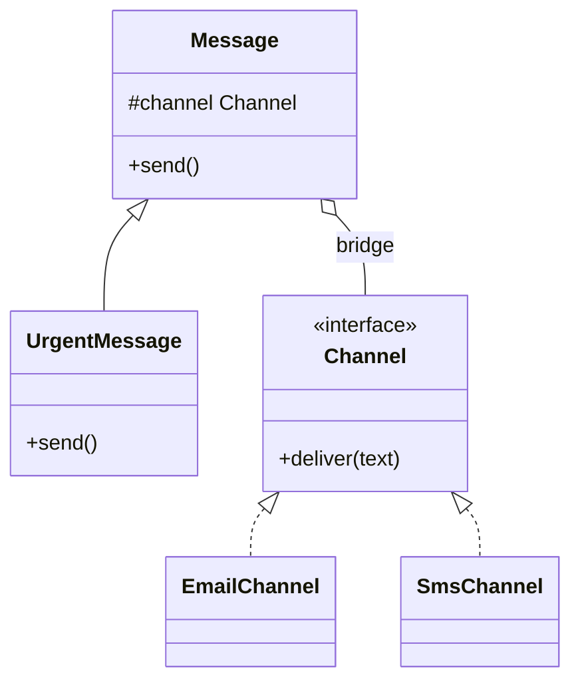

# 07. Bridge

> **Draft: written but not yet run.** The code and the expected output in this lesson were prepared by reading the code and the official documentation. They have not been executed yet. If something does not behave as described, trust your tool's real output and report it.

## What you will be able to do
By the end of this lesson you will be able to:
- recognize a class hierarchy that grows in **two independent directions** and count its classes
- write a **Bridge** that splits it into an abstraction hierarchy and an implementation hierarchy joined by composition
- explain how Bridge differs from Adapter, Strategy and plain inheritance
- choose the right structural pattern for a given problem using a decision table

## Recap
1. (Lesson 06) What is the difference between intrinsic and extrinsic state in a Flyweight? <details><summary>Answer</summary>Intrinsic state is shared and immutable; extrinsic state is different for each object and stays outside the flyweight.</details>
2. (Lesson 04) When do you write an Adapter instead of changing a class? <details><summary>Answer</summary>When you cannot or should not change the class (library or legacy code) and need another interface.</details>
3. (Patterns 101, lesson 08) What does "has a" give you that "is a" does not? <details><summary>Answer</summary>The part can be swapped at run time and combined with many others.</details>

## Why it matters
Imagine a TV shop selling remote controls: *basic* and *advanced* remotes, and TVs from *two brands*. If every combination is its own product (basic-brand-A, advanced-brand-A, basic-brand-B, advanced-brand-B) the catalog multiplies with every new remote or brand. The smarter design makes remotes and brands **separate families with a standard plug between them**: any remote works with any brand. That plug is the **Bridge**. Use it when a class varies along **two dimensions at once** and inheritance would need a class for every pair.

## What you will build
A tiny notification system with two dimensions: the *kind* of message (normal, urgent) and the *channel* it travels over (email, SMS). You will see the problem as a class count, build the bridge, and send all four combinations with two message classes and two channel classes.

## Before you start
- **Prerequisites:** Patterns 201 lessons [04, adapter and facade](04-adapter-and-facade.md), [05, decorator and proxy](05-decorator-and-proxy.md) and [06, composite and flyweight](06-composite-and-flyweight.md); [Patterns 101 lesson 08, composition over inheritance](../../101-zero-to-hero/phase-2-everyday-principles/08-composition-over-inheritance.md).
- Time: 45 minutes for one language, 65 minutes if you follow both.
- You need lessons 04 to 06 and Python 3.10 or newer and/or the .NET 11 SDK. The TypeScript snippet is for reading only.
- Source pack (optional): every file is shown in full in this lesson, so you can follow without it. The finished code, the exercise starter and the solution are in the
  course repository https://github.com/Uee03/Code101 under `source/patterns/201-hero-to-super-hero/phase-2-structural/07-bridge/` (on that page choose **Code, Download ZIP**, or run
  `git clone https://github.com/Uee03/Code101.git`).

## Steps

### Step 1. Make the lesson folders
**PowerShell, starting folder: anywhere**
```powershell
New-Item -ItemType Directory -Path "$HOME/code101/patterns201/lesson07/python" -Force | Out-Null
New-Item -ItemType Directory -Path "$HOME/code101/patterns201/lesson07/csharp" -Force | Out-Null
Set-Location "$HOME/code101/patterns201/lesson07"
code .
```

**macOS/Linux terminal, starting folder: anywhere**
```bash
mkdir -p ~/code101/patterns201/lesson07/python ~/code101/patterns201/lesson07/csharp
cd ~/code101/patterns201/lesson07
code .
```
Expected result: VS Code opens `lesson07` with empty `python` and `csharp` folders.

### Step 2. See the problem as a class count (read only)
Using only inheritance, the notifications look like this:
```python
class Message: ...
class EmailMessage(Message): ...
class SmsMessage(Message): ...
class UrgentEmailMessage(EmailMessage): ...
class UrgentSmsMessage(SmsMessage): ...
```
Two kinds times two channels is four classes plus the base. Add a push channel and you need two more; add a reminder kind and you need three more. The growth is **multiplicative** (kinds times channels), and the urgent-prefix logic is copied in every channel (a DRY violation). Both dimensions are tangled in one hierarchy.

| Kinds | Channels | Classes with inheritance | Classes with a bridge |
|---|---|---|---|
| 2 | 2 | 4 (plus bases) | 2 + 2 |
| 3 | 3 | 9 | 3 + 3 |
| 4 | 5 | 20 | 4 + 5 |

**Pattern: Bridge.** *Intent (paraphrased from the catalogue at refactoring.guru):* split a large class, or a set of closely related classes, into two separate hierarchies, an **abstraction** and an **implementation**, which can be developed independently. The abstraction **holds a reference** to an implementation and delegates the platform-specific work to it.


The words "abstraction" and "implementation" here do **not** mean "interface" and "class". The *abstraction* is the high-level control layer (what the user asks for: send a message, urgent or not); the *implementation* is the low-level layer that does the work (how it travels: email, SMS). The line labeled `bridge` is the one reference that connects the two hierarchies.

### Step 3. Write the Bridge
**File: `~/code101/patterns201/lesson07/python/bridge.py`**
```python
from abc import ABC, abstractmethod


class Channel(ABC):
    @abstractmethod
    def deliver(self, text: str) -> None:
        ...


class EmailChannel(Channel):
    def deliver(self, text: str) -> None:
        print(f"Email: {text}")


class SmsChannel(Channel):
    def deliver(self, text: str) -> None:
        print(f"SMS: {text}")


class Message:
    def __init__(self, channel: Channel, body: str) -> None:
        self._channel = channel
        self._body = body

    def send(self) -> None:
        self._channel.deliver(self._body)


class UrgentMessage(Message):
    def send(self) -> None:
        self._channel.deliver(f"URGENT: {self._body}")


def demo() -> None:
    channels = [EmailChannel(), SmsChannel()]
    for channel in channels:
        Message(channel, "Meeting at 10").send()
        UrgentMessage(channel, "Server down").send()
```

**File: `~/code101/patterns201/lesson07/csharp/Bridge.cs`**
```csharp
namespace BridgeDemo;

public interface IChannel
{
    void Deliver(string text);
}

public class EmailChannel : IChannel
{
    public void Deliver(string text) => Console.WriteLine($"Email: {text}");
}

public class SmsChannel : IChannel
{
    public void Deliver(string text) => Console.WriteLine($"SMS: {text}");
}

public class Message
{
    protected readonly IChannel Channel;
    protected readonly string Body;

    public Message(IChannel channel, string body)
    {
        Channel = channel;
        Body = body;
    }

    public virtual void Send() => Channel.Deliver(Body);
}

public class UrgentMessage : Message
{
    public UrgentMessage(IChannel channel, string body) : base(channel, body)
    {
    }

    public override void Send() => Channel.Deliver($"URGENT: {Body}");
}

public static class Demo
{
    public static void Run()
    {
        var channels = new IChannel[] { new EmailChannel(), new SmsChannel() };
        foreach (var channel in channels)
        {
            new Message(channel, "Meeting at 10").Send();
            new UrgentMessage(channel, "Server down").Send();
        }
    }
}
```
`Message` and `UrgentMessage` form the **abstraction** hierarchy (what to send). `EmailChannel` and `SmsChannel` form the **implementation** hierarchy (how to send). Each message receives *any* channel through its constructor, so all four combinations exist without a class for each. In C#, `protected readonly` fields let the subclass use the channel; in Python the leading underscore is only a convention.

### Step 4. Entry files
**File: `~/code101/patterns201/lesson07/python/main.py`**
```python
import bridge

print("--- bridge ---")
bridge.demo()
```

**File: `~/code101/patterns201/lesson07/csharp/Program.cs`**
```csharp
Console.WriteLine("--- bridge ---");
BridgeDemo.Demo.Run();
```

**File: `~/code101/patterns201/lesson07/csharp/Lesson.csproj`** (identical to lesson 01)
```xml
<Project Sdk="Microsoft.NET.Sdk">

  <PropertyGroup>
    <OutputType>Exe</OutputType>
    <TargetFramework>net11.0</TargetFramework>
    <ImplicitUsings>enable</ImplicitUsings>
    <Nullable>enable</Nullable>
  </PropertyGroup>

</Project>
```

## Run it
Predict first: the loop picks the channel and the inner lines pick the message kind. In which order do the four lines appear? <details><summary>Answer</summary>Both messages over email first, then both over SMS: the channel loop is the outer loop.</details>

**PowerShell, folder: `~/code101/patterns201/lesson07/python`**
```powershell
Set-Location "$HOME/code101/patterns201/lesson07/python"
python main.py
```
**macOS/Linux terminal, folder: `~/code101/patterns201/lesson07/python`**
```bash
cd ~/code101/patterns201/lesson07/python
python3 main.py
```
**Any terminal, folder: `~/code101/patterns201/lesson07/csharp`**
```text
dotnet run --project . --nologo
```
Expected output (derived by reading the code, not yet run; identical for Python and C#):
```text
--- bridge ---
Email: Meeting at 10
Email: URGENT: Server down
SMS: Meeting at 10
SMS: URGENT: Server down
```

## How it works
Calling `send()` on a message runs the abstraction's logic (add `URGENT: ` or not), then **delegates** the delivery to the channel it holds. Adding a `PushChannel` changes nothing in `Message`; adding a `ReminderMessage` changes nothing in any channel. Each side grows by one class and the combinations come for free.

**Why Bridge and not X?**
| Alternative | What it does | Why Bridge is different |
|---|---|---|
| Inheritance only | one class per combination | multiplicative growth and duplicated logic |
| **Adapter** (lesson 04) | makes two **existing** incompatible things fit | applied **after** the fact; Bridge is designed **up front** so the sides can vary |
| **Strategy** (lesson 08) | swaps one algorithm inside a class | same shape (a held object) but a different **intent**: Bridge swaps a whole implementation hierarchy that the abstraction layer is built on top of |
| Python function parameter | pass a function instead of a channel object | fine when the implementation is one method (here `deliver`); use a class when it has several methods or state |

**Pattern card: Bridge**
| | |
|---|---|
| Use when | a class varies in two (or more) independent dimensions; you want to switch the implementation at run time; or the high-level code and the platform code should be developed and released separately |
| Do not use when | there is only one dimension of variation (use Strategy or plain inheritance); the abstraction has only one implementation and you cannot name a second (YAGNI); the split would add layers without an actual second implementation |
| Real-world uses | UI toolkits that separate a control from per-platform drawing code (for example the control and handler split of .NET MAUI is similar in spirit); database access APIs that separate a common connection interface from per-vendor drivers; logging front ends with pluggable providers |
| Related patterns | Adapter (retrofit), Strategy (one swappable algorithm), Abstract Factory (can create the right implementation for the bridge, lesson 01), State (also delegates to a held object that changes, lesson 08) |
| Pitfalls | an interface that fits only one implementation (a leaky abstraction); using the bridge before a second implementation exists; letting the abstraction reach into implementation details; more indirection than the problem needs |

Choosing among the seven structural patterns (this is the **phase 2 summary**):
| Your situation | Pattern |
|---|---|
| Existing class, wrong interface | Adapter |
| Many classes, you want a simple front door | Facade |
| Add behavior to one object, in layers | Decorator |
| Control access, cache, lazy-load one object | Proxy |
| Tree of parts and wholes | Composite |
| Millions of near-identical objects, memory is the problem | Flyweight |
| Two dimensions of variation in one hierarchy | Bridge |

A TypeScript sketch of the bridge line, for reading:
```typescript
interface Channel { deliver(text: string): void }
class Message {
  constructor(protected channel: Channel, protected body: string) {}
  send(): void { this.channel.deliver(this.body); }
}
```
Misconception: **"Bridge is Strategy with a fancier name."** The structure is similar; the difference is scale and intent. Strategy swaps *how one operation is done*. Bridge separates *two whole hierarchies* so that both can grow.

## Try it
**Rung 1, guided.** The starter has `EmailChannel` and `Message`. Copy the `starter` folder of your language to `try07` (copy the folder itself and rename it) and add a new channel and a new kind of message.

**File: `try07/main.py`**
```python
from abc import ABC, abstractmethod


class Channel(ABC):
    @abstractmethod
    def deliver(self, text: str) -> None:
        ...


class EmailChannel(Channel):
    def deliver(self, text: str) -> None:
        print(f"Email: {text}")


class Message:
    def __init__(self, channel: Channel, body: str) -> None:
        self._channel = channel
        self._body = body

    def send(self) -> None:
        self._channel.deliver(self._body)


# TODO 1: write PushChannel(Channel) whose deliver prints "Push: " followed by the text.
# TODO 2: write ReminderMessage(Message) whose send delivers "Reminder: " followed by the body.

Message(EmailChannel(), "Hello").send()
# TODO 3: send ReminderMessage(PushChannel(), "Pay rent") and then ReminderMessage(EmailChannel(), "Pay rent")
```

**File: `try07/Program.cs`** (with the same `Lesson.csproj`)
```csharp
new Message(new EmailChannel(), "Hello").Send();
// TODO 3: send new ReminderMessage(new PushChannel(), "Pay rent") and then new ReminderMessage(new EmailChannel(), "Pay rent")

// TODO 1: write PushChannel : IChannel whose Deliver prints "Push: " followed by the text.
// TODO 2: write ReminderMessage : Message whose Send delivers "Reminder: " followed by the body.

interface IChannel
{
    void Deliver(string text);
}

class EmailChannel : IChannel
{
    public void Deliver(string text) => Console.WriteLine($"Email: {text}");
}

class Message
{
    protected readonly IChannel Channel;
    protected readonly string Body;

    public Message(IChannel channel, string body)
    {
        Channel = channel;
        Body = body;
    }

    public virtual void Send() => Channel.Deliver(Body);
}
```
Expected output when done (not yet run):
```text
Email: Hello
Push: Reminder: Pay rent
Email: Reminder: Pay rent
```
**Rung 2, change.** Make the urgent and reminder prefixes a property of the **message** (a `prefix` method that subclasses override) so that `send()` is written once in `Message`. Which duplicated line disappears?

**Rung 3, stretch (no single answer).** Name a feature of your own, or of an app you know, that varies along two dimensions (for example report type by output format). Draw the two hierarchies in six lines of Mermaid and say which side should be the abstraction.

<details><summary>Solution</summary>

**File: `try07/main.py`**
```python
from abc import ABC, abstractmethod


class Channel(ABC):
    @abstractmethod
    def deliver(self, text: str) -> None:
        ...


class EmailChannel(Channel):
    def deliver(self, text: str) -> None:
        print(f"Email: {text}")


class PushChannel(Channel):
    def deliver(self, text: str) -> None:
        print(f"Push: {text}")


class Message:
    def __init__(self, channel: Channel, body: str) -> None:
        self._channel = channel
        self._body = body

    def send(self) -> None:
        self._channel.deliver(self._body)


class ReminderMessage(Message):
    def send(self) -> None:
        self._channel.deliver(f"Reminder: {self._body}")


Message(EmailChannel(), "Hello").send()
ReminderMessage(PushChannel(), "Pay rent").send()
ReminderMessage(EmailChannel(), "Pay rent").send()
```

**File: `try07/Program.cs`**
```csharp
new Message(new EmailChannel(), "Hello").Send();
new ReminderMessage(new PushChannel(), "Pay rent").Send();
new ReminderMessage(new EmailChannel(), "Pay rent").Send();

interface IChannel
{
    void Deliver(string text);
}

class EmailChannel : IChannel
{
    public void Deliver(string text) => Console.WriteLine($"Email: {text}");
}

class PushChannel : IChannel
{
    public void Deliver(string text) => Console.WriteLine($"Push: {text}");
}

class Message
{
    protected readonly IChannel Channel;
    protected readonly string Body;

    public Message(IChannel channel, string body)
    {
        Channel = channel;
        Body = body;
    }

    public virtual void Send() => Channel.Deliver(Body);
}

class ReminderMessage : Message
{
    public ReminderMessage(IChannel channel, string body) : base(channel, body)
    {
    }

    public override void Send() => Channel.Deliver($"Reminder: {Body}");
}
```
The new channel touched no message class and the new message kind touched no channel class: that is the bridge working. For Rung 2, the duplicated `deliver` call disappears from the subclasses: `Message.send` would call `self._channel.deliver(self.prefix() + self._body)` and each subclass would only override `prefix`. (That variant is a small **Template Method**, lesson 11.)
</details>

## Check yourself
1. How many classes does a bridge need for 3 message kinds and 4 channels, and how many with inheritance only? <details><summary>Answer</summary>3 + 4 = 7 (plus base types) with a bridge, and 3 x 4 = 12 with inheritance.</details>
2. Which line of the diagram is "the bridge"? <details><summary>Answer</summary>The reference from `Message` (abstraction) to `Channel` (implementation).</details>
3. Predict: what would `UrgentMessage(PushChannel(), "x").send()` print, if `PushChannel` printed `Push: ...`? <details><summary>Answer</summary>`Push: URGENT: x`.</details>
4. Why is Bridge usually a bad idea when you have a single channel? <details><summary>Answer</summary>There is only one dimension of variation, so the extra layer adds indirection with no benefit (YAGNI).</details>

## Mixed review (phase 2: lessons 04 to 07)
1. (Lesson 04) You need to use a vendor's `send_sms(number, text)` where your code expects `deliver(text)`. Which pattern, and how does it relate to this lesson's `SmsChannel`? <details><summary>Answer</summary>An Adapter; `SmsChannel` could itself be an adapter around the vendor class.</details>
2. (Lesson 05) You want every channel to log what it sends without editing the channels. Which pattern? <details><summary>Answer</summary>A Decorator around `Channel` (it has the same interface).</details>
3. (Lesson 06) The `Message` objects of a huge mailing differ only in the recipient. Which pattern could share the rest, and what must hold? <details><summary>Answer</summary>Flyweight; the shared part must be immutable.</details>
4. (Lesson 05) Which of these is **not** a wrapper with the same interface: Decorator, Proxy, Facade? <details><summary>Answer</summary>Facade (it has a new, simpler interface).</details>
5. (Lesson 03) Where should the decision "use `SmsChannel` in production" live? <details><summary>Answer</summary>In the composition root, not inside `Message`.</details>

## Common mistakes
These messages are typical and have **not** been reproduced yet; the wording depends on your versions.
| Symptom or error text (typical) | Cause | Fix |
|---|---|---|
| `TypeError: Message.__init__() missing 1 required positional argument: 'body'` (Python) | the constructor needs both a channel and a body | pass both: `Message(channel, "text")` |
| `error CS1729: 'ReminderMessage' does not contain a constructor that takes 2 arguments` (C#) | the subclass has no constructor that forwards to `base(channel, body)` | add the constructor with `: base(channel, body)` |
| `error CS0122: 'Message.Channel' is inaccessible due to its protection level` | the field is private and a subclass or outside code reads it | make it `protected readonly` for subclasses |
| the urgent prefix is missing | you called `Message` instead of `UrgentMessage` | use the subclass for the kind you want |
| `MSB1003: Specify a project or solution file` | the terminal is not in the `csharp` folder | `cd` into the folder that contains `Lesson.csproj` |

## Best practice
Introduce a Bridge when the **second** dimension of variation actually appears; keep the implementation interface small and expressed in terms the abstraction needs, not in terms of one particular implementation. Source: Bridge, Refactoring.Guru https://refactoring.guru/design-patterns/bridge

## Going further
- Cross-check: https://sourcemaking.com/design_patterns/bridge
- Lesson 08 (Strategy and State) shows the two patterns that look most like Bridge and how to tell them apart.
- Lesson 12 shows how patterns combine, for example a Bridge whose implementation side is created by an Abstract Factory.

## Summary
- You counted the classes of a two-dimensional hierarchy and saw the multiplication.
- You wrote a Bridge with an abstraction (messages) and an implementation (channels) joined by one reference.
- You separated Bridge from Adapter, Strategy and plain inheritance.
- You used a decision table to choose among all seven structural patterns and finished phase 2.

## Next lesson
08. Strategy and State: swap an algorithm at run time, and let an object change behavior when its state changes (phase 3, behavioral patterns).
