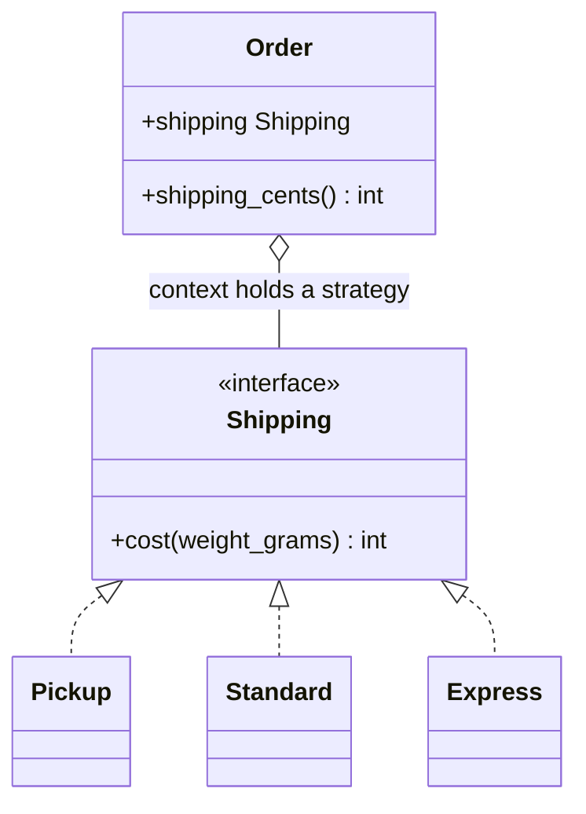
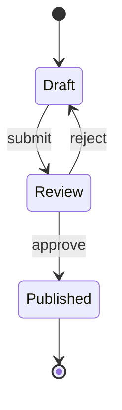
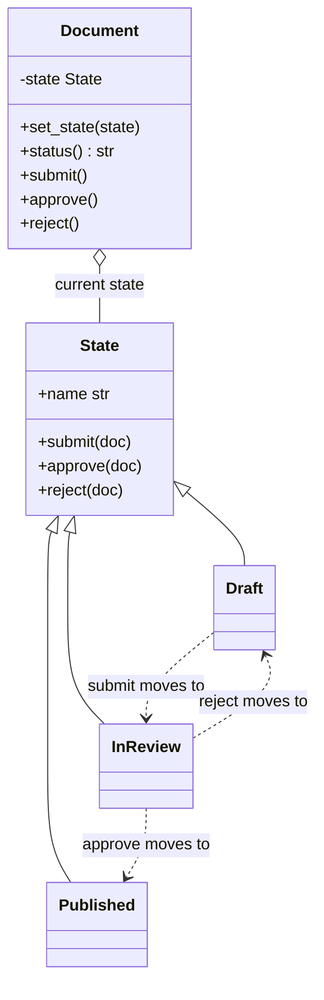

# 08. Strategy and State

> **Draft: written but not yet run.** The code and the expected output in this lesson were prepared by reading the code and the official documentation. They have not been executed yet. If something does not behave as described, trust your tool's real output and report it.

## What you will be able to do
By the end of this lesson you will be able to:
- explain what the **behavioral** family is for and name its ten patterns
- replace an `if / elif` chain on a "kind" with a **Strategy** chosen by the caller
- replace repeated `if status == ...` checks with a **State** machine whose states own the transitions
- tell Strategy from State from Bridge by who chooses the part and whether the parts know each other

## Recap
1. (Lesson 07) When is a Bridge justified? <details><summary>Answer</summary>When a class varies along two independent dimensions, so inheritance would need a class for every pair.</details>
2. (Patterns 101, lesson 03) What does the Open/Closed Principle say about adding a new discount rule? <details><summary>Answer</summary>Add a new class; do not edit the code that already works.</details>
3. (Lesson 05) What does a Decorator keep the same as the object it wraps? <details><summary>Answer</summary>The interface.</details>

## Why it matters
**Behavioral patterns** are about *who does what* and *how objects talk*: the algorithms and the division of responsibilities between objects. The ten are Strategy and State (today), Observer and Mediator (lesson 09), Command and Memento (lesson 10), and Iterator, Template Method, Visitor and Chain of Responsibility (lesson 11).

A **Strategy** is like choosing how to travel to the airport: taxi, bus or train. The goal is the same, the method is chosen by you, and you can change your mind. A **State** is like a traffic light or a vending machine: *the same button does different things depending on what state the machine is in*, and the machine itself moves from state to state. Both replace piles of `if` with small objects; they differ in **who decides**.

## What you will build
Two small programs. The first computes shipping with three interchangeable strategies and switches strategy on one order at run time. The second is a `Document` that goes from draft to review to published, where every state decides which actions are allowed and what comes next, and an illegal action reports a clear error.

## Before you start
- **Prerequisites:** Patterns 201 lessons [01, factory method and abstract factory](../phase-1-creational/01-factory-method-and-abstract-factory.md) to [07, bridge](../phase-2-structural/07-bridge.md); Patterns 101 lessons [03, open-closed](../../101-zero-to-hero/phase-1-solid/03-open-closed.md) and [08, composition over inheritance](../../101-zero-to-hero/phase-2-everyday-principles/08-composition-over-inheritance.md).
- Time: 55 minutes for one language, 80 minutes if you follow both.
- You need lessons 01 to 07 (lesson 07 for the comparison with Bridge) and Python 3.10 or newer and/or the .NET 11 SDK. The TypeScript snippet is for reading only.
- Source pack (optional): every file is shown in full in this lesson, so you can follow without it. The finished code, the exercise starter and the solution are in the
  course repository https://github.com/Uee03/Code101 under `source/patterns/201-hero-to-super-hero/phase-3-behavioral/08-strategy-and-state/` (on that page choose **Code, Download ZIP**, or run
  `git clone https://github.com/Uee03/Code101.git`).

## Steps

### Step 1. Make the lesson folders
**PowerShell, starting folder: anywhere**
```powershell
New-Item -ItemType Directory -Path "$HOME/code101/patterns201/lesson08/python" -Force | Out-Null
New-Item -ItemType Directory -Path "$HOME/code101/patterns201/lesson08/csharp" -Force | Out-Null
Set-Location "$HOME/code101/patterns201/lesson08"
code .
```

**macOS/Linux terminal, starting folder: anywhere**
```bash
mkdir -p ~/code101/patterns201/lesson08/python ~/code101/patterns201/lesson08/csharp
cd ~/code101/patterns201/lesson08
code .
```
Expected result: VS Code opens `lesson08` with empty `python` and `csharp` folders.

### Step 2. See the Strategy problem (read only)
You met this in Patterns 101 lesson 03 (rules for discounts). The same shape for shipping:
```python
def shipping_cents(method, weight_grams):
    if method == "pickup":
        return 0
    elif method == "standard":
        return 500
    elif method == "express":
        return 1000 + weight_grams // 10
    raise ValueError(method)
```
A new method (drone delivery) means editing this function. The function mixes the *choice* with every *algorithm*, and each algorithm cannot be tested or reused alone.

**Pattern 1: Strategy.** *Intent (paraphrased from the catalogue at refactoring.guru):* define a family of algorithms, put each into its own class and make their objects interchangeable.


Roles: the **context** (`Order`) holds a strategy and calls it; the **strategy** interface (`Shipping`) names the one operation; **concrete strategies** implement the algorithms. Whoever builds the order (usually the composition root or the caller) **chooses** the strategy.

### Step 3. Write the Strategy
**File: `~/code101/patterns201/lesson08/python/strategy.py`**
```python
from abc import ABC, abstractmethod


class Shipping(ABC):
    @abstractmethod
    def cost(self, weight_grams: int) -> int:
        ...


class Pickup(Shipping):
    def cost(self, weight_grams: int) -> int:
        return 0


class Standard(Shipping):
    def cost(self, weight_grams: int) -> int:
        return 500


class Express(Shipping):
    def cost(self, weight_grams: int) -> int:
        return 1000 + weight_grams // 10


class Order:
    def __init__(self, weight_grams: int, shipping: Shipping) -> None:
        self._weight_grams = weight_grams
        self.shipping = shipping

    def shipping_cents(self) -> int:
        return self.shipping.cost(self._weight_grams)


def demo() -> None:
    order = Order(2500, Pickup())
    print(f"pickup: {order.shipping_cents()}")
    order.shipping = Standard()
    print(f"standard: {order.shipping_cents()}")
    order.shipping = Express()
    print(f"express: {order.shipping_cents()}")
```

**File: `~/code101/patterns201/lesson08/csharp/Strategy.cs`**
```csharp
namespace StrategyDemo;

public interface IShipping
{
    int Cost(int weightGrams);
}

public class Pickup : IShipping
{
    public int Cost(int weightGrams) => 0;
}

public class Standard : IShipping
{
    public int Cost(int weightGrams) => 500;
}

public class Express : IShipping
{
    public int Cost(int weightGrams) => 1000 + weightGrams / 10;
}

public class Order
{
    private readonly int _weightGrams;

    public Order(int weightGrams, IShipping shipping)
    {
        _weightGrams = weightGrams;
        Shipping = shipping;
    }

    public IShipping Shipping { get; set; }

    public int ShippingCents() => Shipping.Cost(_weightGrams);
}

public static class Demo
{
    public static void Run()
    {
        var order = new Order(2500, new Pickup());
        Console.WriteLine($"pickup: {order.ShippingCents()}");
        order.Shipping = new Standard();
        Console.WriteLine($"standard: {order.ShippingCents()}");
        order.Shipping = new Express();
        Console.WriteLine($"express: {order.ShippingCents()}");
    }
}
```
`Order` no longer knows any algorithm. For 2500 grams, express costs 1000 plus 250, which is 1250 cents. Because functions are values in both languages, a one-method strategy can also be a **function** (Python: pass a `def` or a `lambda`; C#: a `Func<int, int>`). Use a class when the strategy has several methods, state or a name you want in a log.

**Pattern 2: State.** *Intent (paraphrased):* let an object alter its behavior when its internal state changes, so that it appears to change its class.

### Step 4. See the State problem (read only)
```python
class Document:
    def submit(self):
        if self.status == "draft":
            self.status = "review"
        else:
            raise ValueError(f"Cannot submit a {self.status} document")

    def approve(self):
        if self.status == "review":
            self.status = "published"
        else:
            raise ValueError(f"Cannot approve a {self.status} document")
```
Every action repeats an `if` on the status, and adding a status (for example `archived`) means touching **every** method. The rules of one status are scattered across all methods: the *conditional matrix* of actions times statuses.


Read it like a map: circles are **states**, arrows are **transitions** labeled with the action that triggers them. Any action with no arrow out of a state is **illegal** in that state. The State pattern turns this map into code: one class per state, and each class holds only the transitions that start at it.



### Step 5. Write the State
**File: `~/code101/patterns201/lesson08/python/state.py`**
```python
class State:
    name = ""

    def submit(self, doc: "Document") -> None:
        raise ValueError(f"Cannot submit a {self.name} document")

    def approve(self, doc: "Document") -> None:
        raise ValueError(f"Cannot approve a {self.name} document")

    def reject(self, doc: "Document") -> None:
        raise ValueError(f"Cannot reject a {self.name} document")


class Draft(State):
    name = "draft"

    def submit(self, doc: "Document") -> None:
        doc.set_state(InReview())


class InReview(State):
    name = "review"

    def approve(self, doc: "Document") -> None:
        doc.set_state(Published())

    def reject(self, doc: "Document") -> None:
        doc.set_state(Draft())


class Published(State):
    name = "published"


class Document:
    def __init__(self) -> None:
        self._state: State = Draft()

    def set_state(self, state: State) -> None:
        self._state = state

    def status(self) -> str:
        return self._state.name

    def submit(self) -> None:
        self._state.submit(self)

    def approve(self) -> None:
        self._state.approve(self)

    def reject(self) -> None:
        self._state.reject(self)


def demo() -> None:
    doc = Document()
    print(f"status: {doc.status()}")
    doc.submit()
    print(f"status: {doc.status()}")
    doc.reject()
    print(f"status: {doc.status()}")
    doc.submit()
    doc.approve()
    print(f"status: {doc.status()}")
    try:
        doc.submit()
    except ValueError as error:
        print(f"Error: {error}")
```

**File: `~/code101/patterns201/lesson08/csharp/State.cs`**
```csharp
namespace StateDemo;

public abstract class State
{
    public abstract string Name { get; }

    public virtual void Submit(Document doc) =>
        throw new InvalidOperationException($"Cannot submit a {Name} document");

    public virtual void Approve(Document doc) =>
        throw new InvalidOperationException($"Cannot approve a {Name} document");

    public virtual void Reject(Document doc) =>
        throw new InvalidOperationException($"Cannot reject a {Name} document");
}

public class Draft : State
{
    public override string Name => "draft";

    public override void Submit(Document doc) => doc.SetState(new InReview());
}

public class InReview : State
{
    public override string Name => "review";

    public override void Approve(Document doc) => doc.SetState(new Published());

    public override void Reject(Document doc) => doc.SetState(new Draft());
}

public class Published : State
{
    public override string Name => "published";
}

public class Document
{
    private State _state = new Draft();

    public void SetState(State state)
    {
        _state = state;
    }

    public string Status() => _state.Name;

    public void Submit() => _state.Submit(this);

    public void Approve() => _state.Approve(this);

    public void Reject() => _state.Reject(this);
}

public static class Demo
{
    public static void Run()
    {
        var doc = new Document();
        Console.WriteLine($"status: {doc.Status()}");
        doc.Submit();
        Console.WriteLine($"status: {doc.Status()}");
        doc.Reject();
        Console.WriteLine($"status: {doc.Status()}");
        doc.Submit();
        doc.Approve();
        Console.WriteLine($"status: {doc.Status()}");
        try
        {
            doc.Submit();
        }
        catch (InvalidOperationException error)
        {
            Console.WriteLine($"Error: {error.Message}");
        }
    }
}
```
The base `State` **refuses everything by default**; each concrete state overrides only the actions that are legal there. `Document` is a thin shell that forwards every call to its current state, passing itself so the state can call `set_state`. `Published` overrides nothing, so every action on a published document fails with a clear message. The text comes from the base class, so the three error messages are written once.

### Step 6. Entry files
**File: `~/code101/patterns201/lesson08/python/main.py`**
```python
import state
import strategy

print("--- strategy ---")
strategy.demo()
print("--- state ---")
state.demo()
```

**File: `~/code101/patterns201/lesson08/csharp/Program.cs`**
```csharp
Console.WriteLine("--- strategy ---");
StrategyDemo.Demo.Run();
Console.WriteLine("--- state ---");
StateDemo.Demo.Run();
```

**File: `~/code101/patterns201/lesson08/csharp/Lesson.csproj`** (identical to lesson 01)
```xml
<Project Sdk="Microsoft.NET.Sdk">

  <PropertyGroup>
    <OutputType>Exe</OutputType>
    <TargetFramework>net11.0</TargetFramework>
    <ImplicitUsings>enable</ImplicitUsings>
    <Nullable>enable</Nullable>
  </PropertyGroup>

</Project>
```

## Run it
Predict first: after `submit`, `reject`, `submit`, `approve`, which status does the document have, and what does a further `submit` do? <details><summary>Answer</summary>`published`; the extra `submit` raises an error with the text `Cannot submit a published document`, which `demo` catches and prints.</details>

**PowerShell, folder: `~/code101/patterns201/lesson08/python`**
```powershell
Set-Location "$HOME/code101/patterns201/lesson08/python"
python main.py
```
**macOS/Linux terminal, folder: `~/code101/patterns201/lesson08/python`**
```bash
cd ~/code101/patterns201/lesson08/python
python3 main.py
```
**Any terminal, folder: `~/code101/patterns201/lesson08/csharp`**
```text
dotnet run --project . --nologo
```
Expected output (derived by reading the code, not yet run; identical for Python and C#):
```text
--- strategy ---
pickup: 0
standard: 500
express: 1250
--- state ---
status: draft
status: review
status: draft
status: published
Error: Cannot submit a published document
```

## How it works
Both patterns hold an object and delegate to it. The questions that separate them:

| Question | Strategy | State |
|---|---|---|
| Who picks the held object? | the **client** (from outside) | the **states themselves** (transitions) or the context |
| Do the held objects know each other? | no, they are independent | yes: a state names the next states |
| Does the held object change on its own? | rarely: only when the client says so | yes: as a result of actions |
| What varies? | *how* one operation is done | *what the object does at all* |
| Related shape | Bridge (two hierarchies) | Bridge, plus a state machine |

**Pattern card: Strategy**
| | |
|---|---|
| Use when | you have several ways to do one thing and want to choose at run time; you want to isolate an algorithm from the code that uses it; a class has a large conditional that picks among variants of one operation |
| Do not use when | you have two stable variants that rarely change (an `if` is clearer), or the "family" is one algorithm with parameters (pass the parameters); in Python or C#, a plain function value is often enough |
| Real-world uses | `sorted(items, key=...)` in Python and `IComparer<T>` / `List.Sort(Comparison<T>)` in .NET; compression and encryption algorithm choice; payment, tax and shipping rules |
| Related patterns | State (a strategy that changes itself), Bridge and Decorator (similar structure, different intent), Template Method (lesson 11: varies by inheritance instead of composition), Command (a strategy that can be stored and replayed, lesson 10) |
| Pitfalls | clients must know the strategies to choose well; strategies with different needs forced into one interface (a fat parameter list); a swarm of one-method classes where lambdas would do; forgetting that a strategy with state must not be shared between contexts |

**Pattern card: State**
| | |
|---|---|
| Use when | an object behaves differently depending on its state, there are many states and the state-specific code changes often; or a class is full of `if status == ...` in several methods |
| Do not use when | there are two or three states with simple behavior (an enum and a `match` or `switch` is easier to read), or the transitions are a table of data (keep the table) |
| Real-world uses | order and document workflows; TCP connection states; media players (stopped, playing, paused); UI controls (enabled, pressed, disabled); game characters |
| Related patterns | Strategy (independent swap), Flyweight (state objects without data can be shared, lesson 06), Singleton (stateless states are sometimes made singletons; prefer plain shared instances), Memento (save and restore state, lesson 10) |
| Pitfalls | a state explosion (many classes for a trivial machine); transitions scattered across states with no overview (keep the Mermaid diagram next to the code); shared mutable states; forgetting to handle an action in the base class so illegal actions pass silently |

A TypeScript sketch of Strategy using a function type, for reading:
```typescript
type Shipping = (weightGrams: number) => number;
const express: Shipping = (w) => 1000 + Math.floor(w / 10);
class Order {
  constructor(private weightGrams: number, public shipping: Shipping) {}
  shippingCents(): number { return this.shipping(this.weightGrams); }
}
```
Misconception: **"State and Strategy are the same because the diagrams look alike."** The diagram is the same; the *story* is not. If the client swaps the part from outside to change *how* something is computed, it is a Strategy. If the object's own actions move it between parts that *know about each other*, it is a State.

## Try it
**Rung 1, guided.** The starter is a traffic light made of states, with `Red` and `Green` partly written. Copy the `starter` folder of your language to `try08` (copy the folder itself and rename it) and finish the TODOs.

**File: `try08/main.py`**
```python
from abc import ABC, abstractmethod


class LightState(ABC):
    @property
    @abstractmethod
    def color(self) -> str:
        ...

    @abstractmethod
    def next(self) -> "LightState":
        ...


class Red(LightState):
    @property
    def color(self) -> str:
        return "red"

    def next(self) -> LightState:
        return Green()


class Green(LightState):
    @property
    def color(self) -> str:
        return "green"

    def next(self) -> LightState:
        # TODO 1: return a Yellow state
        raise NotImplementedError("TODO 1")


# TODO 2: write Yellow(LightState): its color is "yellow" and next() returns Red().


class Light:
    def __init__(self) -> None:
        self._state: LightState = Red()

    def color(self) -> str:
        return self._state.color

    def advance(self) -> None:
        self._state = self._state.next()


light = Light()
for _ in range(4):
    print(light.color())
    light.advance()
```

**File: `try08/Program.cs`** (with the same `Lesson.csproj`)
```csharp
var light = new Light();
for (int i = 0; i < 4; i++)
{
    Console.WriteLine(light.Color());
    light.Advance();
}

abstract class LightState
{
    public abstract string Color { get; }

    public abstract LightState Next();
}

class Red : LightState
{
    public override string Color => "red";

    public override LightState Next() => new Green();
}

class Green : LightState
{
    public override string Color => "green";

    // TODO 1: return a new Yellow() instead of throwing
    public override LightState Next() => throw new NotImplementedException("TODO 1");
}

// TODO 2: write Yellow : LightState. Its Color is "yellow" and Next() returns a new Red().

class Light
{
    private LightState _state = new Red();

    public string Color() => _state.Color;

    public void Advance()
    {
        _state = _state.Next();
    }
}
```
Expected output when done (not yet run):
```text
red
green
yellow
red
```
**Rung 2, change.** Add a fourth state `Flashing` that you reach from `Yellow` only when a `night` flag is set on the `Light`, and that returns to `Red` otherwise. Decide where the flag lives, and say whether `Yellow` now knows about `Flashing` (it must: transitions belong to the states).

**Rung 3, stretch (no single answer).** For each of these, write "Strategy" or "State" and one sentence why: (a) tax rules per country, (b) an order that is placed, paid, shipped, delivered, (c) text export as plain or HTML, (d) a game character that is walking, jumping, falling.

<details><summary>Solution</summary>

**File: `try08/main.py`**
```python
from abc import ABC, abstractmethod


class LightState(ABC):
    @property
    @abstractmethod
    def color(self) -> str:
        ...

    @abstractmethod
    def next(self) -> "LightState":
        ...


class Red(LightState):
    @property
    def color(self) -> str:
        return "red"

    def next(self) -> LightState:
        return Green()


class Green(LightState):
    @property
    def color(self) -> str:
        return "green"

    def next(self) -> LightState:
        return Yellow()


class Yellow(LightState):
    @property
    def color(self) -> str:
        return "yellow"

    def next(self) -> LightState:
        return Red()


class Light:
    def __init__(self) -> None:
        self._state: LightState = Red()

    def color(self) -> str:
        return self._state.color

    def advance(self) -> None:
        self._state = self._state.next()


light = Light()
for _ in range(4):
    print(light.color())
    light.advance()
```

**File: `try08/Program.cs`**
```csharp
var light = new Light();
for (int i = 0; i < 4; i++)
{
    Console.WriteLine(light.Color());
    light.Advance();
}

abstract class LightState
{
    public abstract string Color { get; }

    public abstract LightState Next();
}

class Red : LightState
{
    public override string Color => "red";

    public override LightState Next() => new Green();
}

class Green : LightState
{
    public override string Color => "green";

    public override LightState Next() => new Yellow();
}

class Yellow : LightState
{
    public override string Color => "yellow";

    public override LightState Next() => new Red();
}

class Light
{
    private LightState _state = new Red();

    public string Color() => _state.Color;

    public void Advance()
    {
        _state = _state.Next();
    }
}
```
Here the states choose their successor (State). Rung 3 answers: (a) Strategy (the client picks the country's rule), (b) State (actions move the order along a map), (c) Strategy (the client picks the format), (d) State (the character changes by its own actions and events).
</details>

## Check yourself
1. Which of the two patterns has parts that know about each other, and why? <details><summary>Answer</summary>State: each state names the next states in its transitions. Strategies are independent of each other.</details>
2. Predict: `Order(2500, Express()).shipping_cents()`. <details><summary>Answer</summary>1250 (1000 plus 2500 divided by 10).</details>
3. Why does the base `State` raise errors by default? <details><summary>Answer</summary>So that an action that is not legal in a state fails loudly instead of being silently ignored, and the error text is written once.</details>
4. Name a case where an enum and a `switch` is better than the State pattern. <details><summary>Answer</summary>Two or three states with tiny behavior, or transitions stored as a table of data.</details>

## Mixed review
1. (Lesson 07) Which pattern would you use if a message kind **and** its channel both vary? <details><summary>Answer</summary>Bridge.</details>
2. (Lesson 06) Your state classes hold no data. Which pattern lets you share one instance of each? <details><summary>Answer</summary>Flyweight (shared immutable objects).</details>
3. (Lesson 01) Which creational pattern would pick the right `Shipping` strategy from a string such as `"express"`? <details><summary>Answer</summary>A factory (a simple factory function or a Factory Method).</details>
4. (Patterns 101, ISP and OCP) Why is the `Shipping` interface better with one method than with five? <details><summary>Answer</summary>Strategies stay small; no class implements methods it does not need (Interface Segregation) and adding a strategy edits nothing (Open/Closed).</details>
5. (Lesson 05) How is a Decorator different from a Strategy? <details><summary>Answer</summary>A decorator wraps an object with the same interface to add behavior around it; a strategy is the replaceable algorithm *inside* an object.</details>

## Common mistakes
These messages are typical and have **not** been reproduced yet; the wording depends on your versions.
| Symptom or error text (typical) | Cause | Fix |
|---|---|---|
| `NotImplementedError: TODO 1` (Python) or `System.NotImplementedException: TODO 1` (C#) in the starter | TODO 1 is not done yet | return the new state |
| `NameError: name 'Yellow' is not defined` (Python) | the class is used before it exists at run time, or its TODO 2 is missing | write `Yellow` anywhere above the code that runs |
| `error CS0246: The type or namespace name 'Yellow' could not be found` (C#) | the class does not exist yet | write the class (TODO 2) |
| the state never changes | the context method does not call the state, or the state forgot `set_state` | forward the call, and set the new state in the transition |
| `MSB1003: Specify a project or solution file` | the terminal is not in the `csharp` folder | `cd` into the folder that contains `Lesson.csproj` |

## Best practice
Keep each strategy independent and stateless unless it must hold data, and keep a diagram of the state machine next to the State classes so that the transitions stay visible. Source: Strategy, Refactoring.Guru https://refactoring.guru/design-patterns/strategy and State, Refactoring.Guru https://refactoring.guru/design-patterns/state

## Going further
- Cross-checks: https://sourcemaking.com/design_patterns/strategy and https://sourcemaking.com/design_patterns/state
- Python `enum`: https://docs.python.org/3/library/enum.html
- Lesson 12 compares state machines written as patterns with state machines written as data tables.

## Summary
- You named the ten behavioral patterns and what the family is for.
- You replaced an `if` chain with Strategies that the client swaps at run time.
- You turned a state diagram into State classes and saw an illegal action fail clearly.
- You separated Strategy from State by who chooses and whether the parts know each other.

## Next lesson
09. Observer and Mediator: tell many objects that something happened, and stop objects from talking to each other directly.
