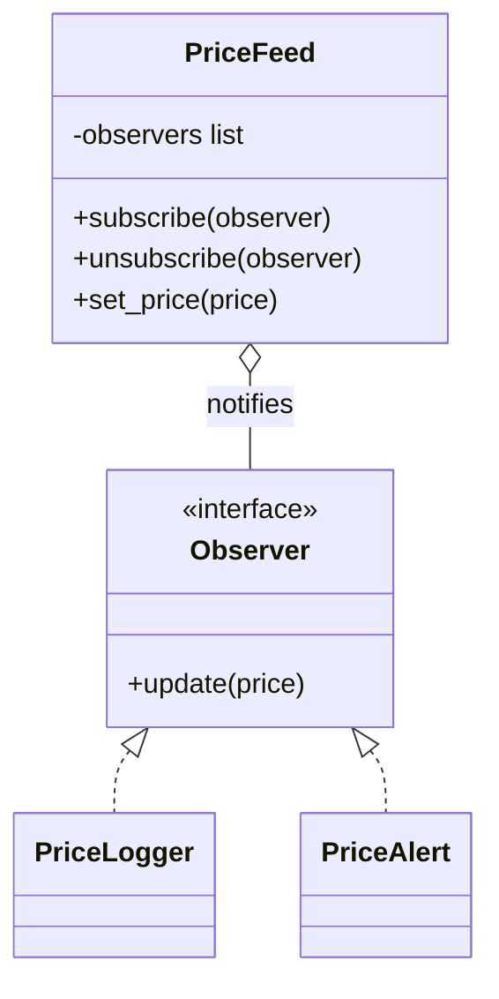
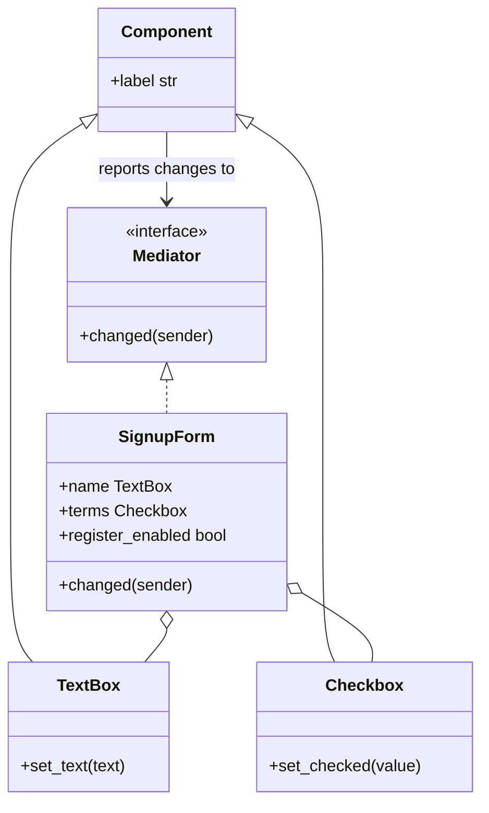

# 09. Observer and Mediator

> **Draft: written but not yet run.** The code and the expected output in this lesson were prepared by reading the code and the official documentation. They have not been executed yet. If something does not behave as described, trust your tool's real output and report it.

## What you will be able to do
By the end of this lesson you will be able to:
- write an **Observer**: a subject that notifies any number of subscribers without knowing who they are
- subscribe and unsubscribe at run time and explain what happens if you forget to unsubscribe
- write a **Mediator** that coordinates several components so they never refer to each other
- choose between Observer (one-to-many broadcast) and Mediator (central coordination)

## Recap
1. (Lesson 08) Who chooses the held object in a Strategy, and in a State? <details><summary>Answer</summary>In a Strategy the client chooses it from outside; in a State the states themselves (or the context) choose the next one.</details>
2. (Patterns 101, lesson 06) What does the Dependency Inversion Principle say a high-level class should depend on? <details><summary>Answer</summary>An abstraction, not a concrete detail.</details>
3. (Lesson 04) What does a Facade hide? <details><summary>Answer</summary>A group of classes behind a simpler interface.</details>

## Why it matters
When you subscribe to a newsletter, the publisher does not know your name or what you will do with the issue; it only knows "there is a list, send each issue to everyone on it". That is an **Observer**: a one-to-many notification where the sender stays ignorant of the receivers. A **Mediator** is an air traffic control tower: pilots do not call each other, they all talk to the tower, which knows the rules. Observer **removes** the dependency of the sender on its receivers. Mediator **centralizes** a web of dependencies between peers into one place.

## What you will build
Two small programs. The first has a `PriceFeed` that notifies a logger and an alert; you will add and remove a subscriber at run time. The second is a signup form with a text box and a checkbox that never reference each other or the button: a `SignupForm` mediator decides whether the "Register" button is enabled.

## Before you start
- **Prerequisites:** [Patterns 201 lesson 08, strategy and state](08-strategy-and-state.md); Patterns 101 lessons [05, interface segregation](../../101-zero-to-hero/phase-1-solid/05-interface-segregation.md) and [06, dependency inversion](../../101-zero-to-hero/phase-1-solid/06-dependency-inversion.md).
- Time: 55 minutes for one language, 80 minutes if you follow both.
- You need lesson 08 and Python 3.10 or newer and/or the .NET 11 SDK. The TypeScript and C# `event` snippets are for reading only.
- Source pack (optional): every file is shown in full in this lesson, so you can follow without it. The finished code, the exercise starter and the solution are in the
  course repository https://github.com/Uee03/Code101 under `source/patterns/201-hero-to-super-hero/phase-3-behavioral/09-observer-and-mediator/` (on that page choose **Code, Download ZIP**, or run
  `git clone https://github.com/Uee03/Code101.git`).

## Steps

### Step 1. Make the lesson folders
**PowerShell, starting folder: anywhere**
```powershell
New-Item -ItemType Directory -Path "$HOME/code101/patterns201/lesson09/python" -Force | Out-Null
New-Item -ItemType Directory -Path "$HOME/code101/patterns201/lesson09/csharp" -Force | Out-Null
Set-Location "$HOME/code101/patterns201/lesson09"
code .
```

**macOS/Linux terminal, starting folder: anywhere**
```bash
mkdir -p ~/code101/patterns201/lesson09/python ~/code101/patterns201/lesson09/csharp
cd ~/code101/patterns201/lesson09
code .
```
Expected result: VS Code opens `lesson09` with empty `python` and `csharp` folders.

### Step 2. See the Observer problem (read only)
```python
class PriceFeed:
    def set_price(self, price):
        self.price = price
        self.logger.write(price)
        self.alert.check(price)
        self.chart.redraw(price)
```
The feed knows every consumer by name. A new consumer (a mobile push) means editing `PriceFeed`; removing the chart means editing it too. The *producer* of the news is coupled to everyone who wants it. Polling (asking the feed again and again "did it change?") is the other bad option: it wastes work and is always late.

**Pattern 1: Observer.** *Intent (paraphrased from the catalogue at refactoring.guru):* define a subscription mechanism to notify multiple objects about events that happen to the object they observe.


Roles: the **subject** (also called publisher: `PriceFeed`) keeps a list and notifies it; the **observer** interface (subscriber) names the one method the subject calls; **concrete observers** react. The subject depends only on the `Observer` interface.

### Step 3. Write the Observer
**File: `~/code101/patterns201/lesson09/python/observer.py`**
```python
from abc import ABC, abstractmethod


class Observer(ABC):
    @abstractmethod
    def update(self, price: int) -> None:
        ...


class PriceFeed:
    def __init__(self) -> None:
        self._observers: list[Observer] = []

    def subscribe(self, observer: Observer) -> None:
        self._observers.append(observer)

    def unsubscribe(self, observer: Observer) -> None:
        self._observers.remove(observer)

    def set_price(self, price: int) -> None:
        for observer in list(self._observers):
            observer.update(price)


class PriceLogger(Observer):
    def update(self, price: int) -> None:
        print(f"log: price is {price}")


class PriceAlert(Observer):
    def __init__(self, limit: int) -> None:
        self._limit = limit

    def update(self, price: int) -> None:
        if price > self._limit:
            print(f"ALERT: price {price} is above {self._limit}")


def demo() -> None:
    feed = PriceFeed()
    logger = PriceLogger()
    alert = PriceAlert(110)
    feed.subscribe(logger)
    feed.subscribe(alert)
    feed.set_price(100)
    feed.set_price(120)
    feed.unsubscribe(logger)
    feed.set_price(130)
```

**File: `~/code101/patterns201/lesson09/csharp/Observer.cs`**
```csharp
namespace ObserverDemo;

public interface IPriceObserver
{
    void Update(int price);
}

public class PriceFeed
{
    private readonly List<IPriceObserver> _observers = new();

    public void Subscribe(IPriceObserver observer)
    {
        _observers.Add(observer);
    }

    public void Unsubscribe(IPriceObserver observer)
    {
        _observers.Remove(observer);
    }

    public void SetPrice(int price)
    {
        foreach (var observer in _observers.ToArray())
        {
            observer.Update(price);
        }
    }
}

public class PriceLogger : IPriceObserver
{
    public void Update(int price) => Console.WriteLine($"log: price is {price}");
}

public class PriceAlert : IPriceObserver
{
    private readonly int _limit;

    public PriceAlert(int limit)
    {
        _limit = limit;
    }

    public void Update(int price)
    {
        if (price > _limit)
        {
            Console.WriteLine($"ALERT: price {price} is above {_limit}");
        }
    }
}

public static class Demo
{
    public static void Run()
    {
        var feed = new PriceFeed();
        var logger = new PriceLogger();
        var alert = new PriceAlert(110);
        feed.Subscribe(logger);
        feed.Subscribe(alert);
        feed.SetPrice(100);
        feed.SetPrice(120);
        feed.Unsubscribe(logger);
        feed.SetPrice(130);
    }
}
```
`set_price` loops over a **copy** of the list (`list(...)`, `ToArray()`), so an observer may unsubscribe itself while being notified without breaking the loop. Notification order is the order of subscription. Reading-only, the idiomatic C# form uses the language's own **event** feature, which is Observer built into the language:
```csharp
public class PriceFeed
{
    public event Action<int>? PriceChanged;

    public void SetPrice(int price) => PriceChanged?.Invoke(price);
}
// subscribe:   feed.PriceChanged += price => Console.WriteLine($"log: price is {price}");
// unsubscribe: feed.PriceChanged -= handler;   (you need the same handler object, so a lambda must be stored first)
```
In Python the same idea is often a list of plain functions. In TypeScript and in browsers, `addEventListener` is Observer.

**Pattern 2: Mediator.** *Intent (paraphrased):* reduce chaotic dependencies between objects by restricting direct communication and forcing them to collaborate only through a mediator object.

### Step 4. See the Mediator problem (read only)
```python
class Checkbox:
    def toggle(self):
        self.checked = not self.checked
        self.button.enabled = self.checked and len(self.name_box.text) > 0

class TextBox:
    def type(self, text):
        self.text = text
        self.button.enabled = self.checkbox.checked and len(text) > 0
```
The components know each other, and the rule "enable the button when the name is filled **and** the terms are accepted" is copied into each of them (DRY). Add one more field and every component must be updated; none of them can be reused in another form.


Each component knows **only** the `Mediator` interface. The form owns the components and holds the rule once.

### Step 5. Write the Mediator
**File: `~/code101/patterns201/lesson09/python/mediator.py`**
```python
from abc import ABC, abstractmethod


class Mediator(ABC):
    @abstractmethod
    def changed(self, sender: "Component") -> None:
        ...


class Component:
    def __init__(self, mediator: Mediator, label: str) -> None:
        self._mediator = mediator
        self.label = label

    def _notify(self) -> None:
        self._mediator.changed(self)


class TextBox(Component):
    def __init__(self, mediator: Mediator, label: str) -> None:
        super().__init__(mediator, label)
        self.text = ""

    def set_text(self, text: str) -> None:
        self.text = text
        self._notify()


class Checkbox(Component):
    def __init__(self, mediator: Mediator, label: str) -> None:
        super().__init__(mediator, label)
        self.checked = False

    def set_checked(self, value: bool) -> None:
        self.checked = value
        self._notify()


class SignupForm(Mediator):
    def __init__(self) -> None:
        self.name = TextBox(self, "name")
        self.terms = Checkbox(self, "terms")
        self.register_enabled = False

    def changed(self, sender: Component) -> None:
        self.register_enabled = len(self.name.text) > 0 and self.terms.checked
        print(f"{sender.label} changed -> register enabled: {self.register_enabled}")


def demo() -> None:
    form = SignupForm()
    form.name.set_text("ana")
    form.terms.set_checked(True)
    form.name.set_text("")
```

**File: `~/code101/patterns201/lesson09/csharp/Mediator.cs`**
```csharp
namespace MediatorDemo;

public interface IMediator
{
    void Changed(Component sender);
}

public abstract class Component
{
    private readonly IMediator _mediator;

    protected Component(IMediator mediator, string label)
    {
        _mediator = mediator;
        Label = label;
    }

    public string Label { get; }

    protected void Notify() => _mediator.Changed(this);
}

public class TextBox : Component
{
    public TextBox(IMediator mediator, string label) : base(mediator, label)
    {
    }

    public string Text { get; private set; } = "";

    public void SetText(string text)
    {
        Text = text;
        Notify();
    }
}

public class Checkbox : Component
{
    public Checkbox(IMediator mediator, string label) : base(mediator, label)
    {
    }

    public bool Checked { get; private set; }

    public void SetChecked(bool value)
    {
        Checked = value;
        Notify();
    }
}

public class SignupForm : IMediator
{
    public SignupForm()
    {
        Name = new TextBox(this, "name");
        Terms = new Checkbox(this, "terms");
    }

    public TextBox Name { get; }

    public Checkbox Terms { get; }

    public bool RegisterEnabled { get; private set; }

    public void Changed(Component sender)
    {
        RegisterEnabled = Name.Text.Length > 0 && Terms.Checked;
        Console.WriteLine($"{sender.Label} changed -> register enabled: {RegisterEnabled}");
    }
}

public static class Demo
{
    public static void Run()
    {
        var form = new SignupForm();
        form.Name.SetText("ana");
        form.Terms.SetChecked(true);
        form.Name.SetText("");
    }
}
```
Every change goes **up** to the form (`changed`), and the form recomputes the rule in one place. In a real UI toolkit the form would then set the button's `enabled` property; here we only print the result (`True` and `False` with a capital letter in both languages).

### Step 6. Entry files
**File: `~/code101/patterns201/lesson09/python/main.py`**
```python
import mediator
import observer

print("--- observer ---")
observer.demo()
print("--- mediator ---")
mediator.demo()
```

**File: `~/code101/patterns201/lesson09/csharp/Program.cs`**
```csharp
Console.WriteLine("--- observer ---");
ObserverDemo.Demo.Run();
Console.WriteLine("--- mediator ---");
MediatorDemo.Demo.Run();
```

**File: `~/code101/patterns201/lesson09/csharp/Lesson.csproj`** (identical to lesson 01)
```xml
<Project Sdk="Microsoft.NET.Sdk">

  <PropertyGroup>
    <OutputType>Exe</OutputType>
    <TargetFramework>net11.0</TargetFramework>
    <ImplicitUsings>enable</ImplicitUsings>
    <Nullable>enable</Nullable>
  </PropertyGroup>

</Project>
```

## Run it
Predict first: after the logger is unsubscribed, what does `set_price(130)` print? <details><summary>Answer</summary>Only the alert line, `ALERT: price 130 is above 110`. The logger no longer hears about the change.</details>

**PowerShell, folder: `~/code101/patterns201/lesson09/python`**
```powershell
Set-Location "$HOME/code101/patterns201/lesson09/python"
python main.py
```
**macOS/Linux terminal, folder: `~/code101/patterns201/lesson09/python`**
```bash
cd ~/code101/patterns201/lesson09/python
python3 main.py
```
**Any terminal, folder: `~/code101/patterns201/lesson09/csharp`**
```text
dotnet run --project . --nologo
```
Expected output (derived by reading the code, not yet run; identical for Python and C#):
```text
--- observer ---
log: price is 100
log: price is 120
ALERT: price 120 is above 110
ALERT: price 130 is above 110
--- mediator ---
name changed -> register enabled: False
terms changed -> register enabled: True
name changed -> register enabled: False
```

## How it works
**Observer** is *one to many*: the subject broadcasts, observers decide what to do. The subject needs no change to add a subscriber. **Mediator** is *many to many routed through one*: peers report to the mediator, which knows the rules and tells peers what to do.

| | Observer | Mediator |
|---|---|---|
| Direction | subject to many subscribers | peers to the mediator and back |
| Who knows whom | subscribers know the subject (to subscribe); the subject knows only an interface | peers know only the mediator; the mediator knows all peers |
| Where the rules live | in each subscriber | in the mediator |
| Typical risk | forgotten unsubscribe, surprising order, cascades | the mediator becomes a god object |

A mediator is often **implemented with Observer**: the components publish "I changed" and the mediator is the subscriber.

**Pattern card: Observer**
| | |
|---|---|
| Use when | a change in one object must update others and you do not know (or do not want to know) how many or which; the set of listeners changes at run time |
| Do not use when | there is exactly one receiver known at design time (call it directly); order of reactions matters and must be guaranteed (use an explicit pipeline); very frequent updates would flood listeners without batching |
| Real-world uses | C# `event` and `INotifyPropertyChanged`; .NET `IObservable<T>`; browser `addEventListener`; Django signals; Qt signals and slots; GUI data binding |
| Related patterns | Mediator (centralizes instead of broadcasting), Command (a notification can carry a command, lesson 10), Chain of Responsibility (lesson 11: one receiver handles it, not all), Singleton (event buses are often global, see lesson 03) |
| Pitfalls | **memory leaks**: a long-living subject keeps a short-living subscriber alive because it still holds a reference; unexpected order; an observer that changes the subject and triggers a loop; exceptions in one observer blocking the rest; threads |

**Pattern card: Mediator**
| | |
|---|---|
| Use when | many objects interact in complex ways and each change forces edits in many classes; components should be reusable in other contexts; dialogs and forms |
| Do not use when | two objects simply talk (a direct call is fine); the rules are tiny; the mediator would just forward calls and add nothing |
| Real-world uses | form and dialog controllers in UI frameworks; the MediatR library in .NET (an in-process request and notification mediator); chat rooms; air traffic control |
| Related patterns | Observer (can implement the notifications), Facade (a facade is one-way, a mediator is two-way), Command (requests sent through a mediator are often commands), Singleton (avoid making the mediator global) |
| Pitfalls | the **god object**: the mediator accumulates all the logic and becomes the new tangle; peers that sneak a direct reference to each other anyway; a mediator that is hard to test because it creates its own peers |

A TypeScript sketch of Observer, for reading:
```typescript
type Listener = (price: number) => void;
class PriceFeed {
  private listeners: Listener[] = [];
  subscribe(listener: Listener): void { this.listeners.push(listener); }
  setPrice(price: number): void { [...this.listeners].forEach((l) => l(price)); }
}
```
Misconception: **"Observer means the subject sends the data, so subscribers never need the subject."** Often the subject sends only "something changed" and subscribers read what they need (a *pull* style), which keeps the interface stable when data grows. Our feed *pushes* the price; both styles are valid.

## Try it
**Rung 1, guided.** The starter has a `Thermometer` subject and a `Display` listener. Copy the `starter` folder of your language to `try09` (copy the folder itself and rename it) and add a warning listener.

**File: `try09/main.py`**
```python
class Thermometer:
    def __init__(self) -> None:
        self._listeners: list = []

    def subscribe(self, listener) -> None:
        self._listeners.append(listener)

    def set_temperature(self, degrees: int) -> None:
        for listener in list(self._listeners):
            listener.update(degrees)


class Display:
    def update(self, degrees: int) -> None:
        print(f"display: {degrees} C")


# TODO 1: write FreezeWarning with update(degrees) that prints "warning: freezing" only when degrees is below 0.

thermometer = Thermometer()
thermometer.subscribe(Display())
# TODO 2: subscribe a FreezeWarning to the thermometer here
thermometer.set_temperature(5)
thermometer.set_temperature(-3)
```

**File: `try09/Program.cs`** (with the same `Lesson.csproj`)
```csharp
var thermometer = new Thermometer();
thermometer.Subscribe(new Display());
// TODO 2: subscribe a new FreezeWarning() to the thermometer here
thermometer.SetTemperature(5);
thermometer.SetTemperature(-3);

// TODO 1: write FreezeWarning : IListener whose Update prints "warning: freezing" only when degrees is below 0.

interface IListener
{
    void Update(int degrees);
}

class Thermometer
{
    private readonly List<IListener> _listeners = new();

    public void Subscribe(IListener listener)
    {
        _listeners.Add(listener);
    }

    public void SetTemperature(int degrees)
    {
        foreach (var listener in _listeners.ToArray())
        {
            listener.Update(degrees);
        }
    }
}

class Display : IListener
{
    public void Update(int degrees) => Console.WriteLine($"display: {degrees} C");
}
```
Expected output when done (not yet run):
```text
display: 5 C
display: -3 C
warning: freezing
```
**Rung 2, change.** Add `unsubscribe` to the thermometer, keep the `Display` in a variable, subscribe both, unsubscribe the display after the first reading, and predict the output before you run it.

**Rung 3, stretch (no single answer).** One of the observers raises an error while handling a reading. Decide: should the other observers still be notified? Write the policy in two sentences and show where in `set_temperature` you would implement it.

<details><summary>Solution</summary>

**File: `try09/main.py`**
```python
class Thermometer:
    def __init__(self) -> None:
        self._listeners: list = []

    def subscribe(self, listener) -> None:
        self._listeners.append(listener)

    def set_temperature(self, degrees: int) -> None:
        for listener in list(self._listeners):
            listener.update(degrees)


class Display:
    def update(self, degrees: int) -> None:
        print(f"display: {degrees} C")


class FreezeWarning:
    def update(self, degrees: int) -> None:
        if degrees < 0:
            print("warning: freezing")


thermometer = Thermometer()
thermometer.subscribe(Display())
thermometer.subscribe(FreezeWarning())
thermometer.set_temperature(5)
thermometer.set_temperature(-3)
```

**File: `try09/Program.cs`**
```csharp
var thermometer = new Thermometer();
thermometer.Subscribe(new Display());
thermometer.Subscribe(new FreezeWarning());
thermometer.SetTemperature(5);
thermometer.SetTemperature(-3);

interface IListener
{
    void Update(int degrees);
}

class Thermometer
{
    private readonly List<IListener> _listeners = new();

    public void Subscribe(IListener listener)
    {
        _listeners.Add(listener);
    }

    public void SetTemperature(int degrees)
    {
        foreach (var listener in _listeners.ToArray())
        {
            listener.Update(degrees);
        }
    }
}

class Display : IListener
{
    public void Update(int degrees) => Console.WriteLine($"display: {degrees} C");
}

class FreezeWarning : IListener
{
    public void Update(int degrees)
    {
        if (degrees < 0)
        {
            Console.WriteLine("warning: freezing");
        }
    }
}
```
Nothing in `Thermometer` changed: that is the point. For Rung 2, `unsubscribe` removes the display from the list, so after the first reading only the warning is called (and prints only for negative values). For Rung 3 a common policy is "log the error and continue", implemented by a `try` / `except` (or `try` / `catch`) around the single `update` call inside the loop.
</details>

## Check yourself
1. Why does the subject loop over a **copy** of the observer list? <details><summary>Answer</summary>An observer may subscribe or unsubscribe during notification; changing a list while looping over it breaks the loop.</details>
2. Predict: `form.terms.set_checked(True)` first, and only then `form.name.set_text("ana")`. What are the two printed lines? <details><summary>Answer</summary>`terms changed -> register enabled: False` (name still empty), then `name changed -> register enabled: True`.</details>
3. What is the main difference between Observer and Mediator? <details><summary>Answer</summary>Observer broadcasts one to many and the receivers decide; a mediator centralizes the rules for many peers that report to it and receive instructions.</details>
4. Name one way an Observer can leak memory. <details><summary>Answer</summary>A long-lived subject holds a reference to a subscriber that is no longer needed because nobody unsubscribed it.</details>

## Mixed review
1. (Lesson 08) The mediator holds the rule "enabled when name and terms". Would a State machine fit better? <details><summary>Answer</summary>Only if the form moves through named phases (for example empty, filled, submitted) with different allowed actions; for one computed flag, a rule in the mediator is enough.</details>
2. (Lesson 05) How is an Observer different from a Decorator? <details><summary>Answer</summary>A decorator wraps one object with the same interface; an observer is a separate listener that is notified, and the subject is not wrapped.</details>
3. (Lesson 03) The feed is created in `demo` and passed around. How would a Singleton event bus differ? <details><summary>Answer</summary>It would be reachable from anywhere (hidden dependency, shared state in tests); prefer passing the feed in.</details>
4. (Lesson 06) Thousands of components each hold a reference to the same mediator. Which pattern is that sharing like, and what must hold? <details><summary>Answer</summary>Sharing one object is like a Flyweight in spirit, but the mediator is stateful, so unlike a flyweight it is not immutable; keep one form per mediator.</details>
5. (Patterns 101, SRP) Which class has "the rule for enabling the register button" as its single reason to change? <details><summary>Answer</summary>`SignupForm`, the mediator.</details>

## Common mistakes
These messages are typical and have **not** been reproduced yet; the wording depends on your versions.
| Symptom or error text (typical) | Cause | Fix |
|---|---|---|
| `ValueError: list.remove(x): x not in list` (Python) | you unsubscribed an observer that was not subscribed (or twice) | keep the same object you subscribed, and unsubscribe once |
| `System.InvalidOperationException: Collection was modified; enumeration operation may not execute.` (C#) | you looped over the live list and an observer changed it | loop over a copy (`ToArray()`) |
| no output from a new observer | you forgot to `subscribe` it | subscribe it (TODO 2) |
| the same line prints twice | the observer was subscribed twice | subscribe once, or ignore duplicates in `subscribe` |
| `MSB1003: Specify a project or solution file` | the terminal is not in the `csharp` folder | `cd` into the folder that contains `Lesson.csproj` |

## Best practice
Always give a subscriber a way to unsubscribe (and unsubscribe when it is no longer needed), and keep the mediator's rules in one readable place; if the mediator keeps growing, split it by feature. Source: Observer, Refactoring.Guru https://refactoring.guru/design-patterns/observer and Mediator, Refactoring.Guru https://refactoring.guru/design-patterns/mediator

## Going further
- Cross-checks: https://sourcemaking.com/design_patterns/observer and https://sourcemaking.com/design_patterns/mediator
- C# events: https://learn.microsoft.com/dotnet/csharp/events-overview
- Lesson 10 uses Command and Memento so that events and requests can be stored, undone and replayed.

## Summary
- You wrote an Observer with subscribe, unsubscribe and notification over a copy of the list.
- You explained how forgotten subscriptions leak memory.
- You wrote a Mediator that keeps a form rule in one place so components never refer to each other.
- You compared Observer and Mediator by direction, knowledge and risk.

## Next lesson
10. Command and Memento: turn a request into an object so it can be queued and undone, and save and restore an object's state.
