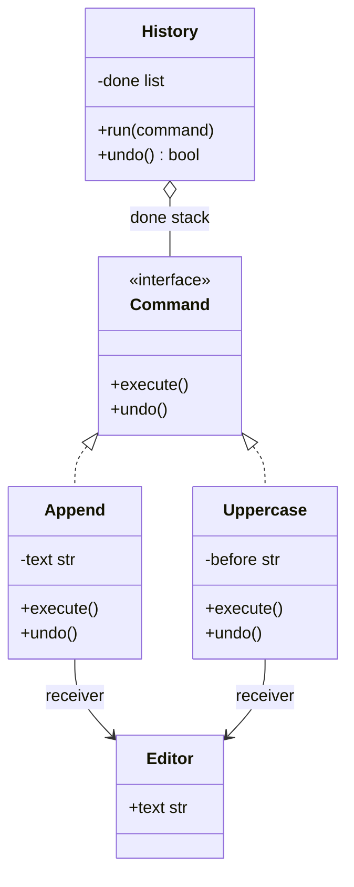
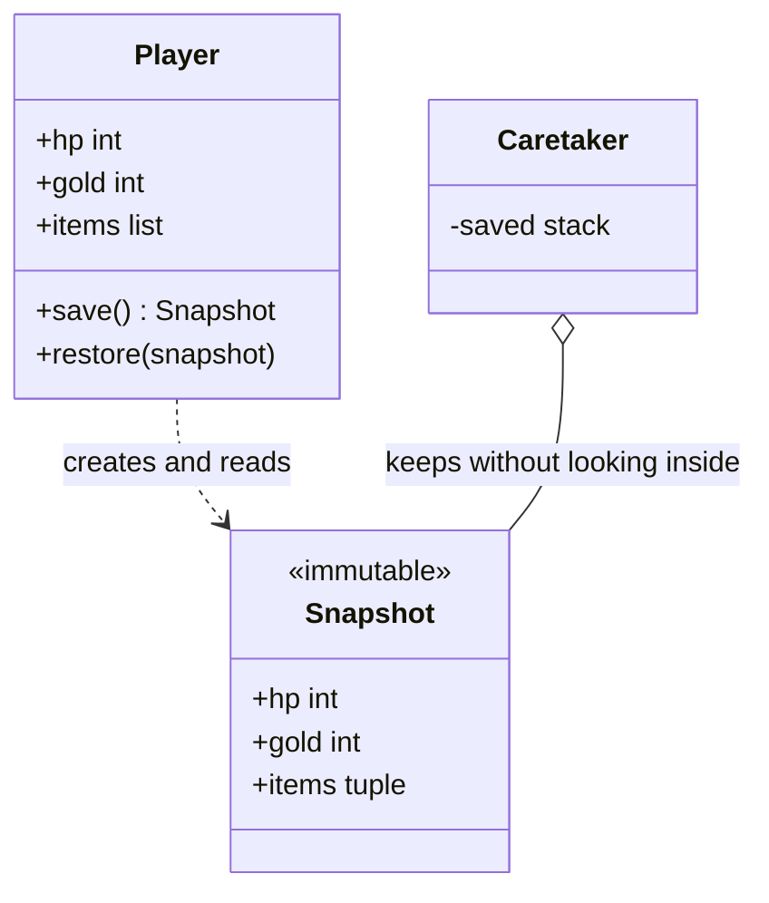

# 10. Command and Memento

> **Draft: written but not yet run.** The code and the expected output in this lesson were prepared by reading the code and the official documentation. They have not been executed yet. If something does not behave as described, trust your tool's real output and report it.

## What you will be able to do
By the end of this lesson you will be able to:
- turn a request into a **Command** object with `execute` and `undo`, and keep a history to undo several steps
- explain why some commands need to remember the old state to undo
- write a **Memento**: an immutable snapshot that lets an object save and restore itself without exposing its internals
- choose between undo by inverse command and undo by snapshot

## Recap
1. (Lesson 09) Why does a subject loop over a copy of its observers? <details><summary>Answer</summary>Observers may subscribe or unsubscribe during the notification, which would break a loop over the live list.</details>
2. (Lesson 02) Why must a prototype's `clone` copy the inner list? <details><summary>Answer</summary>Otherwise the copy and the original share the list (shallow copy).</details>
3. (Lesson 08) Which pattern has independent, swappable algorithms chosen from outside? <details><summary>Answer</summary>Strategy.</details>

## Why it matters
In a restaurant, you do not walk into the kitchen. You write an **order slip** and hand it over. The slip is a **thing**: it can wait in a queue, be passed to another cook, be written in a log, and be cancelled. That is a **Command**: a request turned into an object. A **Memento** is a photograph of a dish before you added salt: when it goes wrong, the kitchen can bring the dish back to how the photograph shows it, and the waiter holding the photograph cannot change the recipe. Together they are the classic engine of **undo**, and the same ideas power job queues, macros, audit logs and game checkpoints.

## What you will build
Two small programs. The first is a text editor whose actions (`Append`, `Uppercase`) are command objects and whose `History` can undo them one by one. The second saves snapshots of a game `Player` (health, gold, items) on a stack and restores them in reverse order.

## Before you start
- **Prerequisites:** Patterns 201 lessons [02, builder and prototype](../phase-1-creational/02-builder-and-prototype.md), [08, strategy and state](08-strategy-and-state.md) and [09, observer and mediator](09-observer-and-mediator.md).
- Time: 55 minutes for one language, 80 minutes if you follow both.
- You need lessons 02, 08 and 09 and Python 3.10 or newer and/or the .NET 11 SDK. The TypeScript snippet is for reading only.
- Source pack (optional): every file is shown in full in this lesson, so you can follow without it. The finished code, the exercise starter and the solution are in the
  course repository https://github.com/Uee03/Code101 under `source/patterns/201-hero-to-super-hero/phase-3-behavioral/10-command-and-memento/` (on that page choose **Code, Download ZIP**, or run
  `git clone https://github.com/Uee03/Code101.git`).

## Steps

### Step 1. Make the lesson folders
**PowerShell, starting folder: anywhere**
```powershell
New-Item -ItemType Directory -Path "$HOME/code101/patterns201/lesson10/python" -Force | Out-Null
New-Item -ItemType Directory -Path "$HOME/code101/patterns201/lesson10/csharp" -Force | Out-Null
Set-Location "$HOME/code101/patterns201/lesson10"
code .
```

**macOS/Linux terminal, starting folder: anywhere**
```bash
mkdir -p ~/code101/patterns201/lesson10/python ~/code101/patterns201/lesson10/csharp
cd ~/code101/patterns201/lesson10
code .
```
Expected result: VS Code opens `lesson10` with empty `python` and `csharp` folders.

### Step 2. See the Command problem (read only)
```python
class SaveButton:
    def on_click(self):
        self.editor.save()

class SaveMenuItem:
    def on_click(self):
        self.editor.save()

class SaveShortcut:
    def on_key(self):
        self.editor.save()
```
Every user interface element calls the editor directly, so the same action is written in many places, the UI classes depend on the editor, and there is nowhere to hang "undo", "queue this for later" or "log what the user did".

**Pattern 1: Command.** *Intent (paraphrased from the catalogue at refactoring.guru):* turn a request into a stand-alone object that contains all information about the request, so that you can pass requests as arguments, delay or queue them, and support undoable operations.


Roles: the **command** interface; **concrete commands** that know their **receiver** (`Editor`) and the data of the request; and an **invoker** (`History`) that runs commands and keeps them. The invoker never knows what a command does.

### Step 3. Write the Command
**File: `~/code101/patterns201/lesson10/python/command.py`**
```python
from abc import ABC, abstractmethod


class Editor:
    def __init__(self) -> None:
        self.text = ""


class Command(ABC):
    @abstractmethod
    def execute(self) -> None:
        ...

    @abstractmethod
    def undo(self) -> None:
        ...


class Append(Command):
    def __init__(self, editor: Editor, text: str) -> None:
        self._editor = editor
        self._text = text

    def execute(self) -> None:
        self._editor.text += self._text

    def undo(self) -> None:
        keep = len(self._editor.text) - len(self._text)
        self._editor.text = self._editor.text[:keep]


class Uppercase(Command):
    def __init__(self, editor: Editor) -> None:
        self._editor = editor
        self._before = ""

    def execute(self) -> None:
        self._before = self._editor.text
        self._editor.text = self._editor.text.upper()

    def undo(self) -> None:
        self._editor.text = self._before


class History:
    def __init__(self) -> None:
        self._done: list[Command] = []

    def run(self, command: Command) -> None:
        command.execute()
        self._done.append(command)

    def undo(self) -> bool:
        if not self._done:
            return False
        self._done.pop().undo()
        return True


def demo() -> None:
    editor = Editor()
    history = History()
    history.run(Append(editor, "Hello"))
    history.run(Append(editor, ", world"))
    print(f"text: [{editor.text}]")
    history.run(Uppercase(editor))
    print(f"text: [{editor.text}]")
    history.undo()
    print(f"text: [{editor.text}]")
    history.undo()
    print(f"text: [{editor.text}]")
    history.undo()
    print(f"text: [{editor.text}]")
    print(f"undo possible: {history.undo()}")
```

**File: `~/code101/patterns201/lesson10/csharp/Command.cs`**
```csharp
namespace CommandDemo;

public class Editor
{
    public string Text { get; set; } = "";
}

public interface ICommand
{
    void Execute();

    void Undo();
}

public class Append : ICommand
{
    private readonly Editor _editor;
    private readonly string _text;

    public Append(Editor editor, string text)
    {
        _editor = editor;
        _text = text;
    }

    public void Execute()
    {
        _editor.Text += _text;
    }

    public void Undo()
    {
        int keep = _editor.Text.Length - _text.Length;
        _editor.Text = _editor.Text.Substring(0, keep);
    }
}

public class Uppercase : ICommand
{
    private readonly Editor _editor;
    private string _before = "";

    public Uppercase(Editor editor)
    {
        _editor = editor;
    }

    public void Execute()
    {
        _before = _editor.Text;
        _editor.Text = _editor.Text.ToUpperInvariant();
    }

    public void Undo()
    {
        _editor.Text = _before;
    }
}

public class History
{
    private readonly Stack<ICommand> _done = new();

    public void Run(ICommand command)
    {
        command.Execute();
        _done.Push(command);
    }

    public bool Undo()
    {
        if (_done.Count == 0)
        {
            return false;
        }
        _done.Pop().Undo();
        return true;
    }
}

public static class Demo
{
    public static void Run()
    {
        var editor = new Editor();
        var history = new History();
        history.Run(new Append(editor, "Hello"));
        history.Run(new Append(editor, ", world"));
        Console.WriteLine($"text: [{editor.Text}]");
        history.Run(new Uppercase(editor));
        Console.WriteLine($"text: [{editor.Text}]");
        history.Undo();
        Console.WriteLine($"text: [{editor.Text}]");
        history.Undo();
        Console.WriteLine($"text: [{editor.Text}]");
        history.Undo();
        Console.WriteLine($"text: [{editor.Text}]");
        Console.WriteLine($"undo possible: {history.Undo()}");
    }
}
```
Two kinds of undo appear here. `Append` can be **reversed by an inverse operation** (remove the last characters it added). `Uppercase` cannot: upper-casing loses the information about which letters were capitals, so it **remembers the old text** (`_before`) when it executes. The history is a **stack** (last in, first out): undo takes the most recent command. A `bool` result tells the caller whether anything was undone. We print the text inside square brackets so that an empty string is visible as `[]`.

**Pattern 2: Memento.** *Intent (paraphrased):* save and restore the previous state of an object without revealing the details of its implementation.

### Step 4. See the Memento problem (read only)
```python
backup = (player.hp, player.gold, player.items)
...
player.hp, player.gold, player.items = backup
```
The caller must know every field of the player (breaks encapsulation), forgets one when a new field is added, and the `items` list in the backup is **the same list object** as the live one, so the backup silently changes along with the player. A good snapshot is taken **by the object itself**, copies mutable parts, and is read-only for everyone else.


Roles: the **originator** (`Player`) creates and restores snapshots; the **memento** (`Snapshot`) is the immutable copy; the **caretaker** (here the `saved` stack in `demo`) stores mementos and gives them back, **never opening them**.

### Step 5. Write the Memento
**File: `~/code101/patterns201/lesson10/python/memento.py`**
```python
from dataclasses import dataclass


@dataclass(frozen=True)
class Snapshot:
    hp: int
    gold: int
    items: tuple[str, ...]


class Player:
    def __init__(self, hp: int, gold: int, items: list[str]) -> None:
        self.hp = hp
        self.gold = gold
        self.items = items

    def save(self) -> Snapshot:
        return Snapshot(self.hp, self.gold, tuple(self.items))

    def restore(self, snapshot: Snapshot) -> None:
        self.hp = snapshot.hp
        self.gold = snapshot.gold
        self.items = list(snapshot.items)

    def describe(self) -> str:
        return f"hp={self.hp} gold={self.gold} items={', '.join(self.items)}"


def demo() -> None:
    player = Player(100, 0, ["sword"])
    saved = [player.save()]
    player.hp = 70
    player.items.append("map")
    saved.append(player.save())
    player.hp = 10
    player.gold = 25
    print(player.describe())
    player.restore(saved.pop())
    print(player.describe())
    player.restore(saved.pop())
    print(player.describe())
```

**File: `~/code101/patterns201/lesson10/csharp/Memento.cs`**
```csharp
namespace MementoDemo;

public record Snapshot(int Hp, int Gold, IReadOnlyList<string> Items);

public class Player
{
    public Player(int hp, int gold, List<string> items)
    {
        Hp = hp;
        Gold = gold;
        Items = items;
    }

    public int Hp { get; set; }

    public int Gold { get; set; }

    public List<string> Items { get; private set; }

    public Snapshot Save() => new Snapshot(Hp, Gold, Items.ToArray());

    public void Restore(Snapshot snapshot)
    {
        Hp = snapshot.Hp;
        Gold = snapshot.Gold;
        Items = new List<string>(snapshot.Items);
    }

    public string Describe() => $"hp={Hp} gold={Gold} items={string.Join(", ", Items)}";
}

public static class Demo
{
    public static void Run()
    {
        var player = new Player(100, 0, new List<string> { "sword" });
        var saved = new Stack<Snapshot>();
        saved.Push(player.Save());
        player.Hp = 70;
        player.Items.Add("map");
        saved.Push(player.Save());
        player.Hp = 10;
        player.Gold = 25;
        Console.WriteLine(player.Describe());
        player.Restore(saved.Pop());
        Console.WriteLine(player.Describe());
        player.Restore(saved.Pop());
        Console.WriteLine(player.Describe());
    }
}
```
`save()` **copies** the item list into a tuple (Python) or array (C#), so later changes to the live list cannot reach the snapshot, and `restore()` makes a new list again so the snapshot stays untouched when the player plays on. The snapshot is a frozen dataclass or a `record`: nobody can modify it. (In C# the strongest form puts the snapshot type *inside* the player class as a private nested type; here the record is public to keep the code short, which means a careless caller could read it. Python cannot enforce hiding at all; it relies on convention.)

### Step 6. Entry files
**File: `~/code101/patterns201/lesson10/python/main.py`**
```python
import command
import memento

print("--- command ---")
command.demo()
print("--- memento ---")
memento.demo()
```

**File: `~/code101/patterns201/lesson10/csharp/Program.cs`**
```csharp
Console.WriteLine("--- command ---");
CommandDemo.Demo.Run();
Console.WriteLine("--- memento ---");
MementoDemo.Demo.Run();
```

**File: `~/code101/patterns201/lesson10/csharp/Lesson.csproj`** (identical to lesson 01)
```xml
<Project Sdk="Microsoft.NET.Sdk">

  <PropertyGroup>
    <OutputType>Exe</OutputType>
    <TargetFramework>net11.0</TargetFramework>
    <ImplicitUsings>enable</ImplicitUsings>
    <Nullable>enable</Nullable>
  </PropertyGroup>

</Project>
```

## Run it
Predict first: after `Uppercase` is undone, what is the text, and what will the **second** undo remove? <details><summary>Answer</summary>The text is `Hello, world` again (the saved `_before`); the second undo removes the `, world` that the second `Append` added, leaving `Hello`.</details>

**PowerShell, folder: `~/code101/patterns201/lesson10/python`**
```powershell
Set-Location "$HOME/code101/patterns201/lesson10/python"
python main.py
```
**macOS/Linux terminal, folder: `~/code101/patterns201/lesson10/python`**
```bash
cd ~/code101/patterns201/lesson10/python
python3 main.py
```
**Any terminal, folder: `~/code101/patterns201/lesson10/csharp`**
```text
dotnet run --project . --nologo
```
Expected output (derived by reading the code, not yet run; identical for Python and C#):
```text
--- command ---
text: [Hello, world]
text: [HELLO, WORLD]
text: [Hello, world]
text: [Hello]
text: []
undo possible: False
--- memento ---
hp=10 gold=25 items=sword, map
hp=70 gold=0 items=sword, map
hp=100 gold=0 items=sword
```

## How it works
**Command** makes the request a value: it can be stored (history), passed (to another thread or a queue), logged and reversed. **Memento** makes the state a value: it can be stored and restored without the caretaker understanding it.

| Undo by | How | Good when | Weak when |
|---|---|---|---|
| **Inverse command** | each command knows how to reverse itself (maybe keeping the old value) | operations are cheap and well understood; the state is large | the operation loses information; external side effects (a sent email) cannot be reversed |
| **Memento (snapshot)** | save the whole state, restore it | the state is small; any operation must be undoable | the state is large (memory); the state includes things that cannot be copied |
| Both | commands store a small memento of what they change | most real editors | complexity |

**Pattern card: Command**
| | |
|---|---|
| Use when | you need undo and redo, queues, scheduling, macros (a command made of commands), logging or replay of operations, or to decouple the sender from the receiver (buttons, menus, shortcuts sharing one action) |
| Do not use when | a plain method call is enough and nothing needs to be stored, queued or undone; a lambda or function value can do the job (in Python and C# a callable is often a perfectly good command) |
| Real-world uses | WPF and MAUI `ICommand`, editor undo stacks, task queues and job runners, database migrations (up and down), database transactions are conceptually similar |
| Related patterns | Memento (undo through snapshots), Strategy (same shape, but a strategy is *how* and is not stored), Chain of Responsibility (lesson 11: commands as requests passed along a chain), Observer (can trigger commands), Composite (a macro command contains commands), Prototype (copy a command to repeat it) |
| Pitfalls | a command that keeps state shared with another (history becomes inconsistent); unbounded history; undo that does not match execute; a command executed twice by accident; commands that capture mutable arguments |

**Pattern card: Memento**
| | |
|---|---|
| Use when | you need snapshots (undo, checkpoints, rollback) and direct access to the state would break encapsulation |
| Do not use when | the state is huge and changes are small (store changes instead); snapshots would contain secrets that must not be copied around; a simple copy of an immutable value does the job (then every value is already a memento) |
| Real-world uses | Python `copy.deepcopy` and `pickle` for snapshots; game save files and checkpoints; editor undo; database savepoints (conceptually) |
| Related patterns | Command (the inverse-undo alternative), Prototype (cloning gives a snapshot too, lesson 02), State (a state machine's current state is itself a small memento), Iterator (iterator state can be saved) |
| Pitfalls | memory growth with many snapshots; shallow snapshots that share mutable parts (the classic bug); snapshots that expose internals to the caretaker; restoring old state that no longer matches the outside world (a file was deleted meanwhile) |

A TypeScript sketch of Command with undo, for reading:
```typescript
interface Command { execute(): void; undo(): void }
class History {
  private done: Command[] = [];
  run(command: Command): void { command.execute(); this.done.push(command); }
  undo(): boolean { const c = this.done.pop(); c?.undo(); return c !== undefined; }
}
```
Misconception: **"undo means running the operation backwards."** Often it is impossible (information was lost) or wrong (an email was sent). Undo is either a stored **old value** (Command with memory, or Memento) or an honest "this cannot be undone".

## Try it
**Rung 1, guided.** The starter has a `Counter`, an `Add` command and a `History`. Copy the `starter` folder of your language to `try10` (copy the folder itself and rename it) and write a `Multiply` command that can be undone (multiplying loses information when the value is 0, so remember the old value).

**File: `try10/main.py`**
```python
from abc import ABC, abstractmethod


class Counter:
    def __init__(self) -> None:
        self.value = 0


class Command(ABC):
    @abstractmethod
    def execute(self) -> None:
        ...

    @abstractmethod
    def undo(self) -> None:
        ...


class Add(Command):
    def __init__(self, counter: Counter, amount: int) -> None:
        self._counter = counter
        self._amount = amount

    def execute(self) -> None:
        self._counter.value += self._amount

    def undo(self) -> None:
        self._counter.value -= self._amount


# TODO 1: write Multiply(Command). __init__ receives the counter and a factor.
#         execute() remembers the old value in self._before and multiplies; undo() puts self._before back.


class History:
    def __init__(self) -> None:
        self._done: list[Command] = []

    def run(self, command: Command) -> None:
        command.execute()
        self._done.append(command)

    def undo(self) -> None:
        self._done.pop().undo()


counter = Counter()
history = History()
history.run(Add(counter, 5))
print(f"value: {counter.value}")
# TODO 2: run Multiply(counter, 3) and print the value, then call history.undo() twice, printing the value after each undo
```

**File: `try10/Program.cs`** (with the same `Lesson.csproj`)
```csharp
var counter = new Counter();
var history = new History();
history.Run(new Add(counter, 5));
Console.WriteLine($"value: {counter.Value}");
// TODO 2: run new Multiply(counter, 3) and print the value, then call history.Undo() twice, printing the value after each undo

// TODO 1: write Multiply : ICommand. The constructor receives the counter and a factor.
//         Execute() remembers the old value in _before and multiplies; Undo() puts _before back.

class Counter
{
    public int Value { get; set; }
}

interface ICommand
{
    void Execute();

    void Undo();
}

class Add : ICommand
{
    private readonly Counter _counter;
    private readonly int _amount;

    public Add(Counter counter, int amount)
    {
        _counter = counter;
        _amount = amount;
    }

    public void Execute()
    {
        _counter.Value += _amount;
    }

    public void Undo()
    {
        _counter.Value -= _amount;
    }
}

class History
{
    private readonly Stack<ICommand> _done = new();

    public void Run(ICommand command)
    {
        command.Execute();
        _done.Push(command);
    }

    public void Undo()
    {
        _done.Pop().Undo();
    }
}
```
Expected output when done (not yet run):
```text
value: 5
value: 15
value: 5
value: 0
```
**Rung 2, change.** Add `redo`: keep a second stack; `undo` pushes the undone command on it, `redo` executes it again, and **running a new command clears the redo stack**. Explain in one sentence why that last rule exists.

**Rung 3, stretch (no single answer).** Your commands send an email and write to a database. Which of them can be undone, and how would you design `undo` for the one that cannot (think of a compensating action, or marking the command as non-undoable)?

<details><summary>Solution</summary>

**File: `try10/main.py`**
```python
from abc import ABC, abstractmethod


class Counter:
    def __init__(self) -> None:
        self.value = 0


class Command(ABC):
    @abstractmethod
    def execute(self) -> None:
        ...

    @abstractmethod
    def undo(self) -> None:
        ...


class Add(Command):
    def __init__(self, counter: Counter, amount: int) -> None:
        self._counter = counter
        self._amount = amount

    def execute(self) -> None:
        self._counter.value += self._amount

    def undo(self) -> None:
        self._counter.value -= self._amount


class Multiply(Command):
    def __init__(self, counter: Counter, factor: int) -> None:
        self._counter = counter
        self._factor = factor
        self._before = 0

    def execute(self) -> None:
        self._before = self._counter.value
        self._counter.value *= self._factor

    def undo(self) -> None:
        self._counter.value = self._before


class History:
    def __init__(self) -> None:
        self._done: list[Command] = []

    def run(self, command: Command) -> None:
        command.execute()
        self._done.append(command)

    def undo(self) -> None:
        self._done.pop().undo()


counter = Counter()
history = History()
history.run(Add(counter, 5))
print(f"value: {counter.value}")
history.run(Multiply(counter, 3))
print(f"value: {counter.value}")
history.undo()
print(f"value: {counter.value}")
history.undo()
print(f"value: {counter.value}")
```

**File: `try10/Program.cs`**
```csharp
var counter = new Counter();
var history = new History();
history.Run(new Add(counter, 5));
Console.WriteLine($"value: {counter.Value}");
history.Run(new Multiply(counter, 3));
Console.WriteLine($"value: {counter.Value}");
history.Undo();
Console.WriteLine($"value: {counter.Value}");
history.Undo();
Console.WriteLine($"value: {counter.Value}");

class Counter
{
    public int Value { get; set; }
}

interface ICommand
{
    void Execute();

    void Undo();
}

class Add : ICommand
{
    private readonly Counter _counter;
    private readonly int _amount;

    public Add(Counter counter, int amount)
    {
        _counter = counter;
        _amount = amount;
    }

    public void Execute()
    {
        _counter.Value += _amount;
    }

    public void Undo()
    {
        _counter.Value -= _amount;
    }
}

class Multiply : ICommand
{
    private readonly Counter _counter;
    private readonly int _factor;
    private int _before;

    public Multiply(Counter counter, int factor)
    {
        _counter = counter;
        _factor = factor;
    }

    public void Execute()
    {
        _before = _counter.Value;
        _counter.Value *= _factor;
    }

    public void Undo()
    {
        _counter.Value = _before;
    }
}

class History
{
    private readonly Stack<ICommand> _done = new();

    public void Run(ICommand command)
    {
        command.Execute();
        _done.Push(command);
    }

    public void Undo()
    {
        _done.Pop().Undo();
    }
}
```
The redo rule (Rung 2): after a new action, the old "future" no longer follows from the current state, so redoing it would produce a state the user never saw. Rung 3 has no single answer; a compensating action ("send a correction email", "delete the row") is not the same as undo, and many systems simply mark such commands non-undoable.
</details>

## Check yourself
1. Which of `Append` and `Uppercase` needs to remember the old state, and why? <details><summary>Answer</summary>`Uppercase`: the operation loses information (which letters were capitals), so it cannot be reversed by an inverse operation.</details>
2. Predict: you call `history.undo()` on a fresh history. What does it return? <details><summary>Answer</summary>`False`; there is nothing to undo.</details>
3. What bug appears if `save()` stores `self.items` itself instead of a copy? <details><summary>Answer</summary>The snapshot shares the live list, so changes after saving appear inside the snapshot and restoring does nothing useful.</details>
4. Why is the caretaker not allowed to open the memento? <details><summary>Answer</summary>So that the originator's internals stay private; only the originator knows how to read its own snapshot.</details>

## Mixed review
1. (Lesson 09) How would you tell all open windows that an undo happened? <details><summary>Answer</summary>Make `History` a subject (Observer) and let windows subscribe.</details>
2. (Lesson 08) An `Undo` button is enabled only when something can be undone. Which pattern describes enabling and disabling by situation? <details><summary>Answer</summary>State (or a mediator rule); the `undo()` bool result is the simplest signal.</details>
3. (Lesson 06) A macro that contains many commands is which structural pattern? <details><summary>Answer</summary>Composite: a command made of commands.</details>
4. (Lesson 02) Which creational pattern gives you "a copy of the object" as a snapshot? <details><summary>Answer</summary>Prototype (with a deep copy).</details>
5. (Patterns 101, DIP) Why does `History` depend on `Command`, not on `Append`? <details><summary>Answer</summary>It depends on an abstraction, so new commands need no change to the history.</details>

## Common mistakes
These messages are typical and have **not** been reproduced yet; the wording depends on your versions.
| Symptom or error text (typical) | Cause | Fix |
|---|---|---|
| `IndexError: pop from empty list` (Python starter) or `System.InvalidOperationException: Stack empty.` (C# starter) | you called `undo` more often than you ran commands | check for an empty history, as the lesson code does with `if not self._done` / `Count == 0` |
| undo restores the wrong text | `undo` used the current text instead of a saved copy | save the value in `execute`, use it in `undo` |
| the snapshot changes after saving | it shares a mutable list with the live object | copy the list when saving and when restoring |
| `dataclasses.FrozenInstanceError: cannot assign to field 'hp'` | you tried to change a snapshot | change the player, then save a new snapshot |
| `MSB1003: Specify a project or solution file` | the terminal is not in the `csharp` folder | `cd` into the folder that contains `Lesson.csproj` |

## Best practice
Make every command either undoable with the data it stores, or explicitly non-undoable, and bound the history (or the number of snapshots) so memory stays predictable. Source: Command, Refactoring.Guru https://refactoring.guru/design-patterns/command and Memento, Refactoring.Guru https://refactoring.guru/design-patterns/memento

## Going further
- Cross-checks: https://sourcemaking.com/design_patterns/command and https://sourcemaking.com/design_patterns/memento
- Python `copy`: https://docs.python.org/3/library/copy.html
- Lesson 11 introduces Chain of Responsibility, where requests like these travel through a series of handlers.

## Summary
- You turned requests into Command objects with `execute` and `undo` and kept a history stack.
- You saw why a lossy command must remember the old value.
- You wrote a Memento: an immutable snapshot taken and restored by the object itself.
- You compared undo by inverse command and by snapshot and named their limits.

## Next lesson
11. Iterator, Template Method, Visitor and Chain of Responsibility: four patterns about walking, structuring and routing work.
