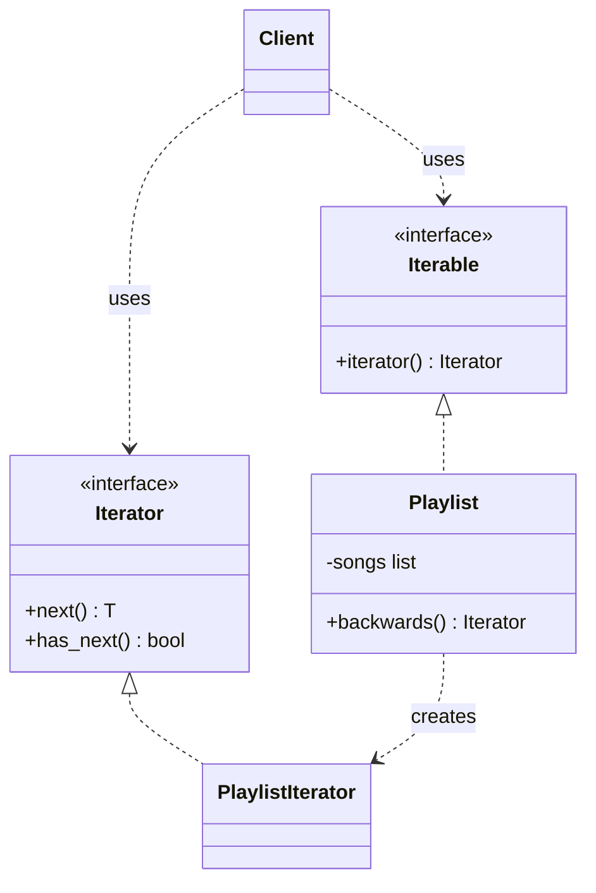
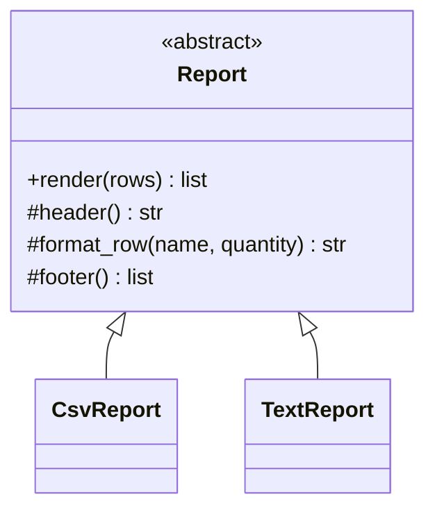
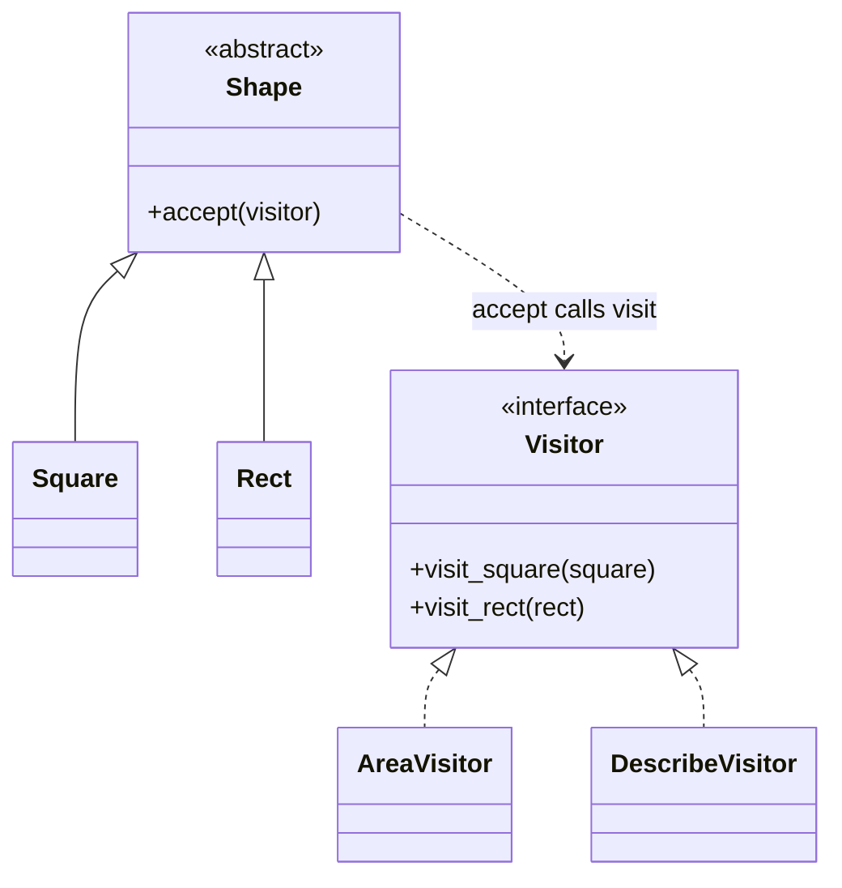
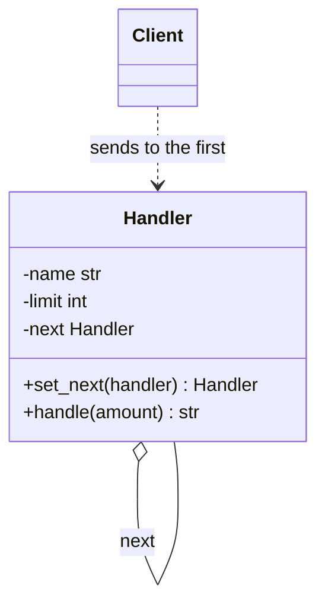

# 11. Iterator, Template Method, Visitor and Chain of Responsibility

> **Draft: written but not yet run.** The code and the expected output in this lesson were prepared by reading the code and the official documentation. They have not been executed yet. If something does not behave as described, trust your tool's real output and report it.

## What you will be able to do
By the end of this lesson you will be able to:
- write an **Iterator** so that clients walk a collection without knowing how it stores its items
- write a **Template Method** that fixes the order of steps in a base class and lets subclasses fill in some of them
- add a new operation to a class family with a **Visitor** without editing the classes, and say what that costs
- build a **Chain of Responsibility** where each handler either deals with a request or passes it on

## Recap
1. (Lesson 10) Why does `Uppercase` store the old text but `Append` does not need to? <details><summary>Answer</summary>Upper-casing loses information so it cannot be reversed by an inverse; appending can be reversed by removing the added characters.</details>
2. (Lesson 08) How is Strategy different from Template Method (a hint: look at composition and inheritance)? <details><summary>Answer</summary>Strategy varies behavior by *composition* (a held object); Template Method varies it by *inheritance* (subclasses override steps).</details>
3. (Lesson 06) What does a Composite let a client do with a tree? <details><summary>Answer</summary>Treat a leaf and a group the same way through one interface.</details>

## Why it matters
Four small ideas that you already use without names. A **for loop over a list** works because lists have **iterators**. A **recipe card** ("1. prep, 2. cook, 3. serve") with steps that differ per dish is a **template**. A **health inspector** who visits every kind of kitchen and does a different check for each is a **visitor**; the kitchens do not need to learn inspection. And a **support desk with levels** (first line, second line, manager) is a **chain**: the request goes up until someone can handle it. This lesson is long because it covers four patterns; take a break after Step 5.

## What you will build
Four tiny programs in one run: iterate a playlist forwards and backwards with independent positions; render two report formats from one skeleton; compute the area and a description of shapes with two visitors; and approve expenses through a manager, director and CEO chain.

## Before you start
- **Prerequisites:** Patterns 201 lessons [05, decorator and proxy](../phase-2-structural/05-decorator-and-proxy.md), [06, composite and flyweight](../phase-2-structural/06-composite-and-flyweight.md), [08, strategy and state](08-strategy-and-state.md) and [10, command and memento](10-command-and-memento.md).
- Time: about 80 minutes for one language in two sittings (patterns 1 and 2, then 3 and 4), 120 minutes for both languages.
- You need lessons 05, 06, 08 and 10 and Python 3.10 or newer and/or the .NET 11 SDK. The TypeScript snippet is for reading only.
- Source pack (optional): every file is shown in full in this lesson, so you can follow without it. The finished code, the exercise starter and the solution are in the
  course repository https://github.com/Uee03/Code101 under `source/patterns/201-hero-to-super-hero/phase-3-behavioral/11-iterator-template-method-visitor-chain/` (on that page choose **Code, Download ZIP**, or run
  `git clone https://github.com/Uee03/Code101.git`).

## Steps

### Step 1. Make the lesson folders
**PowerShell, starting folder: anywhere**
```powershell
New-Item -ItemType Directory -Path "$HOME/code101/patterns201/lesson11/python" -Force | Out-Null
New-Item -ItemType Directory -Path "$HOME/code101/patterns201/lesson11/csharp" -Force | Out-Null
Set-Location "$HOME/code101/patterns201/lesson11"
code .
```

**macOS/Linux terminal, starting folder: anywhere**
```bash
mkdir -p ~/code101/patterns201/lesson11/python ~/code101/patterns201/lesson11/csharp
cd ~/code101/patterns201/lesson11
code .
```
Expected result: VS Code opens `lesson11` with empty `python` and `csharp` folders.

### Step 2. Pattern 1: Iterator
**The problem (read only).**
```python
for i in range(len(playlist.songs)):
    print(playlist.songs[i])
```
The client knows that the playlist stores a list and that items are reached by index. If the playlist later becomes a tree, a database cursor or an endless generator, every loop in the program breaks.

*Intent (paraphrased from the catalogue at refactoring.guru):* let clients traverse the elements of a collection without exposing its underlying representation (list, tree, stack).


Both languages build this into the language: Python has `__iter__` and `__next__` (and `yield` generators), C# has `IEnumerable<T>` and `IEnumerator<T>` (and `yield return`). Because each iterator carries **its own position**, two traversals of the same collection do not disturb each other.

**File: `~/code101/patterns201/lesson11/python/iterator.py`**
```python
from typing import Iterator


class Playlist:
    def __init__(self, songs: list[str]) -> None:
        self._songs = songs

    def __iter__(self) -> Iterator[str]:
        return iter(self._songs)

    def backwards(self) -> Iterator[str]:
        index = len(self._songs) - 1
        while index >= 0:
            yield self._songs[index]
            index -= 1


def demo() -> None:
    playlist = Playlist(["Intro", "Verse", "Chorus"])
    print(f"forward: {', '.join(playlist)}")
    print(f"backwards: {', '.join(playlist.backwards())}")
    first = iter(playlist)
    second = iter(playlist)
    print(f"first: {next(first)}, {next(first)}")
    print(f"second: {next(second)}")
```

**File: `~/code101/patterns201/lesson11/csharp/Iterator.cs`**
```csharp
using System.Collections;

namespace IteratorDemo;

public class Playlist : IEnumerable<string>
{
    private readonly List<string> _songs;

    public Playlist(List<string> songs)
    {
        _songs = songs;
    }

    public IEnumerator<string> GetEnumerator() => _songs.GetEnumerator();

    IEnumerator IEnumerable.GetEnumerator() => GetEnumerator();

    public IEnumerable<string> Backwards()
    {
        for (int i = _songs.Count - 1; i >= 0; i--)
        {
            yield return _songs[i];
        }
    }
}

public static class Demo
{
    public static void Run()
    {
        var playlist = new Playlist(new List<string> { "Intro", "Verse", "Chorus" });
        Console.WriteLine($"forward: {string.Join(", ", playlist)}");
        Console.WriteLine($"backwards: {string.Join(", ", playlist.Backwards())}");
        using var first = playlist.GetEnumerator();
        using var second = playlist.GetEnumerator();
        first.MoveNext();
        string a = first.Current;
        first.MoveNext();
        string b = first.Current;
        second.MoveNext();
        Console.WriteLine($"first: {a}, {b}");
        Console.WriteLine($"second: {second.Current}");
    }
}
```
A function with `yield` (Python) or `yield return` (C#) is a **generator**: it pauses after each item and resumes where it stopped, so it produces items **lazily** (one at a time, only when asked). `backwards` never builds a reversed copy of the list. In C#, `MoveNext()` advances and `Current` reads the item; `using var` makes sure the enumerator is disposed at the end of the method.

**Pattern card: Iterator**
| | |
|---|---|
| Use when | you want to hide how a collection is stored, offer several ways to traverse it, or produce items lazily or endlessly |
| Do not use when | a plain list and a `for` loop are enough and you have one traversal; do not write your own iterator class when a generator does it |
| Real-world uses | Python iterators and generators, `for` loops; C# `IEnumerable<T>`, `foreach`, LINQ; database cursors; file line readers |
| Related patterns | Composite (iterators walk trees), Visitor (walks and acts), Memento (an iterator's position can be saved), Factory Method (`__iter__` / `GetEnumerator` is one) |
| Pitfalls | changing the collection while iterating (list changes during a loop); iterators that are consumed once and then empty; hidden expensive work in a lazy iterator (it runs when you iterate, not when you create it) |

### Step 3. Pattern 2: Template Method
**The problem (read only).**
```python
class CsvReport:
    def render(self, rows):
        lines = ["name,qty"]
        for name, qty in rows:
            lines.append(f"{name},{qty}")
        return lines

class TextReport:
    def render(self, rows):
        lines = ["== Report =="]
        for name, qty in rows:
            lines.append(f"{name} x{qty}")
        lines.append("== end ==")
        return lines
```
The same skeleton (header, one line per row, optional footer) is copied into every report class. Changing the skeleton, for example to skip empty rows, means editing each copy.

*Intent (paraphrased):* define the skeleton of an algorithm in a base class and let subclasses override specific steps without changing the structure.


`render` is the **template method**: it is written once, fixes the order, and calls the **steps**. Some steps are **abstract** (subclasses *must* provide them), some are **hooks** (a default that subclasses *may* override, like `footer`).

**File: `~/code101/patterns201/lesson11/python/template_method.py`**
```python
from abc import ABC, abstractmethod


class Report(ABC):
    def render(self, rows: list[tuple[str, int]]) -> list[str]:
        lines = [self.header()]
        for name, quantity in rows:
            lines.append(self.format_row(name, quantity))
        lines.extend(self.footer())
        return lines

    @abstractmethod
    def header(self) -> str:
        ...

    @abstractmethod
    def format_row(self, name: str, quantity: int) -> str:
        ...

    def footer(self) -> list[str]:
        return []


class CsvReport(Report):
    def header(self) -> str:
        return "name,qty"

    def format_row(self, name: str, quantity: int) -> str:
        return f"{name},{quantity}"


class TextReport(Report):
    def header(self) -> str:
        return "== Report =="

    def format_row(self, name: str, quantity: int) -> str:
        return f"{name} x{quantity}"

    def footer(self) -> list[str]:
        return ["== end =="]


def demo() -> None:
    rows = [("apple", 3), ("pear", 5)]
    print("[csv]")
    for line in CsvReport().render(rows):
        print(line)
    print("[text]")
    for line in TextReport().render(rows):
        print(line)
```

**File: `~/code101/patterns201/lesson11/csharp/TemplateMethod.cs`**
```csharp
namespace TemplateMethodDemo;

public abstract class Report
{
    public IReadOnlyList<string> Render((string Name, int Quantity)[] rows)
    {
        var lines = new List<string> { Header() };
        foreach (var (name, quantity) in rows)
        {
            lines.Add(FormatRow(name, quantity));
        }
        lines.AddRange(Footer());
        return lines;
    }

    protected abstract string Header();

    protected abstract string FormatRow(string name, int quantity);

    protected virtual IEnumerable<string> Footer() => Array.Empty<string>();
}

public class CsvReport : Report
{
    protected override string Header() => "name,qty";

    protected override string FormatRow(string name, int quantity) => $"{name},{quantity}";
}

public class TextReport : Report
{
    protected override string Header() => "== Report ==";

    protected override string FormatRow(string name, int quantity) => $"{name} x{quantity}";

    protected override IEnumerable<string> Footer() => new[] { "== end ==" };
}

public static class Demo
{
    public static void Run()
    {
        var rows = new[] { ("apple", 3), ("pear", 5) };
        Console.WriteLine("[csv]");
        foreach (var line in new CsvReport().Render(rows))
        {
            Console.WriteLine(line);
        }
        Console.WriteLine("[text]");
        foreach (var line in new TextReport().Render(rows))
        {
            Console.WriteLine(line);
        }
    }
}
```
The order (header, rows, footer) is decided **once**. "Hollywood principle": the base class says "don't call us, we'll call you" and calls the subclass steps. It is **inheritance** where Strategy used composition: Template Method is simpler but less flexible (the variation is fixed when the class is chosen, and you cannot combine two parents).

**Pattern card: Template Method**
| | |
|---|---|
| Use when | several classes share the same algorithm skeleton but differ in some steps; you want to control which steps may be overridden |
| Do not use when | the variation is better chosen at run time (use Strategy); the hierarchy would need several unrelated variation points (class explosion); one function with a function parameter does the job |
| Real-world uses | Python `unittest.TestCase` (`setUp`, test method, `tearDown`); .NET `BackgroundService` (calls your `ExecuteAsync`); frameworks with lifecycle methods |
| Related patterns | Strategy (composition instead of inheritance), Factory Method (a creation step of a template), Decorator and Bridge (other ways to vary), Observer (hooks are like events) |
| Pitfalls | the fragile base class (a change in the template breaks subclasses); too many abstract steps; subclasses forced to call `super` in the right order; Liskov violations when a subclass ignores the skeleton |

### Step 4. Pattern 3: Visitor
**The problem (read only).**
```python
def area(shape):
    if isinstance(shape, Square):
        return shape.side * shape.side
    if isinstance(shape, Rect):
        return shape.width * shape.height
    raise TypeError("unknown shape")
```
Every new operation (describe, export to XML, draw) is another `isinstance` ladder, or a new method in every shape class, which makes the shapes grow and mix unrelated jobs (SRP). You want to **add operations without touching the shapes**.

*Intent (paraphrased):* separate an algorithm from the objects it works on, by moving the operation into a visitor object that has one method per concrete class.


The trick is **double dispatch**: `shape.accept(visitor)` first picks the method by the *shape's* class (`Square.accept`), which then calls `visitor.visit_square(self)`, picking the method by the *visitor's* class and by the *shape type* it names. Two decisions, no `if`.

**File: `~/code101/patterns201/lesson11/python/visitor.py`**
```python
from abc import ABC, abstractmethod
from typing import Any


class Shape(ABC):
    @abstractmethod
    def accept(self, visitor: "Visitor") -> Any:
        ...


class Square(Shape):
    def __init__(self, side: int) -> None:
        self.side = side

    def accept(self, visitor: "Visitor") -> Any:
        return visitor.visit_square(self)


class Rect(Shape):
    def __init__(self, width: int, height: int) -> None:
        self.width = width
        self.height = height

    def accept(self, visitor: "Visitor") -> Any:
        return visitor.visit_rect(self)


class Visitor(ABC):
    @abstractmethod
    def visit_square(self, square: Square) -> Any:
        ...

    @abstractmethod
    def visit_rect(self, rect: Rect) -> Any:
        ...


class AreaVisitor(Visitor):
    def visit_square(self, square: Square) -> int:
        return square.side * square.side

    def visit_rect(self, rect: Rect) -> int:
        return rect.width * rect.height


class DescribeVisitor(Visitor):
    def visit_square(self, square: Square) -> str:
        return f"square {square.side}"

    def visit_rect(self, rect: Rect) -> str:
        return f"rect {rect.width}x{rect.height}"


def demo() -> None:
    shapes: list[Shape] = [Square(3), Rect(2, 5)]
    area = AreaVisitor()
    describe = DescribeVisitor()
    total = 0
    for shape in shapes:
        value = shape.accept(area)
        total += value
        print(f"{shape.accept(describe)} -> area {value}")
    print(f"total area: {total}")
```

**File: `~/code101/patterns201/lesson11/csharp/Visitor.cs`**
```csharp
namespace VisitorDemo;

public interface IShapeVisitor<T>
{
    T VisitSquare(Square square);

    T VisitRect(Rect rect);
}

public abstract class Shape
{
    public abstract T Accept<T>(IShapeVisitor<T> visitor);
}

public class Square : Shape
{
    public Square(int side)
    {
        Side = side;
    }

    public int Side { get; }

    public override T Accept<T>(IShapeVisitor<T> visitor) => visitor.VisitSquare(this);
}

public class Rect : Shape
{
    public Rect(int width, int height)
    {
        Width = width;
        Height = height;
    }

    public int Width { get; }

    public int Height { get; }

    public override T Accept<T>(IShapeVisitor<T> visitor) => visitor.VisitRect(this);
}

public class AreaVisitor : IShapeVisitor<int>
{
    public int VisitSquare(Square square) => square.Side * square.Side;

    public int VisitRect(Rect rect) => rect.Width * rect.Height;
}

public class DescribeVisitor : IShapeVisitor<string>
{
    public string VisitSquare(Square square) => $"square {square.Side}";

    public string VisitRect(Rect rect) => $"rect {rect.Width}x{rect.Height}";
}

public static class Demo
{
    public static void Run()
    {
        var shapes = new Shape[] { new Square(3), new Rect(2, 5) };
        var area = new AreaVisitor();
        var describe = new DescribeVisitor();
        int total = 0;
        foreach (var shape in shapes)
        {
            int value = shape.Accept(area);
            total += value;
            Console.WriteLine($"{shape.Accept(describe)} -> area {value}");
        }
        Console.WriteLine($"total area: {total}");
    }
}
```
In C# the visitor interface is **generic** (`IShapeVisitor<T>`) so a visitor can return an `int` or a `string`; in Python, return types are not checked, so `Any` documents "depends on the visitor". Adding a **new operation** (say `PerimeterVisitor`) is one new class and touches no shape. Adding a **new shape** (a `Circle`) is the expensive direction: every visitor must get a new method. Visitor makes one direction cheap and the other costly, so use it where the **class family is stable** and operations keep growing (compilers, syntax trees, document formats).

**Pattern card: Visitor**
| | |
|---|---|
| Use when | you need many unrelated operations over a stable family of classes (for example a syntax tree) and do not want to pollute the classes; you need to run an operation over a whole composite structure |
| Do not use when | the class family changes often (every visitor breaks); there are one or two operations (put them in the classes); the language gives you a lighter tool: Python `functools.singledispatch` and `match`, C# `switch` expressions over types |
| Real-world uses | Python `ast.NodeVisitor`; .NET `ExpressionVisitor` and the Roslyn syntax walkers; compilers, linters and document exporters |
| Related patterns | Composite (visitors walk trees), Iterator (walks without acting), Command (an operation as an object), Strategy (swaps one algorithm; a visitor has one method per type) |
| Pitfalls | the **expression problem** (cheap new operations, expensive new types); visitors needing access to private data (leaks internals); every visitor method duplicating tree-walking code; forgetting `accept` on a new class |

*(Break here if you want two sittings. Everything above runs on its own.)*

### Step 5. Pattern 4: Chain of Responsibility
**The problem (read only).**
```python
def approve(amount):
    if amount <= 100:
        return "manager"
    elif amount <= 1000:
        return "director"
    elif amount <= 10000:
        return "ceo"
    return None
```
The function knows every level and its limit. Adding a level, reordering them or making the list configurable means editing this function. The sender is welded to the whole decision structure.

*Intent (paraphrased):* pass a request along a chain of handlers; each handler decides either to handle it or to pass it to the next.


**File: `~/code101/patterns201/lesson11/python/chain.py`**
```python
from typing import Optional


class Handler:
    def __init__(self, name: str, limit: int) -> None:
        self._name = name
        self._limit = limit
        self._next: Optional["Handler"] = None

    def set_next(self, handler: "Handler") -> "Handler":
        self._next = handler
        return handler

    def handle(self, amount: int) -> str:
        if amount <= self._limit:
            return f"{amount}: approved by {self._name}"
        if self._next is not None:
            return self._next.handle(amount)
        return f"{amount}: nobody can approve"


def demo() -> None:
    manager = Handler("manager", 100)
    manager.set_next(Handler("director", 1000)).set_next(Handler("ceo", 10000))
    for amount in (50, 500, 5000, 50000):
        print(manager.handle(amount))
```

**File: `~/code101/patterns201/lesson11/csharp/Chain.cs`**
```csharp
namespace ChainDemo;

public class Handler
{
    private readonly string _name;
    private readonly int _limit;
    private Handler? _next;

    public Handler(string name, int limit)
    {
        _name = name;
        _limit = limit;
    }

    public Handler SetNext(Handler handler)
    {
        _next = handler;
        return handler;
    }

    public string Handle(int amount)
    {
        if (amount <= _limit)
        {
            return $"{amount}: approved by {_name}";
        }
        if (_next != null)
        {
            return _next.Handle(amount);
        }
        return $"{amount}: nobody can approve";
    }
}

public static class Demo
{
    public static void Run()
    {
        var manager = new Handler("manager", 100);
        manager.SetNext(new Handler("director", 1000)).SetNext(new Handler("ceo", 10000));
        foreach (var amount in new[] { 50, 500, 5000, 50000 })
        {
            Console.WriteLine(manager.Handle(amount));
        }
    }
}
```
`set_next` returns the handler it was given, so the chain can be built in one readable line. The client only knows the **first** handler. The last case shows the important design question: what happens when **nobody** handles the request? Here the end of the chain answers explicitly; silently dropping a request is a classic bug. In this lesson one handler class is configured with data (a name and a limit); the classic form uses a handler subclass per rule, which is the better choice when the rules differ in *kind*, not just in a number (see the exercise).

**Pattern card: Chain of Responsibility**
| | |
|---|---|
| Use when | more than one object may handle a request and the handler is not known in advance; the set or order of handlers should be configurable at run time; you want a pipeline of checks or filters |
| Do not use when | exactly one known receiver exists; every step must always run (use a Decorator or a plain pipeline); the order is a hidden source of bugs and a plain function with `if` is clearer |
| Real-world uses | ASP.NET Core middleware; Python WSGI middleware; DOM event bubbling; Python `logging` passing a record up to parent loggers' handlers; support escalation levels |
| Related patterns | Decorator (same shape, but every layer always runs), Command (the request can be a command), Composite (a chain along a parent path), Observer (all listeners run, in a chain one handles) |
| Pitfalls | a request that falls off the end unhandled; handlers that both handle and pass on by accident; long chains that are hard to debug (log each hop); cycles; order dependence |

A TypeScript sketch of Iterator through a generator, for reading:
```typescript
class Playlist {
  constructor(private songs: string[]) {}
  *backwards(): Generator<string> {
    for (let i = this.songs.length - 1; i >= 0; i--) yield this.songs[i];
  }
}
```

### Step 6. Entry files
**File: `~/code101/patterns201/lesson11/python/main.py`**
```python
import chain
import iterator
import template_method
import visitor

print("--- iterator ---")
iterator.demo()
print("--- template method ---")
template_method.demo()
print("--- visitor ---")
visitor.demo()
print("--- chain of responsibility ---")
chain.demo()
```

**File: `~/code101/patterns201/lesson11/csharp/Program.cs`**
```csharp
Console.WriteLine("--- iterator ---");
IteratorDemo.Demo.Run();
Console.WriteLine("--- template method ---");
TemplateMethodDemo.Demo.Run();
Console.WriteLine("--- visitor ---");
VisitorDemo.Demo.Run();
Console.WriteLine("--- chain of responsibility ---");
ChainDemo.Demo.Run();
```

**File: `~/code101/patterns201/lesson11/csharp/Lesson.csproj`** (identical to lesson 01)
```xml
<Project Sdk="Microsoft.NET.Sdk">

  <PropertyGroup>
    <OutputType>Exe</OutputType>
    <TargetFramework>net11.0</TargetFramework>
    <ImplicitUsings>enable</ImplicitUsings>
    <Nullable>enable</Nullable>
  </PropertyGroup>

</Project>
```

## Run it
Predict first: (1) what do `first` and `second` print, and why is `second` not `Verse`? (2) which line proves the chain has an unhandled case? <details><summary>Answer</summary>(1) `first` prints `Intro, Verse` and `second` prints `Intro`: every iterator has its own position. (2) `50000: nobody can approve`.</details>

**PowerShell, folder: `~/code101/patterns201/lesson11/python`**
```powershell
Set-Location "$HOME/code101/patterns201/lesson11/python"
python main.py
```
**macOS/Linux terminal, folder: `~/code101/patterns201/lesson11/python`**
```bash
cd ~/code101/patterns201/lesson11/python
python3 main.py
```
**Any terminal, folder: `~/code101/patterns201/lesson11/csharp`**
```text
dotnet run --project . --nologo
```
Expected output (derived by reading the code, not yet run; identical for Python and C#):
```text
--- iterator ---
forward: Intro, Verse, Chorus
backwards: Chorus, Verse, Intro
first: Intro, Verse
second: Intro
--- template method ---
[csv]
name,qty
apple,3
pear,5
[text]
== Report ==
apple x3
pear x5
== end ==
--- visitor ---
square 3 -> area 9
rect 2x5 -> area 10
total area: 19
--- chain of responsibility ---
50: approved by manager
500: approved by director
5000: approved by ceo
50000: nobody can approve
```

## How it works
Four ideas, one sentence each:
- **Iterator** moves *traversal* out of the collection into an object with its own position.
- **Template Method** fixes the *order* of an algorithm in a base class and lets subclasses fill the steps (variation by inheritance).
- **Visitor** moves an *operation* out of a class family into a separate object (cheap new operations, costly new types).
- **Chain of Responsibility** passes a *request* along handlers until one handles it (sender and handler decoupled).

Choosing among the ten behavioral patterns (the **phase 3 summary**):
| You want to... | Pattern |
|---|---|
| swap one algorithm from outside | Strategy |
| change behavior with the object's own state | State |
| tell many listeners that something changed | Observer |
| centralize how peers talk | Mediator |
| turn a request into an object (queue, undo) | Command |
| snapshot and restore state | Memento |
| walk a collection without knowing its storage | Iterator |
| fix the skeleton, vary some steps by subclass | Template Method |
| add operations to a stable class family | Visitor |
| let one of several handlers take a request | Chain of Responsibility |

Misconception: **"Visitor means Observer-style visiting, like a web visitor."** The name comes from "visiting" each object of a structure. It has nothing to do with notifications.

## Try it
**Rung 1, guided.** The starter has a password `Check` chain with one rule. Copy the `starter` folder of your language to `try11` (copy the folder itself and rename it), add the digit rule and connect it.

**File: `try11/main.py`**
```python
from typing import Optional


class Check:
    def __init__(self) -> None:
        self._next: Optional["Check"] = None

    def set_next(self, check: "Check") -> "Check":
        self._next = check
        return check

    def verify(self, password: str) -> str:
        problem = self.problem(password)
        if problem is not None:
            return problem
        if self._next is not None:
            return self._next.verify(password)
        return "ok"

    def problem(self, password: str) -> Optional[str]:
        return None


class MinLength(Check):
    def problem(self, password: str) -> Optional[str]:
        if len(password) < 8:
            return "too short"
        return None


# TODO 1: write HasDigit(Check): problem() returns "needs a digit" when the password has no digit, otherwise None.
#         Hint: any(character.isdigit() for character in password)

chain = MinLength()
# TODO 2: chain.set_next(HasDigit())
for password in ("short", "abcdefgh", "abcdefg1"):
    print(f"{password}: {chain.verify(password)}")
```

**File: `try11/Program.cs`** (with the same `Lesson.csproj`)
```csharp
var chain = new MinLength();
// TODO 2: chain.SetNext(new HasDigit());
foreach (var password in new[] { "short", "abcdefgh", "abcdefg1" })
{
    Console.WriteLine($"{password}: {chain.Verify(password)}");
}

// TODO 1: write HasDigit : Check. Problem() returns "needs a digit" when the password has no digit, otherwise null.
//         Hint: password.Any(char.IsDigit)

class Check
{
    private Check? _next;

    public Check SetNext(Check check)
    {
        _next = check;
        return check;
    }

    public string Verify(string password)
    {
        string? problem = Problem(password);
        if (problem != null)
        {
            return problem;
        }
        if (_next != null)
        {
            return _next.Verify(password);
        }
        return "ok";
    }

    protected virtual string? Problem(string password) => null;
}

class MinLength : Check
{
    protected override string? Problem(string password) => password.Length < 8 ? "too short" : null;
}
```
Expected output when done (not yet run):
```text
short: too short
abcdefgh: needs a digit
abcdefg1: ok
```
(The `verify` method here is itself a small **Template Method**: it fixes the order "check my rule, then the next", and subclasses supply only `problem`.)

**Rung 2, change.** Add a third rule, `NoSpaces`, that returns `"no spaces allowed"`, and place it **between** the other two. Predict the result for `"abc defg1"` (nine characters, one space, one digit) before you run it.

**Rung 3, stretch (no single answer).** The chain stops at the first problem. Design a variant that **collects every problem** instead. Which pattern from today's list fits better, and what does the return type become?

<details><summary>Solution</summary>

**File: `try11/main.py`**
```python
from typing import Optional


class Check:
    def __init__(self) -> None:
        self._next: Optional["Check"] = None

    def set_next(self, check: "Check") -> "Check":
        self._next = check
        return check

    def verify(self, password: str) -> str:
        problem = self.problem(password)
        if problem is not None:
            return problem
        if self._next is not None:
            return self._next.verify(password)
        return "ok"

    def problem(self, password: str) -> Optional[str]:
        return None


class MinLength(Check):
    def problem(self, password: str) -> Optional[str]:
        if len(password) < 8:
            return "too short"
        return None


class HasDigit(Check):
    def problem(self, password: str) -> Optional[str]:
        if not any(character.isdigit() for character in password):
            return "needs a digit"
        return None


chain = MinLength()
chain.set_next(HasDigit())
for password in ("short", "abcdefgh", "abcdefg1"):
    print(f"{password}: {chain.verify(password)}")
```

**File: `try11/Program.cs`**
```csharp
var chain = new MinLength();
chain.SetNext(new HasDigit());
foreach (var password in new[] { "short", "abcdefgh", "abcdefg1" })
{
    Console.WriteLine($"{password}: {chain.Verify(password)}");
}

class Check
{
    private Check? _next;

    public Check SetNext(Check check)
    {
        _next = check;
        return check;
    }

    public string Verify(string password)
    {
        string? problem = Problem(password);
        if (problem != null)
        {
            return problem;
        }
        if (_next != null)
        {
            return _next.Verify(password);
        }
        return "ok";
    }

    protected virtual string? Problem(string password) => null;
}

class MinLength : Check
{
    protected override string? Problem(string password) => password.Length < 8 ? "too short" : null;
}

class HasDigit : Check
{
    protected override string? Problem(string password) => password.Any(char.IsDigit) ? null : "needs a digit";
}
```
For Rung 2 the answer is `abc defg1: no spaces allowed` (it is long enough, so the first check passes; the space check comes next and fails). For Rung 3, a plain list of rules (a loop that collects messages, Strategy-like) fits better than a chain, and the return type becomes a list of strings.
</details>

## Check yourself
1. Why can two iterators over the same playlist be at different positions? <details><summary>Answer</summary>Each iterator object holds its own position; the collection only creates them.</details>
2. In Template Method, what is the difference between an abstract step and a hook? <details><summary>Answer</summary>A subclass must implement an abstract step; a hook has a default that a subclass may override.</details>
3. Predict: you add a `Circle` shape. What must you change, and what changes if you add a `PerimeterVisitor` instead? <details><summary>Answer</summary>A new shape needs a new method in every visitor and in the visitor interface; a new visitor needs one new class and touches no shape.</details>
4. What should a chain do when no handler can process the request? <details><summary>Answer</summary>Make the outcome explicit (a result like "nobody can approve" or an error), never drop it silently.</details>

## Mixed review
1. (Lesson 08) A report is chosen at run time from a drop-down. Template Method or Strategy? <details><summary>Answer</summary>Strategy: run-time choice by composition. Template Method fixes the variation when the class is chosen.</details>
2. (Lesson 06) You must compute the total size of a folder tree and later list all file names. Which two patterns work together? <details><summary>Answer</summary>Composite for the tree, and Visitor (or Iterator) to run different operations over it.</details>
3. (Lesson 05) How is a Chain of Responsibility different from a stack of Decorators? <details><summary>Answer</summary>In a chain, a handler may stop the request; every decorator normally forwards it.</details>
4. (Lesson 10) A history of commands is walked from newest to oldest to undo. Which pattern describes the walk? <details><summary>Answer</summary>Iterator.</details>
5. (Patterns 101, OCP) Which of the four patterns is the best answer to "add an operation without editing existing classes", and what is its price? <details><summary>Answer</summary>Visitor; adding a new class to the family becomes expensive.</details>

## Common mistakes
These messages are typical and have **not** been reproduced yet; the wording depends on your versions.
| Symptom or error text (typical) | Cause | Fix |
|---|---|---|
| `StopIteration` (Python) | `next(...)` was called on an iterator that has no more items | check with a `for` loop, or give `next` a default value |
| `TypeError: Can't instantiate abstract class CsvReport ...` (Python) | the subclass did not implement every abstract step | implement `header` and `format_row` |
| `error CS0534: 'CsvReport' does not implement inherited abstract member 'Report.Header()'` (C#) | a step is missing or the `override` keyword is missing | add `protected override string Header() => ...` |
| `AttributeError: 'Square' object has no attribute 'accept'` | the class does not inherit from `Shape` or the method is misspelled | inherit from `Shape` and implement `accept` |
| a request is never answered by the chain | the last handler passes on to nothing and returns nothing | return an explicit "unhandled" result at the end of the chain |
| `MSB1003: Specify a project or solution file` | the terminal is not in the `csharp` folder | `cd` into the folder that contains `Lesson.csproj` |

## Best practice
Prefer the language's built-in tool when it exists (generators and `IEnumerable<T>` for iteration, middleware pipelines for chains, `singledispatch` or pattern matching before a hand-written Visitor), and reach for the full pattern only when the built-in tool cannot express your variation. Source: Iterator, Refactoring.Guru https://refactoring.guru/design-patterns/iterator and Visitor, Refactoring.Guru https://refactoring.guru/design-patterns/visitor

## Going further
- Cross-checks: https://sourcemaking.com/design_patterns/iterator, https://sourcemaking.com/design_patterns/template_method, https://sourcemaking.com/design_patterns/visitor and https://sourcemaking.com/design_patterns/chain_of_responsibility
- Template Method and Chain of Responsibility in the catalogue: https://refactoring.guru/design-patterns/template-method and https://refactoring.guru/design-patterns/chain-of-responsibility
- Python generators: https://docs.python.org/3/howto/functional.html#generators and C# iterators: https://learn.microsoft.com/dotnet/csharp/iterators
- Lesson 12 puts all 22 patterns in one decision table and refactors a messy program toward some of them.

## Summary
- You wrote a generator-based Iterator and showed that two iterators keep separate positions.
- You wrote a Template Method with abstract steps and a hook.
- You wrote two Visitors and named the cost: new operations are cheap, new types are expensive.
- You built a Chain of Responsibility with an explicit end-of-chain answer.
- You finished phase 3: all ten behavioral patterns and a table for choosing among them.

## Next lesson
12. Choosing, combining and refactoring toward patterns: a decision table for all 22 patterns, anti-patterns, and a refactoring exercise.
