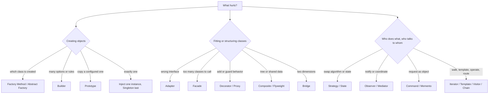
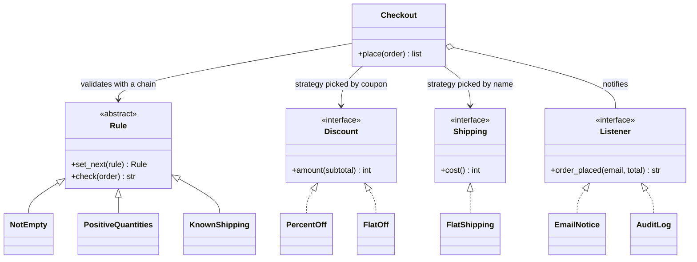

# 12. Choosing, combining and refactoring toward patterns

> **Draft: written but not yet run.** The code and the expected output in this lesson were prepared by reading the code and the official documentation. They have not been executed yet. If something does not behave as described, trust your tool's real output and report it.

## What you will be able to do
By the end of this lesson you will be able to:
- choose among the 22 patterns by starting from the **problem** (the smell), not from the pattern name
- recognize the common anti-patterns that come from using patterns badly
- combine several patterns in one design and explain the role of each
- refactor a messy function toward patterns in small steps, proving after each step that the behavior did not change

## Recap
1. (Lesson 11) What does a Chain of Responsibility do with a request nobody can handle? <details><summary>Answer</summary>It should return an explicit "unhandled" result or raise an error, never drop it silently.</details>
2. (Lesson 03) Name two reasons why a Singleton is usually a smell. <details><summary>Answer</summary>Hidden dependency and global mutable state (also: hard to test, two responsibilities).</details>
3. (Patterns 101, lesson 01) What is refactoring, and what is the proof that you did it right? <details><summary>Answer</summary>Changing the structure of code without changing what it does; unchanged output (a check that passes before and after) is the proof.</details>

## Why it matters
A tool box has a hammer, but a good carpenter first looks at the job. Beginners often learn 22 patterns and then see nails everywhere ("pattern fever"): code gets longer, harder to read and no easier to change. Experts do the opposite: they start from a **concrete pain** (a long `if` chain that grows every month, a class that keeps getting new constructor arguments, a bug caused by shared state), pick the **smallest** pattern that removes that pain, and **stop** when the pain is gone. This lesson turns 11 lessons of patterns into judgment.

## What you will build
Two things. First a **decision table and flowchart** for all 22 patterns. Then a refactoring: a 35-line `checkout` function (validation, discounts, shipping, tax, notifications) becomes a small design using Strategy, Chain of Responsibility, Observer and a Facade, and a program runs **both** versions on five orders and prints `same as before: True` for each. The exercise repeats the method on a smaller function.

## Before you start
- **Prerequisites:** Patterns 201 lessons [01, factory method and abstract factory](../phase-1-creational/01-factory-method-and-abstract-factory.md) to [11, iterator, template method, visitor and chain of responsibility](../phase-3-behavioral/11-iterator-template-method-visitor-chain.md); Patterns 101 lessons [01, why design matters](../../101-zero-to-hero/phase-1-solid/01-why-design-matters.md) and [07, DRY, KISS and YAGNI](../../101-zero-to-hero/phase-2-everyday-principles/07-dry-kiss-yagni.md).
- Time: about 80 minutes for one language in two sittings (the decision tables, then the refactoring), 120 minutes for both languages.
- You need lessons 01 to 11 and Python 3.10 or newer and/or the .NET 11 SDK.
- Source pack (optional): every file is shown in full in this lesson, so you can follow without it. The finished code, the exercise starter and the solution are in the
  course repository https://github.com/Uee03/Code101 under `source/patterns/201-hero-to-super-hero/phase-4-choosing-patterns/12-choosing-combining-refactoring/` (on that page choose **Code, Download ZIP**, or run
  `git clone https://github.com/Uee03/Code101.git`).

## Steps

### Step 1. Make the lesson folders
**PowerShell, starting folder: anywhere**
```powershell
New-Item -ItemType Directory -Path "$HOME/code101/patterns201/lesson12/python" -Force | Out-Null
New-Item -ItemType Directory -Path "$HOME/code101/patterns201/lesson12/csharp" -Force | Out-Null
Set-Location "$HOME/code101/patterns201/lesson12"
code .
```

**macOS/Linux terminal, starting folder: anywhere**
```bash
mkdir -p ~/code101/patterns201/lesson12/python ~/code101/patterns201/lesson12/csharp
cd ~/code101/patterns201/lesson12
code .
```
Expected result: VS Code opens `lesson12` with empty `python` and `csharp` folders.

### Step 2. The decision table: from pain to pattern
Read the **pain** column first. Every row also says what to try **before** the pattern: most pains have a cheaper fix.

| Pain you can point at | Pattern | Try first | Lesson |
|---|---|---|---|
| Shared code must create "some kind of X", subclasses decide which | **Factory Method** | a constructor call or a small function | 01 |
| Several objects must be created as a matching family | **Abstract Factory** | one factory function | 01 |
| A constructor with many optional parts and cross-field rules | **Builder** | keyword arguments, object initializers | 02 |
| Creating an object from scratch is costly or needs a configured example | **Prototype** | `copy.deepcopy`, record `with` | 02 |
| Exactly one instance is required and cannot be passed around | **Singleton** (rarely) | create once in the composition root and inject | 03 |
| A class you cannot change has the wrong interface | **Adapter** | change the caller, if you own it | 04 |
| Callers must know many classes and call them in the right order | **Facade** | a plain function | 04 |
| Add behavior to an object at run time, in combination | **Decorator** | a subclass or a function wrapper | 05 |
| Control access, cache or lazy-load one object | **Proxy** | a cache inside the class | 05 |
| Part-whole tree, treated uniformly | **Composite** | a list | 06 |
| Millions of near-identical immutable objects (after measuring) | **Flyweight** | a smaller data type | 06 |
| A class varies along two independent dimensions | **Bridge** | inheritance, if one dimension | 07 |
| Several ways to do one thing, chosen from outside | **Strategy** | an `if`, a function parameter | 08 |
| Behavior depends on state and many methods test the state | **State** | an enum and a `switch` | 08 |
| Many parties must hear about a change | **Observer** | a direct call, if one receiver | 09 |
| A web of peers that know each other | **Mediator** | direct calls, if two peers | 09 |
| A request must be queued, logged or undone | **Command** | a function value | 10 |
| State must be saved and restored | **Memento** | `copy.deepcopy` of an immutable value | 10 |
| Walk a collection without exposing its storage | **Iterator** | a list and a loop | 11 |
| Same algorithm skeleton, different steps | **Template Method** | a function that takes a function | 11 |
| New operations on a stable class family | **Visitor** | `singledispatch`, pattern matching | 11 |
| One of several handlers should take a request | **Chain of Responsibility** | an `if` ladder | 11 |

The "Try first" column is not a joke: **KISS and YAGNI beat patterns** until the cheap fix hurts.

### Step 3. The flowchart: which family?
Start from what hurts. (This is a map, not a rule.)


Use it in this order: (1) name the pain in one sentence; (2) find the family; (3) read the card of the 1 or 2 candidates; (4) check **when not to use** on the card; (5) try the cheaper fix; (6) only then write the pattern.

### Step 4. Read the messy code
This is the starting point of the refactoring. It works. It is just doing five jobs in one place. Input: items as `(name, price in cents, quantity)`, a shipping name, an optional coupon and an email. Output: a list of receipt lines.

**File: `~/code101/patterns201/lesson12/python/before.py`**
```python
def checkout(items, shipping, coupon, email):
    lines = []
    if len(items) == 0:
        return ["error: cart is empty"]
    for name, price, quantity in items:
        if quantity <= 0:
            return [f"error: bad quantity for {name}"]
    subtotal = 0
    for name, price, quantity in items:
        subtotal += price * quantity
    lines.append(f"subtotal: {subtotal}")
    discount = 0
    if coupon == "WELCOME10":
        discount = subtotal * 10 // 100
    elif coupon == "FIVEOFF":
        discount = min(500, subtotal)
    lines.append(f"discount: {discount}")
    if shipping == "pickup":
        ship = 0
    elif shipping == "standard":
        ship = 500
    elif shipping == "express":
        ship = 1500
    else:
        return [f"error: unknown shipping {shipping}"]
    lines.append(f"shipping: {ship}")
    taxable = subtotal - discount
    tax = taxable * 20 // 100
    lines.append(f"tax: {tax}")
    total = taxable + tax + ship
    lines.append(f"total: {total}")
    lines.append(f"email to {email}: order total {total}")
    lines.append("log: order placed")
    return lines
```

**File: `~/code101/patterns201/lesson12/csharp/Item.cs`**
```csharp
public record Item(string Name, int Price, int Quantity);
```

**File: `~/code101/patterns201/lesson12/csharp/Before.cs`**
```csharp
namespace Before;

public static class Shop
{
    public static List<string> Checkout(List<Item> items, string shipping, string? coupon, string email)
    {
        var lines = new List<string>();
        if (items.Count == 0)
        {
            return new List<string> { "error: cart is empty" };
        }
        foreach (var item in items)
        {
            if (item.Quantity <= 0)
            {
                return new List<string> { $"error: bad quantity for {item.Name}" };
            }
        }
        int subtotal = 0;
        foreach (var item in items)
        {
            subtotal += item.Price * item.Quantity;
        }
        lines.Add($"subtotal: {subtotal}");
        int discount = 0;
        if (coupon == "WELCOME10")
        {
            discount = subtotal * 10 / 100;
        }
        else if (coupon == "FIVEOFF")
        {
            discount = Math.Min(500, subtotal);
        }
        lines.Add($"discount: {discount}");
        int ship;
        if (shipping == "pickup")
        {
            ship = 0;
        }
        else if (shipping == "standard")
        {
            ship = 500;
        }
        else if (shipping == "express")
        {
            ship = 1500;
        }
        else
        {
            return new List<string> { $"error: unknown shipping {shipping}" };
        }
        lines.Add($"shipping: {ship}");
        int taxable = subtotal - discount;
        int tax = taxable * 20 / 100;
        lines.Add($"tax: {tax}");
        int total = taxable + tax + ship;
        lines.Add($"total: {total}");
        lines.Add($"email to {email}: order total {total}");
        lines.Add("log: order placed");
        return lines;
    }
}
```
(In C#, the `Item` record lives in the global namespace so that both the `Before` and `After` namespaces can use it. In Python the same data is a plain tuple.)

### Step 5. Find the smells and plan the steps
Do **not** start typing patterns. First list what is wrong, and decide what is **not** worth changing:

| Smell in `checkout` | Candidate | Decision |
|---|---|---|
| `if / elif` on the coupon: every new coupon edits this function | Strategy (`Discount`) | **yes**: the list grows every campaign |
| `if / elif` on the shipping name | Strategy (`Shipping`) | **yes**: carriers change often |
| Validation by early returns mixed into the calculation | Chain of Responsibility (`Rule`) | **yes**: rules are added and reordered |
| Notification lines hard-coded at the end | Observer (`Listener`) | **yes**: more channels are coming |
| The function does everything | Facade (`Checkout.place`) | **yes**: a small coordinator remains |
| Tax is one expression | nothing | **no**: one rule, nothing varies (YAGNI) |
| `Item` data | nothing | **no**: plain data does not need a class hierarchy |

**The method**, as five rules you will see applied below:
1. **Pin the behavior first.** The program runs the old and the new version on the same inputs and compares; that is the safety net.
2. **Name the smell** before you name a pattern.
3. **Take the smallest step** that removes one smell; run the comparison; continue.
4. **Keep the public entry point** (`checkout` becomes `place_order`; callers do not change their logic).
5. **Stop** when the pain is gone. Do not keep adding flexibility "for later".

*(Break here if you want two sittings.)*

### Step 6. Write the refactored design
The structure after the refactoring (every box is one of the patterns you already know):


**File: `~/code101/patterns201/lesson12/python/after.py`**
```python
from abc import ABC, abstractmethod
from typing import Optional

Item = tuple[str, int, int]


class Order:
    def __init__(self, items: list[Item], shipping: str, coupon: Optional[str], email: str) -> None:
        self.items = items
        self.shipping = shipping
        self.coupon = coupon
        self.email = email


class Discount(ABC):
    @abstractmethod
    def amount(self, subtotal: int) -> int:
        ...


class NoDiscount(Discount):
    def amount(self, subtotal: int) -> int:
        return 0


class PercentOff(Discount):
    def __init__(self, percent: int) -> None:
        self._percent = percent

    def amount(self, subtotal: int) -> int:
        return subtotal * self._percent // 100


class FlatOff(Discount):
    def __init__(self, cents: int) -> None:
        self._cents = cents

    def amount(self, subtotal: int) -> int:
        return min(self._cents, subtotal)


class Shipping(ABC):
    @abstractmethod
    def cost(self) -> int:
        ...


class FlatShipping(Shipping):
    def __init__(self, cents: int) -> None:
        self._cents = cents

    def cost(self) -> int:
        return self._cents


DISCOUNTS: dict[str, Discount] = {"WELCOME10": PercentOff(10), "FIVEOFF": FlatOff(500)}
SHIPPING: dict[str, Shipping] = {
    "pickup": FlatShipping(0),
    "standard": FlatShipping(500),
    "express": FlatShipping(1500),
}


class Rule(ABC):
    def __init__(self) -> None:
        self._next: Optional["Rule"] = None

    def set_next(self, rule: "Rule") -> "Rule":
        self._next = rule
        return rule

    def check(self, order: Order) -> Optional[str]:
        problem = self.problem(order)
        if problem is not None:
            return problem
        if self._next is not None:
            return self._next.check(order)
        return None

    @abstractmethod
    def problem(self, order: Order) -> Optional[str]:
        ...


class NotEmpty(Rule):
    def problem(self, order: Order) -> Optional[str]:
        if len(order.items) == 0:
            return "cart is empty"
        return None


class PositiveQuantities(Rule):
    def problem(self, order: Order) -> Optional[str]:
        for name, _price, quantity in order.items:
            if quantity <= 0:
                return f"bad quantity for {name}"
        return None


class KnownShipping(Rule):
    def problem(self, order: Order) -> Optional[str]:
        if order.shipping not in SHIPPING:
            return f"unknown shipping {order.shipping}"
        return None


class Listener(ABC):
    @abstractmethod
    def order_placed(self, email: str, total: int) -> str:
        ...


class EmailNotice(Listener):
    def order_placed(self, email: str, total: int) -> str:
        return f"email to {email}: order total {total}"


class AuditLog(Listener):
    def order_placed(self, email: str, total: int) -> str:
        return "log: order placed"


class Checkout:
    def __init__(self, rules: Rule, listeners: list[Listener]) -> None:
        self._rules = rules
        self._listeners = listeners

    def place(self, order: Order) -> list[str]:
        problem = self._rules.check(order)
        if problem is not None:
            return [f"error: {problem}"]
        subtotal = sum(price * quantity for _name, price, quantity in order.items)
        discount = DISCOUNTS.get(order.coupon or "", NoDiscount()).amount(subtotal)
        shipping = SHIPPING[order.shipping].cost()
        taxable = subtotal - discount
        tax = taxable * 20 // 100
        total = taxable + tax + shipping
        lines = [
            f"subtotal: {subtotal}",
            f"discount: {discount}",
            f"shipping: {shipping}",
            f"tax: {tax}",
            f"total: {total}",
        ]
        for listener in self._listeners:
            lines.append(listener.order_placed(order.email, total))
        return lines


def place_order(items: list[Item], shipping: str, coupon: Optional[str], email: str) -> list[str]:
    rules = NotEmpty()
    rules.set_next(PositiveQuantities()).set_next(KnownShipping())
    checkout = Checkout(rules, [EmailNotice(), AuditLog()])
    return checkout.place(Order(items, shipping, coupon, email))
```

**File: `~/code101/patterns201/lesson12/csharp/After.cs`**
```csharp
namespace After;

public record Order(List<Item> Items, string Shipping, string? Coupon, string Email);

public interface IDiscount
{
    int Amount(int subtotal);
}

public class NoDiscount : IDiscount
{
    public int Amount(int subtotal) => 0;
}

public class PercentOff : IDiscount
{
    private readonly int _percent;

    public PercentOff(int percent)
    {
        _percent = percent;
    }

    public int Amount(int subtotal) => subtotal * _percent / 100;
}

public class FlatOff : IDiscount
{
    private readonly int _cents;

    public FlatOff(int cents)
    {
        _cents = cents;
    }

    public int Amount(int subtotal) => Math.Min(_cents, subtotal);
}

public interface IShippingOption
{
    int Cost();
}

public class FlatShipping : IShippingOption
{
    private readonly int _cents;

    public FlatShipping(int cents)
    {
        _cents = cents;
    }

    public int Cost() => _cents;
}

public static class Catalog
{
    public static readonly Dictionary<string, IDiscount> Discounts = new()
    {
        ["WELCOME10"] = new PercentOff(10),
        ["FIVEOFF"] = new FlatOff(500),
    };

    public static readonly Dictionary<string, IShippingOption> Shipping = new()
    {
        ["pickup"] = new FlatShipping(0),
        ["standard"] = new FlatShipping(500),
        ["express"] = new FlatShipping(1500),
    };
}

public abstract class Rule
{
    private Rule? _next;

    public Rule SetNext(Rule rule)
    {
        _next = rule;
        return rule;
    }

    public string? Check(Order order)
    {
        string? problem = Problem(order);
        if (problem != null)
        {
            return problem;
        }
        if (_next != null)
        {
            return _next.Check(order);
        }
        return null;
    }

    protected abstract string? Problem(Order order);
}

public class NotEmpty : Rule
{
    protected override string? Problem(Order order) => order.Items.Count == 0 ? "cart is empty" : null;
}

public class PositiveQuantities : Rule
{
    protected override string? Problem(Order order)
    {
        foreach (var item in order.Items)
        {
            if (item.Quantity <= 0)
            {
                return $"bad quantity for {item.Name}";
            }
        }
        return null;
    }
}

public class KnownShipping : Rule
{
    protected override string? Problem(Order order) =>
        Catalog.Shipping.ContainsKey(order.Shipping) ? null : $"unknown shipping {order.Shipping}";
}

public interface IListener
{
    string OrderPlaced(string email, int total);
}

public class EmailNotice : IListener
{
    public string OrderPlaced(string email, int total) => $"email to {email}: order total {total}";
}

public class AuditLog : IListener
{
    public string OrderPlaced(string email, int total) => "log: order placed";
}

public class Checkout
{
    private readonly Rule _rules;
    private readonly List<IListener> _listeners;

    public Checkout(Rule rules, List<IListener> listeners)
    {
        _rules = rules;
        _listeners = listeners;
    }

    public List<string> Place(Order order)
    {
        string? problem = _rules.Check(order);
        if (problem != null)
        {
            return new List<string> { $"error: {problem}" };
        }
        int subtotal = order.Items.Sum(item => item.Price * item.Quantity);
        if (!Catalog.Discounts.TryGetValue(order.Coupon ?? "", out IDiscount? discountRule))
        {
            discountRule = new NoDiscount();
        }
        int discount = discountRule.Amount(subtotal);
        int shipping = Catalog.Shipping[order.Shipping].Cost();
        int taxable = subtotal - discount;
        int tax = taxable * 20 / 100;
        int total = taxable + tax + shipping;
        var lines = new List<string>
        {
            $"subtotal: {subtotal}",
            $"discount: {discount}",
            $"shipping: {shipping}",
            $"tax: {tax}",
            $"total: {total}",
        };
        foreach (var listener in _listeners)
        {
            lines.Add(listener.OrderPlaced(order.Email, total));
        }
        return lines;
    }
}

public static class Shop
{
    public static List<string> PlaceOrder(List<Item> items, string shipping, string? coupon, string email)
    {
        var rules = new NotEmpty();
        rules.SetNext(new PositiveQuantities()).SetNext(new KnownShipping());
        var checkout = new Checkout(rules, new List<IListener> { new EmailNotice(), new AuditLog() });
        return checkout.Place(new Order(items, shipping, coupon, email));
    }
}
```
Where each smell went: coupon and shipping `if` chains became **Strategy** objects looked up in two dictionaries (`DISCOUNTS` and `SHIPPING` in Python, `Catalog` in C#; the dictionary plays the role of a **simple factory** from lesson 01). The early returns became a **Chain of Responsibility** with three rules in the order that the old code tested them (empty cart, then quantities, then shipping name). The two hard-coded lines became **Observer**-style listeners that each return their line. `Checkout.place` is what is left of the old function: a small **Facade** that coordinates. The tax stayed one expression: nothing varies there. The listeners **return** their line instead of printing, so the program can compare old and new output.

### Step 7. Run old and new side by side
**File: `~/code101/patterns201/lesson12/python/main.py`**
```python
import after
import before

CASES = [
    ("welcome coupon", [("pen", 150, 4), ("book", 1200, 1)], "standard", "WELCOME10", "ana@example.com"),
    ("capped coupon", [("cable", 400, 1)], "pickup", "FIVEOFF", "bo@example.com"),
    ("no coupon", [("lamp", 2500, 2)], "express", None, "cy@example.com"),
    ("empty cart", [], "standard", None, "di@example.com"),
    ("unknown shipping", [("pen", 150, 1)], "drone", None, "ed@example.com"),
]

for label, items, shipping, coupon, email in CASES:
    old = before.checkout(items, shipping, coupon, email)
    new = after.place_order(items, shipping, coupon, email)
    print(f"--- {label} ---")
    for line in new:
        print(line)
    print(f"same as before: {old == new}")
```

**File: `~/code101/patterns201/lesson12/csharp/Program.cs`**
```csharp
var cases = new (string Label, List<Item> Items, string Shipping, string? Coupon, string Email)[]
{
    ("welcome coupon", new List<Item> { new Item("pen", 150, 4), new Item("book", 1200, 1) }, "standard", "WELCOME10", "ana@example.com"),
    ("capped coupon", new List<Item> { new Item("cable", 400, 1) }, "pickup", "FIVEOFF", "bo@example.com"),
    ("no coupon", new List<Item> { new Item("lamp", 2500, 2) }, "express", null, "cy@example.com"),
    ("empty cart", new List<Item>(), "standard", null, "di@example.com"),
    ("unknown shipping", new List<Item> { new Item("pen", 150, 1) }, "drone", null, "ed@example.com"),
};

foreach (var (label, items, shipping, coupon, email) in cases)
{
    var old = Before.Shop.Checkout(items, shipping, coupon, email);
    var current = After.Shop.PlaceOrder(items, shipping, coupon, email);
    Console.WriteLine($"--- {label} ---");
    foreach (var line in current)
    {
        Console.WriteLine(line);
    }
    Console.WriteLine($"same as before: {old.SequenceEqual(current)}");
}
```

**File: `~/code101/patterns201/lesson12/csharp/Lesson.csproj`** (identical to lesson 01)
```xml
<Project Sdk="Microsoft.NET.Sdk">

  <PropertyGroup>
    <OutputType>Exe</OutputType>
    <TargetFramework>net11.0</TargetFramework>
    <ImplicitUsings>enable</ImplicitUsings>
    <Nullable>enable</Nullable>
  </PropertyGroup>

</Project>
```

## Run it
Predict first: for the case `capped coupon` (400 cents, coupon `FIVEOFF`, pickup), what is the discount and what is the total? <details><summary>Answer</summary>The flat discount is capped at the subtotal, so the discount is 400 and the total is 0 (no tax on 0, no shipping for pickup).</details>

**PowerShell, folder: `~/code101/patterns201/lesson12/python`**
```powershell
Set-Location "$HOME/code101/patterns201/lesson12/python"
python main.py
```
**macOS/Linux terminal, folder: `~/code101/patterns201/lesson12/python`**
```bash
cd ~/code101/patterns201/lesson12/python
python3 main.py
```
**Any terminal, folder: `~/code101/patterns201/lesson12/csharp`**
```text
dotnet run --project . --nologo
```
Expected output (derived by reading the code, not yet run; identical for Python and C#):
```text
--- welcome coupon ---
subtotal: 1800
discount: 180
shipping: 500
tax: 324
total: 2444
email to ana@example.com: order total 2444
log: order placed
same as before: True
--- capped coupon ---
subtotal: 400
discount: 400
shipping: 0
tax: 0
total: 0
email to bo@example.com: order total 0
log: order placed
same as before: True
--- no coupon ---
subtotal: 5000
discount: 0
shipping: 1500
tax: 1000
total: 7500
email to cy@example.com: order total 7500
log: order placed
same as before: True
--- empty cart ---
error: cart is empty
same as before: True
--- unknown shipping ---
error: unknown shipping drone
same as before: True
```

## How it works
**Was it worth it?** Be honest about the cost:

| | Before | After |
|---|---|---|
| Size | one function of about 35 lines | about 150 lines, 15 types |
| Add a coupon | edit the function and risk the rest | one class and one dictionary entry |
| Add a shipping option | edit the function | one dictionary entry |
| Add a notification | edit the function | one class and one list entry |
| Test the pieces | only the whole | each rule, discount and listener alone |
| Read it once | easy | longer, you must follow the types |

If coupons, carriers and notifications **never change**, the original is better. The refactoring pays off because they change often; that was the pain. This is why the method starts from the pain.

**How patterns combine.** Patterns rarely appear alone:

| Combination | What it gives |
|---|---|
| Strategy + simple factory (a dictionary) | pick the algorithm from a name or configuration (`DISCOUNTS`) |
| Command + Memento | undo: commands that restore a snapshot |
| Composite + Visitor or Iterator | operations and walks over a tree |
| Decorator + Factory | a factory that builds a configured stack of decorators |
| Chain of Responsibility + Command | a request pipeline (middleware) |
| Observer + Mediator | a mediator implemented with events |
| Abstract Factory + Bridge | the factory creates the right implementation for the abstraction |
| State + Flyweight | stateless state objects shared between many contexts |
| Facade + dependency injection | a simple front door whose parts are injected |

**Anti-patterns (patterns used badly).**
| Anti-pattern | Symptom | Fix |
|---|---|---|
| **Pattern fever** (golden hammer) | every class has "Factory", "Manager" or "Strategy" in its name before any pain appeared | remove the pattern; start from the smell |
| **Speculative generality** | an interface with one implementation and no second one in sight | delete the interface until the second case exists (YAGNI) |
| **Singleton as global variable** | `Settings.instance()` called everywhere | inject the object (lesson 03) |
| **God mediator or god facade** | one class that knows and does everything | split by feature; give logic back to the parts |
| **Class explosion** | a hierarchy that grows by a class for every combination | Bridge or Decorator; check you need both dimensions |
| **Inheritance for reuse** | a subclass that only wants one method of its parent | composition (Strategy, Decorator) |
| **Visitor on an unstable family** | every new class forces edits in every visitor | pattern matching, or put the method in the classes |
| **Copying a Java-style pattern into Python** | five classes where a function would do | use the language: functions, generators, modules, `dataclass` |
| **Patterns for show** | the diagram looks impressive, the code is slower to change | measure change cost: how many files does a typical change touch? |

Misconception: **"More patterns means better design."** Design quality is measured by how cheaply the code absorbs the *next change*. A pattern is good exactly when it makes the next change cheaper than it was.

A last TypeScript sketch, for reading: a Strategy chosen from a dictionary is the lightest form of two patterns at once.
```typescript
const discounts: Record<string, (subtotal: number) => number> = {
  WELCOME10: (s) => Math.floor((s * 10) / 100),
  FIVEOFF: (s) => Math.min(500, s),
};
```

## Try it
**Rung 1, guided.** Apply the method to a smaller function: `old_ticket_price` has an `if` chain on the kind of ticket. Copy the `starter` folder of your language to `try12` (copy the folder itself and rename it). Write the Strategy classes and a dictionary, replace the chain with a lookup, and finish with a **check** that proves the new function equals the old one.

**File: `try12/main.py`**
```python
def old_ticket_price(kind: str, base: int) -> int:
    if kind == "child":
        return base // 2
    elif kind == "senior":
        return base * 70 // 100
    elif kind == "student":
        return base - 250
    return base


# TODO 1: write an abstract class Pricing (ABC) with an abstract method price(base).
#         Then write Regular, Child, Senior and Student, each returning the same value as its branch above.
# TODO 2: make a dictionary PRICING from the kind name ("regular", "child", "senior", "student") to a Pricing object.
# TODO 3: write ticket_price(kind, base) that looks the kind up in PRICING (no if chain).

KINDS = ["regular", "child", "senior", "student"]
# TODO 4: for each kind print "<kind>: <ticket_price(kind, 1000)>". Then print
#         "Check passed: new pricing equals old pricing" if every kind gives the same result as old_ticket_price,
#         otherwise print "Check FAILED".
```

**File: `try12/Program.cs`** (with the same `Lesson.csproj`)
```csharp
string[] kinds = { "regular", "child", "senior", "student" };
// TODO 4: for each kind print "<kind>: <TicketPrice(kind, 1000)>". Then print
//         "Check passed: new pricing equals old pricing" if every kind gives the same result as OldTicketPrice,
//         otherwise print "Check FAILED".

static int OldTicketPrice(string kind, int baseCents)
{
    if (kind == "child")
    {
        return baseCents / 2;
    }
    else if (kind == "senior")
    {
        return baseCents * 70 / 100;
    }
    else if (kind == "student")
    {
        return baseCents - 250;
    }
    return baseCents;
}

// TODO 1: write an interface IPricing with int Price(int baseCents).
//         Then write Regular, Child, Senior and Student, each returning the same value as its branch above.
// TODO 2: make a Dictionary<string, IPricing> named pricing from the kind name to a pricing object.
// TODO 3: write TicketPrice(string kind, int baseCents) that looks the kind up in the dictionary (no if chain).
```
Expected output when done (not yet run):
```text
regular: 1000
child: 500
senior: 700
student: 750
Check passed: new pricing equals old pricing
```
**Rung 2, change.** Add a `veteran` ticket at 60 percent of the base price. Count the **existing** classes and functions you had to edit (the answer for a good Strategy design is: only the dictionary).

**Rung 3, stretch (no single answer).** Take a function from your own code (or from lesson 05, 08 or 09) and write a one-page decision note: the pain in one sentence, the pattern you considered, the cheaper alternative, and the verdict "refactor", "not yet" or "no". A "not yet" with a stated trigger ("when a second payment provider arrives") is a good answer.

<details><summary>Solution</summary>

**File: `try12/main.py`**
```python
from abc import ABC, abstractmethod


def old_ticket_price(kind: str, base: int) -> int:
    if kind == "child":
        return base // 2
    elif kind == "senior":
        return base * 70 // 100
    elif kind == "student":
        return base - 250
    return base


class Pricing(ABC):
    @abstractmethod
    def price(self, base: int) -> int:
        ...


class Regular(Pricing):
    def price(self, base: int) -> int:
        return base


class Child(Pricing):
    def price(self, base: int) -> int:
        return base // 2


class Senior(Pricing):
    def price(self, base: int) -> int:
        return base * 70 // 100


class Student(Pricing):
    def price(self, base: int) -> int:
        return base - 250


PRICING = {"regular": Regular(), "child": Child(), "senior": Senior(), "student": Student()}


def ticket_price(kind: str, base: int) -> int:
    return PRICING[kind].price(base)


KINDS = ["regular", "child", "senior", "student"]
for kind in KINDS:
    print(f"{kind}: {ticket_price(kind, 1000)}")
if all(ticket_price(kind, 1000) == old_ticket_price(kind, 1000) for kind in KINDS):
    print("Check passed: new pricing equals old pricing")
else:
    print("Check FAILED")
```

**File: `try12/Program.cs`**
```csharp
string[] kinds = { "regular", "child", "senior", "student" };
var pricing = new Dictionary<string, IPricing>
{
    ["regular"] = new Regular(),
    ["child"] = new Child(),
    ["senior"] = new Senior(),
    ["student"] = new Student(),
};

int TicketPrice(string kind, int baseCents) => pricing[kind].Price(baseCents);

foreach (var kind in kinds)
{
    Console.WriteLine($"{kind}: {TicketPrice(kind, 1000)}");
}
if (kinds.All(kind => TicketPrice(kind, 1000) == OldTicketPrice(kind, 1000)))
{
    Console.WriteLine("Check passed: new pricing equals old pricing");
}
else
{
    Console.WriteLine("Check FAILED");
}

static int OldTicketPrice(string kind, int baseCents)
{
    if (kind == "child")
    {
        return baseCents / 2;
    }
    else if (kind == "senior")
    {
        return baseCents * 70 / 100;
    }
    else if (kind == "student")
    {
        return baseCents - 250;
    }
    return baseCents;
}

interface IPricing
{
    int Price(int baseCents);
}

class Regular : IPricing
{
    public int Price(int baseCents) => baseCents;
}

class Child : IPricing
{
    public int Price(int baseCents) => baseCents / 2;
}

class Senior : IPricing
{
    public int Price(int baseCents) => baseCents * 70 / 100;
}

class Student : IPricing
{
    public int Price(int baseCents) => baseCents - 250;
}
```
For Rung 2, a `Veteran` class (`base * 60 // 100`) plus one dictionary entry: no existing class changes. Note that the **old** function is kept only as the safety net; once you trust the new one, delete it and keep a fixed expected list in the check instead.
</details>

## Check yourself
1. In what order do you decide: pattern, smell or cheaper fix? <details><summary>Answer</summary>Smell (the pain) first, then the cheaper fix, and only then, if the pain remains, the smallest pattern.</details>
2. Predict: you reorder the chain so `KnownShipping` runs first and call it with an empty cart and shipping `drone`. What changes? <details><summary>Answer</summary>The error becomes `error: unknown shipping drone` instead of `error: cart is empty`, so `same as before` would print `False`: rule order is behavior.</details>
3. Which patterns did the refactoring use, and which smell did each remove? <details><summary>Answer</summary>Strategy (coupon and shipping chains), Chain of Responsibility (inline validation), Observer (hard-coded notifications) and a small Facade (the leftover coordinator).</details>
4. Name two situations where the original `checkout` is the better design. <details><summary>Answer</summary>When coupons, carriers and notifications never change, or the function is used in one place and will be thrown away.</details>
5. Why is "singleton for settings" in the anti-pattern list? <details><summary>Answer</summary>It hides a dependency and shares mutable state; inject the object instead.</details>

## Mixed review (the whole course)
1. (Lesson 01) What guarantee does an Abstract Factory add to a Factory Method? <details><summary>Answer</summary>The products created together belong to one matching family.</details>
2. (Lesson 02) Why must a clone copy mutable inner objects? <details><summary>Answer</summary>Otherwise the clone and original share them (shallow copy).</details>
3. (Lesson 04) Adapter, Facade or Decorator: which has a **different** interface from the wrapped object, and which has a **simpler** one? <details><summary>Answer</summary>Adapter (different) and Facade (simpler); a Decorator keeps the same interface.</details>
4. (Lesson 06) What must be true of a Flyweight? <details><summary>Answer</summary>It is immutable and shared; per-object data stays outside it.</details>
5. (Lesson 08) Who chooses the part in a Strategy, and who in a State? <details><summary>Answer</summary>The client chooses a strategy; states (or the context) choose the next state.</details>
6. (Lesson 09) Which pattern risks memory leaks through forgotten subscriptions? <details><summary>Answer</summary>Observer.</details>
7. (Lesson 10) Which pattern gives you undo by storing the old value in the request object? <details><summary>Answer</summary>Command (with the old state stored in the command); Memento does it by snapshot.</details>
8. (Lesson 11) Which pattern makes adding an operation cheap and adding a class expensive? <details><summary>Answer</summary>Visitor.</details>
9. (Patterns 101) Which SOLID principle says "add behavior by adding code, not by editing working code", and which patterns serve it best? <details><summary>Answer</summary>Open/Closed; Strategy, Decorator, Observer, Template Method and Chain of Responsibility all support it.</details>

## Common mistakes
These messages are typical and have **not** been reproduced yet; the wording depends on your versions.
| Symptom or error text (typical) | Cause | Fix |
|---|---|---|
| `ModuleNotFoundError: No module named 'after'` (Python) | you ran `main.py` from a different folder or the file has another name | `cd` into the `python` folder; check that `after.py` and `before.py` are next to `main.py` |
| `error CS0246: The type or namespace name 'Item' could not be found` (C#) | `Item.cs` is missing from the project folder | create `Item.cs` next to `Program.cs` |
| `same as before: False` | the new code differs from the old: often rule order or an off-by-one in a discount | print both lists and compare line by line |
| `KeyError: 'drone'` (Python) | you removed the `KnownShipping` rule, so the unknown name reaches the dictionary | keep the validation rule, or handle the missing key |
| `MSB1003: Specify a project or solution file` | the terminal is not in the `csharp` folder | `cd` into the folder that contains `Lesson.csproj` |

## Best practice
Refactor toward a pattern only behind a safety net that proves the behavior is unchanged, in steps small enough that a failing check points at the last step; stop when the pain is gone. Source: Refactoring, Refactoring.Guru https://refactoring.guru/refactoring and Code smells, Refactoring.Guru https://refactoring.guru/refactoring/smells

## Going further
- The catalogue of design patterns: https://refactoring.guru/design-patterns/catalog and the cross-check at https://sourcemaking.com/design_patterns
- Refactoring techniques that lead to patterns (for example "replace conditional with polymorphism"): https://refactoring.guru/refactoring/techniques
- Reread lesson 03 of Patterns 101 (Open/Closed) and lesson 06 (Dependency Inversion): after this course they read as the *reasons* behind most patterns.

## Summary
- You chose patterns from pains with a decision table and a flowchart, checking the cheaper alternative first.
- You listed the anti-patterns that come from using patterns badly.
- You combined Strategy, Chain of Responsibility, Observer and a Facade to refactor a messy function and proved with a check that its behavior was unchanged.
- You weighed the cost: the refactored design is longer and only pays off when the variation really happens.
- You finished Patterns 201: all 22 patterns of the catalogue.

## Next lesson
None: this is the last lesson of Patterns 201. Practice by running the five-step method on a small function of your own. Next level: [Patterns 301 lesson 01, DI containers and composition roots](../../301-super-hero-to-legendary/phase-1-application-patterns/01-di-containers-and-composition-roots.md).
