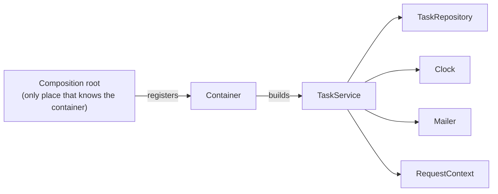
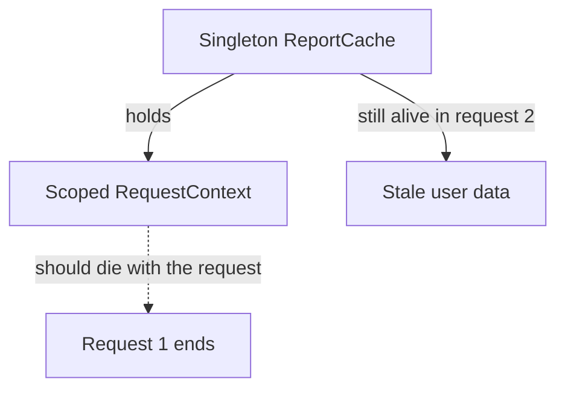

# 01. Dependency injection containers and composition roots

> **Draft: written but not yet run.** The code and the expected output in this lesson were prepared by reading the code and the official documentation. They have not been executed yet. If something does not behave as described, trust your tool's real output and report it.

## What you will be able to do
By the end of this lesson you will be able to:
- place a composition root and explain why only that place may know the container
- choose between singleton, scoped and transient lifetimes and predict what each shares
- detect a captive dependency and a circular dependency at start-up instead of in production
- decide, with an ADR, whether a service needs a container at all

## Recap
1. In Patterns 101 lesson 06, what is the difference between the Dependency Inversion Principle, dependency injection and a DI container? <details><summary>Answer</summary>The principle is a design rule (depend on abstractions), injection is the technique (receive dependencies from outside), a container is a tool that automates the wiring.</details>
2. What was the "composition root" in that lesson? <details><summary>Answer</summary>`main`: the one place near the start of the program where concrete objects are created and connected.</details>

## Why it matters
Hand wiring (`OrderService(SmtpSender())`) is perfect for ten classes and painful for two hundred. A container removes the typing, and in return adds three production problems: lifetimes that leak state between requests, wiring errors that appear only when a rare code path runs, and a global lookup that quietly turns into a **service locator** (a hidden dependency, lesson 08). A senior engineer uses a container deliberately: one composition root, constructor injection everywhere else, and a start-up check that fails fast.

## What you will build
A "Tasks and Teams" `TaskService` that needs a repository, a clock, a mailer and a per-request context. In Python you read and run a 30-line container built from explicit factories, so nothing is magic. In C# you use the real `Microsoft.Extensions.DependencyInjection` container with the same registrations. Both programs print the same 11 lines: they prove what is shared, and prove that two classic wiring bugs are caught before the first request.

## Before you start
- **Prerequisites:** [Patterns 101 lesson 06, dependency inversion](../../101-zero-to-hero/phase-1-solid/06-dependency-inversion.md); Patterns 201 lessons [03, singleton and dependency injection](../../201-hero-to-super-hero/phase-1-creational/03-singleton-and-dependency-injection.md), [05, decorator and proxy](../../201-hero-to-super-hero/phase-2-structural/05-decorator-and-proxy.md) and [09, observer and mediator](../../201-hero-to-super-hero/phase-3-behavioral/09-observer-and-mediator.md).
- Time: 60 minutes for one language, 90 for both. Follow **one** language; read the other to compare.
- You need Python 3.10+ and/or the .NET 11 SDK. The C# project needs one NuGet package, `Microsoft.Extensions.DependencyInjection` 11.0.0 (restored automatically by `dotnet run`; internet access needed the first time).
- Source pack (optional): every file is shown in full in this lesson, so you can follow without it. The finished code, the exercise starter and the solution are in the
  course repository https://github.com/Uee03/Code101 under `source/patterns/301-super-hero-to-legendary/phase-1-application-patterns/01-di-containers-and-composition-roots/` (on that page choose **Code, Download ZIP**, or run
  `git clone https://github.com/Uee03/Code101.git`).

## Steps

### Step 1. Make the lesson folders
**PowerShell, starting folder: anywhere**
```powershell
New-Item -ItemType Directory -Path "$HOME/code101/patterns301/lesson01/python" -Force | Out-Null
New-Item -ItemType Directory -Path "$HOME/code101/patterns301/lesson01/csharp" -Force | Out-Null
Set-Location "$HOME/code101/patterns301/lesson01"
code .
```

**macOS/Linux terminal, starting folder: anywhere**
```bash
mkdir -p ~/code101/patterns301/lesson01/python ~/code101/patterns301/lesson01/csharp
cd ~/code101/patterns301/lesson01
code .
```
Expected result: VS Code opens `lesson01` with empty `python` and `csharp` folders. If you are lost later, `cd ~/code101/patterns301/lesson01` brings you back.

### Step 2. Decide the shape before the code

Rules for the whole lesson:
1. Classes take what they need through the **constructor** and know nothing about the container.
2. Registrations live in one function near the start of the program: the **composition root**.
3. Every registration has a **lifetime**: *singleton* (one instance for the whole program), *scoped* (one per unit of work, usually one web request) or *transient* (a new one at every request for it).
4. The container is **validated at start-up**.

### Step 3. Python: the container and the classes
The container below has no reflection. Each registration is a **factory**, a small function that receives a `get` function to fetch its own dependencies. A `scope` is just a dictionary that caches the scoped instances of one unit of work.

**File: `~/code101/patterns301/lesson01/python/main.py`**
```python
from abc import ABC, abstractmethod


class Container:
    def __init__(self):
        self._factories = {}
        self._lifetimes = {}
        self._singletons = {}

    def register(self, key, factory, lifetime="transient"):
        self._factories[key] = factory
        self._lifetimes[key] = lifetime

    def resolve(self, key, scope=None, _path=()):
        if key in _path:
            chain = " -> ".join(k.__name__ for k in _path + (key,))
            raise RuntimeError(f"circular dependency: {chain}")
        if key not in self._factories:
            raise KeyError(f"not registered: {key.__name__}")
        lifetime = self._lifetimes[key]
        holder = next((p for p in _path if self._lifetimes[p] == "singleton"), None)
        if lifetime == "scoped" and holder is not None:
            raise RuntimeError(f"captive dependency: singleton {holder.__name__} would keep scoped {key.__name__} alive")
        if lifetime == "scoped" and scope is None:
            raise RuntimeError(f"{key.__name__} is scoped: resolve it inside a scope")
        cache = self._singletons if lifetime == "singleton" else scope
        if lifetime != "transient" and key in cache:
            return cache[key]
        instance = self._factories[key](lambda dep: self.resolve(dep, scope, _path + (key,)))
        if lifetime != "transient":
            cache[key] = instance
        return instance

    def validate(self):
        problems = []
        for key in self._factories:
            try:
                self.resolve(key, {})
            except (RuntimeError, KeyError) as error:
                problems.append(f"{key.__name__}: {error}")
        return problems


class Clock(ABC):
    @abstractmethod
    def today(self):
        ...


class FixedClock(Clock):
    def __init__(self, day):
        self._day = day

    def today(self):
        return self._day


class Mailer(ABC):
    @abstractmethod
    def send(self, text):
        ...


class ConsoleMailer(Mailer):
    def send(self, text):
        print(f"mail: {text}")


class TaskRepository(ABC):
    @abstractmethod
    def add(self, title):
        ...


class InMemoryTaskRepository(TaskRepository):
    def __init__(self):
        self._titles = []

    def add(self, title):
        self._titles.append(title)
        return len(self._titles)


class RequestContext:
    def __init__(self, user):
        self.user = user


class TaskService:
    def __init__(self, repo, clock, mailer, context):
        self._repo = repo
        self._clock = clock
        self._mailer = mailer
        self._context = context

    def create(self, title):
        task_id = self._repo.add(title)
        self._mailer.send(f"task {task_id} created")
        return f"{self._context.user} created task {task_id} '{title}' on {self._clock.today()}"


class ReportCache:
    def __init__(self, context):
        self.context = context


class Alpha:
    def __init__(self, beta):
        self.beta = beta


class Beta:
    def __init__(self, alpha):
        self.alpha = alpha


def build_container():
    container = Container()
    container.register(Clock, lambda get: FixedClock("2026-03-01"), "singleton")
    container.register(TaskRepository, lambda get: InMemoryTaskRepository(), "singleton")
    container.register(Mailer, lambda get: ConsoleMailer())
    container.register(RequestContext, lambda get: RequestContext("alice"), "scoped")
    container.register(
        TaskService,
        lambda get: TaskService(get(TaskRepository), get(Clock), get(Mailer), get(RequestContext)),
    )
    return container


def main():
    container = build_container()
    problems = container.validate()
    print(f"validate: {len(problems)} problem(s)")

    for number in (1, 2):
        service = container.resolve(TaskService, {})
        print(service.create(f"Write ADR {number}"))

    scope_a, scope_b = {}, {}
    print("singleton repo shared:", container.resolve(TaskRepository) is container.resolve(TaskRepository))
    print("transient mailer shared:", container.resolve(Mailer) is container.resolve(Mailer))
    print("scoped context shared in one scope:", container.resolve(RequestContext, scope_a) is container.resolve(RequestContext, scope_a))
    print("scoped context shared across scopes:", container.resolve(RequestContext, scope_a) is container.resolve(RequestContext, scope_b))

    broken = build_container()
    broken.register(ReportCache, lambda get: ReportCache(get(RequestContext)), "singleton")
    print("captive: container refused to build:", len(broken.validate()) > 0)

    loop = Container()
    loop.register(Alpha, lambda get: Alpha(get(Beta)))
    loop.register(Beta, lambda get: Beta(get(Alpha)))
    print("cycle: container refused to build:", len(loop.validate()) > 0)


main()
```
Expected result: the file is saved (no dot on the editor tab).

### Step 4. C#: the same program with the real container
**File: `~/code101/patterns301/lesson01/csharp/Lesson.csproj`**
```xml
<Project Sdk="Microsoft.NET.Sdk">

  <PropertyGroup>
    <OutputType>Exe</OutputType>
    <TargetFramework>net11.0</TargetFramework>
    <ImplicitUsings>enable</ImplicitUsings>
    <Nullable>enable</Nullable>
  </PropertyGroup>

  <ItemGroup>
    <PackageReference Include="Microsoft.Extensions.DependencyInjection" Version="11.0.0" />
  </ItemGroup>

</Project>
```
Line by line: `OutputType Exe` makes a console program; `TargetFramework net11.0` selects .NET 11; `ImplicitUsings` adds the common `using` lines (`System`, `System.Collections.Generic`, ...) so `List<T>` and `Console` need no import; `Nullable enable` turns on null warnings; the `PackageReference` downloads the container from NuGet at the pinned version. No lock file is shipped: `dotnet restore` (run by `dotnet run`) creates `obj/project.assets.json`.

**File: `~/code101/patterns301/lesson01/csharp/Program.cs`**
```csharp
using Microsoft.Extensions.DependencyInjection;

var services = new ServiceCollection();
services.AddSingleton<IClock>(new FixedClock("2026-03-01"));
services.AddSingleton<ITaskRepository, InMemoryTaskRepository>();
services.AddTransient<IMailer, ConsoleMailer>();
services.AddScoped(_ => new RequestContext("alice"));
services.AddTransient<TaskService>();

var options = new ServiceProviderOptions { ValidateScopes = true, ValidateOnBuild = true };
using var provider = services.BuildServiceProvider(options);
Console.WriteLine("validate: 0 problem(s)");

for (var number = 1; number <= 2; number++)
{
    using var scope = provider.CreateScope();
    var service = scope.ServiceProvider.GetRequiredService<TaskService>();
    Console.WriteLine(service.Create($"Write ADR {number}"));
}

using var scopeA = provider.CreateScope();
using var scopeB = provider.CreateScope();
var repoShared = ReferenceEquals(provider.GetRequiredService<ITaskRepository>(), provider.GetRequiredService<ITaskRepository>());
var mailerShared = ReferenceEquals(provider.GetRequiredService<IMailer>(), provider.GetRequiredService<IMailer>());
var inOneScope = ReferenceEquals(scopeA.ServiceProvider.GetRequiredService<RequestContext>(), scopeA.ServiceProvider.GetRequiredService<RequestContext>());
var acrossScopes = ReferenceEquals(scopeA.ServiceProvider.GetRequiredService<RequestContext>(), scopeB.ServiceProvider.GetRequiredService<RequestContext>());
Console.WriteLine($"singleton repo shared: {repoShared}");
Console.WriteLine($"transient mailer shared: {mailerShared}");
Console.WriteLine($"scoped context shared in one scope: {inOneScope}");
Console.WriteLine($"scoped context shared across scopes: {acrossScopes}");

var broken = new ServiceCollection();
broken.AddScoped(_ => new RequestContext("alice"));
broken.AddSingleton<ReportCache>();
Console.WriteLine($"captive: container refused to build: {Refuses(broken)}");

var loop = new ServiceCollection();
loop.AddTransient<Alpha>();
loop.AddTransient<Beta>();
Console.WriteLine($"cycle: container refused to build: {Refuses(loop)}");

static bool Refuses(IServiceCollection collection)
{
    try
    {
        collection.BuildServiceProvider(new ServiceProviderOptions { ValidateScopes = true, ValidateOnBuild = true });
        return false;
    }
    catch (AggregateException)
    {
        return true;
    }
}

public interface IClock
{
    string Today();
}

public sealed class FixedClock(string day) : IClock
{
    public string Today() => day;
}

public interface IMailer
{
    void Send(string text);
}

public sealed class ConsoleMailer : IMailer
{
    public void Send(string text) => Console.WriteLine($"mail: {text}");
}

public interface ITaskRepository
{
    int Add(string title);
}

public sealed class InMemoryTaskRepository : ITaskRepository
{
    private readonly List<string> _titles = new();

    public int Add(string title)
    {
        _titles.Add(title);
        return _titles.Count;
    }
}

public sealed record RequestContext(string User);

public sealed class TaskService(ITaskRepository repo, IClock clock, IMailer mailer, RequestContext context)
{
    public string Create(string title)
    {
        var taskId = repo.Add(title);
        mailer.Send($"task {taskId} created");
        return $"{context.User} created task {taskId} '{title}' on {clock.Today()}";
    }
}

public sealed class ReportCache(RequestContext context)
{
    public RequestContext Context => context;
}

public sealed class Alpha(Beta beta)
{
    public Beta Beta => beta;
}

public sealed class Beta(Alpha alpha)
{
    public Alpha Alpha => alpha;
}
```
Two C# notes. Top-level statements come first and the types come after them in the same file; that is allowed. The container finds each constructor by reflection and fills the parameters from its registrations, which is why `TaskService` needs no factory lambda here.

## Run it
Predict first: after the line `validate: 0 problem(s)`, how many `mail:` lines are printed and why is there no `mail:` line for the checks at the bottom? <details><summary>Answer</summary>Two, one per `create` call. The identity checks only resolve objects and never call `create`.</details>

**PowerShell, folder: `~/code101/patterns301/lesson01/python`**
```powershell
Set-Location "$HOME/code101/patterns301/lesson01/python"
python main.py
```
**macOS/Linux terminal, folder: `~/code101/patterns301/lesson01/python`**
```bash
cd ~/code101/patterns301/lesson01/python
python3 main.py
```
**Any terminal, folder: `~/code101/patterns301/lesson01/csharp`**
```text
dotnet run --project . --nologo
```
Expected output (derived by reading the code, not yet run; identical for Python and C#):
```text
validate: 0 problem(s)
mail: task 1 created
alice created task 1 'Write ADR 1' on 2026-03-01
mail: task 2 created
alice created task 2 'Write ADR 2' on 2026-03-01
singleton repo shared: True
transient mailer shared: False
scoped context shared in one scope: True
scoped context shared across scopes: False
captive: container refused to build: True
cycle: container refused to build: True
```
The first `dotnet run` also downloads the package; its progress text is not part of the program output.

## How it works
**Lifetimes decide what is shared.** The singleton repository is created once, so task ids keep counting (1, 2) across both "requests". The scoped `RequestContext` is created once per scope, so everything inside one request sees the same user. The transient mailer is a new object at every request for it.

**Validation moves bugs to start-up.** `validate()` (Python) and `ValidateOnBuild` plus `ValidateScopes` (C#) resolve or inspect every registration before the first request. Two bugs are caught:
- **Captive dependency**: a singleton that holds a scoped service keeps the first request's context for the life of the program. Every later request would then see the first user's data, a security and correctness bug that no compiler finds.
- **Circular dependency**: `Alpha` needs `Beta` needs `Alpha`. Without validation this fails only when someone first resolves it.



**Misconception:** "a container means I do not have to think about wiring." The wiring is still your design; the container only types it for you.

### Trade-offs: hand wiring or container?
| Question | Hand wiring in `main` | Container |
|---|---|---|
| Errors | Compiler finds a missing argument | Often found at start-up, sometimes only at first resolve |
| Readability | Explicit; you can follow the graph by eye | Registrations plus reflection; the graph is implicit |
| Lifetimes | You decide by where you create the object | Must be modelled and validated |
| Cost | Grows linearly with classes | Constant typing, but learning and debugging cost |
| Web frameworks | Possible | Built in (ASP.NET Core ships one), so you pay nothing to use it |

### Failure modes to keep in mind
- **Service locator creep**: someone injects `IServiceProvider` into a service "just this once". The dependencies are now invisible. Allowed places for `provider`: the composition root and framework factories only.
- **Captive dependency** (above) and **scoped service resolved from the root provider**. `ValidateScopes` turns the second one into an immediate exception.
- **Constructor over-injection**: a class with seven parameters is not a container problem, it is a Single Responsibility smell (lesson 06).
- **Hidden start-up cost**: a singleton factory that opens a network connection delays or breaks start-up. Keep factories cheap; measure start-up time before and after adding registrations.
- **Disposal**: the container disposes the `IDisposable` objects it created, at scope or provider end. Objects you create yourself and register as instances are your job to dispose.

### ADR-0001 (decision record for this service)
- **Context:** Tasks and Teams API, about 40 classes, ASP.NET Core in production, Python worker scripts of about 10 classes.
- **Decision:** C# uses the built-in container with `ValidateScopes` and `ValidateOnBuild` on. The Python worker wires by hand in `main`.
- **Consequences:** C# gets lifetimes and framework integration; Python stays free of a dependency. Adopt a Python container only if the hand-written composition root passes about two screens and tests start to need many overrides (measure: lines in the root, number of test overrides).

### When not to use a container
Small programs, scripts, serverless handlers with two dependencies, libraries (a library must not force a container on its callers), and code where start-up time or trimming/AOT compilation matters more than convenience (reflection-based containers can need extra care there).

## Try it
**Rung 1, guided.** Copy the `starter` folder of your language to `try01` (copy the folder itself and rename it). Build the composition root by hand: no container is needed to learn the rule.

**File: `try01/main.py`**
```python
class Clock:
    def __init__(self, day):
        self.day = day

    def today(self):
        return self.day


class ReceiptPrinter:
    def __init__(self, clock):
        self.clock = clock

    def render(self, text):
        return f"{self.clock.today()}: {text}"


class Checkout:
    def __init__(self, printer):
        self.printer = printer

    def pay(self, amount):
        return self.printer.render(f"paid {amount}")


def compose(day):
    # TODO 1: create one Clock for the given day and one ReceiptPrinter that uses it.
    #         Return a Checkout that uses the printer. This function is the composition root.
    raise NotImplementedError


print(compose("2026-03-01").pay(5))
# TODO 2: print a second line that uses compose with the day "2000-01-01".
```

**File: `try01/Program.cs`** (with the plain `Lesson.csproj`: lesson 01 file without the `ItemGroup`)
```csharp
Console.WriteLine(Compose("2026-03-01").Pay(5));
// TODO 2: print a second line that uses Compose with the day "2000-01-01".

static Checkout Compose(string day)
{
    // TODO 1: create one Clock for the given day and one ReceiptPrinter that uses it.
    //         Return a Checkout that uses the printer. This method is the composition root.
    throw new NotImplementedException();
}

class Clock(string day)
{
    public string Today() => day;
}

class ReceiptPrinter(Clock clock)
{
    public string Render(string text) => $"{clock.Today()}: {text}";
}

class Checkout(ReceiptPrinter printer)
{
    public string Pay(int amount) => printer.Render($"paid {amount}");
}
```
Expected output after your fix:
```text
2026-03-01: paid 5
2000-01-01: paid 5
```

**Rung 2, change.** Make the clock a shared single instance: let `compose` accept an existing `Clock` object and prove with `is` / `ReferenceEquals` that two checkouts built in one test share it. Which of the three lifetimes did you just model by hand?

**Rung 3, stretch (no single answer).** Write a five-line ADR for a nightly report job with three dependencies: container yes or no, and which numbers (lines of wiring, tests that override things) would make you change your mind?

<details><summary>Solution</summary>

**File: `exercise/solution/python/main.py`**
```python
class Clock:
    def __init__(self, day):
        self.day = day

    def today(self):
        return self.day


class ReceiptPrinter:
    def __init__(self, clock):
        self.clock = clock

    def render(self, text):
        return f"{self.clock.today()}: {text}"


class Checkout:
    def __init__(self, printer):
        self.printer = printer

    def pay(self, amount):
        return self.printer.render(f"paid {amount}")


def compose(day):
    clock = Clock(day)
    printer = ReceiptPrinter(clock)
    return Checkout(printer)


print(compose("2026-03-01").pay(5))
print(compose("2000-01-01").pay(5))
```

**File: `exercise/solution/csharp/Program.cs`**
```csharp
Console.WriteLine(Compose("2026-03-01").Pay(5));
Console.WriteLine(Compose("2000-01-01").Pay(5));

static Checkout Compose(string day)
{
    var clock = new Clock(day);
    var printer = new ReceiptPrinter(clock);
    return new Checkout(printer);
}

class Clock(string day)
{
    public string Today() => day;
}

class ReceiptPrinter(Clock clock)
{
    public string Render(string text) => $"{clock.Today()}: {text}";
}

class Checkout(ReceiptPrinter printer)
{
    public string Pay(int amount) => printer.Render($"paid {amount}");
}
```
Rung 2 answer: passing one `Clock` object to several `compose` calls is a hand-made **singleton** lifetime. Rung 3 depends on your numbers; a typical answer is "no container: three dependencies, wiring fits in five lines".
</details>

## Check yourself
1. A singleton `ReportCache` takes a scoped `RequestContext` in its constructor. What goes wrong at run time, and which setting catches it at start-up? <details><summary>Answer</summary>The singleton keeps the first request's context for ever, so later requests see stale user data. `ValidateScopes` (C#) or the Python `validate()` rejects the registration.</details>
2. Why does the second request in the output print task id 2 and not 1? <details><summary>Answer</summary>The repository is a singleton shared by both requests.</details>
3. A teammate injects `IServiceProvider` into `TaskService` to fetch the mailer on demand. Give two costs. <details><summary>Answer</summary>The dependency is hidden from the constructor (harder to read and test) and a missing registration fails at run time on that code path instead of at start-up.</details>
4. When would you choose hand wiring in a new project? <details><summary>Answer</summary>Small graphs, scripts, libraries, or when a container's reflection cost or trimming limits matter more than saved typing.</details>

## Common mistakes
| Symptom or error text | Cause | Fix |
|---|---|---|
| `Unable to resolve service for type 'ITaskRepository' while attempting to activate 'TaskService'` (typical .NET message) | A constructor parameter has no registration | Add `AddSingleton<ITaskRepository, ...>` in the composition root |
| `Cannot consume scoped service 'RequestContext' from singleton 'ReportCache'` (typical .NET message, thrown inside the `AggregateException`) | Singleton depends on a scoped service | Make the consumer scoped, or inject a factory that is called per request |
| `KeyError: 'not registered: Mailer'` (Python, derived from the code) | `resolve` of a key you did not register | Register it in `build_container` |
| `dotnet run` says it cannot restore the package | No internet access or a typo in the package name | Check the name and version in `Lesson.csproj` and your network |
| Identity checks print `True` for the transient mailer | You registered it as singleton | Check the third argument of `register` / the `AddTransient` call |

## Best practice
Register everything in one composition root, resolve from the container only there, and turn on scope and build validation so wiring errors fail at start-up. Source: Dependency injection guidelines, Microsoft Learn https://learn.microsoft.com/dotnet/core/extensions/dependency-injection/guidelines ; background: Inversion of Control Containers and the Dependency Injection pattern, Martin Fowler https://martinfowler.com/articles/injection.html

## Going further
- Microsoft Learn, Dependency injection overview: https://learn.microsoft.com/dotnet/core/extensions/dependency-injection
- Capstone use: the ASP.NET backend chapters of `capstones/platform` register their repositories and services this way.

## Summary
- You separated the composition root from the rest of the code and kept the container out of the classes.
- You predicted what singleton, scoped and transient lifetimes share and checked it in the output.
- You caught a captive dependency and a circular dependency at start-up.
- You wrote an ADR that says when a container is worth its cost.

## Next lesson
02. Repository and Unit of Work (and when an ORM already is one): hide the storage behind one small interface, keep changes in one transaction, and learn why EF Core's `DbContext` already does both jobs.
