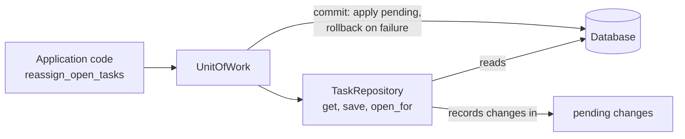

# 02. Repository and Unit of Work (and when an ORM already is one)

> **Draft: written but not yet run.** The code and the expected output in this lesson were prepared by reading the code and the official documentation. They have not been executed yet. If something does not behave as described, trust your tool's real output and report it.

## What you will be able to do
By the end of this lesson you will be able to:
- write a repository that speaks the language of the domain and a unit of work that commits or rolls back several changes together
- predict what a read sees before and after a commit
- explain why `DbContext` (EF Core) and `Session` (SQLAlchemy) already are a unit of work with repositories inside
- decide, with a cost table, whether to add your own layer on top of an ORM

## Recap
1. Which lifetime would you give a unit of work in a web API and why? <details><summary>Answer</summary>Scoped: one per request, so all changes of that request commit together and nothing leaks into the next request (lesson 01).</details>
2. What did `ValidateScopes` protect us from? <details><summary>Answer</summary>A singleton holding a scoped service, for example a long-lived object holding one request's database context.</details>

## Why it matters
Two ideas from Martin Fowler's enterprise catalogue (paraphrased): a **repository** makes a store look like an in-memory collection of domain objects, so business code does not speak SQL; a **unit of work** keeps track of everything you changed during one business action and writes it out as one transaction. Together they stop two classic failures: half-saved business actions (task reassigned, audit row missing) and domain code that is welded to one database. The trap: modern ORMs already implement both, so a naive wrapper adds a layer that hides features and still leaks.

## What you will build
An in-memory "database" with a failing-write switch, a `TaskRepository` that sees pending (uncommitted) changes, and a `UnitOfWork` that commits in id order and **rolls back** when a write fails. The program moves Alice's open tasks to another person twice: first with a failing write (nothing may change), then successfully.

## Before you start
- **Prerequisites:** [Patterns 301 lesson 01, DI containers and composition roots](01-di-containers-and-composition-roots.md).
- Time: 60 minutes for one language, 90 for both. Lesson 01 concepts (lifetimes) are assumed.
- Python 3.10+ and/or the .NET 11 SDK. No packages.
- Source pack (optional): every file is shown in full in this lesson, so you can follow without it. The finished code, the exercise starter and the solution are in the
  course repository https://github.com/Uee03/Code101 under `source/patterns/301-super-hero-to-legendary/phase-1-application-patterns/02-repository-and-unit-of-work/` (on that page choose **Code, Download ZIP**, or run
  `git clone https://github.com/Uee03/Code101.git`).

## Steps

### Step 1. Make the lesson folders
**PowerShell, starting folder: anywhere**
```powershell
New-Item -ItemType Directory -Path "$HOME/code101/patterns301/lesson02/python" -Force | Out-Null
New-Item -ItemType Directory -Path "$HOME/code101/patterns301/lesson02/csharp" -Force | Out-Null
Set-Location "$HOME/code101/patterns301/lesson02"
code .
```

**macOS/Linux terminal, starting folder: anywhere**
```bash
mkdir -p ~/code101/patterns301/lesson02/python ~/code101/patterns301/lesson02/csharp
cd ~/code101/patterns301/lesson02
code .
```
Expected result: VS Code opens `lesson02` with empty `python` and `csharp` folders.

### Step 2. The design in one picture

The repository never writes to the database directly. `save` only records a pending change. The unit of work decides when and in what order the pending changes are written, and undoes everything if one write fails.

### Step 3. Python
**File: `~/code101/patterns301/lesson02/python/main.py`**
```python
from dataclasses import dataclass, replace


@dataclass(frozen=True)
class TaskItem:
    id: int
    title: str
    status: str
    assignee: str


class Database:
    """Stands in for the storage engine: a table plus a switch that simulates a failing write."""

    def __init__(self):
        self.tasks = {}
        self.fail_on_id = None

    def write(self, task):
        if task.id == self.fail_on_id:
            raise RuntimeError(f"write failed for task {task.id}")
        self.tasks[task.id] = task


class TaskRepository:
    def __init__(self, db, pending):
        self._db = db
        self._pending = pending

    def get(self, task_id):
        return self._pending.get(task_id) or self._db.tasks.get(task_id)

    def save(self, task):
        self._pending[task.id] = task

    def open_for(self, assignee):
        merged = {**self._db.tasks, **self._pending}
        found = [t for t in merged.values() if t.assignee == assignee and t.status != "done"]
        return sorted(found, key=lambda t: t.id)


class UnitOfWork:
    def __init__(self, db):
        self._db = db
        self._pending = {}
        self.tasks = TaskRepository(db, self._pending)

    def commit(self):
        backup = dict(self._db.tasks)
        try:
            for task in sorted(self._pending.values(), key=lambda t: t.id):
                self._db.write(task)
        except Exception:
            self._db.tasks = backup
            raise
        finally:
            self._pending.clear()


def reassign_open_tasks(uow, source, target):
    moved = 0
    for task in uow.tasks.open_for(source):
        uow.tasks.save(replace(task, assignee=target))
        moved += 1
    return moved


def main():
    db = Database()
    seed = UnitOfWork(db)
    seed.tasks.save(TaskItem(1, "Write ADR", "todo", "alice"))
    seed.tasks.save(TaskItem(2, "Review PR", "in_progress", "alice"))
    seed.tasks.save(TaskItem(3, "Ship release", "todo", "bob"))
    seed.commit()
    print(f"seeded {len(db.tasks)} tasks")

    db.fail_on_id = 2
    failing = UnitOfWork(db)
    reassign_open_tasks(failing, "alice", "dave")
    try:
        failing.commit()
    except RuntimeError as error:
        print(f"failed: {error}")
    print(f"after rollback: task 1 is still {db.tasks[1].assignee}")
    db.fail_on_id = None

    uow = UnitOfWork(db)
    reassign_open_tasks(uow, "alice", "carol")
    print(f"before commit: repo says {uow.tasks.get(1).assignee}, database says {db.tasks[1].assignee}")
    uow.commit()
    print(f"after commit: database says {db.tasks[1].assignee}")
    print(f"open tasks for carol: {[t.id for t in uow.tasks.open_for('carol')]}")


main()
```

### Step 4. C#
**File: `~/code101/patterns301/lesson02/csharp/Lesson.csproj`**
```xml
<Project Sdk="Microsoft.NET.Sdk">

  <PropertyGroup>
    <OutputType>Exe</OutputType>
    <TargetFramework>net11.0</TargetFramework>
    <ImplicitUsings>enable</ImplicitUsings>
    <Nullable>enable</Nullable>
  </PropertyGroup>

</Project>
```
(`OutputType Exe`: console program; `net11.0`: target .NET 11; `ImplicitUsings`: common `using` lines are added for you; `Nullable`: null warnings on. Identical in every exercise folder of this lesson.)

**File: `~/code101/patterns301/lesson02/csharp/Program.cs`**
```csharp
var db = new Database();
var seed = new UnitOfWork(db);
seed.Tasks.Save(new TaskItem(1, "Write ADR", "todo", "alice"));
seed.Tasks.Save(new TaskItem(2, "Review PR", "in_progress", "alice"));
seed.Tasks.Save(new TaskItem(3, "Ship release", "todo", "bob"));
seed.Commit();
Console.WriteLine($"seeded {db.Tasks.Count} tasks");

db.FailOnId = 2;
var failing = new UnitOfWork(db);
ReassignOpenTasks(failing, "alice", "dave");
try
{
    failing.Commit();
}
catch (InvalidOperationException error)
{
    Console.WriteLine($"failed: {error.Message}");
}
Console.WriteLine($"after rollback: task 1 is still {db.Tasks[1].Assignee}");
db.FailOnId = null;

var uow = new UnitOfWork(db);
ReassignOpenTasks(uow, "alice", "carol");
Console.WriteLine($"before commit: repo says {uow.Tasks.Get(1)!.Assignee}, database says {db.Tasks[1].Assignee}");
uow.Commit();
Console.WriteLine($"after commit: database says {db.Tasks[1].Assignee}");
Console.WriteLine($"open tasks for carol: [{string.Join(", ", uow.Tasks.OpenFor("carol").Select(t => t.Id))}]");

static int ReassignOpenTasks(UnitOfWork uow, string source, string target)
{
    var moved = 0;
    foreach (var task in uow.Tasks.OpenFor(source))
    {
        uow.Tasks.Save(task with { Assignee = target });
        moved++;
    }
    return moved;
}

public sealed record TaskItem(int Id, string Title, string Status, string Assignee);

public sealed class Database
{
    public Dictionary<int, TaskItem> Tasks { get; set; } = new();
    public int? FailOnId { get; set; }

    public void Write(TaskItem task)
    {
        if (task.Id == FailOnId)
        {
            throw new InvalidOperationException($"write failed for task {task.Id}");
        }
        Tasks[task.Id] = task;
    }
}

public sealed class TaskRepository(Database db, SortedDictionary<int, TaskItem> pending)
{
    public TaskItem? Get(int id) => pending.TryGetValue(id, out var task) ? task : db.Tasks.GetValueOrDefault(id);

    public void Save(TaskItem task) => pending[task.Id] = task;

    public List<TaskItem> OpenFor(string assignee)
    {
        var merged = new SortedDictionary<int, TaskItem>(db.Tasks);
        foreach (var (id, task) in pending)
        {
            merged[id] = task;
        }
        return merged.Values.Where(t => t.Assignee == assignee && t.Status != "done").ToList();
    }
}

public sealed class UnitOfWork
{
    private readonly Database _db;
    private readonly SortedDictionary<int, TaskItem> _pending = new();

    public UnitOfWork(Database db)
    {
        _db = db;
        Tasks = new TaskRepository(db, _pending);
    }

    public TaskRepository Tasks { get; }

    public void Commit()
    {
        var backup = new Dictionary<int, TaskItem>(_db.Tasks);
        try
        {
            foreach (var task in _pending.Values)
            {
                _db.Write(task);
            }
        }
        catch
        {
            _db.Tasks = backup;
            throw;
        }
        finally
        {
            _pending.Clear();
        }
    }
}
```
`task with { Assignee = target }` copies a record with one property changed; the original is never mutated, which is what makes the backup copy safe.

## Run it
Predict first: the failing commit writes task 1 before task 2 fails. What does `db.tasks[1].assignee` say right after the failure, and why? <details><summary>Answer</summary>`alice`. The write of task 1 did happen, but the rollback restored the backup taken before the first write.</details>

**PowerShell, folder: `~/code101/patterns301/lesson02/python`**
```powershell
Set-Location "$HOME/code101/patterns301/lesson02/python"
python main.py
```
**macOS/Linux terminal, folder: `~/code101/patterns301/lesson02/python`**
```bash
cd ~/code101/patterns301/lesson02/python
python3 main.py
```
**Any terminal, folder: `~/code101/patterns301/lesson02/csharp`**
```text
dotnet run --project . --nologo
```
Expected output (derived by reading the code, not yet run; identical for Python and C#):
```text
seeded 3 tasks
failed: write failed for task 2
after rollback: task 1 is still alice
before commit: repo says carol, database says alice
after commit: database says carol
open tasks for carol: [1, 2]
```

## How it works
1. `save` only puts the new version into `pending`. Nothing is stored yet.
2. `get` and `open_for` read **pending first, then the database**, so code inside one business action sees its own changes (read-your-writes). Other readers still see the old state until commit.
3. `commit` takes a backup, writes in a fixed order (by id, so lock order is predictable and the output is deterministic), and on any exception restores the backup and re-raises. `finally` clears the pending list either way, so a unit of work is **single use**.
4. The application function `reassign_open_tasks` never calls `commit`. The caller (an HTTP handler, a message consumer) owns the transaction boundary. That keeps one business action equal to one commit.

### Misconceptions
- **"A repository is a wrapper around SQL."** No. It is a collection-like interface in domain words (`open_for(assignee)`), whatever the storage is.
- **"One repository per table."** No. One per **aggregate** (a cluster of objects changed together, like a task with its comments). A repository per table recreates the table layout in your domain code.
- **"A rollback undoes side effects."** No. It undoes the store. A mail already sent stays sent; lesson 05 (outbox) fixes that.

### When an ORM already is one
| Concept | Your hand-written version | EF Core | SQLAlchemy 2.x |
|---|---|---|---|
| Unit of work | `UnitOfWork.commit` | `DbContext.SaveChanges()` (one transaction by default) | `Session.commit()` |
| Change tracking | `pending` | the change tracker | the session's identity map and unit of work |
| Repository | `TaskRepository` | `DbSet<T>` (collection-like, queryable) | `Session.get`, `select()` |

An illustration (not part of this lab; it needs the EF Core package and a database):
```csharp
var open = await db.Tasks.Where(t => t.Assignee == "alice" && t.Status != "done").ToListAsync();
foreach (var task in open) task.Assignee = "carol";
await db.SaveChangesAsync();   // all changes in one transaction
```
So the question is not "repository or not" but **"is my own layer worth its price?"**

| Add your own repository/UoW when | Do not add it when |
|---|---|
| Domain code must be tested without the ORM or a database (the fake in this lesson) | The only reason is "we might change database one day" (measure how often that happened in your history) |
| You want intention-revealing queries (`open_for`) and a single place to optimise them | The repository would just forward `Add`, `Remove`, `GetAll` (a *generic repository* adds nothing and hides ORM features like `Include` and projections) |
| Several storages sit behind one domain (SQL plus search index) | Reads are mostly reports: query the database directly with a read model (lesson 04) |
| Transaction boundaries need to be explicit in the application layer | Your tests already run fast against the real database in a container |

### Failure modes
- **Leaky abstraction:** a repository that returns `IQueryable` lets callers build queries the provider cannot translate, and moves query design into every caller.
- **N+1 queries:** a repository method that loads tasks one by one inside a loop. Measure queries per request (a log of SQL statements), not just response time.
- **Lost updates:** two units of work read version 1 and both write. The fix is optimistic concurrency (a `version` column, as `capstones/platform` uses with ETag and `If-Match`), not a bigger transaction.
- **Long transactions:** a unit of work spanning a user's think time or a remote call holds locks. Keep it to one request.
- **Fake drift:** an in-memory fake that behaves differently from the real store (ordering, case sensitivity, null handling) makes tests pass and production fail. Run the same contract tests against fake and real implementations.

### ADR-0002
- **Context:** Tasks and Teams API on PostgreSQL with EF Core; domain rules for reassigning and completing tasks.
- **Decision:** No generic repository. Use EF Core's `DbContext` as the unit of work. Add narrow, aggregate-level repository interfaces (`ITaskRepository.OpenFor`) only where domain tests need a fake.
- **Consequences:** Less code and full ORM features; a few interfaces to maintain; contract tests keep fake and real in step.

## Try it
**Rung 1, guided.** Copy the `starter` folder of your language to `try02` (copy the folder itself and rename it). Implement `commit` so the last two lines of output show a rollback.

**File: `try02/main.py`**
```python
class Database:
    def __init__(self):
        self.balances = {"a": 10, "b": 0}


class UnitOfWork:
    def __init__(self, db):
        self.db = db
        self.pending = {}

    def set_balance(self, name, value):
        self.pending[name] = value

    def commit(self):
        # TODO 1: copy the current balances first (the backup).
        # TODO 2: apply every pending value in sorted name order; before assigning a value,
        #         raise ValueError(f"negative balance for {name}") if it is below zero.
        # TODO 3: if an error happens, put the backup back (rollback) and raise again.
        # TODO 4: always clear self.pending at the end.
        raise NotImplementedError


db = Database()
uow = UnitOfWork(db)
uow.set_balance("a", 5)
uow.set_balance("b", 5)
uow.commit()
print(f"committed: a={db.balances['a']}, b={db.balances['b']}")

bad = UnitOfWork(db)
bad.set_balance("a", 1)
bad.set_balance("b", -1)
try:
    bad.commit()
except ValueError as error:
    print(f"rolled back: {error}")
print(f"unchanged: a={db.balances['a']}, b={db.balances['b']}")
```

**File: `try02/Program.cs`** (with the `Lesson.csproj` from this lesson)
```csharp
var db = new Database();
var uow = new UnitOfWork(db);
uow.SetBalance("a", 5);
uow.SetBalance("b", 5);
uow.Commit();
Console.WriteLine($"committed: a={db.Balances["a"]}, b={db.Balances["b"]}");

var bad = new UnitOfWork(db);
bad.SetBalance("a", 1);
bad.SetBalance("b", -1);
try
{
    bad.Commit();
}
catch (ArgumentException error)
{
    Console.WriteLine($"rolled back: {error.Message}");
}
Console.WriteLine($"unchanged: a={db.Balances["a"]}, b={db.Balances["b"]}");

class Database
{
    public Dictionary<string, int> Balances { get; set; } = new() { ["a"] = 10, ["b"] = 0 };
}

class UnitOfWork(Database db)
{
    private readonly SortedDictionary<string, int> _pending = new();

    public void SetBalance(string name, int value) => _pending[name] = value;

    public void Commit()
    {
        // TODO 1: copy the current balances first (the backup).
        // TODO 2: apply every pending value in name order; before assigning a value,
        //         throw new ArgumentException($"negative balance for {name}") if it is below zero.
        // TODO 3: if an error happens, put the backup back (rollback) and throw again.
        // TODO 4: always clear _pending at the end.
        throw new NotImplementedException();
    }
}
```
Expected output after your fix:
```text
committed: a=5, b=5
rolled back: negative balance for b
unchanged: a=5, b=5
```

**Rung 2, change.** Move the negative-balance rule out of `commit` into `set_balance` so a bad value is rejected immediately. What did you lose? (Hint: think about rules that need two values at once, and about where a database constraint would still be needed.)

**Rung 3, stretch (no single answer).** Write a four-row cost table for your own team: for each of "generic repository", "aggregate repository", "DbContext directly", "raw SQL read model" list one benefit, one cost and which of your current tests it would change.

<details><summary>Solution</summary>

**File: `exercise/solution/python/main.py`**
```python
class Database:
    def __init__(self):
        self.balances = {"a": 10, "b": 0}


class UnitOfWork:
    def __init__(self, db):
        self.db = db
        self.pending = {}

    def set_balance(self, name, value):
        self.pending[name] = value

    def commit(self):
        backup = dict(self.db.balances)
        try:
            for name in sorted(self.pending):
                if self.pending[name] < 0:
                    raise ValueError(f"negative balance for {name}")
                self.db.balances[name] = self.pending[name]
        except ValueError:
            self.db.balances = backup
            raise
        finally:
            self.pending = {}


db = Database()
uow = UnitOfWork(db)
uow.set_balance("a", 5)
uow.set_balance("b", 5)
uow.commit()
print(f"committed: a={db.balances['a']}, b={db.balances['b']}")

bad = UnitOfWork(db)
bad.set_balance("a", 1)
bad.set_balance("b", -1)
try:
    bad.commit()
except ValueError as error:
    print(f"rolled back: {error}")
print(f"unchanged: a={db.balances['a']}, b={db.balances['b']}")
```

**File: `exercise/solution/csharp/Program.cs`**
```csharp
var db = new Database();
var uow = new UnitOfWork(db);
uow.SetBalance("a", 5);
uow.SetBalance("b", 5);
uow.Commit();
Console.WriteLine($"committed: a={db.Balances["a"]}, b={db.Balances["b"]}");

var bad = new UnitOfWork(db);
bad.SetBalance("a", 1);
bad.SetBalance("b", -1);
try
{
    bad.Commit();
}
catch (ArgumentException error)
{
    Console.WriteLine($"rolled back: {error.Message}");
}
Console.WriteLine($"unchanged: a={db.Balances["a"]}, b={db.Balances["b"]}");

class Database
{
    public Dictionary<string, int> Balances { get; set; } = new() { ["a"] = 10, ["b"] = 0 };
}

class UnitOfWork(Database db)
{
    private readonly SortedDictionary<string, int> _pending = new();

    public void SetBalance(string name, int value) => _pending[name] = value;

    public void Commit()
    {
        var backup = new Dictionary<string, int>(db.Balances);
        try
        {
            foreach (var (name, value) in _pending)
            {
                if (value < 0)
                {
                    throw new ArgumentException($"negative balance for {name}");
                }
                db.Balances[name] = value;
            }
        }
        catch
        {
            db.Balances = backup;
            throw;
        }
        finally
        {
            _pending.Clear();
        }
    }
}
```
Rung 2 answer: early rejection is friendlier, but rules over several values (for example "total must not exceed a limit") can only be checked at commit, and the database should still carry its own `CHECK` constraint as the last line of defence.
</details>

## Check yourself
1. Why does `get` look in `pending` before the database? <details><summary>Answer</summary>So a business action sees its own uncommitted changes (read-your-writes) while other readers still see the old state.</details>
2. Name two reasons not to wrap EF Core in a generic repository. <details><summary>Answer</summary>It duplicates what `DbSet` and `DbContext` already do, and it hides provider features (projections, `Include`, bulk operations) or leaks `IQueryable` anyway.</details>
3. What happens in the first scenario if the failure is on task 3 instead of task 2 (task 3 belongs to bob and is not touched)? <details><summary>Answer</summary>Nothing fails: the pending set contains only tasks 1 and 2, so the commit succeeds.</details>
4. The mail "your task moved" was sent before `commit` and the commit failed. What is wrong and which lesson fixes it? <details><summary>Answer</summary>A side effect escaped the transaction. Use the outbox (lesson 05) so the message is stored in the same transaction and sent only after commit.</details>

## Common mistakes
| Symptom or error text | Cause | Fix |
|---|---|---|
| Changes missing in the database after the program ends | `commit()` never called | The caller of the application function must commit |
| Second `commit` writes nothing | Pending changes were cleared; a unit of work is single use | Create a new `UnitOfWork` per business action |
| `RuntimeError: write failed for task 2` escapes your program (Python, derived from the code) | You forgot the `try/except` around `commit` | Catch it where the transaction boundary is |
| Rollback does not restore data in your own variant | The backup was taken after the first write, or holds mutable objects that were changed in place | Take the backup first and keep stored objects immutable (`frozen=True`, `record`) |
| `NotImplementedException` (typical .NET message: "The method or operation is not implemented.") | The exercise TODO is still there | Replace the `throw` with your code |

## Best practice
Keep the unit of work at the request boundary, give repositories domain-shaped methods per aggregate, and let the ORM be the unit of work unless you can name the test or boundary that needs your own. Source: Repository and Unit of Work, Patterns of Enterprise Application Architecture, Martin Fowler https://martinfowler.com/eaaCatalog/repository.html and https://martinfowler.com/eaaCatalog/unitOfWork.html ; Microsoft Learn, Design the infrastructure persistence layer https://learn.microsoft.com/dotnet/architecture/microservices/microservice-ddd-cqrs-patterns/infrastructure-persistence-layer-design

## Going further
- EF Core `DbContext` lifetime and configuration: https://learn.microsoft.com/ef/core/dbcontext-configuration/
- SQLAlchemy session basics (the Python equivalent): https://docs.sqlalchemy.org/en/20/orm/session_basics.html
- Capstone use: the `version` column and `If-Match` in `capstones/platform` implement optimistic concurrency for the same tasks.

## Summary
- You wrote a repository and a unit of work and saw read-your-writes before a commit.
- You proved a rollback leaves the store unchanged after a partial failure.
- You compared your layer with `DbContext` and `Session` and listed when your own layer pays for itself.
- You recorded the decision in an ADR.

## Next lesson
03. Specification and Query Object: describe "which tasks" as composable objects instead of piling filter methods onto the repository.
