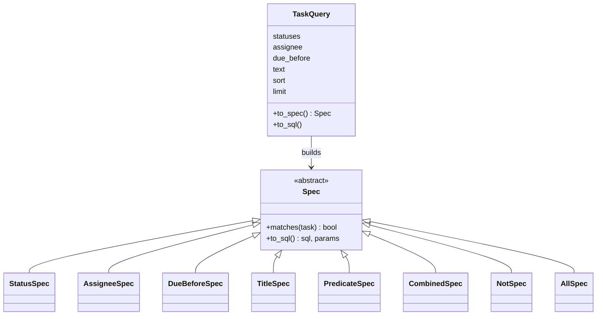

# 03. Specification and Query Object

> **Draft: written but not yet run.** The code and the expected output in this lesson were prepared by reading the code and the official documentation. They have not been executed yet. If something does not behave as described, trust your tool's real output and report it.

## What you will be able to do
By the end of this lesson you will be able to:
- build small specification objects and combine them with and, or and not
- turn one description of "which tasks" into both an in-memory check and a parameterised SQL fragment
- use a query object to turn an untrusted request into a safe query (allow-listed sort, clamped limit, bound parameters)
- say when a specification is worth it and when a plain method or a database view is better

## Recap
1. Why does a repository method like `open_for(assignee)` age badly when the product asks for ten more filters? <details><summary>Answer</summary>Every combination needs a new method (`open_for_overdue_by_team`...), so the repository grows without bound and callers cannot reuse the pieces (lesson 02).</details>
2. What goes into a unit of work and what stays out? <details><summary>Answer</summary>The set of changes for one business action; queries are not part of it.</details>

## Why it matters
"Overdue tasks that are not done" is a business rule. If it exists as one `WHERE` fragment in a controller, another in a report and a third in a background job, the three slowly disagree. A **specification** (Eric Evans and Martin Fowler's pattern, paraphrased) packages one rule as an object that can answer "does this task satisfy me?" and can be combined with others. A **query object** packages the *request*: filters, sort, page size. Together they keep rules reusable and keep user input away from SQL text.

## What you will build
Eight small specification classes (status, assignee, due date, title text, a plain predicate, all, combined, not) and a `TaskQuery`. The program prints the SQL and bound parameters that a request produces, runs the same query in memory, tries an injection attempt, reuses a rule, and shows what breaks when a rule cannot be translated to SQL.

## Before you start
- **Prerequisites:** [Patterns 301 lesson 02, repository and unit of work](02-repository-and-unit-of-work.md).
- Time: 60 minutes for one language, 90 for both.
- Python 3.10+ and/or the .NET 11 SDK. No packages. No database: the SQL is **printed, not executed**, so you can read exactly what would be sent.
- Source pack (optional): every file is shown in full in this lesson, so you can follow without it. The finished code, the exercise starter and the solution are in the
  course repository https://github.com/Uee03/Code101 under `source/patterns/301-super-hero-to-legendary/phase-1-application-patterns/03-specification-and-query-object/` (on that page choose **Code, Download ZIP**, or run
  `git clone https://github.com/Uee03/Code101.git`).

## Steps

### Step 1. Make the lesson folders
**PowerShell, starting folder: anywhere**
```powershell
New-Item -ItemType Directory -Path "$HOME/code101/patterns301/lesson03/python" -Force | Out-Null
New-Item -ItemType Directory -Path "$HOME/code101/patterns301/lesson03/csharp" -Force | Out-Null
Set-Location "$HOME/code101/patterns301/lesson03"
code .
```

**macOS/Linux terminal, starting folder: anywhere**
```bash
mkdir -p ~/code101/patterns301/lesson03/python ~/code101/patterns301/lesson03/csharp
cd ~/code101/patterns301/lesson03
code .
```
Expected result: VS Code opens `lesson03` with empty `python` and `csharp` folders.

### Step 2. The shape

One object, two "interpreters": `matches` (in memory) and `to_sql` (for the database). Each SQL fragment uses `?` **placeholders**: the values travel separately as parameters, so they can never become SQL text.

### Step 3. Python
**File: `~/code101/patterns301/lesson03/python/main.py`**
```python
from dataclasses import dataclass

SORTABLE = {"due": "due", "title": "title", "id": "id"}


@dataclass(frozen=True)
class TaskItem:
    id: int
    title: str
    status: str
    assignee: str
    due: str


class NotTranslatable(Exception):
    pass


class Spec:
    def matches(self, task):
        raise NotImplementedError

    def to_sql(self):
        raise NotImplementedError

    def __and__(self, other):
        return CombinedSpec("AND", self, other)

    def __or__(self, other):
        return CombinedSpec("OR", self, other)

    def __invert__(self):
        return NotSpec(self)


class AllSpec(Spec):
    def matches(self, task):
        return True

    def to_sql(self):
        return "1 = 1", []


class StatusSpec(Spec):
    def __init__(self, status):
        self.status = status

    def matches(self, task):
        return task.status == self.status

    def to_sql(self):
        return "status = ?", [self.status]


class AssigneeSpec(Spec):
    def __init__(self, assignee):
        self.assignee = assignee

    def matches(self, task):
        return task.assignee == self.assignee

    def to_sql(self):
        return "assignee = ?", [self.assignee]


class DueBeforeSpec(Spec):
    def __init__(self, day):
        self.day = day

    def matches(self, task):
        return task.due < self.day

    def to_sql(self):
        return "due < ?", [self.day]


class TitleSpec(Spec):
    def __init__(self, text):
        self.text = text.lower()

    def matches(self, task):
        return self.text in task.title.lower()

    def to_sql(self):
        return "lower(title) LIKE ?", [f"%{self.text}%"]


class PredicateSpec(Spec):
    def __init__(self, test):
        self.test = test

    def matches(self, task):
        return self.test(task)

    def to_sql(self):
        raise NotTranslatable("Predicate cannot be turned into SQL")


class CombinedSpec(Spec):
    def __init__(self, op, left, right):
        self.op = op
        self.left = left
        self.right = right

    def matches(self, task):
        if self.op == "AND":
            return self.left.matches(task) and self.right.matches(task)
        return self.left.matches(task) or self.right.matches(task)

    def to_sql(self):
        left_sql, left_params = self.left.to_sql()
        right_sql, right_params = self.right.to_sql()
        return f"({left_sql} {self.op} {right_sql})", left_params + right_params


class NotSpec(Spec):
    def __init__(self, inner):
        self.inner = inner

    def matches(self, task):
        return not self.inner.matches(task)

    def to_sql(self):
        sql, params = self.inner.to_sql()
        return f"NOT ({sql})", params


@dataclass
class TaskQuery:
    statuses: tuple = ()
    assignee: str | None = None
    due_before: str | None = None
    text: str | None = None
    sort: str = "due"
    limit: int = 10

    def to_spec(self):
        parts = []
        if self.statuses:
            status_spec = StatusSpec(self.statuses[0])
            for status in self.statuses[1:]:
                status_spec = status_spec | StatusSpec(status)
            parts.append(status_spec)
        if self.assignee:
            parts.append(AssigneeSpec(self.assignee))
        if self.due_before:
            parts.append(DueBeforeSpec(self.due_before))
        if self.text:
            parts.append(TitleSpec(self.text))
        if not parts:
            return AllSpec()
        spec = parts[0]
        for part in parts[1:]:
            spec = spec & part
        return spec

    def to_sql(self):
        column = SORTABLE.get(self.sort)
        if column is None:
            raise ValueError(f"cannot sort by {self.sort}")
        where_sql, params = self.to_spec().to_sql()
        limit = min(max(self.limit, 1), 100)
        sql = f"SELECT id, title, status, assignee, due FROM tasks WHERE {where_sql} ORDER BY {column} LIMIT ?"
        return sql, params + [limit]


def run_in_memory(tasks, query):
    spec = query.to_spec()
    found = [t for t in tasks if spec.matches(t)]
    found.sort(key=lambda t: getattr(t, SORTABLE[query.sort]))
    return found[: min(max(query.limit, 1), 100)]


def show(params):
    return "[" + ", ".join(f"'{p}'" if isinstance(p, str) else str(p) for p in params) + "]"


def ids(tasks):
    return "[" + ", ".join(str(t.id) for t in tasks) + "]"


def main():
    tasks = [
        TaskItem(1, "Write ADR", "todo", "alice", "2026-03-05"),
        TaskItem(2, "Review PR", "in_progress", "alice", "2026-03-02"),
        TaskItem(3, "Ship release", "todo", "bob", "2026-03-20"),
        TaskItem(4, "Fix login bug", "blocked", "carol", "2026-03-01"),
        TaskItem(5, "Plan sprint", "done", "alice", "2026-02-20"),
    ]

    query_a = TaskQuery(statuses=("todo", "in_progress"), assignee="alice", due_before="2026-03-10")
    sql, params = query_a.to_sql()
    print("query A sql:", sql)
    print("query A params:", show(params))
    print("query A result:", ids(run_in_memory(tasks, query_a)))

    query_b = TaskQuery(text="x; DROP TABLE tasks; --")
    sql, params = query_b.to_sql()
    print("query B sql:", sql)
    print("query B params:", show(params))
    print("query B result:", ids(run_in_memory(tasks, query_b)))

    overdue = DueBeforeSpec("2026-03-03") & ~StatusSpec("done")
    print("overdue sql:", overdue.to_sql()[0])
    print("overdue result:", ids([t for t in tasks if overdue.matches(t)]))

    long_titles = PredicateSpec(lambda t: len(t.title) > 10)
    print("long titles in memory:", ids([t for t in tasks if long_titles.matches(t)]))
    try:
        long_titles.to_sql()
    except NotTranslatable as error:
        print("long titles to sql:", error)

    try:
        TaskQuery(sort="due; DROP TABLE tasks").to_sql()
    except ValueError as error:
        print("bad sort:", error)


main()
```

### Step 4. C#
**File: `~/code101/patterns301/lesson03/csharp/Lesson.csproj`**
```xml
<Project Sdk="Microsoft.NET.Sdk">

  <PropertyGroup>
    <OutputType>Exe</OutputType>
    <TargetFramework>net11.0</TargetFramework>
    <ImplicitUsings>enable</ImplicitUsings>
    <Nullable>enable</Nullable>
  </PropertyGroup>

</Project>
```

**File: `~/code101/patterns301/lesson03/csharp/Program.cs`**
```csharp
var tasks = new List<TaskItem>
{
    new(1, "Write ADR", "todo", "alice", "2026-03-05"),
    new(2, "Review PR", "in_progress", "alice", "2026-03-02"),
    new(3, "Ship release", "todo", "bob", "2026-03-20"),
    new(4, "Fix login bug", "blocked", "carol", "2026-03-01"),
    new(5, "Plan sprint", "done", "alice", "2026-02-20"),
};

var queryA = new TaskQuery(Statuses: ["todo", "in_progress"], Assignee: "alice", DueBefore: "2026-03-10");
var (sql, parameters) = queryA.ToSql();
Console.WriteLine($"query A sql: {sql}");
Console.WriteLine($"query A params: {Show(parameters)}");
Console.WriteLine($"query A result: {Ids(queryA.RunInMemory(tasks))}");

var queryB = new TaskQuery(Text: "x; DROP TABLE tasks; --");
(sql, parameters) = queryB.ToSql();
Console.WriteLine($"query B sql: {sql}");
Console.WriteLine($"query B params: {Show(parameters)}");
Console.WriteLine($"query B result: {Ids(queryB.RunInMemory(tasks))}");

var overdue = new DueBeforeSpec("2026-03-03").And(new StatusSpec("done").Not());
Console.WriteLine($"overdue sql: {overdue.ToSql().Sql}");
Console.WriteLine($"overdue result: {Ids(tasks.Where(overdue.Matches))}");

var longTitles = new PredicateSpec(t => t.Title.Length > 10);
Console.WriteLine($"long titles in memory: {Ids(tasks.Where(longTitles.Matches))}");
try
{
    longTitles.ToSql();
}
catch (NotTranslatableException error)
{
    Console.WriteLine($"long titles to sql: {error.Message}");
}

try
{
    new TaskQuery(Sort: "due; DROP TABLE tasks").ToSql();
}
catch (ArgumentException error)
{
    Console.WriteLine($"bad sort: {error.Message}");
}

static string Show(List<object> values) =>
    "[" + string.Join(", ", values.Select(p => p is string s ? $"'{s}'" : p.ToString())) + "]";

static string Ids(IEnumerable<TaskItem> found) =>
    "[" + string.Join(", ", found.Select(t => t.Id)) + "]";

public sealed record TaskItem(int Id, string Title, string Status, string Assignee, string Due);

public sealed class NotTranslatableException(string message) : Exception(message);

public abstract class Spec
{
    public abstract bool Matches(TaskItem task);

    public abstract (string Sql, List<object> Params) ToSql();

    public Spec And(Spec other) => new CombinedSpec("AND", this, other);

    public Spec Or(Spec other) => new CombinedSpec("OR", this, other);

    public Spec Not() => new NotSpec(this);
}

public sealed class AllSpec : Spec
{
    public override bool Matches(TaskItem task) => true;

    public override (string Sql, List<object> Params) ToSql() => ("1 = 1", new List<object>());
}

public sealed class StatusSpec(string status) : Spec
{
    public override bool Matches(TaskItem task) => task.Status == status;

    public override (string Sql, List<object> Params) ToSql() => ("status = ?", new List<object> { status });
}

public sealed class AssigneeSpec(string assignee) : Spec
{
    public override bool Matches(TaskItem task) => task.Assignee == assignee;

    public override (string Sql, List<object> Params) ToSql() => ("assignee = ?", new List<object> { assignee });
}

public sealed class DueBeforeSpec(string day) : Spec
{
    public override bool Matches(TaskItem task) => string.CompareOrdinal(task.Due, day) < 0;

    public override (string Sql, List<object> Params) ToSql() => ("due < ?", new List<object> { day });
}

public sealed class TitleSpec(string text) : Spec
{
    private readonly string _text = text.ToLowerInvariant();

    public override bool Matches(TaskItem task) => task.Title.ToLowerInvariant().Contains(_text);

    public override (string Sql, List<object> Params) ToSql() => ("lower(title) LIKE ?", new List<object> { $"%{_text}%" });
}

public sealed class PredicateSpec(Func<TaskItem, bool> test) : Spec
{
    public override bool Matches(TaskItem task) => test(task);

    public override (string Sql, List<object> Params) ToSql() =>
        throw new NotTranslatableException("Predicate cannot be turned into SQL");
}

public sealed class CombinedSpec(string op, Spec left, Spec right) : Spec
{
    public override bool Matches(TaskItem task) =>
        op == "AND" ? left.Matches(task) && right.Matches(task) : left.Matches(task) || right.Matches(task);

    public override (string Sql, List<object> Params) ToSql()
    {
        var (leftSql, leftParams) = left.ToSql();
        var (rightSql, rightParams) = right.ToSql();
        return ($"({leftSql} {op} {rightSql})", leftParams.Concat(rightParams).ToList());
    }
}

public sealed class NotSpec(Spec inner) : Spec
{
    public override bool Matches(TaskItem task) => !inner.Matches(task);

    public override (string Sql, List<object> Params) ToSql()
    {
        var (sql, parameters) = inner.ToSql();
        return ($"NOT ({sql})", parameters);
    }
}

public sealed record TaskQuery(
    string[]? Statuses = null,
    string? Assignee = null,
    string? DueBefore = null,
    string? Text = null,
    string Sort = "due",
    int Limit = 10)
{
    private static readonly Dictionary<string, string> Sortable = new() { ["due"] = "due", ["title"] = "title", ["id"] = "id" };

    public Spec ToSpec()
    {
        var parts = new List<Spec>();
        if (Statuses is { Length: > 0 })
        {
            parts.Add(Statuses.Select(s => (Spec)new StatusSpec(s)).Aggregate((a, b) => a.Or(b)));
        }
        if (!string.IsNullOrEmpty(Assignee))
        {
            parts.Add(new AssigneeSpec(Assignee));
        }
        if (!string.IsNullOrEmpty(DueBefore))
        {
            parts.Add(new DueBeforeSpec(DueBefore));
        }
        if (!string.IsNullOrEmpty(Text))
        {
            parts.Add(new TitleSpec(Text));
        }
        return parts.Count == 0 ? new AllSpec() : parts.Aggregate((a, b) => a.And(b));
    }

    public (string Sql, List<object> Params) ToSql()
    {
        if (!Sortable.TryGetValue(Sort, out var column))
        {
            throw new ArgumentException($"cannot sort by {Sort}");
        }
        var (whereSql, parameters) = ToSpec().ToSql();
        parameters.Add(Math.Clamp(Limit, 1, 100));
        return ($"SELECT id, title, status, assignee, due FROM tasks WHERE {whereSql} ORDER BY {column} LIMIT ?", parameters);
    }

    public List<TaskItem> RunInMemory(IEnumerable<TaskItem> tasks)
    {
        var spec = ToSpec();
        Func<TaskItem, string> key = Sort switch
        {
            "title" => t => t.Title,
            "id" => t => t.Id.ToString("D6"),
            _ => t => t.Due,
        };
        return tasks.Where(spec.Matches).OrderBy(key, StringComparer.Ordinal).Take(Math.Clamp(Limit, 1, 100)).ToList();
    }
}
```
Dates are ISO strings (`2026-03-05`), which compare correctly as text. Real code should use real date types.

## Run it
Predict first: query B contains `DROP TABLE`. Will the printed SQL text contain that word? <details><summary>Answer</summary>No. The text goes into the parameter list; the SQL string only contains the placeholder `?`.</details>

**PowerShell, folder: `~/code101/patterns301/lesson03/python`**
```powershell
Set-Location "$HOME/code101/patterns301/lesson03/python"
python main.py
```
**macOS/Linux terminal, folder: `~/code101/patterns301/lesson03/python`**
```bash
cd ~/code101/patterns301/lesson03/python
python3 main.py
```
**Any terminal, folder: `~/code101/patterns301/lesson03/csharp`**
```text
dotnet run --project . --nologo
```
Expected output (derived by reading the code, not yet run; identical for Python and C#):
```text
query A sql: SELECT id, title, status, assignee, due FROM tasks WHERE (((status = ? OR status = ?) AND assignee = ?) AND due < ?) ORDER BY due LIMIT ?
query A params: ['todo', 'in_progress', 'alice', '2026-03-10', 10]
query A result: [2, 1]
query B sql: SELECT id, title, status, assignee, due FROM tasks WHERE lower(title) LIKE ? ORDER BY due LIMIT ?
query B params: ['%x; drop table tasks; --%', 10]
query B result: []
overdue sql: (due < ? AND NOT (status = ?))
overdue result: [2, 4]
long titles in memory: [3, 4, 5]
long titles to sql: Predicate cannot be turned into SQL
bad sort: cannot sort by due; DROP TABLE tasks
```

## How it works
- **Composition.** `status_spec | other` builds a tree, not a result. `to_spec()` folds the filters of a request into `((status OR status) AND assignee) AND due`; the SQL printed in "query A" has exactly the same nesting, and so does `matches`. One tree, two readings.
- **Security.** Values never become SQL text: `x; DROP TABLE ...` ends up as a bound parameter. The two things that *cannot* be parameters, the column in `ORDER BY` and the limit, are handled by an **allow-list** (`SORTABLE`) and a **clamp** (1 to 100). That is why `bad sort` is rejected before any SQL exists. In real code the user-controlled text also needs its `LIKE` wildcards (`%` and `_`) escaped; the exercise stretch asks you for that.
- **Query object.** `TaskQuery` is the only thing the HTTP layer builds. It is also the natural place for paging and sort rules (the platform capstone's `limit` 1 to 100 and keyset cursors live here, see `capstones/platform`).
- **PredicateSpec** is a trapdoor: it works in memory and **cannot** be translated. That is the central failure mode of the pattern.

### Misconceptions
- **"Specifications replace SQL."** They describe rules. Something must still translate them; with an ORM that something is the expression tree of LINQ or SQLAlchemy's `select().where()`.
- **"More small classes is better design."** Each class here is justified only because there are two interpreters (memory and SQL). With one interpreter a plain function is simpler.

### Trade-offs
| Option | Good when | Cost |
|---|---|---|
| Plain repository methods (`open_for`, `overdue`) | Fewer than about five distinct queries | Method explosion when filters combine |
| Specification objects | Rules are reused across places or must run both in memory and in SQL | Many small classes; a translator to maintain; untranslatable specs |
| Query object on top of the ORM (`Where(...)` built from the request) | Search and list endpoints with optional filters | Must be tested for every filter combination that matters |
| Database view or read model (lesson 04) | Reports and dashboards | Another artefact to migrate and keep fresh |

### Failure modes
- **Untranslatable spec** (the predicate above) found in production when someone passes it to the repository. Prefer a *typed* specification vocabulary, or make `to_sql` part of the abstract interface so the compiler or a test catches the gap.
- **Fetch everything, filter in memory.** If a repository silently falls back to `matches` after loading the whole table, a 20 ms query becomes a 20 s one. Count rows loaded per request.
- **Specification explosion.** Dozens of near-identical classes (`DueBeforeFriday`, `DueBeforeMonday`). Parameterise instead.
- **Divergent interpreters.** `matches` and `to_sql` disagree (case sensitivity, null handling, collation). Test every spec against both.
- **Index blindness.** A clean spec tree can produce `lower(title) LIKE '%...%'`, which no ordinary index helps. Look at the query plan (`EXPLAIN`) for the ones that matter and measure.

### ADR-0003
- **Context:** Tasks list endpoint with seven optional filters; the "overdue" rule is also used by a nightly reminder job.
- **Decision:** One `TaskQuery` for the endpoint, built from validated request parameters; one `OverdueSpec` shared by endpoint and job. No generic specification library.
- **Consequences:** The rule exists once; both interpreters need tests; adding a filter means one spec plus one line in `to_spec`.

## Try it
**Rung 1, guided.** Copy the `starter` folder of your language to `try03` (copy the folder itself and rename it). It has `AND` specs but no `NOT`. Do TODO 1 and 2.

**File: `try03/main.py`**
```python
class Task:
    def __init__(self, id, assignee, status):
        self.id = id
        self.assignee = assignee
        self.status = status


class Spec:
    def matches(self, task):
        raise NotImplementedError

    def __and__(self, other):
        return AndSpec(self, other)

    # TODO 2: add __invert__ that returns NotSpec(self)


class AndSpec(Spec):
    def __init__(self, left, right):
        self.left = left
        self.right = right

    def matches(self, task):
        return self.left.matches(task) and self.right.matches(task)


class StatusSpec(Spec):
    def __init__(self, status):
        self.status = status

    def matches(self, task):
        return task.status == self.status


class AssigneeSpec(Spec):
    def __init__(self, assignee):
        self.assignee = assignee

    def matches(self, task):
        return task.assignee == self.assignee


# TODO 1: write NotSpec(Spec). It receives one spec and matches exactly the tasks that spec does not match.

tasks = [
    Task(1, "alice", "todo"),
    Task(2, "alice", "done"),
    Task(3, "bob", "todo"),
    Task(4, "alice", "in_progress"),
]


def ids(spec):
    return [t.id for t in tasks if spec.matches(t)]


print("alice open:", ids(AssigneeSpec("alice") & ~StatusSpec("done")))
print("not alice:", ids(~AssigneeSpec("alice")))
```

**File: `try03/Program.cs`** (with the `Lesson.csproj` from this lesson)
```csharp
var tasks = new List<WorkItem>
{
    new(1, "alice", "todo"),
    new(2, "alice", "done"),
    new(3, "bob", "todo"),
    new(4, "alice", "in_progress"),
};

Console.WriteLine($"alice open: {Ids(new AssigneeSpec("alice").And(new StatusSpec("done").Not()))}");
Console.WriteLine($"not alice: {Ids(new AssigneeSpec("alice").Not())}");

string Ids(Spec spec) => "[" + string.Join(", ", tasks.Where(spec.Matches).Select(t => t.Id)) + "]";

record WorkItem(int Id, string Assignee, string Status);

abstract class Spec
{
    public abstract bool Matches(WorkItem task);

    public Spec And(Spec other) => new AndSpec(this, other);

    // TODO 2: add a method Not() that returns new NotSpec(this)
}

class AndSpec(Spec left, Spec right) : Spec
{
    public override bool Matches(WorkItem task) => left.Matches(task) && right.Matches(task);
}

class StatusSpec(string status) : Spec
{
    public override bool Matches(WorkItem task) => task.Status == status;
}

class AssigneeSpec(string assignee) : Spec
{
    public override bool Matches(WorkItem task) => task.Assignee == assignee;
}

// TODO 1: write class NotSpec(Spec inner) : Spec. It matches exactly the tasks that inner does not match.
```
Expected output after your fix:
```text
alice open: [1, 4]
not alice: [3]
```

**Rung 2, change.** Add a `DueBefore`-style spec to your copy and print the tasks that are open, belong to alice and are due before a date of your choice. Which classes did you have to touch besides the new one? (Aim for none.)

**Rung 3, stretch (no single answer).** In lesson 03's `TitleSpec`, a user who searches for `50%` gets surprising results. Design the escaping (the `ESCAPE` clause of `LIKE` and a function that escapes `%`, `_` and the escape character) and say which test would catch a regression.

<details><summary>Solution</summary>

**File: `exercise/solution/python/main.py`**
```python
class Task:
    def __init__(self, id, assignee, status):
        self.id = id
        self.assignee = assignee
        self.status = status


class Spec:
    def matches(self, task):
        raise NotImplementedError

    def __and__(self, other):
        return AndSpec(self, other)

    def __invert__(self):
        return NotSpec(self)


class AndSpec(Spec):
    def __init__(self, left, right):
        self.left = left
        self.right = right

    def matches(self, task):
        return self.left.matches(task) and self.right.matches(task)


class NotSpec(Spec):
    def __init__(self, inner):
        self.inner = inner

    def matches(self, task):
        return not self.inner.matches(task)


class StatusSpec(Spec):
    def __init__(self, status):
        self.status = status

    def matches(self, task):
        return task.status == self.status


class AssigneeSpec(Spec):
    def __init__(self, assignee):
        self.assignee = assignee

    def matches(self, task):
        return task.assignee == self.assignee


tasks = [
    Task(1, "alice", "todo"),
    Task(2, "alice", "done"),
    Task(3, "bob", "todo"),
    Task(4, "alice", "in_progress"),
]


def ids(spec):
    return [t.id for t in tasks if spec.matches(t)]


print("alice open:", ids(AssigneeSpec("alice") & ~StatusSpec("done")))
print("not alice:", ids(~AssigneeSpec("alice")))
```

**File: `exercise/solution/csharp/Program.cs`**
```csharp
var tasks = new List<WorkItem>
{
    new(1, "alice", "todo"),
    new(2, "alice", "done"),
    new(3, "bob", "todo"),
    new(4, "alice", "in_progress"),
};

Console.WriteLine($"alice open: {Ids(new AssigneeSpec("alice").And(new StatusSpec("done").Not()))}");
Console.WriteLine($"not alice: {Ids(new AssigneeSpec("alice").Not())}");

string Ids(Spec spec) => "[" + string.Join(", ", tasks.Where(spec.Matches).Select(t => t.Id)) + "]";

record WorkItem(int Id, string Assignee, string Status);

abstract class Spec
{
    public abstract bool Matches(WorkItem task);

    public Spec And(Spec other) => new AndSpec(this, other);

    public Spec Not() => new NotSpec(this);
}

class AndSpec(Spec left, Spec right) : Spec
{
    public override bool Matches(WorkItem task) => left.Matches(task) && right.Matches(task);
}

class NotSpec(Spec inner) : Spec
{
    public override bool Matches(WorkItem task) => !inner.Matches(task);
}

class StatusSpec(string status) : Spec
{
    public override bool Matches(WorkItem task) => task.Status == status;
}

class AssigneeSpec(string assignee) : Spec
{
    public override bool Matches(WorkItem task) => task.Assignee == assignee;
}
```
Rung 3 sketch: escape `\`, `%` and `_` with a backslash in the parameter and add `ESCAPE '\'` to the fragment; test with a task titled `50% done` and one titled `500 done`.
</details>

## Check yourself
1. Why can the `ORDER BY` column not be a bound parameter, and what protects it here? <details><summary>Answer</summary>Placeholders bind values, not identifiers. An allow-list maps a request value to a known column name.</details>
2. `overdue = DueBeforeSpec(...) & ~StatusSpec("done")`: what SQL fragment does `to_sql` return? <details><summary>Answer</summary>`(due < ? AND NOT (status = ?))`.</details>
3. A colleague adds `PredicateSpec(lambda ...)` to a repository query that runs against PostgreSQL. What happens and how do you prevent it? <details><summary>Answer</summary>`to_sql` raises `NotTranslatable` at run time (or worse, someone loads the whole table and filters in memory). Prevent it with a typed vocabulary, tests for every spec, and a metric for rows loaded per request.</details>
4. Give one situation where a plain repository method is better than specifications. <details><summary>Answer</summary>Few distinct queries, no reuse across interpreters.</details>

## Common mistakes
| Symptom or error text | Cause | Fix |
|---|---|---|
| `TypeError: bad operand type for unary ~: 'StatusSpec'` (typical Python message) in the exercise | `__invert__` not added yet | Do TODO 2 |
| `NameError: name 'NotSpec' is not defined` (typical Python message) | TODO 1 not done | Write the class |
| C# compile error that `Spec` does not contain a definition for `Not` (typical message CS1061) | The `Not` method is still a TODO | Add `public Spec Not() => new NotSpec(this);` |
| Parameters printed in a different order than the placeholders | You concatenated `right + left` | Always `left_params + right_params` |
| Results differ between memory and SQL for upper-case titles | One side lower-cases, the other does not | Lower-case in both, or define the collation once |

## Best practice
Put a business rule in one specification, translate it with the tools your data access layer already has, and bind every value as a parameter; allow-list anything that is an identifier. Source: Specification, Eric Evans and Martin Fowler (paper) https://martinfowler.com/apsupp/spec.pdf ; Query Object, Patterns of Enterprise Application Architecture https://martinfowler.com/eaaCatalog/queryObject.html ; OWASP Query Parameterization Cheat Sheet https://cheatsheetseries.owasp.org/cheatsheets/Query_Parameterization_Cheat_Sheet.html

## Going further
- LINQ expression trees (`Expression<Func<T,bool>>`) are the .NET answer to "one description, many interpreters": https://learn.microsoft.com/dotnet/csharp/advanced-topics/expression-trees/
- Capstone use: the task list filters in `capstones/platform/openapi.yaml` (status, priority, assignee, due range, `q`, sort) are exactly the fields of the query object.

## Summary
- You built composable specifications with two interpreters, memory and SQL.
- You turned a request into a query object with allow-listed sort and clamped limit, and saw injection text end up as a parameter.
- You listed the failure modes: untranslatable specs, fetch-and-filter, explosion, divergence, index blindness.
- You wrote the decision down as an ADR.

## Next lesson
04. CQRS and the mediator in practice: separate the code that changes data from the code that reads it, and route requests through one dispatcher with pipeline behaviours.
