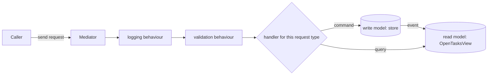

# 04. CQRS and the mediator in practice

> **Draft: written but not yet run.** The code and the expected output in this lesson were prepared by reading the code and the official documentation. They have not been executed yet. If something does not behave as described, trust your tool's real output and report it.

## What you will be able to do
By the end of this lesson you will be able to:
- separate commands (change state) from queries (read state) and give each its own handler
- build a mediator with a pipeline of behaviours (logging, validation) and predict the order they run in
- show with a running example what **eventual consistency** looks like when a read model lags behind
- decide whether CQRS and a mediator pay for themselves in a given service

## Recap
1. Lesson 03: why does a query object carry the allow-listed sort and the clamped limit? <details><summary>Answer</summary>So untrusted request values are turned into a safe, validated request before any data access code sees them.</details>
2. Lesson 01: which lifetime would a handler that holds a unit of work have? <details><summary>Answer</summary>Scoped or transient, never singleton (captive dependency).</details>

## Why it matters
**CQRS** (Command Query Responsibility Segregation) means using a different model to update information than the model you use to read it. A **command** says "do this" and may fail; a **query** says "tell me" and changes nothing. A **mediator** is a single object that receives a request and routes it to the one handler that deals with it, so callers (controllers, jobs) do not know the handlers. Both patterns are easy to over-apply. Martin Fowler warns that CQRS is a significant mental leap that is wrong for most systems; the Microsoft architecture guidance likewise lists it as suitable for collaborative, high-read-ratio or complex domains. This lesson builds both in 150 lines so you can judge the cost with real code.

## What you will build
A tiny task service with three request types (`CreateTask`, `CompleteTask`, `OpenTasksFor`), a mediator with a logging behaviour and a validation behaviour, a **write model** (a dictionary of tasks) and a separate **read model** (open titles per assignee) that is updated by events. You will pause the read model to see a stale read and then catch it up.

## Before you start
- **Prerequisites:** Patterns 301 lessons [01, DI containers and composition roots](01-di-containers-and-composition-roots.md) to [03, specification and query object](03-specification-and-query-object.md); [Patterns 201 lesson 09, observer and mediator](../../201-hero-to-super-hero/phase-3-behavioral/09-observer-and-mediator.md).
- Time: 60 minutes for one language, 90 for both.
- Python 3.10+ and/or the .NET 11 SDK. No packages: the mediator is hand-written. (Popular .NET mediator libraries exist; check their current licence terms before adopting one, because some changed from open source to commercial licensing in recent years.)
- Source pack (optional): every file is shown in full in this lesson, so you can follow without it. The finished code, the exercise starter and the solution are in the
  course repository https://github.com/Uee03/Code101 under `source/patterns/301-super-hero-to-legendary/phase-1-application-patterns/04-cqrs-and-the-mediator/` (on that page choose **Code, Download ZIP**, or run
  `git clone https://github.com/Uee03/Code101.git`).

## Steps

### Step 1. Make the lesson folders
**PowerShell, starting folder: anywhere**
```powershell
New-Item -ItemType Directory -Path "$HOME/code101/patterns301/lesson04/python" -Force | Out-Null
New-Item -ItemType Directory -Path "$HOME/code101/patterns301/lesson04/csharp" -Force | Out-Null
Set-Location "$HOME/code101/patterns301/lesson04"
code .
```

**macOS/Linux terminal, starting folder: anywhere**
```bash
mkdir -p ~/code101/patterns301/lesson04/python ~/code101/patterns301/lesson04/csharp
cd ~/code101/patterns301/lesson04
code .
```
Expected result: VS Code opens `lesson04` with empty `python` and `csharp` folders.

### Step 2. The shape

Rules: a request type has exactly one handler; behaviours wrap handlers like onion layers (first added = outermost); commands change the write model and publish an event; queries read only the read model.

### Step 3. Python
**File: `~/code101/patterns301/lesson04/python/main.py`**
```python
from dataclasses import dataclass


class DomainError(Exception):
    pass


class ValidationError(Exception):
    pass


@dataclass(frozen=True)
class CreateTask:
    title: str
    assignee: str


@dataclass(frozen=True)
class CompleteTask:
    task_id: int


@dataclass(frozen=True)
class OpenTasksFor:
    assignee: str


@dataclass(frozen=True)
class Unknown:
    pass


class Mediator:
    def __init__(self):
        self._handlers = {}
        self._behaviors = []

    def register(self, request_type, handler):
        if request_type in self._handlers:
            raise ValueError(f"handler already registered for {request_type.__name__}")
        self._handlers[request_type] = handler

    def add_behavior(self, behavior):
        self._behaviors.append(behavior)

    def send(self, request):
        handler = self._handlers.get(type(request))
        if handler is None:
            raise LookupError(f"no handler for {type(request).__name__}")
        call = handler
        for behavior in reversed(self._behaviors):
            call = (lambda b, nxt: lambda r: b(r, nxt))(behavior, call)
        return call(request)


class OpenTasksView:
    """Read model: open task titles per assignee, fed by events."""

    def __init__(self):
        self.rows = {}
        self.pending = []
        self.paused = False

    def publish(self, event):
        self.pending.append(event)
        if not self.paused:
            self.catch_up()

    def catch_up(self):
        for kind, task_id, title, assignee in self.pending:
            rows = self.rows.setdefault(assignee, {})
            if kind == "created":
                rows[task_id] = title
            else:
                rows.pop(task_id, None)
        self.pending.clear()

    def titles_for(self, assignee):
        rows = self.rows.get(assignee, {})
        return [rows[task_id] for task_id in sorted(rows)]


def logging_behavior(request, next_handler):
    print(f"[log] {type(request).__name__}")
    return next_handler(request)


def validation_behavior(request, next_handler):
    if isinstance(request, CreateTask) and not request.title.strip():
        raise ValidationError("title is required")
    return next_handler(request)


def build_mediator(store, view):
    mediator = Mediator()
    mediator.add_behavior(logging_behavior)
    mediator.add_behavior(validation_behavior)

    def create_task(command):
        task_id = len(store) + 1
        store[task_id] = {"title": command.title, "status": "todo", "assignee": command.assignee}
        view.publish(("created", task_id, command.title, command.assignee))
        return task_id

    def complete_task(command):
        task = store.get(command.task_id)
        if task is None:
            raise DomainError(f"task {command.task_id} not found")
        if task["status"] == "done":
            raise DomainError(f"task {command.task_id} is already done")
        task["status"] = "done"
        view.publish(("completed", command.task_id, task["title"], task["assignee"]))

    def open_tasks_for(query):
        return view.titles_for(query.assignee)

    mediator.register(CreateTask, create_task)
    mediator.register(CompleteTask, complete_task)
    mediator.register(OpenTasksFor, open_tasks_for)
    return mediator


def attempt(action):
    try:
        message = action()
        if message is not None:
            print(message)
    except (ValidationError, DomainError, LookupError, ValueError) as error:
        print(f"rejected: {error}")


def main():
    store = {}
    view = OpenTasksView()
    mediator = build_mediator(store, view)

    attempt(lambda: f"created task {mediator.send(CreateTask('Write ADR', 'alice'))}")
    attempt(lambda: f"created task {mediator.send(CreateTask('Review PR', 'alice'))}")
    attempt(lambda: f"created task {mediator.send(CreateTask('', 'alice'))}")
    attempt(lambda: mediator.send(CompleteTask(1)) or "completed task 1")
    attempt(lambda: mediator.send(CompleteTask(1)) or "completed task 1")
    attempt(lambda: "open for alice: " + ", ".join(mediator.send(OpenTasksFor("alice"))))

    view.paused = True
    attempt(lambda: f"created task {mediator.send(CreateTask('Ship', 'alice'))}")
    attempt(lambda: "stale read: " + ", ".join(mediator.send(OpenTasksFor("alice"))))
    view.paused = False
    view.catch_up()
    attempt(lambda: "after catch-up: " + ", ".join(mediator.send(OpenTasksFor("alice"))))

    attempt(lambda: mediator.register(CreateTask, lambda command: 0))
    attempt(lambda: mediator.send(Unknown()))


main()
```
The odd-looking `(lambda b, nxt: lambda r: b(r, nxt))(behavior, call)` copies `behavior` and `call` into a fresh scope on every loop turn. Without it, all lambdas would see the final loop values (Python closures capture variables, not values).

### Step 4. C#
**File: `~/code101/patterns301/lesson04/csharp/Lesson.csproj`**
```xml
<Project Sdk="Microsoft.NET.Sdk">

  <PropertyGroup>
    <OutputType>Exe</OutputType>
    <TargetFramework>net11.0</TargetFramework>
    <ImplicitUsings>enable</ImplicitUsings>
    <Nullable>enable</Nullable>
  </PropertyGroup>

</Project>
```

**File: `~/code101/patterns301/lesson04/csharp/Program.cs`**
```csharp
var store = new Dictionary<int, StoredTask>();
var view = new OpenTasksView();
var mediator = BuildMediator(store, view);

Attempt(() => $"created task {mediator.Send(new CreateTask("Write ADR", "alice"))}");
Attempt(() => $"created task {mediator.Send(new CreateTask("Review PR", "alice"))}");
Attempt(() => $"created task {mediator.Send(new CreateTask("", "alice"))}");
Attempt(() =>
{
    mediator.Send(new CompleteTask(1));
    return "completed task 1";
});
Attempt(() =>
{
    mediator.Send(new CompleteTask(1));
    return "completed task 1";
});
Attempt(() => "open for alice: " + string.Join(", ", mediator.Send(new OpenTasksFor("alice"))));

view.Paused = true;
Attempt(() => $"created task {mediator.Send(new CreateTask("Ship", "alice"))}");
Attempt(() => "stale read: " + string.Join(", ", mediator.Send(new OpenTasksFor("alice"))));
view.Paused = false;
view.CatchUp();
Attempt(() => "after catch-up: " + string.Join(", ", mediator.Send(new OpenTasksFor("alice"))));

Attempt(() =>
{
    mediator.Register<CreateTask, int>(_ => 0);
    return null;
});
Attempt(() =>
{
    mediator.Send(new Unknown());
    return null;
});

static Mediator BuildMediator(Dictionary<int, StoredTask> store, OpenTasksView view)
{
    var mediator = new Mediator();
    mediator.AddBehavior((request, next) =>
    {
        Console.WriteLine($"[log] {request.GetType().Name}");
        return next(request);
    });
    mediator.AddBehavior((request, next) =>
    {
        if (request is CreateTask create && string.IsNullOrWhiteSpace(create.Title))
        {
            throw new InvalidRequestException("title is required");
        }
        return next(request);
    });

    mediator.Register<CreateTask, int>(command =>
    {
        var taskId = store.Count + 1;
        store[taskId] = new StoredTask(command.Title, "todo", command.Assignee);
        view.Publish("created", taskId, command.Title, command.Assignee);
        return taskId;
    });
    mediator.Register<CompleteTask, Unit>(command =>
    {
        if (!store.TryGetValue(command.TaskId, out var task))
        {
            throw new DomainException($"task {command.TaskId} not found");
        }
        if (task.Status == "done")
        {
            throw new DomainException($"task {command.TaskId} is already done");
        }
        task.Status = "done";
        view.Publish("completed", command.TaskId, task.Title, task.Assignee);
        return default;
    });
    mediator.Register<OpenTasksFor, List<string>>(query => view.TitlesFor(query.Assignee));
    return mediator;
}

static void Attempt(Func<string?> action)
{
    try
    {
        var message = action();
        if (message is not null)
        {
            Console.WriteLine(message);
        }
    }
    catch (Exception error) when (error is InvalidRequestException or DomainException or KeyNotFoundException or InvalidOperationException)
    {
        Console.WriteLine($"rejected: {error.Message}");
    }
}

public class InvalidRequestException(string message) : Exception(message);

public class DomainException(string message) : Exception(message);

public readonly record struct Unit;

public interface IRequest<TResponse>
{
}

public sealed record CreateTask(string Title, string Assignee) : IRequest<int>;

public sealed record CompleteTask(int TaskId) : IRequest<Unit>;

public sealed record OpenTasksFor(string Assignee) : IRequest<List<string>>;

public sealed record Unknown : IRequest<Unit>;

public sealed class StoredTask(string title, string status, string assignee)
{
    public string Title { get; } = title;
    public string Status { get; set; } = status;
    public string Assignee { get; } = assignee;
}

public sealed class Mediator
{
    private readonly Dictionary<Type, Func<object, object?>> _handlers = new();
    private readonly List<Func<object, Func<object, object?>, object?>> _behaviors = new();

    public void Register<TRequest, TResponse>(Func<TRequest, TResponse> handler) where TRequest : IRequest<TResponse>
    {
        if (!_handlers.TryAdd(typeof(TRequest), request => handler((TRequest)request)))
        {
            throw new InvalidOperationException($"handler already registered for {typeof(TRequest).Name}");
        }
    }

    public void AddBehavior(Func<object, Func<object, object?>, object?> behavior) => _behaviors.Add(behavior);

    public TResponse Send<TResponse>(IRequest<TResponse> request)
    {
        if (!_handlers.TryGetValue(request.GetType(), out var handler))
        {
            throw new KeyNotFoundException($"no handler for {request.GetType().Name}");
        }
        var call = handler;
        foreach (var behavior in Enumerable.Reverse(_behaviors))
        {
            var current = behavior;
            var next = call;
            call = r => current(r, next);
        }
        return (TResponse)call(request)!;
    }
}

public sealed class OpenTasksView
{
    private readonly Dictionary<string, SortedDictionary<int, string>> _rows = new();
    private readonly List<(string Kind, int TaskId, string Title, string Assignee)> _pending = new();

    public bool Paused { get; set; }

    public void Publish(string kind, int taskId, string title, string assignee)
    {
        _pending.Add((kind, taskId, title, assignee));
        if (!Paused)
        {
            CatchUp();
        }
    }

    public void CatchUp()
    {
        foreach (var (kind, taskId, title, assignee) in _pending)
        {
            if (!_rows.TryGetValue(assignee, out var rows))
            {
                rows = new SortedDictionary<int, string>();
                _rows[assignee] = rows;
            }
            if (kind == "created")
            {
                rows[taskId] = title;
            }
            else
            {
                rows.Remove(taskId);
            }
        }
        _pending.Clear();
    }

    public List<string> TitlesFor(string assignee) =>
        _rows.TryGetValue(assignee, out var rows) ? rows.Values.ToList() : new List<string>();
}
```
The C# `Send<TResponse>` is typed: the compiler knows `CreateTask` returns an `int` and `OpenTasksFor` returns a `List<string>`. The Python mediator cannot know; that is a real trade-off between the two languages.

## Run it
Predict first: the request with an empty title prints `[log] CreateTask` and then `rejected: title is required`. Why does the log line appear *before* the rejection? <details><summary>Answer</summary>The logging behaviour was added first, so it is the outer layer; it prints before it calls the next layer, and the validation behaviour inside it throws.</details>

**PowerShell, folder: `~/code101/patterns301/lesson04/python`**
```powershell
Set-Location "$HOME/code101/patterns301/lesson04/python"
python main.py
```
**macOS/Linux terminal, folder: `~/code101/patterns301/lesson04/python`**
```bash
cd ~/code101/patterns301/lesson04/python
python3 main.py
```
**Any terminal, folder: `~/code101/patterns301/lesson04/csharp`**
```text
dotnet run --project . --nologo
```
Expected output (derived by reading the code, not yet run; identical for Python and C#):
```text
[log] CreateTask
created task 1
[log] CreateTask
created task 2
[log] CreateTask
rejected: title is required
[log] CompleteTask
completed task 1
[log] CompleteTask
rejected: task 1 is already done
[log] OpenTasksFor
open for alice: Review PR
[log] CreateTask
created task 3
[log] OpenTasksFor
stale read: Review PR
[log] OpenTasksFor
after catch-up: Review PR, Ship
rejected: handler already registered for CreateTask
rejected: no handler for Unknown
```
The last request, `Unknown`, has no `[log]` line: the mediator looks up the handler first and fails before any behaviour runs.

## How it works
- **Commands vs queries.** `create_task` and `complete_task` change the store and return little or nothing; `open_tasks_for` changes nothing and reads a different structure. Splitting the handlers is *CQS* at the method level; giving the read side its own **model** is CQRS.
- **The read model is a projection.** `OpenTasksView` is built only from events. Because it has the exact shape the screen needs (titles per assignee), the query needs no joins and no filters. The price: it can lag. With `paused = True` the new task "Ship" is in the write model but not yet visible. That gap is **eventual consistency**.
- **Pipeline behaviours** are cross-cutting concerns written once: logging, validation, authorisation, transactions, caching. Order matters: put authorisation before validation (do not tell strangers which fields are wrong), and put the transaction behaviour closest to the handler.
- **Validation lives in two places on purpose.** The behaviour checks the request shape (`title` present); the handler checks business rules against current state (`already done`). A request that is valid can still be rejected by the domain.

### Misconceptions
- **"CQRS needs two databases and event sourcing."** No. It can be two models over one database (a view, a denormalised table), or only separate handlers. Event sourcing is a separate, optional decision.
- **"A mediator decouples my code."** It decouples *callers from handlers*, but hides the call graph: "find usages" on a handler shows nothing but the registration. Teams often add a mediator to a three-class feature and pay for it for years.

### Trade-offs
| Choice | Gain | Cost | Choose it when |
|---|---|---|---|
| Plain service methods | Easiest to read and debug | Cross-cutting code repeated or done by decorators | Most CRUD-style services |
| Separate command and query handlers, same model | Small focused classes, easy to test | More files | Handlers keep growing in one service class |
| Mediator plus behaviours | One place for logging, validation, transactions | Indirection; call graph hidden; start-up registration errors | Many handlers share the same cross-cutting rules |
| Separate read model (full CQRS) | Fast, simple, scalable reads | Eventual consistency; projection code; replays and migrations | Read load or read shape differs a lot from the write model, or reports are slow |

### Failure modes
- **Read-your-own-writes surprise.** A user saves and the list does not show it. Mitigations: return the new state from the command, read from the write model for that one screen, or poll with a version token.
- **Projection drift.** A bug in the projection makes the read model wrong; you need a way to rebuild it from the source of truth. Plan the rebuild before you ship the first projection.
- **Poison events.** One malformed event stops the projection. Decide whether to skip, quarantine or stop, and alert on lag.
- **Mediator as a service locator in disguise.** Handlers that call `mediator.send` to call each other recreate hidden coupling. Let handlers call domain objects, not other handlers.
- **Duplicate and missing handlers** are only found at run time (see the two `rejected:` lines at the end). Validate registrations at start-up, as in lesson 01.
- **Measure** read latency before and after, and projection lag (time from commit to visible). Do not assume the read model is faster: measure it.

### ADR-0004
- **Context:** The Tasks and Teams API has simple team and project CRUD, and one slow, join-heavy "my open work" dashboard.
- **Decision:** Plain service methods for CRUD. A read model (one table, rebuilt by a job) only for the dashboard. No mediator library; one decorator for audit logging.
- **Consequences:** CQRS cost is confined to one feature; the dashboard may lag by seconds and says so in the UI.

## Try it
**Rung 1, guided.** Copy the `starter` folder of your language to `try04` (copy the folder itself and rename it). Make the pipeline wrap the handler with every behaviour and add a second behaviour.

**File: `try04/main.py`**
```python
from dataclasses import dataclass


@dataclass(frozen=True)
class Greet:
    name: str


class Mediator:
    def __init__(self):
        self.handlers = {}
        self.behaviors = []

    def register(self, request_type, handler):
        self.handlers[request_type] = handler

    def add_behavior(self, behavior):
        self.behaviors.append(behavior)

    def send(self, request):
        call = self.handlers[type(request)]
        # TODO 1: wrap call with every behavior so that behaviors[0] runs first and the handler runs last.
        #         A behavior is a function (request, next_handler) that calls next_handler(request).
        return call(request)


seen = []


def counting(request, next_handler):
    seen.append(type(request).__name__)
    return next_handler(request)


# TODO 2: write shout(request, next_handler): call next_handler(request) and return the result in upper case.

mediator = Mediator()
mediator.register(Greet, lambda request: f"hello {request.name}")
mediator.add_behavior(counting)
# TODO 3: add the shout behavior to the mediator.
print(mediator.send(Greet("ana")))
print(f"requests seen: {len(seen)}")
```

**File: `try04/Program.cs`** (with the `Lesson.csproj` from this lesson)
```csharp
var seen = new List<string>();
var mediator = new Mediator();
mediator.Register<Greet>(request => $"hello {request.Name}");
mediator.AddBehavior((request, next) =>
{
    seen.Add(request.GetType().Name);
    return next(request);
});
// TODO 3: add a behavior that calls next(request) and returns the result in upper case (cast it to string first).
Console.WriteLine(mediator.Send(new Greet("ana")));
Console.WriteLine($"requests seen: {seen.Count}");

record Greet(string Name);

class Mediator
{
    private readonly Dictionary<Type, Func<object, object?>> _handlers = new();
    private readonly List<Func<object, Func<object, object?>, object?>> _behaviors = new();

    public void Register<T>(Func<T, object?> handler) => _handlers[typeof(T)] = request => handler((T)request);

    public void AddBehavior(Func<object, Func<object, object?>, object?> behavior) => _behaviors.Add(behavior);

    public object? Send(object request)
    {
        var call = _handlers[request.GetType()];
        // TODO 1: wrap call with every behavior so that _behaviors[0] runs first and the handler runs last.
        //         A behavior is a function (request, next) that calls next(request).
        // TODO 2: remember to copy the loop variables into new variables before the lambda uses them.
        return call(request);
    }
}
```
Expected output after your fix:
```text
HELLO ANA
requests seen: 1
```

**Rung 2, change.** Add a third behaviour that rejects any `Greet` with an empty name by raising an error, and add it so it runs *before* `counting`. Predict what `requests seen` prints for a rejected request, then run it. (Which order do you want in production: count rejected requests or not?)

**Rung 3, stretch (no single answer).** Sketch the projection-rebuild procedure for `OpenTasksView`: where do the events come from, how do you avoid serving a half-built view, and which number tells you when to alert?

<details><summary>Solution</summary>

**File: `exercise/solution/python/main.py`**
```python
from dataclasses import dataclass


@dataclass(frozen=True)
class Greet:
    name: str


class Mediator:
    def __init__(self):
        self.handlers = {}
        self.behaviors = []

    def register(self, request_type, handler):
        self.handlers[request_type] = handler

    def add_behavior(self, behavior):
        self.behaviors.append(behavior)

    def send(self, request):
        call = self.handlers[type(request)]
        for behavior in reversed(self.behaviors):
            call = (lambda b, nxt: lambda r: b(r, nxt))(behavior, call)
        return call(request)


seen = []


def counting(request, next_handler):
    seen.append(type(request).__name__)
    return next_handler(request)


def shout(request, next_handler):
    return next_handler(request).upper()


mediator = Mediator()
mediator.register(Greet, lambda request: f"hello {request.name}")
mediator.add_behavior(counting)
mediator.add_behavior(shout)
print(mediator.send(Greet("ana")))
print(f"requests seen: {len(seen)}")
```

**File: `exercise/solution/csharp/Program.cs`**
```csharp
var seen = new List<string>();
var mediator = new Mediator();
mediator.Register<Greet>(request => $"hello {request.Name}");
mediator.AddBehavior((request, next) =>
{
    seen.Add(request.GetType().Name);
    return next(request);
});
mediator.AddBehavior((request, next) => ((string)next(request)!).ToUpperInvariant());
Console.WriteLine(mediator.Send(new Greet("ana")));
Console.WriteLine($"requests seen: {seen.Count}");

record Greet(string Name);

class Mediator
{
    private readonly Dictionary<Type, Func<object, object?>> _handlers = new();
    private readonly List<Func<object, Func<object, object?>, object?>> _behaviors = new();

    public void Register<T>(Func<T, object?> handler) => _handlers[typeof(T)] = request => handler((T)request);

    public void AddBehavior(Func<object, Func<object, object?>, object?> behavior) => _behaviors.Add(behavior);

    public object? Send(object request)
    {
        var call = _handlers[request.GetType()];
        foreach (var behavior in Enumerable.Reverse(_behaviors))
        {
            var current = behavior;
            var next = call;
            call = r => current(r, next);
        }
        return call(request);
    }
}
```
Rung 2 answer: if the rejecting behaviour is added before `counting`, a rejected request never reaches `counting`, so `requests seen` does not count it. Whether you want that depends on what the metric means; many teams count at the outermost layer.
</details>

## Check yourself
1. In the output, why does the stale read still show only `Review PR`? <details><summary>Answer</summary>The view was paused, so the `created` event for "Ship" was waiting in `pending` and had not been applied.</details>
2. Which behaviour runs first when `add_behavior` was called as logging, then validation? <details><summary>Answer</summary>Logging (outermost); validation runs second; the handler last.</details>
3. Name two situations where you would not add a mediator. <details><summary>Answer</summary>A small service with few handlers, and teams that rely on "find usages" to navigate code; also when one decorator or a framework filter already provides the single cross-cutting concern you need.</details>
4. A user complains "I saved a task and it is not in my list". Name two fixes with different costs. <details><summary>Answer</summary>Return the saved state from the command and update the UI locally (cheap); read that screen from the write model or wait for a version token (more work). Reducing projection lag is the third option.</details>

## Common mistakes
| Symptom or error text | Cause | Fix |
|---|---|---|
| `KeyError: <class '__main__.Greet'>` (typical Python message) in the exercise | No handler registered for that request type | Call `register` for the type |
| Behaviours run in the wrong order | Loop over `behaviors` without `reversed` | Wrap from the last behaviour to the first |
| Every behaviour sees the last loop value (Python) | A lambda inside the loop captures the variable, not the value | Use the two-argument lambda trick or `functools.partial` |
| C# compile error CS0266 or similar: cannot convert `object` to `string` (typical message) | The behaviour result is `object?` | Cast: `(string)next(request)!` |
| A query returns data that does not include a command you just ran | Read model is behind | See "Failure modes"; decide whether that screen needs the write model |

## Best practice
Add CQRS and a mediator only where the read shape or load clearly differs from the write shape, keep the pipeline small and ordered on purpose, and plan how to rebuild every read model. Source: CQRS pattern, Microsoft Azure Architecture Center https://learn.microsoft.com/azure/architecture/patterns/cqrs ; CQRS, Martin Fowler https://martinfowler.com/bliki/CQRS.html

## Going further
- Mediator, Command and Observer in the behavioural catalogue: [Patterns 201 lesson 09, observer and mediator](../../201-hero-to-super-hero/phase-3-behavioral/09-observer-and-mediator.md) and [lesson 10, command and memento](../../201-hero-to-super-hero/phase-3-behavioral/10-command-and-memento.md).
- Capstone use: the platform's `GET /v1/tasks` list and audit trail are natural read-model candidates; see `capstones/platform/TDD.md`.

## Summary
- You separated commands, queries and a read model and watched a stale read happen.
- You built a mediator with behaviours and predicted the order they run in.
- You listed the failure modes (drift, poison events, hidden call graph) and what to measure.
- You recorded when CQRS is *not* worth it.

## Next lesson
05. Domain events, outbox and saga (orchestration vs choreography): publish events reliably, survive duplicates, and coordinate steps across services without a distributed transaction.
