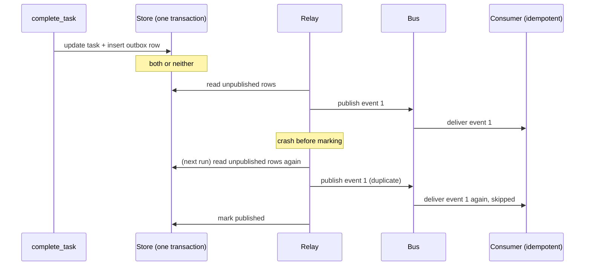

# 05. Domain events, outbox and saga (orchestration vs choreography)

> **Draft: written but not yet run.** The code and the expected output in this lesson were prepared by reading the code and the official documentation. They have not been executed yet. If something does not behave as described, trust your tool's real output and report it.

## What you will be able to do
By the end of this lesson you will be able to:
- write a domain event inside the same transaction as the state change (transactional outbox)
- predict what happens when the relay crashes between "publish" and "mark as published", and make the consumer safe with idempotency
- run a saga with compensating steps and say which steps cannot be compensated
- choose between orchestration and choreography for a given workflow and name the cost of each

## Recap
1. Lesson 02: what does a rollback not undo? <details><summary>Answer</summary>Side effects outside the store, such as an email already sent. This lesson fixes that with an outbox.</details>
2. Lesson 04: what is eventual consistency? <details><summary>Answer</summary>A read model (or another service) may be behind the write model for a short time but catches up.</details>

## Why it matters
A task is completed. Three things must follow: the status is saved, the team lead is told, and the project progress is updated. If you save and then call the message broker, a crash between the two leaves a saved task and **no** message. If you call the broker first, a crash leaves a message about something that never happened. There is no transaction that covers a database and a broker (the "dual write" problem). The outbox pattern turns it into one local transaction plus a retrying publisher. The price is **at-least-once** delivery: duplicates will happen, so every consumer must be idempotent. When a business action spans several services, a **saga** replaces the missing distributed transaction with local transactions and compensations.

## What you will build
In one program: a store with an outbox table and an all-or-nothing `transaction`, a relay that publishes outbox rows, a deliberately crashing relay, an idempotent consumer wrapper, a tiny **choreography** (the progress handler reacts to `TaskCompleted` and emits `ProjectCompleted` by itself) and an **orchestrated saga** that archives a project in three steps and compensates when step three fails.

## Before you start
- **Prerequisites:** Patterns 301 lessons [02, repository and unit of work](02-repository-and-unit-of-work.md) and [04, CQRS and the mediator](04-cqrs-and-the-mediator.md).
- Time: 75 minutes for one language, 110 for both. The program is the longest of phase 1; read the diagrams first.
- Python 3.10+ and/or the .NET 11 SDK. No packages, no broker: the bus is an in-memory object, so you can see every delivery.
- Source pack (optional): every file is shown in full in this lesson, so you can follow without it. The finished code, the exercise starter and the solution are in the
  course repository https://github.com/Uee03/Code101 under `source/patterns/301-super-hero-to-legendary/phase-1-application-patterns/05-domain-events-outbox-and-saga/` (on that page choose **Code, Download ZIP**, or run
  `git clone https://github.com/Uee03/Code101.git`).

## Steps

### Step 1. Make the lesson folders
**PowerShell, starting folder: anywhere**
```powershell
New-Item -ItemType Directory -Path "$HOME/code101/patterns301/lesson05/python" -Force | Out-Null
New-Item -ItemType Directory -Path "$HOME/code101/patterns301/lesson05/csharp" -Force | Out-Null
Set-Location "$HOME/code101/patterns301/lesson05"
code .
```

**macOS/Linux terminal, starting folder: anywhere**
```bash
mkdir -p ~/code101/patterns301/lesson05/python ~/code101/patterns301/lesson05/csharp
cd ~/code101/patterns301/lesson05
code .
```
Expected result: VS Code opens `lesson05` with empty `python` and `csharp` folders.

### Step 2. The outbox in one picture

Definitions: a **domain event** is a fact in the past tense in business words (`TaskCompleted`). The **outbox** is a table in the same database as the state; events are inserted in the same transaction. The **relay** (or "publisher") reads unpublished rows, sends them and marks them. **Idempotent** means doing it twice has the same effect as doing it once.

### Step 3. Python
**File: `~/code101/patterns301/lesson05/python/main.py`**
```python
import copy
from contextlib import contextmanager


class EventBus:
    def __init__(self):
        self.handlers = {}

    def subscribe(self, event_type, handler):
        self.handlers.setdefault(event_type, []).append(handler)

    def publish(self, event):
        for handler in self.handlers.get(event["type"], []):
            handler(event)


class Idempotent:
    """Wraps a handler so a redelivered event is recognised and skipped."""

    def __init__(self, name, handler):
        self.name = name
        self.handler = handler
        self.seen = set()

    def __call__(self, event):
        if event["id"] in self.seen:
            print(f"{self.name}: skipped duplicate event {event['id']}")
            return
        self.seen.add(event["id"])
        self.handler(event)


class Store:
    def __init__(self):
        self.tasks = {}
        self.outbox = []
        self._next_event_id = 1

    def add_event(self, event_type, **data):
        event = {"id": self._next_event_id, "type": event_type, **data}
        self._next_event_id += 1
        self.outbox.append({"event": event, "published": False})

    @contextmanager
    def transaction(self):
        backup = copy.deepcopy((self.tasks, self.outbox, self._next_event_id))
        try:
            yield
        except Exception:
            self.tasks, self.outbox, self._next_event_id = backup
            raise


def complete_task(store, task_id, fail_before_commit=False):
    with store.transaction():
        task = store.tasks[task_id]
        task["status"] = "done"
        store.add_event("TaskCompleted", task_id=task_id, project=task["project"])
        if fail_before_commit:
            raise RuntimeError("crash before commit")


class Relay:
    def __init__(self, store, bus):
        self.store = store
        self.bus = bus

    def run_once(self, crash_after_publish=False):
        for row in self.store.outbox:
            if row["published"]:
                continue
            self.bus.publish(row["event"])
            if crash_after_publish:
                raise RuntimeError("crashed after publish, before marking")
            row["published"] = True


class Saga:
    def __init__(self, steps):
        self.steps = steps

    def run(self, context):
        done = []
        for name, action, compensate in self.steps:
            try:
                action(context)
                print(f"saga: {name} done")
                done.append((name, compensate))
            except RuntimeError as error:
                print(f"saga: {name} failed ({error})")
                for done_name, undo in reversed(done):
                    undo(context)
                    print(f"saga: {done_name} compensated")
                return False
        return True


def archive_saga():
    def mark_archived(context):
        if context["fail"]:
            raise RuntimeError("archive flag rejected")

    return Saga([
        ("freeze_tasks", lambda c: c.update(frozen=True), lambda c: c.update(frozen=False)),
        ("notify_members", lambda c: c["mails"].append("archiving"), lambda c: c["mails"].append("archive cancelled")),
        ("mark_archived", mark_archived, lambda c: None),
    ])


def show_saga(fail):
    context = {"fail": fail, "frozen": False, "mails": []}
    ok = archive_saga().run(context)
    print(f"saga result: {ok}, frozen={context['frozen']}, mails={', '.join(context['mails'])}")


def main():
    store = Store()
    store.tasks = {
        1: {"status": "todo", "project": "PLAT"},
        2: {"status": "todo", "project": "PLAT"},
        3: {"status": "todo", "project": "DOCS"},
    }
    bus = EventBus()

    def on_task_completed_progress(event):
        project = event["project"]
        in_project = [t for t in store.tasks.values() if t["project"] == project]
        if all(t["status"] == "done" for t in in_project):
            bus.publish({"id": 100, "type": "ProjectCompleted", "project": project})

    notify = Idempotent("notify", lambda e: print(f"notify: task {e['task_id']} completed (event {e['id']})"))
    progress = Idempotent("progress", on_task_completed_progress)
    bus.subscribe("TaskCompleted", notify)
    bus.subscribe("TaskCompleted", progress)
    bus.subscribe("ProjectCompleted", lambda e: print(f"lead: project {e['project']} completed"))
    relay = Relay(store, bus)

    try:
        complete_task(store, 1, fail_before_commit=True)
    except RuntimeError as error:
        print(f"failed: {error}")
    print(f"after failure: task 1 is {store.tasks[1]['status']}, outbox rows: {len(store.outbox)}")

    complete_task(store, 1)
    print(f"after commit: task 1 is {store.tasks[1]['status']}, outbox rows: {len(store.outbox)}")

    try:
        relay.run_once(crash_after_publish=True)
    except RuntimeError as error:
        print(f"relay: {error}")
    print(f"event 1 published flag: {store.outbox[0]['published']}")
    relay.run_once()
    print(f"event 1 published flag: {store.outbox[0]['published']}")

    complete_task(store, 2)
    relay.run_once()

    show_saga(fail=True)
    show_saga(fail=False)


main()
```

### Step 4. C#
**File: `~/code101/patterns301/lesson05/csharp/Lesson.csproj`**
```xml
<Project Sdk="Microsoft.NET.Sdk">

  <PropertyGroup>
    <OutputType>Exe</OutputType>
    <TargetFramework>net11.0</TargetFramework>
    <ImplicitUsings>enable</ImplicitUsings>
    <Nullable>enable</Nullable>
  </PropertyGroup>

</Project>
```

**File: `~/code101/patterns301/lesson05/csharp/Program.cs`**
```csharp
var store = new Store();
store.Tasks[1] = new StoredTask("PLAT");
store.Tasks[2] = new StoredTask("PLAT");
store.Tasks[3] = new StoredTask("DOCS");
var bus = new EventBus();

var notify = new Idempotent("notify", e => Console.WriteLine($"notify: task {e.TaskId} completed (event {e.Id})"));
var progress = new Idempotent("progress", e =>
{
    var inProject = store.Tasks.Values.Where(t => t.Project == e.Project).ToList();
    if (inProject.All(t => t.Status == "done"))
    {
        bus.Publish(new DomainEvent(100, "ProjectCompleted", 0, e.Project));
    }
});
bus.Subscribe("TaskCompleted", notify.Handle);
bus.Subscribe("TaskCompleted", progress.Handle);
bus.Subscribe("ProjectCompleted", e => Console.WriteLine($"lead: project {e.Project} completed"));
var relay = new Relay(store, bus);

try
{
    CompleteTask(store, 1, failBeforeCommit: true);
}
catch (InvalidOperationException error)
{
    Console.WriteLine($"failed: {error.Message}");
}
Console.WriteLine($"after failure: task 1 is {store.Tasks[1].Status}, outbox rows: {store.Outbox.Count}");

CompleteTask(store, 1);
Console.WriteLine($"after commit: task 1 is {store.Tasks[1].Status}, outbox rows: {store.Outbox.Count}");

try
{
    relay.RunOnce(crashAfterPublish: true);
}
catch (InvalidOperationException error)
{
    Console.WriteLine($"relay: {error.Message}");
}
Console.WriteLine($"event 1 published flag: {store.Outbox[0].Published}");
relay.RunOnce();
Console.WriteLine($"event 1 published flag: {store.Outbox[0].Published}");

CompleteTask(store, 2);
relay.RunOnce();

ShowSaga(fail: true);
ShowSaga(fail: false);

static void CompleteTask(Store store, int taskId, bool failBeforeCommit = false)
{
    store.InTransaction(() =>
    {
        var task = store.Tasks[taskId];
        task.Status = "done";
        store.AddEvent("TaskCompleted", taskId, task.Project);
        if (failBeforeCommit)
        {
            throw new InvalidOperationException("crash before commit");
        }
    });
}

static void ShowSaga(bool fail)
{
    var context = new SagaContext { Fail = fail };
    var saga = new Saga(
    [
        new SagaStep("freeze_tasks", c => c.Frozen = true, c => c.Frozen = false),
        new SagaStep("notify_members", c => c.Mails.Add("archiving"), c => c.Mails.Add("archive cancelled")),
        new SagaStep("mark_archived", c =>
        {
            if (c.Fail)
            {
                throw new InvalidOperationException("archive flag rejected");
            }
        }, _ => { }),
    ]);
    var ok = saga.Run(context);
    Console.WriteLine($"saga result: {ok}, frozen={context.Frozen}, mails={string.Join(", ", context.Mails)}");
}

public sealed record DomainEvent(int Id, string Type, int TaskId, string Project);

public sealed class EventBus
{
    private readonly Dictionary<string, List<Action<DomainEvent>>> _handlers = new();

    public void Subscribe(string eventType, Action<DomainEvent> handler)
    {
        if (!_handlers.TryGetValue(eventType, out var list))
        {
            list = new List<Action<DomainEvent>>();
            _handlers[eventType] = list;
        }
        list.Add(handler);
    }

    public void Publish(DomainEvent domainEvent)
    {
        if (_handlers.TryGetValue(domainEvent.Type, out var list))
        {
            foreach (var handler in list)
            {
                handler(domainEvent);
            }
        }
    }
}

public sealed class Idempotent(string name, Action<DomainEvent> handler)
{
    private readonly HashSet<int> _seen = new();

    public void Handle(DomainEvent domainEvent)
    {
        if (!_seen.Add(domainEvent.Id))
        {
            Console.WriteLine($"{name}: skipped duplicate event {domainEvent.Id}");
            return;
        }
        handler(domainEvent);
    }
}

public sealed class StoredTask(string project)
{
    public string Project { get; } = project;
    public string Status { get; set; } = "todo";
}

public sealed class OutboxRow(DomainEvent domainEvent)
{
    public DomainEvent Event { get; } = domainEvent;
    public bool Published { get; set; }
}

public sealed class Store
{
    private int _nextEventId = 1;

    public Dictionary<int, StoredTask> Tasks { get; private set; } = new();
    public List<OutboxRow> Outbox { get; private set; } = new();

    public void AddEvent(string type, int taskId, string project)
    {
        Outbox.Add(new OutboxRow(new DomainEvent(_nextEventId, type, taskId, project)));
        _nextEventId++;
    }

    public void InTransaction(Action work)
    {
        var tasksBackup = Tasks.ToDictionary(p => p.Key, p => new StoredTask(p.Value.Project) { Status = p.Value.Status });
        var outboxBackup = Outbox.Select(r => new OutboxRow(r.Event) { Published = r.Published }).ToList();
        var idBackup = _nextEventId;
        try
        {
            work();
        }
        catch
        {
            Tasks = tasksBackup;
            Outbox = outboxBackup;
            _nextEventId = idBackup;
            throw;
        }
    }
}

public sealed class Relay(Store store, EventBus bus)
{
    public void RunOnce(bool crashAfterPublish = false)
    {
        foreach (var row in store.Outbox)
        {
            if (row.Published)
            {
                continue;
            }
            bus.Publish(row.Event);
            if (crashAfterPublish)
            {
                throw new InvalidOperationException("crashed after publish, before marking");
            }
            row.Published = true;
        }
    }
}

public sealed class SagaContext
{
    public bool Fail { get; init; }
    public bool Frozen { get; set; }
    public List<string> Mails { get; } = new();
}

public sealed record SagaStep(string Name, Action<SagaContext> Action, Action<SagaContext> Compensate);

public sealed class Saga(IReadOnlyList<SagaStep> steps)
{
    public bool Run(SagaContext context)
    {
        var done = new List<SagaStep>();
        foreach (var step in steps)
        {
            try
            {
                step.Action(context);
                Console.WriteLine($"saga: {step.Name} done");
                done.Add(step);
            }
            catch (InvalidOperationException error)
            {
                Console.WriteLine($"saga: {step.Name} failed ({error.Message})");
                foreach (var finished in Enumerable.Reverse(done))
                {
                    finished.Compensate(context);
                    Console.WriteLine($"saga: {finished.Name} compensated");
                }
                return false;
            }
        }
        return true;
    }
}
```
Both programs model the transaction by copying and restoring state. A real database does this with `BEGIN` and `COMMIT`; the lesson shows only the *shape*: state change and event row succeed or fail together.

## Run it
Predict first: after the first `relay` run crashes, is event 1 marked as published? And what will the consumers print when the relay runs again? <details><summary>Answer</summary>Not marked (`False`). On the second run the event is published again, so the idempotent consumers print `skipped duplicate event 1` and the relay then marks the row.</details>

**PowerShell, folder: `~/code101/patterns301/lesson05/python`**
```powershell
Set-Location "$HOME/code101/patterns301/lesson05/python"
python main.py
```
**macOS/Linux terminal, folder: `~/code101/patterns301/lesson05/python`**
```bash
cd ~/code101/patterns301/lesson05/python
python3 main.py
```
**Any terminal, folder: `~/code101/patterns301/lesson05/csharp`**
```text
dotnet run --project . --nologo
```
Expected output (derived by reading the code, not yet run; identical for Python and C#):
```text
failed: crash before commit
after failure: task 1 is todo, outbox rows: 0
after commit: task 1 is done, outbox rows: 1
notify: task 1 completed (event 1)
relay: crashed after publish, before marking
event 1 published flag: False
notify: skipped duplicate event 1
progress: skipped duplicate event 1
event 1 published flag: True
notify: task 2 completed (event 2)
lead: project PLAT completed
saga: freeze_tasks done
saga: notify_members done
saga: mark_archived failed (archive flag rejected)
saga: notify_members compensated
saga: freeze_tasks compensated
saga result: False, frozen=False, mails=archiving, archive cancelled
saga: freeze_tasks done
saga: notify_members done
saga: mark_archived done
saga result: True, frozen=True, mails=archiving
```

## How it works
**Outbox.** `complete_task` changes the task and inserts the event in one transaction. The failing run leaves *no* trace: status still `todo`, zero outbox rows, and the event id counter is back too (the retry gets id 1 again). That is the guarantee: a committed change always has its event, an event never exists without its change.

**Relay and duplicates.** The relay has two steps that cannot be one atomic action (send, then mark). Whichever order you pick, a crash between them leaves a duplicate (send, mark) or a loss (mark, send). **At-least-once** is the safe choice: duplicates can be removed by the consumer, losses cannot be recovered. Hence `Idempotent`.

**Idempotency in real systems.** A set in memory is only a demonstration. Production consumers store the processed event id in the same transaction as their own effect (a `processed_events` table with a unique key), or make the effect naturally idempotent (`SET status = 'done'`, not `counter = counter + 1`).

**Choreography.** Nobody told `progress` to emit `ProjectCompleted`: it reacts to `TaskCompleted` and decides. No central code knows the whole flow. (In this demo the derived event is published straight to the bus. In production it would go through its own outbox too.)

**Orchestration.** `Saga` is the central script: steps in order, each with a compensation. On failure it runs the compensations of the **completed** steps in **reverse** order. `mark_archived` is not compensated because it never completed; `freeze_tasks` is compensated last because it ran first.

### Orchestration or choreography?
| Question | Orchestration (a coordinator calls steps) | Choreography (services react to events) |
|---|---|---|
| Where is the flow written? | In one place; easy to read, test and monitor | Spread over every subscriber; the flow is emergent |
| Coupling | Coordinator knows all participants | Participants know only event types |
| Adding a step | Edit the coordinator | Add a subscriber (but you must find who else reacts) |
| Failure handling | Explicit compensation order | Each service must publish failure events; cycles are possible |
| Typical risk | The coordinator becomes a god service | Nobody can answer "what happens after TaskCompleted?" |
| Pick when | More than three steps, strict order, business owner wants a status per instance | Few steps, independent reactions (notifications, projections) |

### Failure modes
- **Compensation is not rollback.** An email cannot be unsent; a refund is a new transaction. Design steps so the irreversible one is **last** (a "pivot"), and make compensations idempotent and retryable.
- **Saga state lost on crash.** The demo keeps its state in memory. A real saga persists its state after every step, so a restarted process can resume or compensate.
- **Relay lag and backlog.** Unpublished rows pile up if the broker is down. Alert on the age of the oldest unpublished row. Never delete unpublished rows.
- **Ordering.** Events for one entity must be processed in order; partition by entity id. Across entities there is no order.
- **Poison message.** An event that always fails blocks the queue behind it. Use a retry limit and a dead-letter store.
- **Outbox growth.** Purge or archive published rows, but only after consumers' deduplication windows have passed.
- **Cyclic choreography.** A reacts to B and B reacts to A. Draw the event graph before you ship.
- **Measure:** oldest unpublished age, publish retries, duplicate rate at consumers, saga compensation rate.

### ADR-0005
- **Context:** completing a task must notify the lead and update project progress; archiving a project touches tasks, mail and a flag, possibly in different services later.
- **Decision:** transactional outbox for `TaskCompleted`; consumers idempotent by event id; project progress and notifications by choreography (independent reactions); project archive by an orchestrated saga with the irreversible step last and persisted saga state.
- **Consequences:** an extra table, a relay and a dead-letter process to operate; consumers need a deduplication store. Not chosen: two-phase commit (not supported across our broker and database) and "publish after commit" without an outbox (can lose events on a crash).

### When not to use these patterns
A single process with a single database and no external side effects needs a transaction, not an outbox. Skip sagas when one local transaction can do the whole job; consider them only when a second service owns part of the data.

## Try it
**Rung 1, guided.** Copy the `starter` folder of your language to `try05` (copy the folder itself and rename it). The events contain duplicates, like a relay that crashed twice. Make the consumer idempotent.

**File: `try05/main.py`**
```python
events = [
    {"id": 1, "points": 5},
    {"id": 2, "points": 3},
    {"id": 1, "points": 5},
    {"id": 2, "points": 3},
    {"id": 3, "points": 1},
]


class Scoreboard:
    def __init__(self):
        self.total = 0
        # TODO 1: create a set that remembers the ids already applied.

    def apply(self, event):
        # TODO 2: if the id was applied before, return False without changing the total.
        #         Otherwise remember the id, add the points and return True.
        self.total += event["points"]
        return True


board = Scoreboard()
duplicates = 0
for event in events:
    if not board.apply(event):
        duplicates += 1
print(f"total points: {board.total}")
print(f"duplicates ignored: {duplicates}")
```

**File: `try05/Program.cs`** (with the `Lesson.csproj` from this lesson)
```csharp
var events = new List<(int Id, int Points)> { (1, 5), (2, 3), (1, 5), (2, 3), (3, 1) };

var board = new Scoreboard();
var duplicates = 0;
foreach (var (id, points) in events)
{
    if (!board.Apply(id, points))
    {
        duplicates++;
    }
}
Console.WriteLine($"total points: {board.Total}");
Console.WriteLine($"duplicates ignored: {duplicates}");

class Scoreboard
{
    // TODO 1: add a HashSet<int> field that remembers the ids already applied.

    public int Total { get; private set; }

    public bool Apply(int id, int points)
    {
        // TODO 2: if the id was applied before, return false without changing Total.
        //         Otherwise remember the id, add the points and return true.
        Total += points;
        return true;
    }
}
```
Before your fix the program prints `total points: 17` and `duplicates ignored: 0`. After your fix:
```text
total points: 9
duplicates ignored: 2
```

**Rung 2, change.** Two events have the same id but different points (a bug in the producer). What does your consumer do, and what should it do? Add a check that reports it.

**Rung 3, stretch (no single answer).** Add a fourth saga step "send invoice" to the archive saga. Where does it go in the order, what is its compensation, and what do you do if the compensation itself fails?

<details><summary>Solution</summary>

**File: `exercise/solution/python/main.py`**
```python
events = [
    {"id": 1, "points": 5},
    {"id": 2, "points": 3},
    {"id": 1, "points": 5},
    {"id": 2, "points": 3},
    {"id": 3, "points": 1},
]


class Scoreboard:
    def __init__(self):
        self.total = 0
        self.applied = set()

    def apply(self, event):
        if event["id"] in self.applied:
            return False
        self.applied.add(event["id"])
        self.total += event["points"]
        return True


board = Scoreboard()
duplicates = 0
for event in events:
    if not board.apply(event):
        duplicates += 1
print(f"total points: {board.total}")
print(f"duplicates ignored: {duplicates}")
```

**File: `exercise/solution/csharp/Program.cs`**
```csharp
var events = new List<(int Id, int Points)> { (1, 5), (2, 3), (1, 5), (2, 3), (3, 1) };

var board = new Scoreboard();
var duplicates = 0;
foreach (var (id, points) in events)
{
    if (!board.Apply(id, points))
    {
        duplicates++;
    }
}
Console.WriteLine($"total points: {board.Total}");
Console.WriteLine($"duplicates ignored: {duplicates}");

class Scoreboard
{
    private readonly HashSet<int> _applied = new();

    public int Total { get; private set; }

    public bool Apply(int id, int points)
    {
        if (!_applied.Add(id))
        {
            return false;
        }
        Total += points;
        return true;
    }
}
```
Rung 2 sketch: remember the points with the id; when the same id arrives with different content, do not apply it, log an error and send it to a dead-letter store: same id must mean same event. Rung 3 sketch: the invoice is the irreversible step, so it goes last (after `mark_archived`); its "compensation" is a credit note, itself a new idempotent step with retries and an alert if retries run out.
</details>

## Check yourself
1. Why can you not simply "save, then publish"? <details><summary>Answer</summary>A crash between the two leaves saved state without an event; there is no transaction spanning database and broker.</details>
2. In the output, which line proves the consumers are idempotent? <details><summary>Answer</summary>`notify: skipped duplicate event 1` (and the `progress` line).</details>
3. A saga has steps A, B, C; C fails. In what order do compensations run and is C compensated? <details><summary>Answer</summary>B, then A; C is not compensated because it did not complete (its own failure handling is local to C).</details>
4. Give one reason to prefer choreography and one to prefer orchestration. <details><summary>Answer</summary>Choreography: independent reactions with minimal coupling. Orchestration: a strict multi-step flow that someone must be able to read, monitor and compensate.</details>

## Common mistakes
| Symptom or error text | Cause | Fix |
|---|---|---|
| Consumers act twice after a retry | Relay is at-least-once and the consumer is not idempotent | Deduplicate by event id in the consumer's own transaction |
| Event exists but state change is lost (or the reverse) | Event published outside the transaction | Insert the event row in the same transaction as the change |
| Compensations run in the wrong order | Iterating the done list forwards | Reverse it, last completed step first |
| `RuntimeError: crashed after publish, before marking` escapes (derived Python message) | The relay exception is not caught in your own driver | The scheduler should log and retry the next run |
| `InvalidOperationException` (C#) with the same text | Same cause | Same fix |

## Best practice
Write the event in the same transaction as the state, deliver at least once, make every consumer idempotent, and keep sagas' steps compensable except one pivot step at the end. Source: Transactional outbox pattern, microservices.io https://microservices.io/patterns/data/transactional-outbox.html ; Saga distributed transactions pattern, Microsoft Azure Architecture Center https://learn.microsoft.com/azure/architecture/patterns/saga ; Domain events: design and implementation, Microsoft Learn https://learn.microsoft.com/dotnet/architecture/microservices/microservice-ddd-cqrs-patterns/domain-events-design-implementation

## Going further
- Choreography vs orchestration, Microsoft guidance in the saga article above.
- Capstone use: the platform's `audit_log` and idempotency keys (`Idempotency-Key` header) are the same ideas at the API edge; see `capstones/platform/TDD.md`.

## Summary
- You made an event and a state change commit or fail together, and saw the failing case leave no trace.
- You made a relay crash, saw the duplicate delivery, and let idempotent consumers absorb it.
- You ran an orchestrated saga with compensations in reverse order and a choreographed reaction.
- You wrote an ADR that lists what you did not choose and why.

## Next lesson
06. Code smells catalog (bloaters, couplers, change preventers, dispensables): learn to name what is wrong with code and measure it, starting phase 2.
