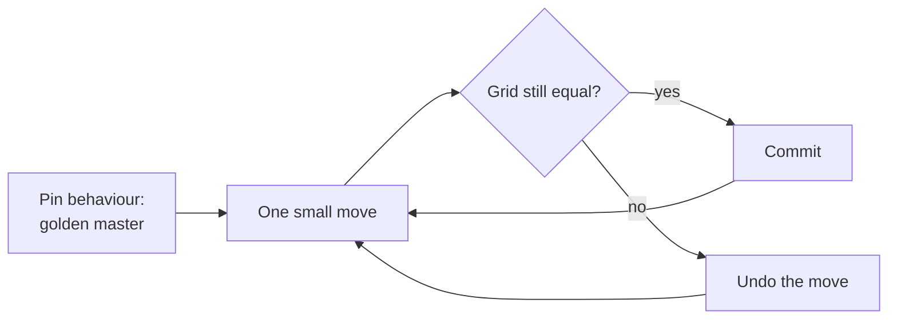

# 07. Refactoring moves with tests as a safety net

> **Draft: written but not yet run.** The code and the expected output in this lesson were prepared by reading the code and the official documentation. They have not been executed yet. If something does not behave as described, trust your tool's real output and report it.

## What you will be able to do
By the end of this lesson you will be able to:
- build a **characterization test** (golden master) that pins down what legacy code does today
- apply four refactorings in small steps: extract function, introduce parameter object, replace conditional with polymorphism, move method
- show that a refactoring step changed *structure only*, and catch one that changed behaviour
- say when polymorphism is the wrong replacement for a conditional

## Recap
1. Lesson 06: which three smells did the scanner flag in `make_invoice`? <details><summary>Answer</summary>Long method, long parameter list and deep nesting.</details>
2. Why is a smell in rarely changed code a low priority? <details><summary>Answer</summary>Fixing it costs time and risk and saves almost nothing, because nobody pays the cost of change there.</details>

## Why it matters
**Refactoring** means changing the structure of code without changing what it does. The second half of that sentence is the hard part: you can only claim it if something checks it. In legacy code there are usually no tests, so the first move is not to clean, it is to **pin the behaviour**: run the old code on many inputs and record the answers (a *golden master*, also called a *characterization* or *approval* test). From then on every small step is checked in milliseconds. Teams that skip this step "refactor" for a week and ship three regressions.

## What you will build
A shipping-cost function with seven parameters (the legacy code), a grid of **216 input combinations**, and four versions of the code: legacy, step 1 (extract functions and a parameter object), step 2 (polymorphic carriers and a moved method) and a deliberately **broken** step 2 that applies the express surcharge in the wrong place. The program compares each version with the legacy answers and shows the broken one failing in 81 places.

## Before you start
- **Prerequisites:** [Patterns 301 lesson 06, code smells catalog](06-code-smells-catalog.md).
- Time: 75 minutes for one language, 110 for both.
- Python 3.10+ and/or the .NET 11 SDK. No packages. No test framework: the golden master is plain code so you can see how it works (afterwards use `pytest` or `xunit` in a real project: see Going further).
- All money is whole **cents** (integers) so results are exact and identical in both languages.
- Source pack (optional): every file is shown in full in this lesson, so you can follow without it. The finished code, the exercise starter and the solution are in the
  course repository https://github.com/Uee03/Code101 under `source/patterns/301-super-hero-to-legendary/phase-2-smells-and-refactoring/07-refactoring-moves-with-tests/` (on that page choose **Code, Download ZIP**, or run
  `git clone https://github.com/Uee03/Code101.git`).

## Steps

### Step 1. Make the lesson folders
**PowerShell, starting folder: anywhere**
```powershell
New-Item -ItemType Directory -Path "$HOME/code101/patterns301/lesson07/python" -Force | Out-Null
New-Item -ItemType Directory -Path "$HOME/code101/patterns301/lesson07/csharp" -Force | Out-Null
Set-Location "$HOME/code101/patterns301/lesson07"
code .
```

**macOS/Linux terminal, starting folder: anywhere**
```bash
mkdir -p ~/code101/patterns301/lesson07/python ~/code101/patterns301/lesson07/csharp
cd ~/code101/patterns301/lesson07
code .
```
Expected result: VS Code opens `lesson07` with empty `python` and `csharp` folders.

### Step 2. The rules of the game
1. **Tests first, green before you start.** Here the grid is the test.
2. **One move at a time**, run the tests after each move. If red, undo the last move (do not debug a pile of changes).
3. **Never mix a refactoring with a behaviour change** in one commit. If you find a bug, write it down, finish the move, then fix it separately with its own test.
4. **Commit after every green step** so a bad move costs one `git reset`.



### Step 3. Python: the four versions
Read the file from the top. `legacy_cost` is the untouched original. The rest are the moves.

**File: `~/code101/patterns301/lesson07/python/shipping.py`**
```python
from dataclasses import dataclass


def legacy_cost(weight_kg, carrier, express, zone, insured, declared_value, fragile):
    if carrier == "post":
        cost = 500 + weight_kg * 120
    elif carrier == "fast":
        cost = 900 + weight_kg * 200
    elif carrier == "freight":
        cost = 2000 + weight_kg * 60
        if cost < 3000:
            cost = 3000
    else:
        raise ValueError("unknown carrier: " + carrier)
    if zone == "eu":
        cost += 400
    elif zone == "world":
        cost += 1500
    if express:
        cost = cost * 3 // 2
    if insured:
        cost += declared_value // 50
    if fragile:
        cost += 250
    return cost


@dataclass(frozen=True)
class Parcel:
    weight_kg: int
    zone: str
    express: bool
    insured: bool
    declared_value: int
    fragile: bool

    def surcharges(self):
        insurance = self.declared_value // 50 if self.insured else 0
        return insurance + (250 if self.fragile else 0)


def carrier_price(carrier, weight_kg):
    if carrier == "post":
        return 500 + weight_kg * 120
    if carrier == "fast":
        return 900 + weight_kg * 200
    if carrier == "freight":
        return max(3000, 2000 + weight_kg * 60)
    raise ValueError("unknown carrier: " + carrier)


def zone_fee(zone):
    if zone == "eu":
        return 400
    if zone == "world":
        return 1500
    return 0


def step1_cost(carrier, parcel):
    cost = carrier_price(carrier, parcel.weight_kg) + zone_fee(parcel.zone)
    if parcel.express:
        cost = cost * 3 // 2
    if parcel.insured:
        cost += parcel.declared_value // 50
    if parcel.fragile:
        cost += 250
    return cost


class Carrier:
    def __init__(self, base, per_kg):
        self.base = base
        self.per_kg = per_kg

    def price(self, weight_kg):
        return self.base + weight_kg * self.per_kg


class FreightCarrier(Carrier):
    def price(self, weight_kg):
        return max(3000, super().price(weight_kg))


CARRIERS = {"post": Carrier(500, 120), "fast": Carrier(900, 200), "freight": FreightCarrier(2000, 60)}
ZONE_FEES = {"domestic": 0, "eu": 400, "world": 1500}


def final_cost(carrier_name, parcel):
    carrier = CARRIERS.get(carrier_name)
    if carrier is None:
        raise ValueError("unknown carrier: " + carrier_name)
    cost = carrier.price(parcel.weight_kg) + ZONE_FEES.get(parcel.zone, 0)
    if parcel.express:
        cost = cost * 3 // 2
    return cost + parcel.surcharges()


def broken_cost(carrier_name, parcel):
    carrier = CARRIERS[carrier_name]
    cost = carrier.price(parcel.weight_kg) + ZONE_FEES.get(parcel.zone, 0) + parcel.surcharges()
    if parcel.express:
        cost = cost * 3 // 2
    return cost
```
What each move did, in order:
1. **Introduce Parameter Object.** Seven loose parameters became `carrier` plus one `Parcel` that holds the six facts about the parcel (a *data clump*). Callers can no longer swap `insured` and `fragile` by mistake: two booleans next to each other in a call are an accident waiting to happen.
2. **Extract Function** (called Extract Method in some catalogues). `carrier_price` and `zone_fee` each have one name and one job; `step1_cost` now reads like the business rule: base price, plus zone fee, express factor, then add-ons.
3. **Replace Conditional with Polymorphism.** The `if carrier ==` ladder became a lookup of `Carrier` objects; `FreightCarrier` overrides `price` for its minimum charge. A new carrier is a new entry (and a new subclass only if its *behaviour* differs), not an edit in a ladder.
4. **Move Method.** The insurance and fragile fees depend only on parcel data, so they moved *into* `Parcel.surcharges()` (the smell was feature envy: the cost function was envious of the parcel's fields).

**File: `~/code101/patterns301/lesson07/python/main.py`**
```python
from shipping import Parcel, broken_cost, final_cost, legacy_cost, step1_cost


def grid():
    for weight in (1, 5, 20):
        for carrier in ("post", "fast", "freight"):
            for zone in ("domestic", "eu", "world"):
                for express in (False, True):
                    for insured in (False, True):
                        for fragile in (False, True):
                            yield weight, carrier, zone, express, insured, fragile


def compare(name, candidate, show_first=False):
    cases = list(grid())
    differences = []
    for weight, carrier, zone, express, insured, fragile in cases:
        expected = legacy_cost(weight, carrier, express, zone, insured, 10000, fragile)
        actual = candidate(carrier, Parcel(weight, zone, express, insured, 10000, fragile))
        if expected != actual:
            differences.append(((weight, carrier, zone, express, insured, fragile), expected, actual))
    print(f"{name}: {len(cases)} cases, {len(differences)} differences")
    if show_first and differences:
        (weight, carrier, zone, express, insured, fragile), expected, actual = differences[0]
        print(f"first difference: {weight} kg {carrier} {zone} express={express} insured={insured} fragile={fragile}: legacy {expected}, candidate {actual}")


def error_text(call):
    try:
        call()
    except ValueError as error:
        return str(error)
    return ""


def main():
    print(f"sample quote: {final_cost('fast', Parcel(5, 'eu', True, True, 10000, False))}")
    compare("step 1 (extract functions, parameter object)", step1_cost)
    compare("step 2 (polymorphic carriers, move method)", final_cost)
    compare("broken step (express applied last)", broken_cost, show_first=True)

    old = error_text(lambda: legacy_cost(1, "teleport", False, "eu", False, 0, False))
    new = error_text(lambda: final_cost("teleport", Parcel(1, "eu", False, False, 0, False)))
    print(f"error message preserved: {old == new and old != ''}")


main()
```
The grid has 3 weights x 3 carriers x 3 zones x 2 x 2 x 2 = **216** combinations. The declared value is fixed at 10000 cents (an insured parcel pays 200 cents). Notice the last check: *error behaviour is behaviour too*. A refactoring that changes the exception text changes the program.

### Step 4. C#
**File: `~/code101/patterns301/lesson07/csharp/Lesson.csproj`**
```xml
<Project Sdk="Microsoft.NET.Sdk">

  <PropertyGroup>
    <OutputType>Exe</OutputType>
    <TargetFramework>net11.0</TargetFramework>
    <ImplicitUsings>enable</ImplicitUsings>
    <Nullable>enable</Nullable>
  </PropertyGroup>

</Project>
```

**File: `~/code101/patterns301/lesson07/csharp/Shipping.cs`**
```csharp
public sealed record Parcel(int WeightKg, string Zone, bool Express, bool Insured, int DeclaredValue, bool Fragile)
{
    public int Surcharges()
    {
        var insurance = Insured ? DeclaredValue / 50 : 0;
        return insurance + (Fragile ? 250 : 0);
    }
}

public class Carrier(int baseCents, int perKg)
{
    public virtual int Price(int weightKg) => baseCents + weightKg * perKg;
}

public sealed class FreightCarrier(int baseCents, int perKg) : Carrier(baseCents, perKg)
{
    public override int Price(int weightKg) => Math.Max(3000, base.Price(weightKg));
}

public static class Shipping
{
    private static readonly Dictionary<string, Carrier> Carriers = new()
    {
        ["post"] = new Carrier(500, 120),
        ["fast"] = new Carrier(900, 200),
        ["freight"] = new FreightCarrier(2000, 60),
    };

    private static readonly Dictionary<string, int> ZoneFees = new() { ["domestic"] = 0, ["eu"] = 400, ["world"] = 1500 };

    public static int LegacyCost(int weightKg, string carrier, bool express, string zone, bool insured, int declaredValue, bool fragile)
    {
        int cost;
        if (carrier == "post")
        {
            cost = 500 + weightKg * 120;
        }
        else if (carrier == "fast")
        {
            cost = 900 + weightKg * 200;
        }
        else if (carrier == "freight")
        {
            cost = 2000 + weightKg * 60;
            if (cost < 3000)
            {
                cost = 3000;
            }
        }
        else
        {
            throw new ArgumentException("unknown carrier: " + carrier);
        }
        if (zone == "eu")
        {
            cost += 400;
        }
        else if (zone == "world")
        {
            cost += 1500;
        }
        if (express)
        {
            cost = cost * 3 / 2;
        }
        if (insured)
        {
            cost += declaredValue / 50;
        }
        if (fragile)
        {
            cost += 250;
        }
        return cost;
    }

    private static int CarrierPrice(string carrier, int weightKg) => carrier switch
    {
        "post" => 500 + weightKg * 120,
        "fast" => 900 + weightKg * 200,
        "freight" => Math.Max(3000, 2000 + weightKg * 60),
        _ => throw new ArgumentException("unknown carrier: " + carrier),
    };

    private static int ZoneFee(string zone) => zone switch
    {
        "eu" => 400,
        "world" => 1500,
        _ => 0,
    };

    public static int Step1Cost(string carrier, Parcel parcel)
    {
        var cost = CarrierPrice(carrier, parcel.WeightKg) + ZoneFee(parcel.Zone);
        if (parcel.Express)
        {
            cost = cost * 3 / 2;
        }
        if (parcel.Insured)
        {
            cost += parcel.DeclaredValue / 50;
        }
        if (parcel.Fragile)
        {
            cost += 250;
        }
        return cost;
    }

    public static int FinalCost(string carrierName, Parcel parcel)
    {
        if (!Carriers.TryGetValue(carrierName, out var carrier))
        {
            throw new ArgumentException("unknown carrier: " + carrierName);
        }
        var cost = carrier.Price(parcel.WeightKg) + ZoneFees.GetValueOrDefault(parcel.Zone, 0);
        if (parcel.Express)
        {
            cost = cost * 3 / 2;
        }
        return cost + parcel.Surcharges();
    }

    public static int BrokenCost(string carrierName, Parcel parcel)
    {
        var carrier = Carriers[carrierName];
        var cost = carrier.Price(parcel.WeightKg) + ZoneFees.GetValueOrDefault(parcel.Zone, 0) + parcel.Surcharges();
        if (parcel.Express)
        {
            cost = cost * 3 / 2;
        }
        return cost;
    }
}
```
The same four moves in C#: `Parcel` is a `record` (the parameter object), `CarrierPrice` and `ZoneFee` are the extracted functions (as `switch` expressions), `Carrier` and `FreightCarrier` are the polymorphic version, `Parcel.Surcharges()` is the moved method.

**File: `~/code101/patterns301/lesson07/csharp/Program.cs`**
```csharp
var cases = Grid().ToList();

Console.WriteLine($"sample quote: {Shipping.FinalCost("fast", new Parcel(5, "eu", true, true, 10000, false))}");
Compare("step 1 (extract functions, parameter object)", Shipping.Step1Cost);
Compare("step 2 (polymorphic carriers, move method)", Shipping.FinalCost);
Compare("broken step (express applied last)", Shipping.BrokenCost, showFirst: true);

var oldText = ErrorText(() => Shipping.LegacyCost(1, "teleport", false, "eu", false, 0, false));
var newText = ErrorText(() => Shipping.FinalCost("teleport", new Parcel(1, "eu", false, false, 0, false)));
Console.WriteLine($"error message preserved: {oldText == newText && oldText != ""}");

static IEnumerable<(int Weight, string Carrier, string Zone, bool Express, bool Insured, bool Fragile)> Grid()
{
    foreach (var weight in new[] { 1, 5, 20 })
    foreach (var carrier in new[] { "post", "fast", "freight" })
    foreach (var zone in new[] { "domestic", "eu", "world" })
    foreach (var express in new[] { false, true })
    foreach (var insured in new[] { false, true })
    foreach (var fragile in new[] { false, true })
    {
        yield return (weight, carrier, zone, express, insured, fragile);
    }
}

void Compare(string name, Func<string, Parcel, int> candidate, bool showFirst = false)
{
    var differences = new List<(string Text, int Expected, int Actual)>();
    foreach (var c in cases)
    {
        var expected = Shipping.LegacyCost(c.Weight, c.Carrier, c.Express, c.Zone, c.Insured, 10000, c.Fragile);
        var actual = candidate(c.Carrier, new Parcel(c.Weight, c.Zone, c.Express, c.Insured, 10000, c.Fragile));
        if (expected != actual)
        {
            differences.Add(($"{c.Weight} kg {c.Carrier} {c.Zone} express={c.Express} insured={c.Insured} fragile={c.Fragile}", expected, actual));
        }
    }
    Console.WriteLine($"{name}: {cases.Count} cases, {differences.Count} differences");
    if (showFirst && differences.Count > 0)
    {
        var first = differences[0];
        Console.WriteLine($"first difference: {first.Text}: legacy {first.Expected}, candidate {first.Actual}");
    }
}

static string ErrorText(Action call)
{
    try
    {
        call();
    }
    catch (ArgumentException error)
    {
        return error.Message;
    }
    return "";
}
```

## Run it
Predict first: the broken step moves the express factor to the end. For which inputs will it still agree with the legacy answers? <details><summary>Answer</summary>For every non-express input (108 cases), and for express inputs without add-ons (insured and fragile both false): 27 more. That is 135 agreements and 81 differences.</details>

**PowerShell, folder: `~/code101/patterns301/lesson07/python`**
```powershell
Set-Location "$HOME/code101/patterns301/lesson07/python"
python main.py
```
**macOS/Linux terminal, folder: `~/code101/patterns301/lesson07/python`**
```bash
cd ~/code101/patterns301/lesson07/python
python3 main.py
```
**Any terminal, folder: `~/code101/patterns301/lesson07/csharp`**
```text
dotnet run --project . --nologo
```
Expected output (derived by reading the code, not yet run; identical for Python and C#):
```text
sample quote: 3650
step 1 (extract functions, parameter object): 216 cases, 0 differences
step 2 (polymorphic carriers, move method): 216 cases, 0 differences
broken step (express applied last): 216 cases, 81 differences
first difference: 1 kg post domestic express=True insured=False fragile=True: legacy 1180, candidate 1305
error message preserved: True
```
Check the sample by hand: a 5 kg `fast` parcel costs 900 + 5 x 200 = 1900; EU adds 400 (2300); express multiplies by 3/2 (3450); insurance adds 10000 / 50 = 200 (3650); not fragile.
Check the first difference: legacy `post` 1 kg = 620, domestic adds nothing, express gives 930, fragile adds 250: **1180**. The broken version adds the 250 first and then multiplies: (620 + 250) x 3 / 2 = **1305**.

## How it works
- **Why a grid and not three hand-picked examples?** The broken step differs only when express *and* an add-on occur together. Three "typical" examples would have missed it. A grid of all combinations of the inputs that matter finds interactions. When inputs are too many, use property-based tests (Hypothesis in Python, FsCheck in .NET) or sample real production inputs.
- **The golden master is a tool for the transition**, not a design. After the refactoring, write intention-revealing tests (`test_freight_has_a_minimum_charge`) and retire the grid or keep it as a regression net.
- **Polymorphism or a table?** `post` and `fast` differ only by two numbers: a table row each. Only `freight` behaves differently (a minimum charge), so only it deserves a subclass. If you made one class per carrier with identical code you would have replaced one smell (a ladder) with another (lazy classes). **Rule of thumb: polymorphism for different behaviour, tables for different data.**
- **Money in cents.** Integer maths gives identical results in both languages; floats would have made the golden master flaky.

### Misconceptions
- **"Refactoring needs a framework and 100 % coverage."** It needs *enough* pinned behaviour around the code you touch.
- **"If the tests pass, the code is better."** Tests only prove the behaviour is the same. Better is judged by the next change: is it smaller, safer, faster to make?

### Failure modes
- **Hidden inputs.** Time, randomness, files, environment variables and global state are inputs too. If the legacy code reads the clock, inject a fixed clock first (lesson 01) or the golden master will flake.
- **Pinning bugs.** The golden master records bugs as truth. That is intended during the move; decide afterwards which "bugs" are really features customers rely on.
- **Over-fitted grids.** A grid that covers only the combinations you thought of has the blind spots you already had. Add cases from production incidents.
- **Mixed commits.** Behaviour changes hidden in a "refactor" commit make bisecting impossible.
- **Performance.** Extracted functions and objects can slow hot loops. Measure with a benchmark before and after if the code is on a hot path; most business code is not.
- **Merge conflicts.** Moving code between files breaks `git blame` and collides with teammates' branches; announce big moves and do them in a short-lived branch.

### ADR-0007
- **Context:** `shipping_cost` is changed monthly (new carriers, new surcharges) and nobody dares touch it.
- **Decision:** pin the current behaviour with a 216-case grid, refactor in the four moves above, then replace the grid by named tests for each rule and one property test for "express never lowers the price".
- **Consequences:** two days of work now; new carriers become one table row. Rejected: a rewrite from scratch (loses undocumented rules) and leaving it as is (monthly risk).

## Try it
**Rung 1, guided.** Copy the `starter` folder of your language to `try07` (copy the folder itself and rename it). Introduce a parameter object for the three address values and prove with the golden master that nothing changed.

**File: `try07/main.py`**
```python
from dataclasses import dataclass


def label(first, last, street, city, zip_code, express):
    text = f"{first} {last}\n{street}\n{zip_code} {city}"
    if express:
        text += "\nEXPRESS"
    return text


# TODO 1: write a frozen dataclass Address with the fields street, city and zip_code.

# TODO 2: write label_v2(first, last, address, express) that returns exactly what label returns,
#         reading address.street, address.city and address.zip_code.

CASES = [
    ("Ana", "Ruiz", "1 Main St", "Oslo", "0150", False),
    ("Bo", "Li", "9 Park Rd", "Bergen", "5003", True),
    ("Cy", "Ott", "3 Hill Way", "Tromso", "9008", True),
]

differences = 0
for first, last, street, city, zip_code, express in CASES:
    old = label(first, last, street, city, zip_code, express)
    new = None  # TODO 3: call label_v2 with an Address built from street, city and zip_code
    if old != new:
        differences += 1
print(f"{len(CASES)} cases, {differences} differences")
```

**File: `try07/Program.cs`** (with the `Lesson.csproj` from this lesson)
```csharp
var cases = new[]
{
    ("Ana", "Ruiz", "1 Main St", "Oslo", "0150", false),
    ("Bo", "Li", "9 Park Rd", "Bergen", "5003", true),
    ("Cy", "Ott", "3 Hill Way", "Tromso", "9008", true),
};

var differences = 0;
foreach (var (first, last, street, city, zip, express) in cases)
{
    var oldText = Label(first, last, street, city, zip, express);
    string? newText = null; // TODO 3: call LabelV2 with an Address built from street, city and zip
    if (oldText != newText)
    {
        differences++;
    }
}
Console.WriteLine($"{cases.Length} cases, {differences} differences");

static string Label(string first, string last, string street, string city, string zip, bool express)
{
    var text = $"{first} {last}\n{street}\n{zip} {city}";
    if (express)
    {
        text += "\nEXPRESS";
    }
    return text;
}

// TODO 1: write a record Address(string Street, string City, string Zip).

// TODO 2: write a static method LabelV2(string first, string last, Address address, bool express)
//         that returns exactly what Label returns, reading address.Street, address.City and address.Zip.
```
Before your fix the program prints `3 cases, 3 differences` (the placeholder `None`/`null` differs from every label). After your fix:
```text
3 cases, 0 differences
```

**Rung 2, change.** Add a fourth case with an empty `street`. Does the golden master pass? Decide whether `label_v2` should reject an empty street and what that means for "same behaviour".

**Rung 3, stretch (no single answer).** In lesson 07's shipping code, add a new carrier `drone` that is 3 times as expensive per kg but refuses weights over 5 kg. Do you add a subclass or a table row? Write down the test you would add first.

<details><summary>Solution</summary>

**File: `exercise/solution/python/main.py`**
```python
from dataclasses import dataclass


def label(first, last, street, city, zip_code, express):
    text = f"{first} {last}\n{street}\n{zip_code} {city}"
    if express:
        text += "\nEXPRESS"
    return text


@dataclass(frozen=True)
class Address:
    street: str
    city: str
    zip_code: str


def label_v2(first, last, address, express):
    text = f"{first} {last}\n{address.street}\n{address.zip_code} {address.city}"
    if express:
        text += "\nEXPRESS"
    return text


CASES = [
    ("Ana", "Ruiz", "1 Main St", "Oslo", "0150", False),
    ("Bo", "Li", "9 Park Rd", "Bergen", "5003", True),
    ("Cy", "Ott", "3 Hill Way", "Tromso", "9008", True),
]

differences = 0
for first, last, street, city, zip_code, express in CASES:
    old = label(first, last, street, city, zip_code, express)
    new = label_v2(first, last, Address(street, city, zip_code), express)
    if old != new:
        differences += 1
print(f"{len(CASES)} cases, {differences} differences")
```

**File: `exercise/solution/csharp/Program.cs`**
```csharp
var cases = new[]
{
    ("Ana", "Ruiz", "1 Main St", "Oslo", "0150", false),
    ("Bo", "Li", "9 Park Rd", "Bergen", "5003", true),
    ("Cy", "Ott", "3 Hill Way", "Tromso", "9008", true),
};

var differences = 0;
foreach (var (first, last, street, city, zip, express) in cases)
{
    var oldText = Label(first, last, street, city, zip, express);
    var newText = LabelV2(first, last, new Address(street, city, zip), express);
    if (oldText != newText)
    {
        differences++;
    }
}
Console.WriteLine($"{cases.Length} cases, {differences} differences");

static string Label(string first, string last, string street, string city, string zip, bool express)
{
    var text = $"{first} {last}\n{street}\n{zip} {city}";
    if (express)
    {
        text += "\nEXPRESS";
    }
    return text;
}

static string LabelV2(string first, string last, Address address, bool express)
{
    var text = $"{first} {last}\n{address.Street}\n{address.Zip} {address.City}";
    if (express)
    {
        text += "\nEXPRESS";
    }
    return text;
}

record Address(string Street, string City, string Zip);
```
Rung 3 sketch: `drone` is a subclass because its rule is behaviour (it refuses some inputs); first test: "a 6 kg drone parcel is rejected with the same error type as an unknown carrier".
</details>

## Check yourself
1. Why did we take the declared value out of the grid dimensions? <details><summary>Answer</summary>It would multiply the cases without adding a new rule: the insurance rule is "value / 50 when insured", which two values already exercise; keeping it constant keeps the grid at 216 and the arithmetic checkable by hand.</details>
2. The broken step passed all non-express cases. What does that teach about test selection? <details><summary>Answer</summary>Bugs often live in interactions; tests must cover combinations of inputs, not each input alone.</details>
3. When is a table better than polymorphism? <details><summary>Answer</summary>When variants differ only in data, not in behaviour.</details>
4. Name two hidden inputs that make a golden master flaky. <details><summary>Answer</summary>Current time and randomness (also files, environment variables, global caches).</details>

## Common mistakes
| Symptom or error text | Cause | Fix |
|---|---|---|
| `ImportError: cannot import name 'broken_cost' from 'shipping'` (typical Python message) | Misspelt name or a stale file | Check the file name `shipping.py` and the spelling |
| `ModuleNotFoundError: No module named 'shipping'` (typical Python message) | You ran `main.py` from another folder | `cd` into the `python` folder |
| The refactored version has differences you cannot find | You changed two things in one step | Undo, and redo one move at a time |
| `3 cases, 3 differences` in the exercise | The placeholder `None` / `null` is still there | Do TODO 3 |
| C# error CS0103 "The name 'Address' does not exist" (typical message) | TODO 1 not done | Add the record |

## Best practice
Pin behaviour first, move in small steps, run the checks after each step, and never mix refactoring with behaviour change. Source: Refactoring techniques, refactoring.guru https://refactoring.guru/refactoring/techniques ; Replace Conditional with Polymorphism https://refactoring.guru/replace-conditional-with-polymorphism ; Introduce Parameter Object https://refactoring.guru/introduce-parameter-object

## Going further
- Property-based tests: Hypothesis (Python) https://hypothesis.readthedocs.io/ ; FsCheck (.NET) https://fscheck.github.io/FsCheck/
- Move Method and Extract Method pages on refactoring.guru (linked from the techniques page above).

## Summary
- You pinned legacy behaviour with a 216-case golden master.
- You applied four named refactorings and proved each one safe.
- You watched a wrong move fail 81 cases and found the reason by hand.
- You decided when a table beats polymorphism and wrote the decision down.

## Next lesson
08. Anti-patterns with before and after: god object, anemic model, golden hammer, service locator and singleton abuse, and what to do instead.
