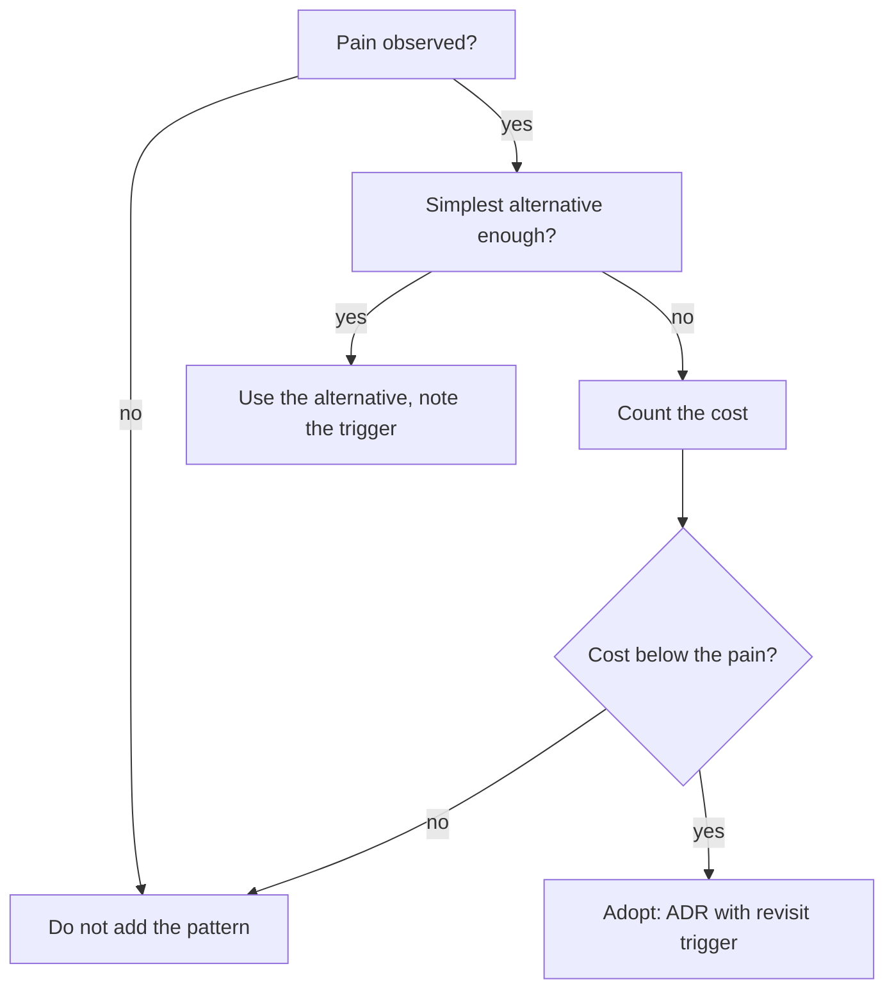
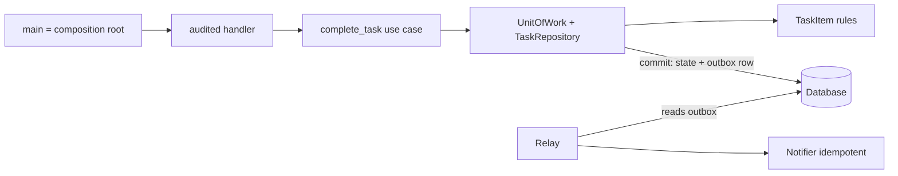

# 09. Choosing patterns: a decision framework and one realistic service

> **Draft: written but not yet run.** The code and the expected output in this lesson were prepared by reading the code and the official documentation. They have not been executed yet. If something does not behave as described, trust your tool's real output and report it.

## What you will be able to do
By the end of this lesson you will be able to:
- apply a five-question framework to decide whether a pattern is worth its cost
- read a small service that combines five patterns on purpose and say which patterns were deliberately left out, and why
- count the cost of abstraction (types, hops between call and work, concepts to learn) before you add a layer
- write an ADR with a revisit trigger that is a number, not a feeling

## Recap
1. Lesson 04: when is a mediator not worth it? <details><summary>Answer</summary>Small services, few handlers, and teams that rely on "find usages": it hides the call graph and adds registration errors that appear at run time.</details>
2. Lesson 05: what does the outbox guarantee and what does it not? <details><summary>Answer</summary>The event exists if and only if the state change committed; delivery is at least once, so consumers must be idempotent.</details>
3. Lesson 08: what is the better way to state an anti-pattern in a review? <details><summary>Answer</summary>Name the observed cost, the smallest fix, and when you would leave it alone.</details>

## Why it matters
By now you know twenty-two catalogue patterns (level 201), five application patterns (phase 1) and a list of anti-patterns. The risk at this level is no longer *not knowing* a pattern; it is **using one too early**. Every pattern buys something (isolation, flexibility, safety) and charges something (indirection, concepts, code). Pattern-first design gives you a diagram that looks professional and a service nobody can change. Judgement means asking what pain you have *today* and choosing the smallest tool that removes it.

## What you will build
The "complete a task" use case of the Tasks and Teams service (see `capstones/platform`: tasks belong to teams, teams have leads), written with **exactly the patterns it needs**:

| Pattern | Used? | Why |
|---|---|---|
| Composition root (hand wiring) | Yes | Few objects; the wiring in `main` is the whole graph |
| Rich domain model | Yes | The completion rules must hold on every code path (lesson 08) |
| Repository (concrete, narrow) | Yes | One place that copies data in and out; no interface yet |
| Unit of work | Yes | One commit per business action; it also collects the events |
| Domain event + outbox + relay + idempotent consumer | Yes | The lead must be told, and the notice must not be lost (lesson 05) |
| Decorator for audit | Yes | One cross-cutting concern; cheaper than a mediator (lesson 04) |
| Specification / query object | **No** | One "overdue" rule; a repository method is enough (lesson 03) |
| CQRS read model, mediator | **No** | Reads are simple; no measured read problem (lesson 04) |
| Saga | **No** | One service, one database: a local transaction suffices (lesson 05) |
| DI container | **No** | Eight types; hand wiring reads better (lesson 01) |

The program runs five attempts, publishes events, lists overdue tasks and ends with a **measurement**: how many types this design has.

## Before you start
- **Prerequisites:** Patterns 301 lessons [01, DI containers and composition roots](../phase-1-application-patterns/01-di-containers-and-composition-roots.md) to [08, anti-patterns before and after](../phase-2-smells-and-refactoring/08-anti-patterns-before-and-after.md).
- Time: 75 minutes for one language, 110 for both.
- Python 3.10+ and/or the .NET 11 SDK. No packages.
- Source pack (optional): every file is shown in full in this lesson, so you can follow without it. The finished code, the exercise starter and the solution are in the
  course repository https://github.com/Uee03/Code101 under `source/patterns/301-super-hero-to-legendary/phase-3-judgement/09-choosing-patterns-in-one-service/` (on that page choose **Code, Download ZIP**, or run
  `git clone https://github.com/Uee03/Code101.git`).

## Steps

### Step 1. Make the lesson folders
**PowerShell, starting folder: anywhere**
```powershell
New-Item -ItemType Directory -Path "$HOME/code101/patterns301/lesson09/python" -Force | Out-Null
New-Item -ItemType Directory -Path "$HOME/code101/patterns301/lesson09/csharp" -Force | Out-Null
Set-Location "$HOME/code101/patterns301/lesson09"
code .
```

**macOS/Linux terminal, starting folder: anywhere**
```bash
mkdir -p ~/code101/patterns301/lesson09/python ~/code101/patterns301/lesson09/csharp
cd ~/code101/patterns301/lesson09
code .
```
Expected result: VS Code opens `lesson09` with empty `python` and `csharp` folders.

### Step 2. The decision framework (read it, you will use it in "How it works" and in the exercise)
Ask these five questions **in order** and stop at the first "no":
1. **Pain.** What hurts today, observed in tests, bugs, review time or incidents? ("It might" is not pain.)
2. **Simplest alternative.** Would a function, a table, a parameter or a comment remove the pain? Try it first.
3. **Cost.** What does the pattern add: types, hops from the caller to the real work, concepts a newcomer must learn, start-up checks? Count them.
4. **Reversibility.** If we are wrong, how hard is it to delete? An interface with one implementation is cheap to remove; an event stream consumed by other teams is not.
5. **Revisit trigger.** Which measurable event makes us look again (second implementation, a third filter, a read p95 above a limit)? Write the number down.



### Step 3. The shape of the service

One request equals one `UnitOfWork`; the use case loads the task through the repository, asks the **task** to complete itself (the rule lives in the entity), commits, and returns. The commit writes the changed task and the event row together. The relay later delivers events to the notifier.

### Step 4. Python
**File: `~/code101/patterns301/lesson09/python/main.py`**
```python
import copy
import inspect


class DomainError(Exception):
    pass


class DomainEvent:
    def __init__(self, event_id, event_type, task_id, actor, team):
        self.id = event_id
        self.type = event_type
        self.task_id = task_id
        self.actor = actor
        self.team = team


class TaskItem:
    def __init__(self, task_id, title, status, assignee, team, due):
        self.id = task_id
        self.title = title
        self.status = status
        self.assignee = assignee
        self.team = team
        self.due = due
        self.events = []

    def complete(self, actor, is_lead):
        if self.status == "done":
            raise DomainError(f"task {self.id} is already done")
        if self.status == "cancelled":
            raise DomainError(f"task {self.id} is cancelled")
        if actor != self.assignee and not is_lead:
            raise DomainError(f"{actor} may not complete task {self.id}")
        self.status = "done"
        self.events.append(("TaskCompleted", actor))


class Database:
    def __init__(self, tasks):
        self.tasks = {t.id: t for t in tasks}
        self.leads = {"platform": "carol"}
        self.outbox = []


class TaskRepository:
    def __init__(self, uow):
        self._uow = uow

    def get(self, task_id):
        if task_id not in self._uow.loaded:
            original = self._uow.db.tasks.get(task_id)
            if original is None:
                return None
            self._uow.loaded[task_id] = copy.deepcopy(original)
        return self._uow.loaded[task_id]

    def overdue(self, today):
        found = [t for t in self._uow.db.tasks.values() if t.status in ("todo", "in_progress") and t.due < today]
        return sorted(found, key=lambda t: t.id)


class UnitOfWork:
    def __init__(self, db):
        self.db = db
        self.loaded = {}
        self.tasks = TaskRepository(self)

    def commit(self):
        for task in self.loaded.values():
            self.db.tasks[task.id] = task
            for event_type, actor in task.events:
                event = DomainEvent(len(self.db.outbox) + 1, event_type, task.id, actor, task.team)
                self.db.outbox.append({"event": event, "published": False})
            task.events = []
        self.loaded = {}


class Relay:
    def __init__(self, db, handlers):
        self.db = db
        self.handlers = handlers

    def run_once(self):
        published = 0
        for row in self.db.outbox:
            if row["published"]:
                continue
            for handler in self.handlers:
                handler(row["event"])
            row["published"] = True
            published += 1
        return published


class Notifier:
    def __init__(self, leads):
        self.leads = leads
        self.seen = set()

    def handle(self, event):
        if event.id in self.seen:
            return
        self.seen.add(event.id)
        print(f"notify lead {self.leads[event.team]}: task {event.task_id} completed by {event.actor} (event {event.id})")


def complete_task(uow, actor, task_id):
    task = uow.tasks.get(task_id)
    if task is None:
        raise DomainError(f"task {task_id} not found")
    task.complete(actor, uow.db.leads.get(task.team) == actor)
    uow.commit()
    return f"task {task_id} completed by {actor}"


def audited(handler, log):
    def run(actor, task_id):
        try:
            result = handler(actor, task_id)
        except DomainError:
            log.append(f"audit: {actor} complete_task {task_id} rejected")
            raise
        log.append(f"audit: {actor} complete_task {task_id} ok")
        return result

    return run


def main():
    db = Database([
        TaskItem(1, "Write ADR", "in_progress", "alice", "platform", "2026-03-05"),
        TaskItem(2, "Review PR", "todo", "alice", "platform", "2026-03-02"),
        TaskItem(3, "Ship release", "todo", "bob", "platform", "2026-03-20"),
        TaskItem(4, "Old chore", "cancelled", "bob", "platform", "2026-02-01"),
    ])
    audit_log = []
    notifier = Notifier(db.leads)
    relay = Relay(db, [notifier.handle])
    complete = audited(lambda actor, task_id: complete_task(UnitOfWork(db), actor, task_id), audit_log)

    for actor, task_id in [("alice", 1), ("bob", 2), ("carol", 2), ("alice", 1), ("bob", 4)]:
        try:
            print(complete(actor, task_id))
        except DomainError as error:
            print(f"rejected: {error}")

    first = relay.run_once()
    second = relay.run_once()
    print(f"relay published {first} events, then {second} on the second run")
    overdue = UnitOfWork(db).tasks.overdue("2026-03-25")
    print(f"overdue as of 2026-03-25: [{', '.join(str(t.id) for t in overdue)}]")
    for line in audit_log:
        print(line)

    own = [c for c in globals().values() if inspect.isclass(c) and c.__module__ == __name__]
    print(f"types in this design: {len(own)}")


main()
```
Read it for the **decisions**, not the syntax:
- `TaskRepository` is a concrete class with no interface: there is one implementation and the tests run on the in-memory database. A trigger to extract an interface is written in the ADR below.
- `UnitOfWork.commit` is the only place that moves events into the outbox; domain code never touches the outbox.
- `audited` is a *decorator function*: one concern, five lines, no framework.
- There is no `Clock` class: the date is a parameter (`overdue("2026-03-25")`), which makes the query deterministic without an abstraction.
- The notifier is idempotent (lesson 05) so the relay can run twice safely.

### Step 5. C#
**File: `~/code101/patterns301/lesson09/csharp/Lesson.csproj`**
```xml
<Project Sdk="Microsoft.NET.Sdk">

  <PropertyGroup>
    <OutputType>Exe</OutputType>
    <TargetFramework>net11.0</TargetFramework>
    <ImplicitUsings>enable</ImplicitUsings>
    <Nullable>enable</Nullable>
  </PropertyGroup>

</Project>
```

**File: `~/code101/patterns301/lesson09/csharp/Service.cs`**
```csharp
namespace TasksService;

public class DomainError(string message) : Exception(message);

public sealed record DomainEvent(int Id, string Type, int TaskId, string Actor, string Team);

public class TaskItem(int id, string title, string status, string assignee, string team, string due)
{
    public int Id { get; } = id;
    public string Title { get; } = title;
    public string Status { get; private set; } = status;
    public string Assignee { get; } = assignee;
    public string Team { get; } = team;
    public string Due { get; } = due;
    public List<(string Type, string Actor)> Events { get; } = new();

    public TaskItem Copy() => new(Id, Title, Status, Assignee, Team, Due);

    public void Complete(string actor, bool isLead)
    {
        if (Status == "done")
        {
            throw new DomainError($"task {Id} is already done");
        }
        if (Status == "cancelled")
        {
            throw new DomainError($"task {Id} is cancelled");
        }
        if (actor != Assignee && !isLead)
        {
            throw new DomainError($"{actor} may not complete task {Id}");
        }
        Status = "done";
        Events.Add(("TaskCompleted", actor));
    }
}

public class Database(IEnumerable<TaskItem> tasks)
{
    public Dictionary<int, TaskItem> Tasks { get; } = tasks.ToDictionary(t => t.Id);
    public Dictionary<string, string> Leads { get; } = new() { ["platform"] = "carol" };
    public List<(DomainEvent Event, bool Published)> Outbox { get; } = new();
}

public sealed class TaskRepository(UnitOfWork uow)
{
    public TaskItem? Get(int taskId)
    {
        if (!uow.Loaded.ContainsKey(taskId))
        {
            if (!uow.Db.Tasks.TryGetValue(taskId, out var original))
            {
                return null;
            }
            uow.Loaded[taskId] = original.Copy();
        }
        return uow.Loaded[taskId];
    }

    public List<TaskItem> Overdue(string today) =>
        uow.Db.Tasks.Values
            .Where(t => (t.Status == "todo" || t.Status == "in_progress") && string.CompareOrdinal(t.Due, today) < 0)
            .OrderBy(t => t.Id)
            .ToList();
}

public sealed class UnitOfWork
{
    public UnitOfWork(Database db)
    {
        Db = db;
        Tasks = new TaskRepository(this);
    }

    public Database Db { get; }
    public Dictionary<int, TaskItem> Loaded { get; } = new();
    public TaskRepository Tasks { get; }

    public void Commit()
    {
        foreach (var task in Loaded.Values)
        {
            Db.Tasks[task.Id] = task;
            foreach (var (type, actor) in task.Events)
            {
                var domainEvent = new DomainEvent(Db.Outbox.Count + 1, type, task.Id, actor, task.Team);
                Db.Outbox.Add((domainEvent, false));
            }
            task.Events.Clear();
        }
        Loaded.Clear();
    }
}

public sealed class Relay(Database db, List<Action<DomainEvent>> handlers)
{
    public int RunOnce()
    {
        var published = 0;
        for (var i = 0; i < db.Outbox.Count; i++)
        {
            var (domainEvent, isPublished) = db.Outbox[i];
            if (isPublished)
            {
                continue;
            }
            foreach (var handler in handlers)
            {
                handler(domainEvent);
            }
            db.Outbox[i] = (domainEvent, true);
            published++;
        }
        return published;
    }
}

public sealed class Notifier(Dictionary<string, string> leads)
{
    private readonly HashSet<int> _seen = new();

    public void Handle(DomainEvent domainEvent)
    {
        if (!_seen.Add(domainEvent.Id))
        {
            return;
        }
        Console.WriteLine($"notify lead {leads[domainEvent.Team]}: task {domainEvent.TaskId} completed by {domainEvent.Actor} (event {domainEvent.Id})");
    }
}
```

**File: `~/code101/patterns301/lesson09/csharp/Program.cs`**
```csharp
using TasksService;

var db = new Database(
[
    new TaskItem(1, "Write ADR", "in_progress", "alice", "platform", "2026-03-05"),
    new TaskItem(2, "Review PR", "todo", "alice", "platform", "2026-03-02"),
    new TaskItem(3, "Ship release", "todo", "bob", "platform", "2026-03-20"),
    new TaskItem(4, "Old chore", "cancelled", "bob", "platform", "2026-02-01"),
]);
var auditLog = new List<string>();
var notifier = new Notifier(db.Leads);
var relay = new Relay(db, [notifier.Handle]);
var complete = Audited((actor, taskId) => CompleteTask(new UnitOfWork(db), actor, taskId), auditLog);

foreach (var (actor, taskId) in new[] { ("alice", 1), ("bob", 2), ("carol", 2), ("alice", 1), ("bob", 4) })
{
    try
    {
        Console.WriteLine(complete(actor, taskId));
    }
    catch (DomainError error)
    {
        Console.WriteLine($"rejected: {error.Message}");
    }
}

var first = relay.RunOnce();
var second = relay.RunOnce();
Console.WriteLine($"relay published {first} events, then {second} on the second run");
var overdue = new UnitOfWork(db).Tasks.Overdue("2026-03-25");
Console.WriteLine($"overdue as of 2026-03-25: [{string.Join(", ", overdue.Select(t => t.Id))}]");
foreach (var line in auditLog)
{
    Console.WriteLine(line);
}

var typeCount = typeof(TaskItem).Assembly.GetTypes().Count(t => t.Namespace == "TasksService" && !t.IsNested);
Console.WriteLine($"types in this design: {typeCount}");

static string CompleteTask(UnitOfWork uow, string actor, int taskId)
{
    var task = uow.Tasks.Get(taskId) ?? throw new DomainError($"task {taskId} not found");
    task.Complete(actor, uow.Db.Leads.GetValueOrDefault(task.Team) == actor);
    uow.Commit();
    return $"task {taskId} completed by {actor}";
}

static Func<string, int, string> Audited(Func<string, int, string> handler, List<string> log) => (actor, taskId) =>
{
    try
    {
        var result = handler(actor, taskId);
        log.Add($"audit: {actor} complete_task {taskId} ok");
        return result;
    }
    catch (DomainError)
    {
        log.Add($"audit: {actor} complete_task {taskId} rejected");
        throw;
    }
};
```
The C# `DomainError` is deliberately a plain class with a primary constructor, and the namespace `TasksService` keeps the design's types separate from the generated `Program` class so the count at the end is honest.

## Run it
Predict first: why does Bob's attempt on task 2 fail while Carol's succeeds, although neither is the assignee? And how many `notify` lines will print? <details><summary>Answer</summary>Carol is the lead of team `platform`, Bob is neither assignee nor lead. Two `notify` lines print, one per committed completion; rejected attempts commit nothing and so create no event.</details>

**PowerShell, folder: `~/code101/patterns301/lesson09/python`**
```powershell
Set-Location "$HOME/code101/patterns301/lesson09/python"
python main.py
```
**macOS/Linux terminal, folder: `~/code101/patterns301/lesson09/python`**
```bash
cd ~/code101/patterns301/lesson09/python
python3 main.py
```
**Any terminal, folder: `~/code101/patterns301/lesson09/csharp`**
```text
dotnet run --project . --nologo
```
Expected output (derived by reading the code, not yet run; identical for Python and C#):
```text
task 1 completed by alice
rejected: bob may not complete task 2
task 2 completed by carol
rejected: task 1 is already done
rejected: task 4 is cancelled
notify lead carol: task 1 completed by alice (event 1)
notify lead carol: task 2 completed by carol (event 2)
relay published 2 events, then 0 on the second run
overdue as of 2026-03-25: [3]
audit: alice complete_task 1 ok
audit: bob complete_task 2 rejected
audit: carol complete_task 2 ok
audit: alice complete_task 1 rejected
audit: bob complete_task 4 rejected
types in this design: 8
```

## How it works
### The cost ledger (question 3 of the framework: count it)
| Type | What it buys | Could we remove it? |
|---|---|---|
| `TaskItem` | The completion rules in one place | No: lesson 08's anemic model is the alternative |
| `DomainEvent` | A fact with an id, for the outbox and idempotency | No, if notifications must not be lost |
| `DomainError` | One exception type for business rule failures | Could use a built-in, but a dedicated type lets callers catch it precisely |
| `Database` | Stands in for the real store | Replaced by a real database later |
| `TaskRepository` | One place that copies data in and out | Yes, if you use the ORM's `DbSet` directly (lesson 02) |
| `UnitOfWork` | One commit per request; collects events | Replaced by the ORM's context |
| `Relay` | Delivers outbox rows | No, if you keep the outbox |
| `Notifier` | An idempotent consumer | Replaced by the real consumer |

**Eight types, two function-level concerns (`complete_task`, `audited`).** Now list the version in which every pattern of phase 1 is applied: a container, a repository interface plus implementation, a unit-of-work interface, specification classes for the overdue rule, a command object, a handler, a validation behaviour, a logging behaviour, a mediator, a read model, a projection and a saga. You will count that list in the exercise. Compare the number of **hops** too: how many files do you open to follow one request? Count them for both designs; do not trust a guess.

### What was deliberately left out, with revisit triggers
| Not adopted | Trigger that makes us look again |
|---|---|
| Repository interface | A second implementation (for example a search index), or tests that need a fake slower than the in-memory database |
| Specification | The overdue rule is needed in a third place, or must run both in memory and in SQL |
| Mediator / CQRS | Three or more cross-cutting concerns repeated in every handler, or a list endpoint whose measured p95 latency is above the agreed limit |
| Saga | Archiving a project must call a second service that owns part of the data |
| DI container | The composition root passes about two screens, or tests override more than five registrations |

### Failure modes of pattern selection
- **Pattern-first design.** Starting from a diagram of patterns and then looking for problems. Start from the pain.
- **Resume-driven development.** A pattern chosen because it is interesting to the author. Ask: who maintains it in two years?
- **Premature interface.** An interface with one implementation, created "for testing", when the real class is already fast and deterministic. It doubles the files and moves "go to definition" to the wrong place.
- **Inconsistency.** Half the handlers use the mediator, half do not. A new pattern is worth adopting only if you will apply it everywhere it fits, or you document the boundary.
- **The framework decides for you.** Many frameworks ship a unit of work (the ORM context), a container and a mediator-like pipeline. Using them is not "adding a pattern"; re-implementing them by hand beside the framework's version is.
- **Cargo cult in reverse.** Refusing every pattern because "simple is better". Simple means *the smallest design that handles today's forces*, and the outbox in this service is there because losing a notification is a real failure.
- **Measure.** Before and after each adoption, record: types, files opened per request, time for a new developer to add a use case, and a latency or error number that motivated the change. If you cannot name the number you are improving, you are guessing.

### ADR-0009
- **Context:** `complete task` must enforce rules on every path, notify the lead reliably, and be auditable. The team has four developers and one PostgreSQL database.
- **Decision:** rich entity, narrow concrete repository, unit of work, outbox with idempotent consumer, audit decorator. No container, mediator, specification, read model or saga.
- **Consequences:** eight types, a three-file path per request, rules testable without a database. Revisit when any trigger in the table above fires; each trigger is a number that the team already collects (types, repeated concerns, p95, second consumer).

## Try it
**Rung 1, guided.** Copy the `starter` folder of your language to `try09` (copy the folder itself and rename it). Add the next use case, "reassign task", using only what the design already has: the rule goes **into the entity**, no new layer.

**File: `try09/main.py`**
```python
class DomainError(Exception):
    pass


LEAD = "carol"


class TaskItem:
    def __init__(self, task_id, assignee):
        self.id = task_id
        self.assignee = assignee

    def reassign(self, new_assignee, actor):
        # TODO 1: raise DomainError(f"{actor} is not the lead") unless actor is LEAD.
        # TODO 2: raise DomainError(f"task {self.id} already belongs to {new_assignee}") when nothing would change.
        # TODO 3: otherwise set the new assignee.
        raise NotImplementedError


task = TaskItem(1, "alice")
for actor, new_assignee in [("carol", "bob"), ("alice", "dave"), ("carol", "bob")]:
    try:
        task.reassign(new_assignee, actor)
        print(f"task {task.id} now belongs to {task.assignee}")
    except DomainError as error:
        print(f"rejected: {error}")
```

**File: `try09/Program.cs`** (with the `Lesson.csproj` from this lesson)
```csharp
var task = new WorkItem(1, "alice");
foreach (var (actor, newAssignee) in new[] { ("carol", "bob"), ("alice", "dave"), ("carol", "bob") })
{
    try
    {
        task.Reassign(newAssignee, actor);
        Console.WriteLine($"task {task.Id} now belongs to {task.Assignee}");
    }
    catch (DomainException error)
    {
        Console.WriteLine($"rejected: {error.Message}");
    }
}

class DomainException(string message) : Exception(message);

class WorkItem(int id, string assignee)
{
    private const string Lead = "carol";

    public int Id { get; } = id;
    public string Assignee { get; private set; } = assignee;

    public void Reassign(string newAssignee, string actor)
    {
        // TODO 1: throw new DomainException($"{actor} is not the lead") unless actor equals the constant Lead.
        // TODO 2: throw new DomainException($"task {Id} already belongs to {newAssignee}") when nothing would change.
        // TODO 3: otherwise set the new assignee.
        throw new NotImplementedException();
    }
}
```
Expected output after your fix:
```text
task 1 now belongs to bob
rejected: alice is not the lead
rejected: task 1 already belongs to bob
```

**Rung 2, change.** Add "reassign" to the lesson's service (not the exercise): which of the existing types do you change, and does the audit decorator need to change? Count the new types you needed. (The design goal is zero.)

**Rung 3, stretch (no single answer).** Count the types of the "every pattern" version of this service (list them by name) and compare with the 8 of this design. Then write an ADR (context, decision, consequences, revisit trigger) that argues for **one** of the patterns we left out, using a pain you can defend with a number.

<details><summary>Solution</summary>

**File: `exercise/solution/python/main.py`**
```python
class DomainError(Exception):
    pass


LEAD = "carol"


class TaskItem:
    def __init__(self, task_id, assignee):
        self.id = task_id
        self.assignee = assignee

    def reassign(self, new_assignee, actor):
        if actor != LEAD:
            raise DomainError(f"{actor} is not the lead")
        if new_assignee == self.assignee:
            raise DomainError(f"task {self.id} already belongs to {new_assignee}")
        self.assignee = new_assignee


task = TaskItem(1, "alice")
for actor, new_assignee in [("carol", "bob"), ("alice", "dave"), ("carol", "bob")]:
    try:
        task.reassign(new_assignee, actor)
        print(f"task {task.id} now belongs to {task.assignee}")
    except DomainError as error:
        print(f"rejected: {error}")
```

**File: `exercise/solution/csharp/Program.cs`**
```csharp
var task = new WorkItem(1, "alice");
foreach (var (actor, newAssignee) in new[] { ("carol", "bob"), ("alice", "dave"), ("carol", "bob") })
{
    try
    {
        task.Reassign(newAssignee, actor);
        Console.WriteLine($"task {task.Id} now belongs to {task.Assignee}");
    }
    catch (DomainException error)
    {
        Console.WriteLine($"rejected: {error.Message}");
    }
}

class DomainException(string message) : Exception(message);

class WorkItem(int id, string assignee)
{
    private const string Lead = "carol";

    public int Id { get; } = id;
    public string Assignee { get; private set; } = assignee;

    public void Reassign(string newAssignee, string actor)
    {
        if (actor != Lead)
        {
            throw new DomainException($"{actor} is not the lead");
        }
        if (newAssignee == Assignee)
        {
            throw new DomainException($"task {Id} already belongs to {newAssignee}");
        }
        Assignee = newAssignee;
    }
}
```
Rung 2 answer: one new method on `TaskItem`, one new use-case function next to `complete_task`, the same `audited` wrapper (it is generic over the handler); zero new types. Rung 3 depends on your list: count yours and compare it with the 8 of this design.
</details>

## Check yourself
1. Why does the service have a concrete `TaskRepository` and no interface? <details><summary>Answer</summary>There is one implementation and tests are fast on the in-memory database; an interface would add a file and a hop with no current benefit. The trigger for extracting one is written down.</details>
2. Which line in the output proves that rejected attempts leave no trace in the outbox? <details><summary>Answer</summary>Only two `notify` lines (events 1 and 2) and `relay published 2 events`, although five attempts were made.</details>
3. Name two situations where adding a mediator would be justified here. <details><summary>Answer</summary>Three or more cross-cutting concerns repeated in every handler, or many handlers that must go through the same pipeline (validation, authorisation, transaction).</details>
4. Why is "types in this design" a useful number and what is its weakness? <details><summary>Answer</summary>It makes the cost of abstraction visible and comparable over time; it ignores the size and difficulty of each type, so pair it with files opened per request and onboarding time.</details>

## Common mistakes
| Symptom or error text | Cause | Fix |
|---|---|---|
| `types in this design` prints a different number in C# | A type was added or removed outside the namespace `TasksService`, or an extra helper type was added | Keep all design types in the namespace; count only those |
| The notifier prints twice | The relay ran before the notifier was idempotent, or `seen` was recreated | Create one `Notifier` and reuse it |
| `rejected: bob may not complete task 2` appears for Carol | The lead lookup uses the wrong team key | Check `leads["platform"]` and the task's team |
| `NotImplementedError` / `NotImplementedException` (typical messages) in the exercise | TODO 1 to 3 not done | Replace the `raise` / `throw` with your code |
| `KeyError: 'platform'` (typical Python message) when you add a task of another team | `leads` has no entry for that team | Add the team to `leads` or handle a missing lead |

## Best practice
Choose a pattern because of a pain you can point to, count what it costs, try the simplest alternative first, and write down the number that would make you revisit. Source: Architectural decision records, Microsoft Azure Well-Architected Framework https://learn.microsoft.com/azure/well-architected/architect-role/architecture-decision-record ; Common web application architectures (when to keep it simple), Microsoft Learn https://learn.microsoft.com/dotnet/architecture/modern-web-apps-azure/common-web-application-architectures ; YAGNI, Martin Fowler https://martinfowler.com/bliki/Yagni.html

## Going further
- Patterns of Enterprise Application Architecture catalogue, Martin Fowler: https://martinfowler.com/eaaCatalog/
- Capstone use: the ASP.NET and Python backend chapters of `capstones/platform` implement the same rules with the database enforcing them (`complete_task` stored function) as a second line of defence.

## Summary
- You applied a five-question framework and wrote its answers as a table of "used" and "not used" patterns.
- You read a service that combines six patterns in eight types and saw what each type buys.
- You measured the cost of abstraction as a number and wrote revisit triggers as numbers.
- You added a use case without adding a type.

## Next lesson
10. Architecture-level patterns and a design review: layered, hexagonal, modular monolith, microservices and event-driven compared in a trade-offs table, an architecture fitness function that checks dependency direction, and a design review exercise.
