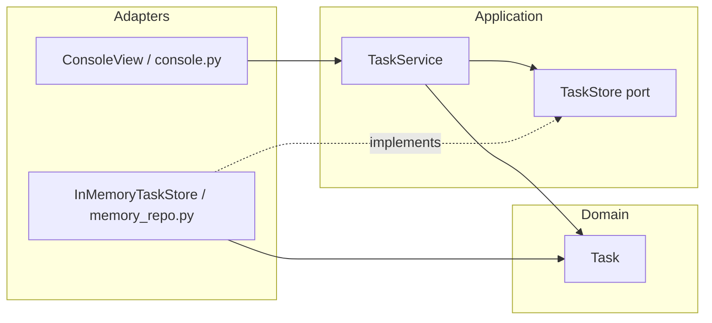

# 10. Architecture-level patterns and a design review

> **Draft: written but not yet run.** The code and the expected output in this lesson were prepared by reading the code and the official documentation. They have not been executed yet. If something does not behave as described, trust your tool's real output and report it.

## What you will be able to do
By the end of this lesson you will be able to:
- compare layered, hexagonal, modular monolith, microservices and event-driven styles using one trade-offs table
- turn an architecture rule ("the domain depends on nothing") into an automatic check, a **fitness function**
- review a design document and write findings with a severity, a failure mode and a fix
- choose the least expensive style that handles today's forces, and write the decision as an ADR with a revisit trigger

## Recap
1. Lesson 09: what are the five framework questions? <details><summary>Answer</summary>Pain, simplest alternative, cost, reversibility, revisit trigger.</details>
2. Lesson 05: why must consumers of at-least-once events be idempotent? <details><summary>Answer</summary>A crash between publish and mark causes redelivery; duplicates are possible, losses are not acceptable.</details>

## Why it matters
Class-level patterns are cheap to change; architecture-level choices are not. A wrong *Strategy* costs an afternoon, a wrong service boundary costs a year. The architecture styles below are patterns at the scale of a whole system. They have names, forces and consequences, and the same discipline applies: pain first, cost counted, simplest alternative tried, reversibility considered. Many teams adopt microservices to solve an organisational problem with a technical tool; others stay in an unstructured monolith because "microservices are hype". This lesson gives you the vocabulary and the habit to avoid both.

## What you will build
1. A small **hexagonal** (ports and adapters) application with three folders: `domain`, `application`, `adapters`, and a **fitness function** that reads every source file, checks that imports respect the dependency rule and prints the result. It also proves the rule can fail by checking a bad snippet.
2. A trade-offs table of five architecture styles.
3. A **design review** of a flawed design document, with an answer key.

## Before you start
- **Prerequisites:** Patterns 301 lessons [01, DI containers and composition roots](../phase-1-application-patterns/01-di-containers-and-composition-roots.md) to [09, choosing patterns in one service](09-choosing-patterns-in-one-service.md).
- Time: 90 minutes for one language, 120 for both (the review exercise is the longest part).
- Python 3.10+ and/or the .NET 11 SDK. No packages.
- The programs read their own source files from disk. Run them from the folder shown.
- Source pack (optional): every file is shown in full in this lesson, so you can follow without it. The finished code, the exercise starter and the solution are in the
  course repository https://github.com/Uee03/Code101 under `source/patterns/301-super-hero-to-legendary/phase-3-judgement/10-architecture-level-patterns-and-design-review/` (on that page choose **Code, Download ZIP**, or run
  `git clone https://github.com/Uee03/Code101.git`).

## Steps

### Step 1. Make the lesson folders
**PowerShell, starting folder: anywhere**
```powershell
New-Item -ItemType Directory -Path "$HOME/code101/patterns301/lesson10/python/domain" -Force | Out-Null
New-Item -ItemType Directory -Path "$HOME/code101/patterns301/lesson10/python/application" -Force | Out-Null
New-Item -ItemType Directory -Path "$HOME/code101/patterns301/lesson10/python/adapters" -Force | Out-Null
New-Item -ItemType Directory -Path "$HOME/code101/patterns301/lesson10/csharp/Domain" -Force | Out-Null
New-Item -ItemType Directory -Path "$HOME/code101/patterns301/lesson10/csharp/Application" -Force | Out-Null
New-Item -ItemType Directory -Path "$HOME/code101/patterns301/lesson10/csharp/Adapters" -Force | Out-Null
Set-Location "$HOME/code101/patterns301/lesson10"
code .
```

**macOS/Linux terminal, starting folder: anywhere**
```bash
mkdir -p ~/code101/patterns301/lesson10/python/{domain,application,adapters}
mkdir -p ~/code101/patterns301/lesson10/csharp/{Domain,Application,Adapters}
cd ~/code101/patterns301/lesson10
code .
```
Expected result: VS Code opens `lesson10` with the two language folders and three empty layer folders in each.

### Step 2. The hexagon and its one rule

**Ports and adapters** (hexagonal architecture, Alistair Cockburn; also known as "clean" or "onion" architecture in slightly different clothes): the application core defines **ports** (interfaces for what it needs), **adapters** at the edge implement them for a database, a web framework or a console. The **dependency rule**: source code dependencies point *inward*. The domain knows nothing about the application layer; the application layer knows nothing about adapters. This is lesson 01's dependency inversion applied to a whole system.

### Step 3. Python
**File: `~/code101/patterns301/lesson10/python/domain/task.py`**
```python
class Task:
    def __init__(self, task_id, title):
        self.id = task_id
        self.title = title
        self.done = False

    def complete(self):
        if self.done:
            raise ValueError(f"task {self.id} is already done")
        self.done = True
```

**File: `~/code101/patterns301/lesson10/python/application/ports.py`**
```python
from abc import ABC, abstractmethod

from domain.task import Task


class TaskStore(ABC):
    @abstractmethod
    def get(self, task_id) -> Task:
        ...

    @abstractmethod
    def save(self, task: Task) -> None:
        ...
```

**File: `~/code101/patterns301/lesson10/python/application/service.py`**
```python
from application.ports import TaskStore
from domain.task import Task


class TaskService:
    def __init__(self, store: TaskStore):
        self._store = store

    def complete(self, task_id) -> Task:
        task = self._store.get(task_id)
        task.complete()
        self._store.save(task)
        return task
```

**File: `~/code101/patterns301/lesson10/python/adapters/memory_repo.py`**
```python
from application.ports import TaskStore
from domain.task import Task


class InMemoryTaskStore(TaskStore):
    def __init__(self, tasks):
        self._tasks = {t.id: t for t in tasks}

    def get(self, task_id) -> Task:
        return self._tasks[task_id]

    def save(self, task: Task) -> None:
        self._tasks[task.id] = task
```

**File: `~/code101/patterns301/lesson10/python/adapters/console.py`**
```python
from domain.task import Task


def render(task: Task) -> str:
    return f"completed: {task.title} is done={task.done}"
```
These three folders have no `__init__.py`: Python treats a folder without one as a *namespace package*, which is enough here because you run `main.py` from the `python` folder.

**File: `~/code101/patterns301/lesson10/python/check_architecture.py`**
```python
import ast
from pathlib import Path

LAYERS = ("domain", "application", "adapters")
FORBIDDEN = {
    "domain": ("application", "adapters"),
    "application": ("adapters",),
    "adapters": (),
}


def imported_layers(source):
    found = []
    for node in ast.walk(ast.parse(source)):
        if isinstance(node, ast.Import):
            names = [alias.name for alias in node.names]
        elif isinstance(node, ast.ImportFrom):
            names = [node.module or ""]
        else:
            continue
        for name in names:
            top = name.split(".")[0]
            if top in LAYERS:
                found.append((top, node.lineno))
    return found


def check_source(layer, source):
    problems = []
    for imported, line in imported_layers(source):
        if imported in FORBIDDEN[layer]:
            problems.append(f"{layer} must not depend on {imported} (line {line})")
    return problems


def check_tree(root):
    files = 0
    problems = []
    for layer in LAYERS:
        for path in sorted((Path(root) / layer).glob("*.py")):
            files += 1
            problems += [f"{path.name}: {p}" for p in check_source(layer, path.read_text(encoding="utf-8"))]
    return files, problems
```
`FORBIDDEN` is the architecture written as data: the domain may import neither of the outer layers; the application layer may not import adapters; adapters may import everything inward.

**File: `~/code101/patterns301/lesson10/python/main.py`**
```python
from pathlib import Path

from adapters.console import render
from adapters.memory_repo import InMemoryTaskStore
from application.service import TaskService
from check_architecture import check_source, check_tree
from domain.task import Task


def main():
    store = InMemoryTaskStore([Task(1, "Write ADR")])
    service = TaskService(store)
    print(render(service.complete(1)))

    files, problems = check_tree(Path(__file__).parent)
    print(f"architecture check: {files} files, {len(problems)} violations")
    bad = check_source("domain", "from adapters.memory_repo import InMemoryTaskStore")
    print(f"bad snippet: {bad[0]}")


main()
```
`main.py` is the composition root (lesson 01): the only file that knows every layer.

### Step 4. C#
**File: `~/code101/patterns301/lesson10/csharp/Lesson.csproj`**
```xml
<Project Sdk="Microsoft.NET.Sdk">

  <PropertyGroup>
    <OutputType>Exe</OutputType>
    <TargetFramework>net11.0</TargetFramework>
    <ImplicitUsings>enable</ImplicitUsings>
    <Nullable>enable</Nullable>
  </PropertyGroup>

</Project>
```

**File: `~/code101/patterns301/lesson10/csharp/Domain/TaskItem.cs`**
```csharp
namespace TasksApp.Domain;

public class TaskItem(int id, string title)
{
    public int Id { get; } = id;
    public string Title { get; } = title;
    public bool Done { get; private set; }

    public void Complete()
    {
        if (Done)
        {
            throw new InvalidOperationException($"task {Id} is already done");
        }
        Done = true;
    }
}
```

**File: `~/code101/patterns301/lesson10/csharp/Application/ITaskStore.cs`**
```csharp
using TasksApp.Domain;

namespace TasksApp.Application;

public interface ITaskStore
{
    TaskItem Get(int id);

    void Save(TaskItem task);
}
```

**File: `~/code101/patterns301/lesson10/csharp/Application/TaskService.cs`**
```csharp
using TasksApp.Domain;

namespace TasksApp.Application;

public class TaskService(ITaskStore store)
{
    public TaskItem Complete(int id)
    {
        var task = store.Get(id);
        task.Complete();
        store.Save(task);
        return task;
    }
}
```

**File: `~/code101/patterns301/lesson10/csharp/Adapters/InMemoryTaskStore.cs`**
```csharp
using TasksApp.Application;
using TasksApp.Domain;

namespace TasksApp.Adapters;

public class InMemoryTaskStore(IEnumerable<TaskItem> tasks) : ITaskStore
{
    private readonly Dictionary<int, TaskItem> _tasks = tasks.ToDictionary(t => t.Id);

    public TaskItem Get(int id) => _tasks[id];

    public void Save(TaskItem task) => _tasks[task.Id] = task;
}
```

**File: `~/code101/patterns301/lesson10/csharp/Adapters/ConsoleView.cs`**
```csharp
using TasksApp.Domain;

namespace TasksApp.Adapters;

public static class ConsoleView
{
    public static string Render(TaskItem task) => $"completed: {task.Title} is done={task.Done}";
}
```

**File: `~/code101/patterns301/lesson10/csharp/ArchitectureCheck.cs`**
```csharp
using System.Text.RegularExpressions;

public static class ArchitectureCheck
{
    private static readonly string[] Layers = ["Domain", "Application", "Adapters"];

    private static readonly Dictionary<string, string[]> Forbidden = new()
    {
        ["Domain"] = ["Application", "Adapters"],
        ["Application"] = ["Adapters"],
        ["Adapters"] = [],
    };

    private static readonly Regex UsingLine = new(@"^using TasksApp\.(\w+)");

    public static List<string> CheckSource(string layer, string source)
    {
        var problems = new List<string>();
        var lines = source.Split('\n');
        for (var i = 0; i < lines.Length; i++)
        {
            var match = UsingLine.Match(lines[i].Trim());
            if (match.Success && Forbidden[layer].Contains(match.Groups[1].Value))
            {
                problems.Add($"{layer.ToLowerInvariant()} must not depend on {match.Groups[1].Value.ToLowerInvariant()} (line {i + 1})");
            }
        }
        return problems;
    }

    public static (int Files, List<string> Problems) CheckTree(string root)
    {
        var files = 0;
        var problems = new List<string>();
        foreach (var layer in Layers)
        {
            foreach (var path in Directory.GetFiles(Path.Combine(root, layer), "*.cs").OrderBy(p => p, StringComparer.Ordinal))
            {
                files++;
                problems.AddRange(CheckSource(layer, File.ReadAllText(path)).Select(p => $"{Path.GetFileName(path)}: {p}"));
            }
        }
        return (files, problems);
    }
}
```
This C# check is a heuristic on `using TasksApp.<Layer>` lines. It does not see fully qualified names written without a `using`. For real projects use a library that reads the compiled assemblies (see Going further).

**File: `~/code101/patterns301/lesson10/csharp/Program.cs`**
```csharp
using TasksApp.Adapters;
using TasksApp.Application;
using TasksApp.Domain;

var store = new InMemoryTaskStore([new TaskItem(1, "Write ADR")]);
var service = new TaskService(store);
Console.WriteLine(ConsoleView.Render(service.Complete(1)));

var (files, problems) = ArchitectureCheck.CheckTree(Directory.GetCurrentDirectory());
Console.WriteLine($"architecture check: {files} files, {problems.Count} violations");
var bad = ArchitectureCheck.CheckSource("Domain", "using TasksApp.Adapters;");
Console.WriteLine($"bad snippet: {bad[0]}");
```

## Run it
Predict first: if someone adds `using TasksApp.Adapters;` to `Domain/TaskItem.cs` (or `from adapters.console import render` to `domain/task.py`), what will the second output line say? <details><summary>Answer</summary>`architecture check: 5 files, 1 violations`. The program prints only the count; the violation text itself is in the list `problems`, which you could print.</details>

**PowerShell, folder: `~/code101/patterns301/lesson10/python`**
```powershell
Set-Location "$HOME/code101/patterns301/lesson10/python"
python main.py
```
**macOS/Linux terminal, folder: `~/code101/patterns301/lesson10/python`**
```bash
cd ~/code101/patterns301/lesson10/python
python3 main.py
```
**Any terminal, folder: `~/code101/patterns301/lesson10/csharp`** (the check reads the layer folders from the current directory)
```text
dotnet run --project . --nologo
```
Expected output (derived by reading the code, not yet run; identical for Python and C#):
```text
completed: Write ADR is done=True
architecture check: 5 files, 0 violations
bad snippet: domain must not depend on adapters (line 1)
```

## How it works
- **A fitness function** is an automated check of an architectural property (the term comes from evolutionary architecture). Here the property is "dependencies point inward". It runs in milliseconds, so it can run on every commit and fail the build. Real tools: `import-linter` (Python), NetArchTest or ArchUnitNET (.NET), ArchUnit (Java). Other typical fitness functions: no cycles between modules, response time budgets, no `SELECT *` in queries, a service never reads another service's tables.
- **The bad snippet** proves the rule can fail. A check that has never failed is not known to work; this is the same idea as lesson 07's broken step.
- **Why it matters for judgement.** An architecture diagram is a wish; the fitness function is evidence. Teams that cannot automate a rule should ask whether they really agree on it.

### The trade-offs table
| Style | Idea | Strengths | Costs and failure modes | Choose when | Avoid when |
|---|---|---|---|---|---|
| **Layered** (presentation, business, data) | Each layer uses the one below | Familiar, quick start, fits CRUD | Business rules leak into "service" classes; data layer becomes the centre; changes ripple through all layers | Simple CRUD with little domain logic | Rich domain rules that must be testable without a database |
| **Hexagonal / clean** | Domain and application in the centre; adapters at the edge | Domain tests need no infrastructure; swap databases and frameworks at the edge | More folders and interfaces; mapping between layers; easy to over-abstract (lesson 09) | Long-lived business logic, several delivery mechanisms (HTTP, queue, CLI) | Throwaway tools, thin CRUD |
| **Modular monolith** | One deployable, strict module boundaries (own data, public API per module) | Simple deployment and transactions; boundaries can later become services | Needs discipline (fitness functions) or boundaries erode; one module's failure can take everything down | Most teams starting a product; unclear boundaries | A single team cannot even agree on modules (then fix that first) |
| **Microservices** | Independently deployable services around business capabilities, each owning its data | Independent deployment and scaling; team autonomy; fault isolation when done well | Distributed failure modes (timeouts, partial failure), eventual consistency, versioned contracts, observability and platform cost, many repositories | Many teams that must release independently; parts with very different scaling or availability needs | One small team; undefined domain boundaries; no platform or monitoring skills |
| **Event-driven** | Components communicate by publishing and reacting to events (broker) | Loose coupling, easy to add consumers, absorbs bursts | Hard to see the whole flow; duplicates and ordering (lesson 05); schema evolution; debugging; eventual consistency | Integration between services, notifications, projections, audit | Requests that need an immediate answer; very small systems |

Rules of thumb from the sources (paraphrased): **monolith first** (Fowler: almost all successful microservice systems started as monoliths that grew too big; systems built as microservices from day one often hit trouble) and **a modular monolith is an architecture, not a stepping stone to be ashamed of**. The styles combine: a modular monolith with hexagonal modules and an outbox publishing events is common.

### Failure modes at architecture scale
- **Distributed monolith.** Services that must be deployed together, share a database or call each other synchronously in long chains: you pay for microservices and get none of the benefits. Symptom to measure: how many services change in one release, how many calls per user request.
- **Shared database integration.** Another team reads your tables: you can no longer change the schema. The design review below has this flaw.
- **Synchronous chains.** If A calls B calls C inside one request, the availability of the request is the *product* of the availabilities of A, B and C.
- **Event spaghetti.** Many events with no owner and no schema versioning.
- **Resume-driven architecture.** Kubernetes and a service mesh for five users.
- **Conway's law ignored.** Your architecture will end up looking like your teams' communication structure; design both together.
- **No evolution path.** Decisions with no revisit trigger become dogma. Every ADR gets one.
- **Measure:** deployment frequency, lead time, change failure rate, mean time to restore (the four DORA measures), and the specific numbers behind your ADR triggers. Do not copy anyone else's benchmark values; collect your own.

### ADR-0010
- **Context:** Tasks and Teams has one product team of five, one PostgreSQL database, and a platform contract shared by four backends (`capstones/platform`).
- **Decision:** modular monolith with hexagonal modules (`tasks`, `teams`, `audit`), the dependency rule enforced by a fitness function in CI; events published through an outbox for the audit and notification consumers.
- **Consequences:** one deployment, local transactions, module boundaries that can be split later. Revisit when two or more teams need independent release schedules, or when one module's scaling profile differs from the rest (measured, not guessed).

## Try it
**Rung 1, guided.** Copy the `starter` folder of your language to `try10` (copy the folder itself and rename it). The mini checker knows only the domain rule. Add the application rule and print a readable verdict.

**File: `try10/main.py`**
```python
FORBIDDEN = {
    "domain": ["application", "adapters"],
    # TODO 1: add the rule for "application": it must not depend on "adapters".
}


def violations(layer, imported):
    return [name for name in imported if name in FORBIDDEN.get(layer, [])]


SAMPLES = [
    ("domain", ["application"]),
    ("application", ["domain"]),
    ("application", ["adapters"]),
    ("adapters", ["application", "domain"]),
]

for layer, imported in SAMPLES:
    bad = violations(layer, imported)
    # TODO 2: print "<layer> imports <names>: ok" when bad is empty, otherwise
    #         "<layer> imports <names>: forbidden (<bad names>)". Join several names with ", ".
    print(layer, imported, bad)
```

**File: `try10/Program.cs`** (with the `Lesson.csproj` from this lesson)
```csharp
var forbidden = new Dictionary<string, string[]>
{
    ["domain"] = ["application", "adapters"],
    // TODO 1: add the rule for "application": it must not depend on "adapters".
};

var samples = new List<(string Layer, string[] Imported)>
{
    ("domain", ["application"]),
    ("application", ["domain"]),
    ("application", ["adapters"]),
    ("adapters", ["application", "domain"]),
};

foreach (var (layer, imported) in samples)
{
    var bad = imported.Where(name => forbidden.GetValueOrDefault(layer, []).Contains(name)).ToList();
    // TODO 2: print "<layer> imports <names>: ok" when bad is empty, otherwise
    //         "<layer> imports <names>: forbidden (<bad names>)". Join several names with ", ".
    Console.WriteLine($"{layer} {imported.Length} {bad.Count}");
}
```
Expected output after your fix:
```text
domain imports application: forbidden (application)
application imports domain: ok
application imports adapters: forbidden (adapters)
adapters imports application, domain: ok
```

**Rung 2, change.** Add a fourth layer, `web`, that may import `application` and `domain` but nothing may import `web`. Which lines of your rule table change? What does the table tell you about the *shape* of the architecture?

**Rung 3, stretch: the design review.** Review the design document below as if you were the senior engineer on the review board. For each finding write: **what** (one sentence), **risk** (what fails, when), **severity** (high, medium, low) and **fix**. Aim for at least eight findings, and name at least two things the design does *right*. Use the checklist after the document. Do not look at the answer key before you have written your list.

> **Design document NOTIF-1: Task notifications (draft)**
> 1. When a task is completed, the Task API publishes a `TaskCompleted` message to the shared company topic `events`.
> 2. The new Notification service reads the Task API's PostgreSQL database directly, through a read-only user, to find the assignee's email address and the team lead, because "it is faster than asking the API".
> 3. Inside the same HTTP request that completes the task, the Task API calls the Notification service synchronously. If that call fails, the Task API returns 500 and rolls back the completion.
> 4. Events are published right after the database commit with a plain `publish()` call. There is no retry.
> 5. The Notification service runs as a single instance. It stores which notifications were already sent in a SQLite file on the instance's local disk.
> 6. The event schema is the C# class `TaskCompleted` from a shared NuGet package that the Task API and the Notification service both reference.
> 7. The team lead's email address is cached in memory when the service starts and is never refreshed.
> 8. The services authenticate to each other with one shared API key stored in an environment variable.
> 9. Rollout: both services are released together on Friday afternoon.
> 10. Success metric: "notifications work".

**Review checklist** (use it for every design review): **Boundaries** (who owns which data and which decision?), **Failure** (what if each dependency is slow, down, duplicated, out of order?), **Data** (consistency, schema evolution, privacy), **Security** (identity of callers, least privilege, secrets, audit), **Operations** (deploy, rollback, monitoring, alerts, on-call), **Evolution** (what is the revisit trigger, how do we change our mind?), **Cost** (types, services, people, money), **Measurement** (which numbers define success?).

<details><summary>Answer key (open after you have written your own findings)</summary>

| # | What | Risk | Severity | Fix |
|---|---|---|---|---|
| 2 | Notification service reads the Task database directly | Shared-database integration: the Task team can no longer change its schema; the service sees data it should not (privacy); a hidden coupling not visible in any API | High | Put what the consumer needs into the event (event-carried state) or call a documented read API; give each service its own data |
| 3 | Synchronous call inside the completing request, with rollback on failure | A notification outage stops all task completion; availability is the product of both services; users wait for mail | High | Decouple: write the event in the same transaction (outbox) and let the Notification service consume it asynchronously |
| 4 | Plain publish after commit, no retry | A crash or broker outage between commit and publish loses events silently | High | Transactional outbox plus relay with retry and an alert on the age of the oldest unpublished row (lesson 05) |
| (missing) | No idempotency for consumers | At-least-once delivery will send duplicate emails | High | Deduplicate by event id in the consumer, stored with its effect |
| 5 | Single instance with SQLite on local disk | No high availability; "already sent" flags are lost on redeploy or disk loss, so users get duplicate or missing mail; cannot scale out | High | A durable shared store (the service's own database) and at least two instances |
| 6 | Event schema shared as a code package | Lockstep upgrades, a breaking change breaks both; hidden coupling of release schedules | Medium | A versioned, language-neutral schema (JSON Schema or similar) with compatibility rules; tolerate unknown fields |
| 7 | Lead email cached forever | Stale or wrong recipient after a team change; potential privacy issue | Medium | Include the lead in the event, or use a short time-to-live cache with refresh |
| 8 | One shared API key in an environment variable | No per-service identity, no rotation story, a leak compromises both; cannot audit who called | High | Service identities with short-lived tokens (for example OAuth client credentials from the identity provider, as the platform's Keycloak realm provides), secrets in a secret store, rotation |
| 9 | Both services released together, on Friday afternoon | Defeats independent deployment (distributed monolith); a bad release meets a weekend with less staff | Medium | Backward-compatible contract so either side can deploy first; progressive rollout; release early in the week with a rollback plan |
| 10 | Success metric "notifications work" | Cannot tell success from failure or set alerts | Medium | Define measurable service-level objectives with stakeholders (for example the share of completions notified within an agreed time), plus alert on outbox age and consumer errors |
| (missing) | No ordering or poison-message handling, no dead-letter store | One bad event can block the queue | Medium | Retry limit, dead-letter queue, alert |
| (missing) | No consideration of the shared topic `events` | Everyone consumes everyone's events; no ownership or schema governance | Low to medium | Topic per domain or event type with an owner |

**Done right:** (1) communicating completion as an event is a good, loosely coupled choice for notifications; (2) wanting the Notification service separate from the Task API is a reasonable boundary *if* the data-ownership and delivery issues above are fixed; (3) the draft says what the service does in ten short items, which makes the review possible.
</details>

## Check yourself
1. Which direction do source dependencies point in a hexagonal architecture and which lesson's principle is that? <details><summary>Answer</summary>Inward, towards the domain; it is the Dependency Inversion Principle (lesson 01 and Patterns 101 lesson 06) applied to layers.</details>
2. Why does the program check a bad snippet? <details><summary>Answer</summary>To prove the checker can actually fail; a check that has never been seen failing is not trustworthy.</details>
3. Give two signs that you have built a distributed monolith. <details><summary>Answer</summary>Services must be deployed together; they share a database; long chains of synchronous calls; one change touches many services.</details>
4. For a five-person team with one database and an unclear domain, which style would you start with and what is your revisit trigger? <details><summary>Answer</summary>A modular monolith; revisit when separate teams need independent releases or a module has a measurably different scaling profile.</details>
5. Name three findings in the design document that relate to lesson 05. <details><summary>Answer</summary>Publish after commit without outbox, no retry, no idempotency (also: no dead-letter handling).</details>

## Common mistakes
| Symptom or error text | Cause | Fix |
|---|---|---|
| `ModuleNotFoundError: No module named 'domain'` (typical Python message) | You ran `main.py` from another folder | `cd` into the `python` folder first |
| `DirectoryNotFoundException` mentioning `Domain` (typical .NET message) | The C# program started in a folder without the layer folders | Run `dotnet run --project .` in the folder that contains the three layer folders |
| `architecture check: 4 files` | A file is in the wrong folder or has another extension | Keep five files in the layer folders as shown |
| The check reports 1 violation after your own change | You imported an outer layer from an inner one | Move the dependency behind a port, or move the code outward |
| IndexError or `ArgumentOutOfRangeException` for `bad[0]` (typical messages) | The rule table lost the domain rule, so the bad snippet is accepted | Restore `FORBIDDEN["domain"]` |

## Best practice
Write architecture rules as automatic checks, choose the least expensive style that fits today's forces, record each decision with a revisit trigger, and review designs with a checklist instead of a mood. Source: Architecture styles, Microsoft Azure Architecture Center https://learn.microsoft.com/azure/architecture/guide/architecture-styles/ ; Monolith First, Martin Fowler https://martinfowler.com/bliki/MonolithFirst.html ; Microservices, a definition of this new architectural term, Martin Fowler and James Lewis https://martinfowler.com/articles/microservices.html ; Hexagonal architecture, Alistair Cockburn https://alistair.cockburn.us/hexagonal-architecture/

## Going further
- Microsoft Learn, Common web application architectures (clean architecture section): https://learn.microsoft.com/dotnet/architecture/modern-web-apps-azure/common-web-application-architectures
- `import-linter` for Python: https://import-linter.readthedocs.io/ ; NetArchTest.Rules for .NET: https://github.com/BenMorris/NetArchTest
- Capstone use: `capstones/platform/TDD.md` records the platform's architecture decisions (sections 4 and 12); the four backend capstones implement one contract in four styles.

## Summary
- You compared five architecture styles on one table and listed their failure modes.
- You wrote the dependency rule as data, ran it as a fitness function and proved it can fail.
- You reviewed a flawed design with a checklist, rating findings by severity.
- You recorded an architecture decision with a measurable revisit trigger.

## Next lesson
This is the last lesson of Patterns 301. Continue with the capstones (`capstones/platform` and a backend of your choice), where these decisions meet real requirements, or revisit lesson 09's framework on a service you maintain.
