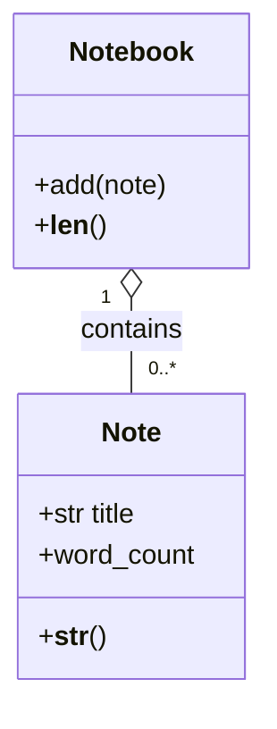

# 01. Classes in depth

> **Draft: written but not yet run.** The code and the expected output in this lesson were prepared by reading the code and the official documentation. They have not been executed yet. If something does not behave as described, trust your tool's real output and report it.

## What you will be able to do
- Model a small value with a dataclass and explicit validation.
- Explain a computed property and Python's `str` and `len` protocols.
- Choose composition over an inappropriate inheritance relationship and test independent state.

## Recap
1. In Python 101 lesson 11, what did `self` identify?
   <details><summary>Answer</summary>The particular instance receiving a method call.</details>
2. Why did the expense tracker's validation use exceptions instead of assertions?
   <details><summary>Answer</summary>Assertions may be removed with optimization; required input validation must remain active.</details>

## Why it matters
Your 101 class kept state on an instance. A larger model also needs clear equality, constraints and ownership of other objects. Generated methods remove repetition, but they do not choose those rules for you.

## What you will build
An immutable note value and two independent notebooks. A notebook **has notes**; it is not a specialized note. The same separation returns as API DTOs versus stored entities in lesson 08.

## Before you start
- **Prerequisites:** [Python 101 lesson 11, classes basics](../../101-zero-to-hero/phase-3-real-programs/11-classes-basics.md) and [Python 101 lesson 12, expense tracker](../../101-zero-to-hero/phase-3-real-programs/12-expense-tracker.md).
- Time: 60 min, including typing, reasoning and the exercise.
- Python **3.12** installed using the setup from Python 101 lesson 01; a code editor and terminal from that track. Windows commands select it with `py -3.12`; macOS/Linux commands use `python3.12`. If necessary, Windows install-manager users can run `py install 3.12` from any folder, then reopen the terminal. Other platforms: [official Python setup](https://docs.python.org/3.12/using/index.html). Do not point the dependency snapshots at an arbitrary newer interpreter and assume compatibility.
- Source pack (optional): every new file is shown in full in this lesson, so you can follow without it. The finished code, the exercise starter and the solution are in the course repository https://github.com/Uee03/Code101 under `source/python/201-hero-to-super-hero/phase-1-core-skills/01-classes-in-depth/` (on that page choose **Code, Download ZIP**, or run `git clone https://github.com/Uee03/Code101.git`).
- Extract ZIPs before using them: Windows **Extract All > Extract**; macOS double-click; Linux use your archive manager's **Extract**. A repository ZIP contains `Code101-main` followed by the source path above. Phase ZIPs contain this lesson's `code` and `exercise` folders. Work in a copy, not inside the ZIP.
- Third-party versions below are teaching snapshots, **not a claim of current security support**. Direct requirements are pinned, transitive dependencies are not locked; review supported releases and resolve a lock before deployment. All output below is unrun.

No external packages are needed. We use the standard-library `unittest` runner to put tests beside every feature; lesson 11 introduces pytest rather than postponing all testing until then.

## Steps
### Step 1. Create your workspace
Open **Terminal > New Terminal** in VS Code. The path before `>` or `$` is the current folder. From anywhere:

**PowerShell - folder: anywhere**
```powershell
New-Item -ItemType Directory -Path "$HOME/code101/python201/lesson01" -Force | Out-Null
Set-Location "$HOME/code101/python201/lesson01"
code .
```

**macOS/Linux - folder: anywhere**
```bash
mkdir -p ~/code101/python201/lesson01
cd ~/code101/python201/lesson01
code .
```
Expected result, not yet run: the folder exists and the editor opens it. If `code` is unavailable, choose **File > Open Folder** instead. In that window open a new terminal; it must show this lesson folder. If asked, trust your own folder.

For every file below use **Explorer > New File** (create named subfolders first), enter the exact filename, paste/type its complete content and save. **Ctrl+S**, or **Cmd+S** on macOS, removes the unsaved dot on the tab. Enable filename extensions in your file manager so `.py` does not become `.py.txt`. Paths below are relative to this lesson folder. If lost, `cd ~/code101/python201/lesson01` returns here on all three platforms.

### Step 2. Define values and a composed collection
A **dataclass** generates methods such as initialization and value equality from annotated fields. An annotation such as `title: str` describes the intended type, but does not validate it at runtime; lesson 02 examines that boundary. `frozen=True` blocks ordinary field reassignment. `slots=True` restricts instance attribute storage; it is not an authorization mechanism. A frozen object is not automatically deeply immutable: a mutable list inside one could still change.

A **property** computes an attribute on access. A **dunder method** (double underscores) implements a Python protocol: `__str__` supports `str`/printing, and `__len__` supports `len`. `__post_init__` runs after the generated initializer, so it can reject blank titles explicitly.

**File: `~/code101/python201/lesson01/models.py`**
```python
from dataclasses import dataclass, field


@dataclass(frozen=True, slots=True)
class Note:
    title: str

    def __post_init__(self) -> None:
        if not self.title.strip():
            raise ValueError("title must not be blank")

    @property
    def word_count(self) -> int:
        return len(self.title.split())

    def __str__(self) -> str:
        return f"{self.title} ({self.word_count} words)"


@dataclass
class Notebook:
    notes: list[Note] = field(default_factory=list)

    def add(self, note: Note) -> None:
        self.notes.append(note)

    def __len__(self) -> int:
        return len(self.notes)


if __name__ == "__main__":
    first = Notebook()
    second = Notebook()
    first.add(Note("Read the docs"))
    print(first.notes[0])
    print(f"notebooks: {len(first)}, {len(second)}")
    print(f"equal values: {Note('Read') == Note('Read')}")
```
`field(default_factory=list)` calls `list` separately for every notebook; it does not share one list across instances. A tuple or an immutable scalar can be a shared default, but a changing collection needs its own owner. Here the title is read-only and `word_count` cannot get out of sync with a separately stored count.

### Step 3. Test the model's contracts
A **unit test** checks one small behavior. `unittest.TestCase` collects methods named `test_...`. `assertEqual` compares results; `assertRaises` checks a deliberate failure. The `setattr` call tries an assignment without putting an intentionally ill-typed assignment in the model.

**File: `~/code101/python201/lesson01/test_models.py`**
```python
import unittest
from dataclasses import FrozenInstanceError

from models import Note, Notebook


class ModelTests(unittest.TestCase):
    def test_value_equality(self) -> None:
        self.assertEqual(Note("Read"), Note("Read"))

    def test_frozen_title(self) -> None:
        note = Note("Read")
        with self.assertRaises(FrozenInstanceError):
            setattr(note, "title", "Changed")

    def test_blank_title(self) -> None:
        with self.assertRaises(ValueError):
            Note("   ")

    def test_property_and_string(self) -> None:
        note = Note("Read the docs")
        self.assertEqual(note.word_count, 3)
        self.assertEqual(str(note), "Read the docs (3 words)")

    def test_composed_collections_are_independent(self) -> None:
        first, second = Notebook(), Notebook()
        first.add(Note("Read"))
        self.assertEqual(len(first), 1)
        self.assertEqual(len(second), 0)
```
The final test is the important regression guard: changing the first notebook must not change the second. These checks are executable specifications, not evidence that they have already passed.

### Step 4. Predict before you run
Will the second notebook have zero notes or one? Will two separate `Note("Read")` instances compare equal? Explain which generated or custom method decides each result before looking below.

## Run it
**PowerShell - folder: `~/code101/python201/lesson01`**
```powershell
py -3.12 models.py
```

**macOS/Linux - folder: `~/code101/python201/lesson01`**
```bash
python3.12 models.py
```
Expected output, not yet run (derived from the three print statements):
```text
Read the docs (3 words)
notebooks: 1, 0
equal values: True
```
**PowerShell - folder: `~/code101/python201/lesson01`**
```powershell
py -3.12 -m unittest -v
```

**macOS/Linux - folder: `~/code101/python201/lesson01`**
```bash
python3.12 -m unittest -v
```
Expected outcome, not yet run: five tests should pass and the report should end with `OK`. The runner's timings and qualified test names vary; no captured test transcript is claimed.

## How it works
The decorator builds the initializer and equality method. Creating a note then calls its post-initialization validation. Printing it invokes `__str__`, which reads the property; the property counts whitespace-separated words. A notebook holds note references and delegates its length to its list.

**Structure (Mermaid):**

> **Why this, not that?** Composition means keeping another object as an attribute. Inheritance means making a subtype that can substitute for its parent. `Notebook(Note)` would claim a notebook is one note; that is the wrong contract. Framework inheritance such as `TestCase` is appropriate when you really implement the parent framework's protocol. Do not introduce a class for a calculation that remains clearer as a function.

Common misconception: dataclasses validate annotations. They do not; our explicit blank-title check is still necessary, and callers here are expected to pass strings.

## Try it
1. **Guided:** complete the computed word count in a `ReadingList`. The empty list must remain independent. Do not store a second count that can go stale.
Without the pack, create `try01` inside this lesson folder and create the starter below there. With the pack, **instead** copy the `exercise/starter` folder itself into this lesson folder and rename the copy `try01`. Do not copy it *into* an existing `try01`: the file must be `lesson01/try01/exercise.py`, not `try01/starter/exercise.py`. Keep the original starter unchanged. Run from the lesson root with the command below. Its checks intentionally fail until the TODOs are finished.
**File: `~/code101/python201/lesson01/try01/exercise.py`**
```python
from dataclasses import dataclass, field


@dataclass
class ReadingList:
    titles: list[str] = field(default_factory=list)

    @property
    def total_words(self) -> int:
        # TODO: calculate a word count across this list's titles.
        return 0


first, second = ReadingList(), ReadingList()
first.titles.append("Read the docs")
assert first.total_words == 3
assert second.total_words == 0
print(first.total_words, second.total_words)
```
**PowerShell - folder: `~/code101/python201/lesson01`**
```powershell
py -3.12 try01/exercise.py
```

**macOS/Linux - folder: `~/code101/python201/lesson01`**
```bash
python3.12 try01/exercise.py
```
Expected completed output, not yet run:
```text
3 0
```
2. **Change:** append `"Write tests"` to the first list. Add an assertion for its new total; the other list must remain zero.
3. **Stretch (optional):** decide whether titles should be immutable note values or mutable strings in a list. State which operations your caller needs before choosing.

<details><summary>Solution to the guided rung</summary>

**File: `~/code101/python201/lesson01/try01/exercise.py`**
```python
from dataclasses import dataclass, field


@dataclass
class ReadingList:
    titles: list[str] = field(default_factory=list)

    @property
    def total_words(self) -> int:
        return sum(len(title.split()) for title in self.titles)


first, second = ReadingList(), ReadingList()
first.titles.append("Read the docs")
assert first.total_words == 3
assert second.total_words == 0
print(first.total_words, second.total_words)
```
The property sums the number of whitespace-separated words without duplicating state. The factory gives each instance its own list.
</details>

## Check yourself
1. Does `Note(7)` become a string because of `title: str`?
   <details><summary>Answer</summary>No. Annotations are not runtime conversion. This model expects a string and only checks for blank text.</details>
2. What supports `len(first)`, and why not store a separate `count` attribute?
   <details><summary>Answer</summary>`__len__` reads the list's current length. A duplicated count could drift after edits.</details>
3. What bug would the final test detect if both notebooks used the same list?
   <details><summary>Answer</summary>Adding to the first would also increase the second's length; the zero-length assertion would fail.</details>

## Common mistakes
| Symptom or typical message (not captured) | Cause | Fix |
|---|---|---|
| Python cannot find `models.py` | Wrong current folder or a hidden `.txt` extension | Return to `~/code101/python201/lesson01`, check the filename and save. |
| Property value treated as a callable | Writing `note.word_count()` | Read `note.word_count`; it is an attribute interface. |
| `FrozenInstanceError` | Ordinary reassignment of a frozen field | Construct a new note value, or deliberately choose a mutable model. |
| `ValueError: title must not be blank` | Our explicit validation rejected whitespace | Supply a meaningful title; do not remove validation to satisfy a test. |

## Best practice
Use a default factory for a mutable dataclass field and choose frozen behavior deliberately; neither feature makes a whole object graph immutable. Source: Python, [Dataclasses and mutable defaults](https://docs.python.org/3.12/library/dataclasses.html#mutable-default-values).

## Going further
- [Python data model](https://docs.python.org/3.12/reference/datamodel.html): implement a protocol only when its behavior is unsurprising.
- Lesson 08 replaces internal models at an HTTP boundary rather than exposing every attribute.

## Summary
- You modeled a validated note with generated initialization and equality.
- You explained computed properties and the `str`/`len` protocols.
- You composed notebooks from notes and specified independent-state tests.

## Next lesson
[02. Type hints and mypy](02-type-hints-and-mypy.md): make caller expectations checkable without confusing them with runtime validation.
