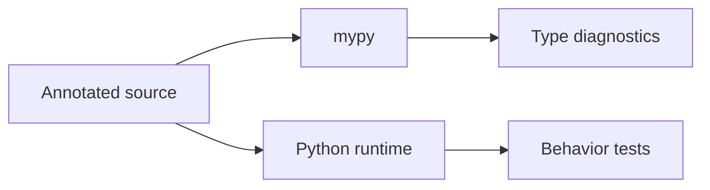

# 02. Type hints and mypy

> **Draft: written but not yet run.** The code and the expected output in this lesson were prepared by reading the code and the official documentation. They have not been executed yet. If something does not behave as described, trust your tool's real output and report it.

## What you will be able to do
- Annotate collection inputs and a result that may be absent.
- Narrow a union safely and explain a structural protocol.
- Configure a strict type check and distinguish it from runtime tests and input validation.

## Recap
1. Did lesson 01's dataclass enforce `title: str`?
   <details><summary>Answer</summary>No. Its annotation describes the type; explicit code checked only blank titles.</details>
2. What advantage did a computed property have over a stored count?
   <details><summary>Answer</summary>It derived the count from the current source of truth.</details>

## Why it matters
Type hints reduce the number of program states you must keep in your head. A checker can catch an unhandled absent result before a request reaches it. It cannot prove a title is acceptable to your business or that a network request will succeed.

## What you will build
A typed note lookup and an uppercase-title formatter that accepts any object with a readable title, not only one concrete class.

## Before you start
- **Prerequisites:** [Python 201 lesson 01, classes in depth](01-classes-in-depth.md).
- Time: 60 min, including typing, reasoning and the exercise.
- Python **3.12** installed using the setup from Python 101 lesson 01; a code editor and terminal from that track. Windows commands select it with `py -3.12`; macOS/Linux commands use `python3.12`. If necessary, Windows install-manager users can run `py install 3.12` from any folder, then reopen the terminal. Other platforms: [official Python setup](https://docs.python.org/3.12/using/index.html). Do not point the dependency snapshots at an arbitrary newer interpreter and assume compatibility.
- Source pack (optional): every new file is shown in full in this lesson, so you can follow without it. The finished code, the exercise starter and the solution are in the course repository https://github.com/Uee03/Code101 under `source/python/201-hero-to-super-hero/phase-1-core-skills/02-type-hints-and-mypy/` (on that page choose **Code, Download ZIP**, or run `git clone https://github.com/Uee03/Code101.git`).
- Extract ZIPs before using them: Windows **Extract All > Extract**; macOS double-click; Linux use your archive manager's **Extract**. A repository ZIP contains `Code101-main` followed by the source path above. Phase ZIPs contain this lesson's `code` and `exercise` folders. Work in a copy, not inside the ZIP.
- Third-party versions below are teaching snapshots, **not a claim of current security support**. Direct requirements are pinned, transitive dependencies are not locked; review supported releases and resolve a lock before deployment. All output below is unrun.

Finish lesson 01. `mypy` is a static type checker: it reads annotations without running the target program.

## Steps
### Step 1. Create the workspace
Open **Terminal > New Terminal** in VS Code. The path before `>` or `$` is the current folder. From anywhere:

**PowerShell - folder: anywhere**
```powershell
New-Item -ItemType Directory -Path "$HOME/code101/python201/lesson02" -Force | Out-Null
Set-Location "$HOME/code101/python201/lesson02"
code .
```

**macOS/Linux - folder: anywhere**
```bash
mkdir -p ~/code101/python201/lesson02
cd ~/code101/python201/lesson02
code .
```
Expected result, not yet run: the folder exists and the editor opens it. If `code` is unavailable, choose **File > Open Folder** instead. In that window open a new terminal; it must show this lesson folder. If asked, trust your own folder.

For every file below use **Explorer > New File** (create named subfolders first), enter the exact filename, paste/type its complete content and save. **Ctrl+S**, or **Cmd+S** on macOS, removes the unsaved dot on the tab. Enable filename extensions in your file manager so `.py` does not become `.py.txt`. Paths below are relative to this lesson folder. If lost, `cd ~/code101/python201/lesson02` returns here on all three platforms.

### Step 2. Install the checker into this project only
**File: `~/code101/python201/lesson02/requirements.txt`**
```text
mypy==1.15.0
```
Use the requirements file above in an isolated environment. No activation is needed, so PowerShell's Restricted script policy cannot block these commands.

**PowerShell - folder: `~/code101/python201/lesson02`**
```powershell
py -3.12 -m venv .venv
& ./.venv/Scripts/python.exe -m pip install -r requirements.txt
```

**macOS/Linux - folder: `~/code101/python201/lesson02`**
```bash
python3.12 -m venv .venv
.venv/bin/python -m pip install -r requirements.txt
```
Expected result, not yet run: `.venv` is created and the requirements install successfully. Package download lines and resolved transitive versions vary; no installer transcript is claimed. If installation fails, stop and read the first error rather than proceeding with a partially prepared environment. The Python 101 virtual-environment lesson covers a missing `venv` component. Always use this lesson's interpreter, not a global `pip`.

### Step 3. State the smallest useful interface
An **iterable** can supply an iterator for visiting values. `Iterable[HasTitle]` permits lists, tuples and (in lesson 03) generators. A **union** `Note | None` permits either a note or absence. **Narrowing** uses a condition to eliminate one possibility.

A **protocol** describes required behavior without forcing inheritance. The read-only property in this protocol means consumers only need to read a string title. `...` is the ellipsis literal; in this protocol method it stands for a signature, not missing application logic.

**File: `~/code101/python201/lesson02/main.py`**
```python
from collections.abc import Iterable
from dataclasses import dataclass
from typing import Protocol


class HasTitle(Protocol):
    @property
    def title(self) -> str: ...


@dataclass
class Note:
    id: int
    title: str


def titles(items: Iterable[HasTitle]) -> list[str]:
    return [item.title.upper() for item in items]


def find_note(notes: Iterable[Note], note_id: int) -> Note | None:
    for note in notes:
        if note.id == note_id:
            return note
    return None


def describe(note: Note | None) -> str:
    if note is None:
        return "missing"
    return note.title


if __name__ == "__main__":
    notes = [Note(1, "Read docs")]
    print(titles(notes))
    print(describe(find_note(notes, 2)))
```
`Article` in the tests can satisfy `HasTitle` without subclassing it. We do not use `isinstance(..., HasTitle)`; runtime protocol checks are a different optional feature and would not validate field contents anyway.

### Step 4. Configure the scope of checking
**File: `~/code101/python201/lesson02/pyproject.toml`**
```toml
[tool.mypy]
python_version = "3.12"
strict = true
files = ["main.py", "test_main.py"]
```
Line 1 names mypy's TOML section. `python_version` selects the language assumptions, not an installed interpreter. `strict` enables stricter checks. `files` fixes which two source files the bare mypy command checks, so unrelated exercise drafts are not accidentally included. A TOML file is a configuration format of named sections and key/value settings; lesson 06 uses it for packaging too.

### Step 5. Keep behavior tests alongside the hints
**File: `~/code101/python201/lesson02/test_main.py`**
```python
import unittest
from dataclasses import dataclass

from main import Note, describe, find_note, titles


@dataclass
class Article:
    title: str


class TypeTests(unittest.TestCase):
    def test_structural_protocol(self) -> None:
        self.assertEqual(titles([Article("Article")]), ["ARTICLE"])

    def test_found(self) -> None:
        self.assertEqual(describe(find_note([Note(1, "Read")], 1)), "Read")

    def test_missing_is_explicit(self) -> None:
        self.assertEqual(describe(find_note([], 1)), "missing")
```
The protocol test exercises a different concrete class. The missing-result test checks behavior that annotations alone cannot establish.

### Step 6. Predict before you run
What happens when ID 2 is absent? Why is calling `upper` inside `titles` safe for a correctly typed caller, while doing `find_note(...).title` without a check is unsafe?

## Run it
**PowerShell - folder: `~/code101/python201/lesson02`**
```powershell
& ./.venv/Scripts/python.exe main.py
```

**macOS/Linux - folder: `~/code101/python201/lesson02`**
```bash
.venv/bin/python main.py
```
Expected output, not yet run:
```text
['READ DOCS']
missing
```
**PowerShell - folder: `~/code101/python201/lesson02`**
```powershell
& ./.venv/Scripts/python.exe -m mypy
```

**macOS/Linux - folder: `~/code101/python201/lesson02`**
```bash
.venv/bin/python -m mypy
```
Expected output, not yet run, based on the configured two-file scope:
```text
Success: no issues found in 2 source files
```
**PowerShell - folder: `~/code101/python201/lesson02`**
```powershell
& ./.venv/Scripts/python.exe -m unittest -v
```

**macOS/Linux - folder: `~/code101/python201/lesson02`**
```bash
.venv/bin/python -m unittest -v
```
Expected outcome, not yet run: three behavior tests should pass, ending with `OK`; timing is variable.

To see narrowing matter, temporarily remove the `None` branch from `describe`, save and rerun mypy from this same folder. It should report accessing `title` on a possible `None` (typical diagnostic, not captured). Restore the branch before continuing. Do not copy a suppression or replace the return type with `Any` merely to make the diagnostic disappear.

## How it works
The checker compares each use to a contract. `titles` promises strings because the protocol promises a readable string title. `find_note` returns `None` on exhaustion, so `describe` must handle absence. The interpreter still runs ordinary Python; it does not insert checks at each function call.

**Structure (Mermaid):**

> **Why this, not that?** A protocol accepts what a caller can actually use. A concrete `list[Note]` parameter would exclude valid article inputs unnecessarily. Use the concrete type when you depend on its exact operations. Do not add a protocol for every one-off function, and do not use `Any` as a substitute for boundary validation.

Common misconception: passing mypy makes untrusted JSON valid. Lesson 08 uses Pydantic for that runtime boundary; these are complementary checks.

## Try it
1. **Guided:** implement a first-title lookup and safely turn its result into an uppercase label. Empty input must produce `empty`.
Without the pack, create `try02` inside this lesson folder and create the starter below there. With the pack, **instead** copy the `exercise/starter` folder itself into this lesson folder and rename the copy `try02`. Do not copy it *into* an existing `try02`: the file must be `lesson02/try02/exercise.py`, not `try02/starter/exercise.py`. Keep the original starter unchanged. Run from the lesson root with the command below. Its checks intentionally fail until the TODOs are finished.
**File: `~/code101/python201/lesson02/try02/exercise.py`**
```python
def first_title(titles: list[str]) -> str | None:
    # TODO: return the first title, or None when the list is empty.
    return None


def label(titles: list[str]) -> str:
    title = first_title(titles)
    # TODO: narrow the possible None before calling upper().
    return "empty"


assert label([]) == "empty"
assert label(["Read"]) == "READ"
print(label([]), label(["Read"]))
```
**PowerShell - folder: `~/code101/python201/lesson02`**
```powershell
& ./.venv/Scripts/python.exe try02/exercise.py
```

**macOS/Linux - folder: `~/code101/python201/lesson02`**
```bash
.venv/bin/python try02/exercise.py
```
Expected completed output, not yet run:
```text
empty READ
```
Check that file too:
**PowerShell - folder: `~/code101/python201/lesson02`**
```powershell
& ./.venv/Scripts/python.exe -m mypy --strict try02/exercise.py
```

**macOS/Linux - folder: `~/code101/python201/lesson02`**
```bash
.venv/bin/python -m mypy --strict try02/exercise.py
```
Expected outcome, not yet run: no type errors for the completed file. The file-count text may depend on command options.
2. **Change:** accept a tuple as input by selecting an appropriate read-only input abstraction; add a tuple assertion.
3. **Stretch (optional):** decide whether an absent first title is better represented by `None` or an exception for your caller. Document the contract.

<details><summary>Solution to the guided rung</summary>

**File: `~/code101/python201/lesson02/try02/exercise.py`**
```python
def first_title(titles: list[str]) -> str | None:
    if not titles:
        return None
    return titles[0]


def label(titles: list[str]) -> str:
    title = first_title(titles)
    if title is None:
        return "empty"
    return title.upper()


assert label([]) == "empty"
assert label(["Read"]) == "READ"
print(label([]), label(["Read"]))
```
The explicit `is None` branch narrows the value to `str`. It also distinguishes a present empty string from an absent item.
</details>

## Check yourself
1. What does `Note | None` require the caller to consider?
   <details><summary>Answer</summary>The lookup may have no result, not just a note with a particular title.</details>
2. Why need `Article` not inherit from `HasTitle`?
   <details><summary>Answer</summary>Protocols use structural compatibility: it already supplies a readable string title.</details>
3. Would a successful type check prove the missing lookup prints `missing`?
   <details><summary>Answer</summary>No. That string is a behavioral contract checked by a test, not a consequence of the return annotation alone.</details>

## Common mistakes
| Symptom or typical message (not captured) | Cause | Fix |
|---|---|---|
| Checker module unavailable | Installed into a different Python | Use the explicit `.venv` interpreter shown above. |
| Possible-`None` attribute diagnostic | Accessing the result without narrowing | Handle absence explicitly before reading attributes. |
| Checker reports little in an untyped function | Its body has no useful annotated contract | Annotate inputs/returns; keep `strict` enabled. |
| Old diagnostics persist | File unsaved, wrong root or wrong configuration | Save and run from the folder containing `pyproject.toml`. |

## Best practice
Use annotations as a development-time contract, not as runtime input enforcement. Source: Python, [typing module](https://docs.python.org/3.12/library/typing.html).

## Going further
- [mypy getting started](https://mypy.readthedocs.io/en/stable/getting_started.html) and [protocols](https://mypy.readthedocs.io/en/stable/protocols.html).
- Lesson 08 connects annotations to HTTP parsing and separately tested DTO validation.

## Summary
- You annotated iterable inputs and a possibly absent result.
- You narrowed a union and explained a structural interface.
- You configured strict checking while retaining runtime behavior tests.

## Next lesson
[03. Iterators and generators](03-iterators-and-generators.md): consume those iterable contracts lazily.
