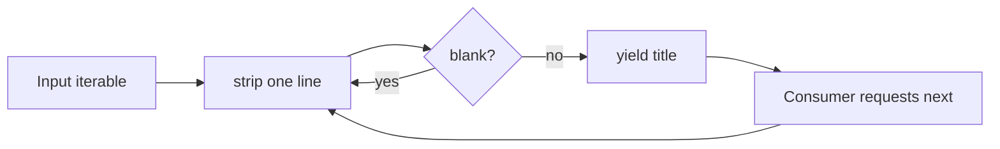

# 03. Iterators and generators

> **Draft: written but not yet run.** The code and the expected output in this lesson were prepared by reading the code and the official documentation. They have not been executed yet. If something does not behave as described, trust your tool's real output and report it.

## What you will be able to do
- Implement the iterator protocol and predict exhaustion.
- Write a generator that filters input lazily.
- Test single-pass behavior and choose when to materialize a list.

## Recap
1. Why did lesson 02 accept `Iterable` instead of `list`?
   <details><summary>Answer</summary>It only needed to visit items, not index or mutate a concrete list.</details>
2. Which lesson 01 methods let an object participate in built-in operations?
   <details><summary>Answer</summary>Dunder methods such as `__len__` and `__str__` implement protocols.</details>

## Why it matters
Reading a large file into a list can allocate memory for data you immediately discard. A pipeline can transform one item at a time instead. The cost is a different consumption contract: an iterator usually cannot be rewound.

## What you will build
A countdown iterator and a generator that strips blank titles. They expose the same iteration protocol by different implementations; lesson 09's result streams use related consumption ideas.

## Before you start
- **Prerequisites:** [Python 201 lesson 02, type hints and mypy](02-type-hints-and-mypy.md).
- Time: 50 min, including typing, reasoning and the exercise.
- Python **3.12** installed using the setup from Python 101 lesson 01; a code editor and terminal from that track. Windows commands select it with `py -3.12`; macOS/Linux commands use `python3.12`. If necessary, Windows install-manager users can run `py install 3.12` from any folder, then reopen the terminal. Other platforms: [official Python setup](https://docs.python.org/3.12/using/index.html). Do not point the dependency snapshots at an arbitrary newer interpreter and assume compatibility.
- Source pack (optional): every new file is shown in full in this lesson, so you can follow without it. The finished code, the exercise starter and the solution are in the course repository https://github.com/Uee03/Code101 under `source/python/201-hero-to-super-hero/phase-1-core-skills/03-iterators-and-generators/` (on that page choose **Code, Download ZIP**, or run `git clone https://github.com/Uee03/Code101.git`).
- Extract ZIPs before using them: Windows **Extract All > Extract**; macOS double-click; Linux use your archive manager's **Extract**. A repository ZIP contains `Code101-main` followed by the source path above. Phase ZIPs contain this lesson's `code` and `exercise` folders. Work in a copy, not inside the ZIP.
- Third-party versions below are teaching snapshots, **not a claim of current security support**. Direct requirements are pinned, transitive dependencies are not locked; review supported releases and resolve a lock before deployment. All output below is unrun.

Finish lesson 02. No external dependencies are needed.

## Steps
### Step 1. Create the workspace
Open **Terminal > New Terminal** in VS Code. The path before `>` or `$` is the current folder. From anywhere:

**PowerShell - folder: anywhere**
```powershell
New-Item -ItemType Directory -Path "$HOME/code101/python201/lesson03" -Force | Out-Null
Set-Location "$HOME/code101/python201/lesson03"
code .
```

**macOS/Linux - folder: anywhere**
```bash
mkdir -p ~/code101/python201/lesson03
cd ~/code101/python201/lesson03
code .
```
Expected result, not yet run: the folder exists and the editor opens it. If `code` is unavailable, choose **File > Open Folder** instead. In that window open a new terminal; it must show this lesson folder. If asked, trust your own folder.

For every file below use **Explorer > New File** (create named subfolders first), enter the exact filename, paste/type its complete content and save. **Ctrl+S**, or **Cmd+S** on macOS, removes the unsaved dot on the tab. Enable filename extensions in your file manager so `.py` does not become `.py.txt`. Paths below are relative to this lesson folder. If lost, `cd ~/code101/python201/lesson03` returns here on all three platforms.

### Step 2. Make progress and exhaustion explicit
An **iterator** keeps the position in a stream: `iter(iterator)` returns itself, and `next` advances it until `StopIteration`. `Self` annotates the current class type. A **generator** is an iterator produced by a function containing `yield`. Yielding suspends the function and preserves its local state until the next request.

**File: `~/code101/python201/lesson03/main.py`**
```python
from collections.abc import Iterable, Iterator
from typing import Self


class Countdown:
    def __init__(self, start: int) -> None:
        self.remaining = start

    def __iter__(self) -> Self:
        return self

    def __next__(self) -> int:
        if self.remaining <= 0:
            raise StopIteration
        value = self.remaining
        self.remaining -= 1
        return value


def clean_titles(lines: Iterable[str]) -> Iterator[str]:
    for line in lines:
        title = line.strip()
        if title:
            yield title


if __name__ == "__main__":
    counter = Countdown(3)
    print(next(counter))
    print(list(counter))
    print(list(counter))
    print(list(clean_titles([" One ", " ", "Two"])))
```
`clean_titles` is lazy: calling it makes a generator; its loop has not run yet. Only consumption starts the work. The countdown implementation is intentionally explicit so you can see what a generator normally handles for you. A negative start produces an empty countdown here; it does not count forever.

### Step 3. Test consumption rather than only final values
**File: `~/code101/python201/lesson03/test_main.py`**
```python
import unittest

from main import Countdown, clean_titles


class IteratorTests(unittest.TestCase):
    def test_protocol_and_exhaustion(self) -> None:
        counter = Countdown(1)
        self.assertIs(iter(counter), counter)
        self.assertEqual(next(counter), 1)
        with self.assertRaises(StopIteration):
            next(counter)
        self.assertEqual(list(counter), [])

    def test_empty_countdown(self) -> None:
        self.assertEqual(list(Countdown(0)), [])

    def test_filter(self) -> None:
        self.assertEqual(list(clean_titles([" A ", "", "B"])), ["A", "B"])

    def test_lazy_and_single_pass(self) -> None:
        lines = ["A"]
        stream = clean_titles(lines)
        lines.append("B")
        self.assertEqual(list(stream), ["A", "B"])
        self.assertEqual(list(stream), [])
```
`assertIs` checks identity. The lazy test appends an item *after* creating the generator and *before* consuming it. The generator observes it because it has not started visiting the input. This is a demonstration of deferred work, not advice to mutate shared collections during iteration.

### Step 4. Predict before you run
After `next(counter)`, which values remain? What will the second `list(counter)` contain? Explain why the source list can be visited again but this countdown cannot.

## Run it
**PowerShell - folder: `~/code101/python201/lesson03`**
```powershell
py -3.12 main.py
```

**macOS/Linux - folder: `~/code101/python201/lesson03`**
```bash
python3.12 main.py
```
Expected output, not yet run:
```text
3
[2, 1]
[]
['One', 'Two']
```
**PowerShell - folder: `~/code101/python201/lesson03`**
```powershell
py -3.12 -m unittest -v
```

**macOS/Linux - folder: `~/code101/python201/lesson03`**
```bash
python3.12 -m unittest -v
```
Expected outcome, not yet run: four tests should pass, ending with `OK`; timing varies.

## How it works
Each `next` stores a smaller remaining count. The first list conversion drains the remaining two values. The second asks an already exhausted iterator for data and gets none. In the generator, each nonblank title is produced only when the consumer asks for it. `Iterator[str]` promises values and progress, not random access.

**Structure (Mermaid):**

> **Why this, not that?** A generator avoids a full intermediate collection. A list is better when you need indexing, repeated passes or a stable snapshot. Calling `list(generator)` deliberately spends that memory and exhausts the iterator; generators are not automatically faster for small inputs.

Common misconception: an iterable and an iterator are interchangeable reusable collections. A list can create fresh iterators; a generator is normally one consumption session. Also, never deliberately raise `StopIteration` inside a generator: return to end it. The explicit `__next__` method uses `StopIteration` because it is implementing the protocol directly.

## Try it
1. **Guided:** filter stripped titles by a minimum length and preserve single-pass behavior.
Without the pack, create `try03` inside this lesson folder and create the starter below there. With the pack, **instead** copy the `exercise/starter` folder itself into this lesson folder and rename the copy `try03`. Do not copy it *into* an existing `try03`: the file must be `lesson03/try03/exercise.py`, not `try03/starter/exercise.py`. Keep the original starter unchanged. Run from the lesson root with the command below. Its checks intentionally fail until the TODOs are finished.
**File: `~/code101/python201/lesson03/try03/exercise.py`**
```python
from collections.abc import Iterable, Iterator


def long_titles(lines: Iterable[str], minimum: int) -> Iterator[str]:
    for line in lines:
        # TODO: strip the line and yield it only when its length is >= minimum.
        if False:
            yield line


stream = long_titles([" A ", " Read ", "Docs"], 4)
assert list(stream) == ["Read", "Docs"]
assert list(stream) == []
print("Read, Docs; exhausted")
```
**PowerShell - folder: `~/code101/python201/lesson03`**
```powershell
py -3.12 try03/exercise.py
```

**macOS/Linux - folder: `~/code101/python201/lesson03`**
```bash
python3.12 try03/exercise.py
```
Expected completed output, not yet run:
```text
Read, Docs; exhausted
```
2. **Change:** include a title exactly at the minimum and one a character shorter. Add assertions for the boundary and empty input.
3. **Stretch (optional):** accept an open text file as the iterable. Decide who owns and closes it; lesson 04 makes cleanup explicit.

<details><summary>Solution to the guided rung</summary>

**File: `~/code101/python201/lesson03/try03/exercise.py`**
```python
from collections.abc import Iterable, Iterator


def long_titles(lines: Iterable[str], minimum: int) -> Iterator[str]:
    for line in lines:
        title = line.strip()
        if len(title) >= minimum:
            yield title


stream = long_titles([" A ", " Read ", "Docs"], 4)
assert list(stream) == ["Read", "Docs"]
assert list(stream) == []
print("Read, Docs; exhausted")
```
Only an accepted title is yielded. The second consumption must be empty because it is the same generator instance.
</details>

## Check yourself
1. Why does `list(counter)` produce `[]` on the second call?
   <details><summary>Answer</summary>The first conversion consumed the iterator's remaining values; it did not clone or reset it.</details>
2. Does calling `clean_titles(lines)` immediately strip all lines?
   <details><summary>Answer</summary>No. Execution starts as values are requested from the generator.</details>
3. When should you intentionally create a list from a generator?
   <details><summary>Answer</summary>When you need a snapshot, indexing or repeated passes and can afford its memory cost.</details>

## Common mistakes
| Symptom or typical message (not captured) | Cause | Fix |
|---|---|---|
| Unexpected empty second result | Reused an exhausted iterator | Build a new generator or deliberately store a list. |
| `StopIteration` at a direct `next` call | Requested beyond the end | Use a `for` loop or a deliberate default argument to `next`. |
| Generator body never seems to run | Created but never consumed it | Iterate or request its next value. |
| Memory usage did not improve | Converted every stage back into lists | Keep intermediate stages lazy; materialize at the actual boundary. |

## Best practice
Document single-pass consumption and materialize only when the caller needs it. Source: Python, [Functional Programming HOWTO: iterators](https://docs.python.org/3.12/howto/functional.html#iterators).

## Going further
- [Generator expressions](https://docs.python.org/3.12/howto/functional.html#generator-expressions-and-list-comprehensions).
- Lesson 04 uses a generator with exactly one yield to describe a resource lifetime.

## Summary
- You implemented an iterator with explicit exhaustion.
- You wrote a lazy filtering generator.
- You specified consumption tests and compared streams with reusable lists.

## Next lesson
[04. Decorators and context managers](04-decorators-and-context-managers.md): wrap calls and manage cleanup without hiding errors.
