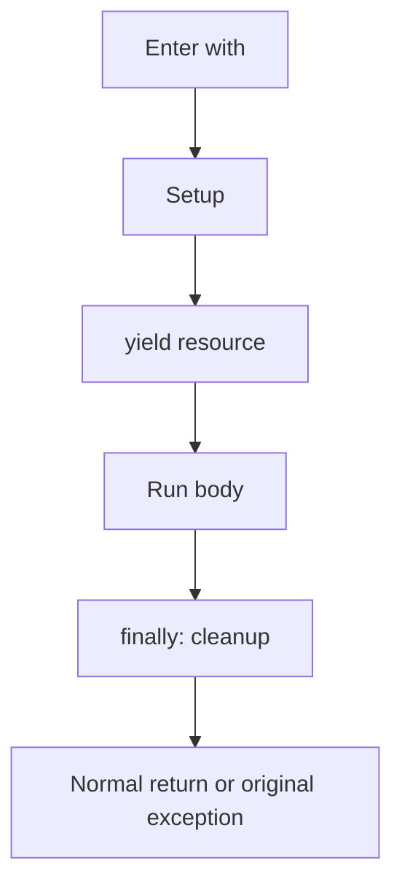

# 04. Decorators and context managers

> **Draft: written but not yet run.** The code and the expected output in this lesson were prepared by reading the code and the official documentation. They have not been executed yet. If something does not behave as described, trust your tool's real output and report it.

## What you will be able to do
- Write a decorator that preserves function metadata and return values.
- Build a generator-based context manager with reliable cleanup.
- Test success and failure paths without suppressing the original error.

## Recap
1. When does a generator resume after a yield?
   <details><summary>Answer</summary>When its consumer requests the next step; a context manager uses a controlled version of that mechanism.</details>
2. Why is lesson 01's notebook composed of notes rather than inherited from one?
   <details><summary>Answer</summary>A notebook contains notes; it cannot substitute for a single note.</details>

## Why it matters
Cross-cutting behavior such as tracing can obscure a function's real work when repeated inside every body. Cleanup is more serious: if it depends on reaching a final normal line, an exception can skip it. Decorators and context managers solve different parts of these problems.

## What you will build
A greeting decorator and an event-recording context manager. A deliberate failure proves why cleanup belongs in `finally`. Lesson 08 uses framework decorators for routes; lessons 09 and 11 use managed sessions.

## Before you start
- **Prerequisites:** [Python 201 lesson 03, iterators and generators](03-iterators-and-generators.md).
- Time: 60 min, including typing, reasoning and the exercise.
- Python **3.12** installed using the setup from Python 101 lesson 01; a code editor and terminal from that track. Windows commands select it with `py -3.12`; macOS/Linux commands use `python3.12`. If necessary, Windows install-manager users can run `py install 3.12` from any folder, then reopen the terminal. Other platforms: [official Python setup](https://docs.python.org/3.12/using/index.html). Do not point the dependency snapshots at an arbitrary newer interpreter and assume compatibility.
- Source pack (optional): every new file is shown in full in this lesson, so you can follow without it. The finished code, the exercise starter and the solution are in the course repository https://github.com/Uee03/Code101 under `source/python/201-hero-to-super-hero/phase-1-core-skills/04-decorators-and-context-managers/` (on that page choose **Code, Download ZIP**, or run `git clone https://github.com/Uee03/Code101.git`).
- Extract ZIPs before using them: Windows **Extract All > Extract**; macOS double-click; Linux use your archive manager's **Extract**. A repository ZIP contains `Code101-main` followed by the source path above. Phase ZIPs contain this lesson's `code` and `exercise` folders. Work in a copy, not inside the ZIP.
- Third-party versions below are teaching snapshots, **not a claim of current security support**. Direct requirements are pinned, transitive dependencies are not locked; review supported releases and resolve a lock before deployment. All output below is unrun.

Finish lesson 03. No external dependencies are needed.

## Steps
### Step 1. Create the workspace
Open **Terminal > New Terminal** in VS Code. The path before `>` or `$` is the current folder. From anywhere:

**PowerShell - folder: anywhere**
```powershell
New-Item -ItemType Directory -Path "$HOME/code101/python201/lesson04" -Force | Out-Null
Set-Location "$HOME/code101/python201/lesson04"
code .
```

**macOS/Linux - folder: anywhere**
```bash
mkdir -p ~/code101/python201/lesson04
cd ~/code101/python201/lesson04
code .
```
Expected result, not yet run: the folder exists and the editor opens it. If `code` is unavailable, choose **File > Open Folder** instead. In that window open a new terminal; it must show this lesson folder. If asked, trust your own folder.

For every file below use **Explorer > New File** (create named subfolders first), enter the exact filename, paste/type its complete content and save. **Ctrl+S**, or **Cmd+S** on macOS, removes the unsaved dot on the tab. Enable filename extensions in your file manager so `.py` does not become `.py.txt`. Paths below are relative to this lesson folder. If lost, `cd ~/code101/python201/lesson04` returns here on all three platforms.

### Step 2. Wrap a call and describe a lifetime
A **decorator** receives a function and returns the function-like value bound to its name. `@uppercase` is equivalent to replacing `greet` with `uppercase(greet)`. A **wrapper** delegates to the original function, optionally changing behavior. `Callable[[str], str]` describes this intentionally narrow signature.

A context manager separates acquisition, use and cleanup. The 101 file example already used one; `@contextmanager` lets us implement one with a generator that yields **exactly once**. `finally` runs when its protected block exits, including exception exits.

**File: `~/code101/python201/lesson04/main.py`**
```python
from collections.abc import Callable, Iterator
from contextlib import contextmanager
from functools import wraps


def uppercase(function: Callable[[str], str]) -> Callable[[str], str]:
    @wraps(function)
    def wrapper(name: str) -> str:
        return function(name).upper()

    return wrapper


@uppercase
def greet(name: str) -> str:
    """Return a greeting."""
    return f"Hello, {name}"


@contextmanager
def managed_events(events: list[str]) -> Iterator[list[str]]:
    events.append("open")
    try:
        yield events
    finally:
        events.append("closed")


if __name__ == "__main__":
    print(greet("Ada"))
    events: list[str] = []
    try:
        with managed_events(events) as active:
            active.append("body")
            raise ValueError("demo failure")
    except ValueError:
        pass
    print(events)
```
`wraps` preserves names/docstrings for introspection. It does not magically make our one-argument wrapper support arbitrary signatures. `managed_events` lets the body use the list, then records cleanup. The outer handler catches a known demo exception only after cleanup; the context manager itself does not swallow it.

### Step 3. Specify normal and exceptional behavior
**File: `~/code101/python201/lesson04/test_main.py`**
```python
import unittest

from main import greet, managed_events


class WrapperTests(unittest.TestCase):
    def test_result_and_metadata(self) -> None:
        self.assertEqual(greet("Ada"), "HELLO, ADA")
        self.assertEqual(greet.__name__, "greet")
        self.assertEqual(greet.__doc__, "Return a greeting.")

    def test_normal_cleanup(self) -> None:
        events: list[str] = []
        with managed_events(events):
            events.append("body")
        self.assertEqual(events, ["open", "body", "closed"])

    def test_failure_is_not_swallowed(self) -> None:
        events: list[str] = []
        with self.assertRaises(ValueError):
            with managed_events(events):
                raise ValueError("demo failure")
        self.assertEqual(events, ["open", "closed"])
```
The metadata checks catch an easy-to-miss wrapper bug. The failure test proves two separate properties: cleanup happened, and the original exception still reached the caller.

### Step 4. Predict before you run
Will `closed` appear when the with-block raises? Will `body` appear in the failure test that raises immediately on entry? Trace exactly when control crosses the yield.

## Run it
**PowerShell - folder: `~/code101/python201/lesson04`**
```powershell
py -3.12 main.py
```

**macOS/Linux - folder: `~/code101/python201/lesson04`**
```bash
python3.12 main.py
```
Expected output, not yet run:
```text
HELLO, ADA
['open', 'body', 'closed']
```
**PowerShell - folder: `~/code101/python201/lesson04`**
```powershell
py -3.12 -m unittest -v
```

**macOS/Linux - folder: `~/code101/python201/lesson04`**
```bash
python3.12 -m unittest -v
```
Expected outcome, not yet run: three tests should pass, ending with `OK`; timing varies.

## How it works
The decorator runs when the function is defined. The wrapper runs each time the function is called. In the with-statement, code before `yield` is setup; the yielded value becomes `active`. Leaving the body resumes the generator, with any body exception delivered at the yield. The `finally` block records cleanup, and the exception propagates normally.

**Structure (Mermaid):**

> **Why this, not that?** Use a decorator for a repeatable policy around calls; use a context manager for a visible resource lifetime around a block. Prefer a plain helper when a wrapper would hide important control flow. Do not add broad exception handlers to turn cleanup into silent failure.

Common misconception: everything after `yield` is guaranteed cleanup. It is not unless the cleanup is in `finally` (or you otherwise handle the thrown exception correctly). This is why the exercise includes a failure path.

## Try it
1. **Guided:** guarantee the finishing marker even when the body raises, without hiding that exception inside the manager.
Without the pack, create `try04` inside this lesson folder and create the starter below there. With the pack, **instead** copy the `exercise/starter` folder itself into this lesson folder and rename the copy `try04`. Do not copy it *into* an existing `try04`: the file must be `lesson04/try04/exercise.py`, not `try04/starter/exercise.py`. Keep the original starter unchanged. Run from the lesson root with the command below. Its checks intentionally fail until the TODOs are finished.
**File: `~/code101/python201/lesson04/try04/exercise.py`**
```python
from collections.abc import Iterator
from contextlib import contextmanager


@contextmanager
def marked(events: list[str]) -> Iterator[None]:
    events.append("start")
    # TODO: arrange for "finish" to be appended even when the body raises.
    yield


events: list[str] = []
try:
    with marked(events):
        raise ValueError("exercise failure")
except ValueError:
    pass
assert events == ["start", "finish"]
print(events)
```
**PowerShell - folder: `~/code101/python201/lesson04`**
```powershell
py -3.12 try04/exercise.py
```

**macOS/Linux - folder: `~/code101/python201/lesson04`**
```bash
python3.12 try04/exercise.py
```
Expected completed output, not yet run:
```text
['start', 'finish']
```
2. **Change:** add a normal-path assertion and confirm its marker list matches the failure path's cleanup order.
3. **Stretch (optional):** write a typed decorator for a different fixed signature. Decide whether an explicit helper would be more readable.

<details><summary>Solution to the guided rung</summary>

**File: `~/code101/python201/lesson04/try04/exercise.py`**
```python
from collections.abc import Iterator
from contextlib import contextmanager


@contextmanager
def marked(events: list[str]) -> Iterator[None]:
    events.append("start")
    try:
        yield
    finally:
        events.append("finish")


events: list[str] = []
try:
    with marked(events):
        raise ValueError("exercise failure")
except ValueError:
    pass
assert events == ["start", "finish"]
print(events)
```
The protected yield ensures cleanup in both paths. The caller still chooses whether to catch the original exception.
</details>

## Check yourself
1. Why apply `wraps` even when the decorated result looks correct?
   <details><summary>Answer</summary>Debuggers, documentation tools and callers inspecting the function should still see its original name and docstring.</details>
2. Where does guaranteed cleanup belong in a generator-based context manager?
   <details><summary>Answer</summary>In a finally block surrounding the single yield.</details>
3. Would catching every exception and not reraising be equivalent?
   <details><summary>Answer</summary>No. It would suppress failures, changing the caller's observable contract.</details>

## Common mistakes
| Symptom or typical message (not captured) | Cause | Fix |
|---|---|---|
| Decorated call returns `None` | Wrapper forgot to return the inner result | Return the delegated call's result. |
| Function appears named `wrapper` | Metadata not preserved | Apply `functools.wraps` to the wrapper. |
| Cleanup skipped on a body exception | Cleanup was only after a bare yield | Put it in `finally`. |
| Context-manager yield-count error | Yielded zero or multiple times | Yield exactly once per managed lifetime. |

## Best practice
A generator context manager that catches an exception only to log it must reraise it unless suppression is intentional. Source: Python, [contextlib.contextmanager](https://docs.python.org/3.12/library/contextlib.html#contextlib.contextmanager). Preserve wrapper metadata with [functools.wraps](https://docs.python.org/3.12/library/functools.html#functools.wraps).

## Going further
- [contextlib.asynccontextmanager](https://docs.python.org/3.12/library/contextlib.html#contextlib.asynccontextmanager) is used for application shutdown in lesson 11.
- [PEP 8](https://peps.python.org/pep-0008/) emphasizes readability; wrappers are not a goal in themselves.

### Phase 1 mixed review
1. A dataclass contains a list. Does `frozen=True` make that list immutable?
   <details><summary>Answer</summary>No. Freezing blocks ordinary field reassignment, not mutation inside referenced objects.</details>
2. A function accepts an iterable, consumes it twice, and sometimes gets no second result. Which contract is missing?
   <details><summary>Answer</summary>It requires a reusable collection or must materialize the iterable once. An arbitrary iterable may be a single-pass iterator.</details>
3. A wrapper preserves types but silently catches all exceptions. Is it correct?
   <details><summary>Answer</summary>Not necessarily. Type correctness says nothing about whether failure behavior matches the promised contract.</details>

## Summary
- You wrote a metadata-preserving decorator.
- You described setup and guaranteed cleanup with one yield.
- You tested return values, metadata and failure propagation.

## Next lesson
[05. async/await and asyncio](../phase-2-concurrency-and-packaging/05-async-and-asyncio.md): apply explicit lifetimes to concurrent tasks.
