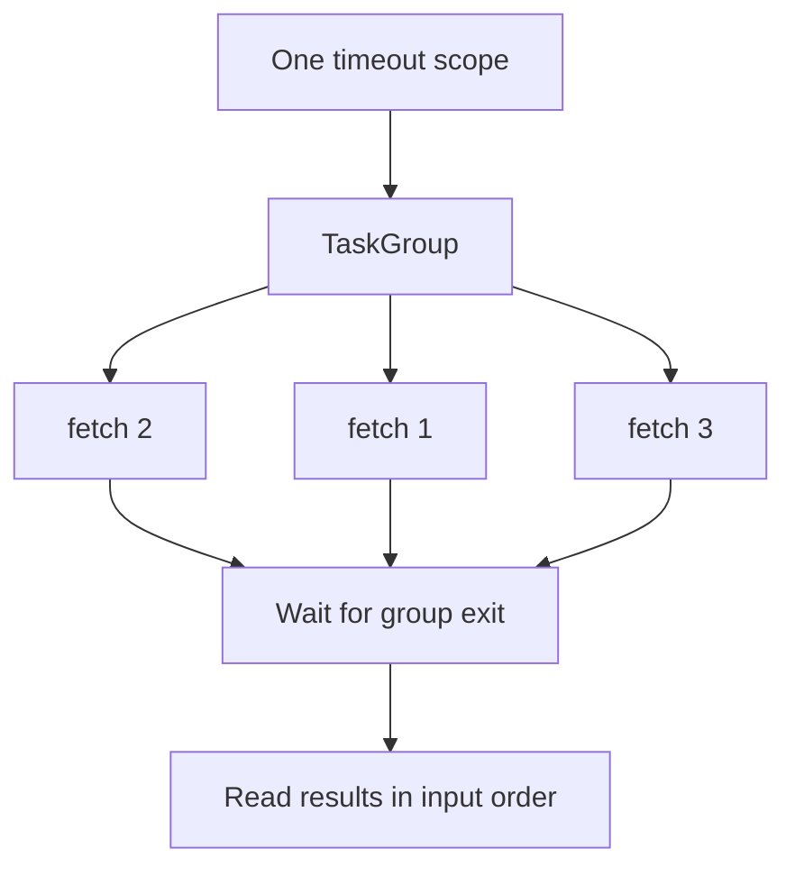

# 05. async/await and asyncio

> **Draft: written but not yet run.** The code and the expected output in this lesson were prepared by reading the code and the official documentation. They have not been executed yet. If something does not behave as described, trust your tool's real output and report it.

## What you will be able to do
- Distinguish a coroutine object from a scheduled task.
- Collect concurrent task results within a bounded lifetime.
- Test ordering, group failure, timeouts and cancellation cleanup.

## Recap
1. Why did lesson 04 put cleanup in `finally`?
   <details><summary>Answer</summary>A body can exit by exception, not only by reaching its last normal statement.</details>
2. Does a generator run its body immediately when called?
   <details><summary>Answer</summary>No. Its work is deferred until consumption; coroutine creation has a related distinction between creating and executing work.</details>

## Why it matters
Applications often wait on several independent I/O operations. Concurrency lets waiting overlap, but introduces failure and lifetime questions. Async syntax is useful only when the operations cooperate with the scheduler.

## What you will build
A simulated title loader with no external network dependency. It preserves requested order while tasks are scheduled together. The bounded task lifetime prepares you to understand a server's event loop in lesson 08 without turning every function into `async def`.

## Before you start
- **Prerequisites:** [Python 201 lesson 04, decorators and context managers](../phase-1-core-skills/04-decorators-and-context-managers.md).
- Time: 65 min, including typing, reasoning and the exercise.
- Python **3.12** installed using the setup from Python 101 lesson 01; a code editor and terminal from that track. Windows commands select it with `py -3.12`; macOS/Linux commands use `python3.12`. If necessary, Windows install-manager users can run `py install 3.12` from any folder, then reopen the terminal. Other platforms: [official Python setup](https://docs.python.org/3.12/using/index.html). Do not point the dependency snapshots at an arbitrary newer interpreter and assume compatibility.
- Source pack (optional): every new file is shown in full in this lesson, so you can follow without it. The finished code, the exercise starter and the solution are in the course repository https://github.com/Uee03/Code101 under `source/python/201-hero-to-super-hero/phase-2-concurrency-and-packaging/05-async-and-asyncio/` (on that page choose **Code, Download ZIP**, or run `git clone https://github.com/Uee03/Code101.git`).
- Extract ZIPs before using them: Windows **Extract All > Extract**; macOS double-click; Linux use your archive manager's **Extract**. A repository ZIP contains `Code101-main` followed by the source path above. Phase ZIPs contain this lesson's `code` and `exercise` folders. Work in a copy, not inside the ZIP.
- Third-party versions below are teaching snapshots, **not a claim of current security support**. Direct requirements are pinned, transitive dependencies are not locked; review supported releases and resolve a lock before deployment. All output below is unrun.

Finish lesson 04. No dependencies or network service are needed. This is a scheduling example, not a speed benchmark.

## Steps
### Step 1. Create the workspace
Open **Terminal > New Terminal** in VS Code. The path before `>` or `$` is the current folder. From anywhere:

**PowerShell - folder: anywhere**
```powershell
New-Item -ItemType Directory -Path "$HOME/code101/python201/lesson05" -Force | Out-Null
Set-Location "$HOME/code101/python201/lesson05"
code .
```

**macOS/Linux - folder: anywhere**
```bash
mkdir -p ~/code101/python201/lesson05
cd ~/code101/python201/lesson05
code .
```
Expected result, not yet run: the folder exists and the editor opens it. If `code` is unavailable, choose **File > Open Folder** instead. In that window open a new terminal; it must show this lesson folder. If asked, trust your own folder.

For every file below use **Explorer > New File** (create named subfolders first), enter the exact filename, paste/type its complete content and save. **Ctrl+S**, or **Cmd+S** on macOS, removes the unsaved dot on the tab. Enable filename extensions in your file manager so `.py` does not become `.py.txt`. Paths below are relative to this lesson folder. If lost, `cd ~/code101/python201/lesson05` returns here on all three platforms.

### Step 2. Bound the group of asynchronous work
A **coroutine** is a suspendable operation created by calling an `async def` function. `await` waits cooperatively for an awaitable; it does not automatically start every other coroutine you have created. A **task** schedules a coroutine on an **event loop**, the scheduler that resumes ready work. A **TaskGroup** owns related tasks and waits for them when its `async with` block exits.

**File: `~/code101/python201/lesson05/main.py`**
```python
import asyncio


async def fetch_title(note_id: int) -> str:
    if note_id <= 0:
        raise ValueError("note_id must be positive")
    await asyncio.sleep(0)
    return f"note-{note_id}"


async def load_titles(note_ids: list[int]) -> list[str]:
    async with asyncio.timeout(1):
        async with asyncio.TaskGroup() as group:
            tasks = [group.create_task(fetch_title(note_id)) for note_id in note_ids]
    return [task.result() for task in tasks]


if __name__ == "__main__":
    print(asyncio.run(load_titles([2, 1, 3])))
```
`asyncio.run` creates and closes the top-level event loop. Do not call it inside an already running notebook/server loop; there you await the operation instead. `sleep(0)` yields control without claiming a particular timing. The one-second timeout bounds the *whole group*, not each task individually. We never print from racing tasks: we print the collected results once.

### Step 3. Test the failure and cancellation contracts
An **ExceptionGroup** carries multiple failures as one structured exception. A task group cancels siblings when a task fails with an ordinary exception. **Cancellation** asks an asynchronous operation to stop at a suspension point; cleanup still belongs in `finally`.

**File: `~/code101/python201/lesson05/test_main.py`**
```python
import asyncio
import unittest

from main import load_titles


class AsyncTests(unittest.IsolatedAsyncioTestCase):
    async def test_result_order(self) -> None:
        self.assertEqual(await load_titles([2, 1]), ["note-2", "note-1"])

    async def test_empty(self) -> None:
        self.assertEqual(await load_titles([]), [])

    async def test_group_failure(self) -> None:
        with self.assertRaises(ExceptionGroup) as caught:
            await load_titles([1, 0])
        self.assertTrue(any(isinstance(error, ValueError) for error in caught.exception.exceptions))

    async def test_cancellation_runs_cleanup(self) -> None:
        entered = asyncio.Event()
        closed: list[bool] = []

        async def worker() -> None:
            try:
                entered.set()
                await asyncio.Event().wait()
            finally:
                closed.append(True)

        task = asyncio.create_task(worker())
        await entered.wait()
        task.cancel()
        with self.assertRaises(asyncio.CancelledError):
            await task
        self.assertEqual(closed, [True])

    async def test_timeout_cancels_wait(self) -> None:
        with self.assertRaises(TimeoutError):
            async with asyncio.timeout(0):
                await asyncio.Event().wait()
```
`IsolatedAsyncioTestCase` gives each asynchronous test its own event loop. `Event` provides a signal: the cancellation test waits until the worker has definitely entered its protected region instead of sleeping for a guessed duration. The zero timeout interrupts a deliberately unending wait on the next loop turn; the test does not assert wall-clock milliseconds.

### Step 4. Predict before you run
Will the output order be `1, 2, 3` or the original `2, 1, 3`? Does awaiting two coroutines one after the other schedule their waits together? Distinguish result order from completion order.

## Run it
**PowerShell - folder: `~/code101/python201/lesson05`**
```powershell
py -3.12 main.py
```

**macOS/Linux - folder: `~/code101/python201/lesson05`**
```bash
python3.12 main.py
```
Expected output, not yet run:
```text
['note-2', 'note-1', 'note-3']
```
**PowerShell - folder: `~/code101/python201/lesson05`**
```powershell
py -3.12 -m unittest -v
```

**macOS/Linux - folder: `~/code101/python201/lesson05`**
```bash
python3.12 -m unittest -v
```
Expected outcome, not yet run: five tests should pass, ending with `OK`. No elapsed-time output is predicted.

## How it works
The task group schedules each fetch and waits for all group members. Fetching validates IDs before its cooperative pause. Once the group exits successfully, all result calls are ready. Iterating the original `tasks` list preserves request order regardless of completion order. If a child fails, the group does not leave orphan siblings running unnoticed; if the outer deadline expires, cancellation unwinds the managed region.

**Structure (Mermaid):**

> **Why this, not that?** Structured task ownership is easier to reason about than untracked fire-and-forget tasks. Use async for cooperative I/O, not to accelerate CPU-heavy calculations. A synchronous database driver inside `async def` still blocks the event loop; lessons 09 and 11 keep synchronous SQLAlchemy calls in synchronous FastAPI handlers.

Common misconception: `async` means parallel execution. These tasks normally share one event-loop thread and switch at cooperative waits; CPU parallelism is a different design problem. For large inputs, also bound the number of tasks, not just their lifetime.

## Try it
1. **Guided:** schedule all supplied `double` calls in one owned group and preserve the input ordering.
Without the pack, create `try05` inside this lesson folder and create the starter below there. With the pack, **instead** copy the `exercise/starter` folder itself into this lesson folder and rename the copy `try05`. Do not copy it *into* an existing `try05`: the file must be `lesson05/try05/exercise.py`, not `try05/starter/exercise.py`. Keep the original starter unchanged. Run from the lesson root with the command below. Its checks intentionally fail until the TODOs are finished.
**File: `~/code101/python201/lesson05/try05/exercise.py`**
```python
import asyncio


async def double(number: int) -> int:
    await asyncio.sleep(0)
    return number * 2


async def doubles(numbers: list[int]) -> list[int]:
    # TODO: schedule all double calls in one TaskGroup; preserve input order.
    return []


result = asyncio.run(doubles([3, 1]))
assert result == [6, 2]
print(result)
```
**PowerShell - folder: `~/code101/python201/lesson05`**
```powershell
py -3.12 try05/exercise.py
```

**macOS/Linux - folder: `~/code101/python201/lesson05`**
```bash
python3.12 try05/exercise.py
```
Expected completed output, not yet run:
```text
[6, 2]
```
2. **Change:** test empty input and a zero value without adding timing assertions.
3. **Stretch (optional):** explain a design that limits active operations to five. Consult `asyncio.Semaphore` before implementing it; unbounded task creation is not a production queue.

<details><summary>Solution to the guided rung</summary>

**File: `~/code101/python201/lesson05/try05/exercise.py`**
```python
import asyncio


async def double(number: int) -> int:
    await asyncio.sleep(0)
    return number * 2


async def doubles(numbers: list[int]) -> list[int]:
    async with asyncio.TaskGroup() as group:
        tasks = [group.create_task(double(number)) for number in numbers]
    return [task.result() for task in tasks]


result = asyncio.run(doubles([3, 1]))
assert result == [6, 2]
print(result)
```
The group owns all task lifetimes. Results are collected only after its successful exit.
</details>

## Check yourself
1. What happens when you call an async function but neither await nor schedule its coroutine?
   <details><summary>Answer</summary>You have created a coroutine object, not completed the work. It may also cause an unawaited-coroutine warning.</details>
2. Why is output ordered even if tasks complete out of order?
   <details><summary>Answer</summary>The result list follows the task references stored in input order after all have finished.</details>
3. Why should cleanup avoid swallowing `CancelledError`?
   <details><summary>Answer</summary>Task groups and timeouts rely on cancellation propagating to manage their lifetimes correctly. Clean up and normally let it propagate.</details>

## Common mistakes
| Symptom or typical message (not captured) | Cause | Fix |
|---|---|---|
| Unawaited-coroutine warning | Created an operation without running it | Await it or create an owned task. |
| `asyncio.run` cannot be called from a running event loop | Nested event-loop entry point | Use one top-level runner; await inside an existing loop. |
| Timeout or cancellation seems ignored | Blocking call prevents cooperative progress | Use an asynchronous library or move blocking work to an appropriate thread boundary. |
| Grouped failure instead of one flat `ValueError` | A task group collected a child failure | Inspect its exceptions; preserve group structure when handling real failures. |

## Best practice
Use task groups for related task lifetimes and allow cancellation to propagate after cleanup. Source: Python, [Task cancellation and task groups](https://docs.python.org/3.12/library/asyncio-task.html#task-groups).

## Going further
- [asyncio synchronization primitives](https://docs.python.org/3.12/library/asyncio-sync.html).
- Lesson 08 explains when synchronous handlers are the correct choice for a FastAPI application.

## Summary
- You distinguished coroutine creation from scheduling.
- You bounded concurrent tasks and preserved input ordering.
- You specified failure, timeout and cleanup tests without timing guesses.

## Next lesson
[06. Packaging with pyproject.toml, venv and uv](06-packaging-with-uv.md): turn a script into an installable command.
