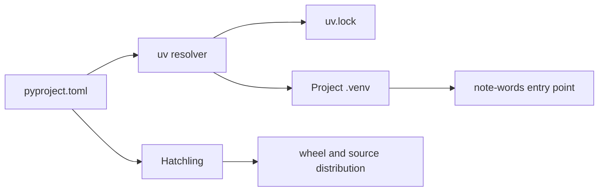

# 06. Packaging with pyproject.toml, venv and uv

> **Draft: written but not yet run.** The code and the expected output in this lesson were prepared by reading the code and the official documentation. They have not been executed yet. If something does not behave as described, trust your tool's real output and report it.

## What you will be able to do
- Package reusable code in a `src` layout with a console entry point.
- Separate the interpreter environment, build backend and project manager.
- Resolve a dependency lock and test installed imports rather than relying on the current folder.

## Recap
1. What separated a package from one module in Python 101 lesson 10?
   <details><summary>Answer</summary>A package groups importable modules; our regular package uses an `__init__.py` file.</details>
2. Why does lesson 02 distinguish a development tool from application behavior?
   <details><summary>Answer</summary>The checker reads contracts; running the program exercises runtime behavior. Installing a tool is not the same as making the application correct.</details>

## Why it matters
An import that works only from your checkout is not yet a distributable interface. Packaging declares what to install and how users invoke it. A virtual environment isolates dependencies, while a lock records the actual resolved versions rather than only broad intent.

## What you will build
A small `note-words` command backed by an importable function. It uses no runtime dependencies; Hatchling builds distributions and uv manages the project environment. This is packaging practice, not a publishing or credentials lesson.

## Before you start
- **Prerequisites:** [Python 201 lesson 05, async and asyncio](05-async-and-asyncio.md).
- Time: 75 min, including typing, reasoning and the exercise.
- Python **3.12** installed using the setup from Python 101 lesson 01; a code editor and terminal from that track. Windows commands select it with `py -3.12`; macOS/Linux commands use `python3.12`. If necessary, Windows install-manager users can run `py install 3.12` from any folder, then reopen the terminal. Other platforms: [official Python setup](https://docs.python.org/3.12/using/index.html). Do not point the dependency snapshots at an arbitrary newer interpreter and assume compatibility.
- Source pack (optional): every new file is shown in full in this lesson, so you can follow without it. The finished code, the exercise starter and the solution are in the course repository https://github.com/Uee03/Code101 under `source/python/201-hero-to-super-hero/phase-2-concurrency-and-packaging/06-packaging-with-uv/` (on that page choose **Code, Download ZIP**, or run `git clone https://github.com/Uee03/Code101.git`).
- Extract ZIPs before using them: Windows **Extract All > Extract**; macOS double-click; Linux use your archive manager's **Extract**. A repository ZIP contains `Code101-main` followed by the source path above. Phase ZIPs contain this lesson's `code` and `exercise` folders. Work in a copy, not inside the ZIP.
- Third-party versions below are teaching snapshots, **not a claim of current security support**. Direct requirements are pinned, transitive dependencies are not locked; review supported releases and resolve a lock before deployment. All output below is unrun.

Finish lesson 05. Python 101 already taught `venv` and pip. Here uv is a project/environment manager; Hatchling is the **build backend**, the tool that creates distribution files. Two sittings are reasonable: pause before Step 5.

## Steps
### Step 1. Create the workspace
Open **Terminal > New Terminal** in VS Code. The path before `>` or `$` is the current folder. From anywhere:

**PowerShell - folder: anywhere**
```powershell
New-Item -ItemType Directory -Path "$HOME/code101/python201/lesson06" -Force | Out-Null
Set-Location "$HOME/code101/python201/lesson06"
code .
```

**macOS/Linux - folder: anywhere**
```bash
mkdir -p ~/code101/python201/lesson06
cd ~/code101/python201/lesson06
code .
```
Expected result, not yet run: the folder exists and the editor opens it. If `code` is unavailable, choose **File > Open Folder** instead. In that window open a new terminal; it must show this lesson folder. If asked, trust your own folder.

For every file below use **Explorer > New File** (create named subfolders first), enter the exact filename, paste/type its complete content and save. **Ctrl+S**, or **Cmd+S** on macOS, removes the unsaved dot on the tab. Enable filename extensions in your file manager so `.py` does not become `.py.txt`. Paths below are relative to this lesson folder. If lost, `cd ~/code101/python201/lesson06` returns here on all three platforms.

### Step 2. Declare packaging metadata explicitly
Create `pyproject.toml` in the workspace root, not in `src`.
**File: `~/code101/python201/lesson06/pyproject.toml`**
```toml
[build-system]
requires = ["hatchling==1.27.0"]
build-backend = "hatchling.build"

[project]
name = "code101-note-words"
version = "0.1.0"
description = "A tiny word-count command for Python 201"
readme = "README.md"
requires-python = ">=3.12"
dependencies = []

[project.scripts]
note-words = "note_words.cli:main"

[tool.hatch.build.targets.wheel]
packages = ["src/note_words"]
```
Every setting has a different responsibility:
| Line/section | Meaning and effect of changing it |
|---|---|
| `[build-system]` | Declares build-time tooling, not application imports. |
| `requires` | Pins the backend used in an isolated build; changing it changes the build tool. |
| `build-backend` | Names the backend's import path; changing it requires that backend's conventions. |
| `[project]` | Starts standardized distribution metadata. |
| `name` | Distribution name seen by installers; it need not equal the import name. |
| `version` | Release identifier embedded in artifacts. |
| `description` | Short human-readable description. |
| `readme` | Includes this exact file as the long description; a missing file can break a build. |
| `requires-python` | Declares a minimum interpreter version, not a request to install one. |
| `dependencies = []` | This package has no third-party runtime dependencies. |
| `[project.scripts]` | Declares installed console commands. |
| `note-words` | Maps the command to `note_words.cli` and its `main` function, without parentheses. |
| `[tool.hatch.build.targets.wheel]` | Configures Hatchling's wheel builder. |
| `packages` | Explicitly includes `src/note_words`; the source layout is not guessed from the distribution name. |

A **wheel** is an installable distribution archive. A **source distribution** contains source and build metadata. A **console entry point** is an installed command that calls a named Python function.

**File: `~/code101/python201/lesson06/README.md`**
```markdown
# Note words

An educational word-count command. It counts whitespace-separated words,
not linguistic tokens. Run `note-words` after installing the project.
```
The README describes the deliberately modest word-count contract. It does not claim linguistic word segmentation.

### Step 3. Create the import package and command
In Explorer create `src`, then `src/note_words`, then these two files.
**File: `~/code101/python201/lesson06/src/note_words/__init__.py`**
```python
def count_words(text: str) -> int:
    return len(text.split())
```
**File: `~/code101/python201/lesson06/src/note_words/cli.py`**
```python
from note_words import count_words


def main() -> None:
    print(f"words: {count_words('Read the docs')}")


if __name__ == "__main__":
    main()
```
The distribution is `code101-note-words`; the import package is `note_words`; the command is `note-words`. They are different interfaces. The **CLI** (command-line interface) delegates the actual work so another program can import and test it.

### Step 4. Specify tests and ignored artifacts
Create the `tests` folder and its file.
**File: `~/code101/python201/lesson06/tests/test_words.py`**
```python
import unittest

from note_words import count_words


class WordTests(unittest.TestCase):
    def test_whitespace(self) -> None:
        self.assertEqual(count_words(" Read\tthe\ndocs "), 3)

    def test_empty(self) -> None:
        self.assertEqual(count_words(""), 0)
```
**File: `~/code101/python201/lesson06/.gitignore`**
```text
.venv/
.uv-tool/
__pycache__/
dist/
*.egg-info/
```
Each ignore line excludes a local artifact: `.venv/` is the project environment; `.uv-tool/` will hold our local uv installation; `__pycache__/` contains Python caches; `dist/` contains built distributions; `*.egg-info/` excludes generated package metadata. **Do not ignore `uv.lock`** for this application workflow.

### Step 5. Install uv locally, then synchronize the project
Keep the manager's environment separate from the managed project. This avoids global tools and PATH edits. The commands below use the package's official [pip installation route](https://docs.astral.sh/uv/getting-started/installation/#pypi); the uv version is an explicit teaching pin, not a claim that it is latest.

**PowerShell - folder: `~/code101/python201/lesson06`**
```powershell
py -3.12 -m venv .uv-tool
& ./.uv-tool/Scripts/python.exe -m pip install uv==0.6.14
& ./.uv-tool/Scripts/uv.exe sync --python 3.12
```

**macOS/Linux - folder: `~/code101/python201/lesson06`**
```bash
python3.12 -m venv .uv-tool
.uv-tool/bin/python -m pip install uv==0.6.14
.uv-tool/bin/uv sync --python 3.12
```
Expected result, not yet run: uv creates `.venv`, resolves `uv.lock` and installs the project in editable form. It can obtain the requested Python if absent; network access may be required. Install progress is variable. A lockfile records exact resolved dependencies for tools to reproduce; do not handwrite hashes or pretend it exists before resolution. This draft intentionally ships no generated lock.

An **editable install** points to your development source, so ordinary source edits are observed without reinstalling; it is not equivalent to testing a built wheel. After the first successful resolution, review `uv.lock` and retain it with your application. Subsequent synchronization can use `sync --locked --python 3.12` on the same uv executable to reject an out-of-date lock instead of silently resolving again. Do not use `--locked` before the first lock exists.

### Step 6. Predict before you run
Will the installed command be called `code101-note-words` or `note-words`? Which configuration line chooses it? Would executing `src/note_words/cli.py` by path be a good packaging test?

## Run it
Use uv to select the project environment and installed entry point.

**PowerShell - folder: `~/code101/python201/lesson06`**
```powershell
& ./.uv-tool/Scripts/uv.exe run --locked note-words
```

**macOS/Linux - folder: `~/code101/python201/lesson06`**
```bash
.uv-tool/bin/uv run --locked note-words
```
Expected application output, not yet run (uv status messages may also appear):
```text
words: 3
```
Test the installed import:
**PowerShell - folder: `~/code101/python201/lesson06`**
```powershell
& ./.venv/Scripts/python.exe -m unittest discover -s tests -v
```

**macOS/Linux - folder: `~/code101/python201/lesson06`**
```bash
.venv/bin/python -m unittest discover -s tests -v
```
Expected outcome, not yet run: two tests should pass, ending with `OK`. These imports use the installed package from `.venv`, not an ad-hoc `sys.path` edit.

Optionally build the two distribution formats; this is a learner command, not something already performed for this draft.

**PowerShell - folder: `~/code101/python201/lesson06`**
```powershell
& ./.uv-tool/Scripts/uv.exe build
Get-ChildItem dist
```

**macOS/Linux - folder: `~/code101/python201/lesson06`**
```bash
.uv-tool/bin/uv build
ls dist
```
Expected artifacts, not yet run: `code101_note_words-0.1.0-py3-none-any.whl` and `code101_note_words-0.1.0.tar.gz`. Build/ls formatting varies. No upload or account is needed. Leave both environments local; there was no activation to undo. Deleting these lesson-local `.venv`, `.uv-tool` and `dist` folders later removes the generated tooling/artifacts, not your source.

## How it works
uv reads the manifest, resolves a lock, creates an environment and asks Hatchling to install the project. Python imports the package from that installation. The entry-point wrapper calls `main`, which delegates to `count_words`. `src` layout makes accidental imports from the repository root less likely; testing a built wheel in a separate clean environment remains a stronger release check than an editable install.

**Structure (Mermaid):**

> **Why this, not that?** `venv` isolates an interpreter environment; pip installs into one; uv coordinates environments, resolution and project commands. None replaces your source's packaging metadata. A one-file throwaway script may not need a distributable package, but a reusable command should not rely on copying folders or editing PATH manually.

Common misconception: pinning direct dependencies is a complete lock. It is not; transitive choices and platform artifacts still need resolution. Never invent a lock file to make an unrun draft look reproducible.

## Try it
1. **Guided:** call the installed function through a new adapter, without copying its implementation.
Without the pack, create `try06` inside this lesson folder and create the starter below there. With the pack, **instead** copy the `exercise/starter` folder itself into this lesson folder and rename the copy `try06`. Do not copy it *into* an existing `try06`: the file must be `lesson06/try06/exercise.py`, not `try06/starter/exercise.py`. Keep the original starter unchanged. Run from the lesson root with the command below. Its checks intentionally fail until the TODOs are finished.
**File: `~/code101/python201/lesson06/try06/exercise.py`**
```python
from note_words import count_words


def describe(text: str) -> str:
    # TODO: return a label containing this installed package's word count.
    return "unfinished"


assert describe("Read docs") == "words: 2"
print(describe("Read docs"))
```
**PowerShell - folder: `~/code101/python201/lesson06`**
```powershell
& ./.venv/Scripts/python.exe try06/exercise.py
```

**macOS/Linux - folder: `~/code101/python201/lesson06`**
```bash
.venv/bin/python try06/exercise.py
```
Expected completed output, not yet run:
```text
words: 2
```
2. **Change:** add an empty-string assertion and explain why it belongs to the package's contract rather than the CLI's printed formatting.
3. **Stretch (optional):** add a command-line text argument with `argparse`. Compare importing a function with launching a subprocess.

<details><summary>Solution to the guided rung</summary>

**File: `~/code101/python201/lesson06/try06/exercise.py`**
```python
from note_words import count_words


def describe(text: str) -> str:
    return f"words: {count_words(text)}"


assert describe("Read docs") == "words: 2"
print(describe("Read docs"))
```
The existing installed package remains the single implementation. The exercise only adapts its return value for a caller.
</details>

## Check yourself
1. Which names refer to the distribution, import and installed command?
   <details><summary>Answer</summary>`code101-note-words`, `note_words` and `note-words`, respectively.</details>
2. Does installing uv install this project?
   <details><summary>Answer</summary>No. The manager is a separate tool. `sync` reads and installs the project into its own environment.</details>
3. Why is there no handwritten `uv.lock` in this unrun draft?
   <details><summary>Answer</summary>A lock must be resolved by the package manager against real metadata. Fabricated hashes or transitive pins are not evidence of reproducibility.</details>

## Common mistakes
| Symptom or typical message (not captured) | Cause | Fix |
|---|---|---|
| Import works in one folder only | Running source paths without installation | Synchronize the package, then use its `.venv` interpreter. |
| Command not found in a global terminal | Entry point belongs to `.venv` | Invoke it via uv as shown; do not add project internals to global PATH. |
| Lock required before first sync | Used `--locked` before resolution | Perform the first sync, review the generated lock, then enforce it. |
| Wheel misses the package | Wrong `packages` path | Keep the manifest's `src/note_words` path aligned with the actual directory. |

## Best practice
Keep standardized project metadata in `pyproject.toml` and declare the build system explicitly. Source: [PEP 621](https://peps.python.org/pep-0621/) and Python Packaging, [Writing pyproject.toml](https://packaging.python.org/en/latest/guides/writing-pyproject-toml/).

## Going further
- [uv project workflow](https://docs.astral.sh/uv/guides/projects/) and [Hatch wheel selection](https://hatch.pypa.io/1.13/plugins/builder/wheel/#packages).
- The full [Python backend capstone](https://github.com/Uee03/Code101/tree/main/capstones/backend-python) packages a larger application; this lesson intentionally does not duplicate it.

## Summary
- You separated an installable package from its CLI adapter.
- You distinguished venv, a manager and a build backend.
- You described real lock resolution and tested installed imports.

## Next lesson
[07. Logging, configuration and secrets](07-logging-configuration-and-secrets.md): keep changing deployment values out of source.
