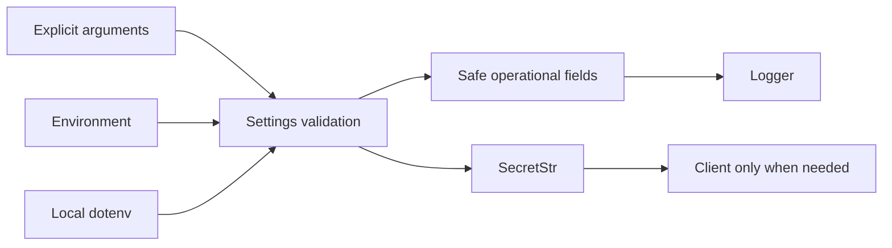

# 07. Logging, configuration and secrets

> **Draft: written but not yet run.** The code and the expected output in this lesson were prepared by reading the code and the official documentation. They have not been executed yet. If something does not behave as described, trust your tool's real output and report it.

## What you will be able to do
- Load validated settings from environment variables and a local dotenv file.
- Log useful operational events without leaking secrets.
- Test configuration conversion, failure and redaction independently of your machine's environment.

## Recap
1. What does an isolated environment protect you from in lesson 06?
   <details><summary>Answer</summary>Mixing one project's installed dependencies with another's. It does not keep credentials confidential.</details>
2. Does a `str` annotation validate an environment variable?
   <details><summary>Answer</summary>No. Runtime validation requires explicit code or a validating boundary such as Pydantic.</details>

## Why it matters
Hard-coded deployment values create needless code changes. Hard-coded credentials are worse: a later deletion does not erase their history. Operational logs should explain what happened, not become a second database of passwords and tokens.

## What you will build
A startup report with a validated batch size and redacted API-key representation. The key is configuration practice only; this script does not authenticate to an external service. Lessons 09-11 reuse the same separation for database and JWT settings.

## Before you start
- **Prerequisites:** [Python 201 lesson 06, packaging with uv](06-packaging-with-uv.md).
- Time: 70 min, including typing, reasoning and the exercise.
- Python **3.12** installed using the setup from Python 101 lesson 01; a code editor and terminal from that track. Windows commands select it with `py -3.12`; macOS/Linux commands use `python3.12`. If necessary, Windows install-manager users can run `py install 3.12` from any folder, then reopen the terminal. Other platforms: [official Python setup](https://docs.python.org/3.12/using/index.html). Do not point the dependency snapshots at an arbitrary newer interpreter and assume compatibility.
- Source pack (optional): every new file is shown in full in this lesson, so you can follow without it. The finished code, the exercise starter and the solution are in the course repository https://github.com/Uee03/Code101 under `source/python/201-hero-to-super-hero/phase-2-concurrency-and-packaging/07-logging-configuration-and-secrets/` (on that page choose **Code, Download ZIP**, or run `git clone https://github.com/Uee03/Code101.git`).
- Extract ZIPs before using them: Windows **Extract All > Extract**; macOS double-click; Linux use your archive manager's **Extract**. A repository ZIP contains `Code101-main` followed by the source path above. Phase ZIPs contain this lesson's `code` and `exercise` folders. Work in a copy, not inside the ZIP.
- Third-party versions below are teaching snapshots, **not a claim of current security support**. Direct requirements are pinned, transitive dependencies are not locked; review supported releases and resolve a lock before deployment. All output below is unrun.

Finish lesson 06. `pydantic-settings` loads sources; Pydantic validates values. A **dotenv file** is a local text file of environment-like assignments, not encryption. A **secret** is data whose disclosure grants access or exposes protected information.

## Steps
### Step 1. Create the workspace
Open **Terminal > New Terminal** in VS Code. The path before `>` or `$` is the current folder. From anywhere:

**PowerShell - folder: anywhere**
```powershell
New-Item -ItemType Directory -Path "$HOME/code101/python201/lesson07" -Force | Out-Null
Set-Location "$HOME/code101/python201/lesson07"
code .
```

**macOS/Linux - folder: anywhere**
```bash
mkdir -p ~/code101/python201/lesson07
cd ~/code101/python201/lesson07
code .
```
Expected result, not yet run: the folder exists and the editor opens it. If `code` is unavailable, choose **File > Open Folder** instead. In that window open a new terminal; it must show this lesson folder. If asked, trust your own folder.

For every file below use **Explorer > New File** (create named subfolders first), enter the exact filename, paste/type its complete content and save. **Ctrl+S**, or **Cmd+S** on macOS, removes the unsaved dot on the tab. Enable filename extensions in your file manager so `.py` does not become `.py.txt`. Paths below are relative to this lesson folder. If lost, `cd ~/code101/python201/lesson07` returns here on all three platforms.

### Step 2. Isolate the settings libraries
**File: `~/code101/python201/lesson07/requirements.txt`**
```text
pydantic==2.11.3
pydantic-settings==2.8.1
```
Use the requirements file above in an isolated environment. No activation is needed, so PowerShell's Restricted script policy cannot block these commands.

**PowerShell - folder: `~/code101/python201/lesson07`**
```powershell
py -3.12 -m venv .venv
& ./.venv/Scripts/python.exe -m pip install -r requirements.txt
```

**macOS/Linux - folder: `~/code101/python201/lesson07`**
```bash
python3.12 -m venv .venv
.venv/bin/python -m pip install -r requirements.txt
```
Expected result, not yet run: `.venv` is created and the requirements install successfully. Package download lines and resolved transitive versions vary; no installer transcript is claimed. If installation fails, stop and read the first error rather than proceeding with a partially prepared environment. The Python 101 virtual-environment lesson covers a missing `venv` component. Always use this lesson's interpreter, not a global `pip`.

### Step 3. Declare typed settings and constraints
**File: `~/code101/python201/lesson07/settings.py`**
```python
from typing import Literal

from pydantic import Field, SecretStr
from pydantic_settings import BaseSettings, SettingsConfigDict


class Settings(BaseSettings):
    model_config = SettingsConfigDict(
        env_prefix="NOTES_", env_file=".env", env_file_encoding="utf-8", extra="forbid"
    )

    api_key: SecretStr
    batch_size: int = Field(default=10, ge=1, le=100)
    log_level: Literal["DEBUG", "INFO", "WARNING"] = "INFO"
```
`BaseSettings` loads missing initializer values from configuration sources. `env_prefix` maps `api_key` to `NOTES_API_KEY`. `env_file` and its encoding load the local file relative to the current working folder; Pydantic does not search arbitrary parent folders. `extra="forbid"` catches unknown dotenv settings in this focused file. Explicit constructor values override environment values; environment values override dotenv values.

`Field` constrains the inclusive numeric range. `Literal` restricts the allowed log-level strings. `SecretStr` redacts its string representation; `get_secret_value()` deliberately reveals it for a client that genuinely needs it. Redaction is not encryption and does not prevent deliberate disclosure.

### Step 4. Generate a private local file from a complete template
**File: `~/code101/python201/lesson07/.env.example`**
```dotenv
NOTES_API_KEY=replace-locally-with-a-generated-value
NOTES_BATCH_SIZE=10
NOTES_LOG_LEVEL=INFO
```
Line 1 names the demonstration API key and is a placeholder, not a credential to reuse. Line 2 selects the batch size (1-100); changing it changes the startup report. Line 3 chooses the logging threshold; DEBUG is noisier and WARNING hides the informational startup event.

**File: `~/code101/python201/lesson07/.gitignore`**
```text
.env
.venv/
__pycache__/
```
The first line excludes local credentials; the second excludes installed dependencies; the third excludes interpreter caches. Git ignore rules do not untrack files already committed. If a real secret was committed, revoke/rotate it; deletion is not enough.

**File: `~/code101/python201/lesson07/configure.py`**
```python
from pathlib import Path
from secrets import token_hex


if __name__ == "__main__":
    template = Path(".env.example").read_text(encoding="utf-8")
    content = template.replace("replace-locally-with-a-generated-value", token_hex(32))
    with Path(".env").open("x", encoding="utf-8") as file:
        file.write(content)
    print("Created .env; keep it private.")
```
`token_hex(32)` requests 32 cryptographically random bytes rendered as text. Exclusive mode `"x"` prevents overwriting an existing `.env`. Run the following once from the project root; keep the resulting private file off screenshots and shared folders.
**PowerShell - folder: `~/code101/python201/lesson07`**
```powershell
& ./.venv/Scripts/python.exe configure.py
```

**macOS/Linux - folder: `~/code101/python201/lesson07`**
```bash
.venv/bin/python configure.py
```
Expected output, not yet run:
```text
Created .env; keep it private.
```
The generated `.env` has the same three assignments as `.env.example`, with only the placeholder replaced by a private random value. Its value is intentionally not shown or fabricated. Do not paste the example placeholder into a real service.

### Step 5. Configure logging only at the entry point
A **logger** emits events with severity levels. A **logging threshold** chooses which levels are visible; a **formatter** chooses the displayed fields.
**File: `~/code101/python201/lesson07/main.py`**
```python
import logging
import sys

from settings import Settings

logger = logging.getLogger("notes")


def report_startup(settings: Settings) -> None:
    logger.info("startup batch_size=%s", settings.batch_size)


def main() -> None:
    settings = Settings()
    logging.basicConfig(
        level=settings.log_level,
        format="%(levelname)s %(name)s %(message)s",
        stream=sys.stdout,
    )
    report_startup(settings)
    print(f"secret redacted: {settings.api_key}")


if __name__ == "__main__":
    main()
```
`getLogger("notes")` uses a stable application component name. Reusable modules often use `getLogger(__name__)`; this tiny example fixes the name to make the output easier to compare. `basicConfig` runs only in the entry point, so importing a helper does not reconfigure a host application's root logger. The level comes from validated settings, the format shows level/name/message, and the stream is stdout for this console demonstration. Pass data as separate logger arguments rather than preformatting sensitive structures. We intentionally log only the nonsensitive batch size.

### Step 6. Isolate settings in tests
**File: `~/code101/python201/lesson07/test_settings.py`**
```python
import os
import unittest
from unittest.mock import patch

from pydantic import ValidationError

from main import report_startup
from settings import Settings


class SettingsTests(unittest.TestCase):
    def test_environment_conversion_and_redaction(self) -> None:
        with patch.dict(os.environ, {"NOTES_API_KEY": "test-only", "NOTES_BATCH_SIZE": "7"}, clear=True):
            settings = Settings(_env_file=None)
        self.assertEqual(settings.batch_size, 7)
        self.assertEqual(str(settings.api_key), "**********")

    def test_missing_secret(self) -> None:
        with patch.dict(os.environ, {}, clear=True):
            with self.assertRaises(ValidationError):
                Settings(_env_file=None)

    def test_invalid_batch_size(self) -> None:
        with patch.dict(os.environ, {"NOTES_API_KEY": "test-only", "NOTES_BATCH_SIZE": "0"}, clear=True):
            with self.assertRaises(ValidationError):
                Settings(_env_file=None)

    def test_log_does_not_contain_secret(self) -> None:
        with patch.dict(os.environ, {}, clear=True):
            settings = Settings(api_key="test-only", batch_size=10, _env_file=None)
        with self.assertLogs("notes", level="INFO") as captured:
            report_startup(settings)
        self.assertEqual(captured.output, ["INFO:notes:startup batch_size=10"])
```
`patch.dict(..., clear=True)` temporarily supplies an isolated environment and restores it afterward. `_env_file=None` disables dotenv input for these tests. `assertLogs` captures a logger's records so the assertion can check the actual fields, not a person's inspection of a console. None of these tests needs your real key.

### Step 7. Predict before you run
Will printing `settings.api_key` reveal the random key? Will a batch size of zero be accepted because the environment provides a string? Predict both behaviors before executing the script or tests.

## Run it
**PowerShell - folder: `~/code101/python201/lesson07`**
```powershell
& ./.venv/Scripts/python.exe main.py
```

**macOS/Linux - folder: `~/code101/python201/lesson07`**
```bash
.venv/bin/python main.py
```
Expected output, not yet run, with the freshly generated file and no overriding environment variables:
```text
INFO notes startup batch_size=10
secret redacted: **********
```
Try an environment override, then restore the shell:

**PowerShell - folder: `~/code101/python201/lesson07`**
```powershell
$env:NOTES_BATCH_SIZE = "7"
& ./.venv/Scripts/python.exe main.py
Remove-Item Env:NOTES_BATCH_SIZE
```

**macOS/Linux - folder: `~/code101/python201/lesson07`**
```bash
NOTES_BATCH_SIZE=7 .venv/bin/python main.py
```
Expected output, not yet run:
```text
INFO notes startup batch_size=7
secret redacted: **********
```
The Unix assignment applies to one process; PowerShell needs the explicit removal. If you already had a deliberate shell value, save it before the experiment and restore it instead of discarding it.
**PowerShell - folder: `~/code101/python201/lesson07`**
```powershell
& ./.venv/Scripts/python.exe -m unittest -v
```

**macOS/Linux - folder: `~/code101/python201/lesson07`**
```bash
.venv/bin/python -m unittest -v
```
Expected outcome, not yet run: four tests should pass, ending with `OK`; timing varies.

## How it works
Settings resolve input sources and validate before logging is configured. The program fails at startup if a required value is absent or unacceptable. Only safe operational fields reach the logger; a demonstration print shows the redacted representation. Environment variables still exist in process memory and may be exposed by debugging/container inspection. A deployment secret store is stronger than committing a dotenv file.

**Structure (Mermaid):**

> **Why this, not that?** Validated settings fail early and document requirements better than scattered `os.getenv` calls with silent fallbacks. For one optional throwaway flag, a direct environment lookup can be sufficient. Never log the full settings object merely because one field happens to be redacted today; future fields may not be.

Common misconception: a masked representation secures the stored secret. It only reduces accidental display; the plaintext `.env` still needs private filesystem access and safe disposal.

## Try it
1. **Guided:** constrain retry count to 1-5 and retain the failing-input check.
Without the pack, create `try07` inside this lesson folder and create the starter below there. With the pack, **instead** copy the `exercise/starter` folder itself into this lesson folder and rename the copy `try07`. Do not copy it *into* an existing `try07`: the file must be `lesson07/try07/exercise.py`, not `try07/starter/exercise.py`. Keep the original starter unchanged. Run from the lesson root with the command below. Its checks intentionally fail until the TODOs are finished.
**File: `~/code101/python201/lesson07/try07/exercise.py`**
```python
from pydantic import Field, ValidationError
from pydantic_settings import BaseSettings, SettingsConfigDict


class Settings(BaseSettings):
    model_config = SettingsConfigDict(env_prefix="EXERCISE_", env_file=None)
    # TODO: constrain retries to the inclusive range 1 through 5.
    retries: int = 3


assert Settings(retries=5).retries == 5
try:
    Settings(retries=0)
except ValidationError:
    print("invalid retries rejected")
else:
    raise AssertionError("zero retries was accepted")
```
**PowerShell - folder: `~/code101/python201/lesson07`**
```powershell
& ./.venv/Scripts/python.exe try07/exercise.py
```

**macOS/Linux - folder: `~/code101/python201/lesson07`**
```bash
.venv/bin/python try07/exercise.py
```
Expected completed output, not yet run:
```text
invalid retries rejected
```
2. **Change:** add assertions for the upper boundary and a rejected value just above it. Avoid printing the full validation input when it might contain secrets.
3. **Stretch (optional):** choose a deployment secret source and describe its access/rotation policy without storing a credential in source.

<details><summary>Solution to the guided rung</summary>

**File: `~/code101/python201/lesson07/try07/exercise.py`**
```python
from pydantic import Field, ValidationError
from pydantic_settings import BaseSettings, SettingsConfigDict


class Settings(BaseSettings):
    model_config = SettingsConfigDict(env_prefix="EXERCISE_", env_file=None)
    retries: int = Field(default=3, ge=1, le=5)


assert Settings(retries=5).retries == 5
try:
    Settings(retries=0)
except ValidationError:
    print("invalid retries rejected")
else:
    raise AssertionError("zero retries was accepted")
```
The constraint is part of the settings boundary, not a duplicated check at every caller.
</details>

## Check yourself
1. What wins if both `.env` and the process environment define `NOTES_BATCH_SIZE`?
   <details><summary>Answer</summary>The process environment; explicit constructor arguments have still higher priority.</details>
2. Does `SecretStr` encrypt `.env`?
   <details><summary>Answer</summary>No. It masks common representations, not stored bytes or deliberate access.</details>
3. Why disable dotenv loading and clear environment input in configuration tests?
   <details><summary>Answer</summary>Tests should not depend on a developer's real credentials or unrelated shell configuration.</details>

## Common mistakes
| Symptom or typical message (not captured) | Cause | Fix |
|---|---|---|
| Required API key missing | Wrong working folder or no local config | Return to the root, run `configure.py` once and check that `.env` exists. |
| File already exists while configuring | Exclusive creation protected the private file | Keep the existing file; do not regenerate credentials casually. |
| A supposedly changed batch size stays unchanged | A process variable overrides dotenv | Inspect/remove only your test override, then rerun. |
| Startup information is absent | Threshold is WARNING or logging already configured by a host | Run the fresh standalone entry point and verify its validated level. |

## Best practice
Keep settings validation at startup and keep secrets out of logs. Source: Pydantic, [Settings management](https://docs.pydantic.dev/latest/concepts/pydantic_settings/); Python, [Logging HOWTO](https://docs.python.org/3.12/howto/logging.html).

## Going further
- [Pydantic secret types](https://docs.pydantic.dev/2.11/api/types/#pydantic.types.SecretStr).
- [Python backend capstone hardening](https://github.com/Uee03/Code101/blob/main/capstones/backend-python/tutorials/phase-5-hardening/05-hardening.md) extends operational concerns beyond this local example.

### Phase 2 mixed review
1. Can putting a blocking HTTP call inside `async def` make it cooperative?
   <details><summary>Answer</summary>No. The operation must cooperate with the event loop or be moved to an appropriate blocking-work boundary.</details>
2. Does `uv.lock` store your application's dotenv credentials?
   <details><summary>Answer</summary>No. A dependency lock and runtime configuration solve different problems; neither belongs inside the other.</details>
3. Why should a database password not be part of a decorator's tracing output?
   <details><summary>Answer</summary>Generic argument logging can disclose secrets regardless of how well the wrapped function is typed or tested.</details>

## Summary
- You loaded and validated environment/dotenv settings.
- You logged a safe startup event and explained redaction limits.
- You specified isolated configuration and logging tests.

## Next lesson
[08. Your first FastAPI service](../phase-3-apis-and-data/08-your-first-fastapi-service.md): validate requests and define a stable public response contract.
