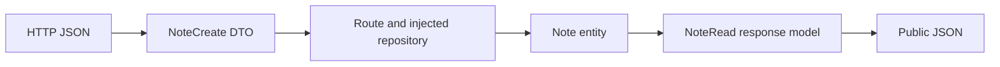

# 08. Your first FastAPI service

> **Draft: written but not yet run.** The code and the expected output in this lesson were prepared by reading the code and the official documentation. They have not been executed yet. If something does not behave as described, trust your tool's real output and report it.

## What you will be able to do
- Define routes with distinct input DTOs, internal entities and response models.
- Inject a repository and return deliberate validation/not-found responses.
- Test an application in process and serve it locally with Uvicorn.

## Recap
1. What can annotations not prove about an incoming title?
   <details><summary>Answer</summary>They do not perform runtime validation of untrusted data; a boundary must check actual contents.</details>
2. What does an application factory gain over shared module-level mutable state?
   <details><summary>Answer</summary>Each created application can own fresh dependencies, which makes independent instances and tests possible.</details>

## Why it matters
An HTTP API is a contract with callers you do not control. Internal attributes should not become public fields by accident. Validation, dependency lifetimes and error status codes deserve the same design attention as the happy-path calculation.

## What you will build
A create/read notes API with in-memory storage, strict title validation and a filtered public response. It deliberately has no authentication yet: bind only to loopback and use no personal data. Lesson 09 introduces persistence; lesson 10 introduces token validation; lesson 11 combines them.

## Before you start
- **Prerequisites:** [Python 201 lesson 07, logging, configuration and secrets](../phase-2-concurrency-and-packaging/07-logging-configuration-and-secrets.md).
- Time: 90 min, including typing, reasoning and the exercise.
- Python **3.12** installed using the setup from Python 101 lesson 01; a code editor and terminal from that track. Windows commands select it with `py -3.12`; macOS/Linux commands use `python3.12`. If necessary, Windows install-manager users can run `py install 3.12` from any folder, then reopen the terminal. Other platforms: [official Python setup](https://docs.python.org/3.12/using/index.html). Do not point the dependency snapshots at an arbitrary newer interpreter and assume compatibility.
- Source pack (optional): every new file is shown in full in this lesson, so you can follow without it. The finished code, the exercise starter and the solution are in the course repository https://github.com/Uee03/Code101 under `source/python/201-hero-to-super-hero/phase-3-apis-and-data/08-your-first-fastapi-service/` (on that page choose **Code, Download ZIP**, or run `git clone https://github.com/Uee03/Code101.git`).
- Extract ZIPs before using them: Windows **Extract All > Extract**; macOS double-click; Linux use your archive manager's **Extract**. A repository ZIP contains `Code101-main` followed by the source path above. Phase ZIPs contain this lesson's `code` and `exercise` folders. Work in a copy, not inside the ZIP.
- Third-party versions below are teaching snapshots, **not a claim of current security support**. Direct requirements are pinned, transitive dependencies are not locked; review supported releases and resolve a lock before deployment. All output below is unrun.

Finish lesson 07. Allow two sittings; pause before Step 5. **HTTP** is the request/response protocol used here. An **API** is an interface another program calls. A **route** maps an HTTP method and path to a handler. **JSON** is the text data format for these request and response bodies. No Docker or database is needed for this lesson.

## Steps
### Step 1. Create the workspace
Open **Terminal > New Terminal** in VS Code. The path before `>` or `$` is the current folder. From anywhere:

**PowerShell - folder: anywhere**
```powershell
New-Item -ItemType Directory -Path "$HOME/code101/python201/lesson08" -Force | Out-Null
Set-Location "$HOME/code101/python201/lesson08"
code .
```

**macOS/Linux - folder: anywhere**
```bash
mkdir -p ~/code101/python201/lesson08
cd ~/code101/python201/lesson08
code .
```
Expected result, not yet run: the folder exists and the editor opens it. If `code` is unavailable, choose **File > Open Folder** instead. In that window open a new terminal; it must show this lesson folder. If asked, trust your own folder.

For every file below use **Explorer > New File** (create named subfolders first), enter the exact filename, paste/type its complete content and save. **Ctrl+S**, or **Cmd+S** on macOS, removes the unsaved dot on the tab. Enable filename extensions in your file manager so `.py` does not become `.py.txt`. Paths below are relative to this lesson folder. If lost, `cd ~/code101/python201/lesson08` returns here on all three platforms.

### Step 2. Install the framework, server and test client
**File: `~/code101/python201/lesson08/requirements.txt`**
```text
fastapi==0.115.12
pydantic==2.11.3
uvicorn==0.34.2
httpx==0.28.1
```
Use the requirements file above in an isolated environment. No activation is needed, so PowerShell's Restricted script policy cannot block these commands.

**PowerShell - folder: `~/code101/python201/lesson08`**
```powershell
py -3.12 -m venv .venv
& ./.venv/Scripts/python.exe -m pip install -r requirements.txt
```

**macOS/Linux - folder: `~/code101/python201/lesson08`**
```bash
python3.12 -m venv .venv
.venv/bin/python -m pip install -r requirements.txt
```
Expected result, not yet run: `.venv` is created and the requirements install successfully. Package download lines and resolved transitive versions vary; no installer transcript is claimed. If installation fails, stop and read the first error rather than proceeding with a partially prepared environment. The Python 101 virtual-environment lesson covers a missing `venv` component. Always use this lesson's interpreter, not a global `pip`.
FastAPI defines the application; Pydantic validates data; Uvicorn is an **ASGI server**, the process that connects network requests to the Python application. ASGI is the asynchronous server gateway interface. HTTPX supplies the client machinery used by `TestClient`.

### Step 3. Separate boundary data from internal state
A **DTO** (data transfer object) describes data crossing a boundary. An **entity** is an internal object with an identity, here a note ID. A **response model** defines what may be returned publicly. These are separate responsibilities even if some fields happen to match today.

**File: `~/code101/python201/lesson08/app.py`**
```python
from dataclasses import dataclass
from threading import Lock
from typing import Annotated

from fastapi import Depends, FastAPI, HTTPException
from pydantic import BaseModel, ConfigDict, StringConstraints

Title = Annotated[str, StringConstraints(strip_whitespace=True, min_length=1, max_length=120)]


@dataclass
class Note:
    id: int
    title: str
    audit_label: str = "internal"


class NoteCreate(BaseModel):
    model_config = ConfigDict(extra="forbid")
    title: Title


class NoteRead(BaseModel):
    model_config = ConfigDict(from_attributes=True)
    id: int
    title: str


class Repository:
    def __init__(self) -> None:
        self.notes: dict[int, Note] = {}
        self.lock = Lock()

    def add(self, title: str) -> Note:
        with self.lock:
            note = Note(id=len(self.notes) + 1, title=title)
            self.notes[note.id] = note
            return note

    def get(self, note_id: int) -> Note | None:
        with self.lock:
            return self.notes.get(note_id)


def create_app() -> FastAPI:
    app = FastAPI(title="Notes, first service")
    repository = Repository()

    def get_repository() -> Repository:
        return repository

    @app.post("/notes", response_model=NoteRead, status_code=201)
    def create_note(payload: NoteCreate, repo: Annotated[Repository, Depends(get_repository)]) -> Note:
        return repo.add(payload.title)

    @app.get("/notes/{note_id}", response_model=NoteRead)
    def read_note(note_id: int, repo: Annotated[Repository, Depends(get_repository)]) -> Note:
        note = repo.get(note_id)
        if note is None:
            raise HTTPException(status_code=404, detail="note not found")
        return note

    return app
```
Read the code in layers:
1. `Title` combines a string annotation with runtime constraints. Whitespace is stripped before checking 1-120 characters.
2. `NoteCreate` accepts only `title`; `extra="forbid"` rejects caller-supplied internal fields.
3. `NoteRead` permits `id` and `title`, not `audit_label`. `from_attributes=True` lets Pydantic read these fields from an entity's attributes.
4. The repository owns storage. A lock makes assigning the next ID plus inserting a note one protected operation within this process. This does **not** make memory durable or shared across processes.
5. The factory gives every app its own repository. **Dependency injection** supplies an implementation to a handler instead of making it construct one. Pass the dependency function to `Depends`, do not call it yourself.
6. `POST` creates and returns status 201. `GET` reads; a missing ID raises an intentional HTTP 404. Invalid request data is rejected with HTTP 422 before the handler's business work.

The handlers are ordinary `def`: there is no asynchronous I/O here. FastAPI runs synchronous path handlers in its thread pool. An async server does not require every handler to be async. Keep this one-process memory demo small; real persistence and concurrent updates need database rules, not more global dictionaries.

### Step 4. Specify API behavior next to the feature
**File: `~/code101/python201/lesson08/probe.py`**
```python
from fastapi.testclient import TestClient

from app import create_app


if __name__ == "__main__":
    with TestClient(create_app()) as client:
        created = client.post("/notes", json={"title": " Read docs "})
        print(created.status_code, created.json())
        missing = client.get("/notes/999")
        print(missing.status_code, missing.json()["detail"])
        print(client.post("/notes", json={"title": " "}).status_code)
```
`TestClient` calls the application in process without binding a network port. Its context manager also supports application startup/shutdown. `json=` encodes a request body; `.status_code` and `.json()` inspect the response.

**File: `~/code101/python201/lesson08/test_app.py`**
```python
import unittest

from fastapi.testclient import TestClient

from app import create_app


class ApiTests(unittest.TestCase):
    def test_create_read_and_output_filter(self) -> None:
        with TestClient(create_app()) as client:
            response = client.post("/notes", json={"title": " Read docs "})
            self.assertEqual(response.status_code, 201)
            self.assertEqual(response.json(), {"id": 1, "title": "Read docs"})
            self.assertEqual(client.get("/notes/1").json(), response.json())

    def test_missing(self) -> None:
        with TestClient(create_app()) as client:
            self.assertEqual(client.get("/notes/1").status_code, 404)

    def test_invalid_input(self) -> None:
        with TestClient(create_app()) as client:
            for payload in ({"title": " "}, {"title": "x" * 121}, {"title": "A", "audit_label": "public"}):
                with self.subTest(payload=payload):
                    self.assertEqual(client.post("/notes", json=payload).status_code, 422)

    def test_factories_do_not_share_data(self) -> None:
        with TestClient(create_app()) as first, TestClient(create_app()) as second:
            first.post("/notes", json={"title": "Private to first app"})
            self.assertEqual(second.get("/notes/1").status_code, 404)
```
`subTest` reports each invalid payload separately within one unittest method. We assert the complete response shape, so leaking an internal field is a failing contract, not just an unnoticed extra key. Factory isolation is checked explicitly.

### Step 5. Predict before you run
Will the POST response contain `audit_label`? Will the blank-title request reach `Repository.add`? What does a brand-new second application know about the first app's note?

## Run it
First inspect deterministic behavior without a server:
**PowerShell - folder: `~/code101/python201/lesson08`**
```powershell
& ./.venv/Scripts/python.exe probe.py
```

**macOS/Linux - folder: `~/code101/python201/lesson08`**
```bash
.venv/bin/python probe.py
```
Expected output, not yet run:
```text
201 {'id': 1, 'title': 'Read docs'}
404 note not found
422
```
**PowerShell - folder: `~/code101/python201/lesson08`**
```powershell
& ./.venv/Scripts/python.exe -m unittest -v
```

**macOS/Linux - folder: `~/code101/python201/lesson08`**
```bash
.venv/bin/python -m unittest -v
```
Expected outcome, not yet run: four test methods should pass (with subcases inside the input test), ending with `OK`.

Now start one local server; keep this terminal open:
**PowerShell - folder: `~/code101/python201/lesson08`**
```powershell
& ./.venv/Scripts/python.exe -m uvicorn app:create_app --factory --host 127.0.0.1 --port 8008
```

**macOS/Linux - folder: `~/code101/python201/lesson08`**
```bash
.venv/bin/python -m uvicorn app:create_app --factory --host 127.0.0.1 --port 8008
```
Expected result, not yet run: Uvicorn listens on `http://127.0.0.1:8008`; its PID, startup and request-log formatting vary. No captured server transcript is claimed. `app:create_app` selects the module and factory; `--factory` calls it once to obtain an app. Loopback prevents LAN exposure. There is deliberately no `--reload` or multi-worker configuration.

In a browser open `http://127.0.0.1:8008/docs`. Expand **POST /notes**, choose **Try it out**, replace the request body with the following and choose **Execute**.

**Request body - Swagger editor for `POST /notes`:**
```json
{"title": "Read docs"}
```
Expected response, not yet run, in this fresh server process: HTTP 201 and `{"id":1,"title":"Read docs"}` (whitespace formatting may differ). Expand **GET /notes/{note_id}**, choose **Try it out**, enter `1` and execute: expect the same public fields with HTTP 200. Try ID `999`: expect HTTP 404 with `{"detail":"note not found"}`. Try an empty title in POST: expect HTTP 422; Pydantic's detailed validation document is version-dependent, so it is not fabricated here. Reloading the browser does not reset storage; restarting this server does.

The interactive documentation is a framework-provided interface, not a custom UI. Use its labeled fields and keyboard controls; there are no custom visual components or art in this lesson. Return to the server terminal and press **Ctrl+C** to stop it. Expected result, not yet run: it shuts down and returns to a shell prompt. This also discards its in-memory notes.

## How it works
FastAPI parses the path/body and resolves dependencies before invoking the handler. Pydantic rejects invalid input. The repository produces an entity; the response model validates and filters its public representation. HTTP exceptions describe expected client-facing outcomes without exposing a Python traceback.

**Structure (Mermaid):**

> **Why this, not that?** Returning a dedicated response model protects the external contract from internal changes. Returning the entity's entire `__dict__` would couple storage details to clients. A DTO is not automatically a rich business model; keep domain rules separate when the application grows. Use a simple function instead of HTTP when no remote boundary is needed.

Common misconception: a correct input model is also the correct output model. Creation does not accept a server-owned ID, while a response should include it. Internal metadata should appear in neither input nor output just because it exists on an entity.

## Try it
1. **Guided:** complete a small route's explicit found/missing behavior. The starter fails safely until implemented.
Without the pack, create `try08` inside this lesson folder and create the starter below there. With the pack, **instead** copy the `exercise/starter` folder itself into this lesson folder and rename the copy `try08`. Do not copy it *into* an existing `try08`: the file must be `lesson08/try08/exercise.py`, not `try08/starter/exercise.py`. Keep the original starter unchanged. Run from the lesson root with the command below. Its checks intentionally fail until the TODOs are finished.
**File: `~/code101/python201/lesson08/try08/exercise.py`**
```python
from fastapi import FastAPI, HTTPException
from fastapi.testclient import TestClient

app = FastAPI()
notes = {1: "Read docs"}


@app.get("/notes/{note_id}")
def read_note(note_id: int) -> dict[str, str]:
    # TODO: return a title or raise HTTPException with status 404.
    raise NotImplementedError("complete the route")


with TestClient(app) as client:
    assert client.get("/notes/1").json() == {"title": "Read docs"}
    assert client.get("/notes/2").status_code == 404
print("found: 200; missing: 404")
```
**PowerShell - folder: `~/code101/python201/lesson08`**
```powershell
& ./.venv/Scripts/python.exe try08/exercise.py
```

**macOS/Linux - folder: `~/code101/python201/lesson08`**
```bash
.venv/bin/python try08/exercise.py
```
Expected completed output, not yet run:
```text
found: 200; missing: 404
```
2. **Change:** test a noninteger path value and assert its validation status. Do not compare a full version-sensitive error message.
3. **Stretch (optional):** design a public output DTO if the internal note later stores an owner and an audit timestamp. State which fields should remain internal and why.

<details><summary>Solution to the guided rung</summary>

**File: `~/code101/python201/lesson08/try08/exercise.py`**
```python
from fastapi import FastAPI, HTTPException
from fastapi.testclient import TestClient

app = FastAPI()
notes = {1: "Read docs"}


@app.get("/notes/{note_id}")
def read_note(note_id: int) -> dict[str, str]:
    if note_id not in notes:
        raise HTTPException(status_code=404, detail="note not found")
    return {"title": notes[note_id]}


with TestClient(app) as client:
    assert client.get("/notes/1").json() == {"title": "Read docs"}
    assert client.get("/notes/2").status_code == 404
print("found: 200; missing: 404")
```
The route raises a deliberate not-found response rather than letting dictionary lookup become an internal server error.
</details>

## Check yourself
1. Why are `NoteCreate`, `Note` and `NoteRead` different classes?
   <details><summary>Answer</summary>They describe accepted input, internal identity/state, and allowed public output, respectively.</details>
2. What is wrong with `Depends(get_repository())` here?
   <details><summary>Answer</summary>It calls the function at definition time instead of giving FastAPI the callable to resolve per request.</details>
3. Does TestClient prove Uvicorn is reachable on port 8008?
   <details><summary>Answer</summary>No. It tests the in-process application, not network binding, proxies or deployment setup.</details>

## Common mistakes
| Symptom or typical message (not captured) | Cause | Fix |
|---|---|---|
| Uvicorn cannot import `app` | Ran from the wrong folder or named the file differently | Return to `lesson08`, save `app.py` and use the exact import string. |
| Browser cannot connect | Server stopped, wrong port or failed startup | Read the server's real output; open the documented port only after successful startup. |
| HTTP 422 for a seemingly valid title | Unknown input field or overlength/blank text | Send only the declared DTO fields and inspect the response's field location. |
| Notes disappear after restart | Memory is not persistent storage | This is deliberate; lesson 09 introduces a database. |

## Best practice
Declare an explicit output contract and filter internal fields rather than returning everything stored. Source: FastAPI, [Response model](https://fastapi.tiangolo.com/tutorial/response-model/) and [Dependencies](https://fastapi.tiangolo.com/tutorial/dependencies/).

## Going further
- [FastAPI testing](https://fastapi.tiangolo.com/tutorial/testing/); [Uvicorn 0.34.2 official settings](https://github.com/encode/uvicorn/blob/0.34.2/docs/settings.md).
- The full [Python backend capstone](https://github.com/Uee03/Code101/tree/main/capstones/backend-python) adds a larger contract, real identity and deployment boundaries.

## Summary
- You separated request DTOs, entities and response models.
- You injected storage and returned deliberate validation/not-found responses.
- You specified in-process tests and a local Uvicorn workflow.

## Next lesson
[09. Data with SQLAlchemy 2 and a stored procedure](09-sqlalchemy-and-stored-procedures.md): persist data and own transactions explicitly.
