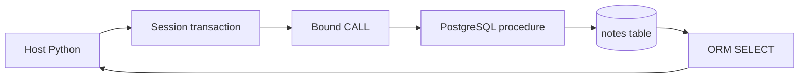

# 09. Data with SQLAlchemy 2 and a stored procedure

> **Draft: written but not yet run.** The code and the expected output in this lesson were prepared by reading the code and the official documentation. They have not been executed yet. If something does not behave as described, trust your tool's real output and report it.

## What you will be able to do
- Map a table with SQLAlchemy 2 typed ORM models and a short-lived session.
- Call a PostgreSQL procedure using bound parameters within an explicit transaction.
- Configure a disposable local database and specify rollback/constraint integration tests.

## Recap
1. Why did lesson 08 lose notes when its process stopped?
   <details><summary>Answer</summary>Its repository lived only in process memory; it had no persistent storage.</details>
2. What does a context manager own in lessons 04 and 05?
   <details><summary>Answer</summary>A visible lifetime with setup, use, waiting/cleanup and failure propagation.</details>

## Why it matters
A database does more than retain bytes: it enforces rules across concurrent callers. An ORM does not remove transaction ownership or make interpolated SQL safe. Stored procedures are one more database interface and must use the same explicit parameter and lifetime discipline.

## What you will build
A local PostgreSQL database, an actual procedure invoked by `CALL`, and a SQLAlchemy ORM read of the saved title. The schema is a disposable learning schema, not a substitute for versioned migrations. Lesson 11 uses a similarly small persistent notes model.

## Before you start
- **Prerequisites:** [Python 201 lesson 08, your first FastAPI service](08-your-first-fastapi-service.md).
- Time: 105 min, including typing, reasoning and the exercise.
- Python **3.12** installed using the setup from Python 101 lesson 01; a code editor and terminal from that track. Windows commands select it with `py -3.12`; macOS/Linux commands use `python3.12`. If necessary, Windows install-manager users can run `py install 3.12` from any folder, then reopen the terminal. Other platforms: [official Python setup](https://docs.python.org/3.12/using/index.html). Do not point the dependency snapshots at an arbitrary newer interpreter and assume compatibility.
- Source pack (optional): every new file is shown in full in this lesson, so you can follow without it. The finished code, the exercise starter and the solution are in the course repository https://github.com/Uee03/Code101 under `source/python/201-hero-to-super-hero/phase-3-apis-and-data/09-sqlalchemy-and-stored-procedures/` (on that page choose **Code, Download ZIP**, or run `git clone https://github.com/Uee03/Code101.git`).
- Extract ZIPs before using them: Windows **Extract All > Extract**; macOS double-click; Linux use your archive manager's **Extract**. A repository ZIP contains `Code101-main` followed by the source path above. Phase ZIPs contain this lesson's `code` and `exercise` folders. Work in a copy, not inside the ZIP.
- Third-party versions below are teaching snapshots, **not a claim of current security support**. Direct requirements are pinned, transitive dependencies are not locked; review supported releases and resolve a lock before deployment. All output below is unrun.

Finish lesson 08. Also complete the PostgreSQL-in-Docker setup in [Databases 101](https://github.com/Uee03/Code101/tree/main/tutorials/databases/101-zero-to-hero) and the [Docker 101](https://github.com/Uee03/Code101/tree/main/tutorials/docker/101-zero-to-hero) setup; Docker Desktop with Linux containers (Windows/macOS) or Docker Engine with Compose v2 (Linux) must be installed. Start the engine using that setup before the learner commands below. We use host port **5542**, not the earlier course's 5432, and a distinct Compose project. Stop if that port is in use rather than stopping another project. Two sittings: pause before Step 6.

An **ORM** maps objects to relational tables. An **engine** manages database connectivity/pooling; a **session** tracks one unit of ORM/database work. A **transaction** groups changes for commit or rollback. A **stored procedure** is a named database operation invoked with `CALL`, unlike a function used in a `SELECT` expression.

## Steps
### Step 1. Create the workspace
Open **Terminal > New Terminal** in VS Code. The path before `>` or `$` is the current folder. From anywhere:

**PowerShell - folder: anywhere**
```powershell
New-Item -ItemType Directory -Path "$HOME/code101/python201/lesson09" -Force | Out-Null
Set-Location "$HOME/code101/python201/lesson09"
code .
```

**macOS/Linux - folder: anywhere**
```bash
mkdir -p ~/code101/python201/lesson09
cd ~/code101/python201/lesson09
code .
```
Expected result, not yet run: the folder exists and the editor opens it. If `code` is unavailable, choose **File > Open Folder** instead. In that window open a new terminal; it must show this lesson folder. If asked, trust your own folder.

For every file below use **Explorer > New File** (create named subfolders first), enter the exact filename, paste/type its complete content and save. **Ctrl+S**, or **Cmd+S** on macOS, removes the unsaved dot on the tab. Enable filename extensions in your file manager so `.py` does not become `.py.txt`. Paths below are relative to this lesson folder. If lost, `cd ~/code101/python201/lesson09` returns here on all three platforms.

### Step 2. Install the ORM, driver and configuration libraries
**File: `~/code101/python201/lesson09/requirements.txt`**
```text
SQLAlchemy==2.0.40
psycopg[binary]==3.2.6
pydantic==2.11.3
pydantic-settings==2.8.1
```
Use the requirements file above in an isolated environment. No activation is needed, so PowerShell's Restricted script policy cannot block these commands.

**PowerShell - folder: `~/code101/python201/lesson09`**
```powershell
py -3.12 -m venv .venv
& ./.venv/Scripts/python.exe -m pip install -r requirements.txt
```

**macOS/Linux - folder: `~/code101/python201/lesson09`**
```bash
python3.12 -m venv .venv
.venv/bin/python -m pip install -r requirements.txt
```
Expected result, not yet run: `.venv` is created and the requirements install successfully. Package download lines and resolved transitive versions vary; no installer transcript is claimed. If installation fails, stop and read the first error rather than proceeding with a partially prepared environment. The Python 101 virtual-environment lesson covers a missing `venv` component. Always use this lesson's interpreter, not a global `pip`.
The `psycopg` driver carries PostgreSQL communication. Its `binary` extra is convenient for this local lab; review driver deployment choices before shipping. `postgresql+psycopg` explicitly selects the SQLAlchemy dialect and driver.

### Step 3. Create all local configuration files
**File: `~/code101/python201/lesson09/.env.example`**
```dotenv
POSTGRES_PASSWORD=replace-locally-with-a-generated-value
DB_USER=notes
DB_NAME=notes
DB_HOST=127.0.0.1
DB_PORT=5542
```
| Line | Meaning and effect of changing it |
|---|---|
| 1 | Generated database password placeholder; never a shared real credential. |
| 2 | Database login role, also used to initialize the lab database. |
| 3 | Database name. Change client and initialization settings together. |
| 4 | Host-side address: loopback for a Python program outside Docker. |
| 5 | Host-side port; changing it also requires changing the Compose port mapping. |

**File: `~/code101/python201/lesson09/.gitignore`**
```text
.env
.venv/
__pycache__/
```
The three lines ignore the private dotenv file, project environment and interpreter caches, respectively.
**File: `~/code101/python201/lesson09/configure.py`**
```python
from pathlib import Path
from secrets import token_hex


if __name__ == "__main__":
    template = Path(".env.example").read_text(encoding="utf-8")
    content = template.replace("replace-locally-with-a-generated-value", token_hex(32))
    with Path(".env").open("x", encoding="utf-8") as file:
        file.write(content)
    print("Created .env; keep it private.")
```
This is the same exclusive-creation workflow as lesson 07, with a different template. It reads no remote secrets and prints none.
**PowerShell - folder: `~/code101/python201/lesson09`**
```powershell
& ./.venv/Scripts/python.exe configure.py
```

**macOS/Linux - folder: `~/code101/python201/lesson09`**
```bash
.venv/bin/python configure.py
```
Expected output, not yet run:
```text
Created .env; keep it private.
```
The generated `.env` contains the complete five-line template with only the password placeholder replaced by a private random value. Do not share it. The two clients (Compose and Pydantic) read the same file for different purposes; Compose does not magically export every value to your host Python process.

**File: `~/code101/python201/lesson09/compose.yml`**
```yaml
services:
  db:
    image: postgres:17-alpine
    environment:
      POSTGRES_USER: ${DB_USER:-notes}
      POSTGRES_DB: ${DB_NAME:-notes}
      POSTGRES_PASSWORD: ${POSTGRES_PASSWORD:?generate .env first}
    ports:
      - "127.0.0.1:5542:5432"
    volumes:
      - pgdata:/var/lib/postgresql/data
      - ./init.sql:/docker-entrypoint-initdb.d/001-notes.sql:ro
    healthcheck:
      test: ["CMD-SHELL", "pg_isready -U $$POSTGRES_USER -d $$POSTGRES_DB"]
      interval: 2s
      timeout: 3s
      retries: 20
volumes:
  pgdata:
```
Every nonblank line, top to bottom:
| Line | Explanation |
|---|---|
| 1 | Starts the service definitions. |
| 2 | Names the database service `db`, also its internal network name. |
| 3 | Selects PostgreSQL major 17 on Alpine. The tag floats across patches; a production digest requires a deliberate update process. |
| 4 | Starts environment values passed into this container. |
| 5 | Sets the initialization/login role from dotenv, with `notes` as fallback. |
| 6 | Sets the initial database name, with the same fallback. |
| 7 | Requires a nonempty private password; Compose stops if it is absent. |
| 8 | Begins host port publishing. |
| 9 | Publishes only loopback 5542 to container 5432; changing the left port also changes the host Python connection. |
| 10 | Begins mounts. |
| 11 | Persists PostgreSQL 17 data in a named volume. |
| 12 | Mounts the SQL initialization script read-only into the official image's first-start initialization directory. |
| 13 | Begins a readiness check. |
| 14 | Runs `pg_isready`; doubled dollars defer variable expansion to the container instead of Compose. |
| 15 | Checks every two seconds. |
| 16 | Allows three seconds for one check. |
| 17 | Allows twenty failed checks before unhealthy status. |
| 18 | Declares top-level named volumes, not more service mounts. |
| 19 | Creates the project-scoped `pgdata` volume. |

No Dockerfile is needed: the official database image already supplies the server and initialization mechanism. Never use `POSTGRES_HOST_AUTH_METHOD=trust` to bypass a password problem. The image's initialization role has elevated powers: this is a local disposable lab, not a least-privilege production role design. Source for image initialization: [Docker Official PostgreSQL image](https://hub.docker.com/_/postgres).

### Step 4. Define the table and actual stored procedure
**File: `~/code101/python201/lesson09/init.sql`**
```sql
CREATE TABLE notes (
    id integer GENERATED ALWAYS AS IDENTITY PRIMARY KEY,
    title varchar(120) NOT NULL CHECK (char_length(btrim(title)) > 0)
);

CREATE PROCEDURE add_note(p_title text)
LANGUAGE SQL
AS $$
    INSERT INTO notes (title) VALUES (p_title);
$$;
```
The identity primary key is database-owned. The length/type and space-only-title check enforce basic storage rules even for non-Python callers. PostgreSQL btrim defaults to ordinary spaces, not every Unicode whitespace character; the broader API strip rule remains a separate input boundary. `CREATE PROCEDURE` declares an input parameter and SQL-language body delimited by dollar quotes. The body inserts the parameter as data. There is **no internal COMMIT**: the Python caller owns the transaction.

Initialization scripts run only when the data volume is empty. Editing this file after first startup does not migrate an existing database. To replay this disposable schema, use the destructive cleanup below and start again. For real data, use a reviewed Alembic migration instead; do not delete a production volume to apply schema changes.

### Step 5. Map the existing table and construct a safe connection
**File: `~/code101/python201/lesson09/models.py`**
```python
from sqlalchemy import String
from sqlalchemy.orm import DeclarativeBase, Mapped, mapped_column


class Base(DeclarativeBase):
    pass


class Note(Base):
    __tablename__ = "notes"

    id: Mapped[int] = mapped_column(primary_key=True)
    title: Mapped[str] = mapped_column(String(120))
```
`DeclarativeBase` creates a registry of mappings; `Mapped` and `mapped_column` are SQLAlchemy 2's typed declarations. This metadata describes a table that the initialization SQL creates. It does not automatically migrate that table. The mapped integer primary key uses the database's generated identity on insertion.

**File: `~/code101/python201/lesson09/database.py`**
```python
from pydantic import SecretStr
from pydantic_settings import BaseSettings, SettingsConfigDict
from sqlalchemy import Engine, URL, create_engine


class Settings(BaseSettings):
    model_config = SettingsConfigDict(env_file=".env", env_file_encoding="utf-8", extra="forbid")

    postgres_password: SecretStr
    db_user: str = "notes"
    db_name: str = "notes"
    db_host: str = "127.0.0.1"
    db_port: int = 5542


def make_engine() -> Engine:
    settings = Settings()
    url = URL.create(
        "postgresql+psycopg",
        username=settings.db_user,
        password=settings.postgres_password.get_secret_value(),
        host=settings.db_host,
        port=settings.db_port,
        database=settings.db_name,
    )
    return create_engine(url, pool_pre_ping=True)
```
The settings names match all five dotenv keys; `extra="forbid"` flags misspellings in this focused file. `URL.create` accepts password data separately so reserved URL characters do not require fragile manual interpolation. Only at that driver boundary do we reveal the `SecretStr`. `pool_pre_ping` checks a pooled connection before reuse; it does not retry whole failed transactions or guarantee availability. Do not log the password or enable SQL parameter logging with sensitive data.

### Step 6. Own the transaction and parameter binding
**File: `~/code101/python201/lesson09/main.py`**
```python
from sqlalchemy import select, text
from sqlalchemy.orm import Session

from database import make_engine
from models import Note


def add_note(session: Session, title: str) -> None:
    session.execute(text("CALL add_note(:title)"), {"title": title})


if __name__ == "__main__":
    engine = make_engine()
    try:
        with Session(engine) as session:
            with session.begin():
                add_note(session, "Read SQLAlchemy")
            title = session.scalar(select(Note.title).where(Note.title == "Read SQLAlchemy").limit(1))
            print(f"saved: {title == 'Read SQLAlchemy'}")
    finally:
        engine.dispose()
```
`text` wraps an explicit SQL statement. `:title` is a **bound parameter**: its value travels in a separate dictionary, not in an f-string. **SQL injection** means input is interpreted as query syntax rather than only as data. Keep identifiers (procedure/table names) fixed, not user-controlled. `session.begin()` commits on successful exit and rolls back on failure. Closing a session alone is not a request to commit. The following SELECT starts a read transaction that is closed with the session.

### Step 7. Specify integration tests
An **integration test** checks collaborating components, here Python, the driver and real PostgreSQL.
**File: `~/code101/python201/lesson09/test_database.py`**
```python
import unittest
from uuid import uuid4

from sqlalchemy import select
from sqlalchemy.exc import IntegrityError
from sqlalchemy.orm import Session

from database import make_engine
from main import add_note
from models import Note


class DatabaseTests(unittest.TestCase):
    def test_bound_quote_and_rollback(self) -> None:
        engine = make_engine()
        title = f"Ada's {uuid4().hex}"
        try:
            with Session(engine) as session:
                add_note(session, title)
                self.assertEqual(session.scalar(select(Note.title).where(Note.title == title)), title)
                session.rollback()
            with Session(engine) as session:
                self.assertIsNone(session.scalar(select(Note.id).where(Note.title == title)))
        finally:
            engine.dispose()

    def test_database_constraint(self) -> None:
        engine = make_engine()
        try:
            with Session(engine) as session:
                with self.assertRaises(IntegrityError):
                    add_note(session, " ")
                session.rollback()
        finally:
            engine.dispose()
```
The first test uses a unique, quote-containing title, observes it inside the transaction, then proves rollback removed it. A quote is ordinary data, not a reason to manually escape SQL. The second test proves the database rejects whitespace independently of the API. After a statement error, rollback resets the failed transaction before continuing. These tests are for this lab database only.

### Step 8. Predict before you run
Will a procedure call persist merely because it executed successfully? What happens if the surrounding transaction fails? Does a title containing an apostrophe require changing the SQL string?

## Run it
All Docker commands here are identical in PowerShell and macOS/Linux terminals; use the **lesson09 root**, containing `compose.yml` and `.env`.

**PowerShell or macOS/Linux - folder: `~/code101/python201/lesson09`**
```shell
docker compose -p python201-data up -d --wait
docker compose -p python201-data ps
docker compose -p python201-data logs --tail 20 db
docker compose -p python201-data exec -T db psql -U notes -d notes -Atc "SELECT current_database()"
```
Expected results, not yet run: `up --wait` finishes successfully once the database is healthy; `ps` shows one running healthy database; logs show initialization/readiness information with variable timestamps and IDs. The last command prints the deterministic database name:
```text
notes
```
If you deliberately changed DB_USER/DB_NAME, replace both `-U notes` and `-d notes` with your chosen values. A failed initialization should be diagnosed in the real logs, not hidden by repeated restarts.

**PowerShell - folder: `~/code101/python201/lesson09`**
```powershell
& ./.venv/Scripts/python.exe main.py
```

**macOS/Linux - folder: `~/code101/python201/lesson09`**
```bash
.venv/bin/python main.py
```
Expected output, not yet run:
```text
saved: True
```
The script inserts **one new note on every run**. It queries by title rather than printing a database-generated ID, so the demo output remains stable even after repeated runs. It does not erase existing notes.
**PowerShell - folder: `~/code101/python201/lesson09`**
```powershell
& ./.venv/Scripts/python.exe -m unittest -v
```

**macOS/Linux - folder: `~/code101/python201/lesson09`**
```bash
.venv/bin/python -m unittest -v
```
Expected outcome, not yet run: two PostgreSQL integration tests should pass, ending with `OK`. They roll back their own writes. They do not prove every production migration or server setting.

Optional database-editor connection settings (UI fields, not another config file): host `127.0.0.1`, port `5542`, database `notes`, user `notes`, password from your private `.env`, SSL disabled **only for this loopback learning container**. Match changed names if you edited them. Do not save an exported connection profile with the password in the repository. The psql command above is sufficient; installing an IDE is not required.

When finished, preserve data or deliberately destroy the lab:

**PowerShell or macOS/Linux - folder: `~/code101/python201/lesson09`**
```shell
docker compose -p python201-data stop
docker compose -p python201-data down -v --remove-orphans
```
Expected results, not yet run: `stop` stops the database without removing its data; `down -v` then removes this project's containers, network and named volume. The second command is **destructive to this lab's notes**. Omit `-v` if you want to preserve its volume. IDs, timing and removal text vary; no exact Docker transcript is asserted.

## How it works
The official image initializes a table and procedure in an empty data volume. A host-side engine connects using validated settings, a short-lived session executes `CALL` with a bound value, and a transaction commits. SQLAlchemy's SELECT reads mapped data through the same engine. The database, not the DTO, is the last line of defense for persisted constraints.

**Structure (Mermaid):**

> **Why this, not that?** Use SQLAlchemy ORM operations for ordinary mapped work; use explicit bound SQL for a database interface such as a stored procedure. Never concatenate caller data into SQL. A procedure is useful for a shared database-side operation, not automatically a better home for every business rule. This small insert would normally be ordinary ORM code; we use a procedure here to teach the integration boundary accurately.

Common misconception: every stored routine returns query rows. This procedure has no output parameter/result contract, so we call it and then query explicitly. PostgreSQL functions and procedures have different invocation and transaction rules.

## Try it
1. **Guided:** practice the same bound-parameter boundary on a disposable SQLite database. This exercise intentionally needs no PostgreSQL server; the main lesson's integration tests still cover the real procedure.
Without the pack, create `try09` inside this lesson folder and create the starter below there. With the pack, **instead** copy the `exercise/starter` folder itself into this lesson folder and rename the copy `try09`. Do not copy it *into* an existing `try09`: the file must be `lesson09/try09/exercise.py`, not `try09/starter/exercise.py`. Keep the original starter unchanged. Run from the lesson root with the command below. Its checks intentionally fail until the TODOs are finished.
**File: `~/code101/python201/lesson09/try09/exercise.py`**
```python
from sqlalchemy import create_engine, text

engine = create_engine("sqlite://")
with engine.begin() as connection:
    connection.execute(text("CREATE TABLE notes (title TEXT NOT NULL)"))
    title = "Ada's note"
    # TODO: insert title using text() and a separate parameter dictionary.
    saved = connection.scalar(text("SELECT title FROM notes"))
    assert saved == title
    print(saved)
engine.dispose()
```
**PowerShell - folder: `~/code101/python201/lesson09`**
```powershell
& ./.venv/Scripts/python.exe try09/exercise.py
```

**macOS/Linux - folder: `~/code101/python201/lesson09`**
```bash
.venv/bin/python try09/exercise.py
```
Expected completed output, not yet run:
```text
Ada's note
```
2. **Change:** insert a second title and read the row count using a scalar query. Keep every changing value separate from SQL text.
3. **Stretch (optional):** decide which contract tests must still run against PostgreSQL if a fast SQLite test passes. Include the procedure and production constraints in your answer.

<details><summary>Solution to the guided rung</summary>

**File: `~/code101/python201/lesson09/try09/exercise.py`**
```python
from sqlalchemy import create_engine, text

engine = create_engine("sqlite://")
with engine.begin() as connection:
    connection.execute(text("CREATE TABLE notes (title TEXT NOT NULL)"))
    title = "Ada's note"
    connection.execute(text("INSERT INTO notes (title) VALUES (:title)"), {"title": title})
    saved = connection.scalar(text("SELECT title FROM notes"))
    assert saved == title
    print(saved)
engine.dispose()
```
`engine.begin()` supplies a connection and commits successful work; the value dictionary keeps the apostrophe in the data channel.
</details>

## Check yourself
1. Does declaring a SQLAlchemy class create or migrate a table here?
   <details><summary>Answer</summary>No. It describes a mapping; the SQL initialization script creates this disposable schema.</details>
2. What is wrong with embedding a title in the CALL using an f-string?
   <details><summary>Answer</summary>It mixes data with SQL syntax and can introduce injection/quoting failures. Use `:title` plus a separate value dictionary.</details>
3. Why must the quote/rollback integration test use real PostgreSQL?
   <details><summary>Answer</summary>SQLite cannot prove PostgreSQL procedure syntax, driver behavior or PostgreSQL's actual constraint/transaction semantics.</details>

## Common mistakes
| Symptom or typical message (not captured) | Cause | Fix |
|---|---|---|
| Connection refused | Engine stopped, database unhealthy or wrong host-side port | Inspect `ps` and logs; keep 5542 on the host and 5432 inside Docker. |
| Table/procedure missing after editing init.sql | Existing volume skipped initialization | Use migrations for real data; only reset this explicitly disposable lab volume if appropriate. |
| Password authentication fails after changing dotenv | Existing database keeps its initialized password | Restore the correct private value or deliberately rotate the database role password; an env edit alone does not rotate it. |
| Transaction remains failed after a constraint error | PostgreSQL requires rollback before more statements | Roll back, then start a new unit of work. |

## Best practice
Bind data separately and keep session/transaction lifetimes explicit. Source: SQLAlchemy, [Transactions and bound parameters](https://docs.sqlalchemy.org/en/20/tutorial/dbapi_transactions.html); PostgreSQL, [CREATE PROCEDURE](https://www.postgresql.org/docs/17/sql-createprocedure.html).

## Going further
- [Alembic tutorial](https://alembic.sqlalchemy.org/en/latest/tutorial.html): versioned migrations replace disposable initialization as a schema evolves.
- [Python backend capstone data chapter](https://github.com/Uee03/Code101/blob/main/capstones/backend-python/tutorials/phase-2-data/02-data.md) implements the larger application; do not duplicate it here.

## Summary
- You mapped a table and owned a short session lifetime.
- You called a real PostgreSQL procedure with bound parameters and a caller-owned transaction.
- You described full local database configuration and rollback/constraint tests.

## Next lesson
[10. Authentication basics](10-authentication-basics.md): establish what a bearer token actually proves before using it to protect notes.
