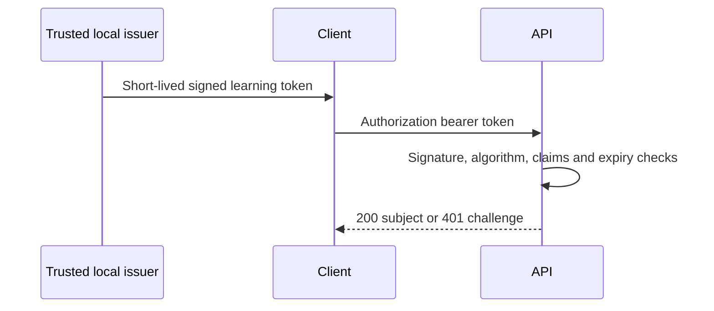

# 10. Authentication basics: hashing, bearer tokens and JWT validation

> **Draft: written but not yet run.** The code and the expected output in this lesson were prepared by reading the code and the official documentation. They have not been executed yet. If something does not behave as described, trust your tool's real output and report it.

## What you will be able to do
- Hash and verify a password with Argon2 without exposing passwords or hash output.
- Validate a JWT's signature, algorithm, expiry, issuer, audience and subject.
- Protect a route with bearer authentication and distinguish it from resource authorization.

## Recap
1. Does a redacted `SecretStr` make a plaintext dotenv file safe to commit?
   <details><summary>Answer</summary>No. Redaction reduces accidental display; it does not encrypt storage or revoke leaked credentials.</details>
2. Why should lesson 08 not accept an owner ID just because a client sends one?
   <details><summary>Answer</summary>Caller input does not establish identity or permission. Server-owned identity must come from a trusted authentication boundary.</details>

## Why it matters
Decoding readable token contents is not authenticating a caller. Password hashing, token signing and ownership checks solve different problems. Confusing them can produce code that looks secure while accepting the wrong issuer, the wrong API audience or another user's data.

## What you will build
An Argon2 demonstration and a bearer-protected `/me` route with strict JWT validation. A trusted local CLI issues a five-minute learning token. **There is no password login endpoint, registration service, refresh token or production identity provider in this lesson.** The CLI is privileged issuer tooling, not proof that someone authenticated by typing a subject.

## Before you start
- **Prerequisites:** [Python 201 lesson 09, SQLAlchemy and stored procedures](09-sqlalchemy-and-stored-procedures.md).
- Time: 100 min, including typing, reasoning and the exercise.
- Python **3.12** installed using the setup from Python 101 lesson 01; a code editor and terminal from that track. Windows commands select it with `py -3.12`; macOS/Linux commands use `python3.12`. If necessary, Windows install-manager users can run `py install 3.12` from any folder, then reopen the terminal. Other platforms: [official Python setup](https://docs.python.org/3.12/using/index.html). Do not point the dependency snapshots at an arbitrary newer interpreter and assume compatibility.
- Source pack (optional): every new file is shown in full in this lesson, so you can follow without it. The finished code, the exercise starter and the solution are in the course repository https://github.com/Uee03/Code101 under `source/python/201-hero-to-super-hero/phase-3-apis-and-data/10-authentication-basics/` (on that page choose **Code, Download ZIP**, or run `git clone https://github.com/Uee03/Code101.git`).
- Extract ZIPs before using them: Windows **Extract All > Extract**; macOS double-click; Linux use your archive manager's **Extract**. A repository ZIP contains `Code101-main` followed by the source path above. Phase ZIPs contain this lesson's `code` and `exercise` folders. Work in a copy, not inside the ZIP.
- Third-party versions below are teaching snapshots, **not a claim of current security support**. Direct requirements are pinned, transitive dependencies are not locked; review supported releases and resolve a lock before deployment. All output below is unrun.

Finish lesson 09; no database or Docker is used here. Allow two sittings; pause before Step 6. **Authentication** establishes an identity; **authorization** decides whether that identity can perform a particular operation. A **bearer token** grants access to whoever possesses it. A **JWT** (JSON Web Token) contains claims and, in our example, a verifiable signature; its payload is not encrypted.

## Steps
### Step 1. Create the workspace
Open **Terminal > New Terminal** in VS Code. The path before `>` or `$` is the current folder. From anywhere:

**PowerShell - folder: anywhere**
```powershell
New-Item -ItemType Directory -Path "$HOME/code101/python201/lesson10" -Force | Out-Null
Set-Location "$HOME/code101/python201/lesson10"
code .
```

**macOS/Linux - folder: anywhere**
```bash
mkdir -p ~/code101/python201/lesson10
cd ~/code101/python201/lesson10
code .
```
Expected result, not yet run: the folder exists and the editor opens it. If `code` is unavailable, choose **File > Open Folder** instead. In that window open a new terminal; it must show this lesson folder. If asked, trust your own folder.

For every file below use **Explorer > New File** (create named subfolders first), enter the exact filename, paste/type its complete content and save. **Ctrl+S**, or **Cmd+S** on macOS, removes the unsaved dot on the tab. Enable filename extensions in your file manager so `.py` does not become `.py.txt`. Paths below are relative to this lesson folder. If lost, `cd ~/code101/python201/lesson10` returns here on all three platforms.

### Step 2. Install maintained security APIs, not handwritten cryptography
**File: `~/code101/python201/lesson10/requirements.txt`**
```text
fastapi==0.115.12
pydantic==2.11.3
pydantic-settings==2.8.1
uvicorn==0.34.2
httpx==0.28.1
PyJWT==2.10.1
pwdlib[argon2]==0.2.1
```
Use the requirements file above in an isolated environment. No activation is needed, so PowerShell's Restricted script policy cannot block these commands.

**PowerShell - folder: `~/code101/python201/lesson10`**
```powershell
py -3.12 -m venv .venv
& ./.venv/Scripts/python.exe -m pip install -r requirements.txt
```

**macOS/Linux - folder: `~/code101/python201/lesson10`**
```bash
python3.12 -m venv .venv
.venv/bin/python -m pip install -r requirements.txt
```
Expected result, not yet run: `.venv` is created and the requirements install successfully. Package download lines and resolved transitive versions vary; no installer transcript is claimed. If installation fails, stop and read the first error rather than proceeding with a partially prepared environment. The Python 101 virtual-environment lesson covers a missing `venv` component. Always use this lesson's interpreter, not a global `pip`.
`pwdlib[argon2]` supplies password hashing, and PyJWT handles JWT encoding/validation. The `argon2` extra is deliberate; do not silently replace it with a fast general-purpose digest. The version pins are teaching snapshots and require a security/dependency review before deployment.

### Step 3. Keep hashing and token validation distinct
A **password hash** is a deliberately expensive one-way verifier; a random **salt** makes independently generated hashes differ even for the same password. A token **signature** detects changes and proves knowledge of a signing key. A **claim** is a token field: `sub` identifies a subject, `iss` an issuer, `aud` the intended API, and `exp` an expiry time.

**File: `~/code101/python201/lesson10/security.py`**
```python
from datetime import UTC, datetime, timedelta

import jwt
from jwt.exceptions import InvalidTokenError
from pwdlib import PasswordHash

ISSUER = "python201"
AUDIENCE = "notes-api"
ALGORITHM = "HS256"
password_hash = PasswordHash.recommended()


def issue_token(subject: str, secret: str, *, now: datetime | None = None) -> str:
    if not subject.strip():
        raise ValueError("subject must not be blank")
    issued = now if now is not None else datetime.now(UTC)
    return jwt.encode(
        {"sub": subject, "iss": ISSUER, "aud": AUDIENCE, "exp": issued + timedelta(minutes=5)},
        secret,
        algorithm=ALGORITHM,
    )


def validate_token(token: str, secret: str) -> str:
    claims = jwt.decode(
        token,
        secret,
        algorithms=[ALGORITHM],
        issuer=ISSUER,
        audience=AUDIENCE,
        options={"require": ["exp", "sub", "iss", "aud"]},
    )
    subject = claims["sub"]
    if not isinstance(subject, str) or not subject.strip():
        raise InvalidTokenError("subject must not be blank")
    return subject
```
`PasswordHash.recommended()` selects the library's recommended Argon2 setup for this installed version. `hash` salts automatically; `verify` compares a supplied password to a stored verifier. We never handwrite a password-hashing construction.

For tokens, HS256 uses one symmetric secret for signing and validation: anyone holding it can mint a token. The allowlist is configured by the server, not read from an untrusted header. `issuer` and `audience` restrict who issued the token and where it is intended to be used. `require` rejects absent claims, not merely expired claims that happen to be present. The explicit subject check rejects blank identities. A UTC-aware expiry avoids local-time ambiguity. The optional `now` parameter supports deterministic expired-token tests without changing a global clock.

### Step 4. Require a private key at the configuration boundary
**File: `~/code101/python201/lesson10/settings.py`**
```python
from pydantic import SecretStr, field_validator
from pydantic_settings import BaseSettings, SettingsConfigDict


class Settings(BaseSettings):
    model_config = SettingsConfigDict(env_prefix="NOTES_", env_file=".env", extra="forbid")
    jwt_secret: SecretStr

    @field_validator("jwt_secret")
    @classmethod
    def require_generated_secret(cls, value: SecretStr) -> SecretStr:
        secret = value.get_secret_value()
        if len(secret) < 32 or secret.startswith("replace-"):
            raise ValueError("generate a private JWT secret of at least 32 characters")
        return value
```
The prefix maps `jwt_secret` to `NOTES_JWT_SECRET`. The local `.env` is optional as a source but the secret itself is required. `extra="forbid"` catches unknown dotenv keys. The field validator rejects short or obvious placeholder secrets and returns the accepted `SecretStr`. Length alone cannot prove randomness; our generator supplies entropy.

**File: `~/code101/python201/lesson10/.env.example`**
```dotenv
NOTES_JWT_SECRET=replace-locally-with-a-generated-value
```
Its one line names a placeholder, not a shared signing key. Do not use any key copied from a tutorial as a real credential.
**File: `~/code101/python201/lesson10/.gitignore`**
```text
.env
.venv/
__pycache__/
```
The lines exclude the private file, virtual environment and bytecode caches, respectively.
**File: `~/code101/python201/lesson10/configure.py`**
```python
from pathlib import Path
from secrets import token_hex


if __name__ == "__main__":
    template = Path(".env.example").read_text(encoding="utf-8")
    content = template.replace("replace-locally-with-a-generated-value", token_hex(32))
    with Path(".env").open("x", encoding="utf-8") as file:
        file.write(content)
    print("Created .env; keep it private.")
```
**PowerShell - folder: `~/code101/python201/lesson10`**
```powershell
& ./.venv/Scripts/python.exe configure.py
```

**macOS/Linux - folder: `~/code101/python201/lesson10`**
```bash
.venv/bin/python configure.py
```
Expected output, not yet run:
```text
Created .env; keep it private.
```
The generated one-line dotenv file replaces only the placeholder with a random value; its full secret is intentionally never printed. Exclusive creation protects an existing key from accidental replacement. Rotating it invalidates previously signed learning tokens.

### Step 5. Validate bearer credentials before entering the route
**File: `~/code101/python201/lesson10/app.py`**
```python
from typing import Annotated

from fastapi import Depends, FastAPI, HTTPException
from fastapi.security import HTTPAuthorizationCredentials, HTTPBearer
from jwt.exceptions import InvalidTokenError

from security import validate_token
from settings import Settings


def create_app(settings: Settings | None = None) -> FastAPI:
    config = settings if settings is not None else Settings()
    app = FastAPI(title="Bearer basics")
    bearer = HTTPBearer(auto_error=False)

    def current_subject(
        credentials: Annotated[HTTPAuthorizationCredentials | None, Depends(bearer)],
    ) -> str:
        if credentials is not None:
            try:
                return validate_token(credentials.credentials, config.jwt_secret.get_secret_value())
            except InvalidTokenError:
                pass
        raise HTTPException(status_code=401, detail="invalid credentials", headers={"WWW-Authenticate": "Bearer"})

    @app.get("/me")
    def me(subject: Annotated[str, Depends(current_subject)]) -> dict[str, str]:
        return {"subject": subject}

    return app
```
`HTTPBearer(auto_error=False)` parses bearer credentials but lets our dependency control the missing/invalid response consistently. It does **not** verify the JWT itself. `validate_token` performs that check. We catch the library's expected invalid-token family and return HTTP 401 with a `WWW-Authenticate: Bearer` challenge, without exposing parser/signature details. We do not catch every application exception and pretend it is a bad credential.

The route receives a validated subject through dependency injection. It has no resource ownership decision to make; lesson 11 adds that second boundary.

### Step 6. Make the issuer's privilege explicit
**File: `~/code101/python201/lesson10/issue.py`**
```python
import argparse

from security import issue_token
from settings import Settings


if __name__ == "__main__":
    parser = argparse.ArgumentParser(description="Trusted local issuer, not a login endpoint")
    parser.add_argument("subject")
    args = parser.parse_args()
    settings = Settings()
    print(issue_token(args.subject, settings.jwt_secret.get_secret_value()))
```
`argparse` reads the requested subject from the command line. This script has the signing secret and can impersonate any subject: keep it in trusted local hands, never publish it as an unauthenticated HTTP endpoint, and do not deploy local minting as a substitute for a real identity provider. The full backend capstone integrates Keycloak and separates issuer trust from the API.

### Step 7. Specify positive and negative checks
**File: `~/code101/python201/lesson10/probe.py`**
```python
from secrets import token_hex

from fastapi.testclient import TestClient

from app import create_app
from security import issue_token, password_hash
from settings import Settings


if __name__ == "__main__":
    secret = token_hex(32)
    settings = Settings(jwt_secret=secret, _env_file=None)
    hashed = password_hash.hash("demonstration-only")
    print("password verified:", password_hash.verify("demonstration-only", hashed))
    with TestClient(create_app(settings)) as client:
        print("missing bearer:", client.get("/me").status_code)
        token = issue_token("ada", secret)
        response = client.get("/me", headers={"Authorization": f"Bearer {token}"})
        print(response.status_code, response.json())
```
The `demonstration-only` string is synthetic test data, not an account credential. The generated hash and JWT are intentionally not printed. The probe creates an ephemeral key and explicit settings, so it needs no private dotenv file or network service.

**File: `~/code101/python201/lesson10/test_security.py`**
```python
from datetime import UTC, datetime, timedelta
from secrets import token_hex
import unittest

import jwt
from fastapi.testclient import TestClient
from jwt.exceptions import InvalidTokenError

from app import create_app
from security import AUDIENCE, ISSUER, issue_token, password_hash, validate_token
from settings import Settings


class SecurityTests(unittest.TestCase):
    def test_salted_password_hashes(self) -> None:
        first = password_hash.hash("test-only")
        second = password_hash.hash("test-only")
        self.assertNotEqual(first, second)
        self.assertTrue(password_hash.verify("test-only", first))
        self.assertFalse(password_hash.verify("wrong", first))

    def test_valid_and_wrong_key(self) -> None:
        secret = token_hex(32)
        token = issue_token("ada", secret)
        self.assertEqual(validate_token(token, secret), "ada")
        with self.assertRaises(InvalidTokenError):
            validate_token(token, token_hex(32))

    def test_expired(self) -> None:
        secret = token_hex(32)
        token = issue_token("ada", secret, now=datetime(2000, 1, 1, tzinfo=UTC))
        with self.assertRaises(InvalidTokenError):
            validate_token(token, secret)

    def test_required_claims_and_trust_boundary(self) -> None:
        secret = token_hex(32)
        base = {"sub": "ada", "iss": ISSUER, "aud": AUDIENCE, "exp": datetime.now(UTC) + timedelta(minutes=5)}
        cases = [dict(base, iss="elsewhere"), dict(base, aud="another-api"), dict(base, sub=" ")]
        missing = base.copy()
        del missing["exp"]
        cases.append(missing)
        for claims in cases:
            with self.subTest(claims=claims), self.assertRaises(InvalidTokenError):
                validate_token(jwt.encode(claims, secret, algorithm="HS256"), secret)
        with self.assertRaises(InvalidTokenError):
            validate_token(jwt.encode(base, "", algorithm="none"), secret)

    def test_missing_and_malformed_bearer(self) -> None:
        settings = Settings(jwt_secret=token_hex(32), _env_file=None)
        with TestClient(create_app(settings)) as client:
            for headers in ({}, {"Authorization": "Bearer broken"}, {"Authorization": "Basic abc"}):
                response = client.get("/me", headers=headers)
                self.assertEqual(response.status_code, 401)
                self.assertEqual(response.headers["www-authenticate"], "Bearer")
```
The hash test verifies correctness and random salting, not a particular encoded hash. Non-expiry claim cases use a future expiry so they cannot pass merely because an unrelated expiry check failed. The expired case uses a fixed date in 2000. The unsigned algorithm case must fail the configured allowlist. Tests are specifications awaiting execution, not a security certification.

### Step 8. Predict before you run
Will hashing the same password twice produce the same encoded hash? Is a readable JWT payload trustworthy before validation? Which negative tests would catch accidentally removing issuer or audience validation?

## Run it
**PowerShell - folder: `~/code101/python201/lesson10`**
```powershell
& ./.venv/Scripts/python.exe probe.py
```

**macOS/Linux - folder: `~/code101/python201/lesson10`**
```bash
.venv/bin/python probe.py
```
Expected output, not yet run:
```text
password verified: True
missing bearer: 401
200 {'subject': 'ada'}
```
**PowerShell - folder: `~/code101/python201/lesson10`**
```powershell
& ./.venv/Scripts/python.exe -m unittest -v
```

**macOS/Linux - folder: `~/code101/python201/lesson10`**
```bash
.venv/bin/python -m unittest -v
```
Expected outcome, not yet run: five test methods should pass, with several claim/header subcases; timings vary, especially for password hashing.

For a manual local request, start the server in terminal A:
**PowerShell - folder: `~/code101/python201/lesson10`**
```powershell
& ./.venv/Scripts/python.exe -m uvicorn app:create_app --factory --host 127.0.0.1 --port 8010
```

**macOS/Linux - folder: `~/code101/python201/lesson10`**
```bash
.venv/bin/python -m uvicorn app:create_app --factory --host 127.0.0.1 --port 8010
```
Expected result, not yet run: a local listener on `http://127.0.0.1:8010`; exact startup logs/PIDs vary.

Open terminal B in the same lesson root and issue one learning token:
**PowerShell - folder: `~/code101/python201/lesson10`**
```powershell
& ./.venv/Scripts/python.exe issue.py ada
```

**macOS/Linux - folder: `~/code101/python201/lesson10`**
```bash
.venv/bin/python issue.py ada
```
Expected output, not yet run: one newly signed JWT string. Its content depends on a private key and the current time, so no token text is invented here. Treat it as a credential. Do not put it in a query URL, a screenshot, source control or an external token-debugging website.

Open `http://127.0.0.1:8010/docs`. First execute **GET /me** without credentials: expect HTTP 401 and the deliberate `invalid credentials` detail. Choose **Authorize**, paste the JWT itself into the HTTP bearer field (not a second `Bearer ` prefix), authorize and close the dialog. Execute GET again: expect HTTP 200 and `{"subject":"ada"}`. After five minutes, an expired token should again receive 401. Use the fixed-date test for reliable automated expiry checking rather than waiting five minutes in a test.

Stop terminal A with **Ctrl+C**; expect shutdown and the shell prompt, not a particular log transcript. Clear the authorization dialog and close terminal B if it contains a printed credential. This unencrypted HTTP example is loopback-only; a remote deployment requires HTTPS and a real identity/token lifecycle.

## How it works
Hashing protects a stored password verifier; it does not issue authorization. A trusted issuer signs a short-lived identity claim. The client presents it in `Authorization: Bearer <token>`. The API validates the token before exposing the subject to the handler. A resource handler must still constrain which records that subject may read or change.

**Structure (Mermaid):**

> **Why this, not that?** Prefer Argon2 for new password verifiers as recommended by FastAPI's security guide; bcrypt remains an established compatibility option when an existing system requires it. Do not use raw SHA-256 for passwords. For production token issuance, prefer an identity provider rather than inventing password grants, refresh policies or key rotation here. This local HS256 exercise teaches verification boundaries only.

Common misconception: JWT validation alone authorizes all database rows. It establishes a trusted subject within this toy issuer model; lesson 11 still filters every note query by owner. Token theft, revocation, key rotation and distributed identity are intentionally capstone concerns.

## Try it
1. **Guided:** reject a correctly signed token that omits its expiry claim. The safe starter raises until validation is implemented.
Without the pack, create `try10` inside this lesson folder and create the starter below there. With the pack, **instead** copy the `exercise/starter` folder itself into this lesson folder and rename the copy `try10`. Do not copy it *into* an existing `try10`: the file must be `lesson10/try10/exercise.py`, not `try10/starter/exercise.py`. Keep the original starter unchanged. Run from the lesson root with the command below. Its checks intentionally fail until the TODOs are finished.
**File: `~/code101/python201/lesson10/try10/exercise.py`**
```python
from secrets import token_hex

import jwt
from jwt.exceptions import InvalidTokenError


def validate(token: str, secret: str) -> str:
    # TODO: validate signature, HS256, issuer, audience and required claims.
    raise NotImplementedError("complete token validation")


secret = token_hex(32)
token = jwt.encode({"sub": "ada", "iss": "python201", "aud": "notes-api"}, secret, algorithm="HS256")
try:
    validate(token, secret)
except InvalidTokenError:
    print("missing expiry rejected")
else:
    raise AssertionError("accepted a token without exp")
```
**PowerShell - folder: `~/code101/python201/lesson10`**
```powershell
& ./.venv/Scripts/python.exe try10/exercise.py
```

**macOS/Linux - folder: `~/code101/python201/lesson10`**
```bash
.venv/bin/python try10/exercise.py
```
Expected completed output, not yet run:
```text
missing expiry rejected
```
2. **Change:** add independent tests for wrong audience and wrong signing key using tokens that otherwise have valid future expiry and nonblank subjects.
3. **Stretch (optional):** explain why an API verifying Keycloak's asymmetric signatures should not also possess the identity provider's private signing key.

<details><summary>Solution to the guided rung</summary>

**File: `~/code101/python201/lesson10/try10/exercise.py`**
```python
from secrets import token_hex

import jwt
from jwt.exceptions import InvalidTokenError


def validate(token: str, secret: str) -> str:
    claims = jwt.decode(
        token, secret, algorithms=["HS256"], issuer="python201", audience="notes-api",
        options={"require": ["exp", "sub", "iss", "aud"]},
    )
    return claims["sub"]


secret = token_hex(32)
token = jwt.encode({"sub": "ada", "iss": "python201", "aud": "notes-api"}, secret, algorithm="HS256")
try:
    validate(token, secret)
except InvalidTokenError:
    print("missing expiry rejected")
else:
    raise AssertionError("accepted a token without exp")
```
The required-claim list enforces presence; ordinary expiry validation alone would not reject an absent claim. The application version additionally rejects blank subjects.
</details>

## Check yourself
1. Why compare with `verify` instead of hashing the supplied password and comparing strings?
   <details><summary>Answer</summary>Salted encodings intentionally differ. The library extracts stored parameters/salt and verifies correctly.</details>
2. What is missing if code only decodes JWT JSON and reads `sub`?
   <details><summary>Answer</summary>Trust: signature, configured algorithm, required claims, expiry, issuer, audience and subject checks.</details>
3. Does a validated Ada token authorize reading Bob's notes?
   <details><summary>Answer</summary>No. Authorization must still enforce record ownership or an explicit permission policy.</details>

## Common mistakes
| Symptom or typical message (not captured) | Cause | Fix |
|---|---|---|
| Startup rejects the signing secret | Missing, short or placeholder configuration | Generate the private dotenv file once and run from its folder. |
| HTTP 401 with an apparently readable token | Wrong signature, claims, expiry or bearer syntax | Check local issuer settings; obtain a fresh correctly intended token. Do not disable validation. |
| Equal passwords have unequal hash strings | Salted password hashing is working | Call the verifier rather than comparing newly generated encodings. |
| Token works locally but another service rejects it | Issuer/audience/key trust differs | Establish the correct trust configuration; never accept arbitrary algorithms/issuers to make a token pass. |

## Best practice
Use a password-hashing library and validate tokens against server-configured trust rather than attacker-supplied headers. Source: FastAPI, [OAuth2, password hashing and JWT](https://fastapi.tiangolo.com/tutorial/security/oauth2-jwt/); PyJWT, [Usage](https://pyjwt.readthedocs.io/en/stable/usage.html).

## Going further
- [Python backend identity chapter: Keycloak](https://github.com/Uee03/Code101/blob/main/capstones/backend-python/tutorials/phase-3-identity/03-identity.md). Use that full identity architecture instead of expanding this local issuer into a production login system.
- [Pydantic validators](https://docs.pydantic.dev/2.11/concepts/validators/) for explicit configuration boundaries.

### Phase 3 mixed review
1. Which class should accept a client-supplied `owner` in a notes-create request?
   <details><summary>Answer</summary>None in this contract. The server derives owner from validated identity; the input DTO should reject that extra field.</details>
2. Does calling a procedure through an ORM remove the need for bound values?
   <details><summary>Answer</summary>No. ORM and explicit SQL both need a data/code separation and an owned transaction.</details>
3. Can an in-process 200-response test prove HTTPS, database migrations and production identity work?
   <details><summary>Answer</summary>No. Those are different integration/deployment boundaries requiring their own later checks.</details>

## Summary
- You used salted Argon2 verification without exposing real credentials.
- You validated JWT trust, required claims and expiry.
- You protected a bearer route and separated identity from ownership authorization.

## Next lesson
[11. Testing with pytest and a small notes API](../phase-4-quality/11-testing-and-notes-api.md): combine DTOs, persistent data and ownership with fixtures and parametrized tests.
